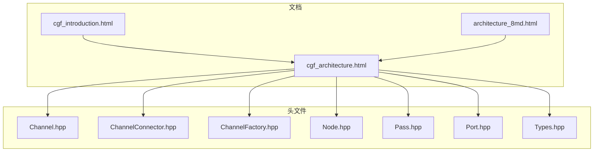
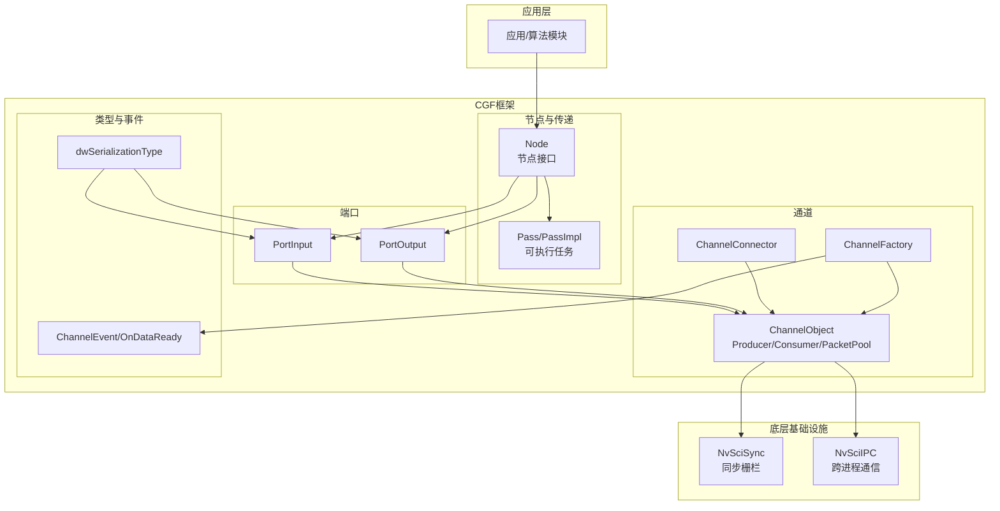
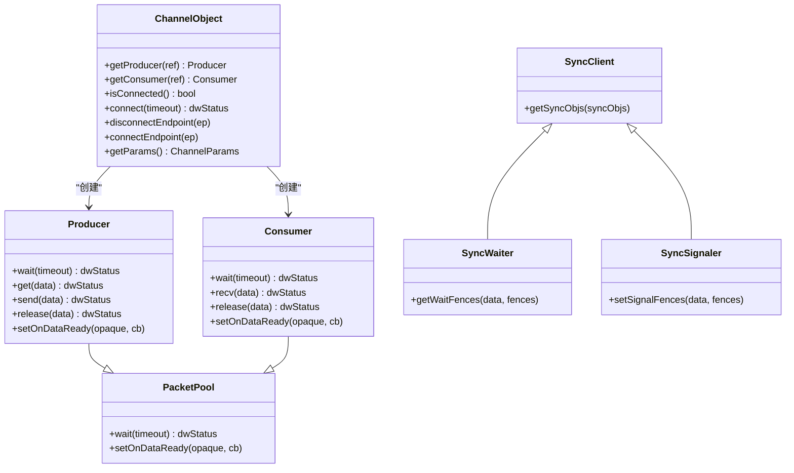
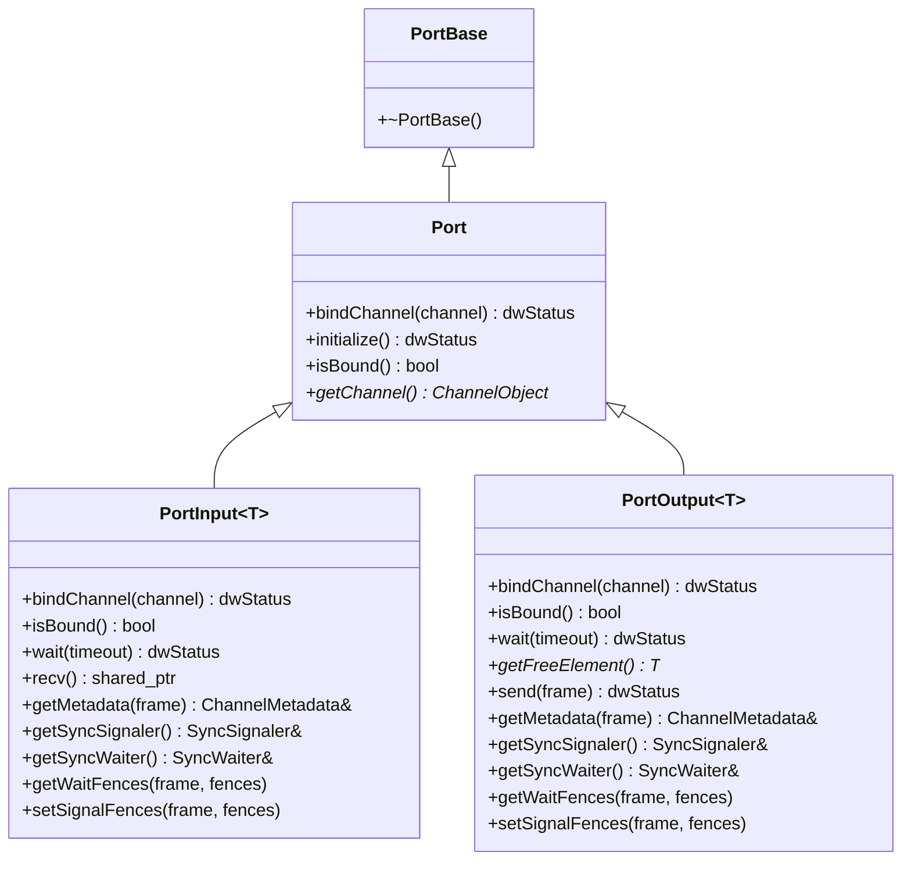
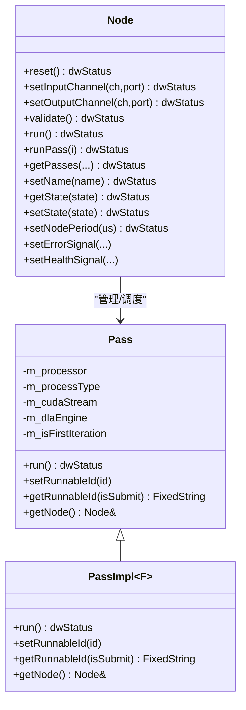
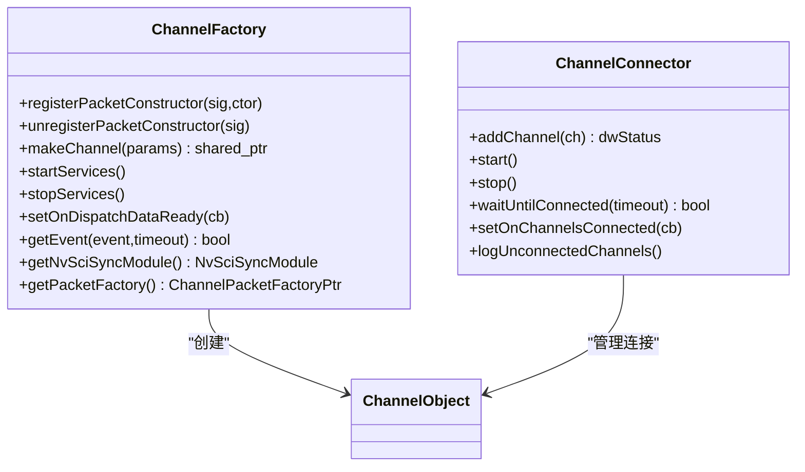
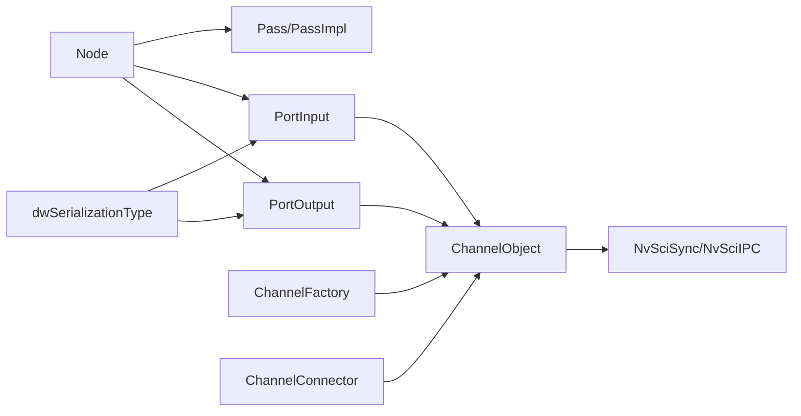

# CGF架构概述

<cite>
**本文引用的文件**
- [cgf_architecture.html](file://driverorks-5.10/doc/nvcgf_html/cgf_architecture.html)
- [cgf_introduction.html](file://driverorks-5.10/doc/nvcgf_html/cgf_introduction.html)
- [architecture_8md.html](file://driverorks-5.10/doc/nvcgf_html/architecture_8md.html)
- [Channel.hpp](file://driverorks-5.10/include/dwcgf/channel/Channel.hpp)
- [ChannelConnector.hpp](file://driverorks-5.10/include/dwcgf/channel/ChannelConnector.hpp)
- [ChannelFactory.hpp](file://driverorks-5.10/include/dwcgf/channel/ChannelFactory.hpp)
- [Node.hpp](file://driverorks-5.10/include/dwcgf/node/Node.hpp)
- [Pass.hpp](file://driverorks-5.10/include/dwcgf/pass/Pass.hpp)
- [Port.hpp](file://driverorks-5.10/include/dwcgf/port/Port.hpp)
- [Types.hpp](file://driverorks-5.10/include/dwcgf/Types.hpp)
</cite>

## 目录
1. [引言](#引言)
2. [项目结构](#项目结构)
3. [核心组件](#核心组件)
4. [架构总览](#架构总览)
5. [详细组件分析](#详细组件分析)
6. [依赖关系分析](#依赖关系分析)
7. [性能考量](#性能考量)
8. [故障排查指南](#故障排查指南)
9. [结论](#结论)
10. [附录](#附录)

## 引言
本文件面向CGF（Compute Graph Framework）的架构概述，系统化阐述其设计理念、核心架构原理与整体架构层次，并重点对比CGF与传统中间件的差异。CGF以“数据流编程范式”为核心，强调数据在处理步骤之间的流动，通过“节点-端口-通道”的分层抽象实现高效、可扩展、可复用的计算图执行。其独特之处在于：
- 通信图框架：以“通道”作为统一的数据交换抽象，支持跨进程、跨设备的零拷贝或低拷贝数据传输。
- 节点间数据传输机制：通过“端口”绑定“通道”，结合“包类型”与元数据，实现强一致的生产/消费模型与同步语义。
- 实时性保证：利用NVIDIA NvSciSync进行跨进程同步，结合等待/信号栅栏（fences）确保确定性时序与资源释放时机。

CGF的目标是将复杂应用分解为可组合的计算图，高效利用多核CPU/GPU/DLA等异构计算资源，灵活布局进程与线程，同时提供安全与可复用的构建模块。

章节来源
- [cgf_introduction.html:104-115](file://driverorks-5.10/doc/nvcgf_html/cgf_introduction.html#L104-L115)

## 项目结构
本仓库中与CGF架构直接相关的关键目录与文件如下：
- 文档与架构页面：位于driverorks-5.10/doc/nvcgf_html，包含CGF架构、执行模型、应用与配置等主题页面。
- 头文件：位于driverorks-5.10/include/dwcgf，涵盖通道、节点、端口、传递（Pass）、类型定义等核心接口。

下图给出与CGF架构相关的文件组织概览（仅展示与本文分析相关的文件）：

图表来源
- [cgf_architecture.html:104-118](file://driverorks-5.10/doc/nvcgf_html/cgf_architecture.html#L104-L118)
- [cgf_introduction.html:104-115](file://driverorks-5.10/doc/nvcgf_html/cgf_introduction.html#L104-L115)
- [architecture_8md.html:103-104](file://driverorks-5.10/doc/nvcgf_html/architecture_8md.html#L103-L104)

章节来源
- [cgf_architecture.html:104-118](file://driverorks-5.10/doc/nvcgf_html/cgf_architecture.html#L104-L118)
- [cgf_introduction.html:104-115](file://driverorks-5.10/doc/nvcgf_html/cgf_introduction.html#L104-L115)
- [architecture_8md.html:103-104](file://driverorks-5.10/doc/nvcgf_html/architecture_8md.html#L103-L104)

## 核心组件
本节从代码层面梳理CGF的核心构件及其职责与交互关系。

- 通道（Channel）
  - 统一的数据交换抽象，封装生产者/消费者、连接状态、同步对象（NvSciSync fences）与事件回调。
  - 提供Producer/Consumer接口用于获取/发送数据包，以及PacketPool用于等待数据可用与设置回调。
  - 支持连接/断开端点、参数查询与连接状态检查。

- 端口（Port）
  - 将节点的输入/输出抽象为模板化的PortInput/PortOutput，内部持有对ChannelObject的Producer/Consumer引用。
  - 提供bindChannel、wait、recv/send、元数据访问与同步栅栏设置/获取等能力，屏蔽通道细节。

- 节点（Node）
  - 节点是可运行的处理单元，负责绑定输入/输出通道、验证端口完整性、执行Pass集合。
  - 提供健康与错误信号上报、状态切换、周期设置、迭代计数等生命周期管理能力。

- 传递（Pass）
  - Pass是可运行的任务单元，描述在特定处理器（CPU/GPU/DLA）上的执行逻辑与调度属性。
  - 通过模板化实现PassImpl，封装函数调用与异常保护，支持CUDA流与DLA句柄。

- 工厂与连接器（ChannelFactory/ChannelConnector）
  - ChannelFactory负责注册/注销包构造器、创建通道、启动/停止后台服务、派发事件。
  - ChannelConnector负责批量通道的连接与等待，提供统一的连接完成回调。

- 类型系统（Types）
  - 定义序列化类型枚举，覆盖感知、定位、行为规划、控制等多个领域数据类型，支撑通道包的类型安全。

章节来源
- [Channel.hpp:56-274](file://driverorks-5.10/include/dwcgf/channel/Channel.hpp#L56-L274)
- [Port.hpp:65-534](file://driverorks-5.10/include/dwcgf/port/Port.hpp#L65-L534)
- [Node.hpp:64-275](file://driverorks-5.10/include/dwcgf/node/Node.hpp#L64-L275)
- [Pass.hpp:48-217](file://driverorks-5.10/include/dwcgf/pass/Pass.hpp#L48-L217)
- [ChannelFactory.hpp:69-154](file://driverorks-5.10/include/dwcgf/channel/ChannelFactory.hpp#L69-L154)
- [ChannelConnector.hpp:47-73](file://driverorks-5.10/include/dwcgf/channel/ChannelConnector.hpp#L47-L73)
- [Types.hpp:41-206](file://driverorks-5.10/include/dwcgf/Types.hpp#L41-L206)

## 架构总览
CGF采用自底向上的分层架构：
- 底层通道系统：抽象跨进程/跨设备的数据传输与同步，提供统一的包模型与事件机制。
- 中间端口层：将通道能力封装为易用的输入/输出端口，屏蔽通道细节，提供类型安全的数据收发。
- 上层节点与传递：以节点为处理单元，以传递为可调度任务，形成可组合的计算图。
- 工具与工厂：通过工厂与连接器统一管理通道生命周期与事件派发，保障连接一致性与性能。

图表来源
- [Node.hpp:64-275](file://driverorks-5.10/include/dwcgf/node/Node.hpp#L64-L275)
- [Pass.hpp:48-217](file://driverorks-5.10/include/dwcgf/pass/Pass.hpp#L48-L217)
- [Port.hpp:65-534](file://driverorks-5.10/include/dwcgf/port/Port.hpp#L65-L534)
- [Channel.hpp:56-274](file://driverorks-5.10/include/dwcgf/channel/Channel.hpp#L56-L274)
- [ChannelConnector.hpp:47-73](file://driverorks-5.10/include/dwcgf/channel/ChannelConnector.hpp#L47-L73)
- [ChannelFactory.hpp:69-154](file://driverorks-5.10/include/dwcgf/channel/ChannelFactory.hpp#L69-L154)
- [Types.hpp:41-206](file://driverorks-5.10/include/dwcgf/Types.hpp#L41-L206)

## 详细组件分析

### 通道系统（ChannelObject/Producer/Consumer）
- 设计要点
  - 生产者/消费者分离，统一通过PacketPool抽象等待与回调；Producer负责获取/发送，Consumer负责接收/释放。
  - 同步语义：通过NvSciSync对象与栅栏（fences）实现跨进程/跨线程的等待与信号，确保确定性时序。
  - 连接模型：支持连接/断开端点、连接状态查询与超时控制，适配不同拓扑与部署场景。

图表来源
- [Channel.hpp:56-274](file://driverorks-5.10/include/dwcgf/channel/Channel.hpp#L56-L274)

章节来源
- [Channel.hpp:56-274](file://driverorks-5.10/include/dwcgf/channel/Channel.hpp#L56-L274)

### 端口系统（PortInput/PortOutput）
- 设计要点
  - 模板化端口：PortInput<T>/PortOutput<T>分别封装消费者/生产者的典型使用模式，自动解析同步属性与包类型。
  - 自动元数据填充：发送时填充序列号、迭代计数等字段；接收时支持缓冲与重用策略，降低分配开销。
  - 同步集成：通过SyncPortHelper对接通道的等待/信号栅栏，实现与上游/下游的确定性协作。

图表来源
- [Port.hpp:65-534](file://driverorks-5.10/include/dwcgf/port/Port.hpp#L65-L534)

章节来源
- [Port.hpp:65-534](file://driverorks-5.10/include/dwcgf/port/Port.hpp#L65-L534)

### 节点与传递（Node/Pass）
- 设计要点
  - 节点：负责端口绑定、验证、运行与健康/错误信号上报；支持周期设置、状态切换与迭代计数。
  - 传递：以模板化实现封装具体执行逻辑，支持CPU/GPU/DLA三种处理器类型，可选CUDA流或DLA句柄。

图表来源
- [Node.hpp:64-275](file://driverorks-5.10/include/dwcgf/node/Node.hpp#L64-L275)
- [Pass.hpp:48-217](file://driverorks-5.10/include/dwcgf/pass/Pass.hpp#L48-L217)

章节来源
- [Node.hpp:64-275](file://driverorks-5.10/include/dwcgf/node/Node.hpp#L64-L275)
- [Pass.hpp:48-217](file://driverorks-5.10/include/dwcgf/pass/Pass.hpp#L48-L217)

### 工厂与连接器（ChannelFactory/ChannelConnector）
- 设计要点
  - ChannelFactory：注册/注销包构造器、创建通道、启动/停止后台服务、派发事件（连接/断开/错误/就绪）。
  - ChannelConnector：批量管理通道连接，阻塞等待直至全部连接完成，提供统一回调。

图表来源
- [ChannelFactory.hpp:69-154](file://driverorks-5.10/include/dwcgf/channel/ChannelFactory.hpp#L69-L154)
- [ChannelConnector.hpp:47-73](file://driverorks-5.10/include/dwcgf/channel/ChannelConnector.hpp#L47-L73)

章节来源
- [ChannelFactory.hpp:69-154](file://driverorks-5.10/include/dwcgf/channel/ChannelFactory.hpp#L69-L154)
- [ChannelConnector.hpp:47-73](file://driverorks-5.10/include/dwcgf/channel/ChannelConnector.hpp#L47-L73)

### 数据类型系统（dwSerializationType）
- 设计要点
  - 定义广泛的数据类型枚举，覆盖图像、点云、感知目标、定位结果、行为规划、控制指令等，确保通道包的类型安全与跨模块互操作。

章节来源
- [Types.hpp:41-206](file://driverorks-5.10/include/dwcgf/Types.hpp#L41-L206)

## 依赖关系分析
- 耦合与内聚
  - 节点与传递：高内聚的执行单元，通过接口解耦具体算法与调度策略。
  - 端口与通道：端口对通道进行封装，降低上层对底层同步与内存管理的关注度。
  - 工厂与连接器：集中管理通道生命周期与事件，避免分散的连接逻辑。

- 外部依赖
  - NvSciSync/NvSciIPC：提供跨进程同步与通信能力，是CGF实时性与确定性的关键。
  - CUDA/驱动库：GPU/DLA执行需要相应运行时支持。

- 可能的循环依赖
  - 通过前置声明与模板化减少编译期循环依赖；运行时通过指针/智能指针传递避免头文件环依赖。

图表来源
- [Port.hpp:65-534](file://driverorks-5.10/include/dwcgf/port/Port.hpp#L65-L534)
- [Node.hpp:64-275](file://driverorks-5.10/include/dwcgf/node/Node.hpp#L64-L275)
- [Channel.hpp:56-274](file://driverorks-5.10/include/dwcgf/channel/Channel.hpp#L56-L274)
- [ChannelFactory.hpp:69-154](file://driverorks-5.10/include/dwcgf/channel/ChannelFactory.hpp#L69-L154)
- [ChannelConnector.hpp:47-73](file://driverorks-5.10/include/dwcgf/channel/ChannelConnector.hpp#L47-L73)
- [Types.hpp:41-206](file://driverorks-5.10/include/dwcgf/Types.hpp#L41-L206)

## 性能考量
- 零拷贝/低拷贝数据传输
  - 通过通道包与NvSciIPC实现跨进程共享内存传输，减少不必要的数据复制。
- 同步与栅栏
  - 使用NvSciSync栅栏确保生产者/消费者之间的确定性时序，避免忙等与上下文切换开销。
- 端口缓冲与重用
  - 接收端支持包缓冲与重用，降低频繁分配/释放带来的延迟抖动。
- 并行执行
  - Pass支持CPU/GPU/DLA多处理器类型，结合CUDA流与DLA句柄提升吞吐量。
- 事件驱动
  - 通过OnDataReady回调与ChannelEvent机制，减少轮询成本，提高响应效率。

## 故障排查指南
- 连接问题
  - 使用ChannelConnector.waitUntilConnected进行阻塞等待，结合logUnconnectedChannels定位未连接通道。
  - 通过ChannelFactory.getEvent捕获连接/断开/错误事件，结合日志定位异常。
- 同步问题
  - 确认Producer/Consumer端均正确设置等待/信号栅栏；检查getSyncObjs与setSignalFences/getWaitFences调用顺序。
- 端口绑定问题
  - 确保PortInput/PortOutput在绑定前已解析同步属性与包类型；避免重复绑定。
- 健康与错误信号
  - 节点实现需在适当位置调用reportCurrentHealthSignal/reportCurrentErrorSignal，以便上层监控与恢复。

章节来源
- [ChannelConnector.hpp:47-73](file://driverorks-5.10/include/dwcgf/channel/ChannelConnector.hpp#L47-L73)
- [ChannelFactory.hpp:69-154](file://driverorks-5.10/include/dwcgf/channel/ChannelFactory.hpp#L69-L154)
- [Node.hpp:180-212](file://driverorks-5.10/include/dwcgf/node/Node.hpp#L180-L212)

## 结论
CGF以“数据流编程范式”为核心，通过“通道-端口-节点-传递”的分层设计，实现了高效、可扩展且具备实时性的计算图执行框架。其独特优势体现在：
- 统一的跨进程数据交换与同步抽象，确保确定性与低延迟；
- 端口层的类型安全与自动元数据管理，简化开发复杂度；
- 工厂与连接器的集中化生命周期管理，提升可靠性与可维护性。

这些特性使CGF在自动驾驶系统中具有显著价值：能够将感知、定位、行为规划与控制等模块以计算图形式组合，实现跨硬件平台的高效协同与确定性时序保障。

## 附录
- 文档与架构页面提供了CGF的高层视角与主题索引，建议配合本文件逐层理解实现细节。
- 类型系统覆盖广泛的应用领域数据类型，便于跨模块互操作与类型安全。

章节来源
- [cgf_architecture.html:104-118](file://driverorks-5.10/doc/nvcgf_html/cgf_architecture.html#L104-L118)
- [cgf_introduction.html:104-115](file://driverorks-5.10/doc/nvcgf_html/cgf_introduction.html#L104-L115)
- [architecture_8md.html:103-104](file://driverorks-5.10/doc/nvcgf_html/architecture_8md.html#L103-L104)