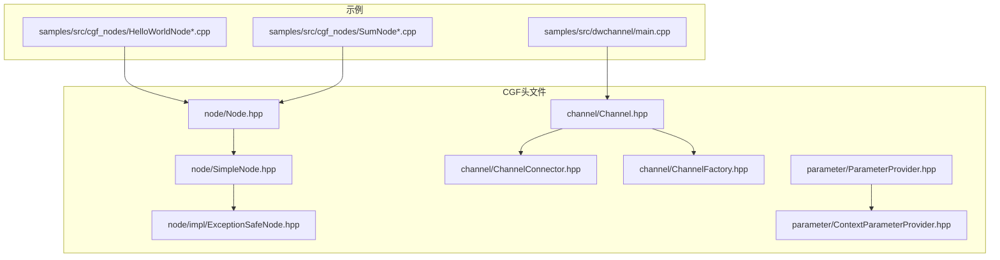
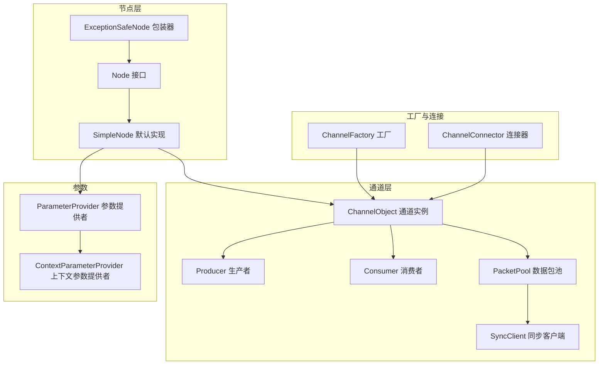
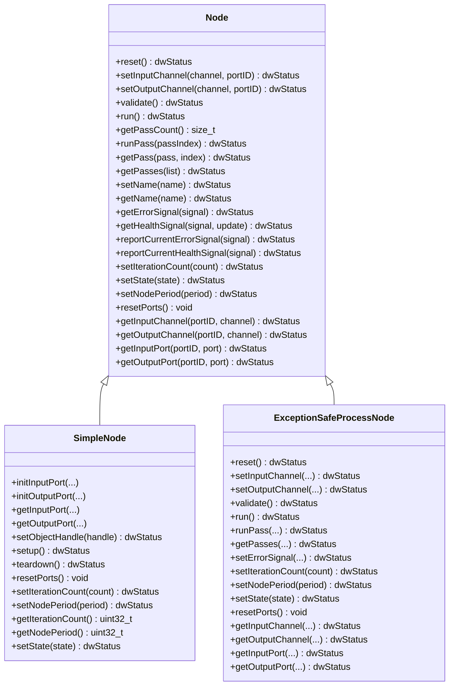
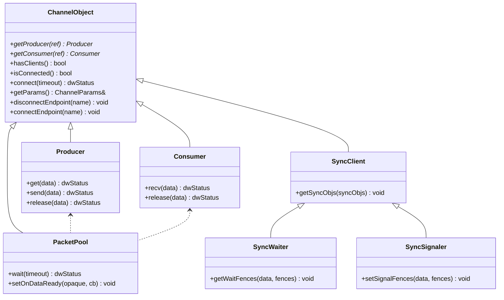
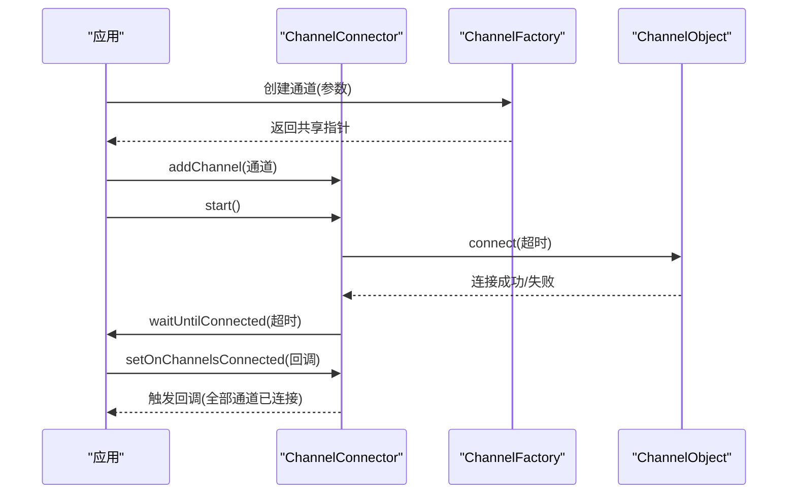
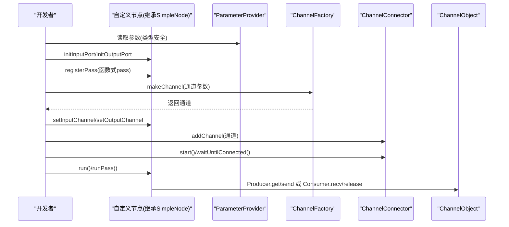
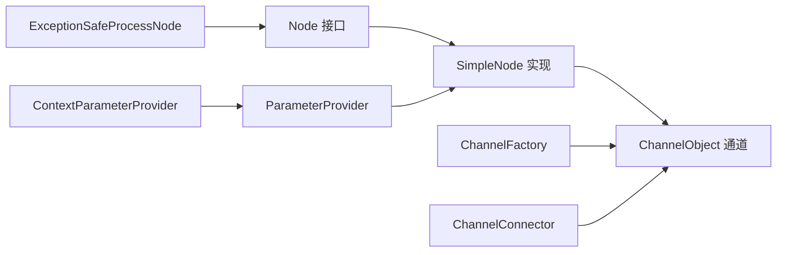

# CGF通信中间件

<cite>
**本文引用的文件**
- [Node.hpp](file://driverorks-5.10/include/dwcgf/node/Node.hpp)
- [SimpleNode.hpp](file://driverorks-5.10/include/dwcgf/node/SimpleNode.hpp)
- [ExceptionSafeNode.hpp](file://driverorks-5.10/include/dwcgf/node/impl/ExceptionSafeNode.hpp)
- [Channel.hpp](file://driverorks-5.10/include/dwcgf/channel/Channel.hpp)
- [ChannelConnector.hpp](file://driverorks-5.10/include/dwcgf/channel/ChannelConnector.hpp)
- [ChannelFactory.hpp](file://driverorks-5.10/include/dwcgf/channel/ChannelFactory.hpp)
- [ParameterProvider.hpp](file://driverorks-5.10/include/dwcgf/parameter/ParameterProvider.hpp)
- [ContextParameterProvider.hpp](file://driverorks-5.10/include/dwcgf/parameter/ContextParameterProvider.hpp)
- [HelloWorldNode.cpp](file://driverorks-5.10/samples/src/cgf_nodes/HelloWorldNode.cpp)
- [HelloWorldNodeImpl.cpp](file://driverorks-5.10/samples/src/cgf_nodes/HelloWorldNodeImpl.cpp)
- [SumNode.cpp](file://driverorks-5.10/samples/src/cgf_nodes/SumNode.cpp)
- [SumNodeImpl.cpp](file://driverorks-5.10/samples/src/cgf_nodes/SumNodeImpl.cpp)
- [main.cpp](file://driverorks-5.10/samples/src/dwchannel/main.cpp)
</cite>

## 目录
1. [引言](#引言)
2. [项目结构](#项目结构)
3. [核心组件](#核心组件)
4. [架构总览](#架构总览)
5. [详细组件分析](#详细组件分析)
6. [依赖关系分析](#依赖关系分析)
7. [性能考虑](#性能考虑)
8. [故障排查指南](#故障排查指南)
9. [结论](#结论)
10. [附录](#附录)

## 引言
本文件面向CGF（Compute Graph Framework）通信中间件，系统化阐述其设计理念、架构原理与核心组件。重点覆盖节点系统（Node基类、SimpleNode、ExceptionSafeNode）、通道系统（ChannelObject及其生产者/消费者模型、数据包池管理、同步原语）、参数系统（ParameterProvider及相关上下文提供者），以及通道连接器的自动连接机制。文档同时给出流程图、时序图与类图，帮助读者从高层到代码级理解CGF的数据通路与执行模型，并提供最佳实践与排错建议。

## 项目结构
CGF位于驱动库子树中，核心头文件集中在driverorks-5.10/include/dwcgf下，按功能域划分为node、channel、parameter、pass、port等目录；samples目录提供节点与通道使用的示例程序。

**图表来源**
- [Node.hpp:64-275](file://driverorks-5.10/include/dwcgf/node/Node.hpp#L64-L275)
- [SimpleNode.hpp:74-611](file://driverorks-5.10/include/dwcgf/node/SimpleNode.hpp#L74-L611)
- [ExceptionSafeNode.hpp:40-101](file://driverorks-5.10/include/dwcgf/node/impl/ExceptionSafeNode.hpp#L40-L101)
- [Channel.hpp:56-274](file://driverorks-5.10/include/dwcgf/channel/Channel.hpp#L56-L274)
- [ChannelConnector.hpp:47-73](file://driverorks-5.10/include/dwcgf/channel/ChannelConnector.hpp#L47-L73)
- [ChannelFactory.hpp:69-154](file://driverorks-5.10/include/dwcgf/channel/ChannelFactory.hpp#L69-L154)

**章节来源**
- [Node.hpp:64-275](file://driverorks-5.10/include/dwcgf/node/Node.hpp#L64-L275)
- [SimpleNode.hpp:74-611](file://driverorks-5.10/include/dwcgf/node/SimpleNode.hpp#L74-L611)
- [Channel.hpp:56-274](file://driverorks-5.10/include/dwcgf/channel/Channel.hpp#L56-L274)
- [ChannelConnector.hpp:47-73](file://driverorks-5.10/include/dwcgf/channel/ChannelConnector.hpp#L47-L73)
- [ChannelFactory.hpp:69-154](file://driverorks-5.10/include/dwcgf/channel/ChannelFactory.hpp#L69-L154)

## 核心组件
- 节点系统：Node定义统一接口，SimpleNode提供默认实现与端口/通道绑定、运行期信号管理，ExceptionSafeNode包装节点以提供异常安全封装。
- 通道系统：ChannelObject抽象通道实例，Producer/Consumer实现生产消费模型，PacketPool统一等待/回调机制，支持NvSci同步对象。
- 参数系统：ParameterProvider提供类型安全的参数访问，ContextParameterProvider扩展上下文感知能力。
- 连接器：ChannelConnector负责批量通道的启动、等待连接、回调通知与未连接诊断。

**章节来源**
- [Node.hpp:64-275](file://driverorks-5.10/include/dwcgf/node/Node.hpp#L64-L275)
- [SimpleNode.hpp:74-611](file://driverorks-5.10/include/dwcgf/node/SimpleNode.hpp#L74-L611)
- [ExceptionSafeNode.hpp:40-101](file://driverorks-5.10/include/dwcgf/node/impl/ExceptionSafeNode.hpp#L40-L101)
- [Channel.hpp:56-274](file://driverorks-5.10/include/dwcgf/channel/Channel.hpp#L56-L274)
- [ChannelConnector.hpp:47-73](file://driverorks-5.10/include/dwcgf/channel/ChannelConnector.hpp#L47-L73)
- [ChannelFactory.hpp:69-154](file://driverorks-5.10/include/dwcgf/channel/ChannelFactory.hpp#L69-L154)
- [ParameterProvider.hpp](file://driverorks-5.10/include/dwcgf/parameter/ParameterProvider.hpp)
- [ContextParameterProvider.hpp](file://driverorks-5.10/include/dwcgf/parameter/ContextParameterProvider.hpp)

## 架构总览
CGF采用“节点-通道”解耦架构：节点通过端口与通道交互，通道负责跨进程/跨设备的数据传输与同步。工厂与连接器负责通道生命周期管理，参数提供者为节点配置提供类型安全的参数访问。

**图表来源**
- [Node.hpp:64-275](file://driverorks-5.10/include/dwcgf/node/Node.hpp#L64-L275)
- [SimpleNode.hpp:74-611](file://driverorks-5.10/include/dwcgf/node/SimpleNode.hpp#L74-L611)
- [ExceptionSafeNode.hpp:40-101](file://driverorks-5.10/include/dwcgf/node/impl/ExceptionSafeNode.hpp#L40-L101)
- [Channel.hpp:56-274](file://driverorks-5.10/include/dwcgf/channel/Channel.hpp#L56-L274)
- [ChannelFactory.hpp:69-154](file://driverorks-5.10/include/dwcgf/channel/ChannelFactory.hpp#L69-L154)
- [ChannelConnector.hpp:47-73](file://driverorks-5.10/include/dwcgf/channel/ChannelConnector.hpp#L47-L73)
- [ParameterProvider.hpp](file://driverorks-5.10/include/dwcgf/parameter/ParameterProvider.hpp)
- [ContextParameterProvider.hpp](file://driverorks-5.10/include/dwcgf/parameter/ContextParameterProvider.hpp)

## 详细组件分析

### 节点系统：Node、SimpleNode、ExceptionSafeNode
- Node接口定义了通道绑定、端口查询、运行期信号、状态与周期设置、迭代计数等统一契约，确保不同节点实现的一致性与可组合性。
- SimpleNode提供默认实现：内置端口注册与访问、通道绑定校验、默认setup/teardown pass、健康与错误信号聚合、模块句柄设置等，显著降低节点开发成本。
- ExceptionSafeNode分别提供普通节点与传感器节点的异常安全包装，将外部调用过程中的异常隔离在包装器内，避免影响框架其他部分。

**图表来源**
- [Node.hpp:64-275](file://driverorks-5.10/include/dwcgf/node/Node.hpp#L64-L275)
- [SimpleNode.hpp:74-611](file://driverorks-5.10/include/dwcgf/node/SimpleNode.hpp#L74-L611)
- [ExceptionSafeNode.hpp:40-101](file://driverorks-5.10/include/dwcgf/node/impl/ExceptionSafeNode.hpp#L40-L101)

**章节来源**
- [Node.hpp:64-275](file://driverorks-5.10/include/dwcgf/node/Node.hpp#L64-L275)
- [SimpleNode.hpp:74-611](file://driverorks-5.10/include/dwcgf/node/SimpleNode.hpp#L74-L611)
- [ExceptionSafeNode.hpp:40-101](file://driverorks-5.10/include/dwcgf/node/impl/ExceptionSafeNode.hpp#L40-L101)

### 通道系统：ChannelObject、生产者/消费者、数据包池与同步原语
- ChannelObject是通道实例的顶层接口，定义Producer/Consumer/PacketPool/SyncClient/SyncWaiter/SyncSignaler等子接口，统一生产消费、等待回调、同步对象获取与信号设置。
- PacketPool提供wait/回调注册等通用能力；Producer/Consumer分别负责获取/发送与接收/释放数据包，遵循严格的序列化调用约定。
- 同步原语通过NvSciSync对象与fence实现跨端同步，SyncClient派生出SyncWaiter/SyncSignaler以分别获取等待fence与设置信号fence。

**图表来源**
- [Channel.hpp:56-274](file://driverorks-5.10/include/dwcgf/channel/Channel.hpp#L56-L274)

**章节来源**
- [Channel.hpp:56-274](file://driverorks-5.10/include/dwcgf/channel/Channel.hpp#L56-L274)

### 通道连接器：自动连接与事件分发
- ChannelConnector负责批量通道的添加、启动、停止、阻塞等待连接完成、设置“全部通道已连接”回调，以及未连接通道诊断。
- ChannelFactory提供通道构造、包构造器注册/注销、后台服务启停、事件轮询等能力，支撑通道生命周期与事件驱动。

**图表来源**
- [ChannelConnector.hpp:47-73](file://driverorks-5.10/include/dwcgf/channel/ChannelConnector.hpp#L47-L73)
- [ChannelFactory.hpp:69-154](file://driverorks-5.10/include/dwcgf/channel/ChannelFactory.hpp#L69-L154)
- [Channel.hpp:56-274](file://driverorks-5.10/include/dwcgf/channel/Channel.hpp#L56-L274)

**章节来源**
- [ChannelConnector.hpp:47-73](file://driverorks-5.10/include/dwcgf/channel/ChannelConnector.hpp#L47-L73)
- [ChannelFactory.hpp:69-154](file://driverorks-5.10/include/dwcgf/channel/ChannelFactory.hpp#L69-L154)

### 参数系统：ParameterProvider与上下文参数提供者
- ParameterProvider提供类型安全的参数访问接口，支持从配置源读取并进行基本校验。
- ContextParameterProvider扩展上下文感知能力，允许节点在运行时根据上下文动态解析参数。
- 建议结合Schema对参数进行约束，确保参数一致性与可维护性。

**章节来源**
- [ParameterProvider.hpp](file://driverorks-5.10/include/dwcgf/parameter/ParameterProvider.hpp)
- [ContextParameterProvider.hpp](file://driverorks-5.10/include/dwcgf/parameter/ContextParameterProvider.hpp)

### 示例与最佳实践
- HelloWorldNode/SumNode展示了如何继承SimpleNode，使用端口初始化宏、注册pass、绑定通道与运行。
- dwchannel示例演示了通道工厂、连接器与通道的基本用法。

**图表来源**
- [HelloWorldNode.cpp](file://driverorks-5.10/samples/src/cgf_nodes/HelloWorldNode.cpp)
- [HelloWorldNodeImpl.cpp](file://driverorks-5.10/samples/src/cgf_nodes/HelloWorldNodeImpl.cpp)
- [SumNode.cpp](file://driverorks-5.10/samples/src/cgf_nodes/SumNode.cpp)
- [SumNodeImpl.cpp](file://driverorks-5.10/samples/src/cgf_nodes/SumNodeImpl.cpp)
- [main.cpp](file://driverorks-5.10/samples/src/dwchannel/main.cpp)
- [SimpleNode.hpp:74-611](file://driverorks-5.10/include/dwcgf/node/SimpleNode.hpp#L74-L611)
- [ChannelFactory.hpp:69-154](file://driverorks-5.10/include/dwcgf/channel/ChannelFactory.hpp#L69-L154)
- [ChannelConnector.hpp:47-73](file://driverorks-5.10/include/dwcgf/channel/ChannelConnector.hpp#L47-L73)

**章节来源**
- [HelloWorldNode.cpp](file://driverorks-5.10/samples/src/cgf_nodes/HelloWorldNode.cpp)
- [HelloWorldNodeImpl.cpp](file://driverorks-5.10/samples/src/cgf_nodes/HelloWorldNodeImpl.cpp)
- [SumNode.cpp](file://driverorks-5.10/samples/src/cgf_nodes/SumNode.cpp)
- [SumNodeImpl.cpp](file://driverorks-5.10/samples/src/cgf_nodes/SumNodeImpl.cpp)
- [main.cpp](file://driverorks-5.10/samples/src/dwchannel/main.cpp)

## 依赖关系分析
- 节点依赖通道：节点通过setInputChannel/setOutputChannel与通道绑定，依赖通道的Producer/Consumer接口进行数据交换。
- 通道依赖工厂与连接器：通道由工厂创建，连接器负责批量连接与事件通知。
- 参数提供者被节点使用：节点在构造或setup阶段读取参数，保证配置正确性。
- 异常安全包装器依赖具体节点实现：ExceptionSafeNode持有Node指针，在调用前保护，避免异常传播。

**图表来源**
- [Node.hpp:64-275](file://driverorks-5.10/include/dwcgf/node/Node.hpp#L64-L275)
- [SimpleNode.hpp:74-611](file://driverorks-5.10/include/dwcgf/node/SimpleNode.hpp#L74-L611)
- [Channel.hpp:56-274](file://driverorks-5.10/include/dwcgf/channel/Channel.hpp#L56-L274)
- [ChannelFactory.hpp:69-154](file://driverorks-5.10/include/dwcgf/channel/ChannelFactory.hpp#L69-L154)
- [ChannelConnector.hpp:47-73](file://driverorks-5.10/include/dwcgf/channel/ChannelConnector.hpp#L47-L73)
- [ParameterProvider.hpp](file://driverorks-5.10/include/dwcgf/parameter/ParameterProvider.hpp)
- [ContextParameterProvider.hpp](file://driverorks-5.10/include/dwcgf/parameter/ContextParameterProvider.hpp)
- [ExceptionSafeNode.hpp:40-101](file://driverorks-5.10/include/dwcgf/node/impl/ExceptionSafeNode.hpp#L40-L101)

**章节来源**
- [Node.hpp:64-275](file://driverorks-5.10/include/dwcgf/node/Node.hpp#L64-L275)
- [SimpleNode.hpp:74-611](file://driverorks-5.10/include/dwcgf/node/SimpleNode.hpp#L74-L611)
- [Channel.hpp:56-274](file://driverorks-5.10/include/dwcgf/channel/Channel.hpp#L56-L274)
- [ChannelFactory.hpp:69-154](file://driverorks-5.10/include/dwcgf/channel/ChannelFactory.hpp#L69-L154)
- [ChannelConnector.hpp:47-73](file://driverorks-5.10/include/dwcgf/channel/ChannelConnector.hpp#L47-L73)
- [ParameterProvider.hpp](file://driverorks-5.10/include/dwcgf/parameter/ParameterProvider.hpp)
- [ContextParameterProvider.hpp](file://driverorks-5.10/include/dwcgf/parameter/ContextParameterProvider.hpp)
- [ExceptionSafeNode.hpp:40-101](file://driverorks-5.10/include/dwcgf/node/impl/ExceptionSafeNode.hpp#L40-L101)

## 性能考虑
- 通道池与数据包复用：通过PacketPool减少频繁分配/释放带来的开销，合理设置缓冲区大小与超时时间。
- 异步处理与同步原语：利用NvSciSync fence实现跨端无拷贝同步，避免忙等；在GPU/DLA等异步处理器上优先使用异步pass。
- 端口与pass数量控制：限制输入输出端口与pass数量，避免过度绑定导致调度与内存压力。
- 参数访问缓存：对不频繁变化的参数进行缓存，减少重复解析与校验。

## 故障排查指南
- 通道未连接：使用ChannelConnector的等待与回调机制定位未连接通道；必要时调用logUnconnectedChannels进行诊断。
- 数据不可用/超时：检查Producer/Consumer调用顺序（先wait再recv/get），确认缓冲区是否满或空；适当增大超时或优化生产/消费节奏。
- 同步问题：核对SyncWaiter/SyncSignaler的fence传递是否匹配，确保通道两端的同步对象一致。
- 参数错误：通过ParameterProvider/ContextParameterProvider的类型安全接口核对参数键名与类型，结合Schema进行静态校验。

**章节来源**
- [ChannelConnector.hpp:47-73](file://driverorks-5.10/include/dwcgf/channel/ChannelConnector.hpp#L47-L73)
- [Channel.hpp:56-274](file://driverorks-5.10/include/dwcgf/channel/Channel.hpp#L56-L274)
- [ParameterProvider.hpp](file://driverorks-5.10/include/dwcgf/parameter/ParameterProvider.hpp)
- [ContextParameterProvider.hpp](file://driverorks-5.10/include/dwcgf/parameter/ContextParameterProvider.hpp)

## 结论
CGF通过清晰的节点-通道边界与工厂/连接器基础设施，提供了高内聚、低耦合的通信中间件方案。节点系统简化了开发复杂度，通道系统保障了跨端数据与同步的可靠性，参数系统提升了配置的类型安全性。配合自动连接与事件驱动机制，CGF能够高效支撑复杂的计算图执行与数据流编排。

## 附录
- 示例参考：HelloWorldNode、SumNode与dwchannel示例展示了端口初始化、通道绑定、连接器使用与基本运行流程。
- 最佳实践：优先使用SimpleNode默认实现，合理划分pass与端口，严格遵循Producer/Consumer调用序列，善用异常安全包装器，结合Schema与参数缓存提升稳定性与性能。

**章节来源**
- [HelloWorldNode.cpp](file://driverorks-5.10/samples/src/cgf_nodes/HelloWorldNode.cpp)
- [HelloWorldNodeImpl.cpp](file://driverorks-5.10/samples/src/cgf_nodes/HelloWorldNodeImpl.cpp)
- [SumNode.cpp](file://driverorks-5.10/samples/src/cgf_nodes/SumNode.cpp)
- [SumNodeImpl.cpp](file://driverorks-5.10/samples/src/cgf_nodes/SumNodeImpl.cpp)
- [main.cpp](file://driverorks-5.10/samples/src/dwchannel/main.cpp)