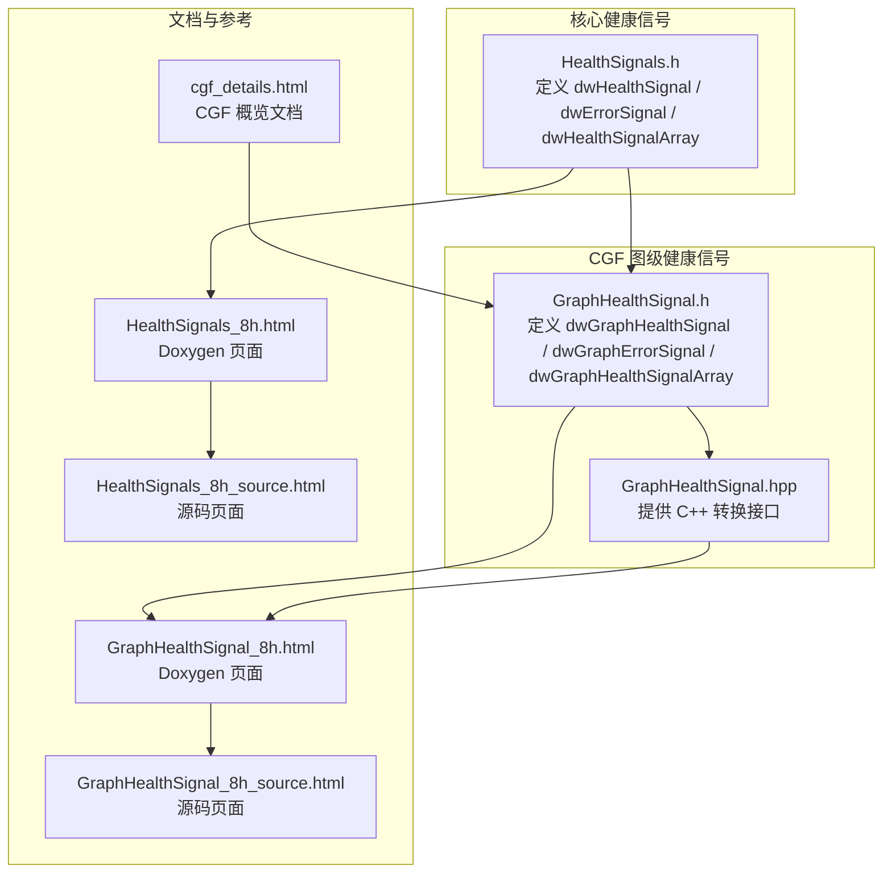
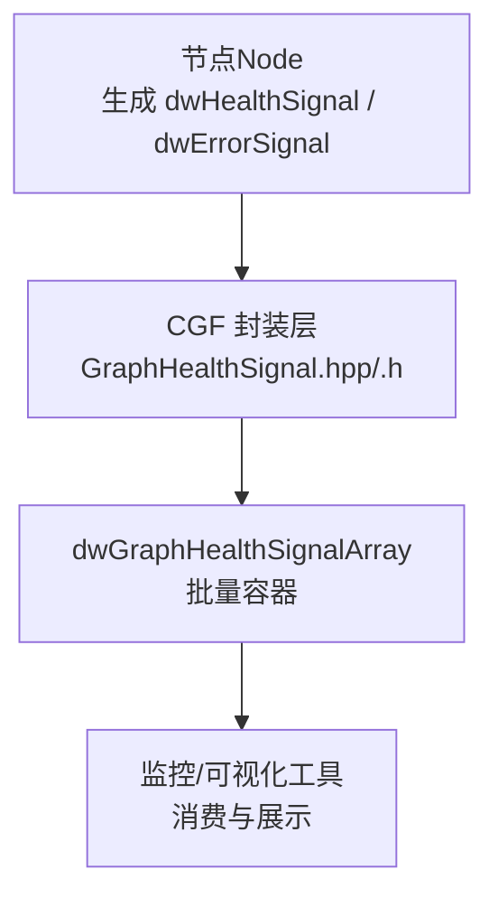
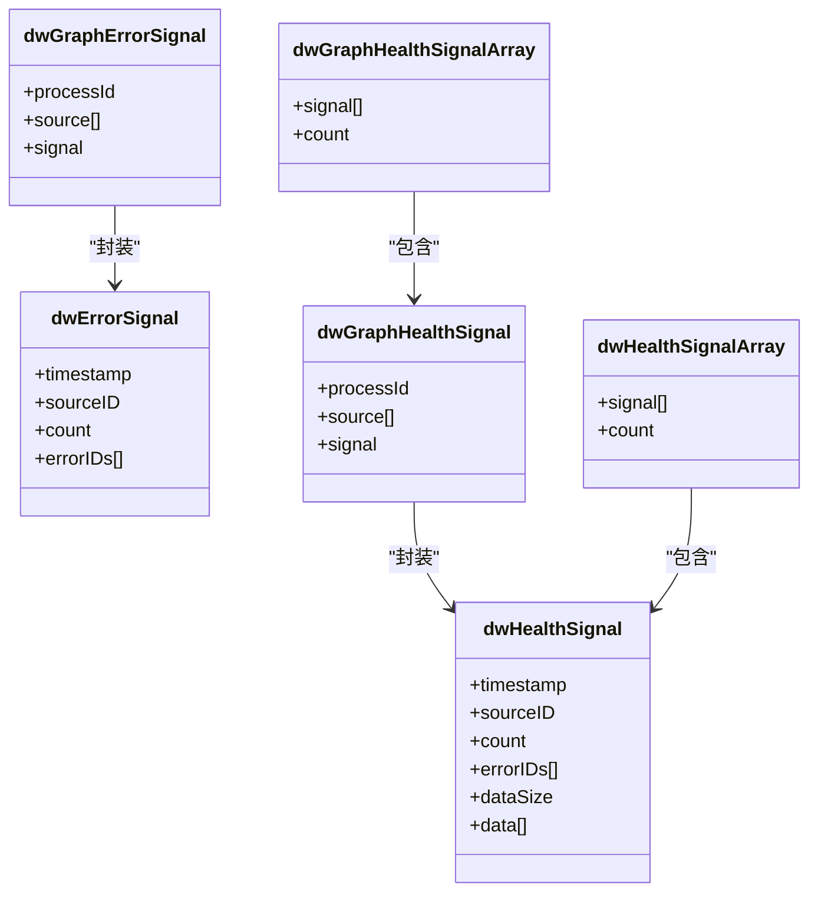
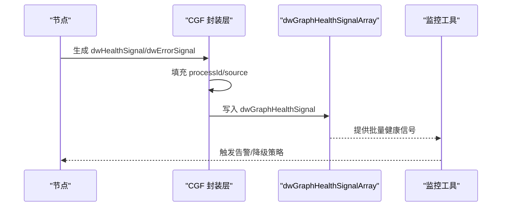
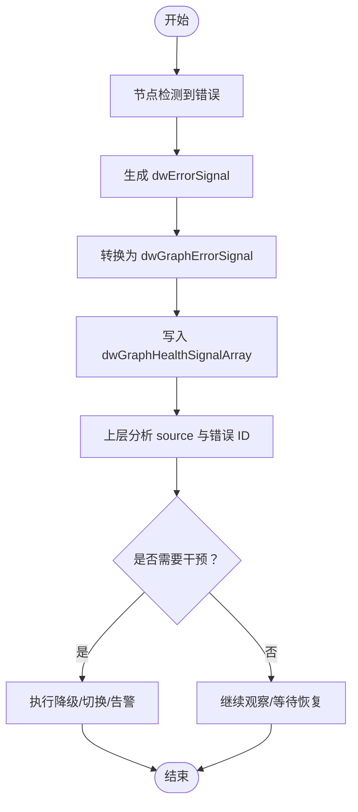

# 健康监测系统

<cite>
**本文引用的文件**
- [GraphHealthSignal.h](file://driverorks-5.10/include/dwcgf/computegraph/GraphHealthSignal.h)
- [GraphHealthSignal.hpp](file://driverorks-5.10/include/dwcgf/computegraph/GraphHealthSignal.hpp)
- [HealthSignals.h](file://driverorks-5.10/include/dw/core/health/HealthSignals.h)
- [GraphHealthSignal_8h.html](file://driverorks-5.10/doc/nvcgf_html/GraphHealthSignal_8h.html)
- [GraphHealthSignal_8h_source.html](file://driverorks-5.10/doc/nvcgf_html/GraphHealthSignal_8h_source.html)
- [HealthSignals_8h.html](file://driverorks-5.10/doc/nvsdk_dw_html/HealthSignals_8h.html)
- [HealthSignals_8h_source.html](file://driverorks-5.10/doc/nvsdk_dw_html/HealthSignals_8h_source.html)
- [cgf_details.html](file://driverorks-5.10/doc/nvcgf_html/cgf_details.html)
</cite>

## 目录
1. [引言](#引言)
2. [项目结构](#项目结构)
3. [核心组件](#核心组件)
4. [架构总览](#架构总览)
5. [详细组件分析](#详细组件分析)
6. [依赖关系分析](#依赖关系分析)
7. [性能考虑](#性能考虑)
8. [故障排查指南](#故障排查指南)
9. [结论](#结论)
10. [附录](#附录)

## 引言
本技术文档围绕 CGF（Compute Graph Framework）健康监测系统展开，重点阐释健康信号的概念及其在 CGF 中的关键作用，系统性解析 GraphHealthSignal 与 GraphErrorSignal 的结构设计与使用方法，说明节点健康状态的报告机制、错误信号的采集与处理流程，并讨论健康监测在实时系统中的意义及对系统稳定性的影响。文档还提供健康监测系统的配置与使用示例思路、自定义健康信号的定义与处理建议，以及在故障诊断与系统维护中的应用方法。

## 项目结构
本仓库中与健康监测相关的核心代码位于以下路径：
- 核心类型定义：driverorks-5.10/include/dw/core/health/HealthSignals.h
- CGF 图级健康信号封装：driverorks-5.10/include/dwcgf/computegraph/GraphHealthSignal.h / .hpp
- 文档与示例：driverorks-5.10/doc/nvcgf_html 与 driverorks-5.10/doc/nvsdk_dw_html

下图展示了与健康监测直接相关的文件组织与职责划分：

**图表来源**
- [GraphHealthSignal.h:1-88](file://driverorks-5.10/include/dwcgf/computegraph/GraphHealthSignal.h#L1-L88)
- [GraphHealthSignal.hpp:1-54](file://driverorks-5.10/include/dwcgf/computegraph/GraphHealthSignal.hpp#L1-L54)
- [HealthSignals.h:1-124](file://driverorks-5.10/include/dw/core/health/HealthSignals.h#L1-L124)
- [GraphHealthSignal_8h.html](file://driverorks-5.10/doc/nvcgf_html/GraphHealthSignal_8h.html)
- [HealthSignals_8h.html](file://driverorks-5.10/doc/nvsdk_dw_html/HealthSignals_8h.html)
- [GraphHealthSignal_8h_source.html](file://driverorks-5.10/doc/nvcgf_html/GraphHealthSignal_8h_source.html)
- [HealthSignals_8h_source.html](file://driverorks-5.10/doc/nvsdk_dw_html/HealthSignals_8h_source.html)
- [cgf_details.html](file://driverorks-5.10/doc/nvcgf_html/cgf_details.html)

**章节来源**
- [GraphHealthSignal.h:1-88](file://driverorks-5.10/include/dwcgf/computegraph/GraphHealthSignal.h#L1-L88)
- [GraphHealthSignal.hpp:1-54](file://driverorks-5.10/include/dwcgf/computegraph/GraphHealthSignal.hpp#L1-L54)
- [HealthSignals.h:1-124](file://driverorks-5.10/include/dw/core/health/HealthSignals.h#L1-L124)
- [GraphHealthSignal_8h.html](file://driverorks-5.10/doc/nvcgf_html/GraphHealthSignal_8h.html)
- [HealthSignals_8h.html](file://driverorks-5.10/doc/nvsdk_dw_html/HealthSignals_8h.html)
- [GraphHealthSignal_8h_source.html](file://driverorks-5.10/doc/nvcgf_html/GraphHealthSignal_8h_source.html)
- [HealthSignals_8h_source.html](file://driverorks-5.10/doc/nvsdk_dw_html/HealthSignals_8h_source.html)
- [cgf_details.html](file://driverorks-5.10/doc/nvcgf_html/cgf_details.html)

## 核心组件
本节聚焦于健康监测系统的核心数据结构与转换接口，帮助读者快速理解“健康信号”在 CGF 中的表达方式与使用边界。

- dwHealthSignal：描述单个软件模块的健康状态，包含时间戳、模块 ID、错误计数、错误 ID 数组以及可选字节数组扩展字段，用于承载额外诊断信息。
- dwErrorSignal：仅在出现错误时上报，包含时间戳、模块 ID、错误计数与错误 ID 数组。
- dwHealthSignalArray：固定容量的数组容器，最大容纳数量由常量定义，便于批量传输与聚合。
- dwGraphHealthSignal / dwGraphErrorSignal：在 CGF 层对上述核心信号进行封装，增加进程 ID 与 source 字段（格式为 processName.NodeName.PassName），用于标识信号来源。
- dwGraphHealthSignalArray：CGF 层的数组容器，用于批量管理图级健康信号。

这些结构共同构成健康监测的数据模型，支撑从节点到图级的健康状态上报与聚合。

**章节来源**
- [HealthSignals.h:66-117](file://driverorks-5.10/include/dw/core/health/HealthSignals.h#L66-L117)
- [GraphHealthSignal.h:44-81](file://driverorks-5.10/include/dwcgf/computegraph/GraphHealthSignal.h#L44-L81)
- [GraphHealthSignal.hpp:39-51](file://driverorks-5.10/include/dwcgf/computegraph/GraphHealthSignal.hpp#L39-L51)

## 架构总览
下图展示了健康监测在 CGF 中的总体架构：节点产生 dwHealthSignal/dwErrorSignal，经由 CGF 封装为 dwGraphHealthSignal/dwGraphErrorSignal 并写入 dwGraphHealthSignalArray，最终由上层监控或可视化工具消费。

**图表来源**
- [HealthSignals.h:66-117](file://driverorks-5.10/include/dw/core/health/HealthSignals.h#L66-L117)
- [GraphHealthSignal.h:44-81](file://driverorks-5.10/include/dwcgf/computegraph/GraphHealthSignal.h#L44-L81)
- [GraphHealthSignal.hpp:39-51](file://driverorks-5.10/include/dwcgf/computegraph/GraphHealthSignal.hpp#L39-L51)

## 详细组件分析

### GraphHealthSignal 与 GraphErrorSignal 结构设计
- 字段语义
  - 进程 ID：标识信号所属进程，便于跨进程定位。
  - source：字符串标识，格式为 processName.NodeName.PassName，用于精确定位来源。
  - dwHealthSignal/dwErrorSignal：继承核心健康信号的结构，包含时间戳、模块 ID、错误集合等。
- 设计要点
  - 通过 source 字段统一来源格式，简化上层聚合与定位。
  - 保留核心信号的可扩展字节数组，支持携带诊断数据。
  - 固定数组容量上限，确保批量传输的可控性与性能。

**图表来源**
- [HealthSignals.h:66-117](file://driverorks-5.10/include/dw/core/health/HealthSignals.h#L66-L117)
- [GraphHealthSignal.h:44-81](file://driverorks-5.10/include/dwcgf/computegraph/GraphHealthSignal.h#L44-L81)

**章节来源**
- [GraphHealthSignal.h:44-81](file://driverorks-5.10/include/dwcgf/computegraph/GraphHealthSignal.h#L44-L81)
- [HealthSignals.h:66-117](file://driverorks-5.10/include/dw/core/health/HealthSignals.h#L66-L117)

### 节点健康状态报告机制
- 上报时机
  - 正常运行：周期性上报 dwHealthSignal，包含当前健康状态与可选诊断数据。
  - 异常发生：上报 dwErrorSignal，随后可继续上报 dwHealthSignal 以反映恢复过程。
- 来源标识
  - 使用 source 字段统一格式，便于上层按节点/通道维度聚合与告警。
- 批量聚合
  - 使用 dwGraphHealthSignalArray 或 dwHealthSignalArray 承载多信号，降低通信开销。

**图表来源**
- [GraphHealthSignal.hpp:39-51](file://driverorks-5.10/include/dwcgf/computegraph/GraphHealthSignal.hpp#L39-L51)
- [GraphHealthSignal.h:44-81](file://driverorks-5.10/include/dwcgf/computegraph/GraphHealthSignal.h#L44-L81)
- [HealthSignals.h:66-117](file://driverorks-5.10/include/dw/core/health/HealthSignals.h#L66-L117)

**章节来源**
- [GraphHealthSignal.hpp:39-51](file://driverorks-5.10/include/dwcgf/computegraph/GraphHealthSignal.hpp#L39-L51)
- [GraphHealthSignal.h:44-81](file://driverorks-5.10/include/dwcgf/computegraph/GraphHealthSignal.h#L44-L81)
- [HealthSignals.h:66-117](file://driverorks-5.10/include/dw/core/health/HealthSignals.h#L66-L117)

### 错误信号的采集与处理流程
- 采集
  - 节点在检测到异常时生成 dwErrorSignal，并填充时间戳、模块 ID 与错误 ID 列表。
- 转换
  - 通过 GraphHealthSignal.hpp 中的转换函数将底层错误信号转换为图级 dwGraphErrorSignal。
- 处理
  - 上层根据 source 定位问题节点，结合错误 ID 与可选 data 字段进行根因分析。
  - 可触发自动降级、切换到备用路径或进入安全模式。

**图表来源**
- [GraphHealthSignal.hpp:39-51](file://driverorks-5.10/include/dwcgf/computegraph/GraphHealthSignal.hpp#L39-L51)
- [HealthSignals.h:66-117](file://driverorks-5.10/include/dw/core/health/HealthSignals.h#L66-L117)
- [GraphHealthSignal.h:44-81](file://driverorks-5.10/include/dwcgf/computegraph/GraphHealthSignal.h#L44-L81)

**章节来源**
- [GraphHealthSignal.hpp:39-51](file://driverorks-5.10/include/dwcgf/computegraph/GraphHealthSignal.hpp#L39-L51)
- [HealthSignals.h:66-117](file://driverorks-5.10/include/dw/core/health/HealthSignals.h#L66-L117)
- [GraphHealthSignal.h:44-81](file://driverorks-5.10/include/dwcgf/computegraph/GraphHealthSignal.h#L44-L81)

### 自定义健康信号的定义与处理
- 定义步骤
  - 在节点内部生成 dwHealthSignal，必要时填充 data 字段承载诊断数据。
  - 使用 GraphHealthSignal.hpp 的转换接口生成 dwGraphHealthSignal。
  - 将信号写入 dwGraphHealthSignalArray，供上层消费。
- 处理建议
  - 为每个关键节点定义稳定的 source 格式，便于跨模块聚合。
  - 对 data 字段约定二进制/文本协议，确保解析一致性。
  - 设置合理的上报频率与阈值，避免噪声干扰。

**章节来源**
- [GraphHealthSignal.hpp:39-51](file://driverorks-5.10/include/dwcgf/computegraph/GraphHealthSignal.hpp#L39-L51)
- [GraphHealthSignal.h:44-81](file://driverorks-5.10/include/dwcgf/computegraph/GraphHealthSignal.h#L44-L81)
- [HealthSignals.h:66-117](file://driverorks-5.10/include/dw/core/health/HealthSignals.h#L66-L117)

## 依赖关系分析
- 组件耦合
  - GraphHealthSignal 依赖 HealthSignals.h 中的核心健康信号类型。
  - GraphHealthSignal.hpp 作为 C++ 包装层，提供类型转换接口，降低上层使用复杂度。
- 关键常量
  - DW_MAX_HEALTH_SIGNAL_ARRAY_SIZE：限制数组容量，平衡内存占用与吞吐。
- 外部集成
  - source 字段格式统一，便于与 CGF 其他模块（如通道、图级调度）协同工作。

**图表来源**
- [HealthSignals.h:105-117](file://driverorks-5.10/include/dw/core/health/HealthSignals.h#L105-L117)
- [GraphHealthSignal.h:44-81](file://driverorks-5.10/include/dwcgf/computegraph/GraphHealthSignal.h#L44-L81)
- [GraphHealthSignal.hpp:39-51](file://driverorks-5.10/include/dwcgf/computegraph/GraphHealthSignal.hpp#L39-L51)

**章节来源**
- [HealthSignals.h:105-117](file://driverorks-5.10/include/dw/core/health/HealthSignals.h#L105-L117)
- [GraphHealthSignal.h:44-81](file://driverorks-5.10/include/dwcgf/computegraph/GraphHealthSignal.h#L44-L81)
- [GraphHealthSignal.hpp:39-51](file://driverorks-5.10/include/dwcgf/computegraph/GraphHealthSignal.hpp#L39-L51)

## 性能考虑
- 批量传输
  - 使用 dwGraphHealthSignalArray/dwHealthSignalArray 减少消息数量，提升吞吐。
- 数据大小控制
  - 合理使用 data 字段，避免超出 DW_MAX_HEALTH_BYTEARRAY_SIZE 导致截断。
- 上报频率
  - 针对不同节点设置差异化上报周期，兼顾可观测性与性能。
- 数组容量
  - DW_MAX_HEALTH_SIGNAL_ARRAY_SIZE 限制了单次传输上限，需在节点数量与信号密度之间权衡。

**章节来源**
- [HealthSignals.h:81-117](file://driverorks-5.10/include/dw/core/health/HealthSignals.h#L81-L117)
- [GraphHealthSignal.h:74-81](file://driverorks-5.10/include/dwcgf/computegraph/GraphHealthSignal.h#L74-L81)

## 故障排查指南
- 常见问题
  - source 格式不一致：导致定位困难。应统一遵循 processName.NodeName.PassName。
  - data 字段未约定协议：解析失败或误读。应制定明确的二进制/文本协议。
  - 错误 ID 缺失：无法准确定位根因。应为每类错误分配稳定 ID。
- 排查步骤
  - 从 source 定位节点，核对错误 ID 与 data 内容。
  - 检查 dwGraphHealthSignalArray 的 count 是否与预期一致。
  - 对比历史健康趋势，识别异常拐点。
- 工具与文档
  - 参考 Doxygen 页面以获取类型定义与使用说明。

**章节来源**
- [GraphHealthSignal_8h.html](file://driverorks-5.10/doc/nvcgf_html/GraphHealthSignal_8h.html)
- [HealthSignals_8h.html](file://driverorks-5.10/doc/nvsdk_dw_html/HealthSignals_8h.html)
- [GraphHealthSignal_8h_source.html](file://driverorks-5.10/doc/nvcgf_html/GraphHealthSignal_8h_source.html)
- [HealthSignals_8h_source.html](file://driverorks-5.10/doc/nvsdk_dw_html/HealthSignals_8h_source.html)

## 结论
CGF 健康监测系统通过 dwHealthSignal/dwErrorSignal 与 dwGraphHealthSignal/dwGraphErrorSignal 的分层设计，实现了从节点到图级的健康状态统一建模与高效传输。配合 dwGraphHealthSignalArray 的批量能力与标准化的 source 格式，系统能够在实时场景中提供高可用的可观测性与可诊断性，显著提升整体稳定性与可维护性。建议在实际工程中严格遵循 source 约定、数据协议与上报策略，持续优化健康信号的粒度与频率，以获得最佳的运维效果。

## 附录
- 相关文档入口
  - CGF 概览与详情：[cgf_details.html](file://driverorks-5.10/doc/nvcgf_html/cgf_details.html)
  - GraphHealthSignal 类型定义与源码：[GraphHealthSignal_8h.html](file://driverorks-5.10/doc/nvcgf_html/GraphHealthSignal_8h.html)、[GraphHealthSignal_8h_source.html](file://driverorks-5.10/doc/nvcgf_html/GraphHealthSignal_8h_source.html)
  - HealthSignals 类型定义与源码：[HealthSignals_8h.html](file://driverorks-5.10/doc/nvsdk_dw_html/HealthSignals_8h.html)、[HealthSignals_8h_source.html](file://driverorks-5.10/doc/nvsdk_dw_html/HealthSignals_8h_source.html)