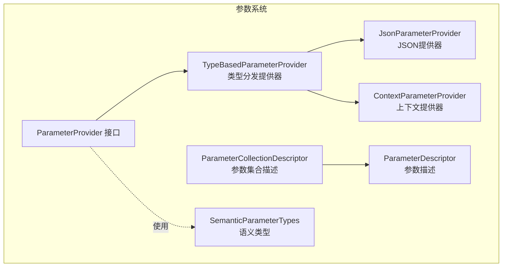
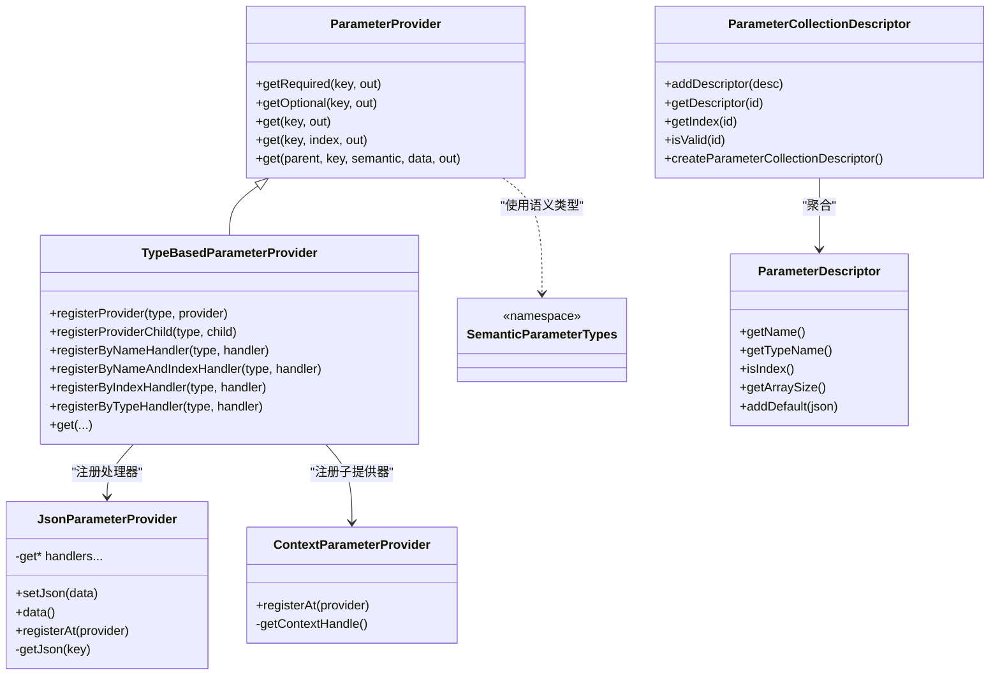
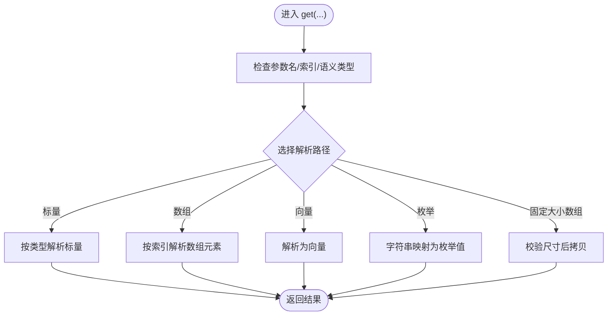
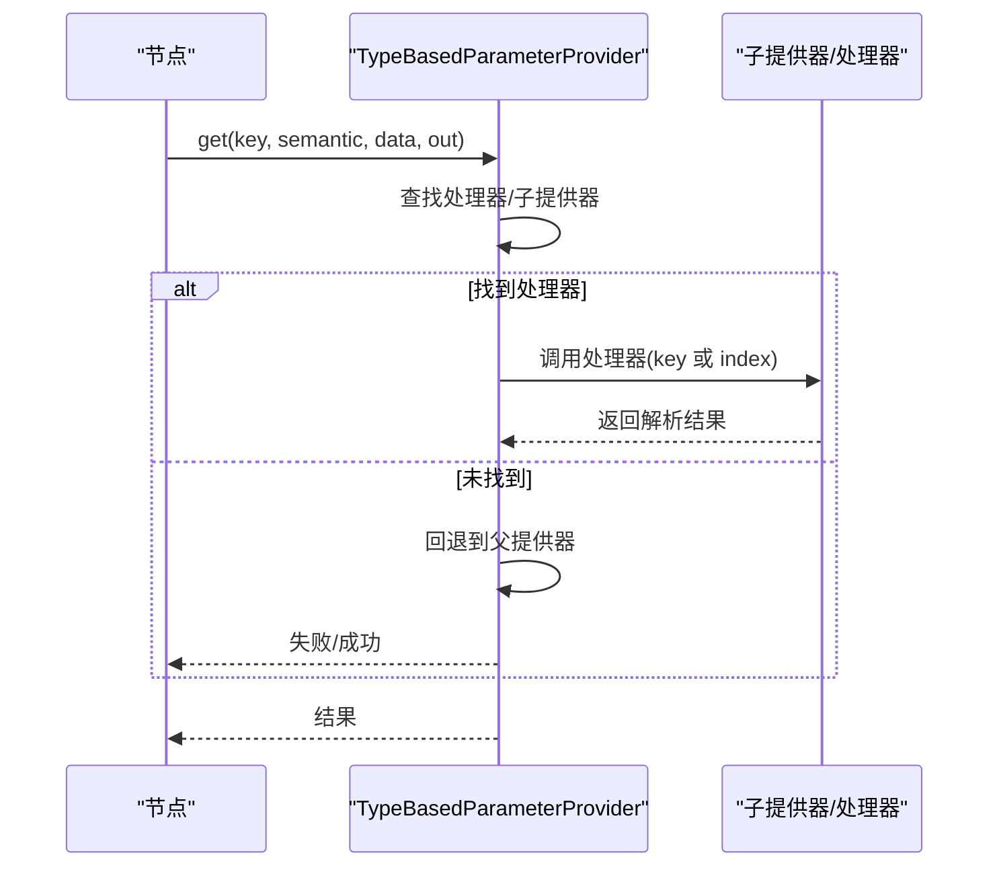
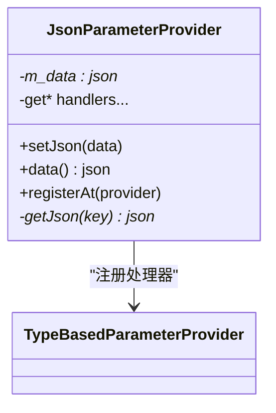
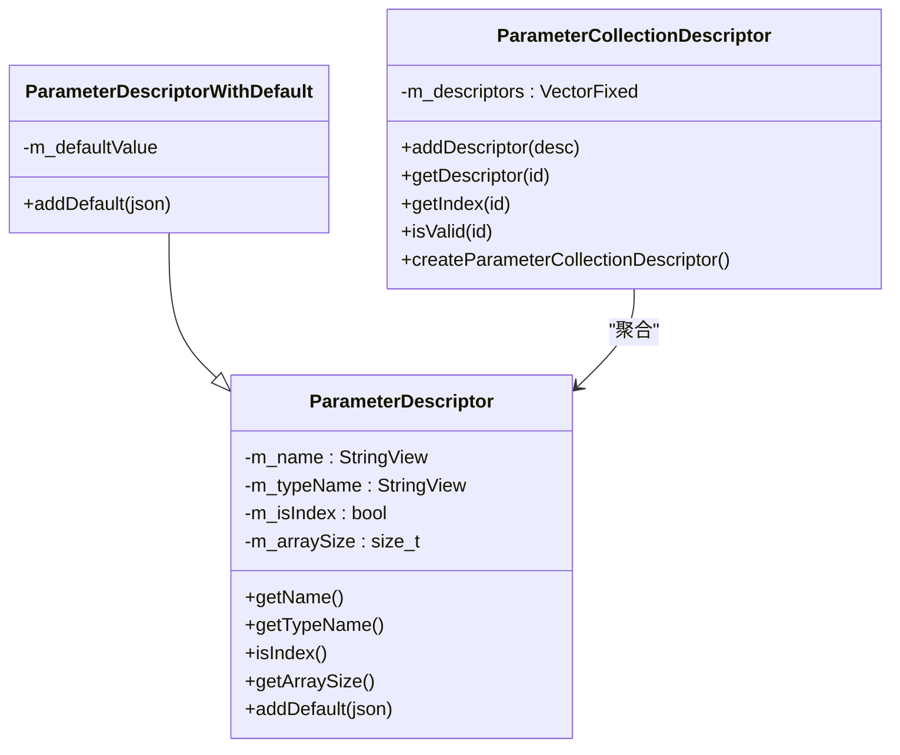
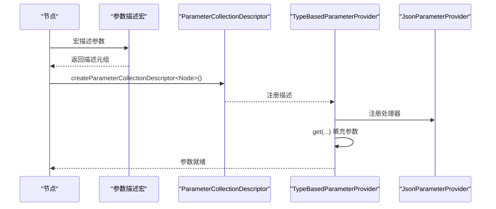
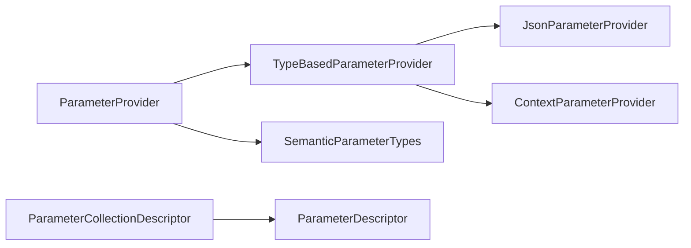

# 参数系统

<cite>
**本文引用的文件**
- [ParameterProvider.hpp](file://driverorks-5.10/include/dwcgf/parameter/ParameterProvider.hpp)
- [ParameterDescriptor.hpp](file://driverorks-5.10/include/dwcgf/parameter/ParameterDescriptor.hpp)
- [ParameterCollectionDescriptor.hpp](file://driverorks-5.10/include/dwcgf/parameter/ParameterCollectionDescriptor.hpp)
- [JsonParameterProvider.hpp](file://driverorks-5.10/include/dwcgf/parameter/JsonParameterProvider.hpp)
- [TypeBasedParameterProvider.hpp](file://driverorks-5.10/include/dwcgf/parameter/TypeBasedParameterProvider.hpp)
- [ContextParameterProvider.hpp](file://driverorks-5.10/include/dwcgf/parameter/ContextParameterProvider.hpp)
- [SemanticParameterTypes.hpp](file://driverorks-5.10/include/dwcgf/parameter/SemanticParameterTypes.hpp)
- [dwLidarPointCloudAccumulatorNode.hpp](file://driverorks-5.10/include/dwframework/dwnodes/dwlidarpointcloudaccumulatornode/dwLidarPointCloudAccumulatorNode.hpp)
- [dwLidarPointCloudStitcherNode.hpp](file://driverorks-5.10/include/dwframework/dwnodes/dwlidarpointcloudstitchernode/dwLidarPointCloudStitcherNode.hpp)
- [dwRigNode.hpp](file://driverorks-5.10/include/dwframework/dwnodes/dwrignode/dwRigNode.hpp)
- [dwTraceCollectorNode.hpp](file://driverorks-5.10/include/dwframework/dwnodes/dwtrace/tracecollectornode/dwTraceCollectorNode.hpp)
</cite>

## 目录
1. [简介](#简介)
2. [项目结构](#项目结构)
3. [核心组件](#核心组件)
4. [架构总览](#架构总览)
5. [详细组件分析](#详细组件分析)
6. [依赖关系分析](#依赖关系分析)
7. [性能考量](#性能考量)
8. [故障排查指南](#故障排查指南)
9. [结论](#结论)
10. [附录](#附录)

## 简介
本文件面向CGF（Computer Graphics Framework）参数系统，系统性阐述参数提供器的设计原理与类型安全的参数访问机制；详解参数集合描述符与参数描述符的使用方法，覆盖参数验证、默认值设置与类型检查；说明参数系统的配置方式（含JSON配置文件与动态参数更新）；解释参数在节点间的传递机制与参数绑定最佳实践；并提供从基础到进阶的完整使用示例与与其他CGF组件的集成方法。

## 项目结构
参数系统位于驱动库的参数子模块中，核心接口与实现分布于以下头文件：
- ParameterProvider：参数访问接口与类型安全模板方法族
- TypeBasedParameterProvider：按数据类型分发的参数提供器
- JsonParameterProvider：从JSON数据源读取参数
- ContextParameterProvider：从上下文句柄提供参数
- ParameterDescriptor/ParameterCollectionDescriptor：参数描述与集合描述
- SemanticParameterTypes：语义类型命名空间
- 节点示例：各节点通过宏描述参数并由提供器填充

图表来源
- [ParameterProvider.hpp:50-580](file://driverorks-5.10/include/dwcgf/parameter/ParameterProvider.hpp#L50-L580)
- [TypeBasedParameterProvider.hpp:72-312](file://driverorks-5.10/include/dwcgf/parameter/TypeBasedParameterProvider.hpp#L72-L312)
- [JsonParameterProvider.hpp:44-155](file://driverorks-5.10/include/dwcgf/parameter/JsonParameterProvider.hpp#L44-L155)
- [ContextParameterProvider.hpp:43-72](file://driverorks-5.10/include/dwcgf/parameter/ContextParameterProvider.hpp#L43-L72)
- [ParameterDescriptor.hpp:282-491](file://driverorks-5.10/include/dwcgf/parameter/ParameterDescriptor.hpp#L282-L491)
- [ParameterCollectionDescriptor.hpp:48-290](file://driverorks-5.10/include/dwcgf/parameter/ParameterCollectionDescriptor.hpp#L48-L290)
- [SemanticParameterTypes.hpp:38-417](file://driverorks-5.10/include/dwcgf/parameter/SemanticParameterTypes.hpp#L38-L417)

章节来源
- [ParameterProvider.hpp:50-580](file://driverorks-5.10/include/dwcgf/parameter/ParameterProvider.hpp#L50-L580)
- [TypeBasedParameterProvider.hpp:72-312](file://driverorks-5.10/include/dwcgf/parameter/TypeBasedParameterProvider.hpp#L72-L312)
- [ParameterDescriptor.hpp:282-491](file://driverorks-5.10/include/dwcgf/parameter/ParameterDescriptor.hpp#L282-L491)
- [ParameterCollectionDescriptor.hpp:48-290](file://driverorks-5.10/include/dwcgf/parameter/ParameterCollectionDescriptor.hpp#L48-L290)
- [JsonParameterProvider.hpp:44-155](file://driverorks-5.10/include/dwcgf/parameter/JsonParameterProvider.hpp#L44-L155)
- [ContextParameterProvider.hpp:43-72](file://driverorks-5.10/include/dwcgf/parameter/ContextParameterProvider.hpp#L43-L72)
- [SemanticParameterTypes.hpp:38-417](file://driverorks-5.10/include/dwcgf/parameter/SemanticParameterTypes.hpp#L38-L417)

## 核心组件
- 参数提供器接口（ParameterProvider）
  - 提供统一的参数获取入口，支持按名称、索引、语义类型与数据类型组合检索
  - 内置“必需/可选”便捷API，自动抛出异常或返回失败状态
  - 支持标量、数组、固定大小数组、向量、枚举、固定长度字符串等多形态参数
- 类型分发提供器（TypeBasedParameterProvider）
  - 将参数请求按数据类型与语义类型分派至已注册的处理器
  - 维护三类处理器注册表：按名、按名+索引、按索引、仅按类型
  - 可注册子提供器（ITypeBasedParameterProviderChild），用于扩展特定类型的参数来源
- JSON提供器（JsonParameterProvider）
  - 从nlohmann::json对象中解析标量、向量与数组参数
  - 提供按名与按名+索引的处理器，适配TypeBasedParameterProvider
- 上下文提供器（ContextParameterProvider）
  - 从dwContextHandle_t提供上下文句柄
- 参数描述与集合描述
  - ParameterDescriptor：描述单个参数的名称、类型、是否索引、数组大小等
  - ParameterCollectionDescriptor：收集节点所有参数描述，并支持默认值导出为JSON
- 语义类型（SemanticParameterTypes）
  - 以空结构体作为语义标签，区分相同数据类型的不同用途（如相机内参、外参）

章节来源
- [ParameterProvider.hpp:75-580](file://driverorks-5.10/include/dwcgf/parameter/ParameterProvider.hpp#L75-L580)
- [TypeBasedParameterProvider.hpp:72-312](file://driverorks-5.10/include/dwcgf/parameter/TypeBasedParameterProvider.hpp#L72-L312)
- [JsonParameterProvider.hpp:44-155](file://driverorks-5.10/include/dwcgf/parameter/JsonParameterProvider.hpp#L44-L155)
- [ContextParameterProvider.hpp:43-72](file://driverorks-5.10/include/dwcgf/parameter/ContextParameterProvider.hpp#L43-L72)
- [ParameterDescriptor.hpp:282-491](file://driverorks-5.10/include/dwcgf/parameter/ParameterDescriptor.hpp#L282-L491)
- [ParameterCollectionDescriptor.hpp:48-290](file://driverorks-5.10/include/dwcgf/parameter/ParameterCollectionDescriptor.hpp#L48-L290)
- [SemanticParameterTypes.hpp:38-417](file://driverorks-5.10/include/dwcgf/parameter/SemanticParameterTypes.hpp#L38-L417)

## 架构总览
参数系统采用“接口抽象 + 类型分发 + 描述驱动”的架构：
- ParameterProvider定义统一访问协议
- TypeBasedParameterProvider负责路由与调度
- JsonParameterProvider/ContextParameterProvider等具体提供器实现数据源
- ParameterDescriptor/ParameterCollectionDescriptor描述参数元信息，支持默认值导出
- SemanticParameterTypes提供语义区分能力

图表来源
- [ParameterProvider.hpp:50-580](file://driverorks-5.10/include/dwcgf/parameter/ParameterProvider.hpp#L50-L580)
- [TypeBasedParameterProvider.hpp:72-312](file://driverorks-5.10/include/dwcgf/parameter/TypeBasedParameterProvider.hpp#L72-L312)
- [JsonParameterProvider.hpp:44-155](file://driverorks-5.10/include/dwcgf/parameter/JsonParameterProvider.hpp#L44-L155)
- [ContextParameterProvider.hpp:43-72](file://driverorks-5.10/include/dwcgf/parameter/ContextParameterProvider.hpp#L43-L72)
- [ParameterDescriptor.hpp:48-87](file://driverorks-5.10/include/dwcgf/parameter/ParameterDescriptor.hpp#L48-L87)
- [ParameterCollectionDescriptor.hpp:179-290](file://driverorks-5.10/include/dwcgf/parameter/ParameterCollectionDescriptor.hpp#L179-L290)
- [SemanticParameterTypes.hpp:38-417](file://driverorks-5.10/include/dwcgf/parameter/SemanticParameterTypes.hpp#L38-L417)

## 详细组件分析

### 参数提供器接口（ParameterProvider）
- 设计要点
  - 模板化重载：按数据类型、语义类型、数组索引、固定大小数组/向量等维度提供重载
  - 异常安全：必需参数访问失败时抛出带状态码的异常；可选访问封装异常并转换为状态
  - 类型检查：通过type_info进行严格的数据类型与语义类型匹配
  - 数组与枚举：支持固定大小数组、二维数组、向量、枚举映射（字符串到枚举值）
- 关键流程
  - getRequired/getOptional：对外暴露的便捷API
  - get(…, semanticTypeInfo, dataTypeInfo, …)：内部路由入口，交由具体实现完成解析

图表来源
- [ParameterProvider.hpp:142-580](file://driverorks-5.10/include/dwcgf/parameter/ParameterProvider.hpp#L142-L580)

章节来源
- [ParameterProvider.hpp:75-580](file://driverorks-5.10/include/dwcgf/parameter/ParameterProvider.hpp#L75-L580)

### 类型分发提供器（TypeBasedParameterProvider）
- 注册与查找
  - registerProvider/registerProviderChild：按数据类型注册提供器或子提供器
  - registerByNameHandler/registerByNameAndIndexHandler/registerByIndexHandler/registerByTypeHandler：按数据类型+语义类型注册处理器
- 路由策略
  - get接口根据传入的语义类型与数据类型，定位到对应的处理器或子提供器
  - 支持父提供器链式回退（parentProvider）
- 平台兼容
  - 在QNX环境下对type_info比较做特殊处理，避免类型比较不一致问题

图表来源
- [TypeBasedParameterProvider.hpp:90-312](file://driverorks-5.10/include/dwcgf/parameter/TypeBasedParameterProvider.hpp#L90-L312)

章节来源
- [TypeBasedParameterProvider.hpp:72-312](file://driverorks-5.10/include/dwcgf/parameter/TypeBasedParameterProvider.hpp#L72-L312)

### JSON参数提供器（JsonParameterProvider）
- 功能
  - 从nlohmann::json对象中按名称解析标量、向量与数组参数
  - 提供registerAt，将自身注册到TypeBasedParameterProvider
- 实现要点
  - 按数据类型实现get*与get*ByIndex处理器
  - 支持字符串与StringView等常见字符串类型
  - 通过setJson/data可动态更新JSON数据源

图表来源
- [JsonParameterProvider.hpp:44-155](file://driverorks-5.10/include/dwcgf/parameter/JsonParameterProvider.hpp#L44-L155)
- [TypeBasedParameterProvider.hpp:174-233](file://driverorks-5.10/include/dwcgf/parameter/TypeBasedParameterProvider.hpp#L174-L233)

章节来源
- [JsonParameterProvider.hpp:44-155](file://driverorks-5.10/include/dwcgf/parameter/JsonParameterProvider.hpp#L44-L155)

### 上下文参数提供器（ContextParameterProvider）
- 功能
  - 从dwContextHandle_t提供上下文句柄
  - registerAt将处理器注册到TypeBasedParameterProvider
- 典型用途
  - 与框架上下文交互，获取运行时环境参数

章节来源
- [ContextParameterProvider.hpp:43-72](file://driverorks-5.10/include/dwcgf/parameter/ContextParameterProvider.hpp#L43-L72)

### 参数描述与集合描述（ParameterDescriptor/ParameterCollectionDescriptor）
- ParameterDescriptor
  - 记录参数名称、类型名、是否索引、数组大小
  - 支持默认值导出（ParameterDescriptorWithDefault）
- ParameterCollectionDescriptor
  - 收集节点的所有参数描述
  - 提供按名称/索引查询与有效性检查
  - 递归遍历节点描述参数，生成描述集合

图表来源
- [ParameterDescriptor.hpp:48-87](file://driverorks-5.10/include/dwcgf/parameter/ParameterDescriptor.hpp#L48-L87)
- [ParameterDescriptor.hpp:142-176](file://driverorks-5.10/include/dwcgf/parameter/ParameterDescriptor.hpp#L142-L176)
- [ParameterCollectionDescriptor.hpp:179-290](file://driverorks-5.10/include/dwcgf/parameter/ParameterCollectionDescriptor.hpp#L179-L290)

章节来源
- [ParameterDescriptor.hpp:282-491](file://driverorks-5.10/include/dwcgf/parameter/ParameterDescriptor.hpp#L282-L491)
- [ParameterCollectionDescriptor.hpp:179-290](file://driverorks-5.10/include/dwcgf/parameter/ParameterCollectionDescriptor.hpp#L179-L290)

### 语义参数类型（SemanticParameterTypes）
- 作用
  - 通过空结构体作为语义标签，区分相同数据类型的用途（如相机内参、外参、图像尺寸等）
  - 与ParameterProvider模板参数配合，实现“同类型不同语义”的参数隔离
- 示例类型
  - 相机相关：CameraIntrinsic、CameraExtrinsic、ImageWidth、ImageHeight等
  - 传感器相关：ImuHandle、LidarHandle、GpsHandle等
  - 输出相关：Output2Rig、ScalingFactor等

章节来源
- [SemanticParameterTypes.hpp:38-417](file://driverorks-5.10/include/dwcgf/parameter/SemanticParameterTypes.hpp#L38-L417)

### 参数描述宏与节点使用示例
- 参数描述宏
  - DW_DESCRIBE_PARAMETER / DW_DESCRIBE_PARAMETER_WITH_SEMANTIC：描述有/无语义的参数
  - DW_DESCRIBE_ARRAY_PARAMETER / DW_DESCRIBE_ARRAY_PARAMETER_WITH_DEFAULT：描述数组与带默认值数组
  - DW_DESCRIBE_INDEX_PARAMETER：描述索引参数（用于从数组中取特定项）
  - DW_DESCRIBE_UNNAMED_PARAMETER / DW_DESCRIBE_UNNAMED_ARRAY_PARAMETER：描述无名参数（仅语义类型识别）
- 节点使用模式
  - 节点在静态成员函数中调用上述宏，构造参数描述元组
  - 运行时由ParameterCollectionDescriptor收集描述
  - 通过TypeBasedParameterProvider与JsonParameterProvider填充参数

图表来源
- [ParameterDescriptor.hpp:265-491](file://driverorks-5.10/include/dwcgf/parameter/ParameterDescriptor.hpp#L265-L491)
- [ParameterCollectionDescriptor.hpp:292-299](file://driverorks-5.10/include/dwcgf/parameter/ParameterCollectionDescriptor.hpp#L292-L299)
- [TypeBasedParameterProvider.hpp:174-233](file://driverorks-5.10/include/dwcgf/parameter/TypeBasedParameterProvider.hpp#L174-L233)
- [JsonParameterProvider.hpp:68-69](file://driverorks-5.10/include/dwcgf/parameter/JsonParameterProvider.hpp#L68-L69)

章节来源
- [ParameterDescriptor.hpp:265-491](file://driverorks-5.10/include/dwcgf/parameter/ParameterDescriptor.hpp#L265-L491)
- [ParameterCollectionDescriptor.hpp:292-299](file://driverorks-5.10/include/dwcgf/parameter/ParameterCollectionDescriptor.hpp#L292-L299)
- [TypeBasedParameterProvider.hpp:174-233](file://driverorks-5.10/include/dwcgf/parameter/TypeBasedParameterProvider.hpp#L174-L233)
- [JsonParameterProvider.hpp:68-69](file://driverorks-5.10/include/dwcgf/parameter/JsonParameterProvider.hpp#L68-L69)

## 依赖关系分析
- 组件耦合
  - ParameterProvider是所有提供器的基接口，TypeBasedParameterProvider继承之并扩展分发逻辑
  - JsonParameterProvider/ContextParameterProvider实现具体数据源，通过registerAt注册到TypeBasedParameterProvider
  - ParameterCollectionDescriptor依赖ParameterDescriptor，递归遍历节点描述生成集合
- 外部依赖
  - nlohmann::json用于JSON参数解析
  - dw::core容器与工具（如StringView、VectorFixed）提供高性能存储与字符串视图
- 循环依赖
  - 无直接循环依赖；描述系统通过编译期元组与模板递归工作

图表来源
- [ParameterProvider.hpp:50-580](file://driverorks-5.10/include/dwcgf/parameter/ParameterProvider.hpp#L50-L580)
- [TypeBasedParameterProvider.hpp:72-312](file://driverorks-5.10/include/dwcgf/parameter/TypeBasedParameterProvider.hpp#L72-L312)
- [JsonParameterProvider.hpp:44-155](file://driverorks-5.10/include/dwcgf/parameter/JsonParameterProvider.hpp#L44-L155)
- [ContextParameterProvider.hpp:43-72](file://driverorks-5.10/include/dwcgf/parameter/ContextParameterProvider.hpp#L43-L72)
- [ParameterDescriptor.hpp:48-87](file://driverorks-5.10/include/dwcgf/parameter/ParameterDescriptor.hpp#L48-L87)
- [ParameterCollectionDescriptor.hpp:179-290](file://driverorks-5.10/include/dwcgf/parameter/ParameterCollectionDescriptor.hpp#L179-L290)
- [SemanticParameterTypes.hpp:38-417](file://driverorks-5.10/include/dwcgf/parameter/SemanticParameterTypes.hpp#L38-L417)

章节来源
- [ParameterProvider.hpp:50-580](file://driverorks-5.10/include/dwcgf/parameter/ParameterProvider.hpp#L50-L580)
- [TypeBasedParameterProvider.hpp:72-312](file://driverorks-5.10/include/dwcgf/parameter/TypeBasedParameterProvider.hpp#L72-L312)
- [ParameterCollectionDescriptor.hpp:179-290](file://driverorks-5.10/include/dwcgf/parameter/ParameterCollectionDescriptor.hpp#L179-L290)

## 性能考量
- 模板展开与编译期计算
  - 参数描述与默认值填充均在编译期展开，运行时仅执行少量分支判断
- 类型分发效率
  - 通过type_info映射到处理器，避免运行时反射开销
  - 在QNX平台采用字符串比较回退，确保稳定性
- JSON解析
  - nlohmann::json解析为标量/向量/数组，避免重复拷贝
- 字符串与数组
  - 固定大小数组与固定长度字符串提供编译期边界检查，减少运行时越界风险

## 故障排查指南
- 常见错误与定位
  - 必需参数缺失：getRequired抛出异常，检查配置文件或提供器注册
  - 类型不匹配：getOptional返回失败，确认数据类型与语义类型是否一致
  - 数组尺寸不匹配：固定大小数组拷贝前会校验长度，抛出异常提示
  - 枚举映射失败：字符串无法映射到枚举值，检查枚举名称拼写
- 调试建议
  - 使用ParameterCollectionDescriptor导出默认值，核对期望与实际
  - 在TypeBasedParameterProvider中打印处理器注册情况，确认分发路径
  - 对JSON提供器设置断点，检查键名与数据结构一致性

章节来源
- [ParameterProvider.hpp:75-135](file://driverorks-5.10/include/dwcgf/parameter/ParameterProvider.hpp#L75-L135)
- [ParameterProvider.hpp:200-292](file://driverorks-5.10/include/dwcgf/parameter/ParameterProvider.hpp#L200-L292)
- [ParameterProvider.hpp:426-536](file://driverorks-5.10/include/dwcgf/parameter/ParameterProvider.hpp#L426-L536)
- [ParameterCollectionDescriptor.hpp:168-171](file://driverorks-5.10/include/dwcgf/parameter/ParameterCollectionDescriptor.hpp#L168-L171)

## 结论
CGF参数系统通过接口抽象、类型分发与描述驱动，实现了类型安全、可扩展且易于维护的参数管理机制。结合JSON配置与动态更新能力，参数系统能够高效支撑复杂节点图的参数装配与运行时调整。语义类型与参数描述体系进一步提升了参数表达力与可读性，便于跨模块协作与长期演进。

## 附录

### 配置方式与动态更新
- JSON配置文件
  - 使用JsonParameterProvider加载nlohmann::json对象
  - 通过ParameterCollectionDescriptor导出默认值，生成schema或示例配置
- 动态参数更新
  - 通过setJson更新数据指针，立即生效于后续get调用
  - 子提供器可通过registerAt重新注册处理器，实现热插拔

章节来源
- [JsonParameterProvider.hpp:62-69](file://driverorks-5.10/include/dwcgf/parameter/JsonParameterProvider.hpp#L62-L69)
- [ParameterCollectionDescriptor.hpp:168-171](file://driverorks-5.10/include/dwcgf/parameter/ParameterCollectionDescriptor.hpp#L168-L171)

### 参数在节点间传递与绑定最佳实践
- 使用语义类型区分同类型参数的不同用途
- 优先使用带默认值的参数描述，降低配置复杂度
- 对数组参数使用索引参数（Index Parameter）从数组中抽取单项
- 无名参数仅在语义类型足以唯一标识时使用
- 通过ParameterCollectionDescriptor集中管理参数描述，便于验证与文档生成

章节来源
- [ParameterDescriptor.hpp:361-374](file://driverorks-5.10/include/dwcgf/parameter/ParameterDescriptor.hpp#L361-L374)
- [ParameterDescriptor.hpp:424-432](file://driverorks-5.10/include/dwcgf/parameter/ParameterDescriptor.hpp#L424-L432)
- [ParameterCollectionDescriptor.hpp:216-237](file://driverorks-5.10/include/dwcgf/parameter/ParameterCollectionDescriptor.hpp#L216-L237)

### 使用示例（路径指引）
- 基础参数描述与默认值
  - [DW_DESCRIBE_PARAMETER_WITH_DEFAULT:477-491](file://driverorks-5.10/include/dwcgf/parameter/ParameterDescriptor.hpp#L477-L491)
- 数组参数与默认值
  - [DW_DESCRIBE_ARRAY_PARAMETER_WITH_DEFAULT:508-522](file://driverorks-5.10/include/dwcgf/parameter/ParameterDescriptor.hpp#L508-L522)
- 索引参数
  - [DW_DESCRIBE_INDEX_PARAMETER:361-374](file://driverorks-5.10/include/dwcgf/parameter/ParameterDescriptor.hpp#L361-L374)
- 无名参数
  - [DW_DESCRIBE_UNNAMED_PARAMETER:424-432](file://driverorks-5.10/include/dwcgf/parameter/ParameterDescriptor.hpp#L424-L432)
- 节点参数描述示例（节选）
  - [dwLidarPointCloudAccumulatorNode:97-146](file://driverorks-5.10/include/dwframework/dwnodes/dwlidarpointcloudaccumulatornode/dwLidarPointCloudAccumulatorNode.hpp#L97-L146)
  - [dwLidarPointCloudStitcherNode:138-142](file://driverorks-5.10/include/dwframework/dwnodes/dwlidarpointcloudstitchernode/dwLidarPointCloudStitcherNode.hpp#L138-L142)
  - [dwRigNode:130-130](file://driverorks-5.10/include/dwframework/dwnodes/dwrignode/dwRigNode.hpp#L130-L130)
  - [dwTraceCollectorNode:118-142](file://driverorks-5.10/include/dwframework/dwnodes/dwtrace/tracecollectornode/dwTraceCollectorNode.hpp#L118-L142)