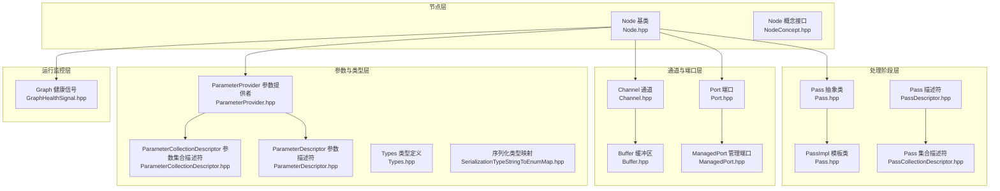
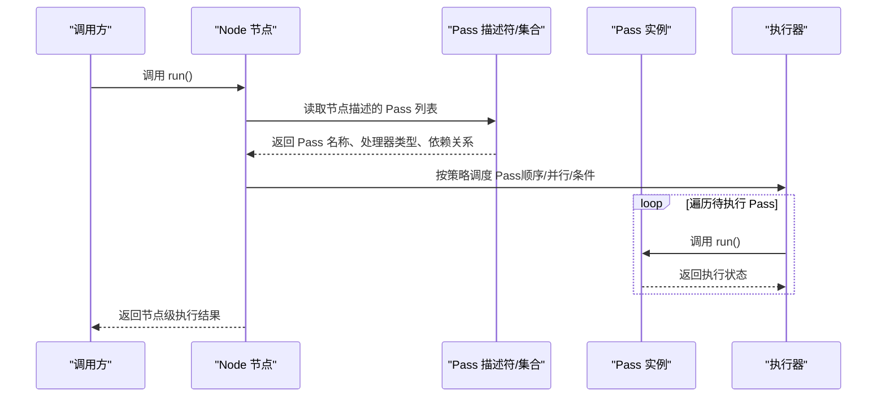
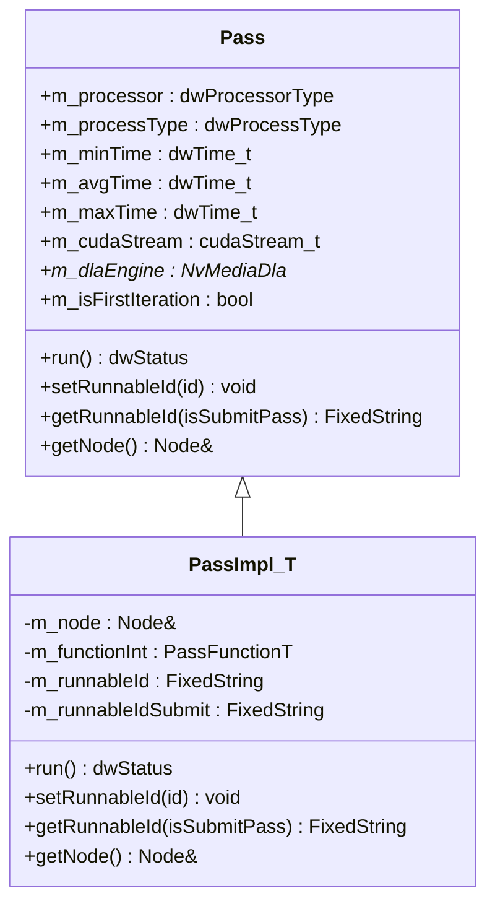
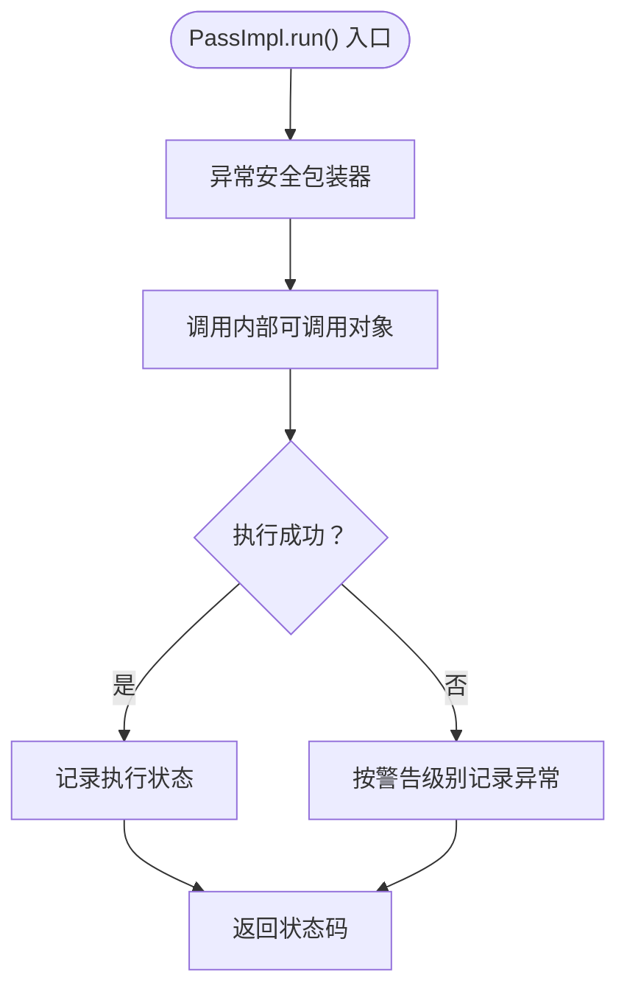
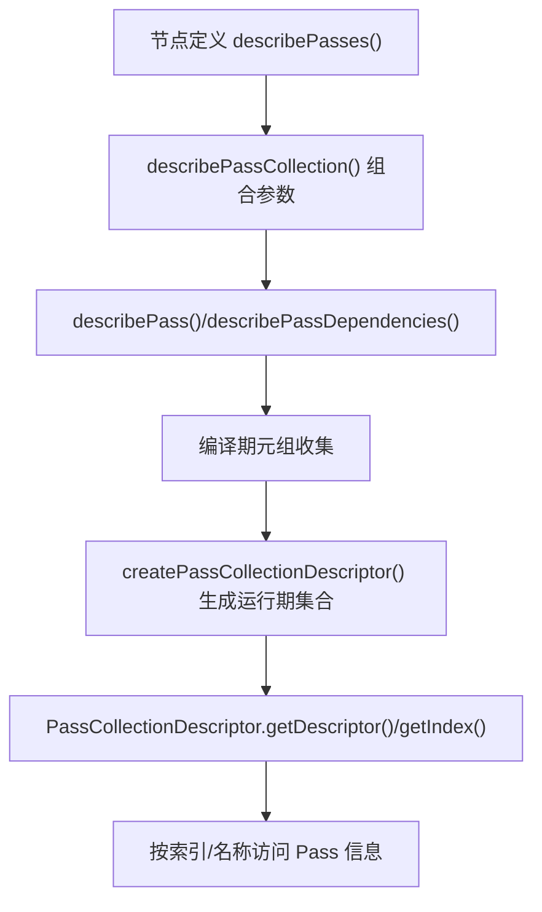
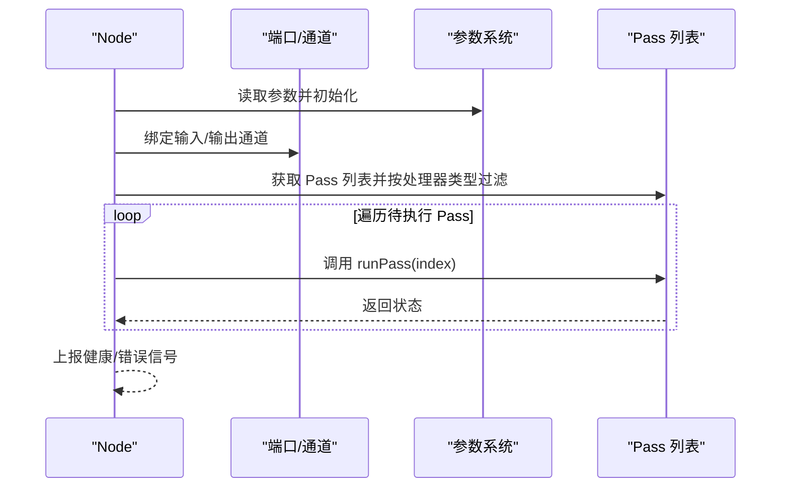
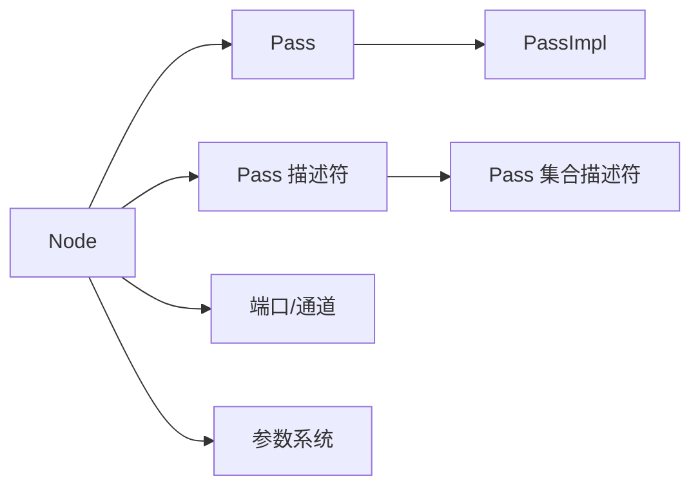

# 处理阶段系统

<cite>
**本文引用的文件**
- [Pass.hpp](file://driverorks-5.10/include/dwcgf/pass/Pass.hpp)
- [PassDescriptor.hpp](file://driverorks-5.10/include/dwcgf/pass/PassDescriptor.hpp)
- [PassCollectionDescriptor.hpp](file://driverorks-5.10/include/dwcgf/pass/PassCollectionDescriptor.hpp)
- [Node.hpp](file://driverorks-5.10/include/dwcgf/node/Node.hpp)
- [NodeConcept.hpp](file://driverorks-5.10/include/dwcgf/node/NodeConcept.hpp)
- [Exception.hpp](file://driverorks-5.10/include/dwcgf/Exception.hpp)
- [Types.hpp](file://driverorks-5.10/include/dwcgf/Types.hpp)
- [Buffer.hpp](file://driverorks-5.10/include/dwcgf/channel/Buffer.hpp)
- [Channel.hpp](file://driverorks-5.10/include/dwcgf/channel/Channel.hpp)
- [Port.hpp](file://driverorks-5.10/include/dwcgf/port/Port.hpp)
- [ManagedPort.hpp](file://driverorks-5.10/include/dwcgf/port/ManagedPort.hpp)
- [ParameterProvider.hpp](file://driverorks-5.10/include/dwcgf/parameter/ParameterProvider.hpp)
- [ParameterCollectionDescriptor.hpp](file://driverorks-5.10/include/dwcgf/parameter/ParameterCollectionDescriptor.hpp)
- [ParameterDescriptor.hpp](file://driverorks-5.10/include/dwcgf/parameter/ParameterDescriptor.hpp)
- [SerializationTypeStringToEnumMap.hpp](file://driverorks-5.10/include/dwcgf/SerializationTypeStringToEnumMap.hpp)
- [GraphHealthSignal.hpp](file://driverorks-5.10/include/dwcgf/computegraph/GraphHealthSignal.hpp)
- [ExceptionSafeNode.hpp](file://driverorks-5.10/include/dwcgf/node/impl/ExceptionSafeNode.hpp)
</cite>

## 目录
1. [引言](#引言)
2. [项目结构](#项目结构)
3. [核心组件](#核心组件)
4. [架构总览](#架构总览)
5. [详细组件分析](#详细组件分析)
6. [依赖分析](#依赖分析)
7. [性能考虑](#性能考虑)
8. [故障排查指南](#故障排查指南)
9. [结论](#结论)
10. [附录](#附录)

## 引言
本技术文档围绕 CGF（Compute Graph Framework）处理阶段系统展开，系统性阐述 Pass 抽象类的设计理念与生命周期管理、PassImpl 的具体实现与处理逻辑组织方式、Pass 描述符与 Pass 集合描述符的使用方法、处理阶段的执行策略（顺序执行、并行处理、条件执行），以及在节点执行流程中的作用与与其他组件的协作机制。文档同时提供处理阶段开发的完整实践指南，帮助开发者快速创建、配置与调试自定义处理阶段。

## 项目结构
处理阶段系统位于驱动框架的“dwcgf”子模块中，核心文件分布如下：
- pass 子目录：定义 Pass 抽象类、PassImpl 模板类及 Pass 描述符族（PassDescriptor、PassCollectionDescriptor）
- node 子目录：定义 Node 基类与 Node 概念接口，提供运行时获取 Pass、按处理器类型过滤 Pass 等能力
- channel 与 port 子目录：为 Pass 执行提供数据通道与端口基础设施
- parameter 子目录：参数声明与提供，支撑 Pass 的动态配置
- computegraph 子目录：计算图健康信号等运行期监控信息

图表来源
- [Pass.hpp:48-107](file://driverorks-5.10/include/dwcgf/pass/Pass.hpp#L48-L107)
- [PassDescriptor.hpp:48-117](file://driverorks-5.10/include/dwcgf/pass/PassDescriptor.hpp#L48-L117)
- [PassCollectionDescriptor.hpp:44-122](file://driverorks-5.10/include/dwcgf/pass/PassCollectionDescriptor.hpp#L44-L122)
- [Node.hpp:64-275](file://driverorks-5.10/include/dwcgf/node/Node.hpp#L64-L275)
- [NodeConcept.hpp:53-93](file://driverorks-5.10/include/dwcgf/node/NodeConcept.hpp#L53-L93)
- [Channel.hpp](file://driverorks-5.10/include/dwcgf/channel/Channel.hpp)
- [Buffer.hpp](file://driverorks-5.10/include/dwcgf/channel/Buffer.hpp)
- [Port.hpp](file://driverorks-5.10/include/dwcgf/port/Port.hpp)
- [ManagedPort.hpp](file://driverorks-5.10/include/dwcgf/port/ManagedPort.hpp)
- [ParameterProvider.hpp](file://driverorks-5.10/include/dwcgf/parameter/ParameterProvider.hpp)
- [ParameterCollectionDescriptor.hpp](file://driverorks-5.10/include/dwcgf/parameter/ParameterCollectionDescriptor.hpp)
- [ParameterDescriptor.hpp](file://driverorks-5.10/include/dwcgf/parameter/ParameterDescriptor.hpp)
- [SerializationTypeStringToEnumMap.hpp](file://driverorks-5.10/include/dwcgf/SerializationTypeStringToEnumMap.hpp)
- [GraphHealthSignal.hpp](file://driverorks-5.10/include/dwcgf/computegraph/GraphHealthSignal.hpp)

章节来源
- [Pass.hpp:48-107](file://driverorks-5.10/include/dwcgf/pass/Pass.hpp#L48-L107)
- [PassDescriptor.hpp:48-117](file://driverorks-5.10/include/dwcgf/pass/PassDescriptor.hpp#L48-L117)
- [PassCollectionDescriptor.hpp:44-122](file://driverorks-5.10/include/dwcgf/pass/PassCollectionDescriptor.hpp#L44-L122)
- [Node.hpp:64-275](file://driverorks-5.10/include/dwcgf/node/Node.hpp#L64-L275)
- [NodeConcept.hpp:53-93](file://driverorks-5.10/include/dwcgf/node/NodeConcept.hpp#L53-L93)

## 核心组件
- Pass 抽象类：定义处理阶段的统一接口，包括运行入口、可执行标识设置与查询、所属节点访问、处理器类型与进程类型、历史耗时统计字段、CUDA 流与 DLA 句柄、首次迭代标记等。
- PassImpl 模板类：将任意可调用对象封装为 Pass，支持 CPU/GPU/DLA 三种执行环境；在 run() 中通过异常安全包装器执行目标函数，并维护可执行标识字符串。
- Pass 描述符族：以编译期元组与运行期集合的形式描述节点的处理阶段，包括名称、处理器类型、显式依赖关系等；提供索引查找、有效性检查、依赖解析等工具函数。
- Node 基类：提供节点级运行控制，包括 run() 全部 Pass、按索引运行单个 Pass、获取 Pass 列表与按处理器类型过滤、设置/获取节点名、错误与健康信号上报等。
- Node 概念接口：为节点注册与工厂创建提供静态接口契约，明确 describePasses() 等描述函数的返回约定。

章节来源
- [Pass.hpp:48-107](file://driverorks-5.10/include/dwcgf/pass/Pass.hpp#L48-L107)
- [Pass.hpp:109-217](file://driverorks-5.10/include/dwcgf/pass/Pass.hpp#L109-L217)
- [PassDescriptor.hpp:48-117](file://driverorks-5.10/include/dwcgf/pass/PassDescriptor.hpp#L48-L117)
- [PassDescriptor.hpp:112-181](file://driverorks-5.10/include/dwcgf/pass/PassDescriptor.hpp#L112-L181)
- [PassCollectionDescriptor.hpp:44-122](file://driverorks-5.10/include/dwcgf/pass/PassCollectionDescriptor.hpp#L44-L122)
- [Node.hpp:118-163](file://driverorks-5.10/include/dwcgf/node/Node.hpp#L118-L163)
- [NodeConcept.hpp:53-93](file://driverorks-5.10/include/dwcgf/node/NodeConcept.hpp#L53-L93)

## 架构总览
处理阶段系统围绕“节点-通道-端口-参数”的整体架构工作。节点负责组织与调度其内部的多个处理阶段（Pass），每个 Pass 可绑定到不同处理器（CPU/GPU/DLA）。通道与端口提供数据输入输出，参数系统为 Pass 的配置与运行时注入提供支撑。运行期间，节点根据描述符生成 Pass 集合，依据依赖关系与处理器类型进行调度，并通过健康/错误信号反馈运行状态。

图表来源
- [Node.hpp:118-163](file://driverorks-5.10/include/dwcgf/node/Node.hpp#L118-L163)
- [PassDescriptor.hpp:112-181](file://driverorks-5.10/include/dwcgf/pass/PassDescriptor.hpp#L112-L181)
- [PassCollectionDescriptor.hpp:157-164](file://driverorks-5.10/include/dwcgf/pass/PassCollectionDescriptor.hpp#L157-L164)

## 详细组件分析

### Pass 抽象类与生命周期
- 设计要点
  - 统一接口：run() 作为唯一执行入口；setRunnableId()/getRunnableId() 提供可执行标识管理；getNode() 返回所属节点。
  - 资源与约束：m_processor/m_processType 指定执行环境；m_cudaStream/m_dlaEngine 为 GPU/DLA 提供资源句柄；m_isFirstIteration 支持流水线与调度切换场景。
  - 不可拷贝：删除拷贝构造与赋值，确保 Pass 实例的生命周期由其所属节点严格管理。
- 生命周期管理
  - 创建：由节点在构建 Pass 集合时创建，通常通过 PassImpl 封装用户函数。
  - 运行：由节点调度器按序或并行触发，异常通过异常安全包装器捕获并记录。
  - 销毁：随节点销毁而释放，避免悬挂引用。

图表来源
- [Pass.hpp:48-107](file://driverorks-5.10/include/dwcgf/pass/Pass.hpp#L48-L107)
- [Pass.hpp:109-217](file://driverorks-5.10/include/dwcgf/pass/Pass.hpp#L109-L217)

章节来源
- [Pass.hpp:48-107](file://driverorks-5.10/include/dwcgf/pass/Pass.hpp#L48-L107)
- [Pass.hpp:109-217](file://driverorks-5.10/include/dwcgf/pass/Pass.hpp#L109-L217)

### PassImpl：模板化实现与处理逻辑组织
- 构造策略
  - CPU 执行：直接传入可调用对象与处理器类型。
  - GPU 执行：除处理器类型外，还需提供 CUDA 流；若非 GPU 则抛出不支持异常。
  - DLA 执行：指定 DLA 引擎句柄；若非 DLA 则抛出不支持异常。
- 运行策略
  - run() 内部通过异常安全包装器执行目标函数，统一记录警告级别日志；返回值由目标函数决定。
  - 可执行标识：setRunnableId() 同时维护普通与提交态标识，便于流水线场景区分。
- 数据与资源
  - 维护所属节点引用，确保 Pass 可访问上下文与通道。
  - 保存可调用对象副本，保证跨线程/跨生命周期的安全执行。

图表来源
- [Pass.hpp:170-178](file://driverorks-5.10/include/dwcgf/pass/Pass.hpp#L170-L178)
- [Exception.hpp](file://driverorks-5.10/include/dwcgf/Exception.hpp)

章节来源
- [Pass.hpp:109-217](file://driverorks-5.10/include/dwcgf/pass/Pass.hpp#L109-L217)
- [Exception.hpp](file://driverorks-5.10/include/dwcgf/Exception.hpp)

### Pass 描述符与 Pass 集合描述符：定义、排序与依赖
- 描述符族
  - describePass()/describePassCollection()：以编译期元组形式描述节点的 Pass 列表，支持为特定 Pass 指定显式依赖。
  - describePassDependencies()：用于声明 Pass 间的依赖集合。
- 查询工具
  - passSize()/isValidPass()/passIndex()：对节点的 Pass 列表进行大小查询、有效性检查与名称到索引的映射。
  - passName()/passProcessorType()/hasPassDependencies()/passDependencies()：按索引查询 Pass 的名称、处理器类型、是否存在显式依赖及其列表。
- 运行期集合
  - PassDescriptor：封装单个 Pass 的名称、处理器类型、是否具有显式依赖、依赖数量与依赖项。
  - PassCollectionDescriptor：以固定容量容器存储多个 PassDescriptor，支持按索引与名称访问、校验有效性、添加描述符等。
  - createPassCollectionDescriptor()：根据节点的编译期描述生成运行期集合，递归遍历所有 Pass 并填充依赖信息。

图表来源
- [PassDescriptor.hpp:54-117](file://driverorks-5.10/include/dwcgf/pass/PassDescriptor.hpp#L54-L117)
- [PassDescriptor.hpp:112-181](file://driverorks-5.10/include/dwcgf/pass/PassDescriptor.hpp#L112-L181)
- [PassCollectionDescriptor.hpp:157-164](file://driverorks-5.10/include/dwcgf/pass/PassCollectionDescriptor.hpp#L157-L164)

章节来源
- [PassDescriptor.hpp:48-117](file://driverorks-5.10/include/dwcgf/pass/PassDescriptor.hpp#L48-L117)
- [PassDescriptor.hpp:112-181](file://driverorks-5.10/include/dwcgf/pass/PassDescriptor.hpp#L112-L181)
- [PassCollectionDescriptor.hpp:44-122](file://driverorks-5.10/include/dwcgf/pass/PassCollectionDescriptor.hpp#L44-L122)
- [PassCollectionDescriptor.hpp:157-164](file://driverorks-5.10/include/dwcgf/pass/PassCollectionDescriptor.hpp#L157-L164)

### 节点执行流程与处理阶段协作
- 节点职责
  - run()：协调并执行节点内全部 Pass。
  - runPass(index)：按索引执行单个 Pass。
  - getPasses()/getPasses(..., processor, processType)：获取 Pass 列表并按处理器/进程类型过滤。
  - 输入/输出通道绑定：通过 setInputChannel()/setOutputChannel() 将端口与通道关联，为 Pass 的数据通路提供基础。
- 与参数系统协作
  - 通过 ParameterProvider 获取构造参数，结合 ParameterCollectionDescriptor/ParameterDescriptor 完成参数声明与映射。
- 与通道/端口协作
  - 端口与通道在节点层面完成绑定，Pass 在运行时通过节点提供的上下文访问端口与缓冲区。
- 健康与错误信号
  - 节点在运行期间与结束时上报健康/错误信号，辅助上层监控与诊断。

图表来源
- [Node.hpp:118-163](file://driverorks-5.10/include/dwcgf/node/Node.hpp#L118-L163)
- [Node.hpp:170-275](file://driverorks-5.10/include/dwcgf/node/Node.hpp#L170-L275)
- [ParameterProvider.hpp](file://driverorks-5.10/include/dwcgf/parameter/ParameterProvider.hpp)
- [Port.hpp](file://driverorks-5.10/include/dwcgf/port/Port.hpp)
- [ManagedPort.hpp](file://driverorks-5.10/include/dwcgf/port/ManagedPort.hpp)
- [Channel.hpp](file://driverorks-5.10/include/dwcgf/channel/Channel.hpp)
- [Buffer.hpp](file://driverorks-5.10/include/dwcgf/channel/Buffer.hpp)
- [GraphHealthSignal.hpp](file://driverorks-5.10/include/dwcgf/computegraph/GraphHealthSignal.hpp)

章节来源
- [Node.hpp:118-163](file://driverorks-5.10/include/dwcgf/node/Node.hpp#L118-L163)
- [Node.hpp:170-275](file://driverorks-5.10/include/dwcgf/node/Node.hpp#L170-L275)
- [ParameterProvider.hpp](file://driverorks-5.10/include/dwcgf/parameter/ParameterProvider.hpp)
- [Port.hpp](file://driverorks-5.10/include/dwcgf/port/Port.hpp)
- [ManagedPort.hpp](file://driverorks-5.10/include/dwcgf/port/ManagedPort.hpp)
- [Channel.hpp](file://driverorks-5.10/include/dwcgf/channel/Channel.hpp)
- [Buffer.hpp](file://driverorks-5.10/include/dwcgf/channel/Buffer.hpp)
- [GraphHealthSignal.hpp](file://driverorks-5.10/include/dwcgf/computegraph/GraphHealthSignal.hpp)

### 处理阶段执行策略：顺序、并行与条件
- 顺序执行
  - 基于 Pass 描述符的编译期顺序，节点按索引依次调度执行；适合强依赖链路。
- 并行处理
  - 对无冲突的 Pass（无显式依赖或满足依赖先行）可并行执行；需结合处理器类型与资源（CUDA 流/DLA）进行隔离。
- 条件执行
  - 通过节点状态、输入数据可用性、参数开关等条件判断是否执行特定 Pass；可在 runPass(index) 层面加入前置检查。
- 依赖管理
  - 使用 Pass 描述符的显式依赖声明，结合 PassCollectionDescriptor 的依赖集合，确保先行 Pass 完成后再执行后续 Pass。

章节来源
- [PassDescriptor.hpp:197-223](file://driverorks-5.10/include/dwcgf/pass/PassDescriptor.hpp#L197-L223)
- [PassCollectionDescriptor.hpp:124-164](file://driverorks-5.10/include/dwcgf/pass/PassCollectionDescriptor.hpp#L124-L164)
- [Node.hpp:118-163](file://driverorks-5.10/include/dwcgf/node/Node.hpp#L118-L163)

### 开发指南：自定义处理阶段的创建、配置与调试
- 步骤一：定义节点与 Pass 描述
  - 在节点类中实现静态 describePasses()，使用 describePassCollection()/describePass()/describePassDependencies() 组织 Pass 列表与依赖。
- 步骤二：实现节点工厂与参数映射
  - 通过 Node 概念接口的 create() 工厂函数，结合 ParameterProvider 与参数描述符完成参数声明与映射。
- 步骤三：实现 Pass 执行体
  - 使用 PassImpl 封装你的处理逻辑，选择 CPU/GPU/DLA 执行路径；在 run() 中完成数据读取、处理与写回。
- 步骤四：配置通道与端口
  - 在节点中绑定输入/输出通道与端口，确保 Pass 的数据通路畅通。
- 步骤五：调试与监控
  - 通过异常安全包装器捕获异常并记录日志；利用健康/错误信号上报运行状态；必要时启用调试输出与断点定位。

章节来源
- [NodeConcept.hpp:53-93](file://driverorks-5.10/include/dwcgf/node/NodeConcept.hpp#L53-L93)
- [PassDescriptor.hpp:54-117](file://driverorks-5.10/include/dwcgf/pass/PassDescriptor.hpp#L54-L117)
- [Pass.hpp:109-217](file://driverorks-5.10/include/dwcgf/pass/Pass.hpp#L109-L217)
- [Node.hpp:118-163](file://driverorks-5.10/include/dwcgf/node/Node.hpp#L118-L163)
- [Exception.hpp](file://driverorks-5.10/include/dwcgf/Exception.hpp)

## 依赖分析
- 组件耦合
  - Pass 与 Node 强耦合：Pass 通过 getNode() 访问节点上下文；PassImpl 保存 Node 引用。
  - Pass 与通道/端口弱耦合：通过节点提供的端口/通道接口间接访问数据。
  - Pass 与参数系统弱耦合：参数通过节点工厂与参数提供者注入，Pass 一般不直接依赖参数系统。
- 依赖链
  - 节点 -> Pass 描述符 -> Pass 集合 -> Pass 实例 -> 执行器 -> 通道/端口。
- 循环依赖
  - 未发现循环依赖；Pass 仅持有 Node 引用，不反向持有 Pass 集合。

图表来源
- [Node.hpp:118-163](file://driverorks-5.10/include/dwcgf/node/Node.hpp#L118-L163)
- [Pass.hpp:109-217](file://driverorks-5.10/include/dwcgf/pass/Pass.hpp#L109-L217)
- [PassDescriptor.hpp:112-181](file://driverorks-5.10/include/dwcgf/pass/PassDescriptor.hpp#L112-L181)
- [PassCollectionDescriptor.hpp:157-164](file://driverorks-5.10/include/dwcgf/pass/PassCollectionDescriptor.hpp#L157-L164)
- [Port.hpp](file://driverorks-5.10/include/dwcgf/port/Port.hpp)
- [Channel.hpp](file://driverorks-5.10/include/dwcgf/channel/Channel.hpp)
- [ParameterProvider.hpp](file://driverorks-5.10/include/dwcgf/parameter/ParameterProvider.hpp)

章节来源
- [Node.hpp:118-163](file://driverorks-5.10/include/dwcgf/node/Node.hpp#L118-L163)
- [Pass.hpp:109-217](file://driverorks-5.10/include/dwcgf/pass/Pass.hpp#L109-L217)
- [PassDescriptor.hpp:112-181](file://driverorks-5.10/include/dwcgf/pass/PassDescriptor.hpp#L112-L181)
- [PassCollectionDescriptor.hpp:157-164](file://driverorks-5.10/include/dwcgf/pass/PassCollectionDescriptor.hpp#L157-L164)

## 性能考虑
- 执行环境选择
  - CPU：适用于轻量、低延迟或通用计算；注意避免阻塞。
  - GPU：利用 CUDA 流隔离并发 Pass，减少同步开销；合理分配流与队列。
  - DLA：针对特定算子优化，注意引擎占用与优先级。
- 依赖与并发
  - 显式依赖会限制并行度；应尽量拆分无依赖的 Pass，提升吞吐。
- 异常与日志
  - 异常安全包装器会带来少量开销，但能显著提升稳定性；建议在关键路径谨慎使用。
- 资源复用
  - 通道与缓冲区的复用可降低内存与带宽压力；避免频繁创建/销毁。

## 故障排查指南
- 常见问题
  - Pass 无法运行：检查处理器类型与资源（CUDA 流/DLA）配置是否匹配；确认节点已正确绑定端口与通道。
  - 依赖死锁：核对 Pass 描述符中的显式依赖是否形成环；调整依赖顺序或拆分 Pass。
  - 参数未生效：检查参数声明与映射是否一致；确认 ParameterProvider 提供了正确的值。
- 排查步骤
  - 启用详细日志，观察异常安全包装器记录的警告信息。
  - 通过节点的健康/错误信号接口获取运行期状态。
  - 使用 getPasses()/getPasses(..., processor, processType) 验证 Pass 列表与过滤结果。
- 相关接口
  - 异常与状态：ExceptionWithStatus、dwStatus。
  - 健康/错误信号：GraphHealthSignal。
  - 端口/通道：Port/ManagedPort、Channel/Buffer。

章节来源
- [Exception.hpp](file://driverorks-5.10/include/dwcgf/Exception.hpp)
- [GraphHealthSignal.hpp](file://driverorks-5.10/include/dwcgf/computegraph/GraphHealthSignal.hpp)
- [Node.hpp:118-163](file://driverorks-5.10/include/dwcgf/node/Node.hpp#L118-L163)
- [Port.hpp](file://driverorks-5.10/include/dwcgf/port/Port.hpp)
- [ManagedPort.hpp](file://driverorks-5.10/include/dwcgf/port/ManagedPort.hpp)
- [Channel.hpp](file://driverorks-5.10/include/dwcgf/channel/Channel.hpp)
- [Buffer.hpp](file://driverorks-5.10/include/dwcgf/channel/Buffer.hpp)

## 结论
处理阶段系统通过 Pass 抽象类与 PassImpl 模板类实现了统一且灵活的执行模型，结合 Pass 描述符与集合描述符，提供了从编译期到运行期的完整描述与管理能力。节点层负责调度与资源协调，通道/端口/参数系统提供数据与配置支撑，健康/错误信号保障运行期可观测性。遵循本文的开发与调试指南，可高效构建高性能、可维护的处理阶段体系。

## 附录
- 关键类型与接口
  - 处理器类型与状态：dwProcessorType、dwProcessType、dwTime_t、dwStatus。
  - 序列化类型映射：SerializationTypeStringToEnumMap。
  - 异常与状态：ExceptionWithStatus、dwStatus。
- 相关实现参考
  - 异常安全节点包装：ExceptionSafeNode。
  - 节点概念接口：NodeConcept。
  - 参数提供者与描述符：ParameterProvider、ParameterCollectionDescriptor、ParameterDescriptor。

章节来源
- [Types.hpp](file://driverorks-5.10/include/dwcgf/Types.hpp)
- [SerializationTypeStringToEnumMap.hpp](file://driverorks-5.10/include/dwcgf/SerializationTypeStringToEnumMap.hpp)
- [Exception.hpp](file://driverorks-5.10/include/dwcgf/Exception.hpp)
- [ExceptionSafeNode.hpp](file://driverorks-5.10/include/dwcgf/node/impl/ExceptionSafeNode.hpp)
- [NodeConcept.hpp:53-93](file://driverorks-5.10/include/dwcgf/node/NodeConcept.hpp#L53-L93)
- [ParameterProvider.hpp](file://driverorks-5.10/include/dwcgf/parameter/ParameterProvider.hpp)
- [ParameterCollectionDescriptor.hpp](file://driverorks-5.10/include/dwcgf/parameter/ParameterCollectionDescriptor.hpp)
- [ParameterDescriptor.hpp](file://driverorks-5.10/include/dwcgf/parameter/ParameterDescriptor.hpp)