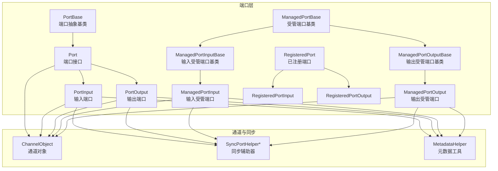
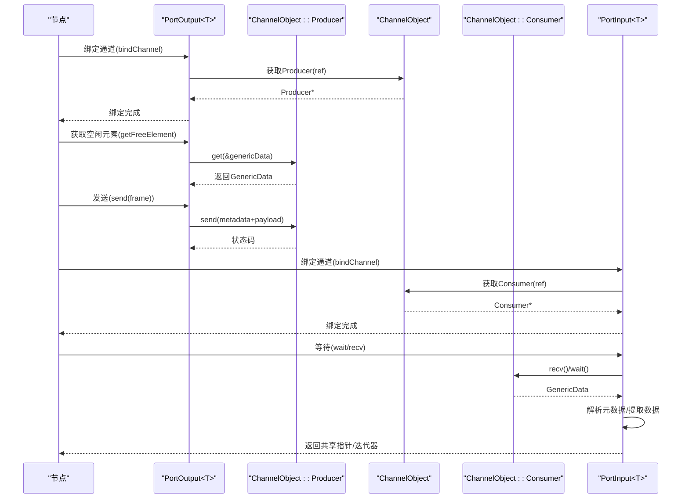
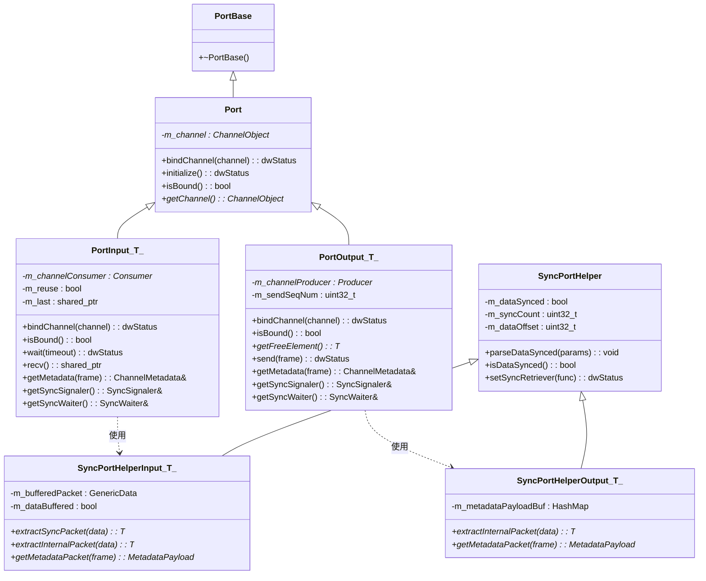
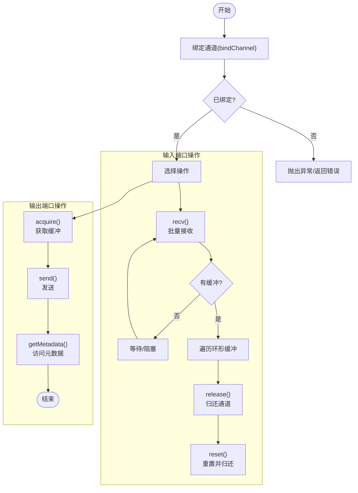
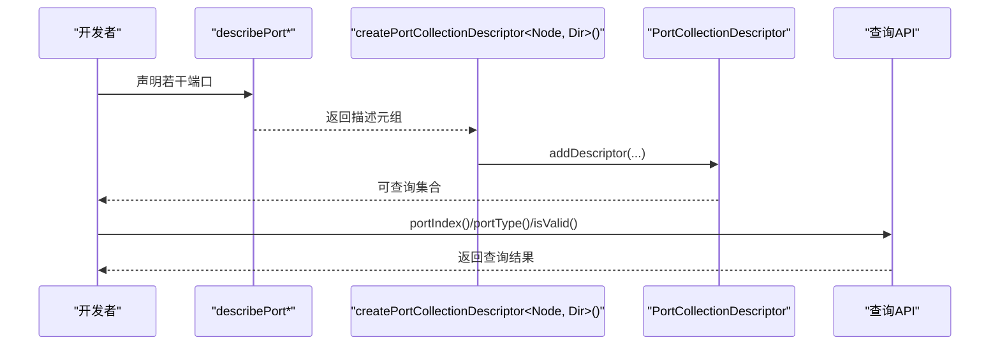
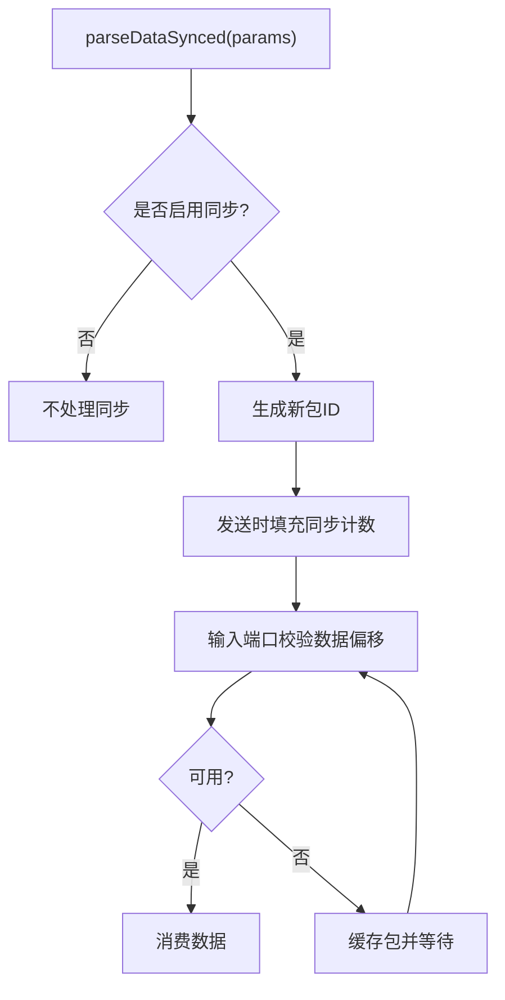
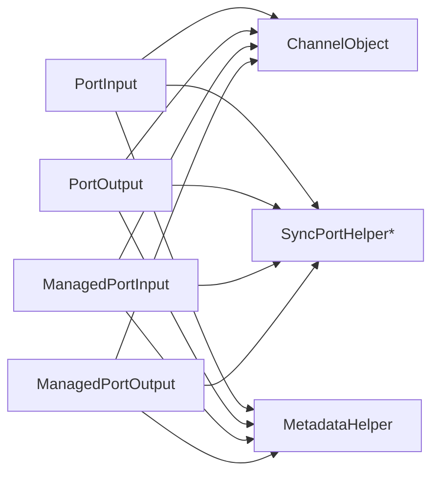

# 端口系统

<cite>
**本文引用的文件**
- [Port.hpp](file://driverorks-5.10/include/dwcgf/port/Port.hpp)
- [ManagedPort.hpp](file://driverorks-5.10/include/dwcgf/port/ManagedPort.hpp)
- [RegisteredPort.hpp](file://driverorks-5.10/include/dwcgf/port/RegisteredPort.hpp)
- [PortDescriptor.hpp](file://driverorks-5.10/include/dwcgf/port/PortDescriptor.hpp)
- [PortCollectionDescriptor.hpp](file://driverorks-5.10/include/dwcgf/port/PortCollectionDescriptor.hpp)
- [SyncPortHelper.hpp](file://driverorks-5.10/include/dwcgf/port/SyncPortHelper.hpp)
- [Channel.hpp](file://driverorks-5.10/include/dwcgf/channel/Channel.hpp)
- [MetadataHelper.hpp](file://driverorks-5.10/include/dwcgf/port/MetadataHelper.hpp)
</cite>

## 目录
1. [引言](#引言)
2. [项目结构](#项目结构)
3. [核心组件](#核心组件)
4. [架构总览](#架构总览)
5. [详细组件分析](#详细组件分析)
6. [依赖分析](#依赖分析)
7. [性能考虑](#性能考虑)
8. [故障排查指南](#故障排查指南)
9. [结论](#结论)
10. [附录](#附录)

## 引言
本技术文档围绕 CGF（Compute Graph Framework）端口系统展开，系统性阐述端口抽象基类的设计理念、输入端口与输出端口的实现差异、数据流向与缓冲机制、同步策略、端口集合描述符的使用方法、端口配置最佳实践、端口与通道的绑定关系、数据传输机制与错误处理策略，并提供端口开发的完整示例流程与性能优化建议。目标是帮助开发者快速理解并正确使用端口系统，构建稳定高效的节点间数据通路。

## 项目结构
端口系统位于驱动库的端口子模块中，核心文件包括：
- 基础端口抽象与输入/输出模板：Port.hpp
- 受管理端口（带缓冲与生命周期管理）：ManagedPort.hpp
- 已注册端口（带端口 ID 的输入/输出）：RegisteredPort.hpp
- 端口描述符与集合描述符（用于节点元数据声明与查询）：PortDescriptor.hpp、PortCollectionDescriptor.hpp
- 同步端口辅助器（索引/时序同步、偏移校验等）：SyncPortHelper.hpp
- 通道接口与元数据工具：Channel.hpp、MetadataHelper.hpp

图表来源
- [Port.hpp:58-543](file://driverorks-5.10/include/dwcgf/port/Port.hpp#L58-L543)
- [ManagedPort.hpp:48-569](file://driverorks-5.10/include/dwcgf/port/ManagedPort.hpp#L48-L569)
- [RegisteredPort.hpp:43-95](file://driverorks-5.10/include/dwcgf/port/RegisteredPort.hpp#L43-L95)
- [SyncPortHelper.hpp:47-262](file://driverorks-5.10/include/dwcgf/port/SyncPortHelper.hpp#L47-L262)
- [Channel.hpp](file://driverorks-5.10/include/dwcgf/channel/Channel.hpp)
- [MetadataHelper.hpp](file://driverorks-5.10/include/dwcgf/port/MetadataHelper.hpp)

章节来源
- [Port.hpp:58-543](file://driverorks-5.10/include/dwcgf/port/Port.hpp#L58-L543)
- [ManagedPort.hpp:48-569](file://driverorks-5.10/include/dwcgf/port/ManagedPort.hpp#L48-L569)
- [RegisteredPort.hpp:43-95](file://driverorks-5.10/include/dwcgf/port/RegisteredPort.hpp#L43-L95)
- [PortDescriptor.hpp:49-465](file://driverorks-5.10/include/dwcgf/port/PortDescriptor.hpp#L49-L465)
- [PortCollectionDescriptor.hpp:55-182](file://driverorks-5.10/include/dwcgf/port/PortCollectionDescriptor.hpp#L55-L182)
- [SyncPortHelper.hpp:47-262](file://driverorks-5.10/include/dwcgf/port/SyncPortHelper.hpp#L47-L262)
- [Channel.hpp](file://driverorks-5.10/include/dwcgf/channel/Channel.hpp)
- [MetadataHelper.hpp](file://driverorks-5.10/include/dwcgf/port/MetadataHelper.hpp)

## 核心组件
- 端口抽象基类与方向枚举：定义端口方向（输入/输出），统一端口接口，便于上层节点以一致方式访问。
- 输入端口 PortInput<T>：封装消费者通道，提供等待、接收、元数据访问与同步围栏设置能力；支持复用与缓冲策略。
- 输出端口 PortOutput<T>：封装生产者通道，提供获取空闲元素、发送、元数据填充与同步围栏设置能力。
- 受管理端口 ManagedPort*：在类型无关层面封装缓冲所有权与生命周期，提供 acquire/send/recv/release/reset 等高级操作。
- 已注册端口 RegisteredPort*：在端口基础上附加端口 ID，便于运行时定位与管理。
- 端口描述符与集合描述符：通过编译期描述 API 提供节点端口清单、数组端口、绑定要求与注释信息，支持运行时查询。
- 同步辅助器 SyncPortHelper*：解析通道参数中的同步状态，生成/校验同步计数，处理跨边界数据偏移与可用性判断。

章节来源
- [Port.hpp:51-56](file://driverorks-5.10/include/dwcgf/port/Port.hpp#L51-L56)
- [Port.hpp:65-78](file://driverorks-5.10/include/dwcgf/port/Port.hpp#L65-L78)
- [Port.hpp:88-272](file://driverorks-5.10/include/dwcgf/port/Port.hpp#L88-L272)
- [Port.hpp:285-534](file://driverorks-5.10/include/dwcgf/port/Port.hpp#L285-L534)
- [ManagedPort.hpp:48-202](file://driverorks-5.10/include/dwcgf/port/ManagedPort.hpp#L48-L202)
- [ManagedPort.hpp:207-346](file://driverorks-5.10/include/dwcgf/port/ManagedPort.hpp#L207-L346)
- [ManagedPort.hpp:369-560](file://driverorks-5.10/include/dwcgf/port/ManagedPort.hpp#L369-L560)
- [RegisteredPort.hpp:43-95](file://driverorks-5.10/include/dwcgf/port/RegisteredPort.hpp#L43-L95)
- [PortDescriptor.hpp:49-465](file://driverorks-5.10/include/dwcgf/port/PortDescriptor.hpp#L49-L465)
- [PortCollectionDescriptor.hpp:55-182](file://driverorks-5.10/include/dwcgf/port/PortCollectionDescriptor.hpp#L55-L182)
- [SyncPortHelper.hpp:47-262](file://driverorks-5.10/include/dwcgf/port/SyncPortHelper.hpp#L47-L262)

## 架构总览
端口系统围绕“通道对象”进行数据传输，输入端口从通道消费者接收数据，输出端口向通道生产者发送数据。同步辅助器贯穿其中，负责同步计数、数据偏移与可用性校验。受管理端口在更高层抽象了缓冲生命周期与批量收发逻辑，简化节点开发。

图表来源
- [Port.hpp:127-272](file://driverorks-5.10/include/dwcgf/port/Port.hpp#L127-L272)
- [Port.hpp:334-534](file://driverorks-5.10/include/dwcgf/port/Port.hpp#L334-L534)
- [Channel.hpp](file://driverorks-5.10/include/dwcgf/channel/Channel.hpp)

## 详细组件分析

### 端口抽象与输入/输出端口
- 设计原则
  - 方向枚举 PortDirection 明确区分 INPUT/OUTPUT/COUNT。
  - PortBase 作为抽象基类，Port 作为通用接口，派生出输入/输出两类具体端口。
  - 输入/输出端口均继承同步辅助器，以支持同步数据包的索引与偏移校验。
- 数据流向
  - 输出端口：节点侧调用 getFreeElement 获取可写缓冲，填充数据后 send 到下游消费者。
  - 输入端口：节点侧调用 wait/recv 等待并接收数据，内部可能缓存一个不可消费的包以保证有序性。
- 缓冲与复用
  - 输入端口支持 enableReuse 与内部 m_last 缓存，避免重复分配；受管理输入端口支持环形缓冲与批量接收。
  - 输出端口通过 Producer 生命周期持有单个缓冲，发送后释放。
- 同步策略
  - 同步辅助器解析通道参数，决定是否启用同步；当启用时，输出端口填充序列号与迭代计数，输入端口按数据偏移校验可用性。
- 错误处理
  - 绑定时若通道为空或重复绑定会抛出异常；未绑定直接调用发送/等待会返回不可用状态；内部类型提取失败抛出异常。

图表来源
- [Port.hpp:58-543](file://driverorks-5.10/include/dwcgf/port/Port.hpp#L58-L543)
- [SyncPortHelper.hpp:47-262](file://driverorks-5.10/include/dwcgf/port/SyncPortHelper.hpp#L47-L262)

章节来源
- [Port.hpp:51-56](file://driverorks-5.10/include/dwcgf/port/Port.hpp#L51-L56)
- [Port.hpp:65-78](file://driverorks-5.10/include/dwcgf/port/Port.hpp#L65-L78)
- [Port.hpp:88-272](file://driverorks-5.10/include/dwcgf/port/Port.hpp#L88-L272)
- [Port.hpp:285-534](file://driverorks-5.10/include/dwcgf/port/Port.hpp#L285-L534)
- [SyncPortHelper.hpp:47-262](file://driverorks-5.10/include/dwcgf/port/SyncPortHelper.hpp#L47-L262)

### 受管理端口（ManagedPort）
- 设计目标
  - 在类型无关层面封装缓冲所有权与生命周期，屏蔽通道细节，提供 acquire/send/recv/release/reset 等高层操作。
- 输入端口（ManagedPortInputBase/ManagedPortInput<T>）
  - 支持构造属性 ConstructProperties（最大并发缓冲数、等待时间）、绑定属性 BoundProperties（复用开关、同步开关、数据偏移）。
  - recv() 可批量接收，内部维护环形缓冲；release() 将缓冲归还通道；reset() 归还并重置周期计数。
- 输出端口（ManagedPortOutputBase/ManagedPortOutput<T>）
  - 提供 acquire() 获取缓冲、send() 发送、getMetadata() 访问元数据；支持回调 before-send。
- 同步与锁步
  - 可绑定锁步同步客户端，发送提前时间戳包；支持周期计数与周期设置。

图表来源
- [ManagedPort.hpp:207-346](file://driverorks-5.10/include/dwcgf/port/ManagedPort.hpp#L207-L346)
- [ManagedPort.hpp:117-202](file://driverorks-5.10/include/dwcgf/port/ManagedPort.hpp#L117-L202)
- [ManagedPort.hpp:369-560](file://driverorks-5.10/include/dwcgf/port/ManagedPort.hpp#L369-L560)

章节来源
- [ManagedPort.hpp:48-346](file://driverorks-5.10/include/dwcgf/port/ManagedPort.hpp#L48-L346)
- [ManagedPort.hpp:369-560](file://driverorks-5.10/include/dwcgf/port/ManagedPort.hpp#L369-L560)

### 已注册端口（RegisteredPort）
- 作用
  - 在端口基础上附加端口 ID，便于运行时根据 ID 定位端口实例，支持节点内多端口场景。
- 类型
  - RegisteredPortInput<T>/RegisteredPortOutput<T> 分别继承对应输入/输出端口与 RegisteredPort。

章节来源
- [RegisteredPort.hpp:43-95](file://driverorks-5.10/include/dwcgf/port/RegisteredPort.hpp#L43-L95)

### 端口描述符与集合描述符
- 端口描述符 API
  - describePort/describePortArray：声明端口类型名、名称、绑定要求、注释与数组大小。
  - describePorts<Node, Direction>：获取节点某方向的所有端口描述元组。
  - 查询接口：descriptorPortSize/descriptorPortBinding/descriptorPortComment/portType/portIndex/portArraySize 等。
- 集合描述符
  - PortCollectionDescriptor：将编译期描述转换为运行时可查询的集合，支持添加描述符、校验索引有效性、按标识符查询端口索引与描述符。

图表来源
- [PortDescriptor.hpp:51-465](file://driverorks-5.10/include/dwcgf/port/PortDescriptor.hpp#L51-L465)
- [PortCollectionDescriptor.hpp:90-182](file://driverorks-5.10/include/dwcgf/port/PortCollectionDescriptor.hpp#L90-L182)

章节来源
- [PortDescriptor.hpp:49-465](file://driverorks-5.10/include/dwcgf/port/PortDescriptor.hpp#L49-L465)
- [PortCollectionDescriptor.hpp:55-182](file://driverorks-5.10/include/dwcgf/port/PortCollectionDescriptor.hpp#L55-L182)

### 同步端口辅助器（SyncPortHelper）
- 功能
  - 解析通道参数中的同步状态，生成新的包类型 ID；输出端口发送时填充同步计数；输入端口按当前同步计数与数据偏移校验包可用性。
- 关键点
  - 跨管道边界时，数据偏移非零，输入端口需等待至可用；内部维护缓冲以保留不可消费包，确保有序消费。
  - 输出端口维护元数据包到帧指针的映射，以便后续元数据访问。

图表来源
- [SyncPortHelper.hpp:47-262](file://driverorks-5.10/include/dwcgf/port/SyncPortHelper.hpp#L47-L262)

章节来源
- [SyncPortHelper.hpp:47-262](file://driverorks-5.10/include/dwcgf/port/SyncPortHelper.hpp#L47-L262)

## 依赖分析
- 组件耦合
  - 输入/输出端口强依赖通道对象（Producer/Consumer）与同步辅助器；受管理端口进一步封装通道细节。
  - 端口描述符与集合描述符仅在编译期参与类型推导与查询，运行时通过集合描述符访问。
- 外部依赖
  - 通道接口 ChannelObject、通道参数 ChannelParams、元数据工具 MetadataHelper。
  - 同步原语 NvSciSync（通过通道封装）。

图表来源
- [Port.hpp:88-534](file://driverorks-5.10/include/dwcgf/port/Port.hpp#L88-L534)
- [ManagedPort.hpp:117-560](file://driverorks-5.10/include/dwcgf/port/ManagedPort.hpp#L117-L560)
- [SyncPortHelper.hpp:47-262](file://driverorks-5.10/include/dwcgf/port/SyncPortHelper.hpp#L47-L262)
- [Channel.hpp](file://driverorks-5.10/include/dwcgf/channel/Channel.hpp)
- [MetadataHelper.hpp](file://driverorks-5.10/include/dwcgf/port/MetadataHelper.hpp)

章节来源
- [Port.hpp:88-534](file://driverorks-5.10/include/dwcgf/port/Port.hpp#L88-L534)
- [ManagedPort.hpp:117-560](file://driverorks-5.10/include/dwcgf/port/ManagedPort.hpp#L117-L560)
- [SyncPortHelper.hpp:47-262](file://driverorks-5.10/include/dwcgf/port/SyncPortHelper.hpp#L47-L262)
- [Channel.hpp](file://driverorks-5.10/include/dwcgf/channel/Channel.hpp)
- [MetadataHelper.hpp](file://driverorks-5.10/include/dwcgf/port/MetadataHelper.hpp)

## 性能考虑
- 批量接收与环形缓冲
  - 受管理输入端口支持批量接收与环形缓冲，减少频繁系统调用与上下文切换开销。
- 缓冲复用
  - 输入端口的 enableReuse 与受管理端口的 reset() 可降低内存分配与拷贝成本。
- 等待策略
  - 合理设置等待时间与超时，避免忙等；对同步数据包，必要时使用零等待以配合锁步。
- 元数据与类型提取
  - 避免重复提取元数据；受管理端口内部维护映射表，减少查找成本。
- 同步偏移与可用性
  - 正确配置数据偏移，避免不必要的缓存与重试；在跨边界场景下，尽量减少同步计数波动。

## 故障排查指南
- 绑定错误
  - 通道为空或重复绑定：检查 bindChannel 参数与调用时机；确保每个端口只绑定一次。
- 未绑定直接调用
  - 发送/等待/元数据访问前必须确认 isBound()；否则会触发不可用错误。
- 类型不匹配
  - 元数据包类型提取失败会抛出异常；确保通道参考与实际数据类型一致。
- 同步问题
  - 输入端口返回不可用或无数据：检查同步计数、数据偏移与锁步客户端状态；确认上游已发送同步包。
- 回调与围栏
  - 设置信号/等待围栏失败：确认通道已绑定且端口处于有效状态；核对 Fence 数组长度与顺序。

章节来源
- [Port.hpp:127-272](file://driverorks-5.10/include/dwcgf/port/Port.hpp#L127-L272)
- [Port.hpp:334-534](file://driverorks-5.10/include/dwcgf/port/Port.hpp#L334-L534)
- [ManagedPort.hpp:117-346](file://driverorks-5.10/include/dwcgf/port/ManagedPort.hpp#L117-L346)
- [SyncPortHelper.hpp:224-251](file://driverorks-5.10/include/dwcgf/port/SyncPortHelper.hpp#L224-L251)

## 结论
CGF 端口系统通过抽象基类与模板化输入/输出端口，结合受管理端口与同步辅助器，提供了清晰的数据流控制、缓冲管理与同步保障。端口描述符体系使得节点端口声明与查询具备强类型与可扩展性。遵循本文的配置与开发实践，可显著提升端口使用的稳定性与性能。

## 附录

### 端口开发完整示例（步骤说明）
- 步骤 1：声明端口
  - 使用 describePort/describePortArray 在节点中声明输入/输出端口，指定类型名、名称、绑定要求与注释。
- 步骤 2：实现节点
  - 在节点中定义 PortInput<T>/PortOutput<T> 或 ManagedPortInput<T>/ManagedPortOutput<T> 成员。
- 步骤 3：绑定通道
  - 在节点初始化阶段调用 bindChannel，传入对应通道对象；确保通道参数与端口类型匹配。
- 步骤 4：数据收发
  - 输入端口：wait/recv 获取数据；受管理端口：recv/release 批量处理；输出端口：getFreeElement/send 发送数据。
- 步骤 5：同步与复用
  - 若启用同步，确保上游/下游均为同步端口；合理配置数据偏移；必要时开启复用以降低分配成本。
- 步骤 6：查询与验证
  - 使用集合描述符查询端口索引与类型，验证标识符有效性；在运行时根据端口 ID 进行定位。

章节来源
- [PortDescriptor.hpp:51-465](file://driverorks-5.10/include/dwcgf/port/PortDescriptor.hpp#L51-L465)
- [PortCollectionDescriptor.hpp:90-182](file://driverorks-5.10/include/dwcgf/port/PortCollectionDescriptor.hpp#L90-L182)
- [Port.hpp:127-272](file://driverorks-5.10/include/dwcgf/port/Port.hpp#L127-L272)
- [Port.hpp:334-534](file://driverorks-5.10/include/dwcgf/port/Port.hpp#L334-L534)
- [ManagedPort.hpp:117-560](file://driverorks-5.10/include/dwcgf/port/ManagedPort.hpp#L117-L560)