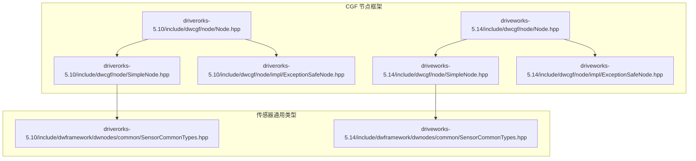
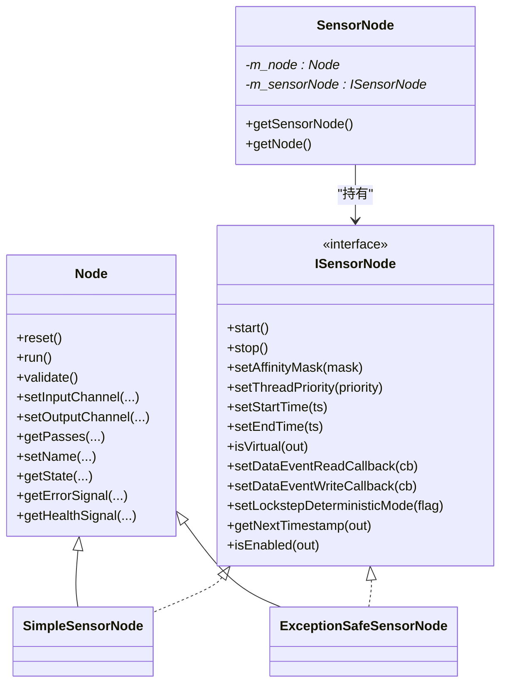
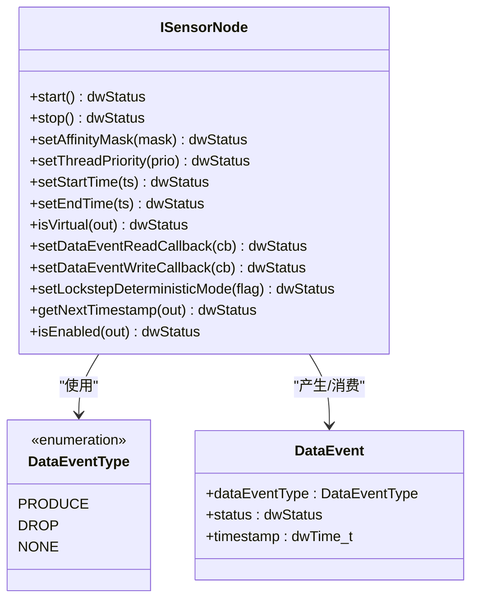
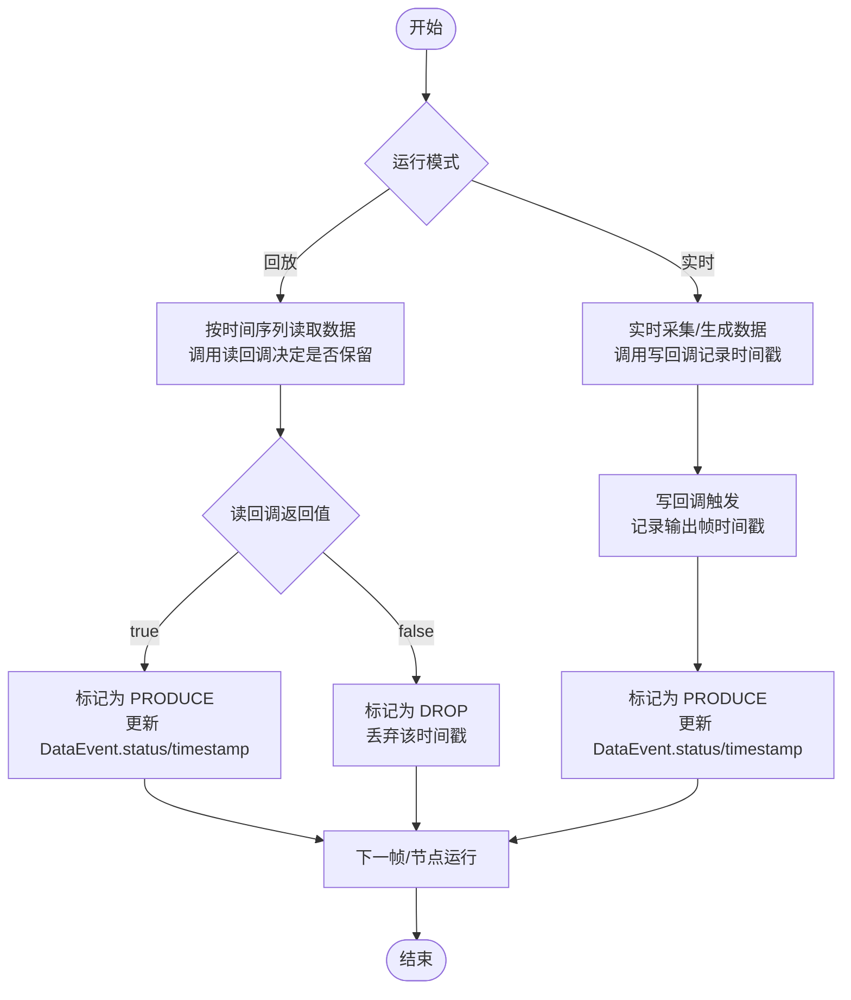
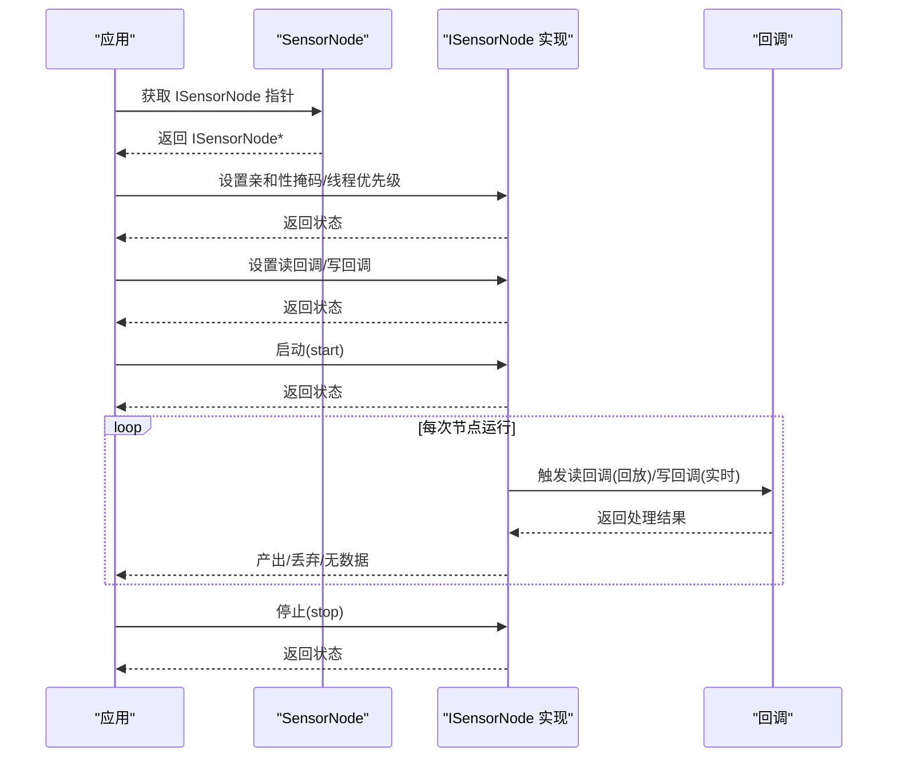
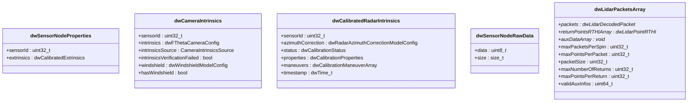
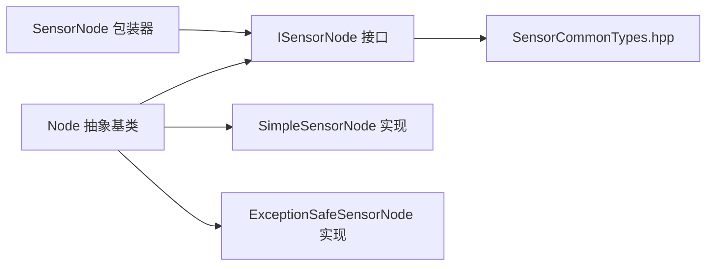

# 传感器节点接口

<cite>
**本文引用的文件**
- [Node.hpp](file://driverorks-5.10/include/dwcgf/node/Node.hpp)
- [Node.hpp](file://driveworks-5.14/include/dwcgf/node/Node.hpp)
- [SensorCommonTypes.hpp](file://driverorks-5.10/include/dwframework/dwnodes/common/SensorCommonTypes.hpp)
- [SensorCommonTypes.hpp](file://driveworks-5.14/include/dwframework/dwnodes/common/SensorCommonTypes.hpp)
- [SimpleNode.hpp](file://driverorks-5.10/include/dwcgf/node/SimpleNode.hpp)
- [ExceptionSafeNode.hpp](file://driverorks-5.10/include/dwcgf/node/impl/ExceptionSafeNode.hpp)
- [SimpleNode.hpp](file://driveworks-5.14/include/dwcgf/node/SimpleNode.hpp)
- [ExceptionSafeNode.hpp](file://driveworks-5.14/include/dwcgf/node/impl/ExceptionSafeNode.hpp)
</cite>

## 目录
1. [引言](#引言)
2. [项目结构](#项目结构)
3. [核心组件](#核心组件)
4. [架构总览](#架构总览)
5. [详细组件分析](#详细组件分析)
6. [依赖关系分析](#依赖关系分析)
7. [性能考量](#性能考量)
8. [故障排查指南](#故障排查指南)
9. [结论](#结论)
10. [附录](#附录)

## 引言
本技术文档围绕 CGF 传感器节点接口 ISensorNode 进行系统化说明，目标是帮助开发者理解并正确实现传感器节点的启动/停止、亲和性掩码与线程优先级设置、数据事件类型与回调机制，以及在 CGF 执行图中的数据流处理最佳实践。文档同时给出类关系图、调用时序图与流程图，帮助读者从不同维度把握接口设计与实现要点。

## 项目结构
与 ISensorNode 接口直接相关的头文件主要位于驱动库的 CGF 框架与节点层中，版本差异体现在接口细节与扩展能力上。下图展示了与传感器节点接口相关的关键文件及其角色定位。

**图表来源**
- [Node.hpp:276-386](file://driverorks-5.10/include/dwcgf/node/Node.hpp#L276-L386)
- [Node.hpp:325-442](file://driveworks-5.14/include/dwcgf/node/Node.hpp#L325-L442)
- [SimpleNode.hpp:612-612](file://driverorks-5.10/include/dwcgf/node/SimpleNode.hpp#L612-L612)
- [SimpleNode.hpp:588-588](file://driveworks-5.14/include/dwcgf/node/SimpleNode.hpp#L588-L588)
- [ExceptionSafeNode.hpp:102-102](file://driverorks-5.10/include/dwcgf/node/impl/ExceptionSafeNode.hpp#L102-L102)
- [ExceptionSafeNode.hpp:121-121](file://driveworks-5.14/include/dwcgf/node/impl/ExceptionSafeNode.hpp#L121-L121)
- [SensorCommonTypes.hpp:47-116](file://driverorks-5.10/include/dwframework/dwnodes/common/SensorCommonTypes.hpp#L47-L116)
- [SensorCommonTypes.hpp:47-146](file://driveworks-5.14/include/dwframework/dwnodes/common/SensorCommonTypes.hpp#L47-L146)

**章节来源**
- [Node.hpp:276-386](file://driverorks-5.10/include/dwcgf/node/Node.hpp#L276-L386)
- [Node.hpp:325-442](file://driveworks-5.14/include/dwcgf/node/Node.hpp#L325-L442)

## 核心组件
本节聚焦 ISensorNode 接口的职责与关键方法，涵盖传感器生命周期控制、硬件相关配置、数据事件模型与回调机制。

- 传感器生命周期控制
  - 启动：用于激活传感器采集或数据生成流程
  - 停止：用于释放资源、结束采集或数据生成
- 硬件相关配置
  - 亲和性掩码设置：将传感器线程绑定到特定 CPU 核心集合
  - 线程优先级设置：调整传感器线程调度优先级
  - 时间窗口设置：为回放模式设定起止时间戳
  - 是否虚拟传感器：区分实时与虚拟（回放）场景
- 数据事件模型
  - DataEventType 枚举：PRODUCE/DROP/NONE，分别表示产生数据、丢弃数据、无数据
  - DataEvent 结构体：包含事件类型、状态码、时间戳
- 回调机制
  - 读回调：回放模式下按时间序列过滤有效帧
  - 写回调：实时模式下输出每帧的时间戳供外部记录或同步

**章节来源**
- [Node.hpp:276-386](file://driverorks-5.10/include/dwcgf/node/Node.hpp#L276-L386)
- [Node.hpp:325-442](file://driveworks-5.14/include/dwcgf/node/Node.hpp#L325-L442)

## 架构总览
下图展示了 ISensorNode 与其典型实现的关系，以及与 CGF 节点框架的集成方式。

**图表来源**
- [Node.hpp:64-275](file://driverorks-5.10/include/dwcgf/node/Node.hpp#L64-L275)
- [Node.hpp:276-386](file://driverorks-5.10/include/dwcgf/node/Node.hpp#L276-L386)
- [Node.hpp:65-324](file://driveworks-5.14/include/dwcgf/node/Node.hpp#L65-L324)
- [Node.hpp:325-442](file://driveworks-5.14/include/dwcgf/node/Node.hpp#L325-L442)
- [SimpleNode.hpp:612-612](file://driverorks-5.10/include/dwcgf/node/SimpleNode.hpp#L612-L612)
- [ExceptionSafeNode.hpp:102-102](file://driverorks-5.10/include/dwcgf/node/impl/ExceptionSafeNode.hpp#L102-L102)
- [SimpleNode.hpp:588-588](file://driveworks-5.14/include/dwcgf/node/SimpleNode.hpp#L588-L588)
- [ExceptionSafeNode.hpp:121-121](file://driveworks-5.14/include/dwcgf/node/impl/ExceptionSafeNode.hpp#L121-L121)

## 详细组件分析

### ISensorNode 接口详解
- 方法族概览
  - 生命周期：start()/stop()
  - 硬件绑定：setAffinityMask()/setThreadPriority()
  - 回放控制：setStartTime()/setEndTime()/isVirtual()/setLockstepDeterministicMode()
  - 数据事件：setDataEventReadCallback()/setDataEventWriteCallback()/getNextTimestamp()
  - 可用性：isEnabled()（5.14 版本新增）
- 数据事件模型
  - DataEventType：PRODUCE/DROP/NONE
  - DataEvent：dataEventType/status/timestamp
- 回调约定
  - 读回调：返回 true 表示保留该时间戳，false 表示丢弃
  - 写回调：每次输出一帧时被调用，携带 DataEvent

**图表来源**
- [Node.hpp:276-386](file://driverorks-5.10/include/dwcgf/node/Node.hpp#L276-L386)
- [Node.hpp:325-442](file://driveworks-5.14/include/dwcgf/node/Node.hpp#L325-L442)

**章节来源**
- [Node.hpp:276-386](file://driverorks-5.10/include/dwcgf/node/Node.hpp#L276-L386)
- [Node.hpp:325-442](file://driveworks-5.14/include/dwcgf/node/Node.hpp#L325-L442)

### 数据事件处理流程
下图展示回放与实时两种模式下的数据事件处理流程，强调读回调与写回调的时机与作用。

**图表来源**
- [Node.hpp:322-378](file://driverorks-5.10/include/dwcgf/node/Node.hpp#L322-L378)
- [Node.hpp:371-427](file://driveworks-5.14/include/dwcgf/node/Node.hpp#L371-L427)

**章节来源**
- [Node.hpp:322-378](file://driverorks-5.10/include/dwcgf/node/Node.hpp#L322-L378)
- [Node.hpp:371-427](file://driveworks-5.14/include/dwcgf/node/Node.hpp#L371-L427)

### 典型实现与使用示例
- 简单实现：SimpleSensorNode
  - 继承自 Node 并实现 ISensorNode，适合快速原型与示例
- 异常安全实现：ExceptionSafeSensorNode
  - 在异常安全框架下实现 ISensorNode，适合生产环境对鲁棒性的要求
- 使用 SensorNode 包装器
  - 通过 SensorNode 将任意 Node 强转为 ISensorNode 并进行安全检查

**图表来源**
- [Node.hpp:387-436](file://driverorks-5.10/include/dwcgf/node/Node.hpp#L387-L436)
- [Node.hpp:443-480](file://driveworks-5.14/include/dwcgf/node/Node.hpp#L443-L480)
- [SimpleNode.hpp:612-612](file://driverorks-5.10/include/dwcgf/node/SimpleNode.hpp#L612-L612)
- [ExceptionSafeNode.hpp:102-102](file://driverorks-5.10/include/dwcgf/node/impl/ExceptionSafeNode.hpp#L102-L102)
- [SimpleNode.hpp:588-588](file://driveworks-5.14/include/dwcgf/node/SimpleNode.hpp#L588-L588)
- [ExceptionSafeNode.hpp:121-121](file://driveworks-5.14/include/dwcgf/node/impl/ExceptionSafeNode.hpp#L121-L121)

**章节来源**
- [Node.hpp:387-436](file://driverorks-5.10/include/dwcgf/node/Node.hpp#L387-L436)
- [Node.hpp:443-480](file://driveworks-5.14/include/dwcgf/node/Node.hpp#L443-L480)

### 传感器通用数据类型
传感器节点通常与多种传感器类型协作，通用类型定义了传感器属性、相机内参、雷达内参、原始数据与 Lidar 数据聚合等结构，便于跨节点复用。

- 关键结构
  - 传感器属性：sensorId、外参
  - 相机内参：sensorId、内参源、风挡模型等
  - 雷达内参：方位校正模型、标定状态等
  - 原始数据：指针+大小
  - Lidar 数据聚合：包数组、点云数组、辅助数据、返回设置与有效辅助信息位图

**图表来源**
- [SensorCommonTypes.hpp:47-116](file://driverorks-5.10/include/dwframework/dwnodes/common/SensorCommonTypes.hpp#L47-L116)
- [SensorCommonTypes.hpp:47-146](file://driveworks-5.14/include/dwframework/dwnodes/common/SensorCommonTypes.hpp#L47-L146)

**章节来源**
- [SensorCommonTypes.hpp:47-116](file://driverorks-5.10/include/dwframework/dwnodes/common/SensorCommonTypes.hpp#L47-L116)
- [SensorCommonTypes.hpp:47-146](file://driveworks-5.14/include/dwframework/dwnodes/common/SensorCommonTypes.hpp#L47-L146)

## 依赖关系分析
- 接口与实现解耦
  - Node 作为基础抽象，ISensorNode 作为可选能力接口，具体传感器节点通过继承 Node 并实现 ISensorNode 提供能力
- 包装器与安全层
  - SensorNode 提供统一访问入口，并在构造时进行类型断言，避免错误使用
  - ExceptionSafeSensorNode 在异常安全框架下实现 ISensorNode，提升鲁棒性
- 类型复用
  - 传感器通用类型集中于 SensorCommonTypes.hpp，简化多传感器节点的实现与维护

**图表来源**
- [Node.hpp:64-275](file://driverorks-5.10/include/dwcgf/node/Node.hpp#L64-L275)
- [Node.hpp:276-386](file://driverorks-5.10/include/dwcgf/node/Node.hpp#L276-L386)
- [Node.hpp:65-324](file://driveworks-5.14/include/dwcgf/node/Node.hpp#L65-L324)
- [Node.hpp:325-442](file://driveworks-5.14/include/dwcgf/node/Node.hpp#L325-L442)
- [SimpleNode.hpp:612-612](file://driverorks-5.10/include/dwcgf/node/SimpleNode.hpp#L612-L612)
- [ExceptionSafeNode.hpp:102-102](file://driverorks-5.10/include/dwcgf/node/impl/ExceptionSafeNode.hpp#L102-L102)
- [SimpleNode.hpp:588-588](file://driveworks-5.14/include/dwcgf/node/SimpleNode.hpp#L588-L588)
- [ExceptionSafeNode.hpp:121-121](file://driveworks-5.14/include/dwcgf/node/impl/ExceptionSafeNode.hpp#L121-L121)
- [SensorCommonTypes.hpp:47-116](file://driverorks-5.10/include/dwframework/dwnodes/common/SensorCommonTypes.hpp#L47-L116)

**章节来源**
- [Node.hpp:64-275](file://driverorks-5.10/include/dwcgf/node/Node.hpp#L64-L275)
- [Node.hpp:65-324](file://driveworks-5.14/include/dwcgf/node/Node.hpp#L65-L324)

## 性能考量
- 线程亲和性与优先级
  - 合理设置亲和性掩码可减少跨核迁移，降低缓存抖动；线程优先级应结合系统负载与实时性需求权衡
- 回放确定性
  - 启用锁步确定性模式有助于调试与一致性验证，但可能带来额外开销
- 数据事件回调
  - 回调逻辑应尽量轻量，避免阻塞传感器线程；重计算或 IO 放到下游通道处理
- 时间戳管理
  - 回放模式下严格依赖读回调的时间序列一致性；实时模式下写回调用于外部同步与日志

## 故障排查指南
- 启停失败
  - 检查 start()/stop() 返回状态，确认资源初始化与释放路径
- 回调未生效
  - 确认 setDataEventReadCallback()/setDataEventWriteCallback() 的设置顺序与生命周期
- 时间戳异常
  - 回放模式下若出现乱序或缺失，核查读回调返回值与时间序列单调性
- 线程绑定无效
  - 检查 setAffinityMask()/setThreadPriority() 的调用时机与平台支持情况

**章节来源**
- [Node.hpp:276-386](file://driverorks-5.10/include/dwcgf/node/Node.hpp#L276-L386)
- [Node.hpp:325-442](file://driveworks-5.14/include/dwcgf/node/Node.hpp#L325-L442)

## 结论
ISensorNode 为 CGF 传感器节点提供了统一的生命周期、硬件绑定与数据事件接口。通过 SimpleSensorNode 与 ExceptionSafeSensorNode，开发者可在原型与生产环境中灵活选择实现；借助 SensorNode 包装器与回调机制，能够高效地接入回放与实时数据流。配合 SensorCommonTypes.hpp 中的通用类型定义，可进一步提升多传感器节点的一致性与可维护性。

## 附录
- 最佳实践清单
  - 明确区分回放与实时模式，分别设置读/写回调
  - 启动前完成所有配置（亲和性、优先级、时间窗口），启动后避免频繁变更
  - 回调中仅做必要操作，避免阻塞传感器线程
  - 使用包装器 SensorNode 访问 ISensorNode，确保类型安全
  - 在异常安全实现下部署，提升系统稳定性