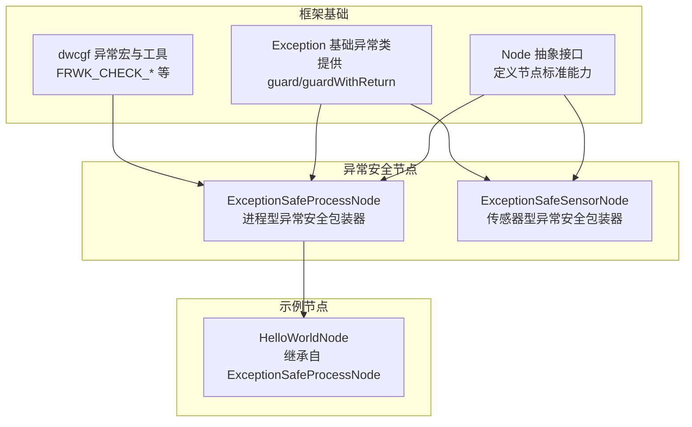
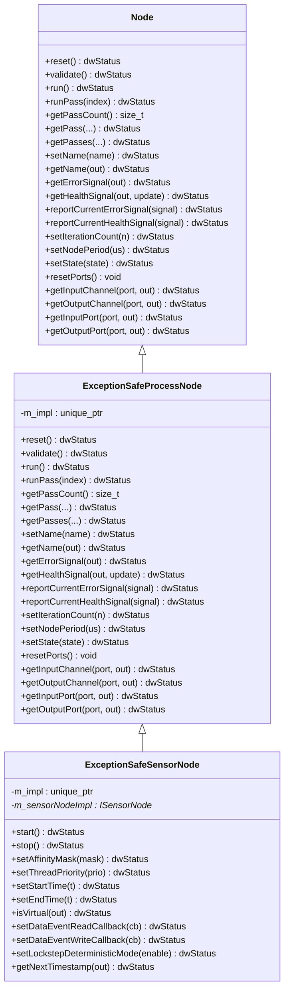
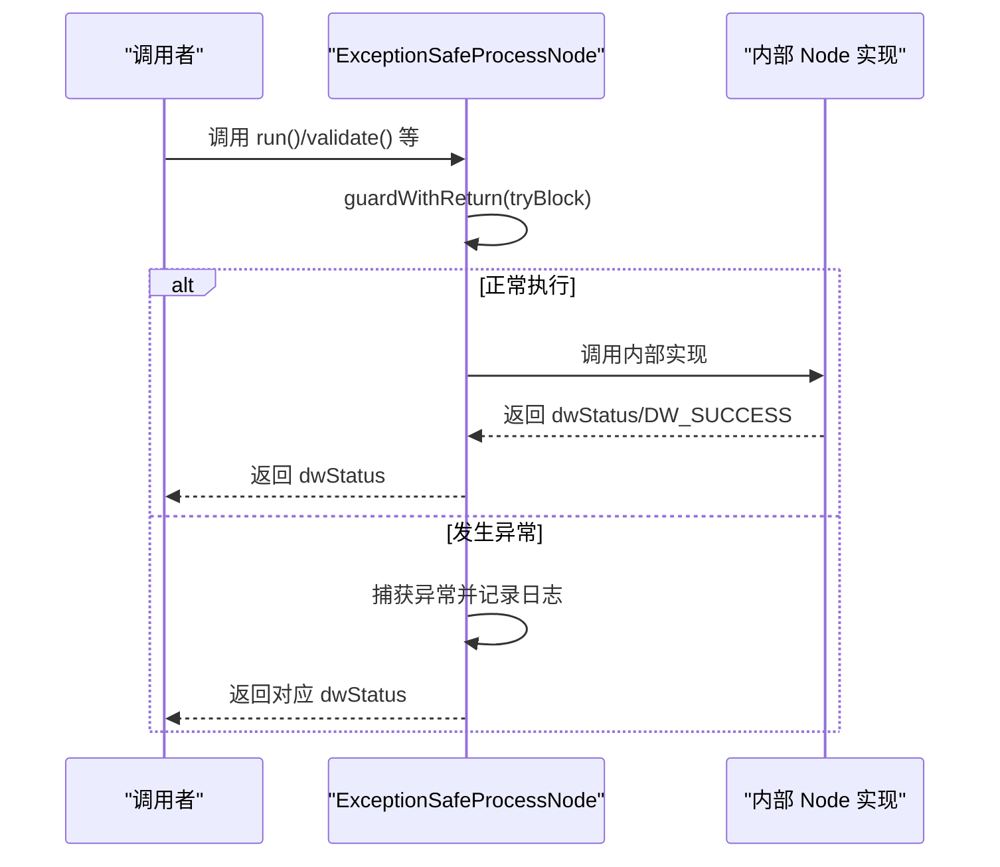
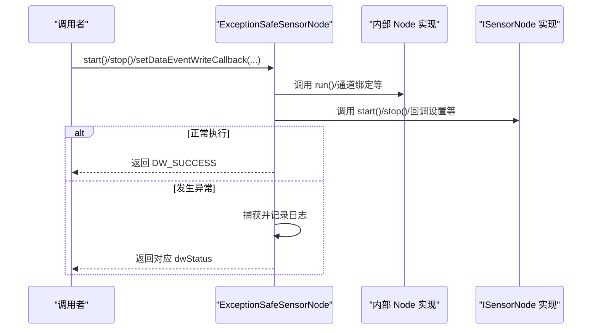
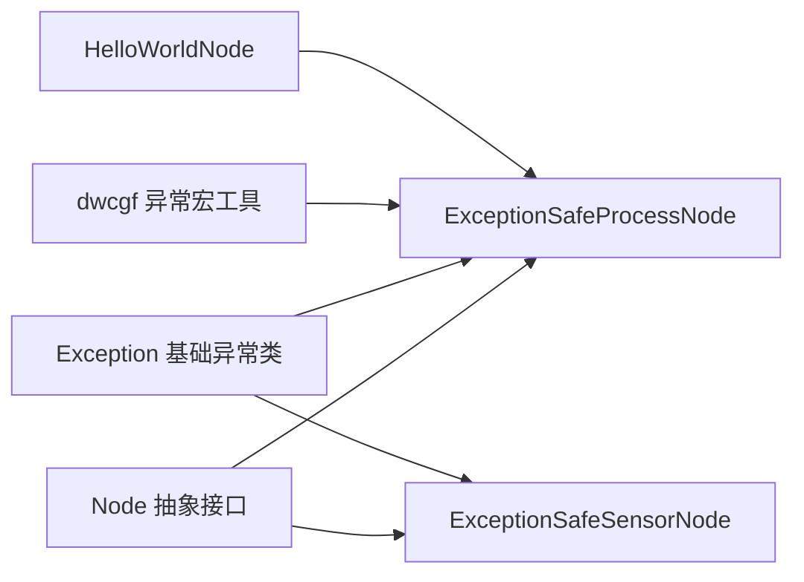

# 异常安全节点

<cite>
**本文引用的文件**
- [ExceptionSafeNode.hpp（driverorks-5.10）](file://driverorks-5.10/include/dwcgf/node/impl/ExceptionSafeNode.hpp)
- [ExceptionSafeNode.hpp（driveworks-5.14）](file://driveworks-5.14/include/dwcgf/node/impl/ExceptionSafeNode.hpp)
- [ExceptionSafeNode.hpp（driveworks-5.8）](file://driveworks-5.8/include/dwcgf/node/impl/ExceptionSafeNode.hpp)
- [Node.hpp](file://driverorks-5.10/include/dwcgf/node/Node.hpp)
- [Exception.hpp（dwcgf）](file://driverorks-5.10/include/dwcgf/Exception.hpp)
- [Exception.hpp（core）](file://driverorks-5.10/include/dw/core/base/Exception.hpp)
- [HelloWorldNode.cpp](file://driverorks-5.10/samples/src/cgf_nodes/HelloWorldNode.cpp)
</cite>

## 目录
1. [引言](#引言)
2. [项目结构](#项目结构)
3. [核心组件](#核心组件)
4. [架构总览](#架构总览)
5. [详细组件分析](#详细组件分析)
6. [依赖关系分析](#依赖关系分析)
7. [性能考量](#性能考量)
8. [故障排查指南](#故障排查指南)
9. [结论](#结论)
10. [附录](#附录)

## 引言
本技术文档围绕 CGF（Compute Graph Framework）中的“异常安全节点”展开，重点解释 ExceptionSafeNode 的设计原理与异常处理机制，涵盖异常捕获与转换、资源清理与恢复、错误状态报告等关键能力。文档将对比异常安全节点与普通节点的差异与优势，并给出最佳实践、常见异常场景的处理策略、实现示例与调试技巧，帮助开发者在节点运行过程中确保系统稳定性与数据完整性。

## 项目结构
异常安全节点相关的核心代码位于以下位置：
- 异常安全节点接口与实现：driverorks-5.10、driveworks-5.14、driveworks-5.8 的头文件中定义了 ExceptionSafeProcessNode 与 ExceptionSafeSensorNode。
- 基类 Node 定义：统一的节点抽象接口，规定了节点生命周期、通道绑定、健康与错误信号上报等能力。
- 异常与状态封装：dwcgf/Exception.hpp 提供宏与工具；dw/core/base/Exception.hpp 提供 Exception 与 ExceptionWithStatus 的 guard/guardWithReturn 等异常捕获与转换机制。
- 示例：samples 中的 HelloWorldNode 等节点通过继承 ExceptionSafeProcessNode 实现异常安全封装。

**图表来源**
- [Node.hpp:64-275](file://driverorks-5.10/include/dwcgf/node/Node.hpp#L64-L275)
- [Exception.hpp（core）:118-335](file://driverorks-5.10/include/dw/core/base/Exception.hpp#L118-L335)
- [ExceptionSafeNode.hpp（driverorks-5.10）:40-101](file://driverorks-5.10/include/dwcgf/node/impl/ExceptionSafeNode.hpp#L40-L101)
- [HelloWorldNode.cpp:47-50](file://driverorks-5.10/samples/src/cgf_nodes/HelloWorldNode.cpp#L47-L50)

**章节来源**
- [Node.hpp:64-275](file://driverorks-5.10/include/dwcgf/node/Node.hpp#L64-L275)
- [Exception.hpp（core）:118-335](file://driverorks-5.10/include/dw/core/base/Exception.hpp#L118-L335)
- [ExceptionSafeNode.hpp（driverorks-5.10）:40-101](file://driverorks-5.10/include/dwcgf/node/impl/ExceptionSafeNode.hpp#L40-L101)
- [HelloWorldNode.cpp:47-50](file://driverorks-5.10/samples/src/cgf_nodes/HelloWorldNode.cpp#L47-L50)

## 核心组件
- ExceptionSafeProcessNode：对 Node 的所有公共接口进行异常安全封装，将内部实现抛出的异常转换为 dwStatus 返回值，同时保留日志与最后异常信息以便上层诊断。
- ExceptionSafeSensorNode：在 ExceptionSafeProcessNode 基础上，进一步代理 ISensorNode 的传感器相关操作，保证传感器启动/停止、时间戳、事件回调等流程的异常安全。
- Node 抽象接口：定义节点的标准生命周期与能力边界，包括 reset、validate、run、runPass、通道绑定、健康/错误信号上报等。
- 异常与状态工具：Exception::guard/guardWithReturn 将底层异常捕获并映射为 dwStatus，支持记录日志、栈追踪与最后异常缓存；dwcgf/Exception.hpp 提供 FRWK_CHECK_* 等便捷宏。

**章节来源**
- [ExceptionSafeNode.hpp（driverorks-5.10）:40-101](file://driverorks-5.10/include/dwcgf/node/impl/ExceptionSafeNode.hpp#L40-L101)
- [ExceptionSafeNode.hpp（driveworks-5.14）:41-119](file://driveworks-5.14/include/dwcgf/node/impl/ExceptionSafeNode.hpp#L41-L119)
- [ExceptionSafeNode.hpp（driveworks-5.8）:40-193](file://driveworks-5.8/include/dwcgf/node/impl/ExceptionSafeNode.hpp#L40-L193)
- [Node.hpp:64-275](file://driverorks-5.10/include/dwcgf/node/Node.hpp#L64-L275)
- [Exception.hpp（core）:198-289](file://driverorks-5.10/include/dw/core/base/Exception.hpp#L198-L289)
- [Exception.hpp（dwcgf）:47-122](file://driverorks-5.10/include/dwcgf/Exception.hpp#L47-L122)

## 架构总览
异常安全节点通过组合模式持有具体实现 Node 的智能指针，对外暴露与 Node 一致的接口，内部以 Exception::guard/guardWithReturn 包裹调用，实现异常到状态码的转换与日志输出。

**图表来源**
- [Node.hpp:64-275](file://driverorks-5.10/include/dwcgf/node/Node.hpp#L64-L275)
- [ExceptionSafeNode.hpp（driverorks-5.10）:40-101](file://driverorks-5.10/include/dwcgf/node/impl/ExceptionSafeNode.hpp#L40-L101)
- [ExceptionSafeNode.hpp（driveworks-5.14）:41-153](file://driveworks-5.14/include/dwcgf/node/impl/ExceptionSafeNode.hpp#L41-L153)

## 详细组件分析

### ExceptionSafeProcessNode 分析
- 设计要点
  - 组合持有 std::unique_ptr<Node> m_impl，避免直接继承导致的二次虚表开销与复杂性。
  - 对所有 Node 接口方法进行 guard/guardWithReturn 包裹，确保异常被捕获并转换为 dwStatus。
  - 保持 getPassCount、getInputChannel/getOutputChannel 等只读方法的无异常行为，直接委托给内部实现。
- 异常处理机制
  - guardWithReturn：捕获多种异常类型（缓冲区满、越界、无效参数、CUDA 错误、dw::core::Exception、ExceptionWithStatus 等），统一记录日志与栈追踪，返回对应 dwStatus。
  - guard：用于无返回值的 void 方法，内部将其包装为返回 DW_SUCCESS 的函数块，再交由 guardWithReturn 处理。
- 资源清理与恢复
  - 通过组合与智能指针管理生命周期，避免资源泄漏；异常发生时不影响外部调用方的控制流，仅返回状态码。
- 错误状态报告
  - 内部实现可继续上报错误/健康信号；异常安全包装器负责将异常转换为状态码并记录日志，便于上层诊断。

**图表来源**
- [Exception.hpp（core）:198-289](file://driverorks-5.10/include/dw/core/base/Exception.hpp#L198-L289)
- [ExceptionSafeNode.hpp（driverorks-5.10）:48-90](file://driverorks-5.10/include/dwcgf/node/impl/ExceptionSafeNode.hpp#L48-L90)

**章节来源**
- [ExceptionSafeNode.hpp（driverorks-5.10）:48-101](file://driverorks-5.10/include/dwcgf/node/impl/ExceptionSafeNode.hpp#L48-L101)
- [Exception.hpp（core）:198-289](file://driverorks-5.10/include/dw/core/base/Exception.hpp#L198-L289)

### ExceptionSafeSensorNode 分析
- 设计要点
  - 在 ExceptionSafeProcessNode 基础上，额外代理 ISensorNode 的传感器相关接口，如 start/stop、线程亲和性、优先级、时间范围、数据事件回调、锁步确定性模式等。
  - 通过 dynamic_cast 获取内部 ISensorNode*，若失败则抛出异常，确保类型一致性。
- 异常处理机制
  - 传感器相关方法同样采用 guard/guardWithReturn 包裹，保证传感器生命周期与数据事件处理过程的异常安全。
- 与普通节点的区别
  - 普通节点通常只关注计算图中的数据处理；传感器节点还需处理实时数据产生、时间同步、数据事件等复杂场景。异常安全包装器在此基础上提供统一的异常防护。

**图表来源**
- [ExceptionSafeNode.hpp（driveworks-5.8）:195-417](file://driveworks-5.8/include/dwcgf/node/impl/ExceptionSafeNode.hpp#L195-L417)
- [Exception.hpp（core）:198-289](file://driverorks-5.10/include/dw/core/base/Exception.hpp#L198-L289)

**章节来源**
- [ExceptionSafeNode.hpp（driveworks-5.8）:195-417](file://driveworks-5.8/include/dwcgf/node/impl/ExceptionSafeNode.hpp#L195-L417)

### 与普通节点的区别与优势
- 区别
  - 普通节点直接暴露内部实现的所有异常；异常安全节点通过 guard/guardWithReturn 将异常转换为状态码，屏蔽底层异常细节。
  - 普通节点在异常发生时可能导致调用方中断或状态不一致；异常安全节点保证调用方获得明确的状态返回，便于上层统一处理。
- 优势
  - 稳定性：异常被集中捕获与记录，避免异常在调用链中扩散。
  - 可诊断性：异常信息被缓存与日志化，便于后续查询与定位。
  - 数据完整性：异常发生时仍能尽量完成必要的清理动作，降低资源泄漏风险。

**章节来源**
- [Exception.hpp（core）:198-289](file://driverorks-5.10/include/dw/core/base/Exception.hpp#L198-L289)
- [ExceptionSafeNode.hpp（driverorks-5.10）:48-90](file://driverorks-5.10/include/dwcgf/node/impl/ExceptionSafeNode.hpp#L48-L90)

### 异常处理最佳实践与常见场景
- 最佳实践
  - 所有对外公开的节点均应使用 ExceptionSafeProcessNode/ExceptionSafeSensorNode 进行包装，确保异常可控。
  - 在节点内部实现中，优先使用 dwcgf/Exception.hpp 提供的 FRWK_CHECK_* 宏进行快速错误检查与抛出，便于上层统一捕获。
  - 对于需要容忍部分错误的路径，使用 FRWK_CHECK_DW_ERROR_NOTHROW 或 FRWK_CHECK_DW_ERROR_NOTHROW_IGNORE_SOME 记录但不抛出，避免影响主流程。
- 常见异常场景
  - 缓冲区满/空：映射为 DW_BUFFER_FULL/DW_NOT_AVAILABLE，记录日志并返回相应状态。
  - 参数非法：映射为 DW_INVALID_ARGUMENT，记录日志并返回状态。
  - CUDA 错误：通过 cudaErrorToDWError 转换后返回，保留栈追踪。
  - 其他 std::exception：统一记录并返回 DW_FAILURE，保留栈追踪。

**章节来源**
- [Exception.hpp（dwcgf）:47-122](file://driverorks-5.10/include/dwcgf/Exception.hpp#L47-L122)
- [Exception.hpp（core）:205-272](file://driverorks-5.10/include/dw/core/base/Exception.hpp#L205-L272)

### 实现示例与调试技巧
- 实现示例
  - HelloWorldNode 通过继承 ExceptionSafeProcessNode 并将自身实现封装为 std::unique_ptr<Node>，从而自动获得异常安全能力。
- 调试技巧
  - 使用 Exception::getLastException 获取最近一次被 guard 捕获的异常状态与消息，辅助定位问题。
  - 利用 guardWithReturn 的 verbosity 参数控制日志级别，便于在开发与生产环境间切换。
  - 在节点内部使用 FRWK_CHECK_* 宏，确保错误路径清晰可追踪。

**章节来源**
- [HelloWorldNode.cpp:47-50](file://driverorks-5.10/samples/src/cgf_nodes/HelloWorldNode.cpp#L47-L50)
- [Exception.hpp（core）:295-295](file://driverorks-5.10/include/dw/core/base/Exception.hpp#L295-L295)

## 依赖关系分析
- Node 为所有节点的抽象基类，定义统一接口。
- ExceptionSafeNode 组合 Node 实现，通过 Exception::guard/guardWithReturn 实现异常安全。
- dwcgf/Exception.hpp 提供便捷的错误检查与抛出宏，简化节点内部实现。
- 示例节点（如 HelloWorldNode）通过继承 ExceptionSafeProcessNode 展示如何应用异常安全包装器。

**图表来源**
- [Node.hpp:64-275](file://driverorks-5.10/include/dwcgf/node/Node.hpp#L64-L275)
- [Exception.hpp（core）:118-335](file://driverorks-5.10/include/dw/core/base/Exception.hpp#L118-L335)
- [ExceptionSafeNode.hpp（driverorks-5.10）:40-101](file://driverorks-5.10/include/dwcgf/node/impl/ExceptionSafeNode.hpp#L40-L101)
- [HelloWorldNode.cpp:47-50](file://driverorks-5.10/samples/src/cgf_nodes/HelloWorldNode.cpp#L47-L50)

**章节来源**
- [Node.hpp:64-275](file://driverorks-5.10/include/dwcgf/node/Node.hpp#L64-L275)
- [Exception.hpp（core）:118-335](file://driverorks-5.10/include/dw/core/base/Exception.hpp#L118-L335)
- [ExceptionSafeNode.hpp（driverorks-5.10）:40-101](file://driverorks-5.10/include/dwcgf/node/impl/ExceptionSafeNode.hpp#L40-L101)
- [HelloWorldNode.cpp:47-50](file://driverorks-5.10/samples/src/cgf_nodes/HelloWorldNode.cpp#L47-L50)

## 性能考量
- guard/guardWithReturn 为模板函数，编译期可内联，开销极低；仅在异常发生时进入 catch 分支，正常路径几乎无额外成本。
- 日志与栈追踪会带来一定开销，建议在生产环境适当降低日志级别或关闭栈追踪以提升性能。
- 传感器节点的异常处理与日志记录需考虑实时性，必要时可分模块配置日志等级。

## 故障排查指南
- 如何获取最近异常
  - 使用 Exception::getLastException 获取最近一次被 guard 捕获的异常状态与消息，辅助定位问题。
- 常见问题定位
  - 若节点频繁返回 DW_FAILURE，检查内部是否使用了 FRWK_CHECK_DW_ERROR_NOTHROW 忽略了关键错误；必要时改为抛出或记录更详细的上下文。
  - CUDA 相关错误可通过 cudaErrorToDWError 映射，结合日志与栈追踪定位具体调用点。
- 建议流程
  - 在开发阶段开启详细日志与栈追踪；在生产阶段根据性能与日志策略调整。

**章节来源**
- [Exception.hpp（core）:295-334](file://driverorks-5.10/include/dw/core/base/Exception.hpp#L295-L334)

## 结论
异常安全节点通过组合与异常捕获机制，将底层实现的异常转换为可控的状态码返回，显著提升了 CGF 节点在复杂运行环境中的稳定性与可诊断性。配合 dwcgf/Exception.hpp 的宏工具与日志系统，开发者可以快速构建健壮的节点实现，并在出现异常时获得清晰的诊断信息。对于传感器节点，异常安全包装器进一步保障了数据事件与时间同步等关键流程的可靠性。

## 附录
- 版本差异
  - driverorks-5.10 与 driveworks-5.14 的 ExceptionSafeNode 接口略有扩展（如错误/健康信号收集相关方法），但核心异常安全机制一致。
  - driveworks-5.8 的实现更早，接口相对简洁，但已具备完整的 guard/guardWithReturn 能力。

**章节来源**
- [ExceptionSafeNode.hpp（driverorks-5.10）:40-101](file://driverorks-5.10/include/dwcgf/node/impl/ExceptionSafeNode.hpp#L40-L101)
- [ExceptionSafeNode.hpp（driveworks-5.14）:41-153](file://driveworks-5.14/include/dwcgf/node/impl/ExceptionSafeNode.hpp#L41-L153)
- [ExceptionSafeNode.hpp（driveworks-5.8）:40-193](file://driveworks-5.8/include/dwcgf/node/impl/ExceptionSafeNode.hpp#L40-L193)