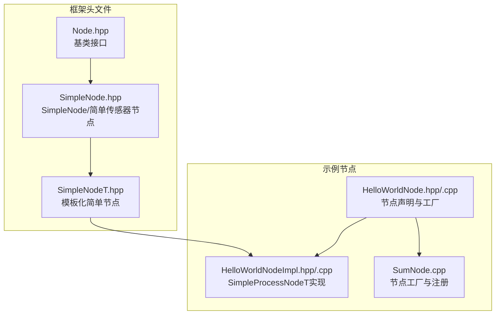
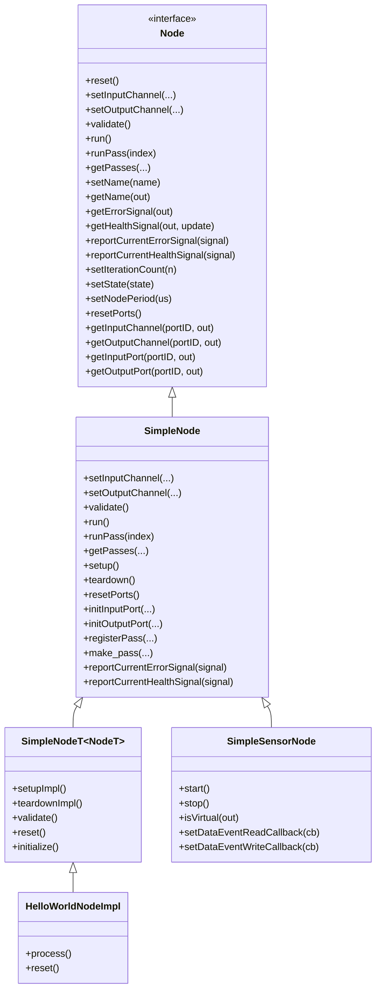
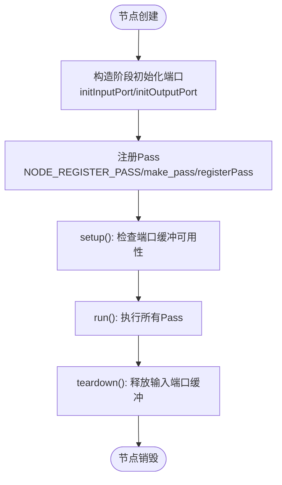
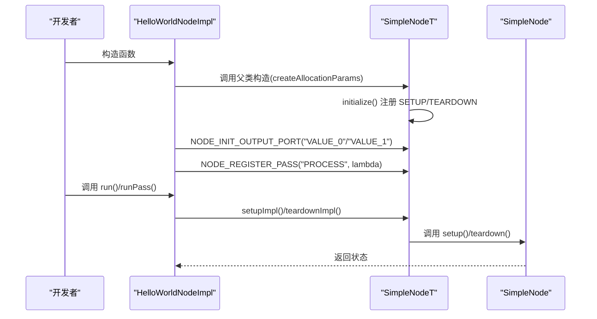
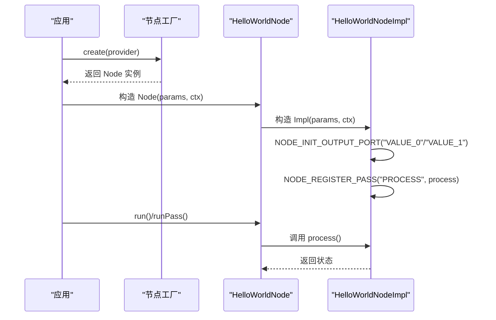
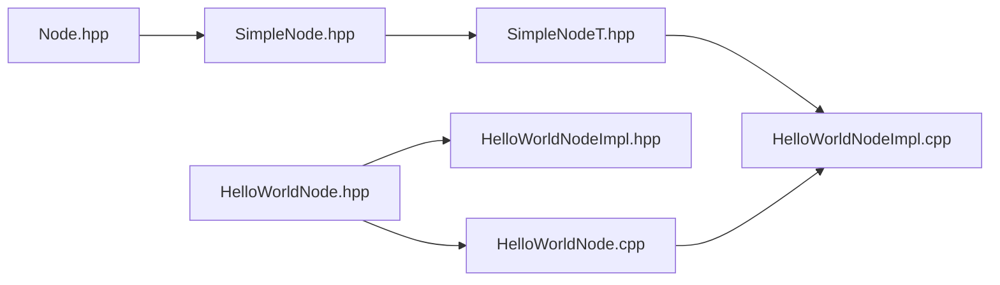

# 简单节点实现

<cite>
**本文档引用的文件**
- [SimpleNode.hpp](file://driverorks-5.10/include/dwcgf/node/SimpleNode.hpp)
- [SimpleNodeT.hpp](file://driverorks-5.10/include/dwcgf/node/SimpleNodeT.hpp)
- [Node.hpp](file://driverorks-5.10/include/dwcgf/node/Node.hpp)
- [HelloWorldNodeImpl.cpp](file://driverorks-5.10/samples/src/cgf_nodes/HelloWorldNodeImpl.cpp)
- [HelloWorldNodeImpl.hpp](file://driverorks-5.10/samples/src/cgf_nodes/HelloWorldNodeImpl.hpp)
- [HelloWorldNode.cpp](file://driverorks-5.10/samples/src/cgf_nodes/HelloWorldNode.cpp)
- [HelloWorldNode.hpp](file://driverorks-5.10/samples/src/cgf_nodes/HelloWorldNode.hpp)
- [SumNode.cpp](file://driverorks-5.10/samples/src/cgf_nodes/SumNode.cpp)
</cite>

## 目录
1. [简介](#简介)
2. [项目结构](#项目结构)
3. [核心组件](#核心组件)
4. [架构总览](#架构总览)
5. [详细组件分析](#详细组件分析)
6. [依赖关系分析](#依赖关系分析)
7. [性能考虑](#性能考虑)
8. [故障排查指南](#故障排查指南)
9. [结论](#结论)
10. [附录：完整使用示例](#附录完整使用示例)

## 简介
本文件面向CGF（DriveWorks Compute Graph Framework）中的“简单节点”实现，系统性解析SimpleNode类的设计理念与轻量级实现特性，涵盖：
- 节点生命周期的简化管理（仅保留setup/teardown/validate/run等必要步骤）
- 基本输入输出通道绑定与端口管理
- 最小化的资源开销与模板化扩展机制
- SimpleNode与基类Node的继承关系及虚函数重写
- 适用场景与使用限制
- 完整的使用示例（创建、配置、运行、清理）

## 项目结构
围绕SimpleNode的实现与使用，相关代码分布在以下位置：
- 头文件：SimpleNode.hpp、SimpleNodeT.hpp（框架层）、Node.hpp（基类）
- 示例节点：HelloWorldNode系列（HelloWorldNodeImpl继承自SimpleProcessNodeT<HelloWorldNode>）
- 其他示例：SumNode（展示节点工厂与注册）

**图表来源**
- [Node.hpp:64-275](file://driverorks-5.10/include/dwcgf/node/Node.hpp#L64-L275)
- [SimpleNode.hpp:74-611](file://driverorks-5.10/include/dwcgf/node/SimpleNode.hpp#L74-L611)
- [SimpleNodeT.hpp:106-186](file://driverorks-5.10/include/dwcgf/node/SimpleNodeT.hpp#L106-L186)
- [HelloWorldNode.hpp:48-94](file://driverorks-5.10/samples/src/cgf_nodes/HelloWorldNode.hpp#L48-L94)
- [HelloWorldNodeImpl.hpp:42-64](file://driverorks-5.10/samples/src/cgf_nodes/HelloWorldNodeImpl.hpp#L42-L64)
- [HelloWorldNode.cpp:41-57](file://driverorks-5.10/samples/src/cgf_nodes/HelloWorldNode.cpp#L41-L57)
- [SumNode.cpp:41-57](file://driverorks-5.10/samples/src/cgf_nodes/SumNode.cpp#L41-L57)

**章节来源**
- [SimpleNode.hpp:1-656](file://driverorks-5.10/include/dwcgf/node/SimpleNode.hpp#L1-L656)
- [SimpleNodeT.hpp:1-204](file://driverorks-5.10/include/dwcgf/node/SimpleNodeT.hpp#L1-L204)
- [Node.hpp:1-518](file://driverorks-5.10/include/dwcgf/node/Node.hpp#L1-L518)

## 核心组件
- Node（基类）：定义节点必须实现的纯虚接口，包括通道绑定、验证、运行、获取健康/错误信号、状态设置、周期与迭代计数等。
- SimpleNode：在Node基础上提供轻量实现，内置默认的setup/teardown/validate/run行为，并封装端口初始化与访问、Pass注册与执行、健康/错误信号上报等。
- SimpleNodeT<NodeT>：模板化版本，通过宏在编译期描述端口、Pass、参数，自动完成setup/teardown注册与validate校验。
- SimpleSensorNode：简单传感器节点接口，用于快速实现传感器节点。

关键特性与简化点：
- 生命周期：仅提供setup/teardown/validate/run等必要步骤，避免复杂状态机与资源管理。
- 端口管理：通过initInputPort/initOutputPort等方法在构造阶段声明并注册端口；通过NODE_GET_*宏便捷获取。
- Pass注册：通过NODE_REGISTER_PASS在构造阶段注册Pass，支持CPU/GPU/DLA等处理器类型自动识别。
- 健康/错误信号：提供默认的上报与更新逻辑，便于上层监控。

**章节来源**
- [Node.hpp:64-275](file://driverorks-5.10/include/dwcgf/node/Node.hpp#L64-L275)
- [SimpleNode.hpp:74-611](file://driverorks-5.10/include/dwcgf/node/SimpleNode.hpp#L74-L611)
- [SimpleNodeT.hpp:44-99](file://driverorks-5.10/include/dwcgf/node/SimpleNodeT.hpp#L44-L99)

## 架构总览
SimpleNode家族的类层次与职责分工如下：

**图表来源**
- [Node.hpp:64-275](file://driverorks-5.10/include/dwcgf/node/Node.hpp#L64-L275)
- [SimpleNode.hpp:74-611](file://driverorks-5.10/include/dwcgf/node/SimpleNode.hpp#L74-L611)
- [SimpleNodeT.hpp:106-186](file://driverorks-5.10/include/dwcgf/node/SimpleNodeT.hpp#L106-L186)
- [HelloWorldNodeImpl.hpp:42-64](file://driverorks-5.10/samples/src/cgf_nodes/HelloWorldNodeImpl.hpp#L42-L64)

## 详细组件分析

### SimpleNode 类设计与实现要点
- 继承关系：public继承自Node，重写部分接口以提供轻量默认行为。
- 输入/输出通道绑定：提供setInputChannel/setOutputChannel与对应的get接口，默认实现抛出异常或返回未实现状态，鼓励子类在构造阶段通过宏完成端口初始化。
- 验证：提供validate与内部辅助validate，用于检查已注册端口是否满足绑定要求。
- 运行时：run/runPass/getPasses等接口由SimpleNodeT统一注册的pass驱动。
- 端口管理：initInputPort/initOutputPort等方法在构造阶段注册端口；NODE_GET_*宏用于运行时获取端口。
- Pass注册：registerPass/make_pass支持将任意可调用对象包装为Pass，自动推断处理器类型与同步/异步执行模式。
- 健康/错误信号：提供默认上报与更新逻辑，便于上层监控。

**图表来源**
- [SimpleNode.hpp:377-549](file://driverorks-5.10/include/dwcgf/node/SimpleNode.hpp#L377-L549)
- [SimpleNode.hpp:242-287](file://driverorks-5.10/include/dwcgf/node/SimpleNode.hpp#L242-L287)
- [SimpleNode.hpp:551-570](file://driverorks-5.10/include/dwcgf/node/SimpleNode.hpp#L551-L570)

**章节来源**
- [SimpleNode.hpp:74-611](file://driverorks-5.10/include/dwcgf/node/SimpleNode.hpp#L74-L611)

### SimpleNodeT 模板化实现
- 自动注册：在构造阶段通过initialize()注册“SETUP”和“TEARDOWN”两个默认Pass，分别委托到SimpleNode::setup/teardown。
- 编译期描述：通过NODE_INIT_*与NODE_GET_*宏，结合模板参数NodeT，实现端口与Pass的编译期描述与索引。
- 默认行为：setupImpl/teardownImpl默认调用SimpleNode::setup/teardown；reset默认调用resetPorts。

**图表来源**
- [SimpleNodeT.hpp:112-185](file://driverorks-5.10/include/dwcgf/node/SimpleNodeT.hpp#L112-L185)
- [HelloWorldNodeImpl.cpp:41-55](file://driverorks-5.10/samples/src/cgf_nodes/HelloWorldNodeImpl.cpp#L41-L55)

**章节来源**
- [SimpleNodeT.hpp:106-186](file://driverorks-5.10/include/dwcgf/node/SimpleNodeT.hpp#L106-L186)

### HelloWorldNode 示例：从零到一的完整流程
- 节点声明：HelloWorldNode通过静态描述函数声明输入/输出端口与Pass集合。
- 工厂与注册：HelloWorldNode::create使用框架工厂创建实例，并通过宏注册节点。
- 实现：HelloWorldNodeImpl继承自SimpleProcessNodeT<HelloWorldNode>，在构造阶段初始化输出端口并注册“PROCESS”Pass；在reset中重置内部状态。

**图表来源**
- [HelloWorldNode.cpp:41-57](file://driverorks-5.10/samples/src/cgf_nodes/HelloWorldNode.cpp#L41-L57)
- [HelloWorldNode.hpp:48-94](file://driverorks-5.10/samples/src/cgf_nodes/HelloWorldNode.hpp#L48-L94)
- [HelloWorldNodeImpl.cpp:41-55](file://driverorks-5.10/samples/src/cgf_nodes/HelloWorldNodeImpl.cpp#L41-L55)

**章节来源**
- [HelloWorldNode.cpp:41-57](file://driverorks-5.10/samples/src/cgf_nodes/HelloWorldNode.cpp#L41-L57)
- [HelloWorldNode.hpp:48-94](file://driverorks-5.10/samples/src/cgf_nodes/HelloWorldNode.hpp#L48-L94)
- [HelloWorldNodeImpl.cpp:41-87](file://driverorks-5.10/samples/src/cgf_nodes/HelloWorldNodeImpl.cpp#L41-L87)

## 依赖关系分析
- SimpleNode依赖Node提供的接口契约，同时依赖Pass/Port/Channel等框架组件。
- SimpleNodeT通过宏与模板参数NodeT在编译期生成端口/Pass描述，降低运行时开销。
- 示例节点HelloWorldNodeImpl依赖SimpleNodeT提供的默认setup/teardown与validate能力。

**图表来源**
- [Node.hpp:64-275](file://driverorks-5.10/include/dwcgf/node/Node.hpp#L64-L275)
- [SimpleNode.hpp:74-611](file://driverorks-5.10/include/dwcgf/node/SimpleNode.hpp#L74-L611)
- [SimpleNodeT.hpp:106-186](file://driverorks-5.10/include/dwcgf/node/SimpleNodeT.hpp#L106-L186)
- [HelloWorldNode.hpp:48-94](file://driverorks-5.10/samples/src/cgf_nodes/HelloWorldNode.hpp#L48-L94)
- [HelloWorldNodeImpl.hpp:42-64](file://driverorks-5.10/samples/src/cgf_nodes/HelloWorldNodeImpl.hpp#L42-L64)
- [HelloWorldNode.cpp:41-57](file://driverorks-5.10/samples/src/cgf_nodes/HelloWorldNode.cpp#L41-L57)

**章节来源**
- [SimpleNode.hpp:34-44](file://driverorks-5.10/include/dwcgf/node/SimpleNode.hpp#L34-L44)
- [SimpleNodeT.hpp:34-37](file://driverorks-5.10/include/dwcgf/node/SimpleNodeT.hpp#L34-L37)

## 性能考虑
- 轻量默认行为：SimpleNode仅提供必要的生命周期步骤，避免复杂状态机与额外资源管理，降低内存与CPU开销。
- 模板化与宏：SimpleNodeT通过编译期描述与宏减少运行时反射成本，提升端口/Pass访问效率。
- 同步/异步执行：根据处理器类型自动判断同步/异步执行模式，避免不必要的阻塞。
- 端口缓冲：默认setup/teardown会检查端口缓冲可用性并释放输入端口缓冲，减少泄漏风险。

[本节为通用指导，不直接分析具体文件]

## 故障排查指南
常见问题与定位建议：
- 端口未初始化或重复初始化：在构造阶段使用NODE_INIT_*宏注册端口，确保索引唯一且类型匹配。
- 端口未绑定通道：validate会检查绑定要求，若未绑定则抛出异常或返回未实现状态。
- Pass索引无效：registerPass会在索引越界或重复注册时抛出异常。
- 端口类型不匹配：getPort系列方法在类型转换失败时抛出异常，需确认端口声明与获取一致。

**章节来源**
- [SimpleNode.hpp:118-122](file://driverorks-5.10/include/dwcgf/node/SimpleNode.hpp#L118-L122)
- [SimpleNode.hpp:259-271](file://driverorks-5.10/include/dwcgf/node/SimpleNode.hpp#L259-L271)
- [SimpleNode.hpp:377-449](file://driverorks-5.10/include/dwcgf/node/SimpleNode.hpp#L377-L449)

## 结论
SimpleNode与SimpleNodeT为CGF提供了“轻量、易用、可扩展”的节点实现路径：
- 通过模板化与宏，将端口与Pass的描述与注册前置到编译期，显著降低运行时开销。
- 通过默认的setup/teardown/validate/run，简化了节点生命周期管理。
- 适用于功能相对简单、端口数量有限、不需要复杂状态机与资源管理的场景。

当节点需要：
- 复杂的状态机与资源管理
- 动态端口/Pass注册
- 高度定制化的通道绑定策略

则应考虑使用更通用的节点基类或自定义实现。

[本节为总结性内容，不直接分析具体文件]

## 附录：完整使用示例
以下示例基于HelloWorldNode，展示从创建到清理的完整流程。

- 步骤1：声明节点与端口/Pass描述
  - 参考：[HelloWorldNode.hpp:57-76](file://driverorks-5.10/samples/src/cgf_nodes/HelloWorldNode.hpp#L57-L76)

- 步骤2：实现节点工厂与注册
  - 参考：[HelloWorldNode.cpp:41-57](file://driverorks-5.10/samples/src/cgf_nodes/HelloWorldNode.cpp#L41-L57)

- 步骤3：实现节点实现类
  - 在构造阶段初始化输出端口并注册“PROCESS”Pass
  - 参考：[HelloWorldNodeImpl.cpp:41-55](file://driverorks-5.10/samples/src/cgf_nodes/HelloWorldNodeImpl.cpp#L41-L55)

- 步骤4：运行与清理
  - 运行时通过run()/runPass触发“PROCESS”Pass
  - 清理时调用teardown（默认由SimpleNodeT::teardownImpl委托）
  - 参考：[SimpleNodeT.hpp:140-149](file://driverorks-5.10/include/dwcgf/node/SimpleNodeT.hpp#L140-L149)

- 步骤5：可选：重置内部状态
  - 参考：[HelloWorldNodeImpl.cpp:63-68](file://driverorks-5.10/samples/src/cgf_nodes/HelloWorldNodeImpl.cpp#L63-L68)

**章节来源**
- [HelloWorldNode.hpp:57-76](file://driverorks-5.10/samples/src/cgf_nodes/HelloWorldNode.hpp#L57-L76)
- [HelloWorldNode.cpp:41-57](file://driverorks-5.10/samples/src/cgf_nodes/HelloWorldNode.cpp#L41-L57)
- [HelloWorldNodeImpl.cpp:41-87](file://driverorks-5.10/samples/src/cgf_nodes/HelloWorldNodeImpl.cpp#L41-L87)
- [SimpleNodeT.hpp:140-149](file://driverorks-5.10/include/dwcgf/node/SimpleNodeT.hpp#L140-L149)