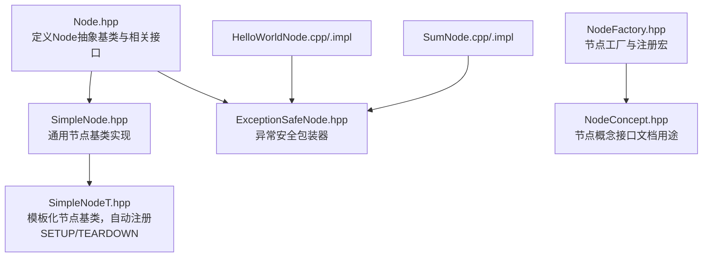
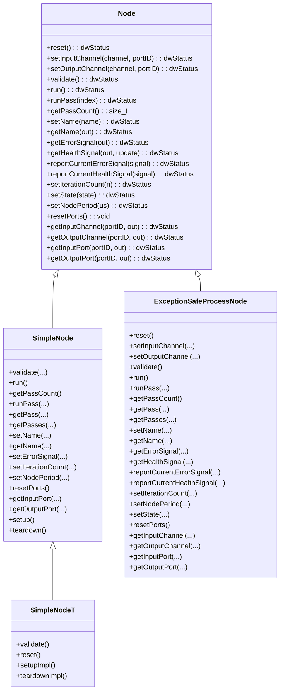
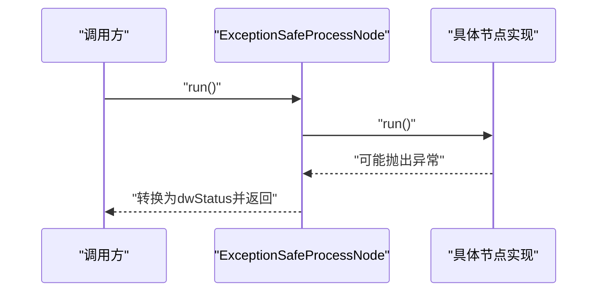
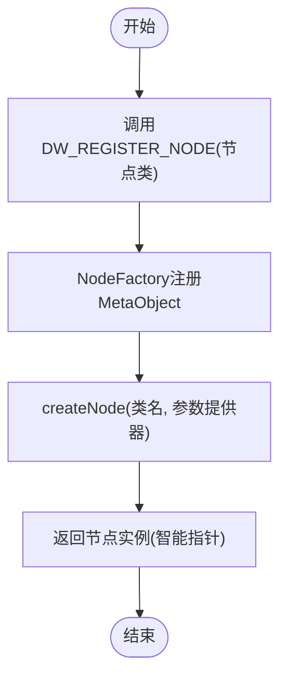
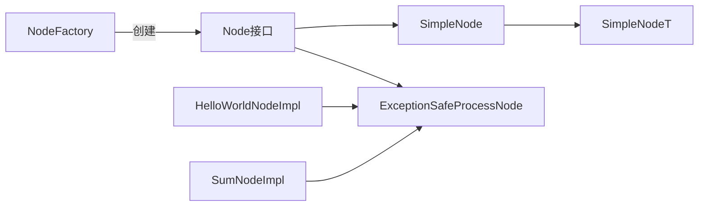

# 节点基类设计

<cite>
**本文引用的文件**
- [Node.hpp](file://driverorks-5.10/include/dwcgf/node/Node.hpp)
- [NodeConcept.hpp](file://driverorks-5.10/include/dwcgf/node/NodeConcept.hpp)
- [NodeFactory.hpp](file://driverorks-5.10/include/dwcgf/node/NodeFactory.hpp)
- [SimpleNode.hpp](file://driverorks-5.10/include/dwcgf/node/SimpleNode.hpp)
- [SimpleNodeT.hpp](file://driverorks-5.10/include/dwcgf/node/SimpleNodeT.hpp)
- [ExceptionSafeNode.hpp](file://driverorks-5.10/include/dwcgf/node/impl/ExceptionSafeNode.hpp)
- [HelloWorldNode.cpp](file://driverorks-5.10/samples/src/cgf_nodes/HelloWorldNode.cpp)
- [HelloWorldNodeImpl.cpp](file://driverorks-5.10/samples/src/cgf_nodes/HelloWorldNodeImpl.cpp)
- [SumNode.cpp](file://driverorks-5.10/samples/src/cgf_nodes/SumNode.cpp)
- [SumNodeImpl.cpp](file://driverorks-5.10/samples/src/cgf_nodes/SumNodeImpl.cpp)
</cite>

## 目录
1. [简介](#简介)
2. [项目结构](#项目结构)
3. [核心组件](#核心组件)
4. [架构总览](#架构总览)
5. [详细组件分析](#详细组件分析)
6. [依赖关系分析](#依赖关系分析)
7. [性能考量](#性能考量)
8. [故障排查指南](#故障排查指南)
9. [结论](#结论)
10. [附录](#附录)

## 简介
本文件面向CGF（Compute Graph Framework）中的“节点基类”体系，系统化梳理Node抽象基类的设计理念与核心接口，覆盖节点生命周期管理（reset、run、validate）、输入输出通道绑定（setInputChannel、setOutputChannel）、参数验证机制、健康信号与错误信号上报、节点名称与状态管理、迭代计数与执行周期等属性接口，并阐明线程安全性要求与异常处理机制。同时，结合SimpleNode/SimpleNodeT与异常安全包装器ExceptionSafeNode的实现，给出可操作的使用示例与最佳实践，帮助开发者正确继承与扩展节点基类。

## 项目结构
本仓库中与节点基类相关的核心头文件位于driverorks-5.10/include/dwcgf/node目录，配套示例节点位于samples/src/cgf_nodes目录。下图展示与本文主题直接相关的文件与模块关系：

**图表来源**
- [Node.hpp:64-275](file://driverorks-5.10/include/dwcgf/node/Node.hpp#L64-L275)
- [SimpleNode.hpp:74-611](file://driverorks-5.10/include/dwcgf/node/SimpleNode.hpp#L74-L611)
- [SimpleNodeT.hpp:106-186](file://driverorks-5.10/include/dwcgf/node/SimpleNodeT.hpp#L106-L186)
- [ExceptionSafeNode.hpp:40-101](file://driverorks-5.10/include/dwcgf/node/impl/ExceptionSafeNode.hpp#L40-L101)
- [NodeFactory.hpp:130-189](file://driverorks-5.10/include/dwcgf/node/NodeFactory.hpp#L130-L189)
- [NodeConcept.hpp:53-93](file://driverorks-5.10/include/dwcgf/node/NodeConcept.hpp#L53-L93)
- [HelloWorldNode.cpp:41-57](file://driverorks-5.10/samples/src/cgf_nodes/HelloWorldNode.cpp#L41-L57)
- [SumNode.cpp:41-57](file://driverorks-5.10/samples/src/cgf_nodes/SumNode.cpp#L41-L57)

**章节来源**
- [Node.hpp:64-275](file://driverorks-5.10/include/dwcgf/node/Node.hpp#L64-L275)
- [SimpleNode.hpp:74-611](file://driverorks-5.10/include/dwcgf/node/SimpleNode.hpp#L74-L611)
- [SimpleNodeT.hpp:106-186](file://driverorks-5.10/include/dwcgf/node/SimpleNodeT.hpp#L106-L186)
- [ExceptionSafeNode.hpp:40-101](file://driverorks-5.10/include/dwcgf/node/impl/ExceptionSafeNode.hpp#L40-L101)
- [NodeFactory.hpp:130-189](file://driverorks-5.10/include/dwcgf/node/NodeFactory.hpp#L130-L189)
- [NodeConcept.hpp:53-93](file://driverorks-5.10/include/dwcgf/node/NodeConcept.hpp#L53-L93)
- [HelloWorldNode.cpp:41-57](file://driverorks-5.10/samples/src/cgf_nodes/HelloWorldNode.cpp#L41-L57)
- [SumNode.cpp:41-57](file://driverorks-5.10/samples/src/cgf_nodes/SumNode.cpp#L41-L57)

## 核心组件
- 抽象基类Node：定义节点生命周期、通道绑定、参数验证、健康/错误信号、名称与状态、迭代计数与周期、端口查询等统一接口契约。
- 通用实现SimpleNode：提供默认的通道绑定、端口管理、SETUP/TEARDOWN默认实现、健康信号聚合与上报、迭代计数与周期设置等。
- 模板化基类SimpleNodeT：在编译期通过描述符自动注册SETUP/TEARDOWN并完成端口校验，简化节点开发。
- 异常安全包装器ExceptionSafeNode：对外暴露Node接口，内部委托具体实现节点，统一捕获异常并转换为状态码，避免异常穿透框架边界。
- 节点工厂NodeFactory与注册宏：支持按类名动态创建节点实例，配合节点概念接口进行元数据描述与参数映射。

**章节来源**
- [Node.hpp:64-275](file://driverorks-5.10/include/dwcgf/node/Node.hpp#L64-L275)
- [SimpleNode.hpp:74-611](file://driverorks-5.10/include/dwcgf/node/SimpleNode.hpp#L74-L611)
- [SimpleNodeT.hpp:106-186](file://driverorks-5.10/include/dwcgf/node/SimpleNodeT.hpp#L106-L186)
- [ExceptionSafeNode.hpp:40-101](file://driverorks-5.10/include/dwcgf/node/impl/ExceptionSafeNode.hpp#L40-L101)
- [NodeFactory.hpp:130-189](file://driverorks-5.10/include/dwcgf/node/NodeFactory.hpp#L130-L189)

## 架构总览
下图展示节点基类体系在CGF中的角色与交互关系：

**图表来源**
- [Node.hpp:64-275](file://driverorks-5.10/include/dwcgf/node/Node.hpp#L64-L275)
- [SimpleNode.hpp:74-611](file://driverorks-5.10/include/dwcgf/node/SimpleNode.hpp#L74-L611)
- [SimpleNodeT.hpp:106-186](file://driverorks-5.10/include/dwcgf/node/SimpleNodeT.hpp#L106-L186)
- [ExceptionSafeNode.hpp:40-101](file://driverorks-5.10/include/dwcgf/node/impl/ExceptionSafeNode.hpp#L40-L101)

## 详细组件分析

### 抽象基类Node：生命周期与接口契约
- 生命周期管理
  - reset：重置节点内部状态，通常在停止或重新配置后调用。
  - run：执行所有pass；也可通过runPass按索引执行指定pass。
  - validate：校验必需端口是否已绑定到通道。
- 通道绑定
  - setInputChannel/setOutputChannel：将端口ID与ChannelObject绑定；带序列化类型参数的重载用于显式声明数据类型。
  - getInputChannel/getOutputChannel：查询端口对应的通道对象。
- 健康与错误信号
  - getErrorSignal/getHealthSignal：获取当前错误/健康信号指针；可选择从模块更新。
  - reportCurrentErrorSignal/reportCurrentHealthSignal：由框架在特定时机调用，允许节点实现者填充当前状态。
- 名称与状态
  - setName/getName：设置/获取节点名称（固定长度字符串）。
  - setState：设置当前状态（线程安全要求见后文）。
- 迭代计数与周期
  - setIterationCount/getIterationCount：设置/获取当前迭代计数。
  - setNodePeriod/getNodePeriod：设置/获取节点执行周期（微秒）。
- 端口查询
  - getInputPort/getOutputPort：根据端口ID获取端口对象指针。
- 其他
  - resetPorts：重置节点内管理的所有端口。
  - getPassCount/getPass/getPasses/getPasses(..., processorType, processType)：查询pass集合与过滤。

线程安全性要点
- setState需保证线程安全，实现时应深拷贝传入状态字符串以确保运行时有效性。
- 健康/错误信号的读写应受控，避免并发竞态。

**章节来源**
- [Node.hpp:76-275](file://driverorks-5.10/include/dwcgf/node/Node.hpp#L76-L275)

### 通用实现SimpleNode：默认行为与辅助能力
- 默认实现
  - run：遍历并执行所有pass。
  - getPassCount/runPass/getPass/getPasses：提供pass容器访问。
  - setName/getName：维护内部名称字段。
  - getErrorSignal/getHealthSignal：提供节点级健康/错误信号存储与返回。
  - reportCurrentErrorSignal/reportCurrentHealthSignal：默认空实现或转发至模块信号。
  - setIterationCount/setNodePeriod：维护内部迭代计数与周期。
  - resetPorts：调用各输入端口的reset以清理缓冲区。
  - getInputPort/getOutputPort：根据端口ID返回对应端口。
- 端口管理
  - initInputPort/initOutputPort：在构造阶段注册非数组端口。
  - initInputArrayPort/initOutputArrayPort：注册数组端口。
  - getInputPort(...)/getOutputPort(...)：按标识或数组索引获取端口。
  - iterateManagedInputPorts/iterateManagedOutputPorts：遍历受管端口。
- PASS注册与创建
  - registerPass：在编译期确定索引的前提下注册pass函数。
  - make_pass：便捷创建PassImpl。
  - createSetupPass/createTeardownPass：可被子类覆盖以自定义setup/teardown逻辑。
- 健康信号聚合
  - clearHealthSignal/updateHealthSignal/copyModuleHealthSignals：对节点健康信号进行增删与模块复制。

**章节来源**
- [SimpleNode.hpp:74-611](file://driverorks-5.10/include/dwcgf/node/SimpleNode.hpp#L74-L611)

### 模板化基类SimpleNodeT：自动注册与编译期描述符
- 自动注册
  - 在构造阶段自动注册名为“SETUP”和“TEARDOWN”的两个pass，分别委托给setupImpl/teardownImpl。
- 编译期描述符
  - 通过createPortCollectionDescriptor与createPassCollectionDescriptor生成输入/输出端口与pass描述，validate时据此检查端口绑定。
- reset默认行为
  - 默认reset仅调用resetPorts并返回成功，便于快速实现。

**章节来源**
- [SimpleNodeT.hpp:106-186](file://driverorks-5.10/include/dwcgf/node/SimpleNodeT.hpp#L106-L186)

### 异常安全包装器ExceptionSafeNode：统一异常处理
- ExceptionSafeProcessNode
  - 包装任意Node实现，对外暴露完整Node接口。
  - 所有方法均捕获底层实现抛出的异常并转换为dwStatus，避免异常越界传播。
- ExceptionSafeSensorNode
  - 同时实现ISensorNode接口，用于传感器节点的异常安全封装。

**图表来源**
- [ExceptionSafeNode.hpp:40-101](file://driverorks-5.10/include/dwcgf/node/impl/ExceptionSafeNode.hpp#L40-L101)

**章节来源**
- [ExceptionSafeNode.hpp:40-193](file://driverorks-5.10/include/dwcgf/node/impl/ExceptionSafeNode.hpp#L40-L193)

### 节点工厂与概念接口：元数据与动态创建
- 节点工厂NodeFactory
  - 提供registerNode与createNode，支持按类名动态创建节点实例。
  - 使用递归互斥锁保护注册表，避免重复注册。
  - 通过MetaObject与模板化适配，反射式导出端口、参数、pass描述。
- 注册宏DW_REGISTER_NODE
  - 将节点类注册到工厂，类名即唯一标识。
- 节点概念NodeConcept
  - 仅用于文档目的，定义节点静态接口create、describeInputPorts、describeOutputPorts、describeParameters、describePasses。

**图表来源**
- [NodeFactory.hpp:130-189](file://driverorks-5.10/include/dwcgf/node/NodeFactory.hpp#L130-L189)
- [NodeConcept.hpp:53-93](file://driverorks-5.10/include/dwcgf/node/NodeConcept.hpp#L53-L93)

**章节来源**
- [NodeFactory.hpp:130-192](file://driverorks-5.10/include/dwcgf/node/NodeFactory.hpp#L130-L192)
- [NodeConcept.hpp:53-93](file://driverorks-5.10/include/dwcgf/node/NodeConcept.hpp#L53-L93)

### 使用示例与最佳实践

- HelloWorldNode示例
  - 通过ExceptionSafeProcessNode包装具体实现HelloWorldNodeImpl。
  - 在构造函数中初始化输出端口与pass，使用NODE_INIT_*与NODE_REGISTER_PASS宏。
  - 在process中读取/写入端口缓冲区并发送数据包。
  - 通过DW_REGISTER_NODE注册节点类。

- SumNode示例
  - 初始化输入端口与pass，从输入端口读取数据并计算。
  - 展示了端口可用性检查与日志记录。

- 最佳实践
  - 继承路径建议：优先使用SimpleNodeT作为基类，利用编译期描述符自动注册SETUP/TEARDOWN与端口校验。
  - 端口初始化：在构造函数中使用NODE_INIT_*宏完成端口注册；如为数组端口，使用NODE_INIT_*_ARRAY_PORT。
  - Pass注册：使用NODE_REGISTER_PASS宏，pass标识符应与描述符一致。
  - 健康/错误信号：在reportCurrentHealthSignal/reportCurrentErrorSignal中填充当前状态；必要时调用copyModuleHealthSignals从模块复制信号。
  - 异常处理：对外层暴露的节点实现建议使用ExceptionSafeProcessNode/ExceptionSafeSensorNode进行包装，确保异常不穿透框架。
  - 线程安全：setState需深拷贝状态字符串；涉及共享资源的访问应加锁或使用原子类型。
  - 参数与元数据：遵循NodeConcept约定，提供create、describe*系列函数以便工厂与描述工具识别。

**章节来源**
- [HelloWorldNode.cpp:41-57](file://driverorks-5.10/samples/src/cgf_nodes/HelloWorldNode.cpp#L41-L57)
- [HelloWorldNodeImpl.cpp:41-87](file://driverorks-5.10/samples/src/cgf_nodes/HelloWorldNodeImpl.cpp#L41-L87)
- [SumNode.cpp:41-57](file://driverorks-5.10/samples/src/cgf_nodes/SumNode.cpp#L41-L57)
- [SumNodeImpl.cpp:41-80](file://driverorks-5.10/samples/src/cgf_nodes/SumNodeImpl.cpp#L41-L80)
- [SimpleNodeT.hpp:44-99](file://driverorks-5.10/include/dwcgf/node/SimpleNodeT.hpp#L44-L99)
- [SimpleNode.hpp:377-549](file://driverorks-5.10/include/dwcgf/node/SimpleNode.hpp#L377-L549)

## 依赖关系分析
- Node是所有节点实现的根接口，SimpleNode/SimpleNodeT在其上提供默认实现。
- ExceptionSafeNode通过组合持有具体Node实现，统一异常处理。
- NodeFactory负责节点实例化与元数据导出，依赖参数/端口/pass描述符。
- 示例节点通过宏与工厂协作，完成注册与创建。

**图表来源**
- [Node.hpp:64-275](file://driverorks-5.10/include/dwcgf/node/Node.hpp#L64-L275)
- [SimpleNode.hpp:74-611](file://driverorks-5.10/include/dwcgf/node/SimpleNode.hpp#L74-L611)
- [SimpleNodeT.hpp:106-186](file://driverorks-5.10/include/dwcgf/node/SimpleNodeT.hpp#L106-L186)
- [ExceptionSafeNode.hpp:40-101](file://driverorks-5.10/include/dwcgf/node/impl/ExceptionSafeNode.hpp#L40-L101)
- [NodeFactory.hpp:130-189](file://driverorks-5.10/include/dwcgf/node/NodeFactory.hpp#L130-L189)

**章节来源**
- [Node.hpp:64-275](file://driverorks-5.10/include/dwcgf/node/Node.hpp#L64-L275)
- [SimpleNode.hpp:74-611](file://driverorks-5.10/include/dwcgf/node/SimpleNode.hpp#L74-L611)
- [SimpleNodeT.hpp:106-186](file://driverorks-5.10/include/dwcgf/node/SimpleNodeT.hpp#L106-L186)
- [ExceptionSafeNode.hpp:40-101](file://driverorks-5.10/include/dwcgf/node/impl/ExceptionSafeNode.hpp#L40-L101)
- [NodeFactory.hpp:130-189](file://driverorks-5.10/include/dwcgf/node/NodeFactory.hpp#L130-L189)

## 性能考量
- pass调度与异步处理：根据处理器类型自动推断同步/异步进程类型，GPU/DLA pass采用异步处理以提升吞吐。
- 健康信号聚合：节点侧维护有限容量的健康信号数组，满载时拒绝新增，避免无限增长。
- 端口缓冲区管理：通过ManagedPort在setup/teardown阶段分配与释放缓冲，减少内存抖动。
- 异常安全包装：异常捕获与状态码转换带来少量开销，但显著提升稳定性与可观测性。

[本节为通用指导，无需列出具体文件来源]

## 故障排查指南
- 端口未绑定
  - 现象：validate失败或运行时报错。
  - 排查：确认必需端口已在构造阶段通过NODE_INIT_*注册，并在连接阶段通过setInputChannel/setOutputChannel绑定。
- 数据类型不匹配
  - 现象：通道绑定带序列化类型参数时出现无效参数错误。
  - 排查：确保传入的序列化类型与通道期望一致。
- 状态设置线程安全
  - 现象：并发setState导致状态不一致。
  - 排查：实现中对传入状态字符串进行深拷贝并在受控区域更新。
- 异常穿透
  - 现象：节点实现抛出异常导致框架崩溃。
  - 排查：使用ExceptionSafeProcessNode/ExceptionSafeSensorNode包装实现，确保异常被捕获并转换为状态码。
- 健康信号缺失
  - 现象：getHealthSignal返回不可用。
  - 排查：确认节点实现了reportCurrentHealthSignal或调用copyModuleHealthSignals从模块复制信号；必要时调用updateHealthSignal补充。

**章节来源**
- [Node.hpp:222-228](file://driverorks-5.10/include/dwcgf/node/Node.hpp#L222-L228)
- [SimpleNode.hpp:305-314](file://driverorks-5.10/include/dwcgf/node/SimpleNode.hpp#L305-L314)
- [ExceptionSafeNode.hpp:40-101](file://driverorks-5.10/include/dwcgf/node/impl/ExceptionSafeNode.hpp#L40-L101)

## 结论
Node抽象基类提供了CGF节点的统一接口契约，SimpleNode/SimpleNodeT在通用实现与编译期描述符方面大幅降低开发复杂度，ExceptionSafeNode则保障了异常安全。结合NodeFactory与注册宏，节点可以以声明式方式被发现、创建与装配。遵循本文的最佳实践，可在保证线程安全与异常可控的前提下，高效构建可维护的CGF节点。

[本节为总结性内容，无需列出具体文件来源]

## 附录
- 关键宏速查
  - NODE_INIT_INPUT_PORT/NODE_INIT_OUTPUT_PORT：初始化单端口
  - NODE_INIT_INPUT_ARRAY_PORT/NODE_INIT_OUTPUT_ARRAY_PORT：初始化数组端口
  - NODE_GET_INPUT_PORT/NODE_GET_OUTPUT_PORT：获取端口
  - NODE_GET_INPUT_ARRAY_PORT/NODE_GET_OUTPUT_ARRAY_PORT：按索引获取数组端口
  - NODE_REGISTER_PASS：注册pass
- 示例节点参考
  - HelloWorldNode/HelloWorldNodeImpl：输出端口示例
  - SumNode/SumNodeImpl：输入端口示例

**章节来源**
- [SimpleNodeT.hpp:44-99](file://driverorks-5.10/include/dwcgf/node/SimpleNodeT.hpp#L44-L99)
- [HelloWorldNode.cpp:41-57](file://driverorks-5.10/samples/src/cgf_nodes/HelloWorldNode.cpp#L41-L57)
- [HelloWorldNodeImpl.cpp:41-87](file://driverorks-5.10/samples/src/cgf_nodes/HelloWorldNodeImpl.cpp#L41-L87)
- [SumNode.cpp:41-57](file://driverorks-5.10/samples/src/cgf_nodes/SumNode.cpp#L41-L57)
- [SumNodeImpl.cpp:41-80](file://driverorks-5.10/samples/src/cgf_nodes/SumNodeImpl.cpp#L41-L80)