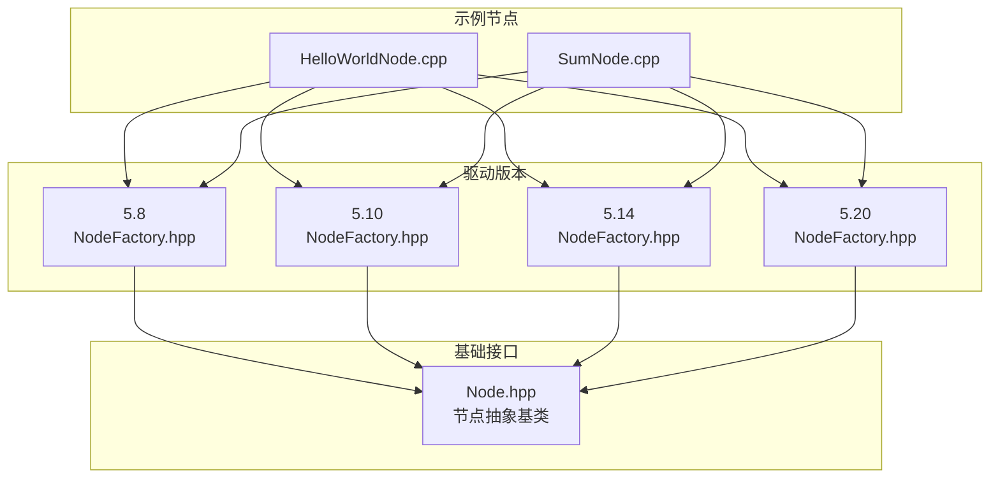
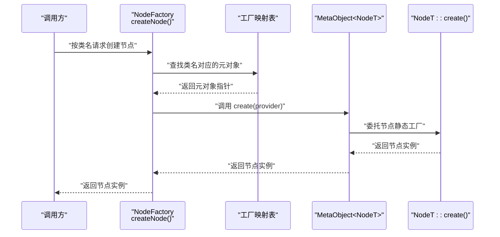
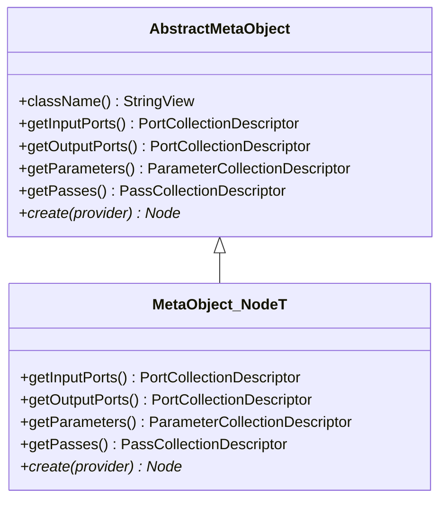
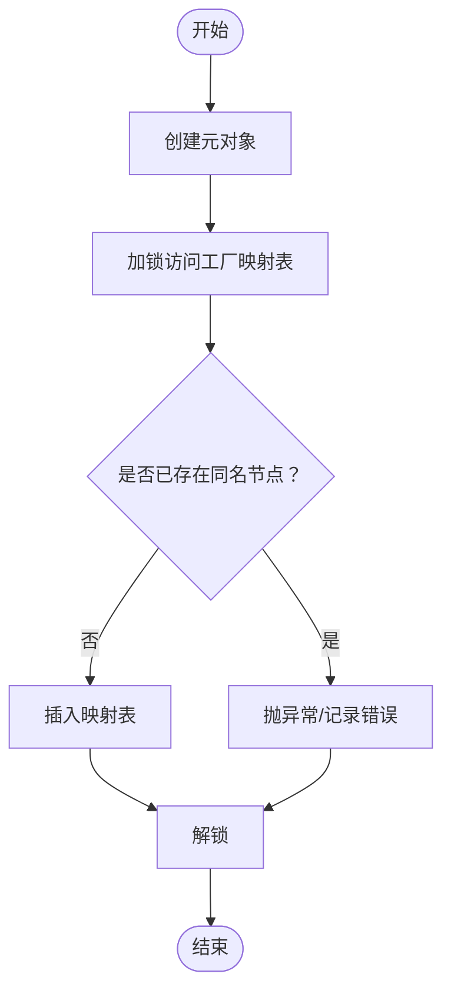
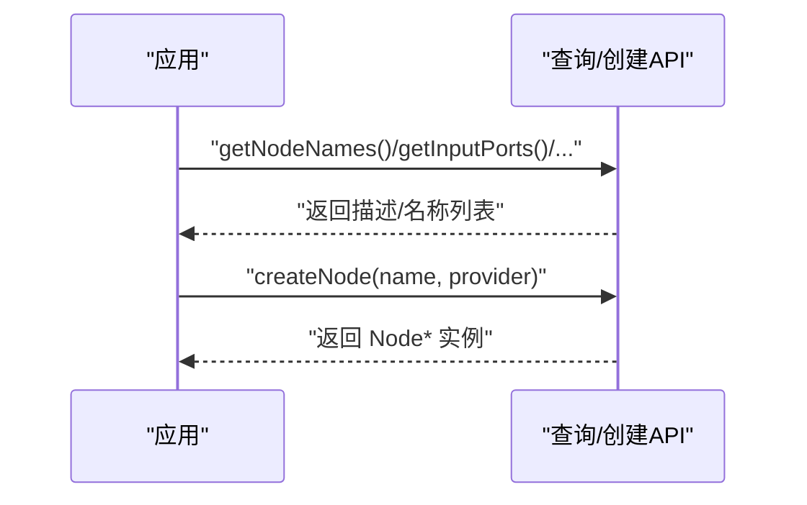
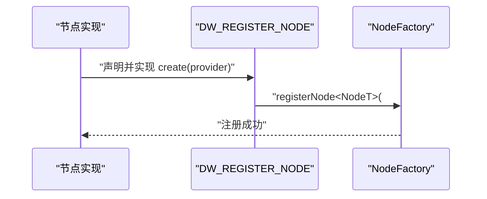
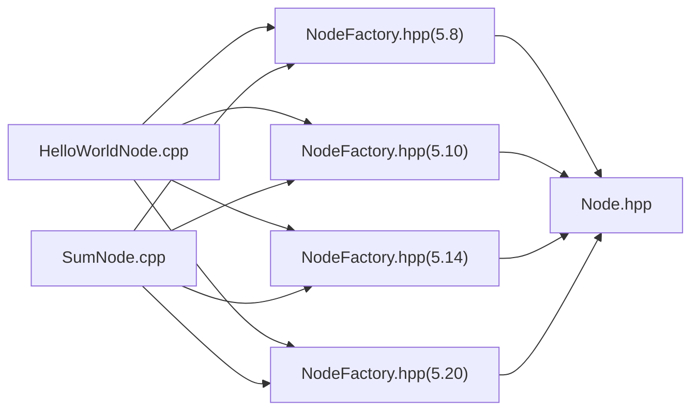

# 节点工厂模式

<cite>
**本文引用的文件**   
- [NodeFactory.hpp（5.8）](file://driveworks-5.8/include/dwcgf/node/NodeFactory.hpp)
- [NodeFactory.hpp（5.10）](file://driverorks-5.10/include/dwcgf/node/NodeFactory.hpp)
- [NodeFactory.hpp（5.14）](file://driveworks-5.14/include/dwcgf/node/NodeFactory.hpp)
- [NodeFactory.hpp（5.20）](file://driveworks-520/include/dwcgf/node/NodeFactory.hpp)
- [Node.hpp](file://driverorks-5.10/include/dwcgf/node/Node.hpp)
- [HelloWorldNode.cpp](file://driverorks-5.10/samples/src/cgf_nodes/HelloWorldNode.cpp)
- [SumNode.cpp](file://driverorks-5.10/samples/src/cgf_nodes/SumNode.cpp)
</cite>

## 目录
1. [引言](#引言)
2. [项目结构](#项目结构)
3. [核心组件](#核心组件)
4. [架构总览](#架构总览)
5. [详细组件分析](#详细组件分析)
6. [依赖关系分析](#依赖关系分析)
7. [性能考量](#性能考量)
8. [故障排查指南](#故障排查指南)
9. [结论](#结论)
10. [附录：使用示例与最佳实践](#附录使用示例与最佳实践)

## 引言
本文件系统化阐述 CGF（Compute Graph Framework）中的“节点工厂”模式，重点解析 NodeFactory 的设计原理、工厂模式在 CGF 架构中的作用，以及节点实例的创建、配置与管理机制。内容覆盖：
- 工厂注册机制与节点类型识别
- 参数传递与配置加载流程
- 动态创建与管理节点的实现路径
- 版本演进与差异对比
- 实战示例与最佳实践

## 项目结构
围绕节点工厂的核心代码位于各版本驱动库的头文件中，配套示例节点展示了如何通过宏完成节点注册与实例化。

图表来源
- [NodeFactory.hpp（5.8）:1-192](file://driveworks-5.8/include/dwcgf/node/NodeFactory.hpp#L1-L192)
- [NodeFactory.hpp（5.10）:1-192](file://driverorks-5.10/include/dwcgf/node/NodeFactory.hpp#L1-L192)
- [NodeFactory.hpp（5.14）:1-229](file://driveworks-5.14/include/dwcgf/node/NodeFactory.hpp#L1-L229)
- [NodeFactory.hpp（5.20）:1-243](file://driveworks-520/include/dwcgf/node/NodeFactory.hpp#L1-L243)
- [Node.hpp:64-275](file://driverorks-5.10/include/dwcgf/node/Node.hpp#L64-L275)
- [HelloWorldNode.cpp:41-57](file://driverorks-5.10/samples/src/cgf_nodes/HelloWorldNode.cpp#L41-L57)
- [SumNode.cpp:41-57](file://driverorks-5.10/samples/src/cgf_nodes/SumNode.cpp#L41-L57)

章节来源
- [NodeFactory.hpp（5.8）:1-192](file://driveworks-5.8/include/dwcgf/node/NodeFactory.hpp#L1-L192)
- [NodeFactory.hpp（5.10）:1-192](file://driverorks-5.10/include/dwcgf/node/NodeFactory.hpp#L1-L192)
- [NodeFactory.hpp（5.14）:1-229](file://driveworks-5.14/include/dwcgf/node/NodeFactory.hpp#L1-L229)
- [NodeFactory.hpp（5.20）:1-243](file://driveworks-520/include/dwcgf/node/NodeFactory.hpp#L1-L243)
- [Node.hpp:64-275](file://driverorks-5.10/include/dwcgf/node/Node.hpp#L64-L275)
- [HelloWorldNode.cpp:41-57](file://driverorks-5.10/samples/src/cgf_nodes/HelloWorldNode.cpp#L41-L57)
- [SumNode.cpp:41-57](file://driverorks-5.10/samples/src/cgf_nodes/SumNode.cpp#L41-L57)

## 核心组件
- 抽象元对象与模板元对象
  - 抽象元对象负责统一描述节点的输入输出端口、参数集合、执行阶段（Pass）以及创建方法。
  - 模板元对象对具体节点类型进行特化，静态生成端口与参数描述，并委托节点类型的静态工厂方法创建实例。
- 注册机制
  - 提供模板函数用于注册节点类型到全局工厂映射表；并发安全由递归互斥锁保障。
  - 宏包装注册逻辑，便于在节点实现文件中一键完成注册。
- 查询与创建
  - 提供查询节点名称、端口/参数/阶段描述的能力。
  - 通过类名索引从工厂映射表获取元对象，再调用其 create 方法完成实例化。

章节来源
- [NodeFactory.hpp（5.8）:60-149](file://driveworks-5.8/include/dwcgf/node/NodeFactory.hpp#L60-L149)
- [NodeFactory.hpp（5.10）:60-161](file://driverorks-5.10/include/dwcgf/node/NodeFactory.hpp#L60-L161)
- [NodeFactory.hpp（5.14）:61-197](file://driveworks-5.14/include/dwcgf/node/NodeFactory.hpp#L61-L197)
- [NodeFactory.hpp（5.20）:62-206](file://driveworks-520/include/dwcgf/node/NodeFactory.hpp#L62-L206)

## 架构总览
下图展示工厂模式在 CGF 中的整体交互：上层通过类名请求创建节点，工厂根据注册信息构造元对象并调用节点静态工厂方法，最终返回可运行的节点实例。

图表来源
- [NodeFactory.hpp（5.8）:130-161](file://driveworks-5.8/include/dwcgf/node/NodeFactory.hpp#L130-L161)
- [NodeFactory.hpp（5.10）:130-161](file://driverorks-5.10/include/dwcgf/node/NodeFactory.hpp#L130-L161)
- [NodeFactory.hpp（5.14）:163-197](file://driveworks-5.14/include/dwcgf/node/NodeFactory.hpp#L163-L197)
- [NodeFactory.hpp（5.20）:169-198](file://driveworks-520/include/dwcgf/node/NodeFactory.hpp#L169-L198)

## 详细组件分析

### 抽象元对象与模板元对象
- 抽象元对象
  - 统一接口：类名访问、输入/输出端口描述、参数描述、阶段描述、创建方法。
  - 保证不同节点类型通过同一接口被工厂识别与实例化。
- 模板元对象
  - 对每个节点类型进行特化：静态生成端口/参数/阶段描述；委托节点类型的静态工厂方法创建实例。
  - 在 5.20 版本中引入了更强的约束与错误收集能力。

图表来源
- [NodeFactory.hpp（5.8）:60-126](file://driveworks-5.8/include/dwcgf/node/NodeFactory.hpp#L60-L126)
- [NodeFactory.hpp（5.10）:60-126](file://driverorks-5.10/include/dwcgf/node/NodeFactory.hpp#L60-L126)
- [NodeFactory.hpp（5.14）:61-159](file://driveworks-5.14/include/dwcgf/node/NodeFactory.hpp#L61-L159)
- [NodeFactory.hpp（5.20）:62-165](file://driveworks-520/include/dwcgf/node/NodeFactory.hpp#L62-L165)

章节来源
- [NodeFactory.hpp（5.8）:60-126](file://driveworks-5.8/include/dwcgf/node/NodeFactory.hpp#L60-L126)
- [NodeFactory.hpp（5.10）:60-126](file://driverorks-5.10/include/dwcgf/node/NodeFactory.hpp#L60-L126)
- [NodeFactory.hpp（5.14）:61-159](file://driveworks-5.14/include/dwcgf/node/NodeFactory.hpp#L61-L159)
- [NodeFactory.hpp（5.20）:62-165](file://driveworks-520/include/dwcgf/node/NodeFactory.hpp#L62-L165)

### 注册机制与宏
- 注册流程
  - 模板函数创建元对象，加锁写入全局映射表；若重复注册则抛出异常或记录错误（5.20）。
  - 宏在编译期拼接唯一后缀，构造静态代理对象，在构造时自动完成注册。
- 并发与健壮性
  - 使用递归互斥锁保护映射表访问；5.20 版本进一步细化为工厂互斥量与错误映射表。

图表来源
- [NodeFactory.hpp（5.8）:130-149](file://driveworks-5.8/include/dwcgf/node/NodeFactory.hpp#L130-L149)
- [NodeFactory.hpp（5.10）:130-149](file://driverorks-5.10/include/dwcgf/node/NodeFactory.hpp#L130-L149)
- [NodeFactory.hpp（5.14）:163-185](file://driveworks-5.14/include/dwcgf/node/NodeFactory.hpp#L163-L185)
- [NodeFactory.hpp（5.20）:169-186](file://driveworks-520/include/dwcgf/node/NodeFactory.hpp#L169-L186)

章节来源
- [NodeFactory.hpp（5.8）:130-189](file://driveworks-5.8/include/dwcgf/node/NodeFactory.hpp#L130-L189)
- [NodeFactory.hpp（5.10）:130-189](file://driverorks-5.10/include/dwcgf/node/NodeFactory.hpp#L130-L189)
- [NodeFactory.hpp（5.14）:163-226](file://driveworks-5.14/include/dwcgf/node/NodeFactory.hpp#L163-L226)
- [NodeFactory.hpp（5.20）:169-240](file://driveworks-520/include/dwcgf/node/NodeFactory.hpp#L169-L240)

### 查询与创建接口
- 查询接口
  - getNodeNames：列出所有已注册节点名称。
  - getInputPorts/getOutputPorts/getParameters/getPasses：按类名返回对应描述集合。
- 创建接口
  - createNode：按类名与参数提供者创建节点实例。
  - 5.20 新增 createInputPortSpecimen/createOutputPortSpecimen：按标识符创建端口样本数据引用。

图表来源
- [NodeFactory.hpp（5.8）:151-161](file://driveworks-5.8/include/dwcgf/node/NodeFactory.hpp#L151-L161)
- [NodeFactory.hpp（5.10）:151-161](file://driverorks-5.10/include/dwcgf/node/NodeFactory.hpp#L151-L161)
- [NodeFactory.hpp（5.14）:187-205](file://driveworks-5.14/include/dwcgf/node/NodeFactory.hpp#L187-L205)
- [NodeFactory.hpp（5.20）:188-206](file://driveworks-520/include/dwcgf/node/NodeFactory.hpp#L188-L206)

章节来源
- [NodeFactory.hpp（5.8）:151-161](file://driveworks-5.8/include/dwcgf/node/NodeFactory.hpp#L151-L161)
- [NodeFactory.hpp（5.10）:151-161](file://driverorks-5.10/include/dwcgf/node/NodeFactory.hpp#L151-L161)
- [NodeFactory.hpp（5.14）:187-205](file://driveworks-5.14/include/dwcgf/node/NodeFactory.hpp#L187-L205)
- [NodeFactory.hpp（5.20）:188-206](file://driveworks-520/include/dwcgf/node/NodeFactory.hpp#L188-L206)

### 示例节点与工厂集成
- 示例节点通过静态工厂方法与宏完成注册，形成“类型 -> 工厂”的绑定。
- HelloWorldNode/SumNode 展示了标准模式：节点实现中提供静态 create 方法，随后使用 DW_REGISTER_NODE 宏注册。

图表来源
- [HelloWorldNode.cpp:41-57](file://driverorks-5.10/samples/src/cgf_nodes/HelloWorldNode.cpp#L41-L57)
- [SumNode.cpp:41-57](file://driverorks-5.10/samples/src/cgf_nodes/SumNode.cpp#L41-L57)
- [NodeFactory.hpp（5.10）:166-189](file://driverorks-5.10/include/dwcgf/node/NodeFactory.hpp#L166-L189)

章节来源
- [HelloWorldNode.cpp:41-57](file://driverorks-5.10/samples/src/cgf_nodes/HelloWorldNode.cpp#L41-L57)
- [SumNode.cpp:41-57](file://driverorks-5.10/samples/src/cgf_nodes/SumNode.cpp#L41-L57)
- [NodeFactory.hpp（5.10）:166-189](file://driverorks-5.10/include/dwcgf/node/NodeFactory.hpp#L166-L189)

## 依赖关系分析
- 头文件依赖
  - NodeFactory 依赖 Node 抽象基类、参数/通道/阶段描述器、字符串视图与容器等基础设施。
  - 示例节点依赖 NodeFactory 宏与参数提供者完成注册与实例化。
- 版本演进
  - 5.8/5.10：基础工厂与注册宏；重复注册抛异常。
  - 5.14：引入端口样本创建能力；宏增强。
  - 5.20：引入工厂互斥量与错误映射表，重复注册记录而非抛异常，新增错误查询接口。

图表来源
- [NodeFactory.hpp（5.8）:34-42](file://driveworks-5.8/include/dwcgf/node/NodeFactory.hpp#L34-L42)
- [NodeFactory.hpp（5.10）:34-42](file://driverorks-5.10/include/dwcgf/node/NodeFactory.hpp#L34-L42)
- [NodeFactory.hpp（5.14）:34-40](file://driveworks-5.14/include/dwcgf/node/NodeFactory.hpp#L34-L40)
- [NodeFactory.hpp（5.20）:34-49](file://driveworks-520/include/dwcgf/node/NodeFactory.hpp#L34-L49)
- [Node.hpp:64-74](file://driverorks-5.10/include/dwcgf/node/Node.hpp#L64-L74)
- [HelloWorldNode.cpp:55-57](file://driverorks-5.10/samples/src/cgf_nodes/HelloWorldNode.cpp#L55-L57)
- [SumNode.cpp:55-57](file://driverorks-5.10/samples/src/cgf_nodes/SumNode.cpp#L55-L57)

章节来源
- [NodeFactory.hpp（5.8）:34-42](file://driveworks-5.8/include/dwcgf/node/NodeFactory.hpp#L34-L42)
- [NodeFactory.hpp（5.10）:34-42](file://driverorks-5.10/include/dwcgf/node/NodeFactory.hpp#L34-L42)
- [NodeFactory.hpp（5.14）:34-40](file://driveworks-5.14/include/dwcgf/node/NodeFactory.hpp#L34-L40)
- [NodeFactory.hpp（5.20）:34-49](file://driveworks-520/include/dwcgf/node/NodeFactory.hpp#L34-L49)
- [Node.hpp:64-74](file://driverorks-5.10/include/dwcgf/node/Node.hpp#L64-L74)
- [HelloWorldNode.cpp:55-57](file://driverorks-5.10/samples/src/cgf_nodes/HelloWorldNode.cpp#L55-L57)
- [SumNode.cpp:55-57](file://driverorks-5.10/samples/src/cgf_nodes/SumNode.cpp#L55-L57)

## 性能考量
- 注册阶段
  - 注册发生在静态初始化阶段，开销极低且仅发生一次；并发访问通过互斥锁保护。
- 查询与创建
  - 查询描述与创建节点均为 O(1) 查表操作；端口/参数/阶段描述采用静态缓存，避免重复构造。
- 内存与异常
  - 元对象与描述器均采用静态存储，减少堆分配；重复注册在 5.20 版本中改为记录错误，避免异常风暴。

## 故障排查指南
- 重复注册
  - 5.8/5.10：抛出无效参数异常；检查是否多次注册相同类名。
  - 5.14：同样抛异常；建议升级至 5.20 以获得更友好的错误处理。
  - 5.20：不抛异常，记录错误并继续；可通过 hasRegistrationErrors 与 getRegistrationErrors 获取详情。
- 类名不匹配
  - 确保传入的类名与注册时一致；宏会将节点类型名作为字符串注册，注意大小写与命名空间。
- 参数提供者
  - createNode 需要有效的参数提供者；确保参数提供者已正确加载配置并可解析节点所需参数。
- 端口样本
  - 5.14/5.20 可通过 createInputPortSpecimen/createOutputPortSpecimen 获取端口样本，用于验证或占位用途。

章节来源
- [NodeFactory.hpp（5.8）:139-144](file://driveworks-5.8/include/dwcgf/node/NodeFactory.hpp#L139-L144)
- [NodeFactory.hpp（5.10）:139-144](file://driverorks-5.10/include/dwcgf/node/NodeFactory.hpp#L139-L144)
- [NodeFactory.hpp（5.14）:176-184](file://driveworks-5.14/include/dwcgf/node/NodeFactory.hpp#L176-L184)
- [NodeFactory.hpp（5.20）:178-185](file://driveworks-520/include/dwcgf/node/NodeFactory.hpp#L178-L185)
- [NodeFactory.hpp（5.20）:208-217](file://driveworks-520/include/dwcgf/node/NodeFactory.hpp#L208-L217)

## 结论
NodeFactory 通过抽象元对象与模板特化，将节点类型与工厂解耦，实现了“类型即插拔”的动态创建能力。配合宏注册与描述器缓存，既保证了易用性也兼顾了性能。随着版本演进，5.20 在健壮性与可观测性方面进一步完善，推荐在新项目中优先采用。

## 附录：使用示例与最佳实践
- 正确注册节点类型
  - 在节点实现中提供静态 create 方法，并在实现文件末尾使用 DW_REGISTER_NODE 宏完成注册。
  - 示例参考：[HelloWorldNode.cpp:41-57](file://driverorks-5.10/samples/src/cgf_nodes/HelloWorldNode.cpp#L41-L57)、[SumNode.cpp:41-57](file://driverorks-5.10/samples/src/cgf_nodes/SumNode.cpp#L41-L57)
- 创建节点实例
  - 使用 createNode(className, provider) 按类名创建节点；确保 provider 已加载节点所需的参数。
  - 参考接口：[NodeFactory.hpp（5.8）](file://driveworks-5.8/include/dwcgf/node/NodeFactory.hpp#L161)、[NodeFactory.hpp（5.10）](file://driverorks-5.10/include/dwcgf/node/NodeFactory.hpp#L161)、[NodeFactory.hpp（5.14）](file://driveworks-5.14/include/dwcgf/node/NodeFactory.hpp#L197)、[NodeFactory.hpp（5.20）](file://driveworks-520/include/dwcgf/node/NodeFactory.hpp#L198)
- 查询与配置
  - 使用 getNodeNames 获取已注册节点列表；使用 getInputPorts/getOutputPorts/getParameters/getPasses 获取描述，辅助配置加载与校验。
  - 参考接口：[NodeFactory.hpp（5.8）:151-159](file://driveworks-5.8/include/dwcgf/node/NodeFactory.hpp#L151-L159)、[NodeFactory.hpp（5.10）:151-159](file://driverorks-5.10/include/dwcgf/node/NodeFactory.hpp#L151-L159)、[NodeFactory.hpp（5.14）:187-195](file://driveworks-5.14/include/dwcgf/node/NodeFactory.hpp#L187-L195)、[NodeFactory.hpp（5.20）:188-196](file://driveworks-520/include/dwcgf/node/NodeFactory.hpp#L188-L196)
- 端口样本与调试
  - 5.14/5.20 可使用 createInputPortSpecimen/createOutputPortSpecimen 获取端口样本，便于调试与验证。
  - 参考接口：[NodeFactory.hpp（5.14）:199-205](file://driveworks-5.14/include/dwcgf/node/NodeFactory.hpp#L199-L205)、[NodeFactory.hpp（5.20）:200-206](file://driveworks-520/include/dwcgf/node/NodeFactory.hpp#L200-L206)
- 错误处理与诊断
  - 5.20 可通过 hasRegistrationErrors 与 getRegistrationErrors 获取重复注册等错误信息，便于定位问题。
  - 参考接口：[NodeFactory.hpp（5.20）:208-217](file://driveworks-520/include/dwcgf/node/NodeFactory.hpp#L208-L217)