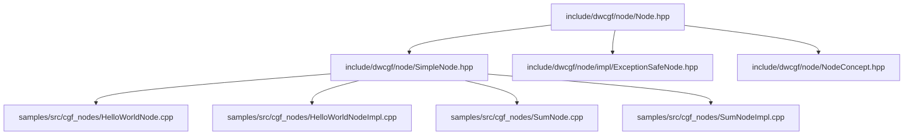
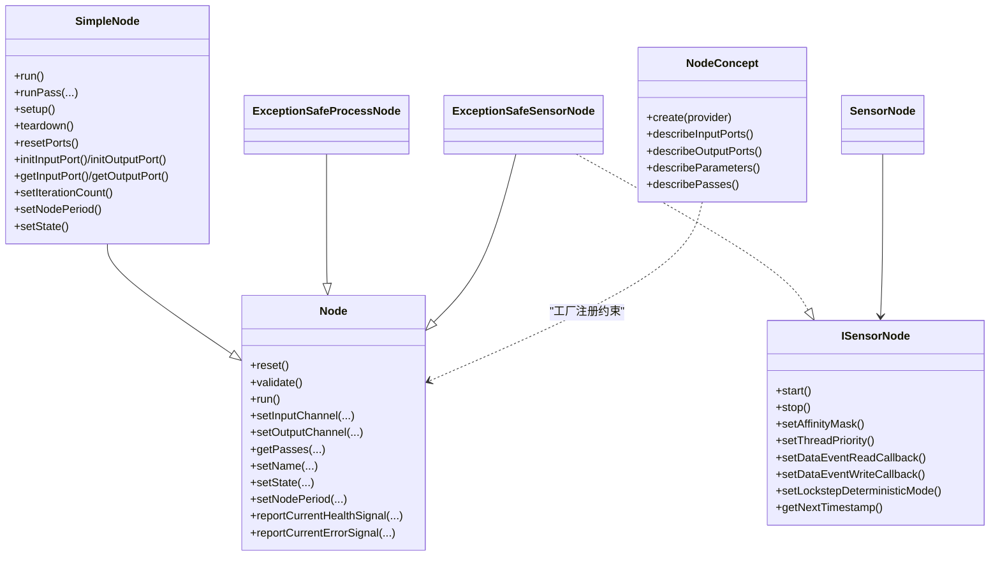
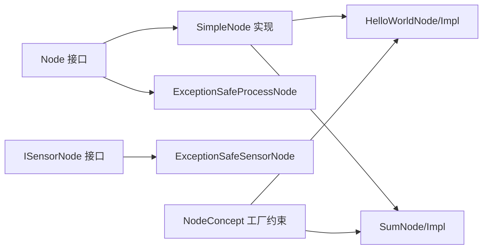

# 节点生命周期管理

<cite>
**本文引用的文件**
- [Node.hpp](file://driverorks-5.10/include/dwcgf/node/Node.hpp)
- [ExceptionSafeNode.hpp](file://driverorks-5.10/include/dwcgf/node/impl/ExceptionSafeNode.hpp)
- [SimpleNode.hpp](file://driverorks-5.10/include/dwcgf/node/SimpleNode.hpp)
- [NodeConcept.hpp](file://driverorks-5.10/include/dwcgf/node/NodeConcept.hpp)
- [HelloWorldNode.cpp](file://driverorks-5.10/samples/src/cgf_nodes/HelloWorldNode.cpp)
- [HelloWorldNodeImpl.cpp](file://driverorks-5.10/samples/src/cgf_nodes/HelloWorldNodeImpl.cpp)
- [SumNode.cpp](file://driverorks-5.10/samples/src/cgf_nodes/SumNode.cpp)
- [SumNodeImpl.cpp](file://driverorks-5.10/samples/src/cgf_nodes/SumNodeImpl.cpp)
</cite>

## 目录
1. [引言](#引言)
2. [项目结构](#项目结构)
3. [核心组件](#核心组件)
4. [架构总览](#架构总览)
5. [详细组件分析](#详细组件分析)
6. [依赖关系分析](#依赖关系分析)
7. [性能考量](#性能考量)
8. [故障排查指南](#故障排查指南)
9. [结论](#结论)
10. [附录](#附录)

## 引言
本技术文档围绕 CGF（Compute Graph Framework）节点的生命周期管理进行系统化梳理，覆盖从节点创建、初始化、配置验证、运行状态管理、资源分配与释放，直至最终销毁的完整流程。文档重点阐释节点状态转换与状态检查机制、关键事件与回调（启动、运行、暂停、恢复、关闭）、以及最佳实践与常见问题的解决方案。目标是帮助开发者在不同版本（driverorks-5.10/5.14/5.8/520）中正确实现与维护节点生命周期，确保线程安全、资源可控与可诊断性。

## 项目结构
本仓库包含多个驱动版本（5.8/5.10/5.14/520），其中与节点生命周期直接相关的核心头文件位于 driverorks-5.10 的 include/dwcgf/node 目录下，示例节点位于对应版本的 samples/src/cgf_nodes 中。下图展示与节点生命周期相关的关键文件与目录关系：

**图表来源**
- [Node.hpp:64-275](file://driverorks-5.10/include/dwcgf/node/Node.hpp#L64-L275)
- [SimpleNode.hpp:74-656](file://driverorks-5.10/include/dwcgf/node/SimpleNode.hpp#L74-L656)
- [ExceptionSafeNode.hpp:40-193](file://driverorks-5.10/include/dwcgf/node/impl/ExceptionSafeNode.hpp#L40-L193)
- [HelloWorldNode.cpp](file://driverorks-5.10/samples/src/cgf_nodes/HelloWorldNode.cpp)
- [HelloWorldNodeImpl.cpp](file://driverorks-5.10/samples/src/cgf_nodes/HelloWorldNodeImpl.cpp)
- [SumNode.cpp](file://driverorks-5.10/samples/src/cgf_nodes/SumNode.cpp)
- [SumNodeImpl.cpp](file://driverorks-5.10/samples/src/cgf_nodes/SumNodeImpl.cpp)
- [NodeConcept.hpp:53-93](file://driverorks-5.10/include/dwcgf/node/NodeConcept.hpp#L53-L93)

**章节来源**
- [Node.hpp:64-275](file://driverorks-5.10/include/dwcgf/node/Node.hpp#L64-L275)
- [SimpleNode.hpp:74-656](file://driverorks-5.10/include/dwcgf/node/SimpleNode.hpp#L74-L656)
- [ExceptionSafeNode.hpp:40-193](file://driverorks-5.10/include/dwcgf/node/impl/ExceptionSafeNode.hpp#L40-L193)
- [NodeConcept.hpp:53-93](file://driverorks-5.10/include/dwcgf/node/NodeConcept.hpp#L53-L93)

## 核心组件
- 基类接口 Node：定义节点生命周期的核心方法族，包括 reset、validate、run、通道绑定、端口访问、健康/错误信号上报、状态设置、周期与迭代计数设置等。该接口强调线程安全的状态变更能力。
- 简单实现基类 SimpleNode：提供默认的 pass 管理（setup/teardown）、端口注册与访问、健康/错误信号聚合、迭代计数与周期设置、以及受控的 reset 行为。它通过模板化的端口与 pass 描述符实现“声明式”节点描述。
- 异常安全包装器 ExceptionSafeNode：对 Node/ISensorNode 进行异常安全封装，确保外部调用在节点内部抛出异常时仍能稳定返回状态码，避免崩溃并保留诊断信息。
- 传感器接口 ISensorNode 与适配器 SensorNode：为传感器型节点提供 start/stop、亲和性与优先级、数据事件回调、锁步确定性模式等能力；SensorNode 将 Node 指针动态转换为 ISensorNode 并提供安全访问。
- 节点概念 NodeConcept：用于节点工厂注册的文档化接口，要求节点具备 create、describeInputPorts、describeOutputPorts、describeParameters、describePasses 等静态函数，便于参数注入与描述生成。

**章节来源**
- [Node.hpp:64-275](file://driverorks-5.10/include/dwcgf/node/Node.hpp#L64-L275)
- [SimpleNode.hpp:74-656](file://driverorks-5.10/include/dwcgf/node/SimpleNode.hpp#L74-L656)
- [ExceptionSafeNode.hpp:40-193](file://driverorks-5.10/include/dwcgf/node/impl/ExceptionSafeNode.hpp#L40-L193)
- [NodeConcept.hpp:53-93](file://driverorks-5.10/include/dwcgf/node/NodeConcept.hpp#L53-L93)

## 架构总览
下图展示了节点生命周期管理的总体架构：Node 作为抽象基类，SimpleNode 提供默认实现，ExceptionSafeNode 在调用层提供异常安全封装，ISensorNode 支持传感器行为，NodeConcept 规范工厂注册。

**图表来源**
- [Node.hpp:64-275](file://driverorks-5.10/include/dwcgf/node/Node.hpp#L64-L275)
- [SimpleNode.hpp:74-656](file://driverorks-5.10/include/dwcgf/node/SimpleNode.hpp#L74-L656)
- [ExceptionSafeNode.hpp:40-193](file://driverorks-5.10/include/dwcgf/node/impl/ExceptionSafeNode.hpp#L40-L193)
- [NodeConcept.hpp:53-93](file://driverorks-5.10/include/dwcgf/node/NodeConcept.hpp#L53-L93)

## 详细组件分析

### 基类接口 Node：生命周期方法族与状态契约
- 初始化与配置
  - setInputChannel/setOutputChannel：将通道绑定到指定端口，支持带数据类型的输入绑定。
  - validate：校验必需端口是否已绑定，确保运行前的完整性。
  - setName/getName：命名与查询，便于日志与诊断。
- 执行与状态
  - run/runPass：执行全部或指定 pass；getPassCount/getPass/getPasses：pass 管理。
  - setState：设置当前状态字符串，Node 实现需保证线程安全。
  - setNodePeriod/setIterationCount：设置节点执行周期与迭代计数，供端口同步与调度使用。
- 健康与错误信号
  - getErrorSignal/getHealthSignal/reportCurrentErrorSignal/reportCurrentHealthSignal：框架在获取信号或 pass 返回非成功时自动调用，用于统一健康/错误上报。
- 资源与端口
  - resetPorts：重置节点内所有端口。
  - getInputChannel/getOutputChannel/getInputPort/getOutputPort：查询通道与端口。

这些方法构成了节点生命周期的“契约”，确保上层框架与节点实现之间的交互一致且可预期。

**章节来源**
- [Node.hpp:76-275](file://driverorks-5.10/include/dwcgf/node/Node.hpp#L76-L275)

### 简单实现基类 SimpleNode：默认行为与模板化描述
- 默认 pass 管理
  - setup/teardown：默认实现分别检查端口缓冲可用性与释放输入端口资源。
  - run/runPass：遍历并执行已注册的 pass 列表。
- 端口管理
  - initInputPort/initOutputPort 及其数组版本：以模板方式声明端口类型与索引，由 SimpleNode 维护注册表，提供类型安全的访问。
  - getInputPort/getOutputPort：按索引或数组索引获取端口引用。
- 健康/错误信号
  - clearHealthSignal/updateHealthSignal/copyModuleHealthSignals/reportCurrentHealthSignal/reportCurrentErrorSignal：聚合节点自身与模块的健康/错误信号。
- 运行时控制
  - setIterationCount/setNodePeriod：记录迭代计数与周期，供端口同步器使用。
  - setState：默认空实现，子类可覆盖以处理状态变化。
- 其他
  - registerPass/make_pass：注册 pass 函数，决定处理器类型与同步/异步过程类型。
  - reset：默认抛出未实现异常，子类应覆盖以执行自定义重置逻辑。

该基类将“声明式描述”与“默认实现”结合，降低重复代码，提升一致性。

**章节来源**
- [SimpleNode.hpp:74-656](file://driverorks-5.10/include/dwcgf/node/SimpleNode.hpp#L74-L656)

### 异常安全包装器 ExceptionSafeNode：调用层保护
- ExceptionSafeProcessNode：对 Node 的所有方法进行异常安全包装，捕获内部异常并返回状态码，同时保留错误/健康信号。
- ExceptionSafeSensorNode：在继承 Node 的同时实现 ISensorNode，对 start/stop/run 等传感器相关方法进行异常安全封装，并暴露传感器回调与锁步模式设置。

该包装器确保即使节点内部发生异常，也不会破坏框架的稳定性与可观测性。

**章节来源**
- [ExceptionSafeNode.hpp:40-193](file://driverorks-5.10/include/dwcgf/node/impl/ExceptionSafeNode.hpp#L40-L193)

### 传感器接口 ISensorNode 与适配器 SensorNode
- ISensorNode：提供传感器生命周期能力，包括 start/stop、亲和性掩码与线程优先级设置、数据事件读写回调、锁步确定性模式、下一时间戳查询等。
- SensorNode：将任意 Node 动态转换为 ISensorNode 并提供安全访问，若节点不实现 ISensorNode 则抛出无效参数异常。

这使得通用节点可以透明地扩展为传感器节点，而无需修改上层调度逻辑。

**章节来源**
- [Node.hpp:277-436](file://driverorks-5.10/include/dwcgf/node/Node.hpp#L277-L436)

### 节点概念 NodeConcept：工厂注册与描述
- 节点工厂注册需要满足 NodeConcept 接口：静态 create 方法负责实例化节点并注入参数；静态 describeXxx 方法用于描述端口、参数与 pass。
- 该规范确保节点可通过参数提供者自动装配，便于 JSON 配置与描述生成工具链集成。

**章节来源**
- [NodeConcept.hpp:53-93](file://driverorks-5.10/include/dwcgf/node/NodeConcept.hpp#L53-L93)

### 示例节点：HelloWorldNode 与 SumNode
- HelloWorldNode/HelloWorldNodeImpl：演示最小节点实现，通常包含端口初始化、参数声明、pass 注册与 run 逻辑。
- SumNode/SumNodeImpl：演示两个输入端口相加的简单计算节点，体现端口绑定、数据读取与输出写入的典型流程。

这些示例展示了如何在 SimpleNode 基础上完成端口与 pass 的声明与实现。

**章节来源**
- [HelloWorldNode.cpp](file://driverorks-5.10/samples/src/cgf_nodes/HelloWorldNode.cpp)
- [HelloWorldNodeImpl.cpp](file://driverorks-5.10/samples/src/cgf_nodes/HelloWorldNodeImpl.cpp)
- [SumNode.cpp](file://driverorks-5.10/samples/src/cgf_nodes/SumNode.cpp)
- [SumNodeImpl.cpp](file://driverorks-5.10/samples/src/cgf_nodes/SumNodeImpl.cpp)

## 依赖关系分析
- SimpleNode 依赖 Node 抽象接口，提供默认的 pass 与端口管理。
- ExceptionSafeNode 依赖 Node/ISensorNode，提供异常安全封装。
- NodeConcept 为工厂注册提供静态接口约束，与具体节点实现解耦。
- 示例节点依赖 SimpleNode 以获得一致的生命周期与端口管理能力。

**图表来源**
- [Node.hpp:64-275](file://driverorks-5.10/include/dwcgf/node/Node.hpp#L64-L275)
- [SimpleNode.hpp:74-656](file://driverorks-5.10/include/dwcgf/node/SimpleNode.hpp#L74-L656)
- [ExceptionSafeNode.hpp:40-193](file://driverorks-5.10/include/dwcgf/node/impl/ExceptionSafeNode.hpp#L40-L193)
- [NodeConcept.hpp:53-93](file://driverorks-5.10/include/dwcgf/node/NodeConcept.hpp#L53-L93)

**章节来源**
- [Node.hpp:64-275](file://driverorks-5.10/include/dwcgf/node/Node.hpp#L64-L275)
- [SimpleNode.hpp:74-656](file://driverorks-5.10/include/dwcgf/node/SimpleNode.hpp#L74-L656)
- [ExceptionSafeNode.hpp:40-193](file://driverorks-5.10/include/dwcgf/node/impl/ExceptionSafeNode.hpp#L40-L193)
- [NodeConcept.hpp:53-93](file://driverorks-5.10/include/dwcgf/node/NodeConcept.hpp#L53-L93)

## 性能考量
- pass 同步/异步类型：根据处理器类型自动推导同步/异步过程类型，GPU/DLA 默认异步，其他默认同步，有助于减少阻塞与提高吞吐。
- 端口缓冲与资源复用：setup/teardown 明确了缓冲可用性检查与释放时机，避免频繁分配/释放带来的开销。
- 异常安全封装：在调用层捕获异常并返回状态码，避免异常传播导致的额外开销与不可预测行为。
- 线程安全状态变更：setState 等方法需保证线程安全，避免竞态条件影响运行时稳定性。

[本节为通用指导，不直接分析具体文件]

## 故障排查指南
- 健康/错误信号上报
  - 使用 getHealthSignal/getErrorSignal 获取当前信号，必要时在 reportCurrentHealthSignal/reportCurrentErrorSignal 中补充节点特定状态。
  - 若信号为空或过期，可在调用时传入更新标志以强制从模块刷新。
- 状态变更与回调
  - setState 默认实现为空，若节点有状态机需求，应在子类中覆盖以处理状态切换与副作用。
  - 传感器节点可通过 ISensorNode 的回调设置数据事件读写，辅助调试与回放。
- 端口与通道
  - validate 失败多因端口未绑定或类型不匹配，检查 setInputChannel/setOutputChannel 的调用顺序与数据类型。
  - resetPorts/reset 仅清理端口状态，若资源泄漏发生在 pass 内部，需在 teardown 或自定义 reset 中显式释放。
- 异常与稳定性
  - 若 run/validate 等方法抛出异常，建议使用 ExceptionSafeNode 包装器以确保框架稳定与可观测性。
- 版本差异
  - 不同版本（5.8/5.10/5.14/520）在 API 细节上可能有差异，建议对照对应版本的 Node/SimpleNode/ExceptionSafeNode 头文件确认行为。

**章节来源**
- [Node.hpp:180-235](file://driverorks-5.10/include/dwcgf/node/Node.hpp#L180-L235)
- [SimpleNode.hpp:294-334](file://driverorks-5.10/include/dwcgf/node/SimpleNode.hpp#L294-L334)
- [ExceptionSafeNode.hpp:40-193](file://driverorks-5.10/include/dwcgf/node/impl/ExceptionSafeNode.hpp#L40-L193)

## 结论
CGF 节点生命周期管理通过 Node 抽象接口、SimpleNode 默认实现与 ExceptionSafeNode 异常安全封装形成清晰的分层：上层框架只关心契约，中间层提供默认行为，底层包装器保障稳定性。配合 ISensorNode 与 NodeConcept，节点可以在参数注入、端口描述与 pass 管理方面保持一致性和可扩展性。遵循本文的状态转换、资源管理与回调机制，可显著提升节点实现的可靠性与可维护性。

[本节为总结，不直接分析具体文件]

## 附录
- 最佳实践
  - 在构造函数中使用 initInputPort/initOutputPort 完成端口声明，避免运行时动态绑定。
  - 在 createSetupPass/createTeardownPass 中注册必要的 pass，确保资源在 setup/teardown 中正确分配/释放。
  - 在 setState 中处理状态切换副作用，如暂停/恢复时的线程/队列管理。
  - 使用 ExceptionSafeNode 包装器以增强鲁棒性。
  - 通过 NodeConcept 的 describeXxx 方法完善节点描述，便于工具链与配置系统集成。
- 常见问题
  - validate 失败：检查端口绑定与数据类型，确保必需端口均已连接。
  - run 抛异常：使用 ExceptionSafeNode 包装器并查看错误/健康信号。
  - 资源泄漏：在 teardown 或自定义 reset 中显式释放外部资源。
  - 状态不一致：确保 setState 的线程安全实现与状态机一致性。

[本节为通用指导，不直接分析具体文件]