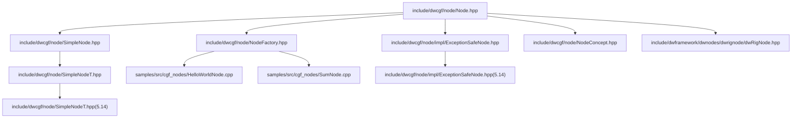
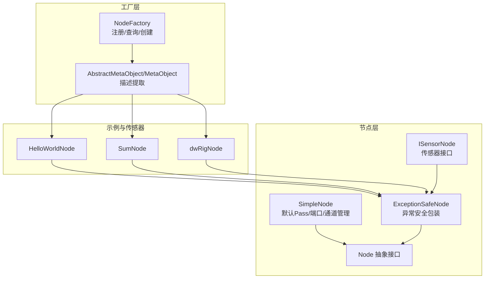
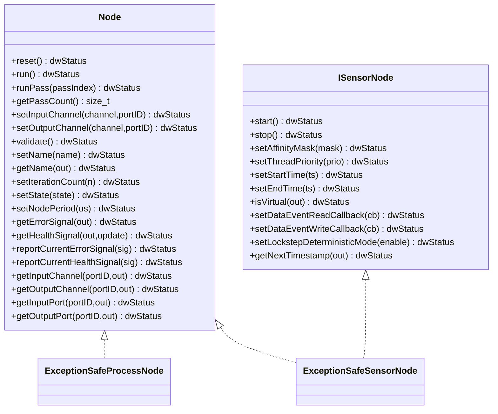
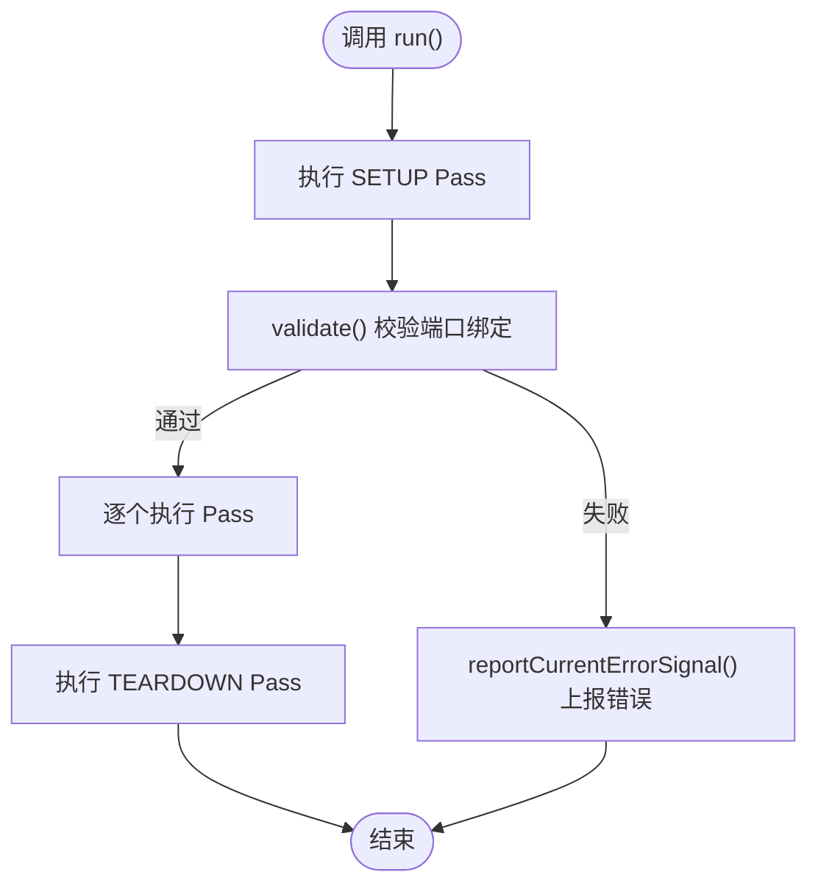
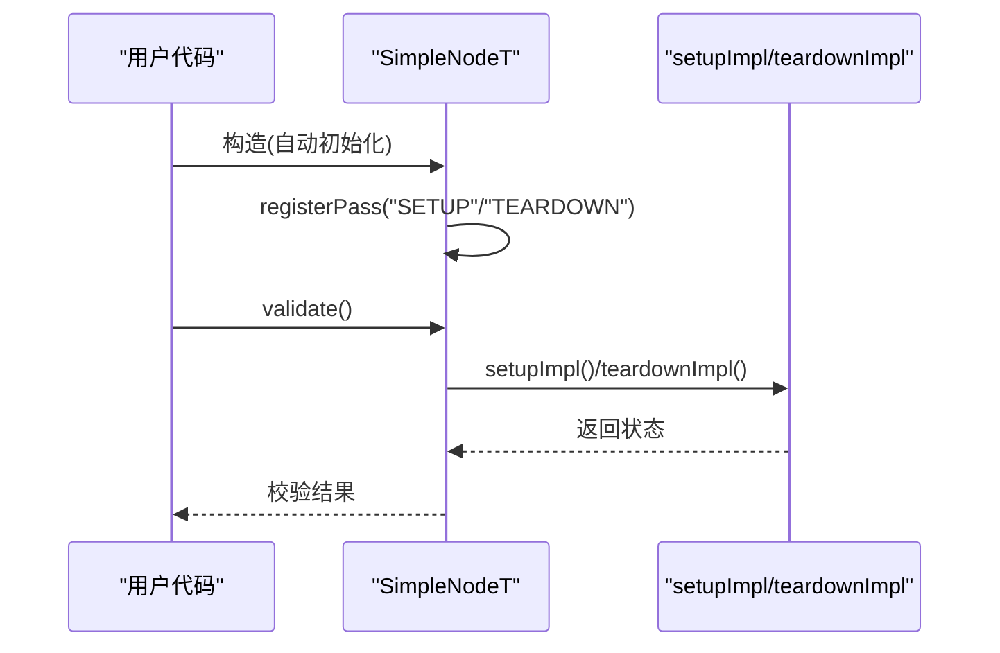
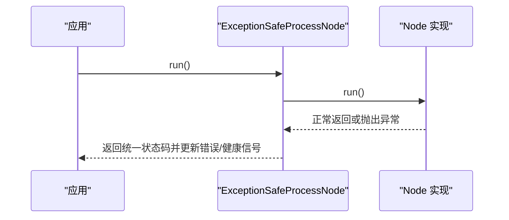
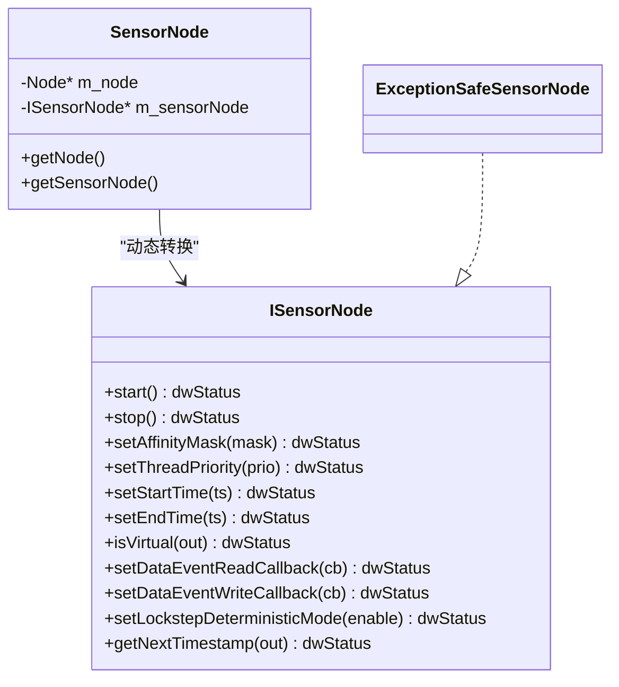
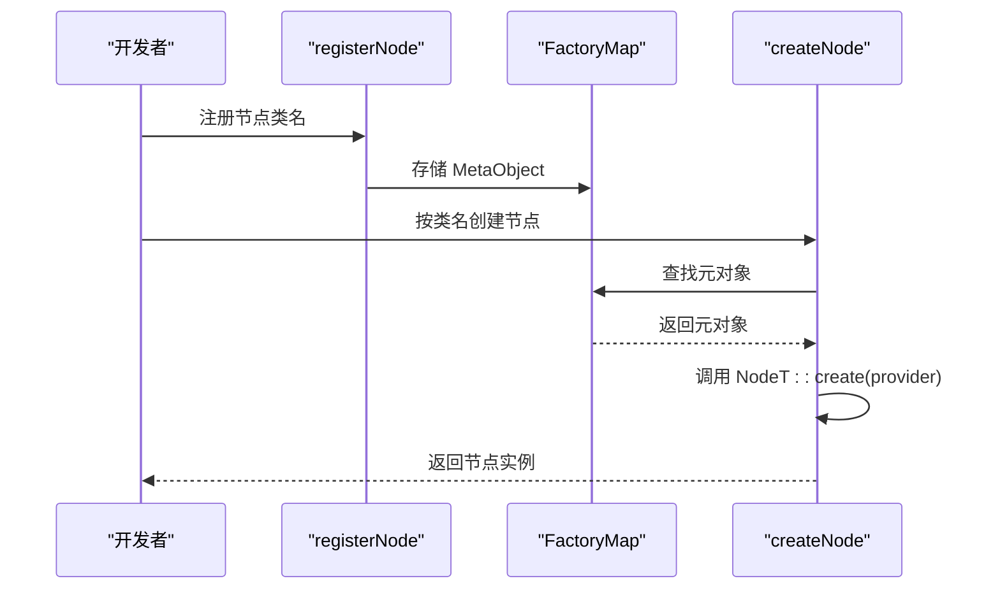
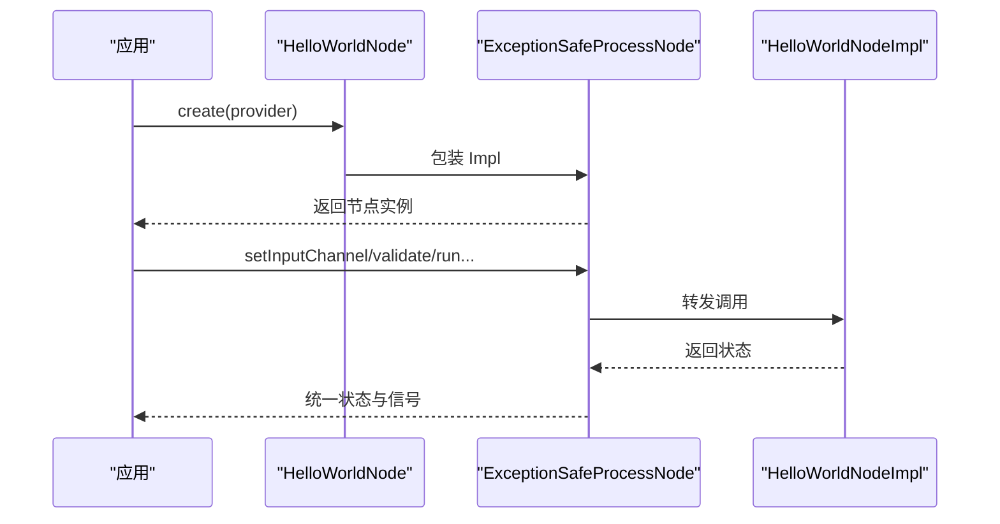
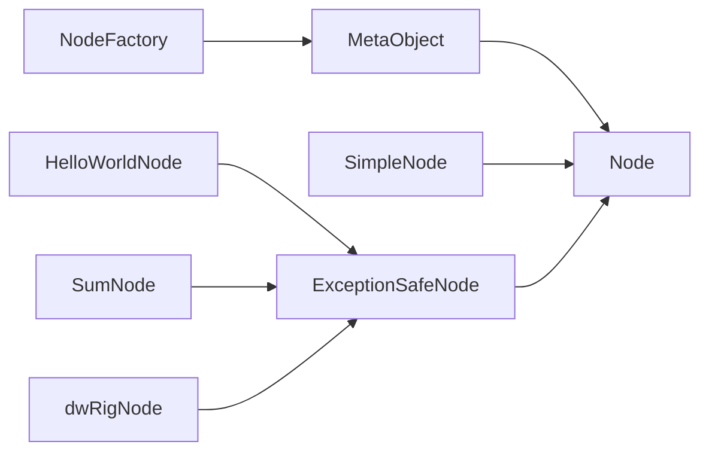

# 节点系统

<cite>
**本文引用的文件**
- [Node.hpp](file://driverorks-5.10/include/dwcgf/node/Node.hpp)
- [NodeFactory.hpp](file://driverorks-5.10/include/dwcgf/node/NodeFactory.hpp)
- [SimpleNode.hpp](file://driverorks-5.10/include/dwcgf/node/SimpleNode.hpp)
- [ExceptionSafeNode.hpp（5.10）](file://driverorks-5.10/include/dwcgf/node/impl/ExceptionSafeNode.hpp)
- [NodeConcept.hpp](file://driverorks-5.10/include/dwcgf/node/NodeConcept.hpp)
- [SimpleNodeT.hpp（5.14）](file://driveworks-5.14/include/dwcgf/node/SimpleNodeT.hpp)
- [ExceptionSafeNode.hpp（5.14）](file://driveworks-5.14/include/dwcgf/node/impl/ExceptionSafeNode.hpp)
- [HelloWorldNode.cpp](file://driverorks-5.10/samples/src/cgf_nodes/HelloWorldNode.cpp)
- [SumNode.cpp](file://driverorks-5.10/samples/src/cgf_nodes/SumNode.cpp)
- [dwRigNode.hpp](file://driverorks-5.10/include/dwframework/dwnodes/dwrignode/dwRigNode.hpp)
</cite>

## 目录
1. [引言](#引言)
2. [项目结构](#项目结构)
3. [核心组件](#核心组件)
4. [架构总览](#架构总览)
5. [详细组件分析](#详细组件分析)
6. [依赖关系分析](#依赖关系分析)
7. [性能考量](#性能考量)
8. [故障排查指南](#故障排查指南)
9. [结论](#结论)
10. [附录](#附录)

## 引言
本技术文档围绕 CGF（Compute Graph Framework）节点系统展开，系统性阐述 Node 抽象基类的设计原则与核心接口，覆盖节点生命周期管理、输入输出通道绑定、参数与端口描述、健康与错误信号上报、以及工厂模式与节点创建最佳实践。同时对 SimpleNode 简单节点、ExceptionSafeNode 异常安全节点进行深入解析，并给出传感器节点的实现要点与示例，帮助开发者快速上手并正确扩展节点系统。

## 项目结构
本仓库包含多版本驱动框架代码，其中与节点系统直接相关的核心头文件位于 driverorks-5.10 与 driveworks-5.14 的 include 目录下；示例节点位于 samples/src/cgf_nodes 中；传感器节点示例位于 dwframework/dwnodes 下。下图展示与节点系统相关的关键目录与文件：

**图表来源**
- [Node.hpp:64-275](file://driverorks-5.10/include/dwcgf/node/Node.hpp#L64-L275)
- [NodeFactory.hpp:57-161](file://driverorks-5.10/include/dwcgf/node/NodeFactory.hpp#L57-L161)
- [SimpleNode.hpp:74-611](file://driverorks-5.10/include/dwcgf/node/SimpleNode.hpp#L74-L611)
- [SimpleNodeT.hpp（5.14）:127-224](file://driveworks-5.14/include/dwcgf/node/SimpleNodeT.hpp#L127-L224)
- [ExceptionSafeNode.hpp（5.10）:40-101](file://driverorks-5.10/include/dwcgf/node/impl/ExceptionSafeNode.hpp#L40-L101)
- [ExceptionSafeNode.hpp（5.14）:41-153](file://driveworks-5.14/include/dwcgf/node/impl/ExceptionSafeNode.hpp#L41-L153)
- [HelloWorldNode.cpp:41-57](file://driverorks-5.10/samples/src/cgf_nodes/HelloWorldNode.cpp#L41-L57)
- [SumNode.cpp:41-57](file://driverorks-5.10/samples/src/cgf_nodes/SumNode.cpp#L41-L57)
- [NodeConcept.hpp:53-93](file://driverorks-5.10/include/dwcgf/node/NodeConcept.hpp#L53-L93)
- [dwRigNode.hpp:83-203](file://driverorks-5.10/include/dwframework/dwnodes/dwrignode/dwRigNode.hpp#L83-L203)

**章节来源**
- [Node.hpp:64-275](file://driverorks-5.10/include/dwcgf/node/Node.hpp#L64-L275)
- [NodeFactory.hpp:57-161](file://driverorks-5.10/include/dwcgf/node/NodeFactory.hpp#L57-L161)

## 核心组件
- 抽象基类 Node：定义节点生命周期、通道绑定、参数与端口描述、健康与错误信号、状态与周期设置、迭代计数等统一接口。
- 工厂与元对象：通过 NodeFactory 提供注册、查询与实例化能力，结合 MetaObject 模板类自动提取端口、参数与 Pass 描述。
- 简单节点 SimpleNode：提供默认的 SETUP/TEARDOWN Pass、端口注册与校验、通道绑定、健康/错误信号收集与上报等通用能力。
- 异常安全节点 ExceptionSafeNode：包装具体节点实现，统一捕获异常、记录错误与健康信号、屏蔽底层实现细节。
- 传感器节点接口 ISensorNode 与封装 SensorNode：提供传感器启动/停止、优先级/亲和性、时间戳回调、锁步确定性模式等能力。
- 示例节点：HelloWorldNode、SumNode 展示如何通过工厂注册与创建节点。
- 传感器节点示例：dwRigNode 展示如何在节点中声明输入/输出端口、Pass 与参数描述。

**章节来源**
- [Node.hpp:64-275](file://driverorks-5.10/include/dwcgf/node/Node.hpp#L64-L275)
- [NodeFactory.hpp:57-161](file://driverorks-5.10/include/dwcgf/node/NodeFactory.hpp#L57-L161)
- [SimpleNode.hpp:74-611](file://driverorks-5.10/include/dwcgf/node/SimpleNode.hpp#L74-L611)
- [ExceptionSafeNode.hpp（5.10）:40-101](file://driverorks-5.10/include/dwcgf/node/impl/ExceptionSafeNode.hpp#L40-L101)
- [NodeConcept.hpp:53-93](file://driverorks-5.10/include/dwcgf/node/NodeConcept.hpp#L53-L93)
- [HelloWorldNode.cpp:41-57](file://driverorks-5.10/samples/src/cgf_nodes/HelloWorldNode.cpp#L41-L57)
- [SumNode.cpp:41-57](file://driverorks-5.10/samples/src/cgf_nodes/SumNode.cpp#L41-L57)
- [dwRigNode.hpp:83-203](file://driverorks-5.10/include/dwframework/dwnodes/dwrignode/dwRigNode.hpp#L83-L203)

## 架构总览
下图展示了节点系统的高层交互：应用通过 NodeFactory 注册节点类型，运行时根据描述信息创建节点实例；节点内部由 SimpleNode 或其派生类负责生命周期与通道绑定；ExceptionSafeNode 包装具体实现以保证异常安全；传感器节点通过 ISensorNode 接口提供数据事件与时间戳控制。

**图表来源**
- [NodeFactory.hpp:57-161](file://driverorks-5.10/include/dwcgf/node/NodeFactory.hpp#L57-L161)
- [Node.hpp:64-275](file://driverorks-5.10/include/dwcgf/node/Node.hpp#L64-L275)
- [SimpleNode.hpp:74-611](file://driverorks-5.10/include/dwcgf/node/SimpleNode.hpp#L74-L611)
- [ExceptionSafeNode.hpp（5.10）:40-101](file://driverorks-5.10/include/dwcgf/node/impl/ExceptionSafeNode.hpp#L40-L101)
- [HelloWorldNode.cpp:41-57](file://driverorks-5.10/samples/src/cgf_nodes/HelloWorldNode.cpp#L41-L57)
- [SumNode.cpp:41-57](file://driverorks-5.10/samples/src/cgf_nodes/SumNode.cpp#L41-L57)
- [dwRigNode.hpp:83-203](file://driverorks-5.10/include/dwframework/dwnodes/dwrignode/dwRigNode.hpp#L83-L203)

## 详细组件分析

### 抽象基类 Node 设计与接口
- 生命周期与执行
  - reset：重置节点状态
  - run/runPass/getPass/getPasses：执行节点内一个或全部 Pass
  - getPassCount：获取 Pass 数量
- 通道绑定
  - setInputChannel/setOutputChannel：将端口与通道绑定（支持指定序列化类型）
  - getInputChannel/getOutputChannel：查询端口绑定的通道
- 端口访问
  - getInputPort/getOutputPort：按 ID 获取端口对象
- 健康与错误信号
  - getErrorSignal/getHealthSignal：获取错误与健康信号
  - reportCurrentErrorSignal/reportCurrentHealthSignal：上报当前信号
- 元数据与状态
  - setName/getName：设置/获取节点名称
  - setIterationCount/getIterationCount：设置/获取迭代计数
  - setState：设置节点状态
  - setNodePeriod/getNodePeriod：设置/获取节点周期
- 传感器接口
  - ISensorNode：start/stop、亲和性/优先级、时间戳回调、锁步模式、数据事件枚举等

**图表来源**
- [Node.hpp:64-275](file://driverorks-5.10/include/dwcgf/node/Node.hpp#L64-L275)
- [ExceptionSafeNode.hpp（5.10）:40-101](file://driverorks-5.10/include/dwcgf/node/impl/ExceptionSafeNode.hpp#L40-L101)

**章节来源**
- [Node.hpp:64-275](file://driverorks-5.10/include/dwcgf/node/Node.hpp#L64-L275)

### SimpleNode 简单节点
- 默认 Pass：内置 SETUP/TEARDOWN 名称常量，提供默认 setup/teardown 实现，确保端口缓冲可用与释放。
- 端口管理：通过 initInputPort/initOutputPort 及数组版本初始化端口；getInputPort/getOutputPort 支持普通与数组索引两种访问方式；提供迭代器遍历受管端口。
- 通道绑定：setInputChannel/setOutputChannel 将端口与 ChannelObject 绑定；validate 对已注册端口进行绑定校验。
- 健康/错误信号：提供 clear/update/copy/report 系列接口，支持从模块复制健康信号并汇总到节点。
- 迭代与周期：setIterationCount/setNodePeriod 与 getState 配合，支持同步/异步处理策略。
- 参数句柄：setModuleHandle 用于关联模块句柄，便于后续资源管理。

**图表来源**
- [SimpleNode.hpp:124-130](file://driverorks-5.10/include/dwcgf/node/SimpleNode.hpp#L124-L130)
- [SimpleNode.hpp:556-563](file://driverorks-5.10/include/dwcgf/node/SimpleNode.hpp#L556-L563)

**章节来源**
- [SimpleNode.hpp:74-611](file://driverorks-5.10/include/dwcgf/node/SimpleNode.hpp#L74-L611)

### SimpleNodeT（5.14）增强版
- 自动化初始化：构造时自动注册 SETUP/TEARDOWN Pass，并调用 setupImpl/teardownImpl。
- 端口校验：validate 内部使用 SimpleNode::validate 辅助函数，结合端口集合描述，检查必绑定端口是否已绑定。
- 宏工具：提供 NODE_INIT_*、NODE_GET_*、NODE_REGISTER_PASS 等宏简化端口与 Pass 的声明与使用。

**图表来源**
- [SimpleNodeT.hpp（5.14）:127-224](file://driveworks-5.14/include/dwcgf/node/SimpleNodeT.hpp#L127-L224)

**章节来源**
- [SimpleNodeT.hpp（5.14）:127-224](file://driveworks-5.14/include/dwcgf/node/SimpleNodeT.hpp#L127-L224)

### 异常安全节点 ExceptionSafeNode
- 包装策略：ExceptionSafeProcessNode/ExceptionSafeSensorNode 持有 std::unique_ptr<Node>，对外暴露与 Node 相同的接口。
- 异常捕获：所有对外调用（reset/run/...）均被包装，捕获异常并转换为错误/健康信号，避免异常穿透至框架层。
- 传感器扩展：ExceptionSafeSensorNode 同时实现 ISensorNode，转发传感器相关操作并保持异常安全。

**图表来源**
- [ExceptionSafeNode.hpp（5.10）:40-101](file://driverorks-5.10/include/dwcgf/node/impl/ExceptionSafeNode.hpp#L40-L101)
- [ExceptionSafeNode.hpp（5.14）:41-153](file://driveworks-5.14/include/dwcgf/node/impl/ExceptionSafeNode.hpp#L41-L153)

**章节来源**
- [ExceptionSafeNode.hpp（5.10）:40-101](file://driverorks-5.10/include/dwcgf/node/impl/ExceptionSafeNode.hpp#L40-L101)
- [ExceptionSafeNode.hpp（5.14）:41-153](file://driveworks-5.14/include/dwcgf/node/impl/ExceptionSafeNode.hpp#L41-L153)

### 传感器节点接口与封装
- ISensorNode：定义传感器启动/停止、线程属性设置、时间戳回调、锁步模式与数据事件枚举等。
- SensorNode 封装：将 Node 动态转换为 ISensorNode，若不支持则抛出无效参数异常。
- 示例：dwRigNode 展示了如何声明输入/输出端口、Pass 与参数描述，并实现 IContainsPreShutdownAction 在退出前保存状态。

**图表来源**
- [Node.hpp:277-386](file://driverorks-5.10/include/dwcgf/node/Node.hpp#L277-L386)
- [Node.hpp:388-436](file://driverorks-5.10/include/dwcgf/node/Node.hpp#L388-L436)
- [ExceptionSafeNode.hpp（5.10）:103-188](file://driverorks-5.10/include/dwcgf/node/impl/ExceptionSafeNode.hpp#L103-L188)

**章节来源**
- [Node.hpp:277-386](file://driverorks-5.10/include/dwcgf/node/Node.hpp#L277-L386)
- [Node.hpp:388-436](file://driverorks-5.10/include/dwcgf/node/Node.hpp#L388-L436)
- [dwRigNode.hpp:83-203](file://driverorks-5.10/include/dwframework/dwnodes/dwrignode/dwRigNode.hpp#L83-L203)

### 节点工厂模式与节点创建
- 元对象与注册
  - AbstractMetaObject：统一描述提取与实例化入口
  - MetaObject<NodeT>：静态缓存端口/参数/Pass 描述，并委托 NodeT::create
  - registerNode：线程安全地将类名映射到元对象
- 查询与创建
  - getNodeNames/getInputPorts/getOutputPorts/getParameters/getPasses：按类名查询描述
  - createNode：根据参数提供者创建节点实例
- 概念约束
  - NodeConcept：定义节点需具备的静态接口 create/describe*，作为注册与生成的契约

**图表来源**
- [NodeFactory.hpp:57-161](file://driverorks-5.10/include/dwcgf/node/NodeFactory.hpp#L57-L161)
- [NodeConcept.hpp:53-93](file://driverorks-5.10/include/dwcgf/node/NodeConcept.hpp#L53-L93)

**章节来源**
- [NodeFactory.hpp:57-161](file://driverorks-5.10/include/dwcgf/node/NodeFactory.hpp#L57-L161)
- [NodeConcept.hpp:53-93](file://driverorks-5.10/include/dwcgf/node/NodeConcept.hpp#L53-L93)

### 示例：自定义节点创建与集成
- HelloWorldNode/SumNode
  - create：通过工厂模板函数创建实例
  - 构造：使用 ExceptionSafeProcessNode 包装具体实现
  - 注册：通过 DW_REGISTER_NODE 宏完成节点注册

**图表来源**
- [HelloWorldNode.cpp:41-57](file://driverorks-5.10/samples/src/cgf_nodes/HelloWorldNode.cpp#L41-L57)
- [SumNode.cpp:41-57](file://driverorks-5.10/samples/src/cgf_nodes/SumNode.cpp#L41-L57)

**章节来源**
- [HelloWorldNode.cpp:41-57](file://driverorks-5.10/samples/src/cgf_nodes/HelloWorldNode.cpp#L41-L57)
- [SumNode.cpp:41-57](file://driverorks-5.10/samples/src/cgf_nodes/SumNode.cpp#L41-L57)

## 依赖关系分析
- 耦合与内聚
  - Node 作为抽象基类，向上提供统一接口，向下由 SimpleNode/ExceptionSafeNode 承担具体职责，耦合度低、内聚度高。
  - NodeFactory 与 MetaObject 解耦节点实现与描述，通过静态描述信息完成创建与查询。
- 外部依赖
  - 通道/端口/参数/Pass 等基础设施来自 dgcgf 子模块，节点仅通过接口使用。
- 循环依赖
  - NodeFactory 与 Node 无循环依赖；ExceptionSafeNode 仅持有 Node 智能指针，避免循环引用。

**图表来源**
- [NodeFactory.hpp:57-161](file://driverorks-5.10/include/dwcgf/node/NodeFactory.hpp#L57-L161)
- [Node.hpp:64-275](file://driverorks-5.10/include/dwcgf/node/Node.hpp#L64-L275)
- [SimpleNode.hpp:74-611](file://driverorks-5.10/include/dwcgf/node/SimpleNode.hpp#L74-L611)
- [ExceptionSafeNode.hpp（5.10）:40-101](file://driverorks-5.10/include/dwcgf/node/impl/ExceptionSafeNode.hpp#L40-L101)
- [HelloWorldNode.cpp:41-57](file://driverorks-5.10/samples/src/cgf_nodes/HelloWorldNode.cpp#L41-L57)
- [SumNode.cpp:41-57](file://driverorks-5.10/samples/src/cgf_nodes/SumNode.cpp#L41-L57)
- [dwRigNode.hpp:83-203](file://driverorks-5.10/include/dwframework/dwnodes/dwrignode/dwRigNode.hpp#L83-L203)

**章节来源**
- [NodeFactory.hpp:57-161](file://driverorks-5.10/include/dwcgf/node/NodeFactory.hpp#L57-L161)
- [Node.hpp:64-275](file://driverorks-5.10/include/dwcgf/node/Node.hpp#L64-L275)

## 性能考量
- Pass 并行与同步
  - SimpleNode 根据处理器类型自动推断同步/异步处理类型，GPU/DLA 使用异步处理，其他类型使用同步处理，有助于提升吞吐。
- 端口与通道管理
  - 受管端口（ManagedPort）在 setup/teardown 中进行缓冲分配与释放，减少外部资源泄漏风险。
- 异常安全开销
  - ExceptionSafeNode 包装带来的异常捕获与信号更新存在少量额外开销，建议在生产环境启用以保障稳定性。
- 健康/错误信号聚合
  - 节点应避免频繁上报信号，建议批量更新并在必要时触发上报，降低信号处理开销。

[本节为通用指导，无需“章节来源”]

## 故障排查指南
- 端口未绑定
  - 现象：validate 返回失败
  - 排查：确认所有必需端口已在构造阶段通过 NODE_INIT_* 宏初始化，并在运行前完成 setInputChannel/setOutputChannel 绑定
- 类型不匹配
  - 现象：getInputPort/getOutputPort 抛出类型转换异常
  - 排查：核对端口类型与声明一致，避免跨节点误用
- 通道类型不匹配
  - 现象：setInputChannel 指定序列化类型时报错
  - 排查：确保传入的序列化类型与通道期望一致
- 异常穿透
  - 现象：节点内部异常导致框架崩溃
  - 排查：使用 ExceptionSafeNode 包装节点，确保异常被捕获并转化为错误/健康信号
- 传感器事件回调
  - 现象：数据事件回调未生效
  - 排查：确认已设置 DataEventReadCallback/DataEventWriteCallback，并在锁步模式下正确传递时间戳

**章节来源**
- [SimpleNode.hpp:113-122](file://driverorks-5.10/include/dwcgf/node/SimpleNode.hpp#L113-L122)
- [Node.hpp:88-97](file://driverorks-5.10/include/dwcgf/node/Node.hpp#L88-L97)
- [ExceptionSafeNode.hpp（5.10）:40-101](file://driverorks-5.10/include/dwcgf/node/impl/ExceptionSafeNode.hpp#L40-L101)

## 结论
CGF 节点系统通过抽象基类 Node、工厂与元对象、简单节点与异常安全节点的分层设计，提供了清晰的生命周期管理、通道绑定、参数与端口描述、健康与错误信号上报能力。开发者可借助 SimpleNodeT 的宏工具快速实现节点，通过 NodeFactory 完成注册与创建，并利用 ExceptionSafeNode 保障运行时稳定性。传感器节点通过 ISensorNode 接口实现数据事件与时间戳控制，满足复杂场景需求。

[本节为总结，无需“章节来源”]

## 附录
- 最佳实践
  - 使用 SimpleNodeT 与宏简化端口与 Pass 的声明
  - 在节点构造阶段完成端口初始化与 Pass 注册
  - 通过 NodeFactory 的 describe* 接口导出节点描述，便于工具链与可视化
  - 使用 ExceptionSafeNode 包装所有自定义节点，确保异常安全
  - 传感器节点实现 ISensorNode，并在需要时设置数据事件回调
- 开发示例路径
  - 示例节点创建与注册：[HelloWorldNode.cpp:41-57](file://driverorks-5.10/samples/src/cgf_nodes/HelloWorldNode.cpp#L41-L57)、[SumNode.cpp:41-57](file://driverorks-5.10/samples/src/cgf_nodes/SumNode.cpp#L41-L57)
  - 传感器节点示例：[dwRigNode.hpp:83-203](file://driverorks-5.10/include/dwframework/dwnodes/dwrignode/dwRigNode.hpp#L83-L203)
  - 工厂与概念约束：[NodeFactory.hpp:57-161](file://driverorks-5.10/include/dwcgf/node/NodeFactory.hpp#L57-L161)、[NodeConcept.hpp:53-93](file://driverorks-5.10/include/dwcgf/node/NodeConcept.hpp#L53-L93)

[本节为补充说明，无需“章节来源”]