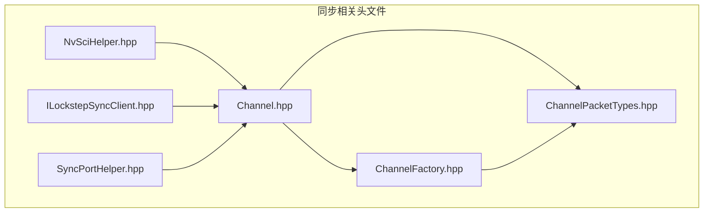
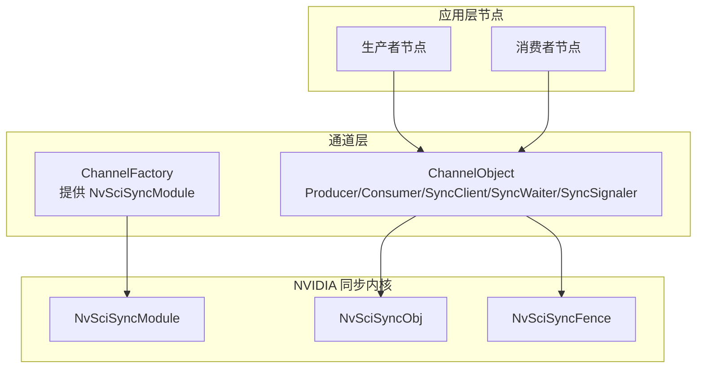
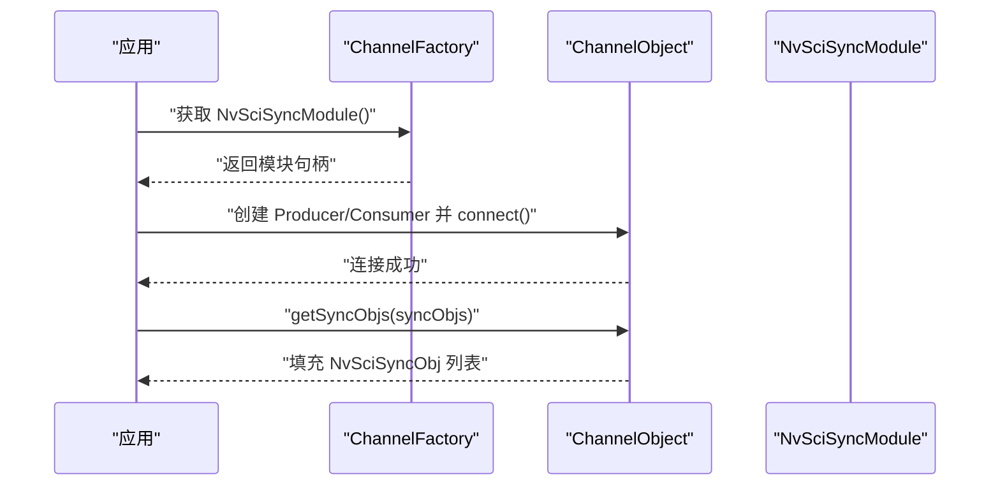
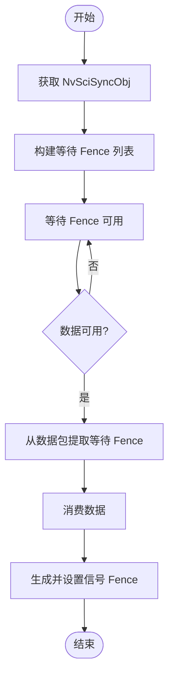
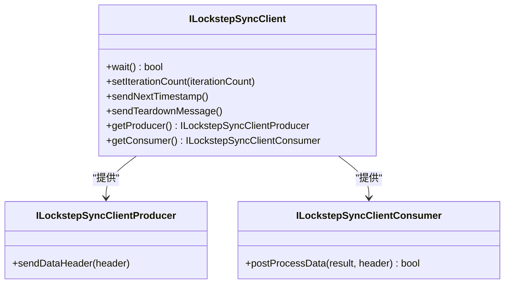
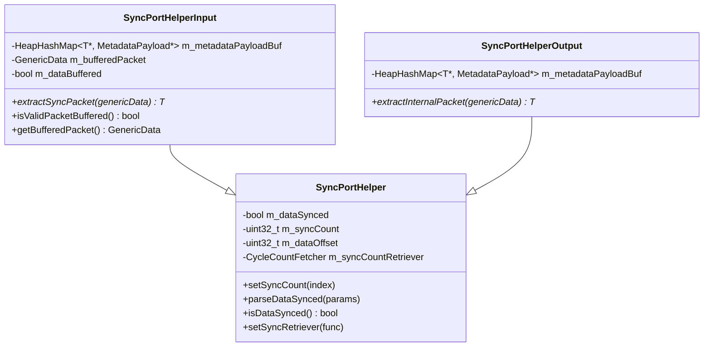
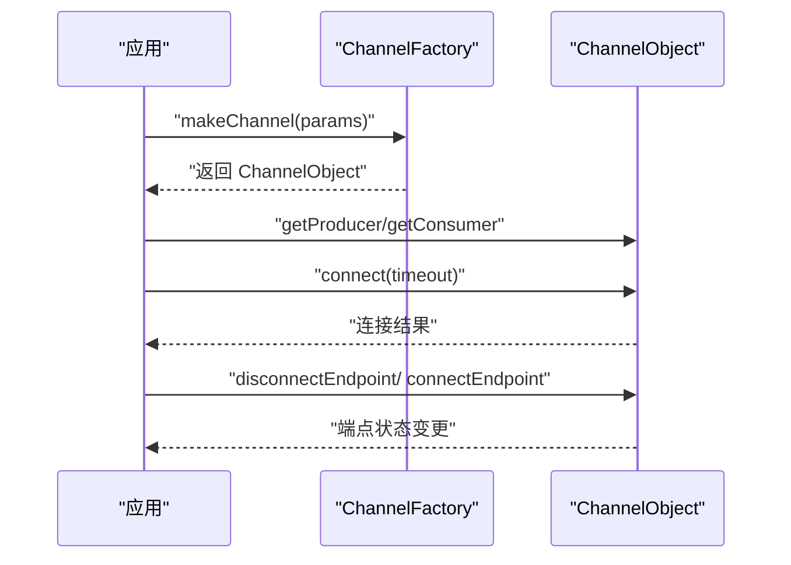
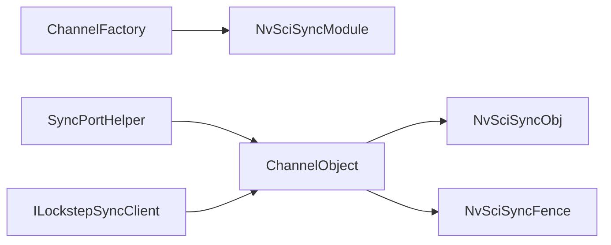

# 同步机制

<cite>
**本文引用的文件**
- [NvSciHelper.hpp](file://driverorks-5.10/include/dwcgf/channel/NvSciHelper.hpp)
- [ILockstepSyncClient.hpp](file://driverorks-5.10/include/dwcgf/lockstep/ILockstepSyncClient.hpp)
- [SyncPortHelper.hpp](file://driverorks-5.10/include/dwcgf/port/SyncPortHelper.hpp)
- [Channel.hpp](file://driverorks-5.10/include/dwcgf/channel/Channel.hpp)
- [ChannelFactory.hpp](file://driverorks-5.10/include/dwcgf/channel/ChannelFactory.hpp)
- [ChannelPacketTypes.hpp](file://driverorks-5.10/include/dwcgf/channel/ChannelPacketTypes.hpp)
</cite>

## 目录
1. [引言](#引言)
2. [项目结构](#项目结构)
3. [核心组件](#核心组件)
4. [架构总览](#架构总览)
5. [详细组件分析](#详细组件分析)
6. [依赖关系分析](#依赖关系分析)
7. [性能考虑](#性能考虑)
8. [故障排查指南](#故障排查指南)
9. [结论](#结论)
10. [附录](#附录)

## 引言
本技术文档围绕 DriveWorks CGF（Compute Graph Framework）中的同步机制展开，重点覆盖以下方面：
- NvSci 同步原语的使用：NvSciSyncObj 的获取与管理、NvSciSyncModule 的生命周期与共享。
- 接口设计与实现：SyncClient、SyncWaiter、SyncSignaler 的职责划分与调用约定。
- Fence 等待与信号机制：getWaitFences 与 setSignalFences 的使用方法与数据流。
- 跨进程同步：NvSci IPC 配置、通道连接与端点控制。
- 超时处理、错误管理与性能优化策略。
- 在节点中正确使用同步机制的实践路径与常见问题诊断。

## 项目结构
本仓库包含多个版本的驱动与框架头文件，同步机制相关的核心位于 driverorks-5.10 版本的 dwcgf 与 dwframework 子目录中。与同步直接相关的关键文件如下：
- NvSci 辅助与错误处理：NvSciHelper.hpp
- 锁步同步客户端接口：ILockstepSyncClient.hpp
- 同步端口辅助工具：SyncPortHelper.hpp
- 通道对象与同步接口：Channel.hpp、ChannelFactory.hpp、ChannelPacketTypes.hpp

图表来源
- [NvSciHelper.hpp:1-68](file://driverorks-5.10/include/dwcgf/channel/NvSciHelper.hpp#L1-68)
- [ILockstepSyncClient.hpp:1-183](file://driverorks-5.10/include/dwcgf/lockstep/ILockstepSyncClient.hpp#L1-183)
- [SyncPortHelper.hpp:1-262](file://driverorks-5.10/include/dwcgf/port/SyncPortHelper.hpp#L1-262)
- [Channel.hpp:1-280](file://driverorks-5.10/include/dwcgf/channel/Channel.hpp#L1-280)
- [ChannelFactory.hpp:1-160](file://driverorks-5.10/include/dwcgf/channel/ChannelFactory.hpp#L1-160)
- [ChannelPacketTypes.hpp:1-367](file://driverorks-5.10/include/dwcgf/channel/ChannelPacketTypes.hpp#L1-367)

章节来源
- [NvSciHelper.hpp:1-68](file://driverorks-5.10/include/dwcgf/channel/NvSciHelper.hpp#L1-L68)
- [ILockstepSyncClient.hpp:1-183](file://driverorks-5.10/include/dwcgf/lockstep/ILockstepSyncClient.hpp#L1-L183)
- [SyncPortHelper.hpp:1-262](file://driverorks-5.10/include/dwcgf/port/SyncPortHelper.hpp#L1-L262)
- [Channel.hpp:1-280](file://driverorks-5.10/include/dwcgf/channel/Channel.hpp#L1-L280)
- [ChannelFactory.hpp:1-160](file://driverorks-5.10/include/dwcgf/channel/ChannelFactory.hpp#L1-L160)
- [ChannelPacketTypes.hpp:1-367](file://driverorks-5.10/include/dwcgf/channel/ChannelPacketTypes.hpp#L1-L367)

## 核心组件
- NvSci 同步对象与模块
  - NvSciSyncObj：用于跨进程/跨域同步的句柄对象，通过 ChannelObject::SyncClient::getSyncObjs 获取。
  - NvSciSyncModule：由 ChannelFactory 统一管理并提供给底层 NvSciStream 通道使用。
- 同步接口族
  - SyncClient：统一的同步能力入口，负责获取 NvSciSyncObj。
  - SyncWaiter：从通道数据包中提取等待 Fence，确保消费前满足前置条件。
  - SyncSignaler：向通道数据包写入信号 Fence，通知下游可继续执行。
- 锁步同步客户端
  - ILockstepSyncClient：面向锁步场景的生产者/消费者对齐接口，支持 advance、data header、unblock 等消息类型与状态机。
- 同步端口辅助
  - SyncPortHelper 及其输入/输出模板：封装同步计数、偏移量与元数据包映射，保障跨流水线边界的同步一致性。

章节来源
- [Channel.hpp:61-111](file://driverorks-5.10/include/dwcgf/channel/Channel.hpp#L61-L111)
- [ChannelFactory.hpp:113-115](file://driverorks-5.10/include/dwcgf/channel/ChannelFactory.hpp#L113-L115)
- [ILockstepSyncClient.hpp:43-176](file://driverorks-5.10/include/dwcgf/lockstep/ILockstepSyncClient.hpp#L43-L176)
- [SyncPortHelper.hpp:47-70](file://driverorks-5.10/include/dwcgf/port/SyncPortHelper.hpp#L47-L70)

## 架构总览
下图展示了同步机制在 CGF 中的整体交互：节点通过 ChannelFactory 创建通道，通道内部持有 NvSciSyncModule；生产者/消费者通过 ChannelObject 获取 SyncClient/SyncWaiter/SyncSignaler；数据包携带元数据与 Fence，实现跨进程/跨节点的确定性同步。

图表来源
- [ChannelFactory.hpp:113-115](file://driverorks-5.10/include/dwcgf/channel/ChannelFactory.hpp#L113-L115)
- [Channel.hpp:64-111](file://driverorks-5.10/include/dwcgf/channel/Channel.hpp#L64-L111)
- [ChannelPacketTypes.hpp:242-244](file://driverorks-5.10/include/dwcgf/channel/ChannelPacketTypes.hpp#L242-L244)

## 详细组件分析

### NvSci 同步对象与模块管理
- NvSciSyncObj 获取
  - 通过 ChannelObject::SyncClient::getSyncObjs 获取已分配的同步对象数组，需在通道完全连接后调用。
  - 返回值与异常：当通道未连接或输出内存不足时抛出相应异常。
- NvSciSyncModule
  - 由 ChannelFactory::getNvSciSyncModule 提供，供底层 NvSciStream 通道使用，应用不应自行释放。
- 错误处理与超时
  - 使用 FRWK_CHECK_NVSCI_ERROR 宏封装 NvSci API 调用，遇到超时或内部错误会转换为框架异常类型。

图表来源
- [ChannelFactory.hpp:113-115](file://driverorks-5.10/include/dwcgf/channel/ChannelFactory.hpp#L113-L115)
- [Channel.hpp:64-76](file://driverorks-5.10/include/dwcgf/channel/Channel.hpp#L64-L76)

章节来源
- [Channel.hpp:61-76](file://driverorks-5.10/include/dwcgf/channel/Channel.hpp#L61-L76)
- [ChannelFactory.hpp:113-115](file://driverorks-5.10/include/dwcgf/channel/ChannelFactory.hpp#L113-L115)
- [NvSciHelper.hpp:51-65](file://driverorks-5.10/include/dwcgf/channel/NvSciHelper.hpp#L51-L65)

### Fence 等待与信号机制
- getWaitFences
  - 从数据包中提取需要等待的 Fence，确保在消费前满足前置同步条件。
  - 参数与约束：传入数据指针与输出 Fence 的 span，需保证输出空间足够。
- setSignalFences
  - 将信号 Fence 写入数据包，通知下游可以继续处理。
  - 参数与约束：传入数据指针与待设置的 Fence 列表，数量受限于实现约束。
- 数据包与元数据
  - 通道数据包包含元数据头（含迭代计数、时间戳等），同步逻辑常基于迭代计数与数据偏移进行校验。

图表来源
- [Channel.hpp:81-111](file://driverorks-5.10/include/dwcgf/channel/Channel.hpp#L81-L111)
- [ChannelPacketTypes.hpp:224-239](file://driverorks-5.10/include/dwcgf/channel/ChannelPacketTypes.hpp#L224-L239)

章节来源
- [Channel.hpp:81-111](file://driverorks-5.10/include/dwcgf/channel/Channel.hpp#L81-L111)
- [ChannelPacketTypes.hpp:224-239](file://driverorks-5.10/include/dwcgf/channel/ChannelPacketTypes.hpp#L224-L239)

### 锁步同步客户端（Lockstep）
- 角色与职责
  - 生产者/消费者分别通过 ILockstepSyncClientProducer 与 ILockstepSyncClientConsumer 扩展能力。
  - 基类接口提供 wait、advance、teardown 等控制流程。
- 消息类型与状态
  - 支持 ADVANCE（推进下一时间戳）、DATA_HEADER（数据头）、UNBLOCK（解阻塞）三类消息。
  - 数据状态枚举包含“未就绪”、“可消费”、“丢弃”。

图表来源
- [ILockstepSyncClient.hpp:87-176](file://driverorks-5.10/include/dwcgf/lockstep/ILockstepSyncClient.hpp#L87-L176)

章节来源
- [ILockstepSyncClient.hpp:43-176](file://driverorks-5.10/include/dwcgf/lockstep/ILockstepSyncClient.hpp#L43-L176)

### 同步端口辅助（SyncPortHelper）
- 功能概述
  - 维护同步计数、数据偏移与周期获取器，解析数据是否已同步，支持输入/输出模板以适配不同数据类型。
- 关键行为
  - setSyncCount：设置当前同步计数。
  - parseDataSynced：根据参数池容量初始化元数据映射。
  - validatePacket：基于当前同步计数与数据偏移判断数据是否可消费。
- 输入/输出模板
  - SyncPortHelperInput：支持缓冲未就绪包、提取内部数据与元数据包映射。
  - SyncPortHelperOutput：维护输出侧元数据映射，便于后续同步操作。

图表来源
- [SyncPortHelper.hpp:47-70](file://driverorks-5.10/include/dwcgf/port/SyncPortHelper.hpp#L47-L70)
- [SyncPortHelper.hpp:127-135](file://driverorks-5.10/include/dwcgf/port/SyncPortHelper.hpp#L127-L135)
- [SyncPortHelper.hpp:169-204](file://driverorks-5.10/include/dwcgf/port/SyncPortHelper.hpp#L169-L204)
- [SyncPortHelper.hpp:206-221](file://driverorks-5.10/include/dwcgf/port/SyncPortHelper.hpp#L206-L221)

章节来源
- [SyncPortHelper.hpp:47-70](file://driverorks-5.10/include/dwcgf/port/SyncPortHelper.hpp#L47-L70)
- [SyncPortHelper.hpp:127-135](file://driverorks-5.10/include/dwcgf/port/SyncPortHelper.hpp#L127-L135)
- [SyncPortHelper.hpp:169-204](file://driverorks-5.10/include/dwcgf/port/SyncPortHelper.hpp#L169-L204)
- [SyncPortHelper.hpp:206-221](file://driverorks-5.10/include/dwcgf/port/SyncPortHelper.hpp#L206-L221)

### 通道对象与事件
- 连接与生命周期
  - 通过 ChannelObject::connect 建立上下游连接；仅在 NvSci 生产者通道上支持端点的 connectEndpoint/disconnectEndpoint 控制。
- 事件模型
  - ChannelFactory 提供事件队列（连接、断开、错误、就绪），应用可通过回调感知数据就绪。

图表来源
- [ChannelFactory.hpp:108-115](file://driverorks-5.10/include/dwcgf/channel/ChannelFactory.hpp#L108-L115)
- [Channel.hpp:244-273](file://driverorks-5.10/include/dwcgf/channel/Channel.hpp#L244-L273)

章节来源
- [ChannelFactory.hpp:108-115](file://driverorks-5.10/include/dwcgf/channel/ChannelFactory.hpp#L108-L115)
- [Channel.hpp:244-273](file://driverorks-5.10/include/dwcgf/channel/Channel.hpp#L244-L273)

## 依赖关系分析
- 组件耦合
  - ChannelFactory 对外暴露 NvSciSyncModule，作为通道层与 NvSci 内核的桥梁。
  - ChannelObject 将同步接口抽象为 SyncClient/SyncWaiter/SyncSignaler，降低上层对底层细节的依赖。
  - SyncPortHelper 依赖通道参数池容量与元数据映射，确保跨边界同步一致性。
- 外部依赖
  - NvSciSync 相关类型与 API（NvSciSyncObj、NvSciSyncFence、NvSciSyncModule）来自系统库。
  - 错误码与日志通过框架异常与日志系统统一处理。

图表来源
- [ChannelFactory.hpp:113-115](file://driverorks-5.10/include/dwcgf/channel/ChannelFactory.hpp#L113-L115)
- [Channel.hpp:64-111](file://driverorks-5.10/include/dwcgf/channel/Channel.hpp#L64-L111)
- [SyncPortHelper.hpp:47-70](file://driverorks-5.10/include/dwcgf/port/SyncPortHelper.hpp#L47-L70)
- [ILockstepSyncClient.hpp:127-176](file://driverorks-5.10/include/dwcgf/lockstep/ILockstepSyncClient.hpp#L127-L176)

章节来源
- [ChannelFactory.hpp:113-115](file://driverorks-5.10/include/dwcgf/channel/ChannelFactory.hpp#L113-L115)
- [Channel.hpp:64-111](file://driverorks-5.10/include/dwcgf/channel/Channel.hpp#L64-L111)
- [SyncPortHelper.hpp:47-70](file://driverorks-5.10/include/dwcgf/port/SyncPortHelper.hpp#L47-L70)
- [ILockstepSyncClient.hpp:127-176](file://driverorks-5.10/include/dwcgf/lockstep/ILockstepSyncClient.hpp#L127-L176)

## 性能考虑
- 通道服务启动时机
  - ChannelFactory 建议在创建所有通道后再启动后台服务，避免创建/销毁阶段的资源竞争导致性能下降。
- Fence 数量与类型
  - setSignalFences 与 getWaitFences 的 Fence 数量受实现约束，应尽量减少不必要的 Fence，避免过度同步。
- 数据偏移与缓冲
  - SyncPortHelperInput 支持缓冲未就绪包，合理利用可减少重试与空转，但需注意内存占用与延迟。
- 超时策略
  - 通道等待存在默认超时上限，建议结合业务特性设置合理的等待时间，避免长时间阻塞。

章节来源
- [ChannelFactory.hpp:118-135](file://driverorks-5.10/include/dwcgf/channel/ChannelFactory.hpp#L118-L135)
- [Channel.hpp:51](file://driverorks-5.10/include/dwcgf/channel/Channel.hpp#L51)
- [SyncPortHelper.hpp:137-167](file://driverorks-5.10/include/dwcgf/port/SyncPortHelper.hpp#L137-L167)

## 故障排查指南
- 常见错误与定位
  - NvSci API 调用失败：使用 FRWK_CHECK_NVSCI_ERROR 宏捕获错误并转换为框架异常，区分超时与内部错误。
  - 通道未连接：调用 getSyncObjs 前必须完成 connect，否则返回无效状态。
  - Fence 数量不匹配：setSignalFences 与 getWaitFences 的 Fence 数量需满足实现约束，否则抛出越界异常。
- 诊断步骤
  - 确认 ChannelFactory::getNvSciSyncModule 已被正确获取且未提前释放。
  - 检查 getProducer/getConsumer 的调用顺序与连接状态。
  - 核对数据包元数据中的迭代计数与数据偏移，确保 SyncPortHelper 的校验逻辑符合预期。
- 建议
  - 在关键路径打印同步事件与超时统计，便于定位瓶颈。
  - 对于跨进程场景，优先使用 connectEndpoint/disconnectEndpoint 明确端点状态，避免隐式阻塞。

章节来源
- [NvSciHelper.hpp:51-65](file://driverorks-5.10/include/dwcgf/channel/NvSciHelper.hpp#L51-L65)
- [Channel.hpp:64-76](file://driverorks-5.10/include/dwcgf/channel/Channel.hpp#L64-L76)
- [Channel.hpp:102-111](file://driverorks-5.10/include/dwcgf/channel/Channel.hpp#L102-L111)
- [SyncPortHelper.hpp:224-251](file://driverorks-5.10/include/dwcgf/port/SyncPortHelper.hpp#L224-L251)

## 结论
本文件系统性梳理了 CGF 同步机制的接口设计、实现要点与最佳实践。通过 NvSciSyncObj/Fence 的标准化封装，结合 SyncClient/SyncWaiter/SyncSignaler 的职责分离，以及 SyncPortHelper 的跨边界一致性保障，开发者可在多进程、多节点场景中实现高效、可控的确定性同步。配合合理的超时与错误处理策略，可显著提升系统的稳定性与可观测性。

## 附录
- 实践建议
  - 在节点中使用 getSyncObjs 获取同步对象后，立即在生产者侧 setSignalFences，在消费者侧 getWaitFences 等待。
  - 对于跨流水线边界的数据，启用 SyncPortHelper 并正确设置数据偏移，确保消费时机一致。
  - 使用 ILockstepSyncClient 进行锁步对齐时，严格遵循 ADVANCE/DATA_HEADER/UNBLOCK 的消息序列。
- 参考路径
  - [NvSci 同步对象获取:64-76](file://driverorks-5.10/include/dwcgf/channel/Channel.hpp#L64-L76)
  - [Fence 设置与等待:81-111](file://driverorks-5.10/include/dwcgf/channel/Channel.hpp#L81-L111)
  - [NvSciSyncModule 获取:113-115](file://driverorks-5.10/include/dwcgf/channel/ChannelFactory.hpp#L113-L115)
  - [锁步同步接口:127-176](file://driverorks-5.10/include/dwcgf/lockstep/ILockstepSyncClient.hpp#L127-L176)
  - [同步端口辅助:47-70](file://driverorks-5.10/include/dwcgf/port/SyncPortHelper.hpp#L47-L70)