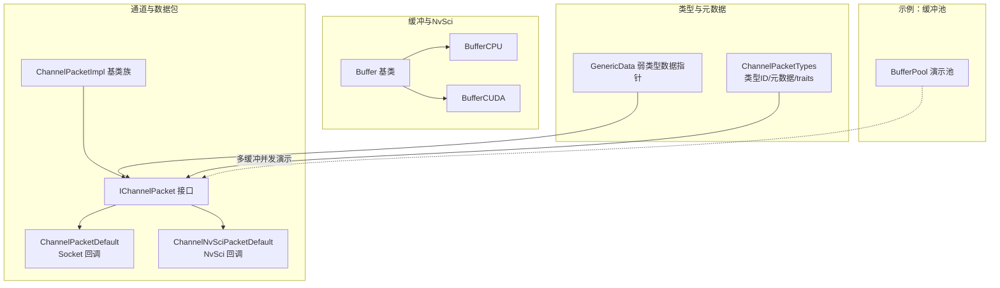
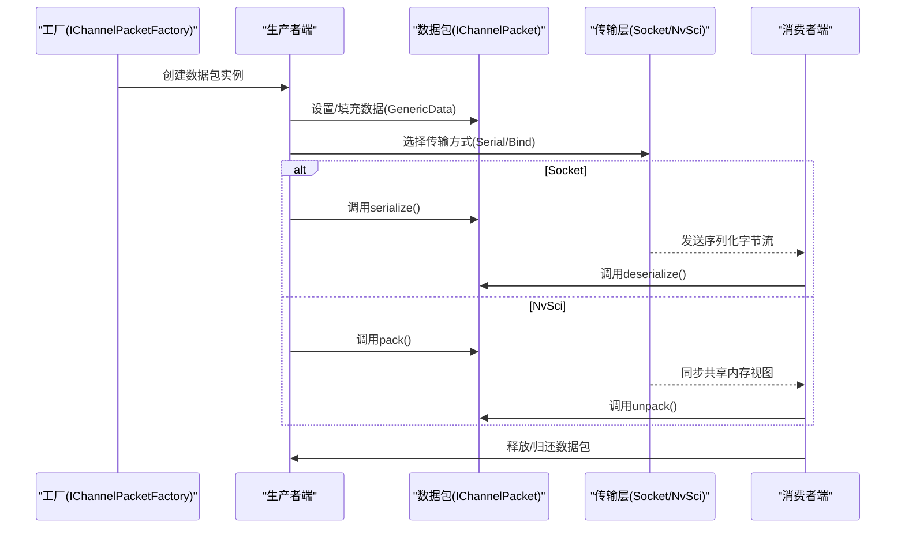
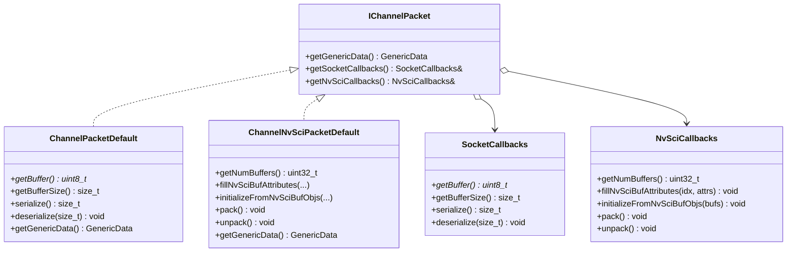
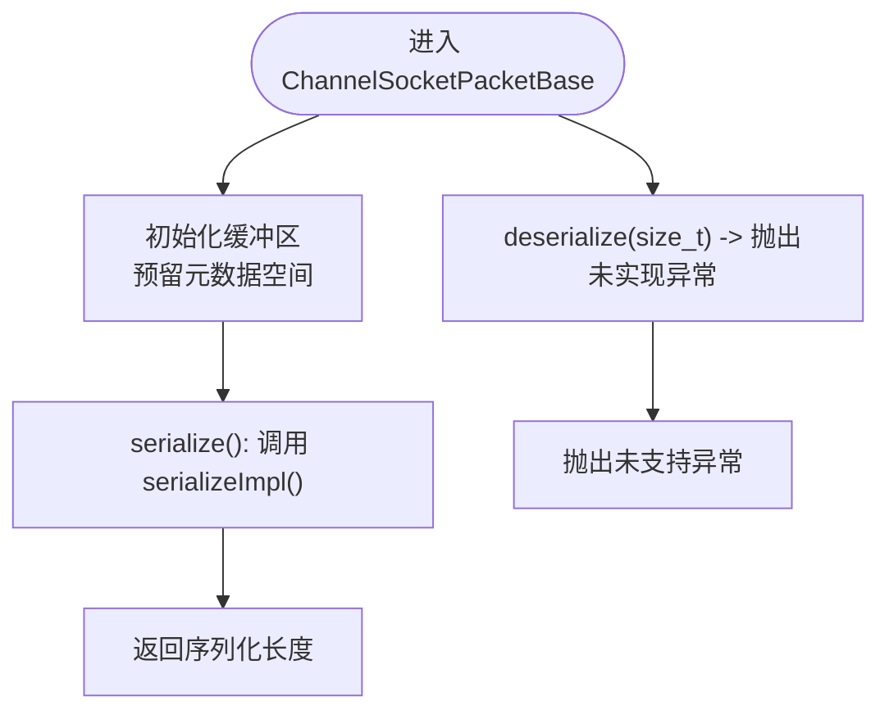
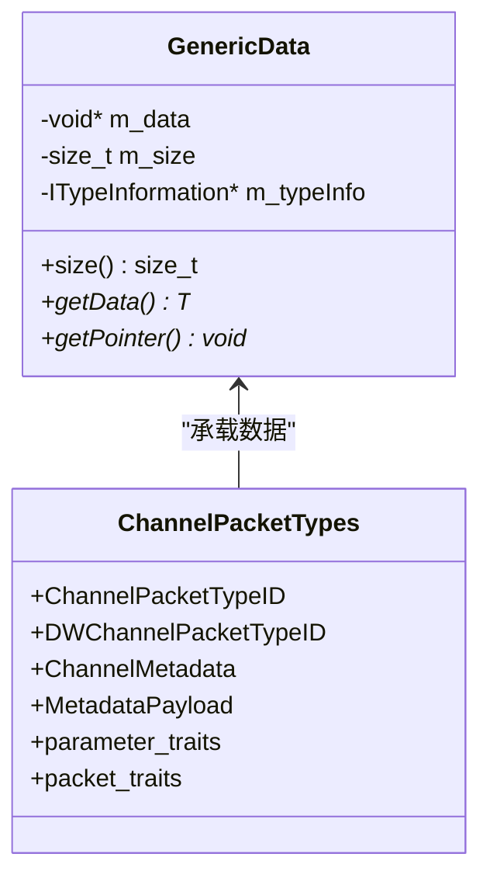
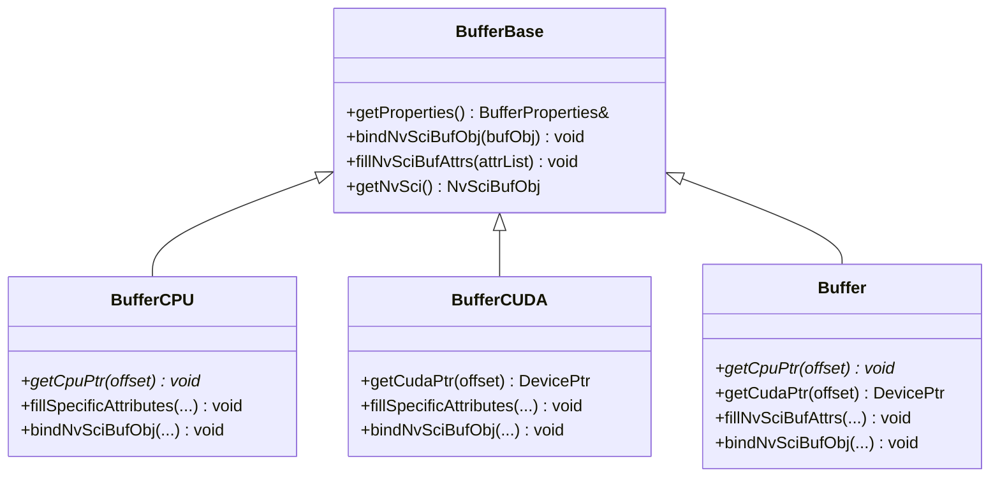
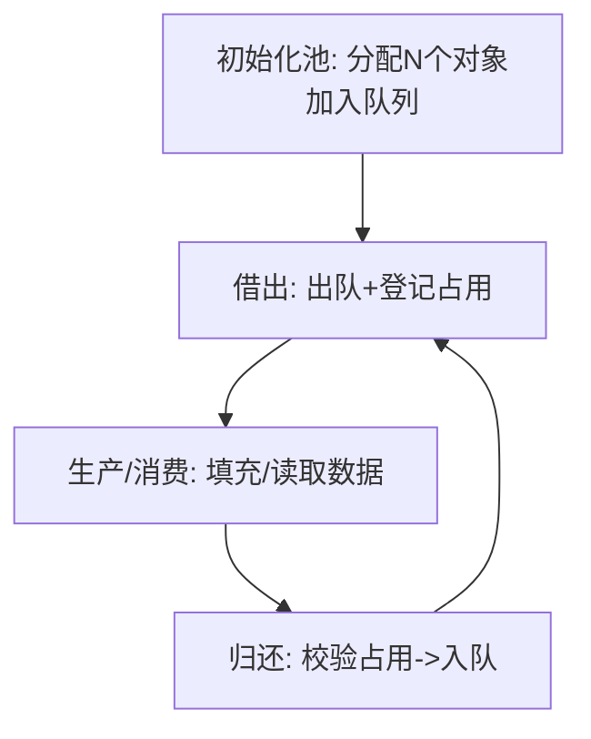
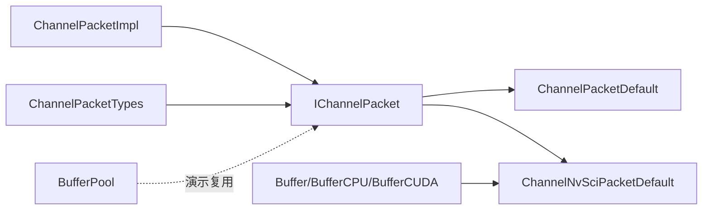

# 数据包管理

<cite>
**本文引用的文件**
- [IChannelPacket.hpp](file://driverorks-5.10/include/dwcgf/channel/IChannelPacket.hpp)
- [ChannelPacketImpl.hpp](file://driverorks-5.10/include/dwcgf/channel/ChannelPacketImpl.hpp)
- [ChannelPacketTypes.hpp](file://driverorks-5.10/include/dwcgf/channel/ChannelPacketTypes.hpp)
- [Buffer.hpp](file://driverorks-5.10/include/dwcgf/channel/Buffer.hpp)
- [BufferPool.hpp](file://driverorks-5.10/samples/src/sensors/plugins/common/BufferPool.hpp)
</cite>

## 目录
1. [简介](#简介)
2. [项目结构](#项目结构)
3. [核心组件](#核心组件)
4. [架构总览](#架构总览)
5. [详细组件分析](#详细组件分析)
6. [依赖关系分析](#依赖关系分析)
7. [性能考虑](#性能考虑)
8. [故障排查指南](#故障排查指南)
9. [结论](#结论)
10. [附录：使用与最佳实践](#附录使用与最佳实践)

## 简介
本文件面向CGF（Computer Graphics Framework）数据包管理系统，系统性阐述数据包抽象与生命周期管理，重点解析GenericData与IChannelPacket的设计原理与使用方法；详解数据包在分配、传输、释放三个阶段的完整流程；说明数据包池的内存管理策略（预分配、复用、回收）；对比图像、点云、传感器数据等不同数据类型的特征与适用场景；给出序列化/反序列化实现指南与性能优化建议（零拷贝、内存对齐），并提供可直接定位到源码的路径指引，帮助读者快速上手与排障。

## 项目结构
围绕数据包管理的核心头文件位于驱动版本目录下的通道子模块中，主要由以下几类组成：
- 接口与默认实现：IChannelPacket、ChannelPacketImpl、ChannelPacketDefault、ChannelNvSciPacketDefault
- 类型与元数据：ChannelPacketTypes（含GenericData、类型ID、元数据结构）
- 缓冲区与NvSci绑定：Buffer与BufferCPU/BufferCUDA
- 示例缓冲池：BufferPool（用于演示多缓冲并发与复用）

**图表来源**
- [IChannelPacket.hpp:55-229](file://driverorks-5.10/include/dwcgf/channel/IChannelPacket.hpp#L55-L229)
- [ChannelPacketImpl.hpp:44-128](file://driverorks-5.10/include/dwcgf/channel/ChannelPacketImpl.hpp#L44-L128)
- [ChannelPacketTypes.hpp:69-367](file://driverorks-5.10/include/dwcgf/channel/ChannelPacketTypes.hpp#L69-L367)
- [Buffer.hpp:69-153](file://driverorks-5.10/include/dwcgf/channel/Buffer.hpp#L69-L153)
- [BufferPool.hpp:74-216](file://driverorks-5.10/samples/src/sensors/plugins/common/BufferPool.hpp#L74-L216)

**章节来源**
- [IChannelPacket.hpp:31-229](file://driverorks-5.10/include/dwcgf/channel/IChannelPacket.hpp#L31-L229)
- [ChannelPacketImpl.hpp:31-131](file://driverorks-5.10/include/dwcgf/channel/ChannelPacketImpl.hpp#L31-L131)
- [ChannelPacketTypes.hpp:31-367](file://driverorks-5.10/include/dwcgf/channel/ChannelPacketTypes.hpp#L31-L367)
- [Buffer.hpp:31-153](file://driverorks-5.10/include/dwcgf/channel/Buffer.hpp#L31-L153)
- [BufferPool.hpp:31-216](file://driverorks-5.10/samples/src/sensors/plugins/common/BufferPool.hpp#L31-L216)

## 核心组件
- IChannelPacket：抽象接口，封装单个通道数据包；定义Socket/NvSci两类传输所需的回调能力，并提供默认实现以支撑通用数据包。
- ChannelPacketDefault：基于Socket的默认实现，提供序列化/反序列化缓冲区与弱类型数据访问。
- ChannelNvSciPacketDefault：基于NvSciBuf的默认实现，支持pack/unpack与NvSci属性填充。
- ChannelPacketImpl：提供Socket基类族与通用数据持有者，便于派生具体数据包类型。
- GenericData：弱类型数据指针容器，携带大小与类型信息，用于跨通道传输。
- ChannelPacketTypes：类型ID、元数据、traits映射、构造参数包装等。
- Buffer/BufferCPU/BufferCUDA：统一的缓冲区抽象与NvSciBuf绑定，支持CPU/CUDA后端。

**章节来源**
- [IChannelPacket.hpp:55-229](file://driverorks-5.10/include/dwcgf/channel/IChannelPacket.hpp#L55-L229)
- [ChannelPacketImpl.hpp:44-128](file://driverorks-5.10/include/dwcgf/channel/ChannelPacketImpl.hpp#L44-L128)
- [ChannelPacketTypes.hpp:69-367](file://driverorks-5.10/include/dwcgf/channel/ChannelPacketTypes.hpp#L69-L367)
- [Buffer.hpp:69-153](file://driverorks-5.10/include/dwcgf/channel/Buffer.hpp#L69-L153)

## 架构总览
下图展示了数据包从“工厂创建—生产者打包—消费者解包—释放回收”的整体流转，以及与NvSci/Socket传输层的交互。

**图表来源**
- [IChannelPacket.hpp:145-151](file://driverorks-5.10/include/dwcgf/channel/IChannelPacket.hpp#L145-L151)
- [ChannelPacketImpl.hpp:57-73](file://driverorks-5.10/include/dwcgf/channel/ChannelPacketImpl.hpp#L57-L73)
- [ChannelPacketTypes.hpp:248-306](file://driverorks-5.10/include/dwcgf/channel/ChannelPacketTypes.hpp#L248-L306)

## 详细组件分析

### IChannelPacket 与默认实现族
- 设计要点
  - 抽象接口统一了“获取弱类型数据”“Socket/NvSci传输回调”三类能力。
  - 默认实现分别覆盖Socket与NvSci两种典型通道类型，屏蔽传输细节差异。
- 关键行为
  - getGenericData：返回GenericData，供通道层统一处理。
  - SocketCallbacks：提供序列化缓冲区、容量、serialize/deserialize。
  - NvSciCallbacks：getNumBuffers/fillNvSciBufAttributes/initializeFromNvSciBufObjs/pack/unpack。
- 使用建议
  - 自定义数据包应继承IChannelPacket并按需实现对应回调。
  - 对于简单POD类型，可直接使用默认实现；复杂对象建议自定义pack/unpack或序列化逻辑。

**图表来源**
- [IChannelPacket.hpp:55-229](file://driverorks-5.10/include/dwcgf/channel/IChannelPacket.hpp#L55-L229)

**章节来源**
- [IChannelPacket.hpp:55-229](file://driverorks-5.10/include/dwcgf/channel/IChannelPacket.hpp#L55-L229)

### ChannelPacketImpl 基类族
- 设计要点
  - ChannelSocketPacketBase：为Socket传输准备序列化缓冲区，提供serialize/deserialize的默认骨架。
  - ChannelPacketBase：持有Optional<GenericData>，确保派生类在设置数据后再被读取。
- 生命周期提示
  - 初始化时通过initBuffer预留元数据空间；序列化前调用serializeImpl；反序列化后即可安全读取数据。

**图表来源**
- [ChannelPacketImpl.hpp:44-101](file://driverorks-5.10/include/dwcgf/channel/ChannelPacketImpl.hpp#L44-L101)

**章节来源**
- [ChannelPacketImpl.hpp:44-128](file://driverorks-5.10/include/dwcgf/channel/ChannelPacketImpl.hpp#L44-L128)

### GenericData 与类型/元数据体系
- GenericData
  - 弱类型指针+大小+类型信息，支持模板getData<T>()进行类型校验与转换。
  - 支持无类型信息但大小匹配的回退路径，便于跨语言/跨通道传输。
- 类型ID与traits
  - ChannelPacketTypeID：唯一标识数据包类型，用于远端一致性校验。
  - parameter_traits/packet_traits：建立数据类型与packet处理的关系。
  - DWFRAMEWORK_DECLARE_PACKET_TYPE_RELATION/DWFRAMEWORK_DECLARE_PACKET_TYPE_POD：宏注册类型关系。
- 元数据
  - ChannelMetadata：包含生产者ID、序号、时间戳、迭代次数、有效性状态等。
  - MetadataPayload：头部+数据的组合体，便于统一序列化/反序列化。

**图表来源**
- [ChannelPacketTypes.hpp:69-367](file://driverorks-5.10/include/dwcgf/channel/ChannelPacketTypes.hpp#L69-L367)

**章节来源**
- [ChannelPacketTypes.hpp:69-367](file://driverorks-5.10/include/dwcgf/channel/ChannelPacketTypes.hpp#L69-L367)

### NvSci 与 Buffer 抽象
- Buffer/BufferCPU/BufferCUDA
  - 统一的NvSciBuf绑定与属性填充接口，支持CPU/CUDA后端。
  - 提供getCpuPtr/getCudaPtr访问器，便于pack/unpack时直接写入/读取。
- 与数据包的结合
  - ChannelNvSciPacketDefault通过NvSciCallbacks与NvSciBuf交互，避免额外拷贝。
  - 可配合BufferBase.fillNvSciBufAttrs完成属性协商。

**图表来源**
- [Buffer.hpp:69-153](file://driverorks-5.10/include/dwcgf/channel/Buffer.hpp#L69-L153)

**章节来源**
- [Buffer.hpp:69-153](file://driverorks-5.10/include/dwcgf/channel/Buffer.hpp#L69-L153)

### 数据包池与内存管理策略
- 预分配
  - 在系统启动阶段创建固定数量的数据包对象，避免运行期频繁分配。
- 复用
  - 生产者完成打包后将数据包归还给池；消费者从池中取出空闲包，减少重复构造成本。
- 回收
  - 池维护“已占用槽位集合”，保证只归还未从池中借出的对象。
- 并发
  - 使用互斥量与条件变量协调多线程下的借还操作，示例中提供超时控制。

**图表来源**
- [BufferPool.hpp:74-216](file://driverorks-5.10/samples/src/sensors/plugins/common/BufferPool.hpp#L74-L216)

**章节来源**
- [BufferPool.hpp:46-216](file://driverorks-5.10/samples/src/sensors/plugins/common/BufferPool.hpp#L46-L216)

## 依赖关系分析
- 接口与实现
  - IChannelPacket是所有数据包的根接口；ChannelPacketDefault/ChannelNvSciPacketDefault分别实现Socket/NvSci路径。
  - ChannelPacketImpl提供Socket基类族，简化派生类实现。
- 类型与元数据
  - ChannelPacketTypes提供类型ID、traits映射、元数据结构，贯穿工厂创建与传输校验。
- 缓冲与绑定
  - Buffer系列负责NvSciBuf的属性填充与指针访问，与NvSci数据包实现紧密耦合。
- 池化
  - BufferPool作为示例，展示如何在多缓冲并发场景下进行对象复用。

**图表来源**
- [IChannelPacket.hpp:55-229](file://driverorks-5.10/include/dwcgf/channel/IChannelPacket.hpp#L55-L229)
- [ChannelPacketImpl.hpp:44-128](file://driverorks-5.10/include/dwcgf/channel/ChannelPacketImpl.hpp#L44-L128)
- [ChannelPacketTypes.hpp:248-306](file://driverorks-5.10/include/dwcgf/channel/ChannelPacketTypes.hpp#L248-L306)
- [Buffer.hpp:69-153](file://driverorks-5.10/include/dwcgf/channel/Buffer.hpp#L69-L153)
- [BufferPool.hpp:74-216](file://driverorks-5.10/samples/src/sensors/plugins/common/BufferPool.hpp#L74-L216)

**章节来源**
- [IChannelPacket.hpp:55-229](file://driverorks-5.10/include/dwcgf/channel/IChannelPacket.hpp#L55-L229)
- [ChannelPacketImpl.hpp:44-128](file://driverorks-5.10/include/dwcgf/channel/ChannelPacketImpl.hpp#L44-L128)
- [ChannelPacketTypes.hpp:248-306](file://driverorks-5.10/include/dwcgf/channel/ChannelPacketTypes.hpp#L248-L306)
- [Buffer.hpp:69-153](file://driverorks-5.10/include/dwcgf/channel/Buffer.hpp#L69-L153)
- [BufferPool.hpp:74-216](file://driverorks-5.10/samples/src/sensors/plugins/common/BufferPool.hpp#L74-L216)

## 性能考虑
- 零拷贝传输
  - NvSci路径优先：通过NvSciBuf共享内存视图，pack/unpack直接写入/读取，避免应用层复制。
  - Socket路径：尽量复用序列化缓冲区，避免重复分配；必要时使用mmap或共享内存。
- 内存对齐
  - NvSci属性填充时遵循对齐要求；Buffer系列提供后端指针访问，确保对齐。
- 缓冲池
  - 预分配固定数量的数据包对象，降低运行期分配抖动；合理设置池大小以覆盖峰值并发。
- 序列化开销
  - 尽量采用定长/扁平结构；对变长字段采用分段缓冲与长度前缀，避免二次拷贝。

[本节为通用指导，无需列出章节来源]

## 故障排查指南
- getGenericData未设置
  - 症状：读取GenericData时报内部错误。
  - 原因：派生类未在ChannelPacketBase中设置m_frame。
  - 解决：在派生类完成数据填充后，赋值m_frame。
  - 参考：[ChannelPacketImpl.hpp:106-118](file://driverorks-5.10/include/dwcgf/channel/ChannelPacketImpl.hpp#L106-L118)
- Socket回调未实现
  - 症状：调用deserialize抛出“未支持”异常。
  - 原因：ChannelSocketPacketBase默认未实现deserialize。
  - 解决：在派生类中重写serializeImpl/deserialize。
  - 参考：[ChannelPacketImpl.hpp:64-73](file://driverorks-5.10/include/dwcgf/channel/ChannelPacketImpl.hpp#L64-L73)
- NvSci pack/unpack失败
  - 症状：pack/unpack后数据不一致或崩溃。
  - 原因：未正确初始化NvSciBuf或属性不匹配。
  - 解决：检查getNumBuffers/fillNvSciBufAttributes/initializeFromNvSciBufObjs顺序与一致性。
  - 参考：[IChannelPacket.hpp:190-198](file://driverorks-5.10/include/dwcgf/channel/IChannelPacket.hpp#L190-L198)
- 缓冲池误还对象
  - 症状：归还时返回失败。
  - 原因：对象非从池中借出或重复归还。
  - 解决：仅归还未占用槽位中的对象；避免重复归还。
  - 参考：[BufferPool.hpp:173-184](file://driverorks-5.10/samples/src/sensors/plugins/common/BufferPool.hpp#L173-L184)

**章节来源**
- [ChannelPacketImpl.hpp:64-118](file://driverorks-5.10/include/dwcgf/channel/ChannelPacketImpl.hpp#L64-L118)
- [IChannelPacket.hpp:190-198](file://driverorks-5.10/include/dwcgf/channel/IChannelPacket.hpp#L190-L198)
- [BufferPool.hpp:173-184](file://driverorks-5.10/samples/src/sensors/plugins/common/BufferPool.hpp#L173-L184)

## 结论
CGF数据包管理通过IChannelPacket抽象与默认实现族，统一了Socket/NvSci两类传输路径；借助GenericData与类型/元数据体系，实现了跨通道的弱类型数据交换；配合Buffer与缓冲池，兼顾零拷贝与内存复用效率。遵循本文的生命周期管理与优化建议，可在保证正确性的前提下获得更优的吞吐与延迟表现。

[本节为总结，无需列出章节来源]

## 附录：使用与最佳实践

### 数据包生命周期管理
- 分配
  - 通过工厂接口创建数据包实例；对于复杂类型，优先使用自定义pack/unpack或序列化实现。
  - 参考：[IChannelPacket.hpp:211-222](file://driverorks-5.10/include/dwcgf/channel/IChannelPacket.hpp#L211-L222)
- 传输
  - NvSci：先pack再传输，消费者收到后unpack。
  - Socket：serialize后发送，消费者收到后deserialize。
  - 参考：[IChannelPacket.hpp:133-137](file://driverorks-5.10/include/dwcgf/channel/IChannelPacket.hpp#L133-L137)
- 释放
  - 归还至缓冲池或交由工厂回收；确保只归还未占用槽位的对象。
  - 参考：[BufferPool.hpp:149-186](file://driverorks-5.10/samples/src/sensors/plugins/common/BufferPool.hpp#L149-L186)

### 不同类型数据包的特点与场景
- 图像/金字塔图像
  - 特点：连续内存块，适合默认POD路径；可结合NvSci零拷贝。
  - 场景：相机链路、特征金字塔。
- 点云/雷达扫描
  - 特点：变长数组，建议采用分段缓冲与长度前缀；可使用NvSci共享视图。
  - 场景：激光雷达/毫米波融合。
- 传感器服务原始数据
  - 特点：结构化POD或复合对象，建议注册类型关系并使用pack/unpack。
  - 场景：IMU/GPS/轮速等多源同步。

### 序列化与反序列化实现指南
- Socket路径
  - 在派生类中实现serializeImpl，将内部结构写入m_buffer；deserialize时从缓冲区重建。
  - 参考：[ChannelPacketImpl.hpp:64-73](file://driverorks-5.10/include/dwcgf/channel/ChannelPacketImpl.hpp#L64-L73)
- NvSci路径
  - 在pack中将最新数据写入NvSciBuf；在unpack中使消费者可见最新数据。
  - 参考：[IChannelPacket.hpp:133-137](file://driverorks-5.10/include/dwcgf/channel/IChannelPacket.hpp#L133-L137)

### 性能优化技巧
- 零拷贝
  - 优先使用NvSci；pack/unpack直接写入共享内存视图。
  - 参考：[Buffer.hpp:136-142](file://driverorks-5.10/include/dwcgf/channel/Buffer.hpp#L136-L142)
- 内存对齐
  - 使用Buffer系列提供的指针访问器；在属性填充时遵循对齐约束。
  - 参考：[Buffer.hpp:96-120](file://driverorks-5.10/include/dwcgf/channel/Buffer.hpp#L96-L120)
- 缓冲池
  - 预分配固定数量对象；合理设置池大小与超时参数。
  - 参考：[BufferPool.hpp:78-88](file://driverorks-5.10/samples/src/sensors/plugins/common/BufferPool.hpp#L78-L88)

### 实际示例路径（不含代码内容）
- 创建并使用数据包（Socket/NvSci）
  - [IChannelPacket.hpp:145-151](file://driverorks-5.10/include/dwcgf/channel/IChannelPacket.hpp#L145-L151)
  - [ChannelPacketImpl.hpp:57-73](file://driverorks-5.10/include/dwcgf/channel/ChannelPacketImpl.hpp#L57-L73)
- 注册类型关系与traits
  - [ChannelPacketTypes.hpp:319-337](file://driverorks-5.10/include/dwcgf/channel/ChannelPacketTypes.hpp#L319-L337)
- 使用NvSci缓冲区
  - [Buffer.hpp:136-142](file://driverorks-5.10/include/dwcgf/channel/Buffer.hpp#L136-L142)
- 多缓冲并发复用
  - [BufferPool.hpp:120-186](file://driverorks-5.10/samples/src/sensors/plugins/common/BufferPool.hpp#L120-L186)