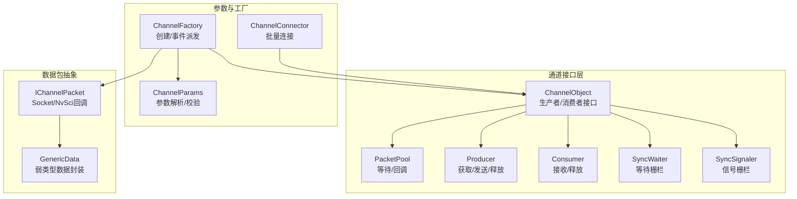
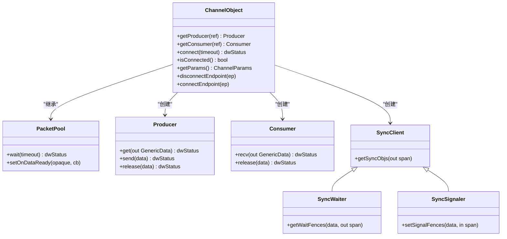
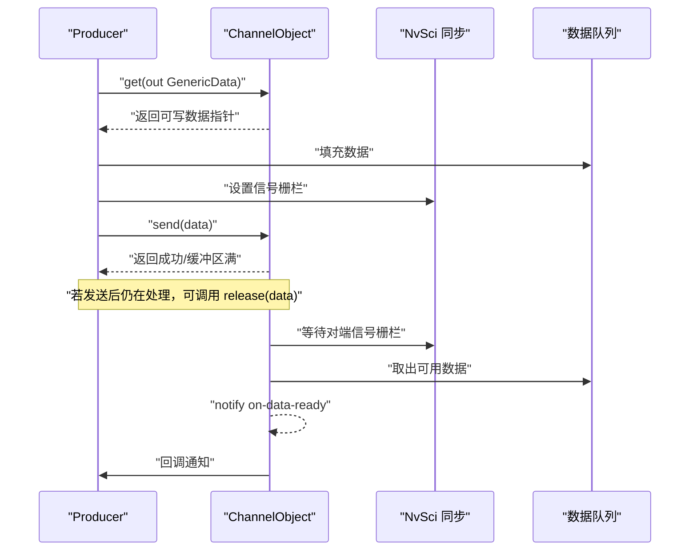
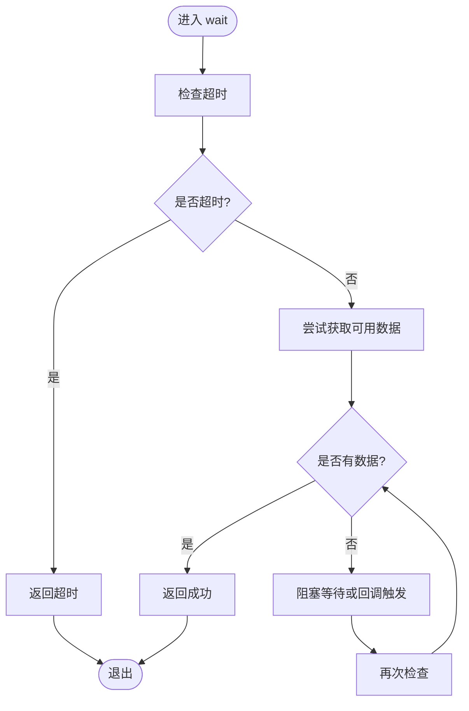
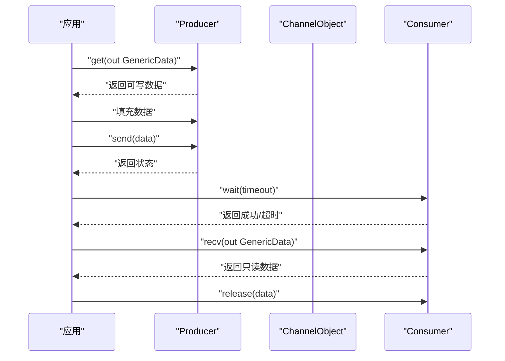
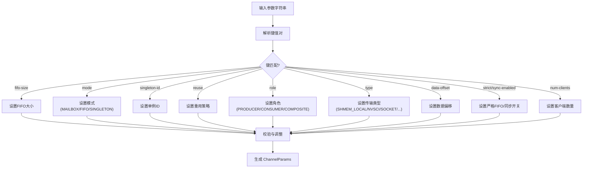
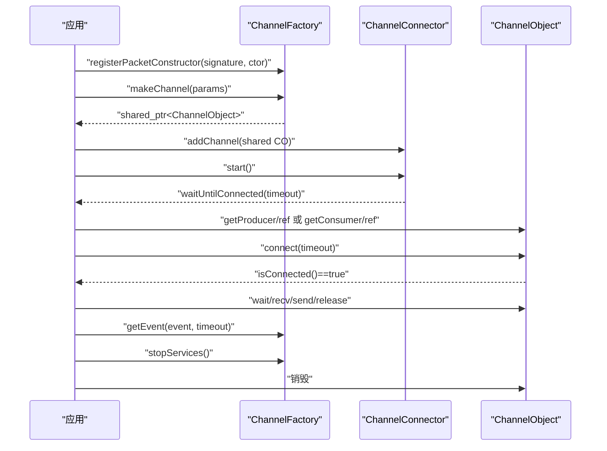
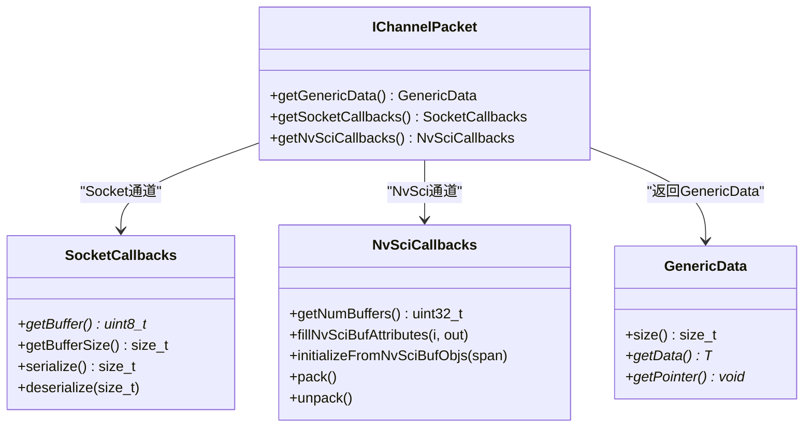
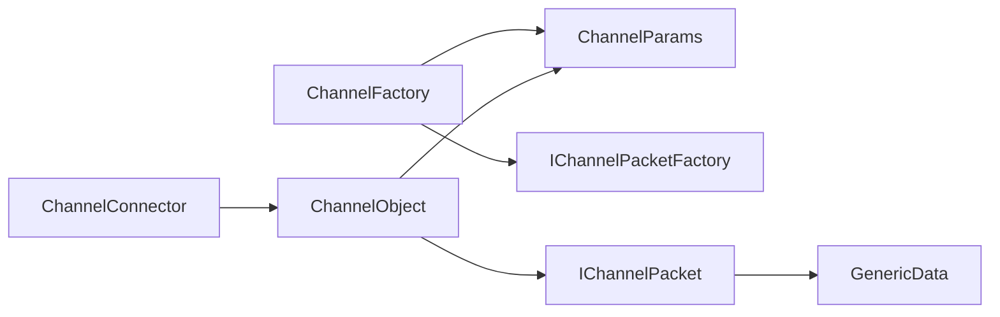

# 通道架构设计

<cite>
**本文引用的文件**
- [Channel.hpp](file://driverorks-5.10/include/dwcgf/channel/Channel.hpp)
- [ChannelParameters.hpp](file://driverorks-5.10/include/dwcgf/channel/ChannelParameters.hpp)
- [ChannelConnector.hpp](file://driverorks-5.10/include/dwcgf/channel/ChannelConnector.hpp)
- [ChannelFactory.hpp](file://driverorks-5.10/include/dwcgf/channel/ChannelFactory.hpp)
- [IChannelPacket.hpp](file://driverorks-5.10/include/dwcgf/channel/IChannelPacket.hpp)
- [ChannelPacketTypes.hpp](file://driverorks-5.10/include/dwcgf/channel/ChannelPacketTypes.hpp)
</cite>

## 目录
1. [引言](#引言)
2. [项目结构](#项目结构)
3. [核心组件](#核心组件)
4. [架构总览](#架构总览)
5. [详细组件分析](#详细组件分析)
6. [依赖关系分析](#依赖关系分析)
7. [性能考量](#性能考量)
8. [故障排查指南](#故障排查指南)
9. [结论](#结论)
10. [附录：使用示例与最佳实践](#附录使用示例与最佳实践)

## 引言
本技术文档围绕 CGF（Computer Graphics Framework）通道架构进行系统化梳理，重点阐释 ChannelObject 的核心设计原理、生产者/消费者模式的实现机制与接口分离设计、PacketPool 抽象层的作用与数据包池管理策略、Producer/Consumer 接口的设计理念（数据获取、发送、接收、释放的完整生命周期）、通道参数配置系统（ChannelParams 的结构与作用），并给出通道创建、初始化与销毁的完整流程说明。同时提供可直接定位到源码路径的示例片段，帮助读者快速理解并正确使用通道接口。

## 项目结构
本仓库中与通道架构相关的核心头文件位于 driverorks-5.10 的 include/dwcgf/channel 目录下，关键文件如下：
- Channel.hpp：定义 ChannelObject 及其子接口（Producer、Consumer、PacketPool、SyncClient/SyncWaiter/SyncSignaler）
- ChannelParameters.hpp：定义通道类型、角色、模式、参数解析与 ChannelParams 结构体
- ChannelConnector.hpp：通道连接器，用于批量管理多个通道的连接与回调
- ChannelFactory.hpp：通道工厂，负责通道创建、事件派发与底层服务启停
- IChannelPacket.hpp：通道数据包抽象接口，定义 Socket/NvSci 回调能力
- ChannelPacketTypes.hpp：通用数据封装 GenericData、数据包类型枚举、元数据结构等

**图表来源**
- [Channel.hpp:56-274](file://driverorks-5.10/include/dwcgf/channel/Channel.hpp#L56-L274)
- [ChannelParameters.hpp:498-713](file://driverorks-5.10/include/dwcgf/channel/ChannelParameters.hpp#L498-L713)
- [ChannelFactory.hpp:69-154](file://driverorks-5.10/include/dwcgf/channel/ChannelFactory.hpp#L69-L154)
- [ChannelConnector.hpp:47-73](file://driverorks-5.10/include/dwcgf/channel/ChannelConnector.hpp#L47-L73)
- [IChannelPacket.hpp:55-223](file://driverorks-5.10/include/dwcgf/channel/IChannelPacket.hpp#L55-L223)
- [ChannelPacketTypes.hpp:69-166](file://driverorks-5.10/include/dwcgf/channel/ChannelPacketTypes.hpp#L69-L166)

**章节来源**
- [Channel.hpp:31-280](file://driverorks-5.10/include/dwcgf/channel/Channel.hpp#L31-L280)
- [ChannelParameters.hpp:31-719](file://driverorks-5.10/include/dwcgf/channel/ChannelParameters.hpp#L31-L719)
- [ChannelConnector.hpp:31-79](file://driverorks-5.10/include/dwcgf/channel/ChannelConnector.hpp#L31-L79)
- [ChannelFactory.hpp:31-160](file://driverorks-5.10/include/dwcgf/channel/ChannelFactory.hpp#L31-L160)
- [IChannelPacket.hpp:31-229](file://driverorks-5.10/include/dwcgf/channel/IChannelPacket.hpp#L31-L229)
- [ChannelPacketTypes.hpp:31-367](file://driverorks-5.10/include/dwcgf/channel/ChannelPacketTypes.hpp#L31-L367)

## 核心组件
- ChannelObject：顶层通道对象，提供 getProducer/getConsumer、connect/isConnected、参数查询、端点连接控制等能力；内部嵌套 PacketPool、Producer、Consumer、SyncClient/SyncWaiter/SyncSignaler 等子接口。
- ChannelParams：通道参数解析与校验核心，支持多种传输类型（共享内存、Socket、NvSci 等）、角色（仅生产者/仅消费者/复合）、模式（FIFO/Mailbox/Singleton）、严格 FIFO、数据偏移、同步开关、客户端数量等。
- ChannelFactory：通道工厂，负责注册数据包构造器、创建通道、启动/停止后台服务、派发事件（连接/断开/错误/就绪）。
- ChannelConnector：批量通道连接器，统一添加通道、启动连接、阻塞等待全部连接、设置回调、日志未连接通道。
- IChannelPacket/GenericData：数据包抽象与弱类型数据封装，支持 Socket/NvSci 两种后端的数据打包/解包与序列化/反序列化。
- ChannelPacketTypes：数据包类型枚举、元数据结构、GenericDataReference 参数封装等。

**章节来源**
- [Channel.hpp:56-274](file://driverorks-5.10/include/dwcgf/channel/Channel.hpp#L56-L274)
- [ChannelParameters.hpp:498-713](file://driverorks-5.10/include/dwcgf/channel/ChannelParameters.hpp#L498-L713)
- [ChannelFactory.hpp:69-154](file://driverorks-5.10/include/dwcgf/channel/ChannelFactory.hpp#L69-L154)
- [ChannelConnector.hpp:47-73](file://driverorks-5.10/include/dwcgf/channel/ChannelConnector.hpp#L47-L73)
- [IChannelPacket.hpp:55-223](file://driverorks-5.10/include/dwcgf/channel/IChannelPacket.hpp#L55-L223)
- [ChannelPacketTypes.hpp:69-306](file://driverorks-5.10/include/dwcgf/channel/ChannelPacketTypes.hpp#L69-L306)

## 架构总览
通道架构采用“接口分离 + 抽象数据包 + 参数驱动”的设计：
- 接口分离：ChannelObject 将连接、生产者、消费者、同步栅栏等职责拆分为独立子接口，便于按需获取与组合使用。
- 抽象数据包：IChannelPacket 提供 Socket/NvSci 两套回调，屏蔽不同后端的内存/同步细节。
- 参数驱动：ChannelParams 统一解析字符串参数，校验模式与角色兼容性，并根据类型选择对应的参数子类（如 Socket/NvSci）。
- 工厂与连接器：ChannelFactory 负责通道生命周期与事件派发；ChannelConnector 批量管理连接状态与回调。

**图表来源**
- [Channel.hpp:116-274](file://driverorks-5.10/include/dwcgf/channel/Channel.hpp#L116-L274)

**章节来源**
- [Channel.hpp:56-274](file://driverorks-5.10/include/dwcgf/channel/Channel.hpp#L56-L274)

## 详细组件分析

### ChannelObject 与生产者/消费者模式
- 接口分离：ChannelObject 暴露 getProducer/getConsumer，分别返回 Producer/Consumer 子接口，避免在单一对象上堆叠过多职责。
- 生命周期：
  - 生产者：通过 get 获取可写数据包，send 发送，release 释放；若 send 后仍有占用，release 可回退至通道。
  - 消费者：先 wait 等待可用数据，再 recv 获取只读数据包，最后 release 释放。
- 同步栅栏：通过 SyncWaiter/SyncSignaler 获取/设置 NvSci 同步栅栏，确保跨进程/跨设备的数据可见性与顺序一致性。
- 连接与状态：hasClients/isConnected/connect 控制通道的可用性与连接状态；支持动态端点连接/断开。

**图表来源**
- [Channel.hpp:147-207](file://driverorks-5.10/include/dwcgf/channel/Channel.hpp#L147-L207)

**章节来源**
- [Channel.hpp:116-274](file://driverorks-5.10/include/dwcgf/channel/Channel.hpp#L116-L274)

### PacketPool 抽象层与数据包池管理
- 等待与回调：PacketPool 提供 wait 与 setOnDataReady，支持超时等待与异步回调，降低轮询成本。
- 同步视图：getSyncWaiter/getSyncSignaler 返回对应同步接口，便于与上游/下游通道建立栅栏依赖。
- 池容量调整：ChannelParams 在构造时根据 FIFO 大小与最大消费者数调整池容量，保证在最坏情况下仍能容纳“返回槽位 + 每消费者在途 + 完整 FIFO”。

**图表来源**
- [Channel.hpp:116-142](file://driverorks-5.10/include/dwcgf/channel/Channel.hpp#L116-L142)
- [ChannelParameters.hpp:667-679](file://driverorks-5.10/include/dwcgf/channel/ChannelParameters.hpp#L667-L679)

**章节来源**
- [Channel.hpp:116-142](file://driverorks-5.10/include/dwcgf/channel/Channel.hpp#L116-L142)
- [ChannelParameters.hpp:667-679](file://driverorks-5.10/include/dwcgf/channel/ChannelParameters.hpp#L667-L679)

### Producer/Consumer 接口设计理念
- 数据获取与发送：
  - Producer.get 返回可写 GenericData，随后 send 将数据提交给通道；若缓冲区满返回相应状态。
  - 若 send 后仍有占用，Producer.release 可将未释放的数据回退至通道。
- 数据接收与释放：
  - Consumer.recv 需在 wait 成功后调用，否则可能无数据可取；recv 返回只读数据后必须 release。
- 生命周期一致性：所有从 get/recv 获得的数据指针，均应在使用完毕后通过对应接口释放，避免资源泄漏。

**图表来源**
- [Channel.hpp:147-207](file://driverorks-5.10/include/dwcgf/channel/Channel.hpp#L147-L207)

**章节来源**
- [Channel.hpp:147-207](file://driverorks-5.10/include/dwcgf/channel/Channel.hpp#L147-L207)

### 通道参数配置系统（ChannelParams）
- 支持的传输类型：本地/远程共享内存、EGLStream、Socket、DDS、NvSci。
- 角色与模式：
  - 角色：仅生产者、仅消费者、复合（默认）。
  - 模式：FIFO（默认）、Mailbox、Singleton。
- 关键参数：
  - fifo-size：客户端最大并发持有包数。
  - id/singleton-id：通道标识与单例标识。
  - mode：FIFO/Mailbox/Singleton。
  - reuse：Mailbox 模式下重用策略。
  - debug-port/debug-num-clients：调试端口与调试客户端数。
  - role/type：角色与类型。
  - data-offset：同步数据偏移（用于同步计数对齐）。
  - strict：严格 FIFO 模式。
  - sync-enabled：启用同步。
  - num-clients/debug-clients：期望连接数。
- 参数解析与校验：
  - 通过 ParseAllChannelParameters 解析键值对，按需填充各字段。
  - 对 Mailbox 与 Singleton 的互斥性、Singleton 的类型限制、reuse 与模式匹配等进行严格校验。
  - 根据 FIFO 与最大消费者数调整池容量，确保在最坏情况下仍可满足需求。

**图表来源**
- [ChannelParameters.hpp:501-568](file://driverorks-5.10/include/dwcgf/channel/ChannelParameters.hpp#L501-L568)
- [ChannelParameters.hpp:631-665](file://driverorks-5.10/include/dwcgf/channel/ChannelParameters.hpp#L631-L665)
- [ChannelParameters.hpp:667-679](file://driverorks-5.10/include/dwcgf/channel/ChannelParameters.hpp#L667-L679)

**章节来源**
- [ChannelParameters.hpp:498-713](file://driverorks-5.10/include/dwcgf/channel/ChannelParameters.hpp#L498-L713)

### 通道创建、初始化与销毁流程
- 创建阶段：
  - 使用 ChannelFactory::makeChannel 传入参数字符串，工厂解析并校验参数，返回共享的 ChannelObject。
  - 注册所需数据包构造器（按 ChannelPacketTypeID 与 ChannelType 组合），确保通道与数据包类型匹配。
- 初始化阶段：
  - 通过 ChannelConnector::addChannel 添加通道，调用 start 启动连接流程。
  - waitUntilConnected 阻塞等待所有通道连接完成，或设置 OnChannelsConnected 回调。
- 运行阶段：
  - 通过 getProducer/getConsumer 获取子接口，按生命周期进行 wait/recv/send/release。
  - ChannelFactory::getEvent 可轮询事件（连接/断开/错误/就绪），结合 setOnDispatchDataReady 做异步处理。
- 销毁阶段：
  - 停止后台服务（stopServices）以避免删除时的竞争；删除通道对象。

**图表来源**
- [ChannelFactory.hpp:69-154](file://driverorks-5.10/include/dwcgf/channel/ChannelFactory.hpp#L69-L154)
- [ChannelConnector.hpp:47-73](file://driverorks-5.10/include/dwcgf/channel/ChannelConnector.hpp#L47-L73)
- [Channel.hpp:209-274](file://driverorks-5.10/include/dwcgf/channel/Channel.hpp#L209-L274)

**章节来源**
- [ChannelFactory.hpp:69-154](file://driverorks-5.10/include/dwcgf/channel/ChannelFactory.hpp#L69-L154)
- [ChannelConnector.hpp:47-73](file://driverorks-5.10/include/dwcgf/channel/ChannelConnector.hpp#L47-L73)
- [Channel.hpp:209-274](file://driverorks-5.10/include/dwcgf/channel/Channel.hpp#L209-L274)

### 数据包抽象层（IChannelPacket 与 GenericData）
- IChannelPacket：
  - SocketCallbacks：提供 getBuffer/getBufferSize/serialize/deserialize，用于 Socket 通道的序列化/反序列化。
  - NvSciCallbacks：提供 getNumBuffers/fillNvSciBufAttributes/initializeFromNvSciBufObjs/pack/unpack，用于 NvSci 通道的 NvSciBuf 背书与打包/解包。
- GenericData：
  - 弱类型数据封装，支持模板 getData<T>() 进行类型安全访问；当无类型信息时，仅比较大小。
- ChannelPacketTypes：
  - 定义数据包类型枚举、元数据结构（包含生产者ID、序列号、时间戳、有效性等）与 GenericDataReference 参数封装。

**图表来源**
- [IChannelPacket.hpp:55-223](file://driverorks-5.10/include/dwcgf/channel/IChannelPacket.hpp#L55-L223)
- [ChannelPacketTypes.hpp:69-166](file://driverorks-5.10/include/dwcgf/channel/ChannelPacketTypes.hpp#L69-L166)

**章节来源**
- [IChannelPacket.hpp:55-223](file://driverorks-5.10/include/dwcgf/channel/IChannelPacket.hpp#L55-L223)
- [ChannelPacketTypes.hpp:69-306](file://driverorks-5.10/include/dwcgf/channel/ChannelPacketTypes.hpp#L69-L306)

## 依赖关系分析
- ChannelObject 依赖 ChannelParams 与 IChannelPacket（通过 GenericDataReference）。
- ChannelFactory 依赖 ChannelParams 与 IChannelPacketFactory，负责通道创建与事件派发。
- ChannelConnector 依赖 ChannelObject 列表，统一管理连接状态。
- IChannelPacket 与 ChannelPacketTypes 共同定义数据包类型与元数据。

**图表来源**
- [ChannelFactory.hpp:69-154](file://driverorks-5.10/include/dwcgf/channel/ChannelFactory.hpp#L69-L154)
- [ChannelConnector.hpp:47-73](file://driverorks-5.10/include/dwcgf/channel/ChannelConnector.hpp#L47-L73)
- [Channel.hpp:34-35](file://driverorks-5.10/include/dwcgf/channel/Channel.hpp#L34-L35)
- [IChannelPacket.hpp:37-38](file://driverorks-5.10/include/dwcgf/channel/IChannelPacket.hpp#L37-L38)
- [ChannelPacketTypes.hpp:69-166](file://driverorks-5.10/include/dwcgf/channel/ChannelPacketTypes.hpp#L69-L166)

**章节来源**
- [ChannelFactory.hpp:69-154](file://driverorks-5.10/include/dwcgf/channel/ChannelFactory.hpp#L69-L154)
- [ChannelConnector.hpp:47-73](file://driverorks-5.10/include/dwcgf/channel/ChannelConnector.hpp#L47-L73)
- [Channel.hpp:34-35](file://driverorks-5.10/include/dwcgf/channel/Channel.hpp#L34-L35)
- [IChannelPacket.hpp:37-38](file://driverorks-5.10/include/dwcgf/channel/IChannelPacket.hpp#L37-L38)
- [ChannelPacketTypes.hpp:69-166](file://driverorks-5.10/include/dwcgf/channel/ChannelPacketTypes.hpp#L69-L166)

## 性能考量
- 池容量与 FIFO：ChannelParams 在构造时根据 FIFO 大小与最大消费者数调整池容量，避免在高并发场景下出现阻塞。
- 严格 FIFO 与非严格模式：strictFifo 控制消费者可接收的最大数据量，非严格模式允许消费者在池容量范围内提前消费，提升吞吐。
- 后台服务：ChannelFactory 提供 startServices/stopServices，建议在创建通道前启动服务，删除前停止服务，减少竞争带来的性能损耗。
- 超时与回调：wait 设置合理超时，结合 setOnDataReady 回调减少忙等。

[本节为通用指导，不直接分析具体文件]

## 故障排查指南
- 连接失败：
  - 检查 ChannelObject::connect 的超时与返回状态；确认已调用 ChannelConnector::waitUntilConnected。
  - 对于 NvSci 通道，确认 getSyncObjs/设置信号栅栏的时机与参数。
- 数据不可达：
  - 确认 Consumer 先 wait 再 recv；Producer.send 后若仍有占用，需调用 release。
- 参数错误：
  - Mailbox 与 Singleton 的互斥性、reuse 与模式匹配、Singleton 类型限制等会在 ChannelParams 校验阶段抛出异常。
- 资源泄漏：
  - 确保每次 get/recv 获得的数据在使用后调用对应 release；对于未发送即释放的情况，release 可回退至通道。

**章节来源**
- [Channel.hpp:124-207](file://driverorks-5.10/include/dwcgf/channel/Channel.hpp#L124-L207)
- [ChannelParameters.hpp:631-665](file://driverorks-5.10/include/dwcgf/channel/ChannelParameters.hpp#L631-L665)

## 结论
本通道架构通过接口分离、抽象数据包与参数驱动，实现了跨传输类型的统一通道模型。ChannelObject 将连接、生产者/消费者与同步栅栏职责清晰划分；PacketPool 提供统一的等待与回调机制；ChannelParams 则以强校验保障不同模式与角色的正确组合。配合 ChannelFactory 与 ChannelConnector，开发者可以高效地创建、连接与管理通道，构建稳定可靠的跨进程/跨设备数据通路。

[本节为总结性内容，不直接分析具体文件]

## 附录：使用示例与最佳实践
以下示例以“代码片段路径”形式给出，便于快速定位到源码位置，避免粘贴具体代码内容。

- 创建通道与参数解析
  - [示例：构造 ChannelParams 并解析参数:501-568](file://driverorks-5.10/include/dwcgf/channel/ChannelParameters.hpp#L501-L568)
  - [示例：注册数据包构造器签名与构造函数:83-92](file://driverorks-5.10/include/dwcgf/channel/ChannelFactory.hpp#L83-L92)
  - [示例：通过工厂创建通道:108-108](file://driverorks-5.10/include/dwcgf/channel/ChannelFactory.hpp#L108-L108)

- 获取生产者/消费者接口与生命周期
  - [示例：获取 Producer 接口:219-219](file://driverorks-5.10/include/dwcgf/channel/Channel.hpp#L219-L219)
  - [示例：Producer.get/send/release:156-176](file://driverorks-5.10/include/dwcgf/channel/Channel.hpp#L156-L176)
  - [示例：获取 Consumer 接口:229-229](file://driverorks-5.10/include/dwcgf/channel/Channel.hpp#L229-L229)
  - [示例：Consumer.recv/release:195-206](file://driverorks-5.10/include/dwcgf/channel/Channel.hpp#L195-L206)

- 等待与回调、同步栅栏
  - [示例：PacketPool.wait/setOnDataReady:132-141](file://driverorks-5.10/include/dwcgf/channel/Channel.hpp#L132-L141)
  - [示例：SyncWaiter.getWaitFences:93-93](file://driverorks-5.10/include/dwcgf/channel/Channel.hpp#L93-L93)
  - [示例：SyncSignaler.setSignalFences:110-110](file://driverorks-5.10/include/dwcgf/channel/Channel.hpp#L110-L110)

- 连接与批量管理
  - [示例：ChannelConnector.addChannel/start/waitUntilConnected:57-64](file://driverorks-5.10/include/dwcgf/channel/ChannelConnector.hpp#L57-L64)
  - [示例：ChannelObject.connect/isConnected:254-242](file://driverorks-5.10/include/dwcgf/channel/Channel.hpp#L254-L242)

- 事件派发与后台服务
  - [示例：ChannelFactory.getEvent:150-150](file://driverorks-5.10/include/dwcgf/channel/ChannelFactory.hpp#L150-L150)
  - [示例：ChannelFactory.startServices/stopServices:126-135](file://driverorks-5.10/include/dwcgf/channel/ChannelFactory.hpp#L126-L135)

- 数据包抽象与元数据
  - [示例：IChannelPacket.SocketCallbacks:72-93](file://driverorks-5.10/include/dwcgf/channel/IChannelPacket.hpp#L72-L93)
  - [示例：IChannelPacket.NvSciCallbacks:102-138](file://driverorks-5.10/include/dwcgf/channel/IChannelPacket.hpp#L102-L138)
  - [示例：GenericData.getData<T>:128-151](file://driverorks-5.10/include/dwcgf/channel/ChannelPacketTypes.hpp#L128-L151)
  - [示例：ChannelMetadata/MetadataPayload:224-239](file://driverorks-5.10/include/dwcgf/channel/ChannelPacketTypes.hpp#L224-L239)

- 最佳实践
  - 在创建所有通道后再启动后台服务，删除前停止服务，减少竞争。
  - FIFO 与 Mailbox/Singleton 的模式选择应与拓扑与延迟要求匹配。
  - 严格遵循“先 wait/recv，再 send/release”，避免死锁与资源泄漏。
  - 对于 NvSci 通道，确保在连接前正确设置同步属性并在合适时机获取/设置栅栏。

[本节为实践指导，不直接分析具体文件]