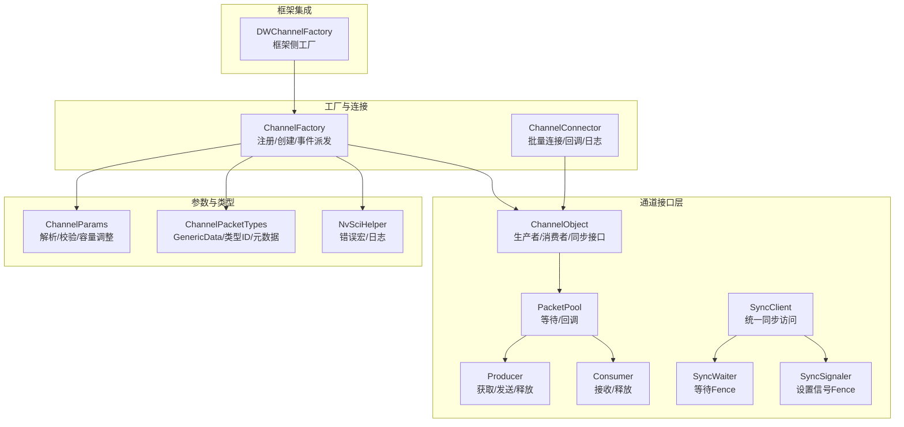
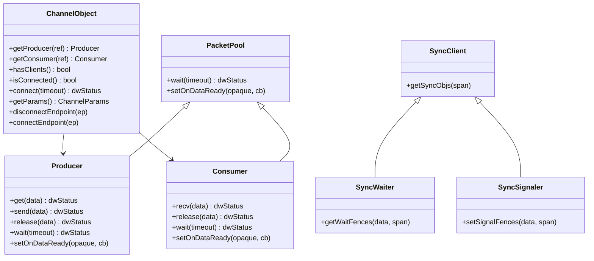
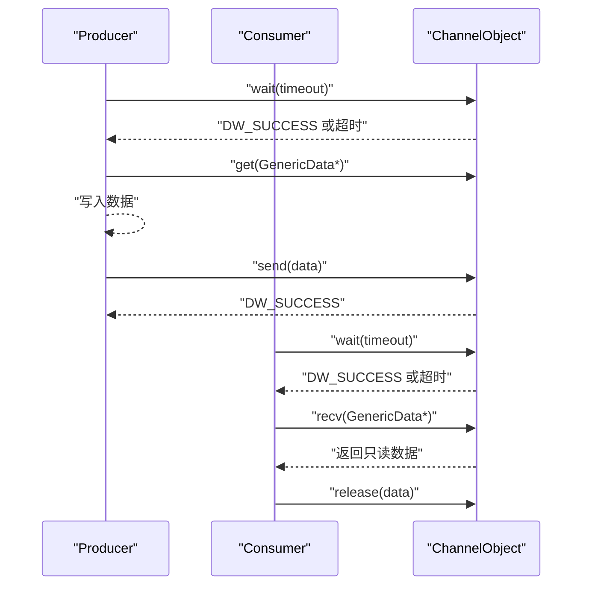
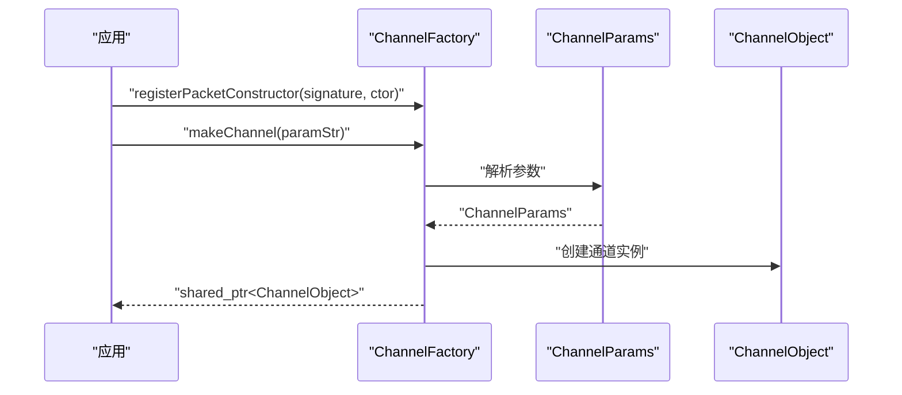
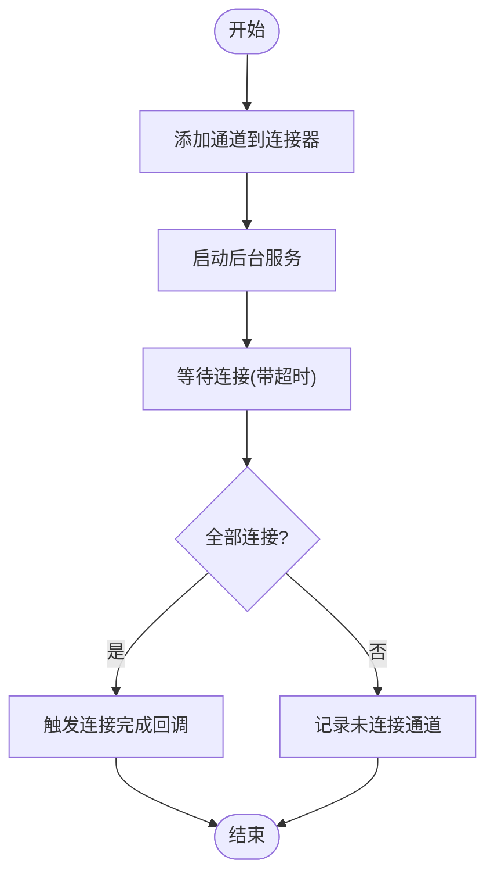
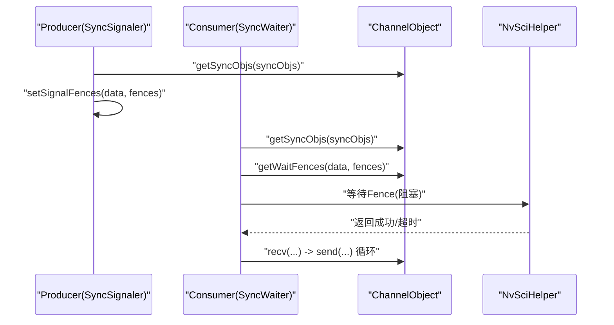
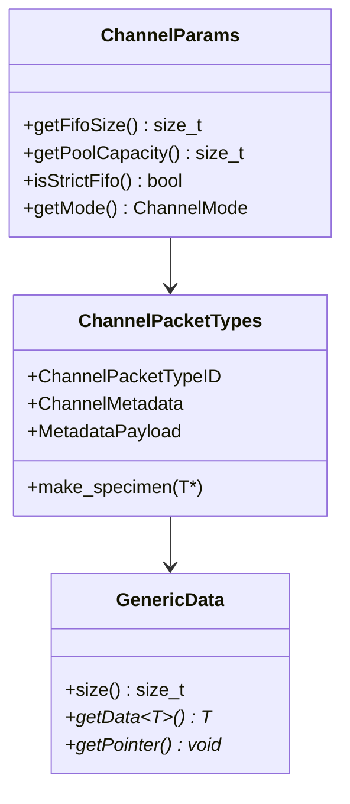
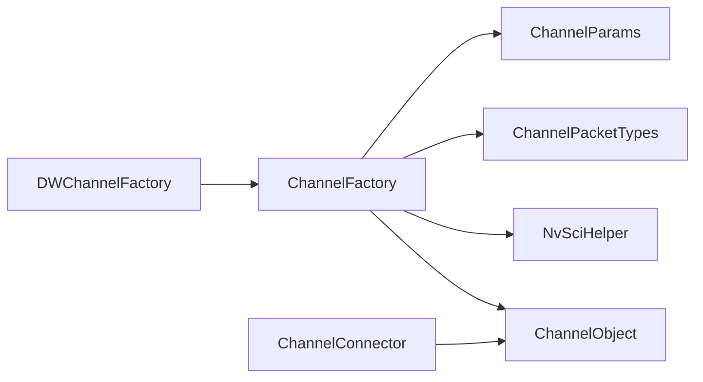

# 通道系统

<cite>
**本文引用的文件**
- [Channel.hpp](file://driverorks-5.10/include/dwcgf/channel/Channel.hpp)
- [ChannelConnector.hpp](file://driverorks-5.10/include/dwcgf/channel/ChannelConnector.hpp)
- [ChannelFactory.hpp](file://driverorks-5.10/include/dwcgf/channel/ChannelFactory.hpp)
- [ChannelPacketTypes.hpp](file://driverorks-5.10/include/dwcgf/channel/ChannelPacketTypes.hpp)
- [ChannelParameters.hpp](file://driverorks-5.10/include/dwcgf/channel/ChannelParameters.hpp)
- [NvSciHelper.hpp](file://driverorks-5.10/include/dwcgf/channel/NvSciHelper.hpp)
- [DWChannelFactory.hpp](file://driverorks-5.10/include/dwframework/dwnodes/common/factories/DWChannelFactory.hpp)
</cite>

## 目录
1. [简介](#简介)
2. [项目结构](#项目结构)
3. [核心组件](#核心组件)
4. [架构总览](#架构总览)
5. [详细组件分析](#详细组件分析)
6. [依赖关系分析](#依赖关系分析)
7. [性能考量](#性能考量)
8. [故障排查指南](#故障排查指南)
9. [结论](#结论)
10. [附录](#附录)

## 简介
本技术文档围绕 CGF（Compute Graph Framework）通道系统，系统性阐述 ChannelObject 的核心设计与生产者/消费者模式、通道工厂模式与创建流程、通道连接器的自动连接机制与状态管理、NvSci 同步原语在 Fence 等待与信号中的应用、数据包池与内存分配策略及性能优化，并提供配置、调试与故障排除的实用指南。文档以驱动层头文件为依据，结合类图、时序图与流程图，帮助读者从概念到实现全面掌握通道系统的使用与扩展。

## 项目结构
通道系统主要由以下模块构成：
- 通道接口与对象：ChannelObject 及其 Producer/Consumer/PacketPool/SyncClient/SyncWaiter/SyncSignaler 子接口
- 通道参数与类型：ChannelParams、ChannelPacketTypes、ChannelParameters
- 工厂与连接：ChannelFactory、ChannelConnector
- NvSci 辅助：NvSciHelper 提供错误检查与日志宏
- 框架集成：DWChannelFactory 作为框架侧工厂入口

**图表来源**
- [Channel.hpp:56-274](file://driverorks-5.10/include/dwcgf/channel/Channel.hpp#L56-L274)
- [ChannelFactory.hpp:69-154](file://driverorks-5.10/include/dwcgf/channel/ChannelFactory.hpp#L69-L154)
- [ChannelConnector.hpp:47-73](file://driverorks-5.10/include/dwcgf/channel/ChannelConnector.hpp#L47-L73)
- [ChannelPacketTypes.hpp:69-306](file://driverorks-5.10/include/dwcgf/channel/ChannelPacketTypes.hpp#L69-L306)
- [ChannelParameters.hpp:498-713](file://driverorks-5.10/include/dwcgf/channel/ChannelParameters.hpp#L498-L713)
- [NvSciHelper.hpp:45-67](file://driverorks-5.10/include/dwcgf/channel/NvSciHelper.hpp#L45-L67)
- [DWChannelFactory.hpp](file://driverorks-5.10/include/dwframework/dwnodes/common/factories/DWChannelFactory.hpp)

**章节来源**
- [Channel.hpp:56-274](file://driverorks-5.10/include/dwcgf/channel/Channel.hpp#L56-L274)
- [ChannelFactory.hpp:69-154](file://driverorks-5.10/include/dwcgf/channel/ChannelFactory.hpp#L69-L154)
- [ChannelConnector.hpp:47-73](file://driverorks-5.10/include/dwcgf/channel/ChannelConnector.hpp#L47-L73)
- [ChannelPacketTypes.hpp:69-306](file://driverorks-5.10/include/dwcgf/channel/ChannelPacketTypes.hpp#L69-L306)
- [ChannelParameters.hpp:498-713](file://driverorks-5.10/include/dwcgf/channel/ChannelParameters.hpp#L498-L713)
- [NvSciHelper.hpp:45-67](file://driverorks-5.10/include/dwcgf/channel/NvSciHelper.hpp#L45-L67)
- [DWChannelFactory.hpp](file://driverorks-5.10/include/dwframework/dwnodes/common/factories/DWChannelFactory.hpp)

## 核心组件
- ChannelObject：通道实例的顶层接口，定义 Producer/Consumer/PacketPool/SyncClient 家族，以及连接、断开、端点控制等能力
- ChannelFactory：通道工厂，负责注册数据包构造器、创建通道、派发事件、管理 NvSciSyncModule
- ChannelConnector：批量连接器，支持添加通道、启动/停止、阻塞等待连接、设置连接完成回调、记录未连接通道
- ChannelPacketTypes：通用数据包装 GenericData、类型 ID、元数据、构造器签名与注册宏
- ChannelParameters：通道参数解析与校验、通道类型/角色/模式、NVSCI 参数、池容量调整
- NvSciHelper：NvSci 错误检查宏与日志辅助函数
- DWChannelFactory：框架侧工厂入口，封装 ChannelFactory 使用

**章节来源**
- [Channel.hpp:56-274](file://driverorks-5.10/include/dwcgf/channel/Channel.hpp#L56-L274)
- [ChannelFactory.hpp:69-154](file://driverorks-5.10/include/dwcgf/channel/ChannelFactory.hpp#L69-L154)
- [ChannelConnector.hpp:47-73](file://driverorks-5.10/include/dwcgf/channel/ChannelConnector.hpp#L47-L73)
- [ChannelPacketTypes.hpp:69-306](file://driverorks-5.10/include/dwcgf/channel/ChannelPacketTypes.hpp#L69-L306)
- [ChannelParameters.hpp:498-713](file://driverorks-5.10/include/dwcgf/channel/ChannelParameters.hpp#L498-L713)
- [NvSciHelper.hpp:45-67](file://driverorks-5.10/include/dwcgf/channel/NvSciHelper.hpp#L45-L67)
- [DWChannelFactory.hpp](file://driverorks-5.10/include/dwframework/dwnodes/common/factories/DWChannelFactory.hpp)

## 架构总览
通道系统采用“工厂+对象+连接器”的分层设计：
- 工厂层负责通道创建与生命周期管理，提供事件派发与 NvSci 资源管理
- 对象层提供统一的生产者/消费者接口与同步抽象
- 连接器层负责多通道自动连接、状态监控与回调通知
- 参数与类型层确保通道行为可配置、数据传输可验证

**图表来源**
- [Channel.hpp:147-274](file://driverorks-5.10/include/dwcgf/channel/Channel.hpp#L147-L274)

## 详细组件分析

### ChannelObject 与生产者/消费者模式
- Producer/Consumer 均继承自 PacketPool，统一了等待与回调机制
- Producer 负责获取空闲数据包、发送与释放；Consumer 负责接收只读数据包与释放
- wait/recv 顺序要求：先 wait 再 recv，避免无数据返回
- 同步接口：SyncWaiter/SyncSignaler 通过 NvSci Fence 实现跨进程/跨组件同步

**图表来源**
- [Channel.hpp:147-207](file://driverorks-5.10/include/dwcgf/channel/Channel.hpp#L147-L207)

**章节来源**
- [Channel.hpp:147-207](file://driverorks-5.10/include/dwcgf/channel/Channel.hpp#L147-L207)

### 通道工厂模式与创建流程
- 注册阶段：通过静态方法注册数据包构造器签名与构造函数，线程安全且仅初始化时调用
- 创建阶段：ChannelFactory::makeChannel 接收参数字符串，内部解析为 ChannelParams 并创建 ChannelObject
- 事件派发：支持设置 OnDispatchDataReady 回调，用于通知数据就绪
- NvSci 资源：getNvSciSyncModule 返回内部持有的 NvSciSyncModule，供底层通道使用

**图表来源**
- [ChannelFactory.hpp:69-154](file://driverorks-5.10/include/dwcgf/channel/ChannelFactory.hpp#L69-L154)
- [ChannelParameters.hpp:498-713](file://driverorks-5.10/include/dwcgf/channel/ChannelParameters.hpp#L498-L713)

**章节来源**
- [ChannelFactory.hpp:69-154](file://driverorks-5.10/include/dwcgf/channel/ChannelFactory.hpp#L69-L154)
- [ChannelParameters.hpp:498-713](file://driverorks-5.10/include/dwcgf/channel/ChannelParameters.hpp#L498-L713)

### 通道连接器的自动连接机制与状态管理
- 批量管理：addChannel 添加通道，start 启动后台服务，stop 停止
- 阻塞等待：waitUntilConnected 支持超时等待所有通道连接
- 回调通知：setOnChannelsConnected 设置全部通道连接完成回调
- 诊断工具：logUnconnectedChannels 输出未连接通道列表

**图表来源**
- [ChannelConnector.hpp:47-73](file://driverorks-5.10/include/dwcgf/channel/ChannelConnector.hpp#L47-L73)

**章节来源**
- [ChannelConnector.hpp:47-73](file://driverorks-5.10/include/dwcgf/channel/ChannelConnector.hpp#L47-L73)

### NvSci 同步原语与跨进程同步
- Fence 等待与信号：SyncWaiter 通过 getWaitFences 获取等待 Fence；SyncSignaler 通过 setSignalFences 设置发送 Fence
- 同步对象：SyncClient::getSyncObjs 获取已分配的 NvSciSyncObjs，通道必须完全连接后方可调用
- 错误处理：NvSciHelper 提供 FRWK_CHECK_NVSCI_ERROR 宏，将 NvSciError 映射为 DW_* 状态码并抛出异常

**图表来源**
- [Channel.hpp:64-111](file://driverorks-5.10/include/dwcgf/channel/Channel.hpp#L64-L111)
- [NvSciHelper.hpp:45-67](file://driverorks-5.10/include/dwcgf/channel/NvSciHelper.hpp#L45-L67)

**章节来源**
- [Channel.hpp:64-111](file://driverorks-5.10/include/dwcgf/channel/Channel.hpp#L64-L111)
- [NvSciHelper.hpp:45-67](file://driverorks-5.10/include/dwcgf/channel/NvSciHelper.hpp#L45-L67)

### 数据包池管理与内存分配策略
- GenericData：弱类型缓冲区，携带指针、大小与类型信息，支持模板化 getData<T>() 获取强类型指针
- 类型与元数据：ChannelPacketTypeID 与预定义类型枚举，MetadataPayload 封装 ChannelMetadata 与数据体
- 参数化构造：make_specimen 为类型 T 创建 specimen 包装，便于跨进程传递参数
- 池容量与 FIFO/单例/邮箱模式：ChannelParams 在不同模式下调整池容量，严格 FIFO 与非严格 FIFO 影响消费窗口

**图表来源**
- [ChannelPacketTypes.hpp:69-306](file://driverorks-5.10/include/dwcgf/channel/ChannelPacketTypes.hpp#L69-L306)
- [ChannelParameters.hpp:498-713](file://driverorks-5.10/include/dwcgf/channel/ChannelParameters.hpp#L498-L713)

**章节来源**
- [ChannelPacketTypes.hpp:69-306](file://driverorks-5.10/include/dwcgf/channel/ChannelPacketTypes.hpp#L69-L306)
- [ChannelParameters.hpp:498-713](file://driverorks-5.10/include/dwcgf/channel/ChannelParameters.hpp#L498-L713)

### 通道参数与配置要点
- 通道类型：本地共享内存、远程共享内存、EGLStream、Socket、DDS、NvSciStream
- 角色与模式：生产者/消费者/复合，FIFO、邮箱、单例
- 参数解析：支持整数、布尔、枚举、固定字符串、向量等类型解析
- 校验与容量：对 FIFO/单例/邮箱组合进行约束，根据 FIFO 大小与最大消费者数调整池容量
- NVSCI 特定参数：流名称、限流、本地客户端数量等

**章节来源**
- [ChannelParameters.hpp:49-713](file://driverorks-5.10/include/dwcgf/channel/ChannelParameters.hpp#L49-L713)

### 框架侧工厂集成
- DWChannelFactory 作为框架侧入口，封装 ChannelFactory 的注册、创建与事件派发逻辑，便于上层节点使用

**章节来源**
- [DWChannelFactory.hpp](file://driverorks-5.10/include/dwframework/dwnodes/common/factories/DWChannelFactory.hpp)

## 依赖关系分析
- ChannelObject 依赖 ChannelParameters 与 IChannelPacket（通过工厂与数据包类型）
- ChannelFactory 依赖 ChannelParameters、ChannelPacketTypes、NvSciHelper 与底层 NvSciSyncModule
- ChannelConnector 依赖 ChannelObject 列表，负责批量连接与状态监控
- DWChannelFactory 依赖 ChannelFactory

**图表来源**
- [ChannelFactory.hpp:69-154](file://driverorks-5.10/include/dwcgf/channel/ChannelFactory.hpp#L69-L154)
- [ChannelConnector.hpp:47-73](file://driverorks-5.10/include/dwcgf/channel/ChannelConnector.hpp#L47-L73)
- [DWChannelFactory.hpp](file://driverorks-5.10/include/dwframework/dwnodes/common/factories/DWChannelFactory.hpp)

**章节来源**
- [ChannelFactory.hpp:69-154](file://driverorks-5.10/include/dwcgf/channel/ChannelFactory.hpp#L69-L154)
- [ChannelConnector.hpp:47-73](file://driverorks-5.10/include/dwcgf/channel/ChannelConnector.hpp#L47-L73)
- [DWChannelFactory.hpp](file://driverorks-5.10/include/dwframework/dwnodes/common/factories/DWChannelFactory.hpp)

## 性能考量
- 池容量与 FIFO：根据消费者数量与 FIFO 大小动态调整池容量，避免拥塞与频繁分配
- 模式选择：单例模式仅适用于本地共享内存，且 FIFO 必须为 1；邮箱模式支持复用但需配合 reuse
- 严格 FIFO：严格模式限制消费窗口，非严格模式允许消费者在池上限内提前消费
- NvSci 组件启用：通过 ChannelNvSciStreamEnabledComponents 控制 CPU/EGL/CUDA/PVA/DLA/NvMedia 组件，按需启用以降低开销
- 超时与回调：合理设置 wait 超时与 OnDataReady 回调，减少忙轮询与上下文切换

[本节为通用指导，无需具体文件引用]

## 故障排查指南
- NvSci 错误映射：使用 FRWK_CHECK_NVSCI_ERROR 宏捕获 NvSciError，超时映射为 DW_TIME_OUT，其他错误映射为 DW_INTERNAL_ERROR
- 连接问题：使用 ChannelConnector::logUnconnectedChannels 输出未连接通道；确认通道角色与类型匹配
- 同步问题：确保通道已完全连接后再调用 getSyncObjs；核对 Fence 设置/等待是否成对出现
- 参数错误：检查参数字符串格式与取值范围，参考参数解析与校验逻辑
- 事件监听：通过 ChannelFactory::getEvent 获取事件队列，区分 CONNECTED/DISCONNECTED/ERROR/READY

**章节来源**
- [NvSciHelper.hpp:45-67](file://driverorks-5.10/include/dwcgf/channel/NvSciHelper.hpp#L45-L67)
- [ChannelConnector.hpp:69-73](file://driverorks-5.10/include/dwcgf/channel/ChannelConnector.hpp#L69-L73)
- [ChannelFactory.hpp:140-151](file://driverorks-5.10/include/dwcgf/channel/ChannelFactory.hpp#L140-L151)

## 结论
通道系统通过清晰的接口分层与工厂/连接器模式，提供了高内聚、低耦合的数据通路抽象。借助 NvSci Fence 与同步接口，系统实现了跨进程/跨组件的可靠同步；通过参数化与类型系统，保证了数据传输的一致性与可扩展性。遵循本文的配置、调试与优化建议，可在复杂 CGF 场景中稳定高效地构建数据管道。

[本节为总结，无需具体文件引用]

## 附录
- 最佳实践
  - 初始化阶段集中注册数据包构造器，创建所有通道后再启动后台服务
  - 使用 ChannelConnector 批量管理连接，设置连接完成回调以驱动后续初始化
  - 正确设置通道模式与 FIFO 大小，避免池溢出或消费滞后
  - 在需要跨组件同步时，使用 SyncWaiter/SyncSignaler 与 getSyncObjs 协同
  - 通过 ChannelFactory::getEvent 订阅通道事件，及时响应连接/断开/错误
- 常见问题定位
  - NvSci 超时：检查连接状态与 Fence 设置；适当增大超时或优化上游生产节奏
  - 无数据到达：确认 wait/recv 顺序与回调设置；检查池容量与模式配置
  - 参数不生效：核对参数字符串键值与解析逻辑，确保类型与范围合法

[本节为补充说明，无需具体文件引用]