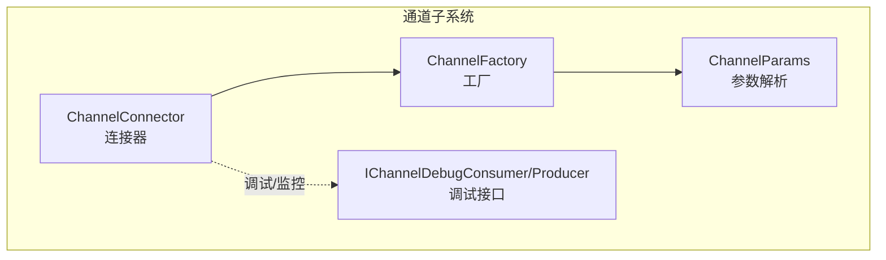
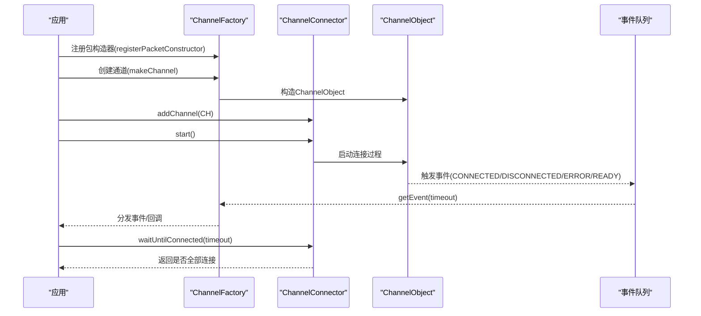
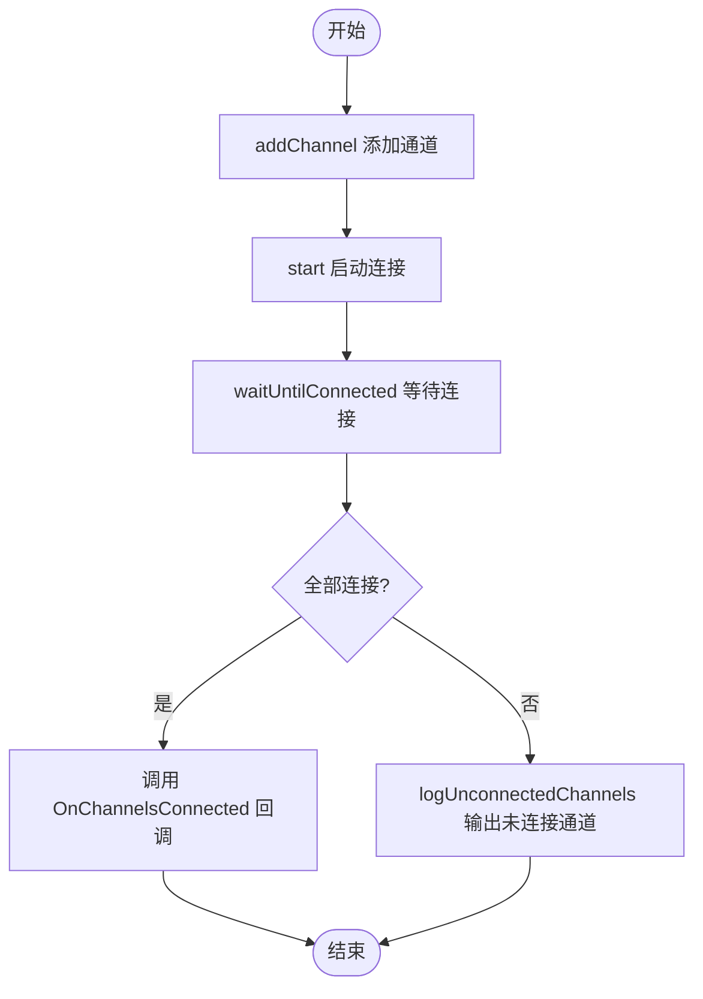
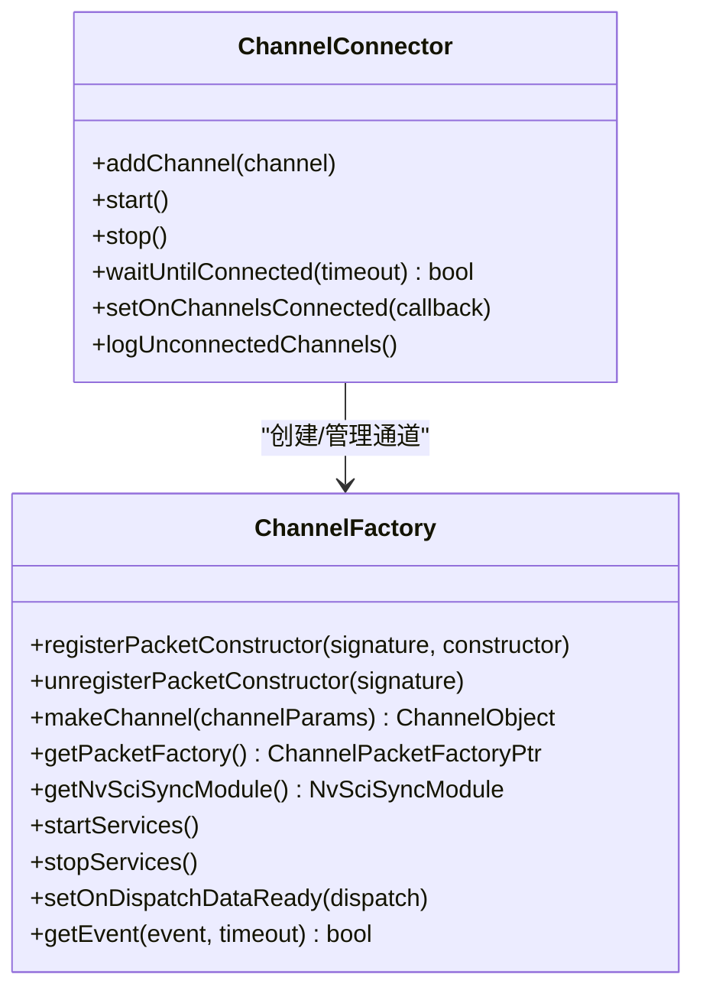
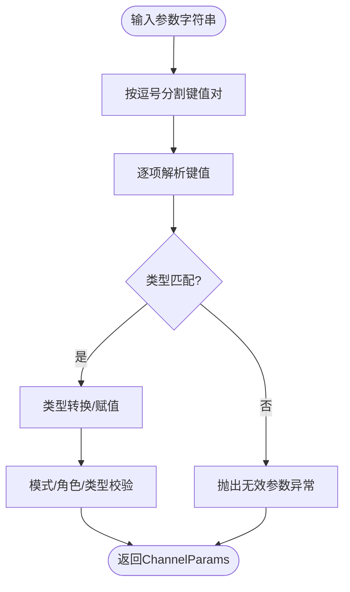

# 通道连接器

<cite>
**本文引用的文件**
- [driverorks-5.10/include/dwcgf/channel/ChannelConnector.hpp](file://driverorks-5.10/include/dwcgf/channel/ChannelConnector.hpp)
- [driverorks-5.10/include/dwcgf/channel/ChannelFactory.hpp](file://driverorks-5.10/include/dwcgf/channel/ChannelFactory.hpp)
- [driverorks-5.10/include/dwcgf/channel/ChannelParameters.hpp](file://driverorks-5.10/include/dwcgf/channel/ChannelParameters.hpp)
- [driverorks-5.10/doc/nvcgf_html/ChannelConnector_8hpp.html](file://driverorks-5.10/doc/nvcgf_html/ChannelConnector_8hpp.html)
- [driverorks-5.10/doc/nvcgf_html/ChannelFactory_8hpp.html](file://driverorks-5.10/doc/nvcgf_html/ChannelFactory_8hpp.html)
- [driverorks-5.10/doc/nvcgf_html/ChannelParameters_8hpp.html](file://driverorks-5.10/doc/nvcgf_html/ChannelParameters_8hpp.html)
- [driverorks-5.10/doc/nvcgf_html/classdw_1_1framework_1_1IChannelDebugConsumer.html](file://driverorks-5.10/doc/nvcgf_html/classdw_1_1framework_1_1IChannelDebugConsumer.html)
- [driverorks-5.10/doc/nvcgf_html/classdw_1_1framework_1_1IChannelDebugProducer.html](file://driverorks-5.10/doc/nvcgf_html/classdw_1_1framework_1_1IChannelDebugProducer.html)
</cite>

## 目录
1. [简介](#简介)
2. [项目结构](#项目结构)
3. [核心组件](#核心组件)
4. [架构总览](#架构总览)
5. [详细组件分析](#详细组件分析)
6. [依赖关系分析](#依赖关系分析)
7. [性能考量](#性能考量)
8. [故障排查指南](#故障排查指南)
9. [结论](#结论)
10. [附录：配置与使用示例路径](#附录配置与使用示例路径)

## 简介
本文件面向CGF（Compute Graph Framework）通道子系统的“通道连接器”技术文档，聚焦于ChannelConnector的自动连接机制、连接状态管理策略、错误处理与恢复、通道工厂模式的实现与最佳实践，并提供配置、调试与监控的实用指南。文档以driverorks-5.10版本的头文件与Doxygen文档为基础，结合参数解析与事件模型，系统化阐述从连接发现、建立到维护的完整流程。

## 项目结构
围绕通道连接与工厂的核心文件位于driverorks-5.10的include/dwcgf/channel目录，关键头文件如下：
- ChannelConnector.hpp：对外暴露的连接器接口，负责批量通道的添加、启动、等待连接完成、回调注册与未连接通道日志等。
- ChannelFactory.hpp：通道工厂接口，提供包构造器注册、通道创建、事件分发、服务启停等能力。
- ChannelParameters.hpp：通道参数解析与校验，涵盖类型、角色、模式、套接字与NvSci流参数等。

图表来源
- [driverorks-5.10/include/dwcgf/channel/ChannelConnector.hpp:47-73](file://driverorks-5.10/include/dwcgf/channel/ChannelConnector.hpp#L47-L73)
- [driverorks-5.10/include/dwcgf/channel/ChannelFactory.hpp:69-154](file://driverorks-5.10/include/dwcgf/channel/ChannelFactory.hpp#L69-L154)
- [driverorks-5.10/include/dwcgf/channel/ChannelParameters.hpp:498-713](file://driverorks-5.10/include/dwcgf/channel/ChannelParameters.hpp#L498-L713)

章节来源
- [driverorks-5.10/include/dwcgf/channel/ChannelConnector.hpp:47-73](file://driverorks-5.10/include/dwcgf/channel/ChannelConnector.hpp#L47-L73)
- [driverorks-5.10/include/dwcgf/channel/ChannelFactory.hpp:69-154](file://driverorks-5.10/include/dwcgf/channel/ChannelFactory.hpp#L69-L154)
- [driverorks-5.10/include/dwcgf/channel/ChannelParameters.hpp:498-713](file://driverorks-5.10/include/dwcgf/channel/ChannelParameters.hpp#L498-L713)

## 核心组件
- ChannelConnector
  - 提供批量通道管理：addChannel、start、stop、waitUntilConnected、setOnChannelsConnected、logUnconnectedChannels。
  - 默认最大通道数常量与回调类型定义。
- ChannelFactory
  - 注册/注销包构造器；创建通道；事件轮询；服务启停；数据就绪分发回调。
  - 事件类型：CONNECTED、DISCONNECTED、ERROR、READY。
- ChannelParams
  - 解析通道参数字符串，支持类型、角色、模式、FIFO大小、单例/邮箱模式、同步开关、客户端数量、调试端口等。
  - 针对不同传输类型（如SOCKET、NVSCI）提供专用参数对象。

章节来源
- [driverorks-5.10/include/dwcgf/channel/ChannelConnector.hpp:47-73](file://driverorks-5.10/include/dwcgf/channel/ChannelConnector.hpp#L47-L73)
- [driverorks-5.10/include/dwcgf/channel/ChannelFactory.hpp:69-154](file://driverorks-5.10/include/dwcgf/channel/ChannelFactory.hpp#L69-L154)
- [driverorks-5.10/include/dwcgf/channel/ChannelParameters.hpp:498-713](file://driverorks-5.10/include/dwcgf/channel/ChannelParameters.hpp#L498-L713)

## 架构总览
下图展示了连接器、工厂与参数解析之间的交互关系，以及事件驱动的数据通路。

图表来源
- [driverorks-5.10/include/dwcgf/channel/ChannelFactory.hpp:69-154](file://driverorks-5.10/include/dwcgf/channel/ChannelFactory.hpp#L69-L154)
- [driverorks-5.10/include/dwcgf/channel/ChannelConnector.hpp:53-73](file://driverorks-5.10/include/dwcgf/channel/ChannelConnector.hpp#L53-L73)

## 详细组件分析

### ChannelConnector：自动连接机制与状态管理
- 自动连接流程
  - addChannel：将待连接的ChannelObject加入连接器内部集合。
  - start：启动后台连接流程，触发各通道的连接尝试。
  - waitUntilConnected：阻塞等待所有通道连接完成或超时。
  - setOnChannelsConnected：设置全部通道连接后的回调。
  - logUnconnectedChannels：输出仍处于未连接状态的通道信息，便于诊断。
- 连接状态管理策略
  - 成功：事件类型为CONNECTED，表示通道已建立可用数据通路。
  - 失败：事件类型为ERROR，携带错误信号，可用于定位具体失败原因。
  - 断开：事件类型为DISCONNECTED，表示通道失去连接，需触发重连或降级处理。
  - 就绪：事件类型为READY，携带opaque指针与OnDataReady回调，用于通知上层数据可消费。
- 错误处理与恢复
  - 基于事件驱动的错误上报（ERROR），结合日志与回调进行快速定位。
  - 对于断开（DISCONNECTED），建议在上层策略中执行重连或故障转移。
  - 使用waitUntilConnected与超时控制避免无限阻塞。

图表来源
- [driverorks-5.10/include/dwcgf/channel/ChannelConnector.hpp:53-73](file://driverorks-5.10/include/dwcgf/channel/ChannelConnector.hpp#L53-L73)

章节来源
- [driverorks-5.10/include/dwcgf/channel/ChannelConnector.hpp:47-73](file://driverorks-5.10/include/dwcgf/channel/ChannelConnector.hpp#L47-L73)

### ChannelFactory：工厂模式与事件驱动
- 工厂职责
  - 注册/注销包构造器：确保通道使用的数据包类型在运行前完成注册。
  - 创建通道：根据参数字符串生成ChannelObject。
  - 事件分发：通过getEvent轮询事件，支持线程安全（非并发安全）。
  - 服务启停：startServices/stopServices用于优化通道创建/销毁的性能。
- 事件模型
  - CONNECTED：通道连接成功。
  - DISCONNECTED：通道断开。
  - ERROR：通道发生错误，携带错误信号。
  - READY：通道准备就绪，携带opaque与OnDataReady回调。
- 数据就绪分发
  - setOnDispatchDataReady允许上层接管数据就绪通知，实现灵活的异步处理。

图表来源
- [driverorks-5.10/include/dwcgf/channel/ChannelFactory.hpp:69-154](file://driverorks-5.10/include/dwcgf/channel/ChannelFactory.hpp#L69-L154)
- [driverorks-5.10/include/dwcgf/channel/ChannelConnector.hpp:47-73](file://driverorks-5.10/include/dwcgf/channel/ChannelConnector.hpp#L47-L73)

章节来源
- [driverorks-5.10/include/dwcgf/channel/ChannelFactory.hpp:69-154](file://driverorks-5.10/include/dwcgf/channel/ChannelFactory.hpp#L69-L154)

### ChannelParameters：参数解析与约束
- 支持的通道类型
  - SHMEM_LOCAL、SHMEM_REMOTE、EGLSTREAM、SOCKET、DDS、NVSCI。
- 角色与模式
  - 角色：PRODUCER、CONSUMER、COMPOSITE。
  - 模式：FIFO、MAILBOX、SINGLETON。
- 关键参数
  - id、singleton-id、fifo-size、mode、reuse、debug-port、num-clients、debug-num-clients、role、type、data-offset、strict、sync-enabled。
- 参数解析与校验
  - 通过ParseAllChannelParameters解析键值对，针对不同类型进行转换与异常抛出。
  - 针对MAILBOX与SINGLETON模式进行互斥与兼容性校验。
  - 针对不同传输类型（如SOCKET、NVSCI）提供专用参数对象（ChannelSocketParams、ChannelNvSciStreamParams）。

图表来源
- [driverorks-5.10/include/dwcgf/channel/ChannelParameters.hpp:343-380](file://driverorks-5.10/include/dwcgf/channel/ChannelParameters.hpp#L343-L380)
- [driverorks-5.10/include/dwcgf/channel/ChannelParameters.hpp:498-713](file://driverorks-5.10/include/dwcgf/channel/ChannelParameters.hpp#L498-L713)

章节来源
- [driverorks-5.10/include/dwcgf/channel/ChannelParameters.hpp:498-713](file://driverorks-5.10/include/dwcgf/channel/ChannelParameters.hpp#L498-L713)

### 调试与监控：IChannelDebugConsumer/Producer
- IChannelDebugConsumer
  - recv：接收数据包。
  - wait：等待数据包到达。
  - getFromChannel：从指定通道对象获取消费者实例。
- IChannelDebugProducer
  - get/send：获取/发送数据包。
  - getFromChannel：从指定通道对象获取生产者实例。
- 应用场景
  - 在开发与测试阶段，通过调试接口绕过常规事件流，直接收发数据包，辅助定位通道问题。

章节来源
- [driverorks-5.10/doc/nvcgf_html/classdw_1_1framework_1_1IChannelDebugConsumer.html:112-125](file://driverorks-5.10/doc/nvcgf_html/classdw_1_1framework_1_1IChannelDebugConsumer.html#L112-L125)
- [driverorks-5.10/doc/nvcgf_html/classdw_1_1framework_1_1IChannelDebugProducer.html:112-125](file://driverorks-5.10/doc/nvcgf_html/classdw_1_1framework_1_1IChannelDebugProducer.html#L112-L125)

## 依赖关系分析
- ChannelConnector依赖ChannelFactory进行通道创建与事件分发。
- ChannelFactory依赖ChannelParams进行参数解析与校验。
- 调试接口IChannelDebugConsumer/Producer独立于主事件流，仅在需要时启用。

图表来源
- [driverorks-5.10/include/dwcgf/channel/ChannelConnector.hpp:47-73](file://driverorks-5.10/include/dwcgf/channel/ChannelConnector.hpp#L47-L73)
- [driverorks-5.10/include/dwcgf/channel/ChannelFactory.hpp:69-154](file://driverorks-5.10/include/dwcgf/channel/ChannelFactory.hpp#L69-L154)
- [driverorks-5.10/include/dwcgf/channel/ChannelParameters.hpp:498-713](file://driverorks-5.10/include/dwcgf/channel/ChannelParameters.hpp#L498-L713)
- [driverorks-5.10/doc/nvcgf_html/classdw_1_1framework_1_1IChannelDebugConsumer.html:112-125](file://driverorks-5.10/doc/nvcgf_html/classdw_1_1framework_1_1IChannelDebugConsumer.html#L112-L125)
- [driverorks-5.10/doc/nvcgf_html/classdw_1_1framework_1_1IChannelDebugProducer.html:112-125](file://driverorks-5.10/doc/nvcgf_html/classdw_1_1framework_1_1IChannelDebugProducer.html#L112-L125)

章节来源
- [driverorks-5.10/include/dwcgf/channel/ChannelConnector.hpp:47-73](file://driverorks-5.10/include/dwcgf/channel/ChannelConnector.hpp#L47-L73)
- [driverorks-5.10/include/dwcgf/channel/ChannelFactory.hpp:69-154](file://driverorks-5.10/include/dwcgf/channel/ChannelFactory.hpp#L69-L154)
- [driverorks-5.10/include/dwcgf/channel/ChannelParameters.hpp:498-713](file://driverorks-5.10/include/dwcgf/channel/ChannelParameters.hpp#L498-L713)

## 性能考量
- 通道创建与销毁的性能
  - 工厂文档明确指出：在服务未启动时创建/销毁通道会因后台服务竞争导致性能下降，建议先创建完所有通道再启动服务，停止服务后再删除通道。
- 连接等待与阻塞
  - waitUntilConnected提供超时控制，避免长时间阻塞影响系统启动。
- 参数与池容量
  - ChannelParams在FIFO模式下会根据消费者数量调整池容量，确保吞吐与稳定性。

章节来源
- [driverorks-5.10/include/dwcgf/channel/ChannelFactory.hpp:117-135](file://driverorks-5.10/include/dwcgf/channel/ChannelFactory.hpp#L117-L135)
- [driverorks-5.10/include/dwcgf/channel/ChannelParameters.hpp:667-679](file://driverorks-5.10/include/dwcgf/channel/ChannelParameters.hpp#L667-L679)

## 故障排查指南
- 常见问题与定位
  - 通道未连接：使用logUnconnectedChannels输出未连接通道，结合waitUntilConnected的超时行为判断是否需要延长等待或检查参数。
  - 连接失败：关注ERROR事件，读取错误信号定位具体原因（如网络、权限、参数不合法等）。
  - 断开重连：监听DISCONNECTED事件，在上层策略中执行重连或降级处理。
- 调试手段
  - 使用IChannelDebugConsumer/Producer直连通道，绕过常规事件流进行数据收发，验证通道可用性与数据正确性。
- 参数校验
  - 若出现“未知类型/角色/模式”或“索引越界”等异常，检查参数字符串格式与取值范围。

章节来源
- [driverorks-5.10/include/dwcgf/channel/ChannelConnector.hpp:63-73](file://driverorks-5.10/include/dwcgf/channel/ChannelConnector.hpp#L63-L73)
- [driverorks-5.10/include/dwcgf/channel/ChannelFactory.hpp:58-65](file://driverorks-5.10/include/dwcgf/channel/ChannelFactory.hpp#L58-L65)
- [driverorks-5.10/doc/nvcgf_html/classdw_1_1framework_1_1IChannelDebugConsumer.html:112-125](file://driverorks-5.10/doc/nvcgf_html/classdw_1_1framework_1_1IChannelDebugConsumer.html#L112-L125)
- [driverorks-5.10/doc/nvcgf_html/classdw_1_1framework_1_1IChannelDebugProducer.html:112-125](file://driverorks-5.10/doc/nvcgf_html/classdw_1_1framework_1_1IChannelDebugProducer.html#L112-L125)

## 结论
ChannelConnector通过事件驱动与工厂模式实现了通道的自动连接、状态管理与错误恢复；ChannelFactory提供了统一的通道创建与事件分发能力；ChannelParameters则保证了参数解析的严谨性与一致性。配合调试接口与合理的参数配置，可在复杂拓扑与多进程环境中稳定地构建数据通路。

## 附录：配置与使用示例路径
以下为常用操作的参考路径（请在对应版本头文件中查看具体接口签名与说明）：
- 连接器接口与方法
  - [ChannelConnector类定义:47-73](file://driverorks-5.10/include/dwcgf/channel/ChannelConnector.hpp#L47-L73)
- 工厂接口与事件
  - [ChannelFactory类定义:69-154](file://driverorks-5.10/include/dwcgf/channel/ChannelFactory.hpp#L69-L154)
- 参数解析与校验
  - [ChannelParams类定义与解析函数:498-713](file://driverorks-5.10/include/dwcgf/channel/ChannelParameters.hpp#L498-L713)
- 调试接口
  - [IChannelDebugConsumer:112-125](file://driverorks-5.10/doc/nvcgf_html/classdw_1_1framework_1_1IChannelDebugConsumer.html#L112-L125)
  - [IChannelDebugProducer:112-125](file://driverorks-5.10/doc/nvcgf_html/classdw_1_1framework_1_1IChannelDebugProducer.html#L112-L125)