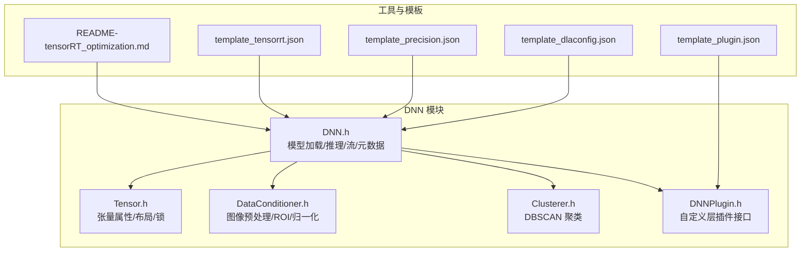
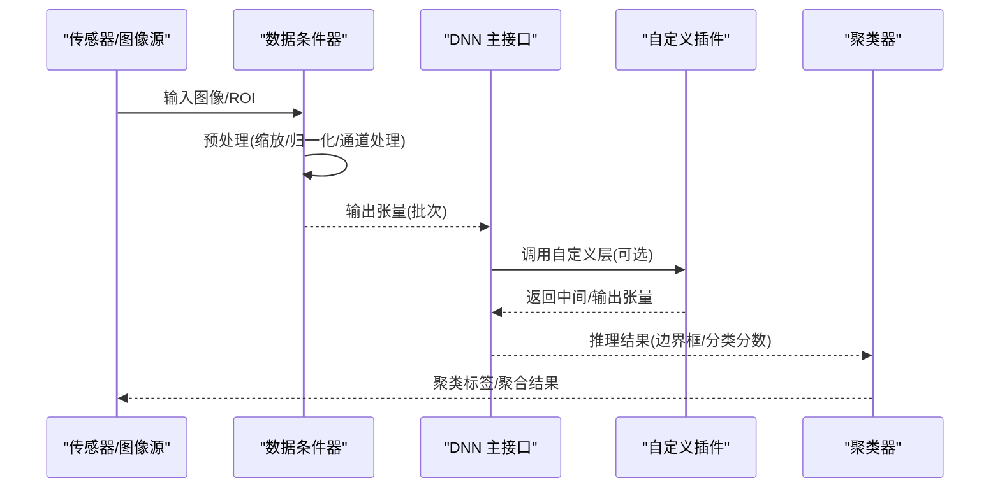
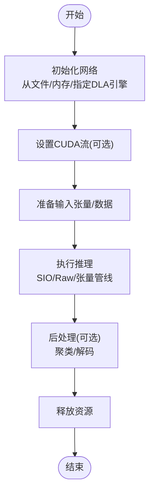
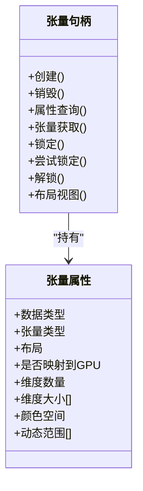
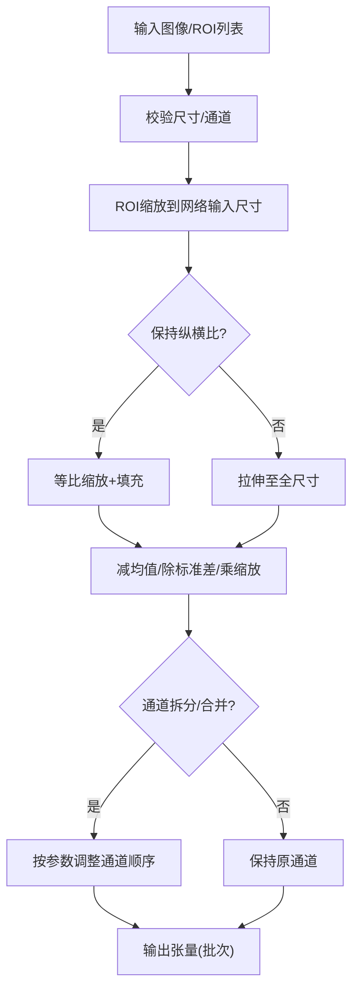
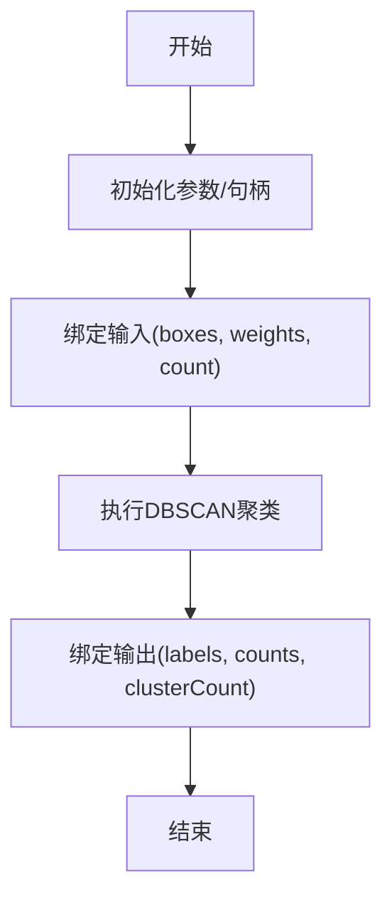
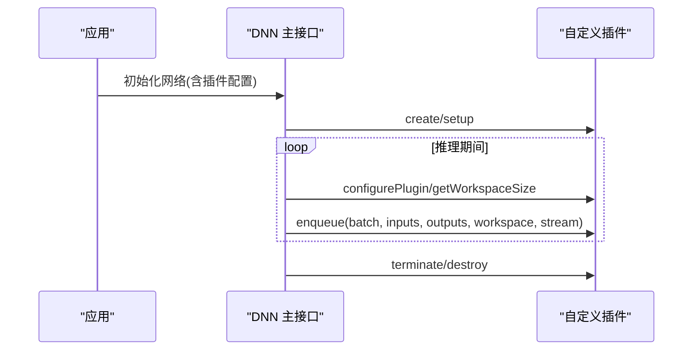
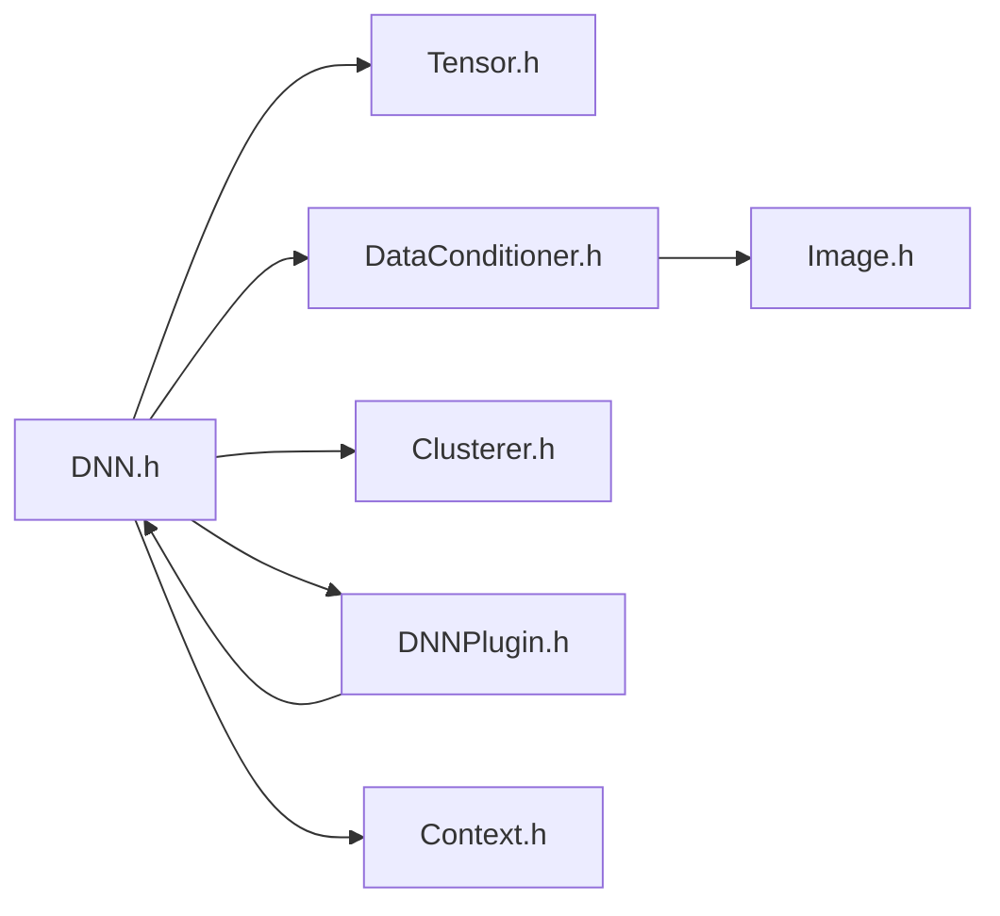

# DNN推理

<cite>
**本文引用的文件**
- [DNN.h](file://driverorks-5.10/include/dw/dnn/DNN.h)
- [Tensor.h](file://driverorks-5.10/include/dw/dnn/tensor/Tensor.h)
- [DataConditioner.h](file://driverorks-5.10/include/dw/dnn/DataConditioner.h)
- [Clusterer.h](file://driverorks-5.10/include/dw/dnn/Clusterer.h)
- [DNNPlugin.h](file://driverorks-5.10/include/dw/dnn/DNNPlugin.h)
- [DNNPlugin.h（旧版）](file://driverorks-5.10/include/dw/dnn/plugin/DNNPlugin.h)
- [README-tensorRT_optimization.md](file://driverorks-5.10/tools/dnn/README-tensorRT_optimization.md)
- [template_tensorrt.json](file://driverorks-5.10/tools/dnn/template_tensorrt.json)
- [template_plugin.json](file://driverorks-5.10/tools/dnn/template_plugin.json)
- [template_precision.json](file://driverorks-5.10/tools/dnn/template_precision.json)
- [template_dlaconfig.json](file://driverorks-5.10/tools/dnn/template_dlaconfig.json)
- [dwx_dnn_plugins.html](file://driverorks-5.10/doc/nvsdk_dw_html/dwx_dnn_plugins.html)
- [dwx_dnn_plugin_sample.html](file://driverorks-5.10/doc/nvsdk_dw_html/dwx_dnn_plugin_sample.html)
- [dwx_sample_dnn_tensor.html](file://driverorks-5.10/doc/nvsdk_dw_html/dwx_sample_dnn_tensor.html)
</cite>

## 目录
1. [引言](#引言)
2. [项目结构](#项目结构)
3. [核心组件](#核心组件)
4. [架构总览](#架构总览)
5. [详细组件分析](#详细组件分析)
6. [依赖关系分析](#依赖关系分析)
7. [性能考虑](#性能考虑)
8. [故障排查指南](#故障排查指南)
9. [结论](#结论)
10. [附录](#附录)

## 引言
本技术文档面向使用 NVIDIA DriveWorks 的开发者，系统性阐述 DNN 推理模块的设计与使用，覆盖以下主题：
- DNN 主接口：模型加载、推理执行、流配置、元数据获取
- Tensor 张量：数据结构、维度与布局、内存访问与锁机制
- 数据条件器：输入图像预处理、ROI 缩放、归一化与通道处理
- 聚类器：DBSCAN 后处理，对边界框进行聚类并输出标签
- 插件系统：自定义层扩展机制、插件生命周期与序列化
- 完整工作流：从模型加载到推理执行与后处理的端到端流程
- 性能优化与 GPU 加速最佳实践

## 项目结构
DNN 相关代码位于 include/dw/dnn 下，核心头文件如下：
- DNN 主接口：DNN.h
- 张量接口：tensor/Tensor.h
- 数据条件器：DataConditioner.h
- 聚类器：Clusterer.h
- 插件接口：DNNPlugin.h（含旧版兼容头）

工具与模板位于 tools/dnn，用于 TensorRT 模型优化、精度与插件配置等。

**图表来源**
- [DNN.h:124-204](file://driverorks-5.10/include/dw/dnn/DNN.h#L124-L204)
- [Tensor.h:97-137](file://driverorks-5.10/include/dw/dnn/tensor/Tensor.h#L97-L137)
- [DataConditioner.h:57-86](file://driverorks-5.10/include/dw/dnn/DataConditioner.h#L57-L86)
- [Clusterer.h:57-69](file://driverorks-5.10/include/dw/dnn/Clusterer.h#L57-L69)
- [DNNPlugin.h:56-141](file://driverorks-5.10/include/dw/dnn/DNNPlugin.h#L56-L141)
- [README-tensorRT_optimization.md](file://driverorks-5.10/tools/dnn/README-tensorRT_optimization.md)
- [template_tensorrt.json](file://driverorks-5.10/tools/dnn/template_tensorrt.json)
- [template_plugin.json](file://driverorks-5.10/tools/dnn/template_plugin.json)
- [template_precision.json](file://driverorks-5.10/tools/dnn/template_precision.json)
- [template_dlaconfig.json](file://driverorks-5.10/tools/dnn/template_dlaconfig.json)

**章节来源**
- [DNN.h:124-204](file://driverorks-5.10/include/dw/dnn/DNN.h#L124-L204)
- [Tensor.h:97-137](file://driverorks-5.10/include/dw/dnn/tensor/Tensor.h#L97-L137)
- [DataConditioner.h:57-86](file://driverorks-5.10/include/dw/dnn/DataConditioner.h#L57-L86)
- [Clusterer.h:57-69](file://driverorks-5.10/include/dw/dnn/Clusterer.h#L57-L69)
- [DNNPlugin.h:56-141](file://driverorks-5.10/include/dw/dnn/DNNPlugin.h#L56-L141)

## 核心组件
- DNN 主接口：提供从文件或内存初始化 TensorRT 网络、设置 CUDA 流、查询输入/输出尺寸与张量属性、单输入单输出与多输入多输出推理、重置与释放等能力。
- Tensor 张量：定义张量类型（CPU/CUDA/NvMedia）、布局（NCHW/NHWC/NCHWx）、颜色空间、动态范围与维度信息；提供创建/销毁、属性查询、锁定/解锁、布局视图计算等。
- 数据条件器：根据网络输入尺寸配置参数，执行缩放、裁剪、均值/标准差归一化、通道拆分/合并、地址填充策略等，支持批量输入与 ROI 映射。
- 聚类器：以 DBSCAN 为核心，对边界框集合按距离与权重阈值进行聚类，输出每个样本的类别标签。
- 插件系统：提供自定义层生命周期函数、格式支持检测、配置、前向执行、序列化/反序列化、命名空间与字段集合等。

**章节来源**
- [DNN.h:124-440](file://driverorks-5.10/include/dw/dnn/DNN.h#L124-L440)
- [Tensor.h:97-254](file://driverorks-5.10/include/dw/dnn/tensor/Tensor.h#L97-L254)
- [DataConditioner.h:57-300](file://driverorks-5.10/include/dw/dnn/DataConditioner.h#L57-300)
- [Clusterer.h:57-167](file://driverorks-5.10/include/dw/dnn/Clusterer.h#L57-167)
- [DNNPlugin.h:56-393](file://driverorks-5.10/include/dw/dnn/DNNPlugin.h#L56-393)

## 架构总览
DNN 推理在 DriveWorks 中采用“模型加载—数据预处理—推理—后处理”的流水线式架构。数据条件器负责将传感器输入转换为网络期望的张量格式；DNN 主接口驱动 TensorRT 执行推理；聚类器对推理结果进行后处理（如目标聚合）。

**图表来源**
- [DNN.h:124-204](file://driverorks-5.10/include/dw/dnn/DNN.h#L124-L204)
- [DataConditioner.h:207-268](file://driverorks-5.10/include/dw/dnn/DataConditioner.h#L207-268)
- [DNNPlugin.h:149-254](file://driverorks-5.10/include/dw/dnn/DNNPlugin.h#L149-L254)
- [Clusterer.h:128-167](file://driverorks-5.10/include/dw/dnn/Clusterer.h#L128-167)

## 详细组件分析

### DNN 主接口
- 初始化方式
  - 从文件加载（含 DLA 引擎 ID）
  - 从内存加载（含 DLA 引擎 ID）
- 推理接口
  - 单输入单输出（SIO）快捷路径
  - 多输入多输出（Raw）通用路径
- 流与元数据
  - 设置/获取 CUDA 流
  - 查询输入/输出尺寸与张量属性
  - 获取输入/输出索引与元数据
- 生命周期
  - 重置与释放

**图表来源**
- [DNN.h:124-204](file://driverorks-5.10/include/dw/dnn/DNN.h#L124-L204)
- [DNN.h:226-278](file://driverorks-5.10/include/dw/dnn/DNN.h#L226-L278)
- [DNN.h:280-304](file://driverorks-5.10/include/dw/dnn/DNN.h#L280-L304)
- [DNN.h:306-424](file://driverorks-5.10/include/dw/dnn/DNN.h#L306-L424)

**章节来源**
- [DNN.h:124-440](file://driverorks-5.10/include/dw/dnn/DNN.h#L124-L440)

### Tensor 张量
- 关键属性
  - 数据类型、张量类型(CPU/CUDA/NvMedia)、布局(NCHW/NHWC/NCHWx)、颜色空间、动态范围
  - 维度数组与最大维度限制
- 访问与锁
  - 创建/销毁
  - 属性查询与张量内容获取
  - 锁定/尝试锁定/解锁，支持写访问
  - 布局视图：偏移、步长、元素数量，便于高效遍历
- 注意事项
  - NvMedia 内容不可直接通过指针遍历，需经流传输

**图表来源**
- [Tensor.h:97-137](file://driverorks-5.10/include/dw/dnn/tensor/Tensor.h#L97-L137)
- [Tensor.h:149-254](file://driverorks-5.10/include/dw/dnn/tensor/Tensor.h#L149-L254)

**章节来源**
- [Tensor.h:97-254](file://driverorks-5.10/include/dw/dnn/tensor/Tensor.h#L97-L254)

### 数据条件器
- 参数结构
  - 均值、标准差、均值图像、通道拆分、缩放系数、忽略纵横比、逐平面均值归一化、通道索引映射
- 初始化
  - 基于网络输入尺寸或张量属性初始化
  - 支持设置 CUDA 流
- 处理流程
  - 对批量图像进行 ROI 提取、缩放、填充、归一化、通道变换
  - 输出可为 GPU 张量句柄或原始 GPU 指针
- 反投影
  - 将网络输出坐标映射回输入图像坐标

**图表来源**
- [DataConditioner.h:57-86](file://driverorks-5.10/include/dw/dnn/DataConditioner.h#L57-L86)
- [DataConditioner.h:122-155](file://driverorks-5.10/include/dw/dnn/DataConditioner.h#L122-L155)
- [DataConditioner.h:207-268](file://driverorks-5.10/include/dw/dnn/DataConditioner.h#L207-268)
- [DataConditioner.h:284-299](file://driverorks-5.10/include/dw/dnn/DataConditioner.h#L284-299)

**章节来源**
- [DataConditioner.h:57-300](file://driverorks-5.10/include/dw/dnn/DataConditioner.h#L57-300)

### 聚类器
- 参数
  - DBSCAN 邻域半径、最小样本数、最小权重和、最大样本数
- 使用流程
  - 初始化参数与句柄
  - 绑定输入（边界框与权重）
  - 执行聚类
  - 绑定输出（标签与聚类数）

**图表来源**
- [Clusterer.h:57-69](file://driverorks-5.10/include/dw/dnn/Clusterer.h#L57-L69)
- [Clusterer.h:100-167](file://driverorks-5.10/include/dw/dnn/Clusterer.h#L100-167)

**章节来源**
- [Clusterer.h:57-167](file://driverorks-5.10/include/dw/dnn/Clusterer.h#L57-167)

### 插件系统
- 插件接口要点
  - 生命周期：创建、克隆、设置、终止、销毁
  - 规格：输出数量、输出维度推导、工作区大小、格式支持、配置
  - 执行：前向 enqueue（含批大小、输入/输出指针、工作区、CUDA 流）
  - 序列化：序列化大小、缓冲区序列化、从缓冲区/字段集合/权重反序列化
  - 元信息：类型、版本、命名空间、广播策略、输出精度推导、字段集合
- 与 DNN 的集成
  - 通过插件配置结构体在初始化时注册自定义层

**图表来源**
- [DNN.h:72-86](file://driverorks-5.10/include/dw/dnn/DNN.h#L72-L86)
- [DNNPlugin.h:149-254](file://driverorks-5.10/include/dw/dnn/DNNPlugin.h#L149-L254)
- [DNNPlugin.h:262-393](file://driverorks-5.10/include/dw/dnn/DNNPlugin.h#L262-393)

**章节来源**
- [DNN.h:72-86](file://driverorks-5.10/include/dw/dnn/DNN.h#L72-L86)
- [DNNPlugin.h:56-393](file://driverorks-5.10/include/dw/dnn/DNNPlugin.h#L56-393)

## 依赖关系分析
- DNN 主接口依赖 Tensor 张量、数据条件器、聚类器与插件系统
- 数据条件器依赖图像类型与 CUDA 流
- 插件系统与 DNN 主接口耦合紧密，通过插件配置结构体集成
- 工具与模板为模型优化与配置提供支撑

**图表来源**
- [DNN.h:49-54](file://driverorks-5.10/include/dw/dnn/DNN.h#L49-L54)
- [Tensor.h:49](file://driverorks-5.10/include/dw/dnn/tensor/Tensor.h#L49)
- [DataConditioner.h:49-52](file://driverorks-5.10/include/dw/dnn/DataConditioner.h#L49-52)
- [Clusterer.h:49-52](file://driverorks-5.10/include/dw/dnn/Clusterer.h#L49-52)
- [DNNPlugin.h:49-51](file://driverorks-5.10/include/dw/dnn/DNNPlugin.h#L49-51)

**章节来源**
- [DNN.h:49-54](file://driverorks-5.10/include/dw/dnn/DNN.h#L49-L54)
- [Tensor.h:49](file://driverorks-5.10/include/dw/dnn/tensor/Tensor.h#L49)
- [DataConditioner.h:49-52](file://driverorks-5.10/include/dw/dnn/DataConditioner.h#L49-52)
- [Clusterer.h:49-52](file://driverorks-5.10/include/dw/dnn/Clusterer.h#L49-52)
- [DNNPlugin.h:49-51](file://driverorks-5.10/include/dw/dnn/DNNPlugin.h#L49-51)

## 性能考虑
- 批大小与 DLA
  - DLA 推理通常在最大批大小下执行，较小批仅减少输出拷贝量
- CUDA 流
  - 通过设置/获取 CUDA 流实现异步执行与流水线并行
- 数据条件器
  - 合理设置 ROI 与纵横比策略，避免不必要的缩放与填充
  - 使用 GPU 映射内存（若适用）降低主机与设备间拷贝
- 插件与精度
  - 利用模板与工具生成针对目标硬件的优化模型
  - 在满足精度要求的前提下选择合适的数据类型与量化参数

[本节为通用指导，不直接分析具体文件]

## 故障排查指南
- 常见错误与定位
  - 无效参数/句柄：检查网络句柄、张量句柄、CUDA 流是否有效
  - 文件不存在/模型无效：确认模型路径与 JSON 元数据存在且格式正确
  - CUDA 能力不匹配：确保模型生成目标硬件能力满足当前设备
  - 推理失败：检查输入/输出尺寸与批大小是否符合模型约束
- 建议排查步骤
  - 校验初始化返回状态
  - 使用 dwDNN_getInputSize/dwDNN_getOutputSize 确认尺寸
  - 使用 dwDataConditioner_getOutputSize 校验预处理输出尺寸
  - 逐步启用/禁用插件，定位自定义层问题
  - 查看工具链输出与日志，核对 TensorRT 优化参数

**章节来源**
- [DNN.h:98-102](file://driverorks-5.10/include/dw/dnn/DNN.h#L98-L102)
- [DNN.h:140-144](file://driverorks-5.10/include/dw/dnn/DNN.h#L140-L144)
- [DNN.h:241-244](file://driverorks-5.10/include/dw/dnn/DNN.h#L241-L244)

## 结论
DNN 推理模块在 DriveWorks 中提供了从模型加载、数据预处理、推理执行到后处理的完整能力。通过清晰的接口抽象与灵活的插件机制，开发者可在保证性能的同时扩展非标算子，并结合工具链实现针对目标硬件的优化。建议在实际工程中严格遵循尺寸与批大小约束，合理配置 CUDA 流与数据条件器参数，并利用模板与工具提升开发效率与稳定性。

[本节为总结性内容，不直接分析具体文件]

## 附录

### API 参考与使用示例（路径指引）
- 模型加载与推理
  - [初始化网络(文件):124-127](file://driverorks-5.10/include/dw/dnn/DNN.h#L124-L127)
  - [初始化网络(内存):172-177](file://driverorks-5.10/include/dw/dnn/DNN.h#L172-L177)
  - [设置/获取 CUDA 流:291-304](file://driverorks-5.10/include/dw/dnn/DNN.h#L291-L304)
  - [单输入单输出推理:250-252](file://driverorks-5.10/include/dw/dnn/DNN.h#L250-L252)
  - [多输入多输出推理:276-278](file://driverorks-5.10/include/dw/dnn/DNN.h#L276-L278)
  - [查询输入/输出尺寸与张量属性:306-360](file://driverorks-5.10/include/dw/dnn/DNN.h#L306-L360)
  - [获取元数据:413-424](file://driverorks-5.10/include/dw/dnn/DNN.h#L413-L424)
- 张量操作
  - [创建/销毁:149-163](file://driverorks-5.10/include/dw/dnn/tensor/Tensor.h#L149-L163)
  - [属性查询/张量获取:197-212](file://driverorks-5.10/include/dw/dnn/tensor/Tensor.h#L197-L212)
  - [锁定/尝试锁定/解锁:226-254](file://driverorks-5.10/include/dw/dnn/tensor/Tensor.h#L226-L254)
  - [布局视图:184-187](file://driverorks-5.10/include/dw/dnn/tensor/Tensor.h#L184-L187)
- 数据条件器
  - [初始化(基于网络输入尺寸):122-127](file://driverorks-5.10/include/dw/dnn/DataConditioner.h#L122-L127)
  - [初始化(基于张量属性):150-155](file://driverorks-5.10/include/dw/dnn/DataConditioner.h#L150-L155)
  - [设置/获取 CUDA 流:168-181](file://driverorks-5.10/include/dw/dnn/DataConditioner.h#L168-L181)
  - [预处理(原始GPU指针):233-236](file://driverorks-5.10/include/dw/dnn/DataConditioner.h#L233-L236)
  - [预处理(张量句柄):264-268](file://driverorks-5.10/include/dw/dnn/DataConditioner.h#L264-L268)
  - [输出尺寸计算:279-281](file://driverorks-5.10/include/dw/dnn/DataConditioner.h#L279-L281)
  - [坐标反投影:296-299](file://driverorks-5.10/include/dw/dnn/DataConditioner.h#L296-L299)
- 聚类器
  - [初始化参数/句柄:100-102](file://driverorks-5.10/include/dw/dnn/Clusterer.h#L100-L102)
  - [重置/释放:112-126](file://driverorks-5.10/include/dw/dnn/Clusterer.h#L112-L126)
  - [绑定输入/输出:150-166](file://driverorks-5.10/include/dw/dnn/Clusterer.h#L150-L166)
  - [执行聚类:138-139](file://driverorks-5.10/include/dw/dnn/Clusterer.h#L138-L139)
- 插件系统
  - [插件配置结构:72-86](file://driverorks-5.10/include/dw/dnn/DNN.h#L72-L86)
  - [生命周期函数:149-182](file://driverorks-5.10/include/dw/dnn/DNNPlugin.h#L149-L182)
  - [前向执行:253-254](file://driverorks-5.10/include/dw/dnn/DNNPlugin.h#L253-L254)
  - [序列化/反序列化:262-306](file://driverorks-5.10/include/dw/dnn/DNNPlugin.h#L262-L306)
  - [字段集合/命名空间:392-342](file://driverorks-5.10/include/dw/dnn/DNNPlugin.h#L392-L342)

### 工具与模板
- TensorRT 优化说明与模板
  - [优化说明](file://driverorks-5.10/tools/dnn/README-tensorRT_optimization.md)
  - [TensorRT 配置模板](file://driverorks-5.10/tools/dnn/template_tensorrt.json)
  - [插件配置模板](file://driverorks-5.10/tools/dnn/template_plugin.json)
  - [精度配置模板](file://driverorks-5.10/tools/dnn/template_precision.json)
  - [DLA 配置模板](file://driverorks-5.10/tools/dnn/template_dlaconfig.json)
- 文档页面
  - [DNN 插件文档](file://driverorks-5.10/doc/nvsdk_dw_html/dwx_dnn_plugins.html)
  - [DNN 插件示例](file://driverorks-5.10/doc/nvsdk_dw_html/dwx_dnn_plugin_sample.html)
  - [张量示例](file://driverorks-5.10/doc/nvsdk_dw_html/dwx_sample_dnn_tensor.html)