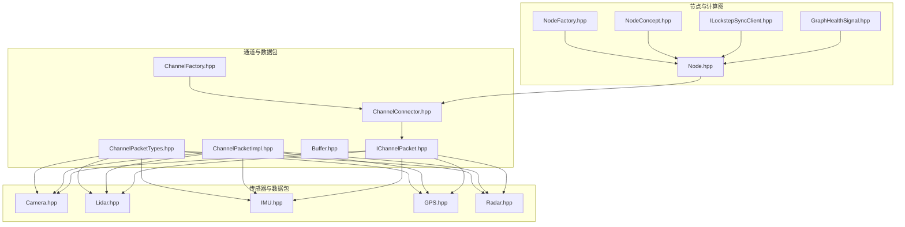
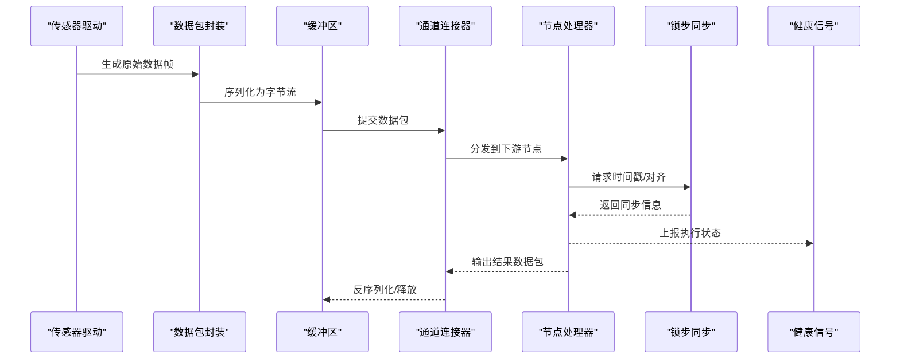
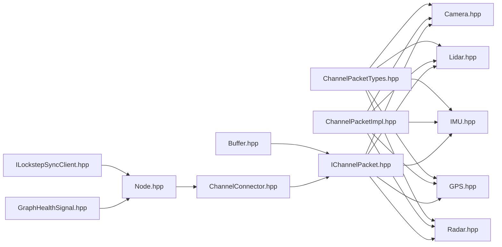

# Driveworks API层

<cite>
**本文引用的文件**
- [driverorks-5.10/include/dwframework/dwnodes/common/channelpackets/Camera.hpp](file://driverorks-5.10/include/dwframework/dwnodes/common/channelpackets/Camera.hpp)
- [driverorks-5.10/include/dwframework/dwnodes/common/channelpackets/Lidar.hpp](file://driverorks-5.10/include/dwframework/dwnodes/common/channelpackets/Lidar.hpp)
- [driverorks-5.10/include/dwframework/dwnodes/common/channelpackets/IMU.hpp](file://driverorks-5.10/include/dwframework/dwnodes/common/channelpackets/IMU.hpp)
- [driverorks-5.10/include/dwframework/dwnodes/common/channelpackets/GPS.hpp](file://driverorks-5.10/include/dwframework/dwnodes/common/channelpackets/GPS.hpp)
- [driverorks-5.10/include/dwframework/dwnodes/common/channelpackets/Radar.hpp](file://driverorks-5.10/include/dwframework/dwnodes/common/channelpackets/Radar.hpp)
- [driverorks-5.10/include/dwcgf/channel/ChannelPacketTypes.hpp](file://driverorks-5.10/include/dwcgf/channel/ChannelPacketTypes.hpp)
- [driverorks-5.10/include/dwcgf/channel/ChannelPacketImpl.hpp](file://driverorks-5.10/include/dwcgf/channel/ChannelPacketImpl.hpp)
- [driverorks-5.10/include/dwcgf/channel/Buffer.hpp](file://driverorks-5.10/include/dwcgf/channel/Buffer.hpp)
- [driverorks-5.10/include/dwcgf/channel/IChannelPacket.hpp](file://driverorks-5.10/include/dwcgf/channel/IChannelPacket.hpp)
- [driverorks-5.10/include/dwcgf/channel/ChannelConnector.hpp](file://driverorks-5.10/include/dwcgf/channel/ChannelConnector.hpp)
- [driverorks-5.10/include/dwcgf/channel/ChannelFactory.hpp](file://driverorks-5.10/include/dwcgf/channel/ChannelFactory.hpp)
- [driverorks-5.10/include/dwcgf/node/Node.hpp](file://driverorks-5.10/include/dwcgf/node/Node.hpp)
- [driverorks-5.10/include/dwcgf/node/NodeFactory.hpp](file://driverorks-5.10/include/dwcgf/node/NodeFactory.hpp)
- [driverorks-5.10/include/dwcgf/node/NodeConcept.hpp](file://driverorks-5.10/include/dwcgf/node/NodeConcept.hpp)
- [driverorks-5.10/include/dwcgf/lockstep/ILockstepSyncClient.hpp](file://driverorks-5.10/include/dwcgf/lockstep/ILockstepSyncClient.hpp)
- [driverorks-5.10/include/dwcgf/computegraph/GraphHealthSignal.hpp](file://driverorks-5.10/include/dwcgf/computegraph/GraphHealthSignal.hpp)
- [driverorks-5.10/include/dwcgf/enum/EnumDescriptor.hpp](file://driverorks-5.10/include/dwcgf/enum/EnumDescriptor.hpp)
- [driverorks-5.10/include/dwcgf/Types.hpp](file://driverorks-5.10/include/dwcgf/Types.hpp)
- [driverorks-5.10/include/dwcgf/Exception.hpp](file://driverorks-5.10/include/dwcgf/Exception.hpp)
- [driverorks-5.10/include/dwcgf/channel/NvSciHelper.hpp](file://driverorks-5.10/include/dwcgf/channel/NvSciHelper.hpp)
- [driverorks-5.10/include/dw/core/base/Exception.hpp](file://driverorks-5.10/include/dw/core/base/Exception.hpp)
- [driveworks-5.14/include/dwframework/dwnodes/common/channelpackets/Camera.hpp](file://driveworks-5.14/include/dwframework/dwnodes/common/channelpackets/Camera.hpp)
- [driveworks-5.14/include/dwframework/dwnodes/common/channelpackets/Lidar.hpp](file://driveworks-5.14/include/dwframework/dwnodes/common/channelpackets/Lidar.hpp)
- [driveworks-5.14/include/dwframework/dwnodes/common/channelpackets/IMU.hpp](file://driveworks-5.14/include/dwframework/dwnodes/common/channelpackets/IMU.hpp)
- [driveworks-5.14/include/dwframework/dwnodes/common/channelpackets/GPS.hpp](file://driveworks-5.14/include/dwframework/dwnodes/common/channelpackets/GPS.hpp)
- [driveworks-5.14/include/dwframework/dwnodes/common/channelpackets/Radar.hpp](file://driveworks-5.14/include/dwframework/dwnodes/common/channelpackets/Radar.hpp)
- [driveworks-5.20/include/dwframework/dwnodes/common/channelpackets/Camera.hpp](file://driveworks-5.20/include/dwframework/dwnodes/common/channelpackets/Camera.hpp)
- [driveworks-5.20/include/dwframework/dwnodes/common/channelpackets/Lidar.hpp](file://driveworks-5.20/include/dwframework/dwnodes/common/channelpackets/Lidar.hpp)
- [driveworks-5.20/include/dwframework/dwnodes/common/channelpackets/IMU.hpp](file://driveworks-5.20/include/dwframework/dwnodes/common/channelpackets/IMU.hpp)
- [driveworks-5.20/include/dwframework/dwnodes/common/channelpackets/GPS.hpp](file://driveworks-5.20/include/dwframework/dwnodes/common/channelpackets/GPS.hpp)
- [driveworks-5.20/include/dwframework/dwnodes/common/channelpackets/Radar.hpp](file://driveworks-5.20/include/dwframework/dwnodes/common/channelpackets/Radar.hpp)
</cite>

## 目录
1. [引言](#引言)
2. [项目结构](#项目结构)
3. [核心组件](#核心组件)
4. [架构总览](#架构总览)
5. [详细组件分析](#详细组件分析)
6. [依赖关系分析](#依赖关系分析)
7. [性能考虑](#性能考虑)
8. [故障排查指南](#故障排查指南)
9. [结论](#结论)
10. [附录](#附录)

## 引言
本技术参考文档聚焦于 Driveworks 的 API 层，系统性梳理传感器接口与数据通道（Channel）体系、节点（Node）框架、以及面向多传感器（摄像头、激光雷达、雷达、IMU、GPS）的数据包封装与传输机制。文档同时覆盖图像处理与点云处理的通用类型与接口约定，并对 DNN 推理接口与模型插件系统的集成路径进行说明，帮助开发者快速理解并正确使用 Driveworks API。

## 项目结构
Driveworks API 层主要由以下层次构成：
- 通道与数据包：定义跨进程/跨设备的数据传输抽象、序列化/反序列化与缓冲区管理。
- 节点与计算图：定义可组合的处理单元、端口与同步机制，支撑数据流编排。
- 传感器与数据包：针对不同传感器类型（相机、激光雷达、雷达、IMU、GPS）定义专用数据包类型与封装。
- 错误与异常：统一的异常与错误信号机制，便于调试与健康监控。
- 版本兼容：在不同版本中（如 5.10、5.14、5.20）保持接口一致性的同时，提供差异化的实现细节。



图表来源
- [driverorks-5.10/include/dwcgf/channel/ChannelPacketTypes.hpp](file://driverorks-5.10/include/dwcgf/channel/ChannelPacketTypes.hpp)
- [driverorks-5.10/include/dwcgf/channel/ChannelPacketImpl.hpp](file://driverorks-5.10/include/dwcgf/channel/ChannelPacketImpl.hpp)
- [driverorks-5.10/include/dwcgf/channel/Buffer.hpp](file://driverorks-5.10/include/dwcgf/channel/Buffer.hpp)
- [driverorks-5.10/include/dwcgf/channel/IChannelPacket.hpp](file://driverorks-5.10/include/dwcgf/channel/IChannelPacket.hpp)
- [driverorks-5.10/include/dwcgf/channel/ChannelConnector.hpp](file://driverorks-5.10/include/dwcgf/channel/ChannelConnector.hpp)
- [driverorks-5.10/include/dwcgf/channel/ChannelFactory.hpp](file://driverorks-5.10/include/dwcgf/channel/ChannelFactory.hpp)
- [driverorks-5.10/include/dwcgf/node/Node.hpp](file://driverorks-5.10/include/dwcgf/node/Node.hpp)
- [driverorks-5.10/include/dwcgf/node/NodeFactory.hpp](file://driverorks-5.10/include/dwcgf/node/NodeFactory.hpp)
- [driverorks-5.10/include/dwcgf/node/NodeConcept.hpp](file://driverorks-5.10/include/dwcgf/node/NodeConcept.hpp)
- [driverorks-5.10/include/dwcgf/lockstep/ILockstepSyncClient.hpp](file://driverorks-5.10/include/dwcgf/lockstep/ILockstepSyncClient.hpp)
- [driverorks-5.10/include/dwcgf/computegraph/GraphHealthSignal.hpp](file://driverorks-5.10/include/dwcgf/computegraph/GraphHealthSignal.hpp)
- [driverorks-5.10/include/dwframework/dwnodes/common/channelpackets/Camera.hpp](file://driverorks-5.10/include/dwframework/dwnodes/common/channelpackets/Camera.hpp)
- [driverorks-5.10/include/dwframework/dwnodes/common/channelpackets/Lidar.hpp](file://driverorks-5.10/include/dwframework/dwnodes/common/channelpackets/Lidar.hpp)
- [driverorks-5.10/include/dwframework/dwnodes/common/channelpackets/IMU.hpp](file://driverorks-5.10/include/dwframework/dwnodes/common/channelpackets/IMU.hpp)
- [driverorks-5.10/include/dwframework/dwnodes/common/channelpackets/GPS.hpp](file://driverorks-5.10/include/dwframework/dwnodes/common/channelpackets/GPS.hpp)
- [driverorks-5.10/include/dwframework/dwnodes/common/channelpackets/Radar.hpp](file://driverorks-5.10/include/dwframework/dwnodes/common/channelpackets/Radar.hpp)

章节来源
- [driverorks-5.10/include/dwcgf/channel/ChannelPacketTypes.hpp](file://driverorks-5.10/include/dwcgf/channel/ChannelPacketTypes.hpp)
- [driverorks-5.10/include/dwcgf/channel/ChannelPacketImpl.hpp](file://driverorks-5.10/include/dwcgf/channel/ChannelPacketImpl.hpp)
- [driverorks-5.10/include/dwcgf/channel/Buffer.hpp](file://driverorks-5.10/include/dwcgf/channel/Buffer.hpp)
- [driverorks-5.10/include/dwcgf/channel/IChannelPacket.hpp](file://driverorks-5.10/include/dwcgf/channel/IChannelPacket.hpp)
- [driverorks-5.10/include/dwcgf/channel/ChannelConnector.hpp](file://driverorks-5.10/include/dwcgf/channel/ChannelConnector.hpp)
- [driverorks-5.10/include/dwcgf/channel/ChannelFactory.hpp](file://driverorks-5.10/include/dwcgf/channel/ChannelFactory.hpp)
- [driverorks-5.10/include/dwcgf/node/Node.hpp](file://driverorks-5.10/include/dwcgf/node/Node.hpp)
- [driverorks-5.10/include/dwcgf/node/NodeFactory.hpp](file://driverorks-5.10/include/dwcgf/node/NodeFactory.hpp)
- [driverorks-5.10/include/dwcgf/node/NodeConcept.hpp](file://driverorks-5.10/include/dwcgf/node/NodeConcept.hpp)
- [driverorks-5.10/include/dwcgf/lockstep/ILockstepSyncClient.hpp](file://driverorks-5.10/include/dwcgf/lockstep/ILockstepSyncClient.hpp)
- [driverorks-5.10/include/dwcgf/computegraph/GraphHealthSignal.hpp](file://driverorks-5.10/include/dwcgf/computegraph/GraphHealthSignal.hpp)

## 核心组件
- 通道与数据包
  - ChannelPacketTypes：定义数据包类型枚举与注册机制，确保跨模块一致的数据包标识。
  - ChannelPacketImpl：提供通用的数据包实现模板与 DW 类型关系声明宏，用于将 C++ 类型与 Driveworks 类型绑定。
  - Buffer：抽象内存缓冲区，支持 CPU/CUDA 等后端，作为数据包序列化/反序列化的载体。
  - IChannelPacket：通道数据包接口，定义序列化/反序列化、NvSci 集成回调等标准行为。
  - ChannelConnector/ChannelFactory：负责通道的创建、连接与资源管理，支撑跨进程/跨设备数据通路。
- 节点与计算图
  - Node/NodeFactory/NodeConcept：定义节点概念、端口描述与工厂模式，支持可插拔的处理单元。
  - ILockstepSyncClient：提供锁步同步客户端接口，保证多传感器时间对齐。
  - GraphHealthSignal：计算图健康信号，用于运行时状态监控与告警。
- 传感器与数据包
  - Camera/Lidar/IMU/GPS/Radar：分别定义对应传感器帧/扫描数据的句柄与数据包类型，通过宏或自定义类实现序列化/反序列化。

章节来源
- [driverorks-5.10/include/dwcgf/channel/ChannelPacketTypes.hpp](file://driverorks-5.10/include/dwcgf/channel/ChannelPacketTypes.hpp)
- [driverorks-5.10/include/dwcgf/channel/ChannelPacketImpl.hpp](file://driverorks-5.10/include/dwcgf/channel/ChannelPacketImpl.hpp)
- [driverorks-5.10/include/dwcgf/channel/Buffer.hpp](file://driverorks-5.10/include/dwcgf/channel/Buffer.hpp)
- [driverorks-5.10/include/dwcgf/channel/IChannelPacket.hpp](file://driverorks-5.10/include/dwcgf/channel/IChannelPacket.hpp)
- [driverorks-5.10/include/dwcgf/channel/ChannelConnector.hpp](file://driverorks-5.10/include/dwcgf/channel/ChannelConnector.hpp)
- [driverorks-5.10/include/dwcgf/channel/ChannelFactory.hpp](file://driverorks-5.10/include/dwcgf/channel/ChannelFactory.hpp)
- [driverorks-5.10/include/dwcgf/node/Node.hpp](file://driverorks-5.10/include/dwcgf/node/Node.hpp)
- [driverorks-5.10/include/dwcgf/node/NodeFactory.hpp](file://driverorks-5.10/include/dwcgf/node/NodeFactory.hpp)
- [driverorks-5.10/include/dwcgf/node/NodeConcept.hpp](file://driverorks-5.10/include/dwcgf/node/NodeConcept.hpp)
- [driverorks-5.10/include/dwcgf/lockstep/ILockstepSyncClient.hpp](file://driverorks-5.10/include/dwcgf/lockstep/ILockstepSyncClient.hpp)
- [driverorks-5.10/include/dwcgf/computegraph/GraphHealthSignal.hpp](file://driverorks-5.10/include/dwcgf/computegraph/GraphHealthSignal.hpp)

## 架构总览
下图展示了从传感器到节点再到通道的数据通路，以及与同步、健康监控的交互关系。



图表来源
- [driverorks-5.10/include/dwcgf/channel/IChannelPacket.hpp](file://driverorks-5.10/include/dwcgf/channel/IChannelPacket.hpp)
- [driverorks-5.10/include/dwcgf/channel/Buffer.hpp](file://driverorks-5.10/include/dwcgf/channel/Buffer.hpp)
- [driverorks-5.10/include/dwcgf/channel/ChannelConnector.hpp](file://driverorks-5.10/include/dwcgf/channel/ChannelConnector.hpp)
- [driverorks-5.10/include/dwcgf/node/Node.hpp](file://driverorks-5.10/include/dwcgf/node/Node.hpp)
- [driverorks-5.10/include/dwcgf/lockstep/ILockstepSyncClient.hpp](file://driverorks-5.10/include/dwcgf/lockstep/ILockstepSyncClient.hpp)
- [driverorks-5.10/include/dwcgf/computegraph/GraphHealthSignal.hpp](file://driverorks-5.10/include/dwcgf/computegraph/GraphHealthSignal.hpp)

## 详细组件分析

### 传感器接口与数据包封装
- 相机（Camera）
  - 数据包类型：通过宏声明相机帧句柄类型，确保与通道类型系统一致。
  - 使用要点：在节点中以通道数据包形式接收/发送图像帧；注意序列化开销与内存拷贝。
- 激光雷达（Lidar）
  - 数据包类型：通过宏声明解码后的激光包类型，并与 DW 类型建立关系。
  - 使用要点：关注点云数据结构、返回数、强度与距离字段；在多线程场景下注意并发安全。
- 雷达（Radar）
  - 数据包类型：声明雷达扫描与属性类型；提供自定义通道数据包类以支持序列化/反序列化。
  - 关键实现：包含多个可变长数组的打包/解包逻辑，需严格管理缓冲区大小与指针映射。
- IMU（惯性测量单元）
  - 数据包类型：声明 IMU 帧类型，适合高频率采样与时间戳对齐。
  - 使用要点：结合锁步同步接口，确保与其他传感器的时间一致性。
- GPS
  - 数据包类型：声明 GPS 帧类型，常与 IMU 组合作为定位基准。
  - 使用要点：注意坐标系与时间戳格式，避免跨模块不一致导致的定位漂移。

```mermaid
classDiagram
class ChannelPacketBase {
+serialize() size_t
+deserialize(size_t) void
}
class ChannelPacketRadarScan {
+getFrame() dwRadarScan*
+setBufferSize(size_t) void
+serialize() size_t
+deserialize(size_t) void
}
class RadarScanNvSciPacket {
+getNumBuffers() uint32_t
+fillNvSciBufAttributes(...)
+initializeFromNvSciBufObjs(...)
+pack() void
+unpack() void
+getGenericData() GenericData
}
ChannelPacketRadarScan --|> ChannelPacketBase
RadarScanNvSciPacket ..|> IChannelPacket
RadarScanNvSciPacket ..|> IChannelPacket : : NvSciCallbacks
```

图表来源
- [driverorks-5.10/include/dwframework/dwnodes/common/channelpackets/Radar.hpp](file://driverorks-5.10/include/dwframework/dwnodes/common/channelpackets/Radar.hpp)
- [driverorks-5.10/include/dwcgf/channel/IChannelPacket.hpp](file://driverorks-5.10/include/dwcgf/channel/IChannelPacket.hpp)

章节来源
- [driverorks-5.10/include/dwframework/dwnodes/common/channelpackets/Camera.hpp](file://driverorks-5.10/include/dwframework/dwnodes/common/channelpackets/Camera.hpp)
- [driverorks-5.10/include/dwframework/dwnodes/common/channelpackets/Lidar.hpp](file://driverorks-5.10/include/dwframework/dwnodes/common/channelpackets/Lidar.hpp)
- [driverorks-5.10/include/dwframework/dwnodes/common/channelpackets/IMU.hpp](file://driverorks-5.10/include/dwframework/dwnodes/common/channelpackets/IMU.hpp)
- [driverorks-5.10/include/dwframework/dwnodes/common/channelpackets/GPS.hpp](file://driverorks-5.10/include/dwframework/dwnodes/common/channelpackets/GPS.hpp)
- [driverorks-5.10/include/dwframework/dwnodes/common/channelpackets/Radar.hpp](file://driverorks-5.10/include/dwframework/dwnodes/common/channelpackets/Radar.hpp)

### 图像处理模块（概念性说明）
- 图像变换与几何处理：通过通道数据包传递图像句柄，节点侧实现仿射变换、透视校正、ROI 提取等几何操作。
- 特征检测与跟踪：基于图像数据包，实现角点、边缘、模板匹配等特征检测，并结合时间戳进行特征轨迹管理。
- 性能建议：尽量减少 CPU-GPU 数据拷贝，优先使用 GPU 加速；合理设置批处理大小与流水线深度。

[本节为概念性说明，不直接分析具体文件，故无章节来源]

### 点云处理模块（概念性说明）
- 点云组装：将来自多激光雷达的点云按时间戳对齐并拼接，形成完整场景点云。
- 运动补偿：利用 IMU/GPS 的轨迹估计，对点云进行运动补偿，消除车辆抖动带来的几何畸变。
- 配准与平面提取：采用 ICP 或 RANSAC 等算法进行配准与地面/平面提取，为后续建图与导航提供基础。
- 性能建议：优先使用 GPU/并行算法；对点云进行降采样与分区，提升实时性。

[本节为概念性说明，不直接分析具体文件，故无章节来源]

### DNN 推理接口与模型插件系统（概念性说明）
- 模型集成：通过节点封装 DNN 推理过程，输入为图像/点云数据包，输出为检测框、语义分割或轨迹预测等。
- Tensor 操作：在节点内部完成张量预处理（归一化、尺寸调整）、调用后端推理引擎（如 TensorRT），并进行后处理（NMS、解码）。
- 插件系统：支持动态加载不同模型插件，按需切换网络结构与权重，满足多场景部署需求。
- 性能建议：量化/剪枝、混合精度训练、批内并行与批间流水；合理配置 GPU 内存池与 CUDA 流。

[本节为概念性说明，不直接分析具体文件，故无章节来源]

## 依赖关系分析
- 低耦合高内聚：通道与节点通过接口解耦，传感器数据包仅暴露必要的访问接口。
- 可扩展性：通过宏与工厂模式，新增传感器类型只需定义数据包类型与封装类。
- 同步与健康：锁步同步与健康信号贯穿节点链路，保障系统稳定性与可观测性。



图表来源
- [driverorks-5.10/include/dwcgf/channel/ChannelPacketTypes.hpp](file://driverorks-5.10/include/dwcgf/channel/ChannelPacketTypes.hpp)
- [driverorks-5.10/include/dwcgf/channel/ChannelPacketImpl.hpp](file://driverorks-5.10/include/dwcgf/channel/ChannelPacketImpl.hpp)
- [driverorks-5.10/include/dwcgf/channel/IChannelPacket.hpp](file://driverorks-5.10/include/dwcgf/channel/IChannelPacket.hpp)
- [driverorks-5.10/include/dwcgf/channel/Buffer.hpp](file://driverorks-5.10/include/dwcgf/channel/Buffer.hpp)
- [driverorks-5.10/include/dwcgf/channel/ChannelConnector.hpp](file://driverorks-5.10/include/dwcgf/channel/ChannelConnector.hpp)
- [driverorks-5.10/include/dwcgf/node/Node.hpp](file://driverorks-5.10/include/dwcgf/node/Node.hpp)
- [driverorks-5.10/include/dwcgf/lockstep/ILockstepSyncClient.hpp](file://driverorks-5.10/include/dwcgf/lockstep/ILockstepSyncClient.hpp)
- [driverorks-5.10/include/dwcgf/computegraph/GraphHealthSignal.hpp](file://driverorks-5.10/include/dwcgf/computegraph/GraphHealthSignal.hpp)
- [driverorks-5.10/include/dwframework/dwnodes/common/channelpackets/Camera.hpp](file://driverorks-5.10/include/dwframework/dwnodes/common/channelpackets/Camera.hpp)
- [driverorks-5.10/include/dwframework/dwnodes/common/channelpackets/Lidar.hpp](file://driverorks-5.10/include/dwframework/dwnodes/common/channelpackets/Lidar.hpp)
- [driverorks-5.10/include/dwframework/dwnodes/common/channelpackets/IMU.hpp](file://driverorks-5.10/include/dwframework/dwnodes/common/channelpackets/IMU.hpp)
- [driverorks-5.10/include/dwframework/dwnodes/common/channelpackets/GPS.hpp](file://driverorks-5.10/include/dwframework/dwnodes/common/channelpackets/GPS.hpp)
- [driverorks-5.10/include/dwframework/dwnodes/common/channelpackets/Radar.hpp](file://driverorks-5.10/include/dwframework/dwnodes/common/channelpackets/Radar.hpp)

章节来源
- [driverorks-5.10/include/dwcgf/channel/ChannelPacketTypes.hpp](file://driverorks-5.10/include/dwcgf/channel/ChannelPacketTypes.hpp)
- [driverorks-5.10/include/dwcgf/channel/ChannelPacketImpl.hpp](file://driverorks-5.10/include/dwcgf/channel/ChannelPacketImpl.hpp)
- [driverorks-5.10/include/dwcgf/channel/IChannelPacket.hpp](file://driverorks-5.10/include/dwcgf/channel/IChannelPacket.hpp)
- [driverorks-5.10/include/dwcgf/channel/Buffer.hpp](file://driverorks-5.10/include/dwcgf/channel/Buffer.hpp)
- [driverorks-5.10/include/dwcgf/channel/ChannelConnector.hpp](file://driverorks-5.10/include/dwcgf/channel/ChannelConnector.hpp)
- [driverorks-5.10/include/dwcgf/node/Node.hpp](file://driverorks-5.10/include/dwcgf/node/Node.hpp)
- [driverorks-5.10/include/dwcgf/lockstep/ILockstepSyncClient.hpp](file://driverorks-5.10/include/dwcgf/lockstep/ILockstepSyncClient.hpp)
- [driverorks-5.10/include/dwcgf/computegraph/GraphHealthSignal.hpp](file://driverorks-5.10/include/dwcgf/computegraph/GraphHealthSignal.hpp)

## 性能考虑
- 减少拷贝：优先使用零拷贝或只读共享内存（结合 NvSci）；避免不必要的 CPU-GPU 数据搬运。
- 批处理与流水线：将小批次合并为大批次，利用 GPU 并行；在节点间设置流水线深度，提高吞吐。
- 缓冲区复用：重用 Buffer 对象，降低频繁分配/释放带来的开销。
- 时间对齐：使用锁步同步接口，避免因时间戳错位导致的重复计算与无效数据。

[本节提供一般性指导，不直接分析具体文件，故无章节来源]

## 故障排查指南
- 异常与错误信号
  - 统一异常：通过异常头文件定义的异常类型进行错误传播，便于上层捕获与恢复。
  - 健康信号：利用计算图健康信号监控节点执行状态，定位卡顿、丢帧或死锁问题。
- 常见问题
  - 数据包序列化失败：检查缓冲区大小与指针映射是否正确，确认序列化/反序列化顺序一致。
  - 同步偏差：核对锁步同步客户端的参数与时间戳，确保所有传感器在同一时刻采集。
  - 内存泄漏：确认 Buffer 生命周期管理，避免跨线程共享未加锁的缓冲区。

章节来源
- [driverorks-5.10/include/dwcgf/Exception.hpp](file://driverorks-5.10/include/dwcgf/Exception.hpp)
- [driverorks-5.10/include/dwcgf/computegraph/GraphHealthSignal.hpp](file://driverorks-5.10/include/dwcgf/computegraph/GraphHealthSignal.hpp)
- [driverorks-5.10/include/dw/core/base/Exception.hpp](file://driverorks-5.10/include/dw/core/base/Exception.hpp)

## 结论
Driveworks API 层通过“通道+节点”的架构，为多传感器数据融合提供了清晰、可扩展且高性能的基础设施。围绕相机、激光雷达、雷达、IMU、GPS 的数据包封装与传输机制，配合锁步同步与健康监控，能够有效支撑从感知到推理的完整链路。开发者应重点关注数据包序列化策略、缓冲区管理与同步对齐，以获得稳定可靠的系统表现。

[本节为总结性内容，不直接分析具体文件，故无章节来源]

## 附录
- 版本差异提示
  - 在 5.10/5.14/5.20 中，传感器数据包头文件路径与部分实现细节存在差异，但核心接口保持一致。建议根据目标版本选择对应的头文件与示例。
- 相关文件索引
  - 通道与数据包：[ChannelPacketTypes.hpp](file://driverorks-5.10/include/dwcgf/channel/ChannelPacketTypes.hpp)，[ChannelPacketImpl.hpp](file://driverorks-5.10/include/dwcgf/channel/ChannelPacketImpl.hpp)，[Buffer.hpp](file://driverorks-5.10/include/dwcgf/channel/Buffer.hpp)，[IChannelPacket.hpp](file://driverorks-5.10/include/dwcgf/channel/IChannelPacket.hpp)
  - 节点与同步：[Node.hpp](file://driverorks-5.10/include/dwcgf/node/Node.hpp)，[NodeFactory.hpp](file://driverorks-5.10/include/dwcgf/node/NodeFactory.hpp)，[NodeConcept.hpp](file://driverorks-5.10/include/dwcgf/node/NodeConcept.hpp)，[ILockstepSyncClient.hpp](file://driverorks-5.10/include/dwcgf/lockstep/ILockstepSyncClient.hpp)
  - 传感器数据包：[Camera.hpp](file://driverorks-5.10/include/dwframework/dwnodes/common/channelpackets/Camera.hpp)，[Lidar.hpp](file://driverorks-5.10/include/dwframework/dwnodes/common/channelpackets/Lidar.hpp)，[IMU.hpp](file://driverorks-5.10/include/dwframework/dwnodes/common/channelpackets/IMU.hpp)，[GPS.hpp](file://driverorks-5.10/include/dwframework/dwnodes/common/channelpackets/GPS.hpp)，[Radar.hpp](file://driverorks-5.10/include/dwframework/dwnodes/common/channelpackets/Radar.hpp)