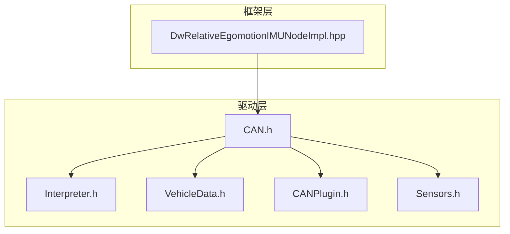
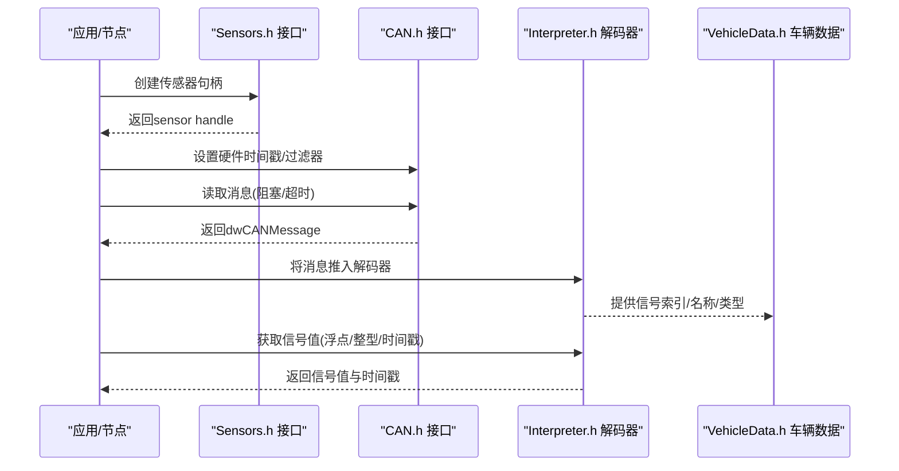
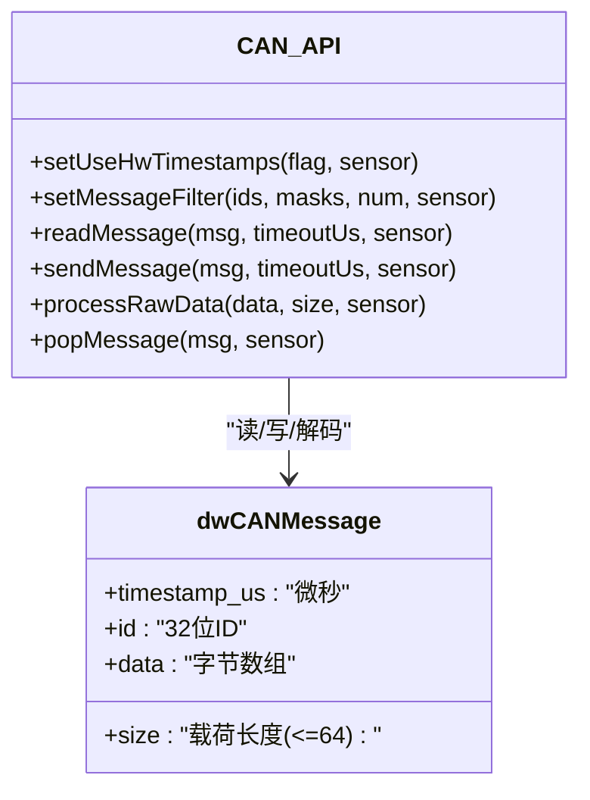
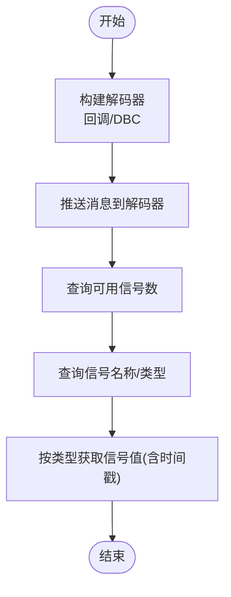
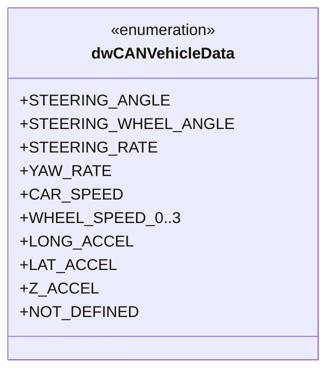
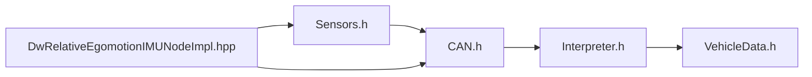

# CAN总线传感器

<cite>
**本文引用的文件**
- [CAN.h](file://driverorks-5.10/include/dw/sensors/canbus/CAN.h)
- [Interpreter.h](file://driverorks-5.10/include/dw/sensors/canbus/Interpreter.h)
- [VehicleData.h](file://driverorks-5.10/include/dw/sensors/canbus/VehicleData.h)
- [CANPlugin.h](file://driverorks-5.10/include/dw/sensors/plugins/canbus/CANPlugin.h)
- [Sensors.h](file://driverorks-5.10/include/dw/sensors/Sensors.h)
- [DwRelativeEgomotionIMUNodeImpl.hpp](file://driverorks-5.10/include/dwframework/dwnodes/egomotion/dwrelativeegomotionimunode/impl/dwRelativeEgomotionIMUNodeImpl.hpp)
</cite>

## 目录
1. [引言](#引言)
2. [项目结构](#项目结构)
3. [核心组件](#核心组件)
4. [架构总览](#架构总览)
5. [详细组件分析](#详细组件分析)
6. [依赖关系分析](#依赖关系分析)
7. [性能考虑](#性能考虑)
8. [故障排查指南](#故障排查指南)
9. [结论](#结论)
10. [附录：完整配置与使用示例](#附录完整配置与使用示例)

## 引言
本技术文档面向在NVIDIA DriveWorks框架下使用CAN总线传感器的开发者，系统性阐述CAN抽象层接口、消息结构、过滤与读写流程、DBC解码器以及典型应用（如车辆状态解码）。文档重点覆盖以下方面：
- CAN抽象类接口规范与返回值语义
- CAN消息结构与数据读取方法（含标准/扩展帧、数据长度编码、错误帧处理）
- 过滤器配置与消息映射
- CAN协议规范、波特率配置与网络拓扑支持
- 完整配置示例与代码片段路径指引
- 实际用法：初始化、参数配置、读取消息、处理总线状态

## 项目结构
与CAN总线传感器相关的核心头文件位于驱动层与框架层：
- 驱动层（传感器抽象）：CAN.h、Interpreter.h、VehicleData.h、CANPlugin.h
- 框架层（节点集成）：DwRelativeEgomotionIMUNodeImpl.hpp（示例节点中使用CAN传感器）

**图表来源**
- [CAN.h](file://driverorks-5.10/include/dw/sensors/canbus/CAN.h)
- [Interpreter.h](file://driverorks-5.10/include/dw/sensors/canbus/Interpreter.h)
- [VehicleData.h](file://driverorks-5.10/include/dw/sensors/canbus/VehicleData.h)
- [CANPlugin.h](file://driverorks-5.10/include/dw/sensors/plugins/canbus/CANPlugin.h)
- [Sensors.h](file://driverorks-5.10/include/dw/sensors/Sensors.h)
- [DwRelativeEgomotionIMUNodeImpl.hpp](file://driverorks-5.10/include/dwframework/dwnodes/egomotion/dwrelativeegomotionimunode/impl/dwRelativeEgomotionIMUNodeImpl.hpp)

**章节来源**
- [CAN.h](file://driverorks-5.10/include/dw/sensors/canbus/CAN.h)
- [Interpreter.h](file://driverorks-5.10/include/dw/sensors/canbus/Interpreter.h)
- [VehicleData.h](file://driverorks-5.10/include/dw/sensors/canbus/VehicleData.h)
- [CANPlugin.h](file://driverorks-5.10/include/dw/sensors/plugins/canbus/CANPlugin.h)
- [Sensors.h](file://driverorks-5.10/include/dw/sensors/Sensors.h)
- [DwRelativeEgomotionIMUNodeImpl.hpp](file://driverorks-5.10/include/dwframework/dwnodes/egomotion/dwrelativeegomotionimunode/impl/dwRelativeEgomotionIMUNodeImpl.hpp)

## 核心组件
- CAN抽象接口：提供硬件时间戳控制、消息过滤、读写、原始数据处理等能力
- 解码器接口：支持基于DBC或回调的信号解码与编码
- 车辆数据枚举：预定义常用CAN信号类型（如车速、转向角、加速度等）
- 插件接口：CAN传感器插件抽象，便于不同底层驱动接入

**章节来源**
- [CAN.h](file://driverorks-5.10/include/dw/sensors/canbus/CAN.h)
- [Interpreter.h](file://driverorks-5.10/include/dw/sensors/canbus/Interpreter.h)
- [VehicleData.h](file://driverorks-5.10/include/dw/sensors/canbus/VehicleData.h)
- [CANPlugin.h](file://driverorks-5.10/include/dw/sensors/plugins/canbus/CANPlugin.h)

## 架构总览
CAN总线传感器在DriveWorks中的典型调用链如下：

**图表来源**
- [Sensors.h](file://driverorks-5.10/include/dw/sensors/Sensors.h)
- [CAN.h](file://driverorks-5.10/include/dw/sensors/canbus/CAN.h)
- [Interpreter.h](file://driverorks-5.10/include/dw/sensors/canbus/Interpreter.h)
- [VehicleData.h](file://driverorks-5.10/include/dw/sensors/canbus/VehicleData.h)

## 详细组件分析

### 组件A：CAN抽象接口与消息结构
- dwCANMessage结构体字段
  - 时间戳：微秒级（上下文时钟）
  - ID：32位，支持ISO 11898-1标准与扩展帧
  - size：有效载荷字节数（最大64字节）
  - data：最多64字节的有效载荷
- 关键API
  - 硬件时间戳控制：启用/禁用HW时间戳
  - 消息过滤：按ID与掩码过滤，支持多条目
  - 读取消息：带超时的阻塞读取
  - 发送消息：带超时的可靠发送
  - 原始数据处理：RAW流解码并出队消息

**图表来源**
- [CAN.h](file://driverorks-5.10/include/dw/sensors/canbus/CAN.h)

**章节来源**
- [CAN.h](file://driverorks-5.10/include/dw/sensors/canbus/CAN.h)

### 组件B：CAN消息解码器与DBC支持
- 回调式解码器：通过回调函数提供信号信息与取值
- DBC式解码器：从DBC文件构建，支持信号名称查询、范围、类型等
- 编码能力：基于DBC的信号编码（仅DBC构建的解码器支持）
- 消费流程：推送消息到解码器，获取可用信号数量、名称、类型、取值

**图表来源**
- [Interpreter.h](file://driverorks-5.10/include/dw/sensors/canbus/Interpreter.h)

**章节来源**
- [Interpreter.h](file://driverorks-5.10/include/dw/sensors/canbus/Interpreter.h)

### 组件C：车辆数据枚举与信号映射
- 预定义信号类型：转向角、车速、轮速、加速度、横摆角速度等
- 用途：SDK模块可通过统一枚举查询对应信号，便于跨DBC实现解耦

**图表来源**
- [VehicleData.h](file://driverorks-5.10/include/dw/sensors/canbus/VehicleData.h)

**章节来源**
- [VehicleData.h](file://driverorks-5.10/include/dw/sensors/canbus/VehicleData.h)

### 组件D：CAN插件接口与传感器管理
- 插件接口：定义CAN传感器插件的抽象，便于不同底层驱动接入
- 传感器管理：与Sensors.h配合，完成传感器生命周期管理

**章节来源**
- [CANPlugin.h](file://driverorks-5.10/include/dw/sensors/plugins/canbus/CANPlugin.h)
- [Sensors.h](file://driverorks-5.10/include/dw/sensors/Sensors.h)

### 组件E：在框架节点中的使用示例
- 在相对里程IMU节点中，通过Sensors.h创建CAN传感器，并将其输出端口与车辆状态端口对接
- 展示了从传感器读取消息到解码器消费的典型链路

**章节来源**
- [DwRelativeEgomotionIMUNodeImpl.hpp](file://driverorks-5.10/include/dwframework/dwnodes/egomotion/dwrelativeegomotionimunode/impl/dwRelativeEgomotionIMUNodeImpl.hpp)

## 依赖关系分析
- CAN.h依赖Sensors.h进行句柄管理与上下文操作
- Interpreter.h依赖CAN.h的消息结构与VehicleData.h的信号枚举
- 节点实现通过Sensors.h与CAN.h协作，完成数据采集与解码

**图表来源**
- [Sensors.h](file://driverorks-5.10/include/dw/sensors/Sensors.h)
- [CAN.h](file://driverorks-5.10/include/dw/sensors/canbus/CAN.h)
- [Interpreter.h](file://driverorks-5.10/include/dw/sensors/canbus/Interpreter.h)
- [VehicleData.h](file://driverorks-5.10/include/dw/sensors/canbus/VehicleData.h)
- [DwRelativeEgomotionIMUNodeImpl.hpp](file://driverorks-5.10/include/dwframework/dwnodes/egomotion/dwrelativeegomotionimunode/impl/dwRelativeEgomotionIMUNodeImpl.hpp)

**章节来源**
- [Sensors.h](file://driverorks-5.10/include/dw/sensors/Sensors.h)
- [CAN.h](file://driverorks-5.10/include/dw/sensors/canbus/CAN.h)
- [Interpreter.h](file://driverorks-5.10/include/dw/sensors/canbus/Interpreter.h)
- [VehicleData.h](file://driverorks-5.10/include/dw/sensors/canbus/VehicleData.h)
- [DwRelativeEgomotionIMUNodeImpl.hpp](file://driverorks-5.10/include/dwframework/dwnodes/egomotion/dwrelativeegomotionimunode/impl/dwRelativeEgomotionIMUNodeImpl.hpp)

## 性能考虑
- 超时策略：合理设置读取与发送超时，避免长时间阻塞
- 硬件时间戳：优先启用硬件时间戳以降低系统开销；若底层不支持则回退软件时间戳
- 过滤器优化：尽量缩小过滤器集合，减少无效消息处理
- 原始数据处理：在CPU线程中弹出已解码消息会增加线程负载，建议在专用线程中处理

## 故障排查指南
- 读取超时：检查总线是否启动、过滤器是否正确、设备权限
- 发送失败：确认传感器已启动、总线未被阻塞、发送超时足够
- 解码异常：确认DBC文件有效、消息ID与DBC一致、信号名称匹配
- 硬件时间戳不可用：底层驱动不支持时需禁用HW时间戳

## 结论
本文档梳理了DriveWorks中CAN总线传感器的接口与实现要点，涵盖消息结构、读写与过滤、解码器与DBC支持、车辆数据枚举以及在框架节点中的使用方式。结合本文提供的配置示例与流程图，开发者可快速完成CAN传感器的初始化、配置与数据处理。

## 附录：完整配置与使用示例
以下示例以“代码片段路径”形式给出，便于在工程中定位具体实现位置与参数含义。

- 初始化与创建传感器
  - 参考路径：[Sensors.h](file://driverorks-5.10/include/dw/sensors/Sensors.h)
  - 步骤要点：创建上下文、创建传感器句柄、配置传感器参数

- 启用硬件时间戳
  - 参考路径：[CAN.h](file://driverorks-5.10/include/dw/sensors/canbus/CAN.h)
  - API：dwSensorCAN_setUseHwTimestamps(flag, sensor)

- 配置消息过滤器
  - 参考路径：[CAN.h](file://driverorks-5.10/include/dw/sensors/canbus/CAN.h)
  - API：dwSensorCAN_setMessageFilter(ids, masks, num, sensor)
  - 注意：掩码默认值与多条目过滤规则

- 读取CAN消息
  - 参考路径：[CAN.h](file://driverorks-5.10/include/dw/sensors/canbus/CAN.h)
  - API：dwSensorCAN_readMessage(msg, timeoutUs, sensor)
  - 返回值：超时、未可用、成功、错误等

- 发送CAN消息
  - 参考路径：[CAN.h](file://driverorks-5.10/include/dw/sensors/canbus/CAN.h)
  - API：dwSensorCAN_sendMessage(msg, timeoutUs, sensor)

- 处理原始数据流
  - 参考路径：[CAN.h](file://driverorks-5.10/include/dw/sensors/canbus/CAN.h)
  - API：dwSensorCAN_processRawData(data, size, sensor)、dwSensorCAN_popMessage(msg, sensor)

- 使用DBC解码器
  - 参考路径：[Interpreter.h](file://driverorks-5.10/include/dw/sensors/canbus/Interpreter.h)
  - 构建：dwCANInterpreter_buildFromDBC(...) 或 dwCANInterpreter_buildFromDBCString(...)
  - 消费：dwCANInterpreter_consume(msg, interpreter)
  - 查询：dwCANInterpreter_getNumberSignals(...)、dwCANInterpreter_getSignalName(...)、dwCANInterpreter_getSignalType(...)
  - 取值：dwCANInterpreter_getf32/getf64/geti32(...)

- 车辆数据信号映射
  - 参考路径：[VehicleData.h](file://driverorks-5.10/include/dw/sensors/canbus/VehicleData.h)
  - 用途：通过统一枚举查询对应信号索引与取值

- 在节点中的集成
  - 参考路径：[DwRelativeEgomotionIMUNodeImpl.hpp](file://driverorks-5.10/include/dwframework/dwnodes/egomotion/dwrelativeegomotionimunode/impl/dwRelativeEgomotionIMUNodeImpl.hpp)
  - 步骤：创建CAN传感器，连接端口，消费解码后的信号

- CAN协议与波特率
  - 协议：ISO 11898-1（标准与扩展帧）
  - 波特率：由底层驱动与物理总线决定，测试环境可参考Linux虚拟can工具
  - 拓扑：总线型拓扑，终端电阻与布线阻抗需满足规范