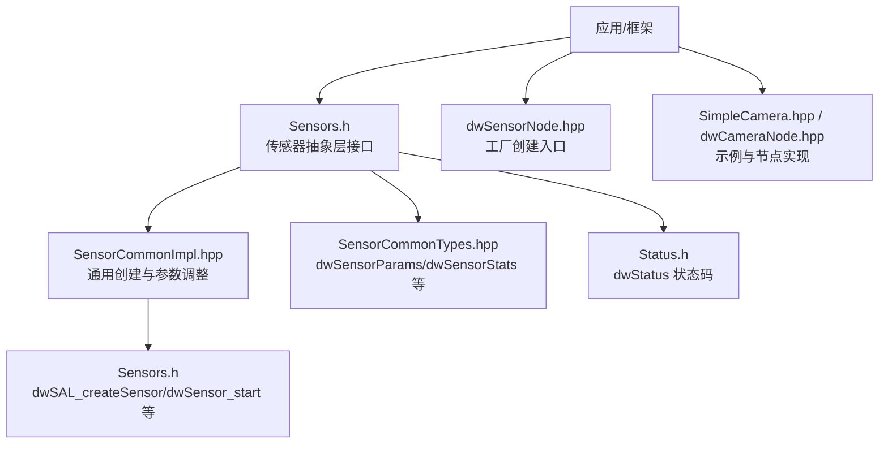
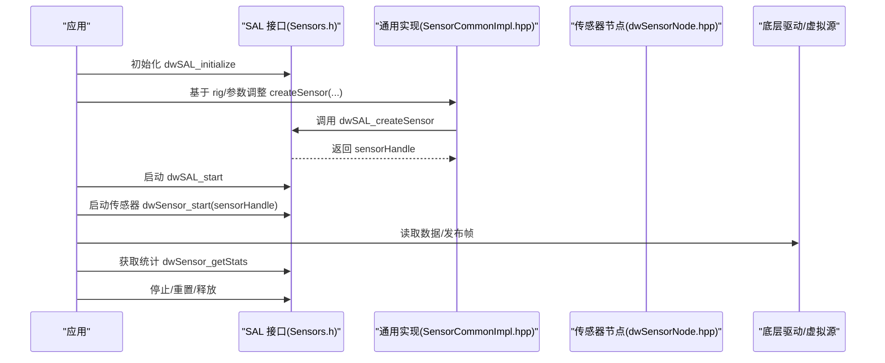
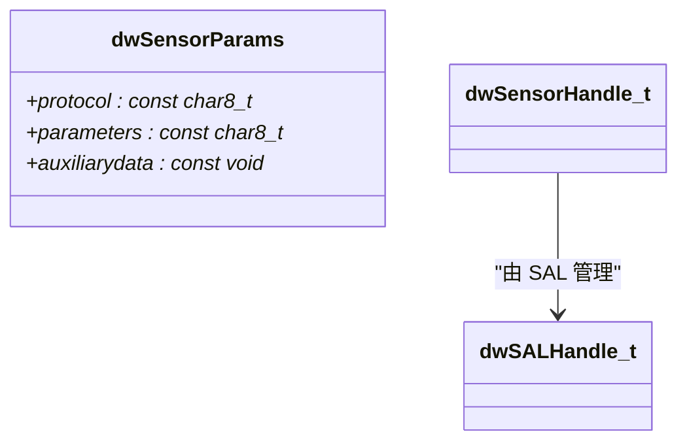
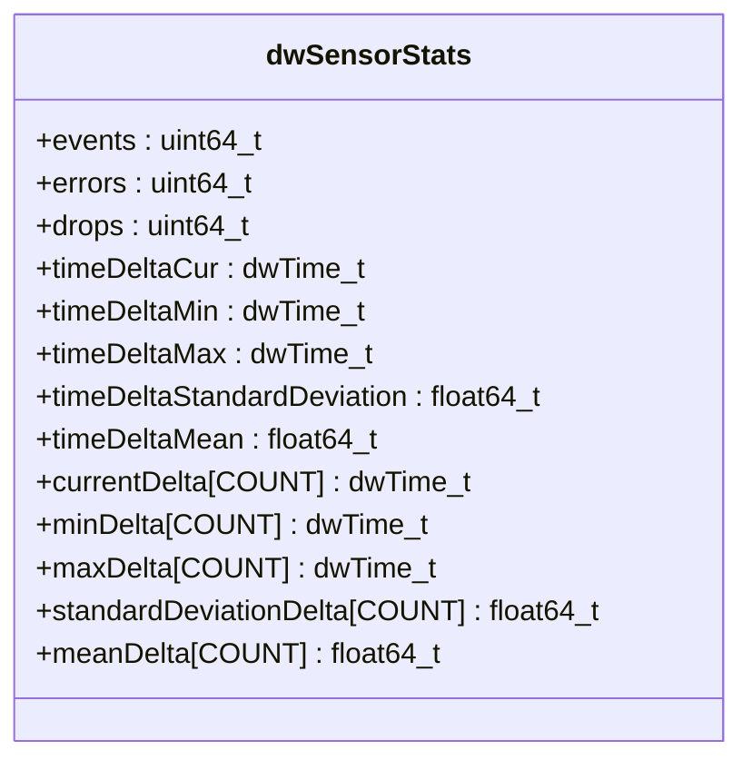
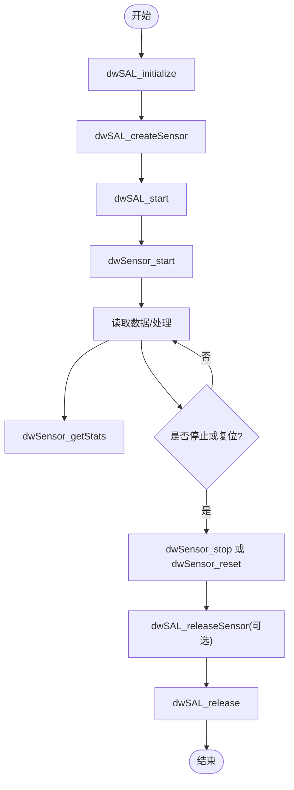
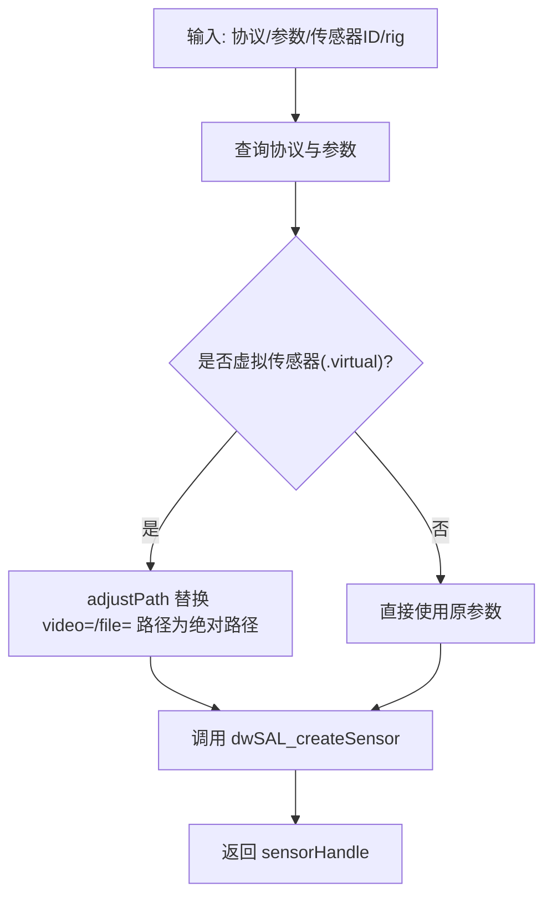
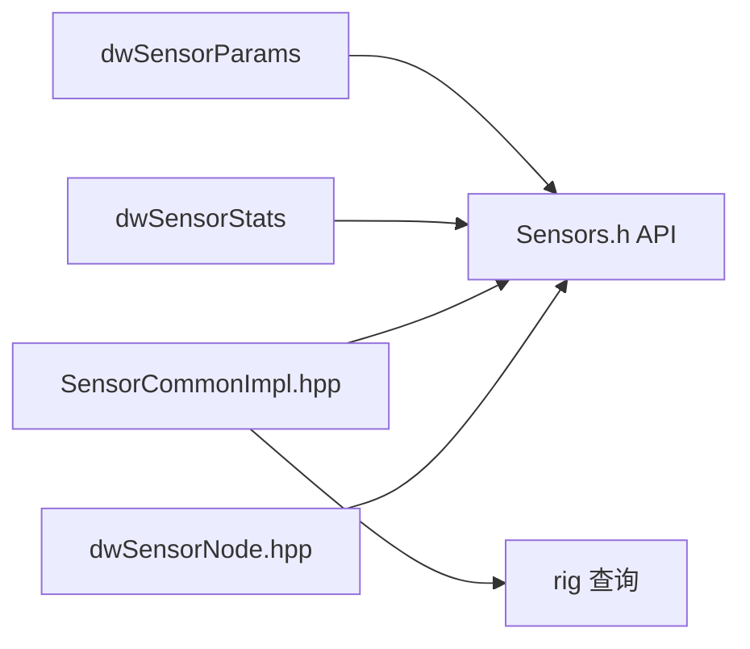

# 传感器基类接口

<cite>
**本文引用的文件**   
- [Sensors.h](file://driverorks-5.10/include/dw/sensors/Sensors.h)
- [SensorCommonTypes.hpp](file://driverorks-5.10/include/dwframework/dwnodes/common/SensorCommonTypes.hpp)
- [SensorCommonImpl.hpp](file://driverorks-5.10/include/dwframework/dwnodes/common/SensorCommonImpl.hpp)
- [dwSensorNode.hpp](file://driverorks-5.10/include/dwframework/dwnodes/sensors/common/dwSensorNode.hpp)
- [Status.h](file://driverorks-5.10/include/dw/core/base/Status.h)
- [SimpleCamera.hpp](file://driverorks-5.10/samples/src/framework/SimpleCamera.hpp)
- [dwCameraNode.hpp](file://driveworks-5.14/include/dwframework/dwnodes/sensors/dwcameranode/dwCameraNode.hpp)
</cite>

## 目录
1. [简介](#简介)
2. [项目结构](#项目结构)
3. [核心组件](#核心组件)
4. [架构总览](#架构总览)
5. [详细组件分析](#详细组件分析)
6. [依赖关系分析](#依赖关系分析)
7. [性能考虑](#性能考虑)
8. [故障排查指南](#故障排查指南)
9. [结论](#结论)
10. [附录：常见用法与示例路径](#附录常见用法与示例路径)

## 简介
本文件系统性阐述 DriveWorks 传感器抽象层（SAL）的基类接口设计与使用规范，覆盖以下主题：
- 传感器句柄类型与协议参数结构体的字段语义
- 传感器统计信息结构体的指标含义
- 生命周期管理 API 的调用流程与返回状态
- 协议名与参数字符串的格式规范及辅助数据传递机制
- 错误处理与状态码说明（含 DW_INVALID_HANDLE、DW_SUCCESS、DW_NOT_SUPPORTED 等）
- 实际使用示例的代码片段路径指引

## 项目结构
围绕传感器基类接口的关键文件组织如下：
- 接口定义与生命周期 API：Sensors.h
- 传感器通用类型与数据结构：SensorCommonTypes.hpp
- 传感器创建与参数调整的通用实现：SensorCommonImpl.hpp
- 传感器节点工厂与创建入口：dwSensorNode.hpp
- 核心状态码定义：Status.h
- 示例与用法参考：SimpleCamera.hpp、dwCameraNode.hpp

**图示来源**
- [Sensors.h:294-518](file://driverorks-5.10/include/dw/sensors/Sensors.h#L294-L518)
- [SensorCommonImpl.hpp:121-146](file://driverorks-5.10/include/dwframework/dwnodes/common/SensorCommonImpl.hpp#L121-L146)
- [SensorCommonTypes.hpp:94-186](file://driverorks-5.10/include/dwframework/dwnodes/common/SensorCommonTypes.hpp#L94-L186)
- [Status.h:119-121](file://driverorks-5.10/include/dw/core/base/Status.h#L119-L121)
- [dwSensorNode.hpp:47-58](file://driverorks-5.10/include/dwframework/dwnodes/sensors/common/dwSensorNode.hpp#L47-L58)
- [SimpleCamera.hpp:80-162](file://driverorks-5.10/samples/src/framework/SimpleCamera.hpp#L80-L162)
- [dwCameraNode.hpp:160-176](file://driveworks-5.14/include/dwframework/dwnodes/sensors/dwcameranode/dwCameraNode.hpp#L160-L176)

**章节来源**
- [Sensors.h:31-785](file://driverorks-5.10/include/dw/sensors/Sensors.h#L31-L785)
- [SensorCommonTypes.hpp:47-123](file://driverorks-5.10/include/dwframework/dwnodes/common/SensorCommonTypes.hpp#L47-L123)
- [SensorCommonImpl.hpp:44-152](file://driverorks-5.10/include/dwframework/dwnodes/common/SensorCommonImpl.hpp#L44-L152)
- [dwSensorNode.hpp:47-62](file://driverorks-5.10/include/dwframework/dwnodes/sensors/common/dwSensorNode.hpp#L47-L62)
- [Status.h:57-111](file://driverorks-5.10/include/dw/core/base/Status.h#L57-L111)
- [SimpleCamera.hpp:57-162](file://driverorks-5.10/samples/src/framework/SimpleCamera.hpp#L57-L162)
- [dwCameraNode.hpp:53-176](file://driveworks-5.14/include/dwframework/dwnodes/sensors/dwcameranode/dwCameraNode.hpp#L53-L176)

## 核心组件
- 句柄类型
  - dwSALHandle_t：传感器抽象层句柄
  - dwSensorHandle_t：具体传感器句柄
- 参数结构体 dwSensorParams
  - protocol：协议名称（长度上限见常量）
  - parameters：键值对参数串，逗号分隔
  - auxiliarydata：可选的二进制辅助数据指针
- 统计结构体 dwSensorStats
  - 事件计数：events、errors、drops
  - 时间差统计：currentDelta/minDelta/maxDelta/meanDelta/stddevDelta（按时间差类型分组）

**章节来源**
- [Sensors.h:82-116](file://driverorks-5.10/include/dw/sensors/Sensors.h#L82-L116)
- [Sensors.h:136-186](file://driverorks-5.10/include/dw/sensors/Sensors.h#L136-L186)
- [SensorCommonTypes.hpp:73-92](file://driverorks-5.10/include/dwframework/dwnodes/common/SensorCommonTypes.hpp#L73-L92)

## 架构总览
下图展示了从应用到传感器驱动的典型调用链路与职责边界。

**图示来源**
- [Sensors.h:294-518](file://driverorks-5.10/include/dw/sensors/Sensors.h#L294-L518)
- [SensorCommonImpl.hpp:121-146](file://driverorks-5.10/include/dwframework/dwnodes/common/SensorCommonImpl.hpp#L121-L146)
- [dwSensorNode.hpp:47-58](file://driverorks-5.10/include/dwframework/dwnodes/sensors/common/dwSensorNode.hpp#L47-L58)

## 详细组件分析

### 1) 传感器句柄与参数结构体
- 句柄类型
  - dwSALHandle_t：用于管理一组传感器的抽象层句柄
  - dwSensorHandle_t：单个传感器的句柄
- 参数结构体 dwSensorParams 字段
  - protocol：协议名，如 camera.gmsl、camera.virtual、can.file 等
  - parameters：逗号分隔的 key=value 对，例如 key1=val1,key2=val2
  - auxiliarydata：可选的二进制辅助数据指针，一般为 NULL

**图示来源**
- [Sensors.h:82-116](file://driverorks-5.10/include/dw/sensors/Sensors.h#L82-L116)

**章节来源**
- [Sensors.h:82-116](file://driverorks-5.10/include/dw/sensors/Sensors.h#L82-L116)

### 2) 传感器统计信息结构体
- 指标说明
  - events：正常事件总数
  - errors：错误事件数
  - drops：丢弃事件数
  - currentDelta/minDelta/maxDelta/meanDelta/stddevDelta：按时间差类型分组的时间统计数组
- 时间差类型枚举（节选）
  - DW_SENSOR_STATE_DELTA_HOST_AND_HOST_TIME
  - DW_SENSOR_STATE_DELTA_SENSOR_AND_SENSOR_TIME
  - DW_SENSOR_STATE_DELTA_HOST_AND_SENSOR_TIME
  - DW_SENSOR_STATE_DELTA_CURRENT_AND_HOST_TIME

**图示来源**
- [Sensors.h:136-186](file://driverorks-5.10/include/dw/sensors/Sensors.h#L136-L186)

**章节来源**
- [Sensors.h:118-186](file://driverorks-5.10/include/dw/sensors/Sensors.h#L118-L186)

### 3) 生命周期管理 API
- 初始化与释放
  - dwSAL_initialize：创建并初始化 SAL
  - dwSAL_release：释放 SAL，关闭所有传感器并卸载驱动
  - dwSAL_reset：重置 SAL 管理的所有传感器
- 传感器创建与释放
  - dwSAL_createSensor：根据 dwSensorParams 创建传感器
  - dwSAL_releaseSensor：释放单个传感器
- 启停与复位
  - dwSAL_start：启动 SAL 管理的所有传感器（隐式引导）
  - dwSensor_start：启动指定传感器
  - dwSensor_stop：停止传感器
  - dwSensor_reset：复位传感器
- 其他能力
  - dwSensor_getStats：获取统计信息
  - dwSensor_readRawData/dwSensor_returnRawData：读取/归还原始数据
  - dwSensor_seekToTime/dwSensor_seekToEvent：时间/事件级定位
  - dwSensor_setThreadPriority/dwSensor_setThreadAffinity：线程优先级与亲和性设置

**图示来源**
- [Sensors.h:294-518](file://driverorks-5.10/include/dw/sensors/Sensors.h#L294-L518)

**章节来源**
- [Sensors.h:294-518](file://driverorks-5.10/include/dw/sensors/Sensors.h#L294-L518)

### 4) 协议名与参数字符串格式规范
- 协议名
  - 长度限制：DW_SENSOR_MAX_PROTOCOL_NAME_LENGTH（常量定义）
  - 示例：camera.gmsl、camera.virtual、can.file、lidar.virtual 等
- 参数字符串
  - 形式：key1=value1,key2=value2,key3=value3
  - 长度限制：DW_SENSOR_MAX_PARAMETER_STRING_LENGTH（常量定义）
  - 辅助数据：通过 auxiliarydata 传入，一般为 NULL

**章节来源**
- [Sensors.h:88-116](file://driverorks-5.10/include/dw/sensors/Sensors.h#L88-L116)

### 5) 辅助数据传递机制
- auxiliarydata：在 dwSensorParams 中提供二进制辅助数据指针
- 使用场景：某些传感器需要在创建时传入非字符串形式的数据（如路径、配置块等）
- 一般情况下为 NULL，仅特定传感器实现可能使用

**章节来源**
- [Sensors.h:108-114](file://driverorks-5.10/include/dw/sensors/Sensors.h#L108-L114)

### 6) 错误处理与状态码
- 常见状态码
  - DW_INVALID_HANDLE：句柄无效
  - DW_SUCCESS：成功
  - DW_NOT_SUPPORTED：功能不支持
  - DW_NOT_INITIALIZED：对象需先初始化
  - DW_SAL_NO_DRIVER_FOUND：找不到对应驱动
  - DW_SAL_SENSOR_ERROR：传感器内部不可恢复错误
  - DW_END_OF_STREAM：流结束
  - DW_TIME_OUT：超时
- SAL 与传感器 API 的错误传播
  - 多数 API 在失败时返回上述状态码，调用方应检查并按需处理

**章节来源**
- [Status.h:57-111](file://driverorks-5.10/include/dw/core/base/Status.h#L57-L111)
- [Sensors.h:294-518](file://driverorks-5.10/include/dw/sensors/Sensors.h#L294-L518)

### 7) 传感器创建与参数调整（通用实现）
- SensorCommonImpl::createSensor
  - 从 rig 获取协议与参数
  - 对虚拟传感器进行路径修正（绝对化）
  - 调用 dwSAL_createSensor 完成创建
- SensorCommonImpl::adjustPath
  - 将相对路径替换为绝对路径
  - 支持 video= 与 file= 参数的路径拼接
  - 对 timestamp= 参数进行同前缀补齐

**图示来源**
- [SensorCommonImpl.hpp:121-146](file://driverorks-5.10/include/dwframework/dwnodes/common/SensorCommonImpl.hpp#L121-L146)
- [SensorCommonImpl.hpp:50-119](file://driverorks-5.10/include/dwframework/dwnodes/common/SensorCommonImpl.hpp#L50-L119)

**章节来源**
- [SensorCommonImpl.hpp:44-152](file://driverorks-5.10/include/dwframework/dwnodes/common/SensorCommonImpl.hpp#L44-L152)

### 8) 传感器节点工厂与创建入口
- dwSensorNode::create
  - 支持两种创建方式：直接传入 dwSensorParams；或通过传感器名称与 rig 句柄间接构造
- 与上下文、SAL 句柄配合，形成统一的节点创建入口

**章节来源**
- [dwSensorNode.hpp:47-58](file://driverorks-5.10/include/dwframework/dwnodes/sensors/common/dwSensorNode.hpp#L47-L58)

### 9) 示例：相机传感器的典型用法
- SimpleCamera 类展示了：
  - 通过 dwSensorParams 与 SAL/Context 创建相机传感器
  - 启动传感器后读取图像帧
  - 可选的 GL 输出与帧管线处理
- dwCameraNode 展示了节点化的参数描述与构造方式

**章节来源**
- [SimpleCamera.hpp:57-162](file://driverorks-5.10/samples/src/framework/SimpleCamera.hpp#L57-L162)
- [dwCameraNode.hpp:160-176](file://driveworks-5.14/include/dwframework/dwnodes/sensors/dwcameranode/dwCameraNode.hpp#L160-L176)

## 依赖关系分析
- dwSensorParams 与 dwSensorStats 作为跨模块共享的数据载体
- SensorCommonImpl 依赖 rig 查询与 SAL 创建接口
- dwSensorNode 提供统一的工厂入口，连接上层节点系统与底层 SAL

**图示来源**
- [Sensors.h:94-186](file://driverorks-5.10/include/dw/sensors/Sensors.h#L94-L186)
- [SensorCommonImpl.hpp:121-146](file://driverorks-5.10/include/dwframework/dwnodes/common/SensorCommonImpl.hpp#L121-L146)
- [dwSensorNode.hpp:47-58](file://driverorks-5.10/include/dwframework/dwnodes/sensors/common/dwSensorNode.hpp#L47-L58)

**章节来源**
- [Sensors.h:94-186](file://driverorks-5.10/include/dw/sensors/Sensors.h#L94-L186)
- [SensorCommonImpl.hpp:121-146](file://driverorks-5.10/include/dwframework/dwnodes/common/SensorCommonImpl.hpp#L121-L146)
- [dwSensorNode.hpp:47-58](file://driverorks-5.10/include/dwframework/dwnodes/sensors/common/dwSensorNode.hpp#L47-L58)

## 性能考虑
- 线程与优先级
  - 部分传感器会启用内部线程与驱动交互，可通过线程优先级与亲和性接口进行调节
- 统计指标
  - 利用 dwSensorStats 的时间差均值与标准差评估抖动与稳定性
- 超时控制
  - 读取数据时合理设置超时，避免阻塞影响主流程

[本节为通用指导，无需列出具体文件来源]

## 故障排查指南
- 常见问题与定位
  - DW_INVALID_HANDLE：确认句柄有效性与生命周期
  - DW_SAL_NO_DRIVER_FOUND：核对协议名是否正确且已加载
  - DW_SAL_SENSOR_ERROR：检查底层驱动状态与硬件连接
  - DW_NOT_SUPPORTED：确认目标传感器是否支持该功能
  - DW_NOT_INITIALIZED：确保已调用 dwSAL_start 或相应初始化流程
- 建议排查步骤
  - 检查协议名与参数字符串格式
  - 使用 dwSensor_getStats 观察事件/错误/丢包趋势
  - 在虚拟传感器场景下，确认路径修正逻辑是否生效

**章节来源**
- [Status.h:57-111](file://driverorks-5.10/include/dw/core/base/Status.h#L57-L111)
- [Sensors.h:294-518](file://driverorks-5.10/include/dw/sensors/Sensors.h#L294-L518)

## 结论
本文件梳理了 DriveWorks 传感器基类接口的设计理念与使用规范，明确了句柄类型、参数结构体、统计指标、生命周期 API、协议与参数格式、辅助数据传递机制以及错误处理策略。结合通用实现与节点工厂，开发者可以稳定地集成多种传感器类型，并通过统计信息与状态码进行运行时诊断与优化。

[本节为总结性内容，无需列出具体文件来源]

## 附录：常见用法与示例路径
- 初始化与创建
  - [Sensors.h:294-348](file://driverorks-5.10/include/dw/sensors/Sensors.h#L294-L348)
  - [SensorCommonImpl.hpp:121-146](file://driverorks-5.10/include/dwframework/dwnodes/common/SensorCommonImpl.hpp#L121-L146)
- 启停与复位
  - [Sensors.h:378-518](file://driverorks-5.10/include/dw/sensors/Sensors.h#L378-L518)
- 读取原始数据与定位
  - [Sensors.h:520-646](file://driverorks-5.10/include/dw/sensors/Sensors.h#L520-L646)
- 统计与状态码
  - [Sensors.h:765-777](file://driverorks-5.10/include/dw/sensors/Sensors.h#L765-L777)
  - [Status.h:119-121](file://driverorks-5.10/include/dw/core/base/Status.h#L119-L121)
- 示例参考
  - [SimpleCamera.hpp:80-162](file://driverorks-5.10/samples/src/framework/SimpleCamera.hpp#L80-L162)
  - [dwCameraNode.hpp:160-176](file://driveworks-5.14/include/dwframework/dwnodes/sensors/dwcameranode/dwCameraNode.hpp#L160-L176)