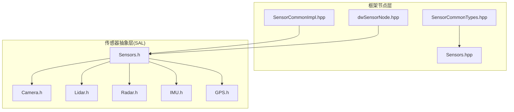
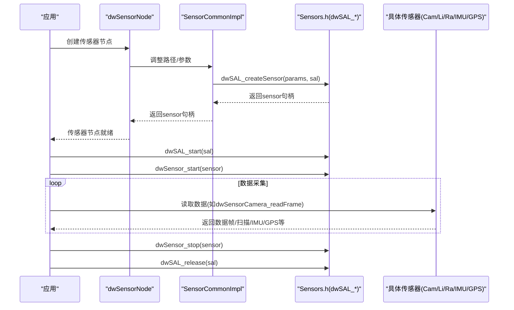
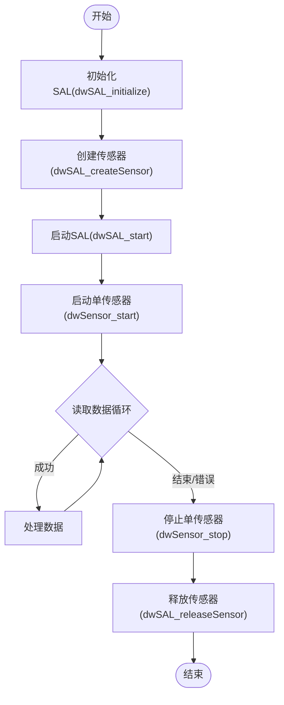
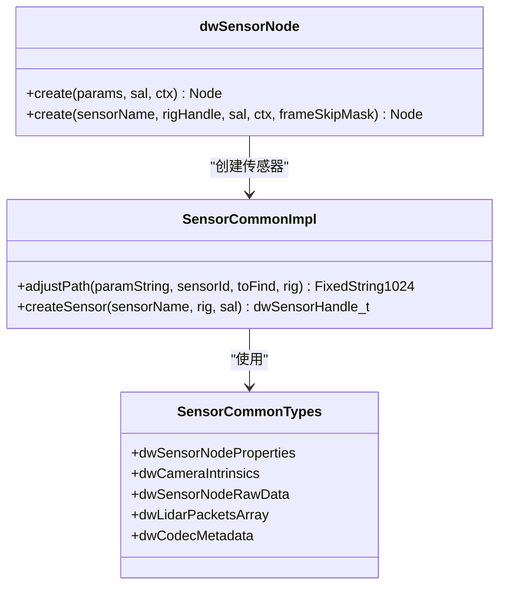
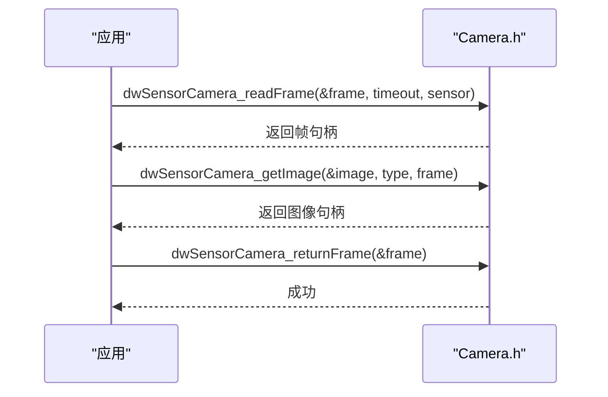
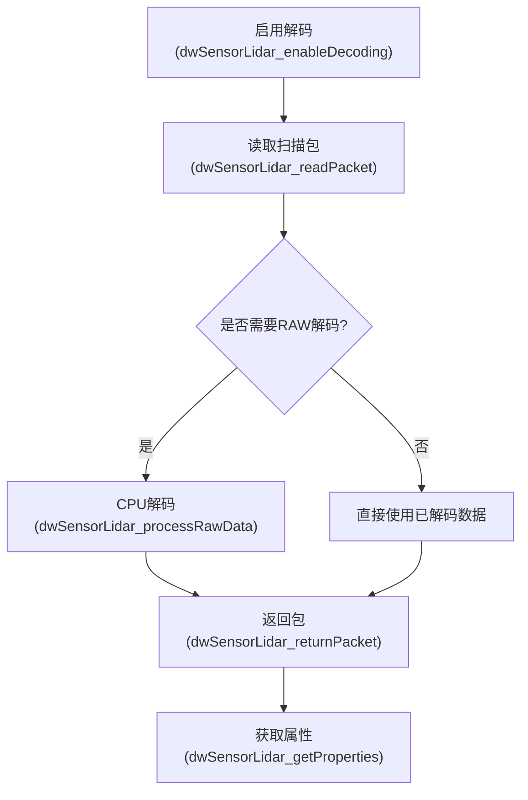
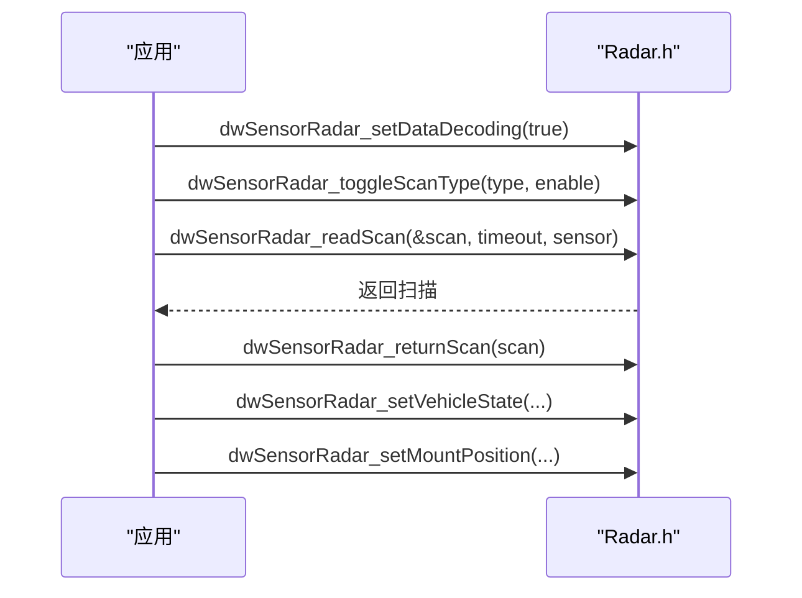
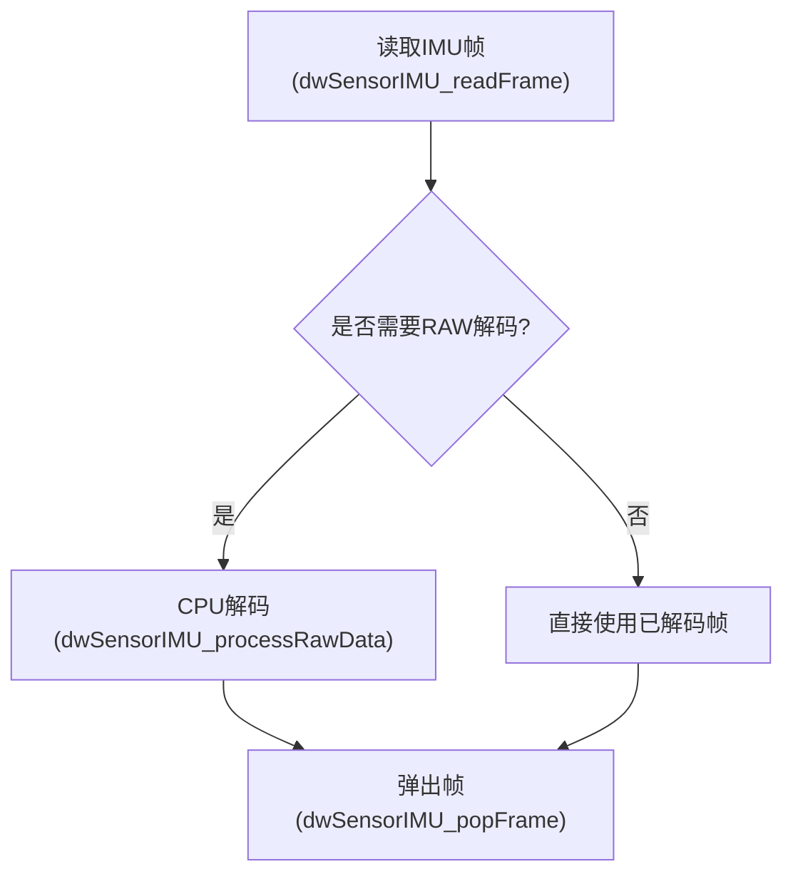
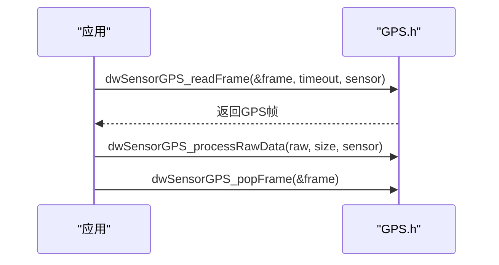
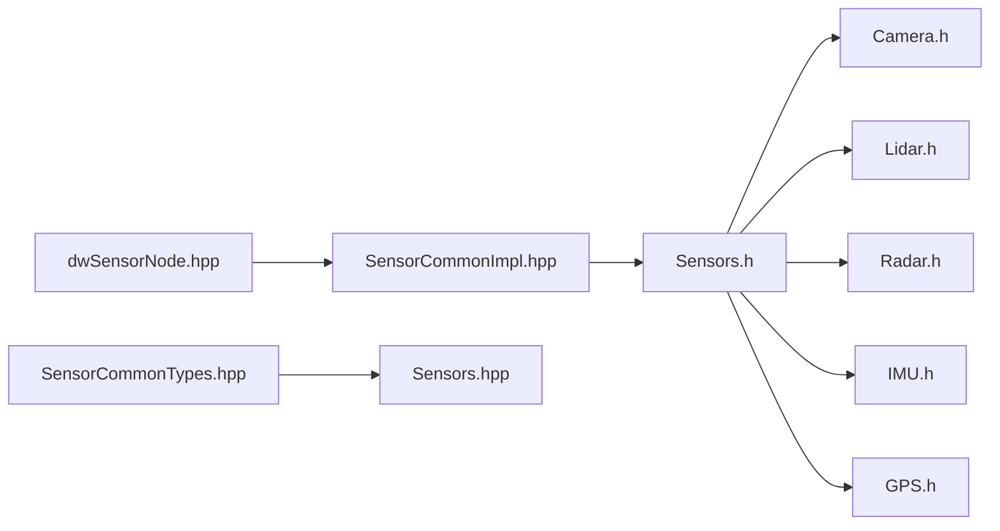

# 传感器接口

<cite>
**本文引用的文件**   
- [Sensors.hpp](file://driverorks-5.10/include/dwframework/dwnodes/common/channelpackets/Sensors.hpp)
- [SensorCommonTypes.hpp](file://driverorks-5.10/include/dwframework/dwnodes/common/channelpackets/SensorCommonTypes.hpp)
- [SensorCommonImpl.hpp](file://driverorks-5.10/include/dwframework/dwnodes/common/SensorCommonImpl.hpp)
- [dwSensorNode.hpp](file://driverorks-5.10/include/dwframework/dwnodes/sensors/common/dwSensorNode.hpp)
- [Sensors.h](file://driverorks-5.10/include/dw/sensors/Sensors.h)
- [Camera.h](file://driverorks-5.10/include/dw/sensors/camera/Camera.h)
- [Lidar.h](file://driverorks-5.10/include/dw/sensors/lidar/Lidar.h)
- [Radar.h](file://driverorks-5.10/include/dw/sensors/radar/Radar.h)
- [IMU.h](file://driverorks-5.10/include/dw/sensors/imu/IMU.h)
- [GPS.h](file://driverorks-5.10/include/dw/sensors/gps/GPS.h)
</cite>

## 目录
1. [简介](#简介)
2. [项目结构](#项目结构)
3. [核心组件](#核心组件)
4. [架构总览](#架构总览)
5. [详细组件分析](#详细组件分析)
6. [依赖关系分析](#依赖关系分析)
7. [性能考量](#性能考量)
8. [故障排查指南](#故障排查指南)
9. [结论](#结论)
10. [附录：API 参考与示例路径](#附录api-参考与示例路径)

## 简介
本技术文档围绕 NVIDIA DriveWorks 的传感器接口模块，系统化阐述传感器抽象层（SAL）与框架节点层的设计与实现，覆盖传感器生命周期管理、数据事件处理、通用接口规范，以及各类具体传感器（摄像头、激光雷达、雷达、IMU、GPS、CAN 总线、通用数据）的接口要点与使用方法。文档同时提供架构图、流程图与类图，帮助读者从整体到细节全面理解传感器接口体系。

## 项目结构
本仓库中与传感器接口相关的核心目录与文件如下：
- 框架节点公共类型与通道包定义：用于在 CGF（Compute Graph Framework）通道中传输传感器相关数据包
  - [Sensors.hpp](file://driverorks-5.10/include/dwframework/dwnodes/common/channelpackets/Sensors.hpp)
  - [SensorCommonTypes.hpp](file://driverorks-5.10/include/dwframework/dwnodes/common/channelpackets/SensorCommonTypes.hpp)
- 框架节点通用实现与工具
  - [SensorCommonImpl.hpp](file://driverorks-5.10/include/dwframework/dwnodes/common/SensorCommonImpl.hpp)
  - [dwSensorNode.hpp](file://driverorks-5.10/include/dwframework/dwnodes/sensors/common/dwSensorNode.hpp)
- 传感器抽象层（SAL）与各传感器子模块 API
  - [Sensors.h](file://driverorks-5.10/include/dw/sensors/Sensors.h)
  - 摄像头：[Camera.h](file://driverorks-5.10/include/dw/sensors/camera/Camera.h)
  - 激光雷达：[Lidar.h](file://driverorks-5.10/include/dw/sensors/lidar/Lidar.h)
  - 雷达：[Radar.h](file://driverorks-5.10/include/dw/sensors/radar/Radar.h)
  - IMU：[IMU.h](file://driverorks-5.10/include/dw/sensors/imu/IMU.h)
  - GPS：[GPS.h](file://driverorks-5.10/include/dw/sensors/gps/GPS.h)

**图表来源**
- [SensorCommonImpl.hpp:44-146](file://driverorks-5.10/include/dwframework/dwnodes/common/SensorCommonImpl.hpp#L44-L146)
- [SensorCommonTypes.hpp:31-48](file://driverorks-5.10/include/dwframework/dwnodes/common/channelpackets/SensorCommonTypes.hpp#L31-L48)
- [Sensors.hpp:31-39](file://driverorks-5.10/include/dwframework/dwnodes/common/channelpackets/Sensors.hpp#L31-L39)
- [dwSensorNode.hpp:47-58](file://driverorks-5.10/include/dwframework/dwnodes/sensors/common/dwSensorNode.hpp#L47-L58)
- [Sensors.h:82-330](file://driverorks-5.10/include/dw/sensors/Sensors.h#L82-L330)

**章节来源**
- [Sensors.hpp:31-39](file://driverorks-5.10/include/dwframework/dwnodes/common/channelpackets/Sensors.hpp#L31-L39)
- [SensorCommonTypes.hpp:31-48](file://driverorks-5.10/include/dwframework/dwnodes/common/channelpackets/SensorCommonTypes.hpp#L31-L48)
- [SensorCommonImpl.hpp:44-146](file://driverorks-5.10/include/dwframework/dwnodes/common/SensorCommonImpl.hpp#L44-L146)
- [dwSensorNode.hpp:47-58](file://driverorks-5.10/include/dwframework/dwnodes/sensors/common/dwSensorNode.hpp#L47-L58)
- [Sensors.h:82-330](file://driverorks-5.10/include/dw/sensors/Sensors.h#L82-L330)

## 核心组件
- 传感器抽象层（SAL）
  - 提供统一的传感器生命周期管理与通用能力：初始化、重置、释放、启动、停止、复位、RAW 数据读取与归还、寻址与回放、统计查询等。
  - 关键接口参见：[Sensors.h:293-365](file://driverorks-5.10/include/dw/sensors/Sensors.h#L293-L365)、[Sensors.h:472-518](file://driverorks-5.10/include/dw/sensors/Sensors.h#L472-L518)、[Sensors.h:520-560](file://driverorks-5.10/include/dw/sensors/Sensors.h#L520-L560)、[Sensors.h:562-694](file://driverorks-5.10/include/dw/sensors/Sensors.h#L562-L694)、[Sensors.h:696-777](file://driverorks-5.10/include/dw/sensors/Sensors.h#L696-L777)
- 框架节点层
  - SensorCommonImpl：提供路径修正与虚拟传感器参数调整、创建传感器句柄等通用实现。
  - SensorCommonTypes：定义框架侧通用数据结构（如原始数据、延迟、相机内参、点云数组等）。
  - Sensors 通道包：将框架侧数据结构映射为可跨通道传输的数据包类型。
  - dwSensorNode：提供静态工厂方法创建传感器节点（支持按名称或参数创建）。
- 各传感器子模块
  - 摄像头：帧读取、图像导出、CUDA 流设置、ISP/NvMedia 管理等。
  - 激光雷达：解码开关、扫描包读取、属性查询、消息发送等。
  - 雷达：扫描类型切换、解码开关、数据读取与返回、属性查询、车辆状态与安装位置设置等。
  - IMU：姿态、角速度、加速度、磁力计、温度、对齐状态等信号读取与质量状态。
  - GPS：经纬度、海拔、速度、航向、精度指标、UTC 时间、定位模式等。
  - CAN 总线：通用数据传感器接口（参见 Sensors.h 中的通用数据类型与通用方法）。

**章节来源**
- [Sensors.h:82-330](file://driverorks-5.10/include/dw/sensors/Sensors.h#L82-L330)
- [SensorCommonImpl.hpp:44-146](file://driverorks-5.10/include/dwframework/dwnodes/common/SensorCommonImpl.hpp#L44-L146)
- [SensorCommonTypes.hpp:31-48](file://driverorks-5.10/include/dwframework/dwnodes/common/channelpackets/SensorCommonTypes.hpp#L31-L48)
- [Sensors.hpp:31-39](file://driverorks-5.10/include/dwframework/dwnodes/common/channelpackets/Sensors.hpp#L31-L39)
- [dwSensorNode.hpp:47-58](file://driverorks-5.10/include/dwframework/dwnodes/sensors/common/dwSensorNode.hpp#L47-L58)

## 架构总览
下图展示了从应用到传感器抽象层（SAL），再到各传感器子模块的整体调用链路与数据流。

**图表来源**
- [dwSensorNode.hpp:47-58](file://driverorks-5.10/include/dwframework/dwnodes/sensors/common/dwSensorNode.hpp#L47-L58)
- [SensorCommonImpl.hpp:121-146](file://driverorks-5.10/include/dwframework/dwnodes/common/SensorCommonImpl.hpp#L121-L146)
- [Sensors.h:293-365](file://driverorks-5.10/include/dw/sensors/Sensors.h#L293-L365)
- [Sensors.h:367-392](file://driverorks-5.10/include/dw/sensors/Sensors.h#L367-L392)
- [Sensors.h:472-492](file://driverorks-5.10/include/dw/sensors/Sensors.h#L472-L492)

## 详细组件分析

### 传感器抽象层（SAL）与生命周期
- 初始化与释放
  - dwSAL_initialize：创建并初始化 SAL 模块
  - dwSAL_release：释放 SAL 模块及其管理的所有传感器驱动
  - 参考：[Sensors.h:293-330](file://driverorks-5.10/include/dw/sensors/Sensors.h#L293-L330)
- 传感器创建与销毁
  - dwSAL_createSensor：根据协议与参数创建传感器
  - dwSAL_releaseSensor：释放单个传感器
  - 参考：[Sensors.h:332-365](file://driverorks-5.10/include/dw/sensors/Sensors.h#L332-L365)
- 启动/停止/复位
  - dwSAL_start：启动所有传感器
  - dwSensor_start/dwSensor_stop/dwSensor_reset：控制单个传感器
  - 参考：[Sensors.h:367-392](file://driverorks-5.10/include/dw/sensors/Sensors.h#L367-L392)、[Sensors.h:472-518](file://driverorks-5.10/include/dw/sensors/Sensors.h#L472-L518)
- RAW 数据与回放
  - dwSensor_readRawData/dwSensor_returnRawData：读取/归还原始数据
  - 寻址与回放：seek 到时间/事件、创建/保存/获取寻址表
  - 参考：[Sensors.h:520-560](file://driverorks-5.10/include/dw/sensors/Sensors.h#L520-L560)、[Sensors.h:562-694](file://driverorks-5.10/include/dw/sensors/Sensors.h#L562-L694)、[Sensors.h:696-777](file://driverorks-5.10/include/dw/sensors/Sensors.h#L696-L777)

**图表来源**
- [Sensors.h:293-365](file://driverorks-5.10/include/dw/sensors/Sensors.h#L293-L365)
- [Sensors.h:367-392](file://driverorks-5.10/include/dw/sensors/Sensors.h#L367-L392)
- [Sensors.h:472-518](file://driverorks-5.10/include/dw/sensors/Sensors.h#L472-L518)
- [Sensors.h:520-560](file://driverorks-5.10/include/dw/sensors/Sensors.h#L520-L560)

**章节来源**
- [Sensors.h:293-365](file://driverorks-5.10/include/dw/sensors/Sensors.h#L293-L365)
- [Sensors.h:367-392](file://driverorks-5.10/include/dw/sensors/Sensors.h#L367-L392)
- [Sensors.h:472-518](file://driverorks-5.10/include/dw/sensors/Sensors.h#L472-L518)
- [Sensors.h:520-560](file://driverorks-5.10/include/dw/sensors/Sensors.h#L520-L560)
- [Sensors.h:562-694](file://driverorks-5.10/include/dw/sensors/Sensors.h#L562-L694)
- [Sensors.h:696-777](file://driverorks-5.10/include/dw/sensors/Sensors.h#L696-L777)

### 框架节点与通用实现
- SensorCommonImpl
  - 虚拟传感器路径修正与参数拼接
  - 通过 rig 获取传感器参数并创建传感器句柄
  - 参考：[SensorCommonImpl.hpp:44-146](file://driverorks-5.10/include/dwframework/dwnodes/common/SensorCommonImpl.hpp#L44-L146)
- SensorCommonTypes
  - 定义框架侧通用数据结构：原始数据、延迟、相机内参、点云数组、编码元数据等
  - 参考：[SensorCommonTypes.hpp:31-48](file://driverorks-5.10/include/dwframework/dwnodes/common/channelpackets/SensorCommonTypes.hpp#L31-L48)
- Sensors 通道包
  - 将通用数据结构映射为通道包类型，便于跨节点传输
  - 参考：[Sensors.hpp:31-39](file://driverorks-5.10/include/dwframework/dwnodes/common/channelpackets/Sensors.hpp#L31-L39)
- dwSensorNode
  - 提供静态工厂方法创建传感器节点（支持按名称或参数创建）
  - 参考：[dwSensorNode.hpp:47-58](file://driverorks-5.10/include/dwframework/dwnodes/sensors/common/dwSensorNode.hpp#L47-L58)

**图表来源**
- [SensorCommonImpl.hpp:44-146](file://driverorks-5.10/include/dwframework/dwnodes/common/SensorCommonImpl.hpp#L44-L146)
- [SensorCommonTypes.hpp:31-48](file://driverorks-5.10/include/dwframework/dwnodes/common/channelpackets/SensorCommonTypes.hpp#L31-L48)
- [Sensors.hpp:31-39](file://driverorks-5.10/include/dwframework/dwnodes/common/channelpackets/Sensors.hpp#L31-L39)
- [dwSensorNode.hpp:47-58](file://driverorks-5.10/include/dwframework/dwnodes/sensors/common/dwSensorNode.hpp#L47-L58)

**章节来源**
- [SensorCommonImpl.hpp:44-146](file://driverorks-5.10/include/dwframework/dwnodes/common/SensorCommonImpl.hpp#L44-L146)
- [SensorCommonTypes.hpp:31-48](file://driverorks-5.10/include/dwframework/dwnodes/common/channelpackets/SensorCommonTypes.hpp#L31-L48)
- [Sensors.hpp:31-39](file://driverorks-5.10/include/dwframework/dwnodes/common/channelpackets/Sensors.hpp#L31-L39)
- [dwSensorNode.hpp:47-58](file://driverorks-5.10/include/dwframework/dwnodes/sensors/common/dwSensorNode.hpp#L47-L58)

### 摄像头传感器（Camera）
- 帧读取与图像导出
  - dwSensorCamera_readFrame：阻塞式读取一帧
  - dwSensorCamera_getImage / dwSensorCamera_getImageAsync：导出指定格式图像
  - dwSensorCamera_returnFrame：归还帧
  - 参考：[Camera.h:515-567](file://driverorks-5.10/include/dw/sensors/camera/Camera.h#L515-L567)、[Camera.h:569-619](file://driverorks-5.10/include/dw/sensors/camera/Camera.h#L569-L619)
- CUDA 流与图像池
  - dwSensorCamera_setCUDAStream / dwSensorCamera_getCUDAStream
  - dwSensorCamera_setImagePool
  - 参考：[Camera.h:756-781](file://driverorks-5.10/include/dw/sensors/camera/Camera.h#L756-L781)、[Camera.h:621-636](file://driverorks-5.10/include/dw/sensors/camera/Camera.h#L621-L636)
- 传感器属性与输出类型
  - dwSensorCamera_getSensorProperties / dwSensorCamera_getImageProperties
  - 参考：[Camera.h:688-701](file://driverorks-5.10/include/dw/sensors/camera/Camera.h#L688-L701)、[Camera.h:735-754](file://driverorks-5.10/include/dw/sensors/camera/Camera.h#L735-L754)

**图表来源**
- [Camera.h:515-567](file://driverorks-5.10/include/dw/sensors/camera/Camera.h#L515-L567)
- [Camera.h:569-619](file://driverorks-5.10/include/dw/sensors/camera/Camera.h#L569-L619)
- [Camera.h:621-636](file://driverorks-5.10/include/dw/sensors/camera/Camera.h#L621-L636)

**章节来源**
- [Camera.h:515-567](file://driverorks-5.10/include/dw/sensors/camera/Camera.h#L515-L567)
- [Camera.h:569-619](file://driverorks-5.10/include/dw/sensors/camera/Camera.h#L569-L619)
- [Camera.h:621-636](file://driverorks-5.10/include/dw/sensors/camera/Camera.h#L621-L636)
- [Camera.h:688-701](file://driverorks-5.10/include/dw/sensors/camera/Camera.h#L688-L701)
- [Camera.h:735-754](file://driverorks-5.10/include/dw/sensors/camera/Camera.h#L735-L754)
- [Camera.h:756-781](file://driverorks-5.10/include/dw/sensors/camera/Camera.h#L756-L781)

### 激光雷达传感器（Lidar）
- 解码控制
  - dwSensorLidar_enableDecoding / dwSensorLidar_disableDecoding / dwSensorLidar_isDecodingEnabled
  - 参考：[Lidar.h:264-289](file://driverorks-5.10/include/dw/sensors/lidar/Lidar.h#L264-L289)
- 扫描包读取与处理
  - dwSensorLidar_readPacket / dwSensorLidar_returnPacket
  - dwSensorLidar_processRawData：CPU 线程解码 RAW
  - 参考：[Lidar.h:300-337](file://driverorks-5.10/include/dw/sensors/lidar/Lidar.h#L300-L337)、[Lidar.h:339-356](file://driverorks-5.10/include/dw/sensors/lidar/Lidar.h#L339-L356)
- 属性与消息
  - dwSensorLidar_getProperties：获取传感器属性
  - dwSensorLidar_sendMessage：发送命令消息
  - 参考：[Lidar.h:358-369](file://driverorks-5.10/include/dw/sensors/lidar/Lidar.h#L358-L369)、[Lidar.h:371-383](file://driverorks-5.10/include/dw/sensors/lidar/Lidar.h#L371-L383)

**图表来源**
- [Lidar.h:264-289](file://driverorks-5.10/include/dw/sensors/lidar/Lidar.h#L264-L289)
- [Lidar.h:300-337](file://driverorks-5.10/include/dw/sensors/lidar/Lidar.h#L300-L337)
- [Lidar.h:339-356](file://driverorks-5.10/include/dw/sensors/lidar/Lidar.h#L339-L356)
- [Lidar.h:358-369](file://driverorks-5.10/include/dw/sensors/lidar/Lidar.h#L358-L369)

**章节来源**
- [Lidar.h:264-289](file://driverorks-5.10/include/dw/sensors/lidar/Lidar.h#L264-L289)
- [Lidar.h:300-337](file://driverorks-5.10/include/dw/sensors/lidar/Lidar.h#L300-L337)
- [Lidar.h:339-356](file://driverorks-5.10/include/dw/sensors/lidar/Lidar.h#L339-L356)
- [Lidar.h:358-369](file://driverorks-5.10/include/dw/sensors/lidar/Lidar.h#L358-L369)
- [Lidar.h:371-383](file://driverorks-5.10/include/dw/sensors/lidar/Lidar.h#L371-L383)

### 雷达传感器（Radar）
- 扫描类型控制与解码
  - dwSensorRadar_toggleScanType：启用/禁用扫描类型
  - dwSensorRadar_setDataDecoding：启用/禁用解码
  - 参考：[Radar.h:406-436](file://driverorks-5.10/include/dw/sensors/radar/Radar.h#L406-L436)
- 数据读取与返回
  - dwSensorRadar_readData / dwSensorRadar_returnData：按扫描类型读取
  - dwSensorRadar_readScan / dwSensorRadar_returnScan：按完整扫描读取
  - 参考：[Radar.h:437-477](file://driverorks-5.10/include/dw/sensors/radar/Radar.h#L437-L477)、[Radar.h:479-518](file://driverorks-5.10/include/dw/sensors/radar/Radar.h#L479-L518)
- RAW 解码与属性
  - dwSensorRadar_processRawData：CPU 线程解码 RAW
  - dwSensorRadar_getProperties：获取雷达属性
  - 参考：[Radar.h:519-539](file://driverorks-5.10/include/dw/sensors/radar/Radar.h#L519-L539)、[Radar.h:541-553](file://driverorks-5.10/include/dw/sensors/radar/Radar.h#L541-L553)
- 车辆状态与安装位置
  - dwSensorRadar_setVehicleState / dwSensorRadar_setMountPosition
  - 参考：[Radar.h:555-581](file://driverorks-5.10/include/dw/sensors/radar/Radar.h#L555-L581)

**图表来源**
- [Radar.h:406-436](file://driverorks-5.10/include/dw/sensors/radar/Radar.h#L406-L436)
- [Radar.h:437-477](file://driverorks-5.10/include/dw/sensors/radar/Radar.h#L437-L477)
- [Radar.h:479-518](file://driverorks-5.10/include/dw/sensors/radar/Radar.h#L479-L518)
- [Radar.h:519-539](file://driverorks-5.10/include/dw/sensors/radar/Radar.h#L519-L539)
- [Radar.h:555-581](file://driverorks-5.10/include/dw/sensors/radar/Radar.h#L555-L581)

**章节来源**
- [Radar.h:406-436](file://driverorks-5.10/include/dw/sensors/radar/Radar.h#L406-L436)
- [Radar.h:437-477](file://driverorks-5.10/include/dw/sensors/radar/Radar.h#L437-L477)
- [Radar.h:479-518](file://driverorks-5.10/include/dw/sensors/radar/Radar.h#L479-L518)
- [Radar.h:519-539](file://driverorks-5.10/include/dw/sensors/radar/Radar.h#L519-L539)
- [Radar.h:541-553](file://driverorks-5.10/include/dw/sensors/radar/Radar.h#L541-L553)
- [Radar.h:555-581](file://driverorks-5.10/include/dw/sensors/radar/Radar.h#L555-L581)

### IMU 传感器（IMU）
- 帧读取与 RAW 处理
  - dwSensorIMU_readFrame：阻塞读取 IMU 帧
  - dwSensorIMU_processRawData：CPU 线程解码 RAW
  - dwSensorIMU_popFrame：弹出已解码帧
  - 参考：[IMU.h:693-742](file://driverorks-5.10/include/dw/sensors/imu/IMU.h#L693-L742)
- 数据结构
  - dwIMUFrame：包含姿态、角速度、加速度、磁力计、温度、对齐状态、质量状态等
  - 参考：[IMU.h:288-495](file://driverorks-5.10/include/dw/sensors/imu/IMU.h#L288-L495)

**图表来源**
- [IMU.h:693-742](file://driverorks-5.10/include/dw/sensors/imu/IMU.h#L693-L742)
- [IMU.h:288-495](file://driverorks-5.10/include/dw/sensors/imu/IMU.h#L288-L495)

**章节来源**
- [IMU.h:693-742](file://driverorks-5.10/include/dw/sensors/imu/IMU.h#L693-L742)
- [IMU.h:288-495](file://driverorks-5.10/include/dw/sensors/imu/IMU.h#L288-L495)

### GPS 传感器（GPS）
- 帧读取与 RAW 处理
  - dwSensorGPS_readFrame：阻塞读取 GPS 帧
  - dwSensorGPS_processRawData：CPU 线程解码 RAW
  - dwSensorGPS_popFrame：弹出已解码帧
  - 参考：[GPS.h:467-517](file://driverorks-5.10/include/dw/sensors/gps/GPS.h#L467-L517)
- 数据结构
  - dwGPSFrame：包含经纬度、海拔、速度、航向、精度指标、UTC 时间、定位模式等
  - 参考：[GPS.h:174-324](file://driverorks-5.10/include/dw/sensors/gps/GPS.h#L174-L324)

**图表来源**
- [GPS.h:467-517](file://driverorks-5.10/include/dw/sensors/gps/GPS.h#L467-L517)
- [GPS.h:174-324](file://driverorks-5.10/include/dw/sensors/gps/GPS.h#L174-L324)

**章节来源**
- [GPS.h:467-517](file://driverorks-5.10/include/dw/sensors/gps/GPS.h#L467-L517)
- [GPS.h:174-324](file://driverorks-5.10/include/dw/sensors/gps/GPS.h#L174-L324)

### CAN 总线传感器与通用数据传感器
- 通用数据传感器
  - 通用数据传感器类型与通用方法由 Sensors.h 中的通用数据类型与通用接口提供，适用于 CAN 总线等通用数据采集场景
  - 参考：[Sensors.h:188-209](file://driverorks-5.10/include/dw/sensors/Sensors.h#L188-L209)、[Sensors.h:520-560](file://driverorks-5.10/include/dw/sensors/Sensors.h#L520-L560)

**章节来源**
- [Sensors.h:188-209](file://driverorks-5.10/include/dw/sensors/Sensors.h#L188-L209)
- [Sensors.h:520-560](file://driverorks-5.10/include/dw/sensors/Sensors.h#L520-L560)

## 依赖关系分析
- 组件耦合与职责
  - 框架节点层依赖 SAL 接口进行传感器生命周期管理与数据读取
  - 各传感器子模块在 SAL 抽象之上提供专用 API
  - 通道包类型将框架侧数据结构标准化以便跨节点传输
- 关键依赖链
  - dwSensorNode -> SensorCommonImpl -> Sensors.h
  - 各传感器子模块（Camera/Lidar/Radar/IMU/GPS）均依赖 Sensors.h 的通用能力

**图表来源**
- [dwSensorNode.hpp:47-58](file://driverorks-5.10/include/dwframework/dwnodes/sensors/common/dwSensorNode.hpp#L47-L58)
- [SensorCommonImpl.hpp:44-146](file://driverorks-5.10/include/dwframework/dwnodes/common/SensorCommonImpl.hpp#L44-L146)
- [Sensors.h:82-330](file://driverorks-5.10/include/dw/sensors/Sensors.h#L82-L330)
- [SensorCommonTypes.hpp:31-48](file://driverorks-5.10/include/dwframework/dwnodes/common/channelpackets/SensorCommonTypes.hpp#L31-L48)
- [Sensors.hpp:31-39](file://driverorks-5.10/include/dwframework/dwnodes/common/channelpackets/Sensors.hpp#L31-L39)

**章节来源**
- [dwSensorNode.hpp:47-58](file://driverorks-5.10/include/dwframework/dwnodes/sensors/common/dwSensorNode.hpp#L47-L58)
- [SensorCommonImpl.hpp:44-146](file://driverorks-5.10/include/dwframework/dwnodes/common/SensorCommonImpl.hpp#L44-L146)
- [Sensors.h:82-330](file://driverorks-5.10/include/dw/sensors/Sensors.h#L82-L330)
- [SensorCommonTypes.hpp:31-48](file://driverorks-5.10/include/dwframework/dwnodes/common/channelpackets/SensorCommonTypes.hpp#L31-L48)
- [Sensors.hpp:31-39](file://driverorks-5.10/include/dwframework/dwnodes/common/channelpackets/Sensors.hpp#L31-L39)

## 性能考量
- 线程与优先级
  - 可通过 dwSensor_setThreadPriority 与 dwSensor_setThreadAffinity 设置内部线程优先级与亲和性，以优化实时性与稳定性
  - 参考：[Sensors.h:721-763](file://driverorks-5.10/include/dw/sensors/Sensors.h#L721-L763)
- 解码开销
  - 激光雷达与雷达的解码会引入额外 CPU 开销；可根据场景启用/禁用解码
  - 参考：[Lidar.h:264-289](file://driverorks-5.10/include/dw/sensors/lidar/Lidar.h#L264-L289)、[Radar.h:423-436](file://driverorks-5.10/include/dw/sensors/radar/Radar.h#L423-L436)
- 图像导出与 CUDA 流
  - 使用 dwSensorCamera_setCUDAStream 可将异步转换绑定到指定 CUDA 流，减少同步阻塞
  - 参考：[Camera.h:756-781](file://driverorks-5.10/include/dw/sensors/camera/Camera.h#L756-L781)

**章节来源**
- [Sensors.h:721-763](file://driverorks-5.10/include/dw/sensors/Sensors.h#L721-L763)
- [Lidar.h:264-289](file://driverorks-5.10/include/dw/sensors/lidar/Lidar.h#L264-L289)
- [Radar.h:423-436](file://driverorks-5.10/include/dw/sensors/radar/Radar.h#L423-L436)
- [Camera.h:756-781](file://driverorks-5.10/include/dw/sensors/camera/Camera.h#L756-L781)

## 故障排查指南
- 常见错误码与含义
  - 传感器无新数据：DW_SENSOR_ERROR_CODE_NO_NEW_DATA
  - 参考：[Sensors.h:286-291](file://driverorks-5.10/include/dw/sensors/Sensors.h#L286-L291)
- 错误上报与健康信号
  - 传感器错误 ID 位偏移与错误码定义
  - 参考：[Sensors.h:277-281](file://driverorks-5.10/include/dw/sensors/Sensors.h#L277-L281)
- RAW 数据与回放问题
  - 读取 RAW 失败或超时：检查 dwSensor_readRawData 返回值与超时设置
  - 回放寻址异常：确认寻址表创建与保存流程
  - 参考：[Sensors.h:520-560](file://driverorks-5.10/include/dw/sensors/Sensors.h#L520-L560)、[Sensors.h:662-718](file://driverorks-5.10/include/dw/sensors/Sensors.h#L662-L718)

**章节来源**
- [Sensors.h:277-291](file://driverorks-5.10/include/dw/sensors/Sensors.h#L277-L291)
- [Sensors.h:520-560](file://driverorks-5.10/include/dw/sensors/Sensors.h#L520-L560)
- [Sensors.h:662-718](file://driverorks-5.10/include/dw/sensors/Sensors.h#L662-L718)

## 结论
本技术文档系统梳理了 DriveWorks 传感器接口模块的架构与实现，明确了从 SAL 到各传感器子模块的调用关系与数据流，给出了生命周期管理、数据事件处理、性能优化与故障排查的关键要点。结合本文提供的 API 参考与示例路径，开发者可快速集成并稳定使用各类传感器接口。

## 附录：API 参考与示例路径
- 传感器抽象层（SAL）常用接口
  - 初始化/释放：[Sensors.h:293-330](file://driverorks-5.10/include/dw/sensors/Sensors.h#L293-L330)、[Sensors.h:332-365](file://driverorks-5.10/include/dw/sensors/Sensors.h#L332-L365)
  - 启动/停止/复位：[Sensors.h:367-392](file://driverorks-5.10/include/dw/sensors/Sensors.h#L367-L392)、[Sensors.h:472-518](file://driverorks-5.10/include/dw/sensors/Sensors.h#L472-L518)
  - RAW 数据与回放：[Sensors.h:520-560](file://driverorks-5.10/include/dw/sensors/Sensors.h#L520-L560)、[Sensors.h:562-694](file://driverorks-5.10/include/dw/sensors/Sensors.h#L562-L694)
- 摄像头
  - 帧读取与图像导出：[Camera.h:515-567](file://driverorks-5.10/include/dw/sensors/camera/Camera.h#L515-L567)、[Camera.h:569-619](file://driverorks-5.10/include/dw/sensors/camera/Camera.h#L569-L619)
  - CUDA 流与图像池：[Camera.h:756-781](file://driverorks-5.10/include/dw/sensors/camera/Camera.h#L756-L781)、[Camera.h:621-636](file://driverorks-5.10/include/dw/sensors/camera/Camera.h#L621-L636)
- 激光雷达
  - 解码与读取：[Lidar.h:264-289](file://driverorks-5.10/include/dw/sensors/lidar/Lidar.h#L264-L289)、[Lidar.h:300-337](file://driverorks-5.10/include/dw/sensors/lidar/Lidar.h#L300-L337)
  - 属性与消息：[Lidar.h:358-369](file://driverorks-5.10/include/dw/sensors/lidar/Lidar.h#L358-L369)、[Lidar.h:371-383](file://driverorks-5.10/include/dw/sensors/lidar/Lidar.h#L371-L383)
- 雷达
  - 扫描类型与解码：[Radar.h:406-436](file://driverorks-5.10/include/dw/sensors/radar/Radar.h#L406-L436)
  - 数据读取与返回：[Radar.h:437-477](file://driverorks-5.10/include/dw/sensors/radar/Radar.h#L437-L477)、[Radar.h:479-518](file://driverorks-5.10/include/dw/sensors/radar/Radar.h#L479-L518)
  - RAW 解码与属性：[Radar.h:519-539](file://driverorks-5.10/include/dw/sensors/radar/Radar.h#L519-L539)、[Radar.h:541-553](file://driverorks-5.10/include/dw/sensors/radar/Radar.h#L541-L553)
  - 车辆状态与安装位置：[Radar.h:555-581](file://driverorks-5.10/include/dw/sensors/radar/Radar.h#L555-L581)
- IMU
  - 帧读取与 RAW 处理：[IMU.h:693-742](file://driverorks-5.10/include/dw/sensors/imu/IMU.h#L693-L742)
- GPS
  - 帧读取与 RAW 处理：[GPS.h:467-517](file://driverorks-5.10/include/dw/sensors/gps/GPS.h#L467-L517)
- 框架节点与通用实现
  - 节点创建：[dwSensorNode.hpp:47-58](file://driverorks-5.10/include/dwframework/dwnodes/sensors/common/dwSensorNode.hpp#L47-L58)
  - 路径修正与创建传感器：[SensorCommonImpl.hpp:121-146](file://driverorks-5.10/include/dwframework/dwnodes/common/SensorCommonImpl.hpp#L121-L146)
  - 通用数据结构与通道包：[SensorCommonTypes.hpp:31-48](file://driverorks-5.10/include/dwframework/dwnodes/common/channelpackets/SensorCommonTypes.hpp#L31-L48)、[Sensors.hpp:31-39](file://driverorks-5.10/include/dwframework/dwnodes/common/channelpackets/Sensors.hpp#L31-L39)