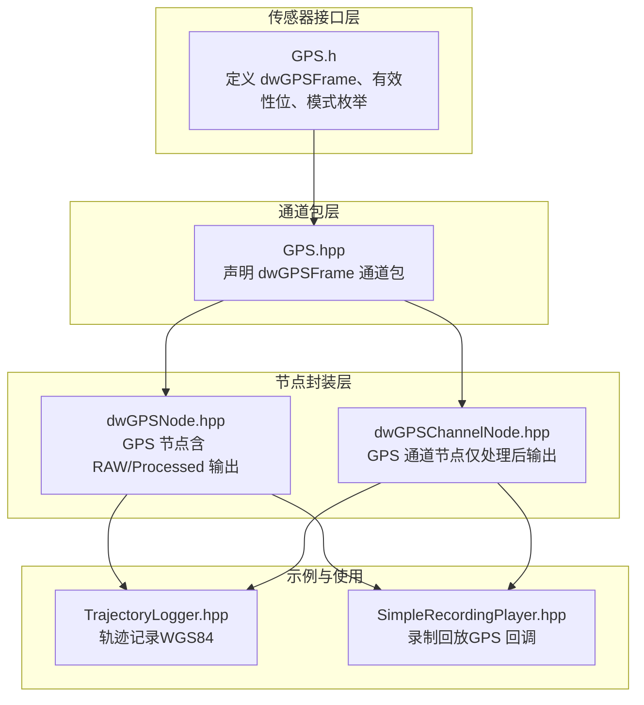
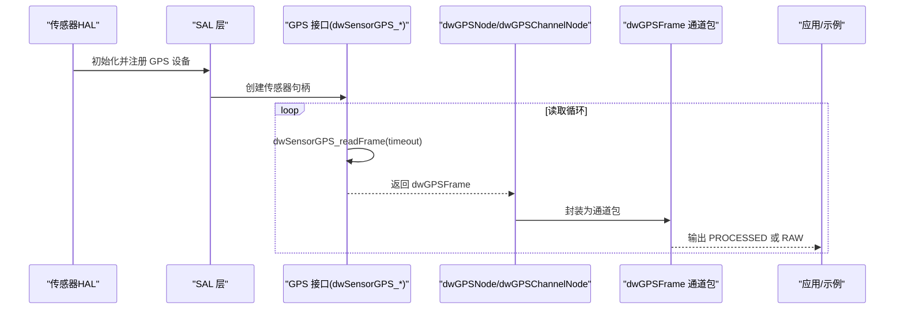
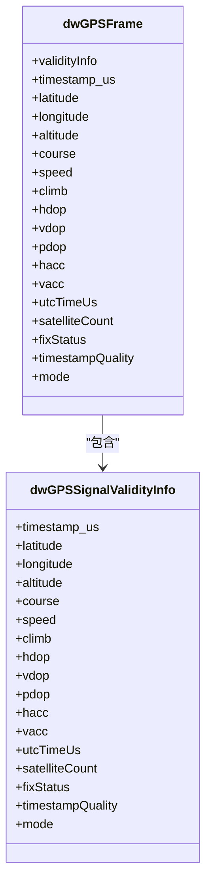
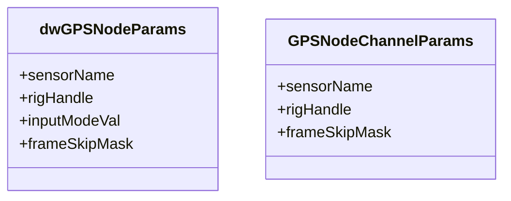
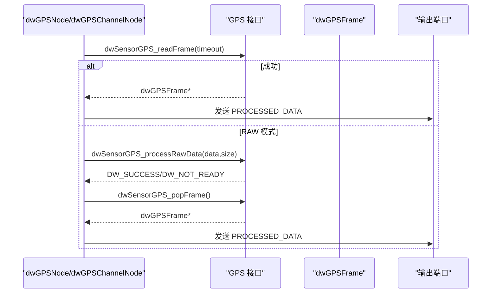
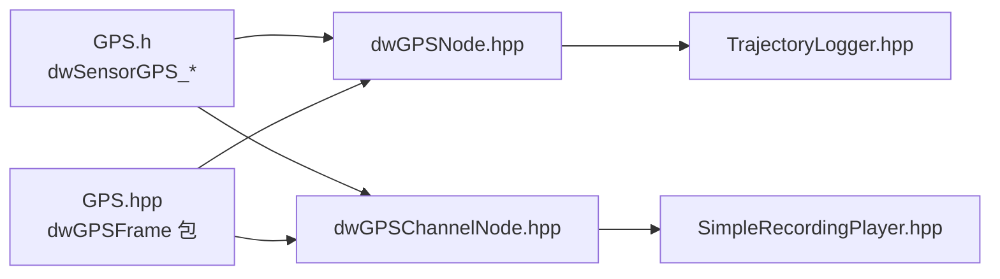

# 全球定位系统传感器

<cite>
**本文引用的文件**
- [GPS.h](file://driverorks-5.10/include/dw/sensors/gps/GPS.h)
- [GPS.hpp](file://driverorks-5.10/include/dwframework/dwnodes/common/channelpackets/GPS.hpp)
- [dwGPSNode.hpp（5.10）](file://driverorks-5.10/include/dwframework/dwnodes/sensors/dwgpsnode/dwGPSNode.hpp)
- [dwGPSChannelNode.hpp（5.10）](file://driverorks-5.10/include/dwframework/dwnodes/sensors/dwgpsnode/dwGPSChannelNode.hpp)
- [GPS.h（5.14）](file://driveworks-5.14/include/dw/sensors/gps/GPS.h)
- [GPS.hpp（5.14）](file://driveworks-5.14/include/dwframework/dwnodes/common/channelpackets/GPS.hpp)
- [dwGPSNode.hpp（5.14）](file://driveworks-5.14/include/dwframework/dwnodes/sensors/dwgpsnode/dwGPSNode.hpp)
- [dwGPSChannelNode.hpp（5.14）](file://driveworks-5.14/include/dwframework/dwnodes/sensors/dwgpsnode/dwGPSChannelNode.hpp)
- [TrajectoryLogger.hpp（5.10）](file://driverorks-5.10/samples/src/egomotion/TrajectoryLogger.hpp)
- [SimpleRecordingPlayer.hpp（5.10）](file://driverorks-5.10/samples/src/framework/SimpleRecordingPlayer.hpp)
- [TrajectoryLogger.hpp（5.14）](file://driveworks-5.14/samples/src/egomotion/TrajectoryLogger.hpp)
- [SimpleRecordingPlayer.hpp（5.14）](file://driveworks-5.14/samples/src/framework/SimpleRecordingPlayer.hpp)
</cite>

## 目录
1. [引言](#引言)
2. [项目结构](#项目结构)
3. [核心组件](#核心组件)
4. [架构总览](#架构总览)
5. [详细组件分析](#详细组件分析)
6. [依赖关系分析](#依赖关系分析)
7. [性能考量](#性能考量)
8. [故障排查指南](#故障排查指南)
9. [结论](#结论)
10. [附录：配置与使用示例路径](#附录配置与使用示例路径)

## 引言
本技术文档围绕 NVIDIA DriveWorks 中的 GPS 传感器模块展开，面向系统集成工程师与算法开发者，系统阐述 GPS 抽象接口、数据帧结构、节点化封装、端口与参数描述、以及在框架中的读取与处理流程。文档重点覆盖以下方面：
- GPS 抽象接口与数据帧结构：经纬度、海拔、速度矢量、时间戳、精度指标与模式状态
- GPS 参数配置结构体与节点参数描述
- GPS 数据读取方法与 RAW 处理流程
- 卫星状态监控与精度评估要点
- 坐标系定义、差分 GPS（DGPS）支持与多星座兼容性现状
- 完整的配置示例与代码片段路径指引

## 项目结构
GPS 模块由两部分组成：
- 底层传感器接口与数据结构：位于传感器公共头文件中，定义 GPS 帧、有效性位、模式枚举等
- 节点化封装：位于 dwframework 的 dwnodes 子目录，提供 dwGPSNode 与 dwGPSChannelNode 两类节点，用于在 CGF 图中接入 GPS 数据流

图表来源
- [GPS.h:175-324](file://driverorks-5.10/include/dw/sensors/gps/GPS.h#L175-L324)
- [GPS.hpp:37-37](file://driverorks-5.10/include/dwframework/dwnodes/common/channelpackets/GPS.hpp#L37-L37)
- [dwGPSNode.hpp（5.10）:68-92](file://driverorks-5.10/include/dwframework/dwnodes/sensors/dwgpsnode/dwGPSNode.hpp#L68-L92)
- [dwGPSChannelNode.hpp（5.10）:67-81](file://driverorks-5.10/include/dwframework/dwnodes/sensors/dwgpsnode/dwGPSChannelNode.hpp#L67-L81)
- [TrajectoryLogger.hpp（5.10）:91-93](file://driverorks-5.10/samples/src/egomotion/TrajectoryLogger.hpp#L91-L93)
- [SimpleRecordingPlayer.hpp（5.10）:55-55](file://driverorks-5.10/samples/src/framework/SimpleRecordingPlayer.hpp#L55-L55)

章节来源
- [GPS.h:175-324](file://driverorks-5.10/include/dw/sensors/gps/GPS.h#L175-L324)
- [GPS.hpp:37-37](file://driverorks-5.10/include/dwframework/dwnodes/common/channelpackets/GPS.hpp#L37-L37)
- [dwGPSNode.hpp（5.10）:68-92](file://driverorks-5.10/include/dwframework/dwnodes/sensors/dwgpsnode/dwGPSNode.hpp#L68-L92)
- [dwGPSChannelNode.hpp（5.10）:67-81](file://driverorks-5.10/include/dwframework/dwnodes/sensors/dwgpsnode/dwGPSChannelNode.hpp#L67-L81)

## 核心组件
- GPS 抽象接口与数据帧
  - dwGPSFrame：承载单帧 GPS 定位信息，包含 WGS84 经纬度、海拔、航向、地速/爬升、DOP、H/V ACC、UTC 时间、卫星数、fix 状态、时间质量、模式等
  - 信号有效性位：dwGPSSignalValidityInfo 提供每个信号字段的有效性标记，便于上层进行精度评估与状态判断
  - 模式与状态：dwGPSMode、dwGPSFixStatus、dwGPSTimestampQuality 描述定位模式、fix 等级与时间质量
- 节点封装
  - dwGPSNode：提供 RAW 与 PROCESSED 双路输出，适合需要原始数据或进一步处理的场景
  - dwGPSChannelNode：仅提供 PROCESSED 输出，简化数据通路
- 通道包
  - dwGPSFrame 作为通道包类型通过 DWFRAMEWORK_DECLARE_PACKET_TYPE_POD 声明，便于在 CGF 通道间传输

章节来源
- [GPS.h:131-169](file://driverorks-5.10/include/dw/sensors/gps/GPS.h#L131-L169)
- [GPS.h:175-324](file://driverorks-5.10/include/dw/sensors/gps/GPS.h#L175-L324)
- [GPS.hpp:37-37](file://driverorks-5.10/include/dwframework/dwnodes/common/channelpackets/GPS.hpp#L37-L37)
- [dwGPSNode.hpp（5.10）:68-92](file://driverorks-5.10/include/dwframework/dwnodes/sensors/dwgpsnode/dwGPSNode.hpp#L68-L92)
- [dwGPSChannelNode.hpp（5.10）:74-81](file://driverorks-5.10/include/dwframework/dwnodes/sensors/dwgpsnode/dwGPSChannelNode.hpp#L74-L81)

## 架构总览
下图展示了从底层传感器接口到节点封装再到应用使用的整体流程。

图表来源
- [GPS.h:484-485](file://driverorks-5.10/include/dw/sensors/gps/GPS.h#L484-L485)
- [GPS.h:516-517](file://driverorks-5.10/include/dw/sensors/gps/GPS.h#L516-L517)
- [dwGPSNode.hpp（5.10）:78-82](file://driverorks-5.10/include/dwframework/dwnodes/sensors/dwgpsnode/dwGPSNode.hpp#L78-L82)
- [dwGPSChannelNode.hpp（5.10）:78-81](file://driverorks-5.10/include/dwframework/dwnodes/sensors/dwgpsnode/dwGPSChannelNode.hpp#L78-L81)

## 详细组件分析

### GPS 抽象接口与数据帧结构
- 关键字段说明（节选）
  - 位置：latitude、longitude（单位度）、altitude（单位米，椭球高）
  - 运动：course（单位度，真北相对航向）、speed（单位 m/s 地速）、climb（单位 m/s 爬升率）
  - 精度：hdop、vdop、pdop（单位无量纲）、hacc、vacc（单位米）
  - 时间：timestamp_us（接收时间戳微秒）、utcTimeUs（UTC 微秒）、timestampQuality
  - 卫星：satelliteCount（可见卫星数）、fixStatus（2D/3D/无）
  - 模式：mode（未知/无效/DR/独立/差分/RTK 浮动/固定/PPP 收敛/收敛）
  - 有效性：validityInfo 对各字段提供有效性标记
- 读取与 RAW 处理
  - dwSensorGPS_readFrame：阻塞式读取下一帧，支持超时与无限等待
  - dwSensorGPS_processRawData / dwSensorGPS_popFrame：对 RAW 数据进行解码并弹出已处理帧

图表来源
- [GPS.h:131-169](file://driverorks-5.10/include/dw/sensors/gps/GPS.h#L131-L169)
- [GPS.h:175-324](file://driverorks-5.10/include/dw/sensors/gps/GPS.h#L175-L324)

章节来源
- [GPS.h:131-169](file://driverorks-5.10/include/dw/sensors/gps/GPS.h#L131-L169)
- [GPS.h:175-324](file://driverorks-5.10/include/dw/sensors/gps/GPS.h#L175-L324)

### GPS 参数配置结构体与节点参数描述
- dwGPSNodeParams（节点构造参数）
  - 字段：sensorName（语义参数，GPS 名称）、rigHandle（标定刚体句柄）、inputModeVal（布尔输入模式开关）、frameSkipMask（跳帧掩码）
  - 参数描述：通过 describeParameters 静态函数声明，支持以多种构造方式创建节点
- dwGPSChannelNodeParams（通道节点构造参数）
  - 字段：sensorName、rigHandle、frameSkipMask
  - 参数描述：同样通过 describeParameters 静态函数声明

图表来源
- [dwGPSNode.hpp（5.10）:52-58](file://driverorks-5.10/include/dwframework/dwnodes/sensors/dwgpsnode/dwGPSNode.hpp#L52-L58)
- [dwGPSChannelNode.hpp（5.10）:52-57](file://driverorks-5.10/include/dwframework/dwnodes/sensors/dwgpsnode/dwGPSChannelNode.hpp#L52-L57)

章节来源
- [dwGPSNode.hpp（5.10）:52-58](file://driverorks-5.10/include/dwframework/dwnodes/sensors/dwgpsnode/dwGPSNode.hpp#L52-L58)
- [dwGPSChannelNode.hpp（5.10）:52-57](file://driverorks-5.10/include/dwframework/dwnodes/sensors/dwgpsnode/dwGPSChannelNode.hpp#L52-L57)

### GPS 数据读取与处理流程
- 读取流程
  - 使用 dwSensorGPS_readFrame 在指定超时内阻塞等待新帧
  - 成功后将数据填充至 dwGPSFrame
- RAW 处理流程
  - 若上游提供 RAW 数据，先调用 dwSensorGPS_processRawData 进行解码
  - 再通过 dwSensorGPS_popFrame 获取已解码帧
- 节点输出
  - dwGPSNode：输出 SENSOR_PROPERTIES、PROCESSED_DATA、RAW_DATA、TIMESTAMP、NEXT_TIMESTAMP
  - dwGPSChannelNode：输出 SENSOR_PROPERTIES、PROCESSED_DATA、TIMESTAMP、NEXT_TIMESTAMP

图表来源
- [GPS.h:484-485](file://driverorks-5.10/include/dw/sensors/gps/GPS.h#L484-L485)
- [GPS.h:501-502](file://driverorks-5.10/include/dw/sensors/gps/GPS.h#L501-L502)
- [GPS.h:516-517](file://driverorks-5.10/include/dw/sensors/gps/GPS.h#L516-L517)
- [dwGPSNode.hpp（5.10）:78-82](file://driverorks-5.10/include/dwframework/dwnodes/sensors/dwgpsnode/dwGPSNode.hpp#L78-L82)
- [dwGPSChannelNode.hpp（5.10）:78-81](file://driverorks-5.10/include/dwframework/dwnodes/sensors/dwgpsnode/dwGPSChannelNode.hpp#L78-L81)

章节来源
- [GPS.h:484-485](file://driverorks-5.10/include/dw/sensors/gps/GPS.h#L484-L485)
- [GPS.h:501-502](file://driverorks-5.10/include/dw/sensors/gps/GPS.h#L501-L502)
- [GPS.h:516-517](file://driverorks-5.10/include/dw/sensors/gps/GPS.h#L516-L517)
- [dwGPSNode.hpp（5.10）:78-82](file://driverorks-5.10/include/dwframework/dwnodes/sensors/dwgpsnode/dwGPSNode.hpp#L78-L82)
- [dwGPSChannelNode.hpp（5.10）:78-81](file://driverorks-5.10/include/dwframework/dwnodes/sensors/dwgpsnode/dwGPSChannelNode.hpp#L78-L81)

### 卫星状态监控与精度评估
- 卫星状态
  - satelliteCount：可见卫星数量（注释提示后端尚未完全实现）
  - fixStatus：2D/3D/无
- 精度评估
  - hdop/vdop/pdop：水平/垂直/位置精度因子
  - hacc/vacc：水平/垂直定位精度估计
  - validityInfo：对上述字段提供有效性标记，建议在使用前检查有效性
- 时间质量
  - timestampQuality：初始化中/正常/同步丢失

章节来源
- [GPS.h:263-287](file://driverorks-5.10/include/dw/sensors/gps/GPS.h#L263-L287)
- [GPS.h:147-166](file://driverorks-5.10/include/dw/sensors/gps/GPS.h#L147-L166)

### 坐标系定义、差分 GPS（DGPS）支持与多星座兼容性
- 坐标系
  - 位置字段采用 WGS84 经纬度与椭球高，符合国际 GNSS 标准
- 差分 GPS（DGPS）
  - 通过模式字段（dwGPSMode）体现，包括“差分”、“RTK 浮动/固定”、“PPP 收敛/收敛”等，可反映差分与精密单点定位能力
- 多星座兼容性
  - 模式枚举涵盖多种 GNSS 定位模式，表明对多星座（GPS、GLONASS、Galileo、BDS 等）的通用支持；具体可用星座取决于硬件与固件

章节来源
- [GPS.h:81-103](file://driverorks-5.10/include/dw/sensors/gps/GPS.h#L81-L103)
- [GPS.h:294-305](file://driverorks-5.10/include/dw/sensors/gps/GPS.h#L294-L305)

### 实际使用示例（代码片段路径）
- 初始化 GPS 传感器与节点
  - 节点参数描述与构造：参见 [dwGPSNode.hpp（5.10）:101-127](file://driverorks-5.10/include/dwframework/dwnodes/sensors/dwgpsnode/dwGPSNode.hpp#L101-L127)
  - 通道节点参数描述与构造：参见 [dwGPSChannelNode.hpp（5.10）:98-118](file://driverorks-5.10/include/dwframework/dwnodes/sensors/dwgpsnode/dwGPSChannelNode.hpp#L98-L118)
- 读取定位数据
  - 读取帧：参见 [GPS.h:484-485](file://driverorks-5.10/include/dw/sensors/gps/GPS.h#L484-L485)
  - RAW 解码与弹帧：参见 [GPS.h:501-502](file://driverorks-5.10/include/dw/sensors/gps/GPS.h#L501-L502), [GPS.h:516-517](file://driverorks-5.10/include/dw/sensors/gps/GPS.h#L516-L517)
- 处理定位状态
  - 有效性检查与模式判断：参见 [GPS.h:131-169](file://driverorks-5.10/include/dw/sensors/gps/GPS.h#L131-L169), [GPS.h:81-103](file://driverorks-5.10/include/dw/sensors/gps/GPS.h#L81-L103)
- 记录轨迹（WGS84）
  - 示例：参见 [TrajectoryLogger.hpp（5.10）:91-93](file://driverorks-5.10/samples/src/egomotion/TrajectoryLogger.hpp#L91-L93)
- 录制回放（GPS 回调）
  - 示例：参见 [SimpleRecordingPlayer.hpp（5.10）:55-55](file://driverorks-5.10/samples/src/framework/SimpleRecordingPlayer.hpp#L55-L55)

章节来源
- [dwGPSNode.hpp（5.10）:101-127](file://driverorks-5.10/include/dwframework/dwnodes/sensors/dwgpsnode/dwGPSNode.hpp#L101-L127)
- [dwGPSChannelNode.hpp（5.10）:98-118](file://driverorks-5.10/include/dwframework/dwnodes/sensors/dwgpsnode/dwGPSChannelNode.hpp#L98-L118)
- [GPS.h:484-485](file://driverorks-5.10/include/dw/sensors/gps/GPS.h#L484-L485)
- [GPS.h:501-502](file://driverorks-5.10/include/dw/sensors/gps/GPS.h#L501-L502)
- [GPS.h:516-517](file://driverorks-5.10/include/dw/sensors/gps/GPS.h#L516-L517)
- [TrajectoryLogger.hpp（5.10）:91-93](file://driverorks-5.10/samples/src/egomotion/TrajectoryLogger.hpp#L91-L93)
- [SimpleRecordingPlayer.hpp（5.10）:55-55](file://driverorks-5.10/samples/src/framework/SimpleRecordingPlayer.hpp#L55-L55)

## 依赖关系分析
- 节点与通道包
  - dwGPSNode 与 dwGPSChannelNode 均依赖 dwGPSFrame 通道包类型
- 节点与传感器接口
  - 两类节点均通过底层 GPS 接口读取/处理数据帧
- 版本演进
  - 5.14 版本在参数描述与字符串视图使用上有所调整，但核心接口保持一致

图表来源
- [GPS.h:484-485](file://driverorks-5.10/include/dw/sensors/gps/GPS.h#L484-L485)
- [GPS.hpp:37-37](file://driverorks-5.10/include/dwframework/dwnodes/common/channelpackets/GPS.hpp#L37-L37)
- [dwGPSNode.hpp（5.10）:78-82](file://driverorks-5.10/include/dwframework/dwnodes/sensors/dwgpsnode/dwGPSNode.hpp#L78-L82)
- [dwGPSChannelNode.hpp（5.10）:78-81](file://driverorks-5.10/include/dwframework/dwnodes/sensors/dwgpsnode/dwGPSChannelNode.hpp#L78-L81)
- [TrajectoryLogger.hpp（5.10）:91-93](file://driverorks-5.10/samples/src/egomotion/TrajectoryLogger.hpp#L91-L93)
- [SimpleRecordingPlayer.hpp（5.10）:55-55](file://driverorks-5.10/samples/src/framework/SimpleRecordingPlayer.hpp#L55-L55)

章节来源
- [GPS.hpp:37-37](file://driverorks-5.10/include/dwframework/dwnodes/common/channelpackets/GPS.hpp#L37-L37)
- [dwGPSNode.hpp（5.10）:78-82](file://driverorks-5.10/include/dwframework/dwnodes/sensors/dwgpsnode/dwGPSNode.hpp#L78-L82)
- [dwGPSChannelNode.hpp（5.10）:78-81](file://driverorks-5.10/include/dwframework/dwnodes/sensors/dwgpsnode/dwGPSChannelNode.hpp#L78-L81)

## 性能考量
- 读取策略
  - 合理设置超时时间，避免长时间阻塞影响实时性
  - 在 RAW 解码路径中，注意 CPU 线程负载，必要时将解码与弹帧操作置于专用线程
- 输出端口
  - 仅启用必要的输出端口（如仅 PROCESSED），减少带宽与拷贝开销
- 有效性检查
  - 在消费数据前检查 validityInfo，避免使用无效字段导致误判

## 故障排查指南
- 常见返回值与含义
  - DW_TIME_OUT：超时未收到新帧，检查传感器启动与线程调度
  - DW_NOT_AVAILABLE：传感器未启动或轮询模式无可用数据
  - DW_SAL_SENSOR_ERROR：I/O 或总线错误，检查硬件连接与驱动
  - DW_SUCCESS：成功
- 诊断步骤
  - 确认传感器句柄有效与已启动
  - 检查 RAW 数据是否完整（多次返回 DW_NOT_READY 后再尝试）
  - 核对 validityInfo 与模式字段，确认定位状态与精度满足需求
  - 如使用录制回放，确保回调正确接入并处理 GPS 帧

章节来源
- [GPS.h:476-481](file://driverorks-5.10/include/dw/sensors/gps/GPS.h#L476-L481)
- [GPS.h:497-500](file://driverorks-5.10/include/dw/sensors/gps/GPS.h#L497-L500)
- [GPS.h:512-514](file://driverorks-5.10/include/dw/sensors/gps/GPS.h#L512-L514)

## 结论
本模块以清晰的数据帧结构与节点化封装，提供了从底层传感器接口到上层应用的完整 GPS 数据通路。通过参数化配置与严格的信号有效性管理，能够满足不同定位精度与实时性要求的应用场景。版本演进中保持了接口稳定性，同时增强了参数描述与字符串视图的使用一致性。

## 附录：配置与使用示例路径
- 节点参数与构造
  - [dwGPSNode.hpp（5.10）:101-127](file://driverorks-5.10/include/dwframework/dwnodes/sensors/dwgpsnode/dwGPSNode.hpp#L101-L127)
  - [dwGPSChannelNode.hpp（5.10）:98-118](file://driverorks-5.10/include/dwframework/dwnodes/sensors/dwgpsnode/dwGPSChannelNode.hpp#L98-L118)
- 读取与处理
  - [GPS.h:484-485](file://driverorks-5.10/include/dw/sensors/gps/GPS.h#L484-L485)
  - [GPS.h:501-502](file://driverorks-5.10/include/dw/sensors/gps/GPS.h#L501-L502)
  - [GPS.h:516-517](file://driverorks-5.10/include/dw/sensors/gps/GPS.h#L516-L517)
- 状态与精度
  - [GPS.h:131-169](file://driverorks-5.10/include/dw/sensors/gps/GPS.h#L131-L169)
  - [GPS.h:81-103](file://driverorks-5.10/include/dw/sensors/gps/GPS.h#L81-L103)
- 示例
  - [TrajectoryLogger.hpp（5.10）:91-93](file://driverorks-5.10/samples/src/egomotion/TrajectoryLogger.hpp#L91-L93)
  - [SimpleRecordingPlayer.hpp（5.10）:55-55](file://driverorks-5.10/samples/src/framework/SimpleRecordingPlayer.hpp#L55-L55)