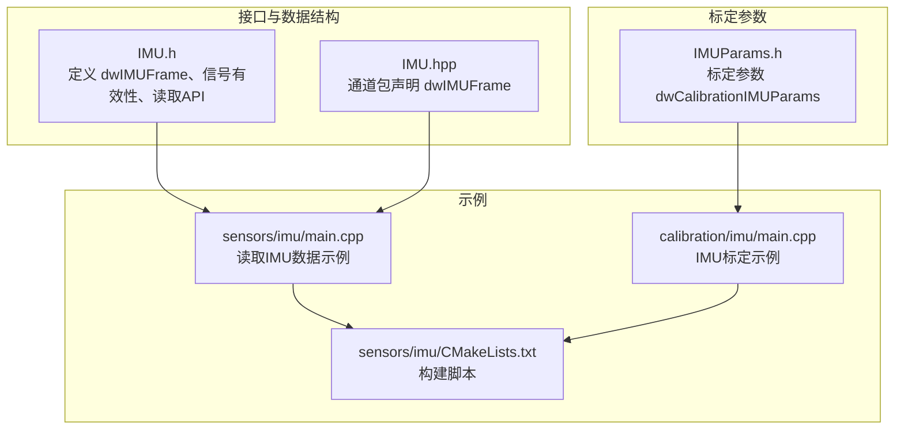
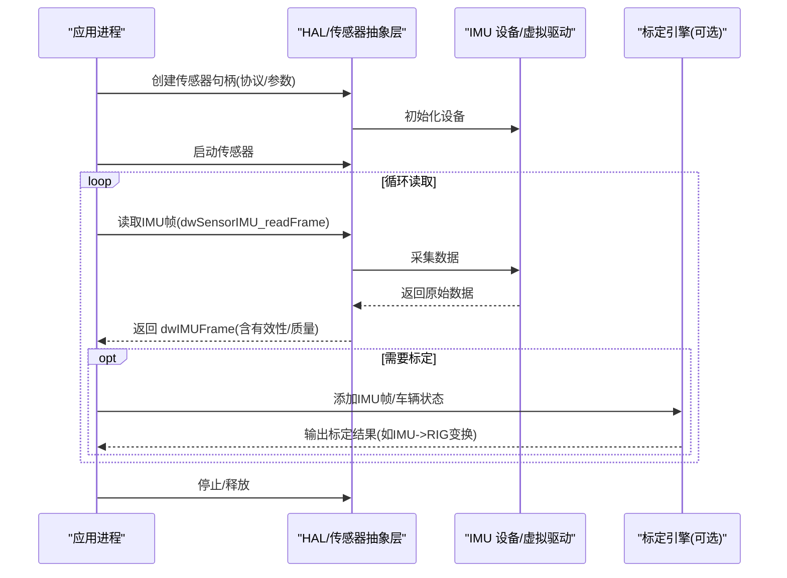
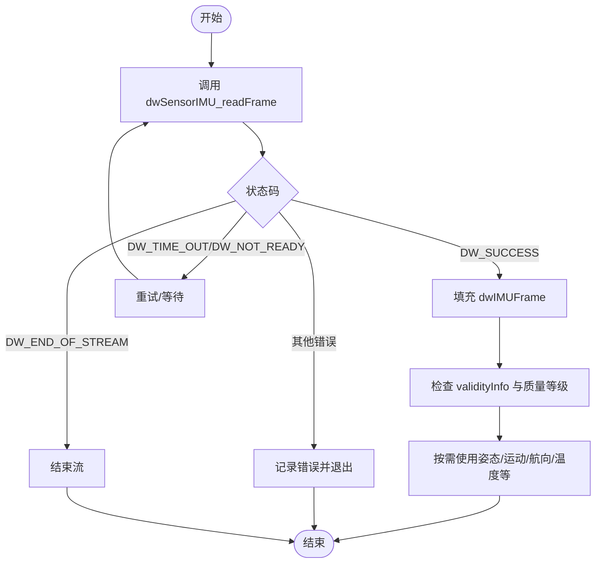
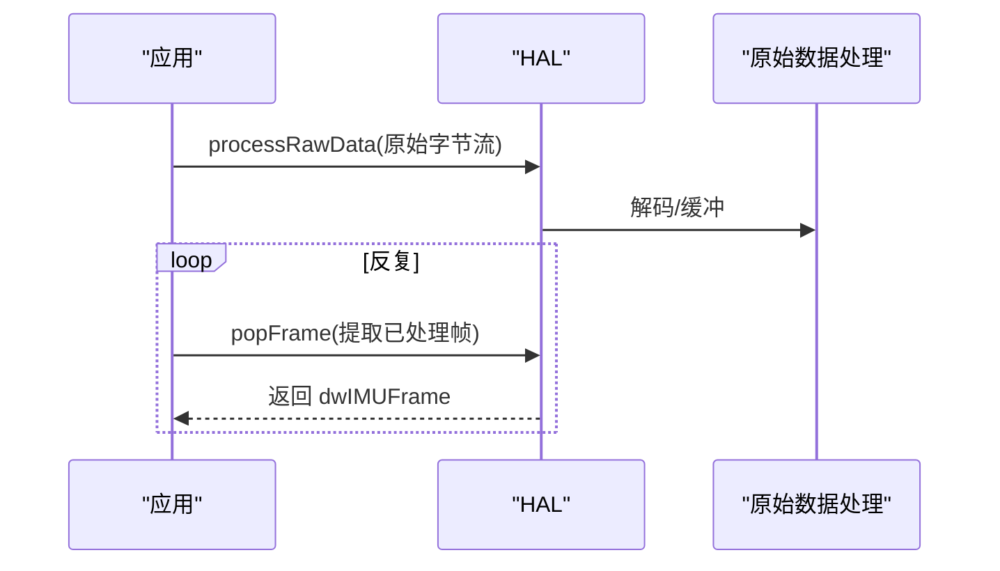
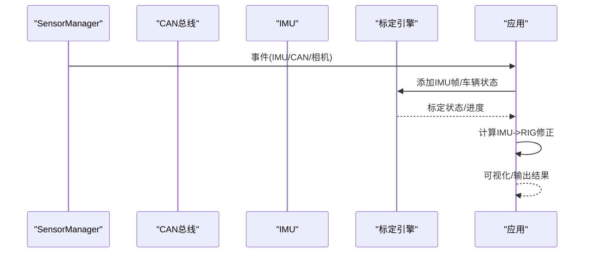
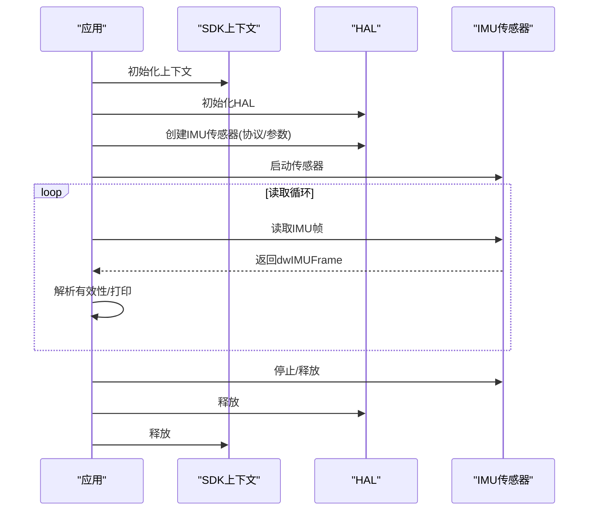
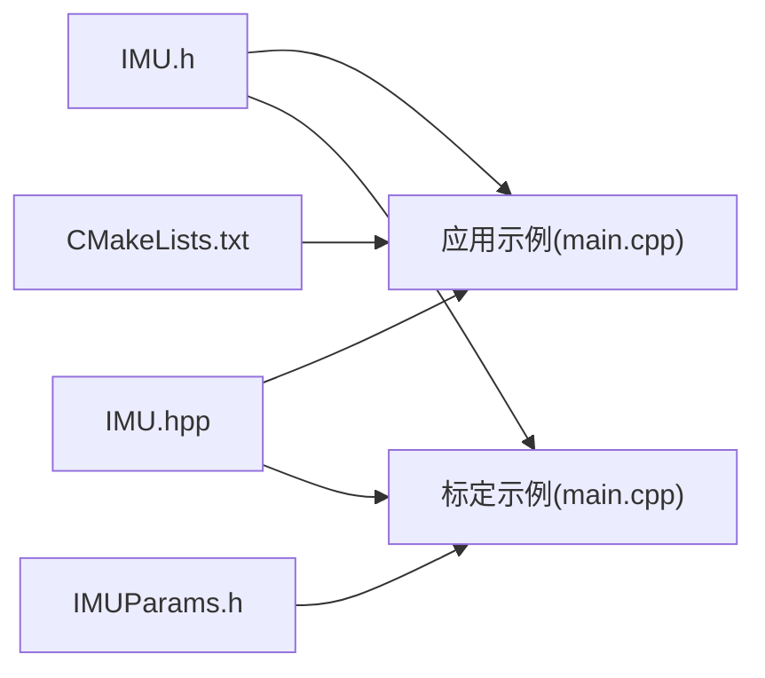

# 惯性测量单元传感器

<cite>
**本文引用的文件**
- [IMU.h](file://driverorks-5.10/include/dw/sensors/imu/IMU.h)
- [IMU.hpp](file://driverorks-5.10/include/dwframework/dwnodes/common/channelpackets/IMU.hpp)
- [IMUParams.h](file://driverorks-5.10/include/dw/calibration/engine/imu/IMUParams.h)
- [main.cpp（传感器IMU示例）](file://driverorks-5.10/samples/src/sensors/imu/main.cpp)
- [main.cpp（IMU标定示例）](file://driverorks-5.10/samples/src/calibration/imu/main.cpp)
- [CMakeLists.txt（IMU示例）](file://driverorks-5.10/samples/src/sensors/imu/CMakeLists.txt)
</cite>

## 目录
1. [简介](#简介)
2. [项目结构](#项目结构)
3. [核心组件](#核心组件)
4. [架构总览](#架构总览)
5. [详细组件分析](#详细组件分析)
6. [依赖关系分析](#依赖关系分析)
7. [性能考量](#性能考量)
8. [故障排查指南](#故障排查指南)
9. [结论](#结论)
10. [附录](#附录)

## 简介
本技术文档围绕 NVIDIA DriveWorks 的惯性测量单元（IMU）传感器模块，系统阐述其接口设计与实现要点，覆盖以下主题：
- IMU 抽象与接口：dwIMUFrame 数据帧结构、有效性位与信号质量字段、读取与原始数据处理 API。
- 参数配置：IMU 标定参数结构 dwCalibrationIMUParams 的字段说明与典型用途。
- 姿态与运动数据：加速度、角速度、磁力计、航向等数据的获取与处理流程。
- 时间戳同步与数据融合：时间戳语义、对齐状态、质量等级与融合建议。
- 坐标系与校准：坐标系约定、偏置校准、温度补偿与噪声处理。
- 配置示例与使用流程：采样率、量程、偏置与温度补偿的配置思路，以及初始化、读取与姿态解算的参考流程。

## 项目结构
与 IMU 相关的核心文件分布如下：
- 接口与数据结构：位于驱动层头文件中，定义 IMU 数据帧、信号有效性与读取 API。
- 标定参数：位于标定引擎头文件中，描述 IMU 标定所需的输入参数。
- 示例程序：位于 samples 中，演示如何初始化、启动传感器并读取 IMU 数据；另一个示例展示如何结合 CAN/相机进行 IMU 标定。

**图表来源**
- [IMU.h](file://driverorks-5.10/include/dw/sensors/imu/IMU.h)
- [IMU.hpp](file://driverorks-5.10/include/dwframework/dwnodes/common/channelpackets/IMU.hpp)
- [IMUParams.h](file://driverorks-5.10/include/dw/calibration/engine/imu/IMUParams.h)
- [main.cpp（传感器IMU示例）](file://driverorks-5.10/samples/src/sensors/imu/main.cpp)
- [main.cpp（IMU标定示例）](file://driverorks-5.10/samples/src/calibration/imu/main.cpp)
- [CMakeLists.txt（IMU示例）](file://driverorks-5.10/samples/src/sensors/imu/CMakeLists.txt)

**章节来源**
- [IMU.h](file://driverorks-5.10/include/dw/sensors/imu/IMU.h)
- [IMU.hpp](file://driverorks-5.10/include/dwframework/dwnodes/common/channelpackets/IMU.hpp)
- [IMUParams.h](file://driverorks-5.10/include/dw/calibration/engine/imu/IMUParams.h)
- [main.cpp（传感器IMU示例）](file://driverorks-5.10/samples/src/sensors/imu/main.cpp)
- [main.cpp（IMU标定示例）](file://driverorks-5.10/samples/src/calibration/imu/main.cpp)
- [CMakeLists.txt（IMU示例）](file://driverorks-5.10/samples/src/sensors/imu/CMakeLists.txt)

## 核心组件
- IMU 数据帧结构：dwIMUFrame 提供统一的数据容器，包含时间戳、姿态（欧拉角/四元数）、角速度、加速度、磁力计、航向、温度、偏置与质量等级等字段，并通过 validityInfo 字段标注各信号的有效性与质量。
- 读取与处理 API：提供阻塞式读取 dwSensorIMU_readFrame、原始数据处理 dwSensorIMU_processRawData 与弹出已处理帧 dwSensorIMU_popFrame。
- 标定参数：dwCalibrationIMUParams 提供采样率、陀螺仪偏置范围、悬架柔顺模型等标定所需先验信息。

关键字段与职责（节选）：
- 时间戳：用于同步与对齐，单位微秒。
- 姿态：orientation（欧拉角）与 orientationQuaternion（四元数），用于描述载体在 ENU 坐标系中的方向。
- 角速度：turnrate（rad/s），传感器坐标系下的角速度。
- 加速度：acceleration（m/s²），包含重力分量，反映传感器自身运动。
- 磁力计：magnetometer（utesla），用于航向估计（需配合地磁模型）。
- 航向：heading（度），相对于 ENU 的方位角。
- 温度与质量：temperature（°C）及各类质量等级枚举，指示信号健康状况。
- 对齐状态：alignmentStatus，指示 INS 初始化与对齐质量。

**章节来源**
- [IMU.h](file://driverorks-5.10/include/dw/sensors/imu/IMU.h)
- [IMU.hpp](file://driverorks-5.10/include/dwframework/dwnodes/common/channelpackets/IMU.hpp)

## 架构总览
下图展示了 IMU 从 HAL 层到应用层的调用路径与数据流：

**图表来源**
- [IMU.h](file://driverorks-5.10/include/dw/sensors/imu/IMU.h)
- [main.cpp（传感器IMU示例）](file://driverorks-5.10/samples/src/sensors/imu/main.cpp)
- [main.cpp（IMU标定示例）](file://driverorks-5.10/samples/src/calibration/imu/main.cpp)

## 详细组件分析

### 组件A：IMU 数据帧与有效性管理
- 数据帧结构：dwIMUFrame 将 IMU 所有输出整合在一个结构体内，便于统一处理与序列化。
- 有效性与质量：通过 validityInfo 与各类质量枚举，应用可判断信号是否可用、是否发生过载或温度异常、时间戳同步是否丢失等。
- 读取流程：阻塞等待新帧，超时或不可用时返回相应状态码；成功时填充帧内容。

**图表来源**
- [IMU.h](file://driverorks-5.10/include/dw/sensors/imu/IMU.h)

**章节来源**
- [IMU.h](file://driverorks-5.10/include/dw/sensors/imu/IMU.h)

### 组件B：IMU 原始数据处理与通道包
- 原始数据处理：提供 dwSensorIMU_processRawData 与 dwSensorIMU_popFrame，允许应用直接注入原始字节流并提取已解码帧。
- 通道包声明：IMU.hpp 将 dwIMUFrame 声明为 POD 通道包类型，便于在 CGF/节点间传递。

**图表来源**
- [IMU.h](file://driverorks-5.10/include/dw/sensors/imu/IMU.h)
- [IMU.hpp](file://driverorks-5.10/include/dwframework/dwnodes/common/channelpackets/IMU.hpp)

**章节来源**
- [IMU.h](file://driverorks-5.10/include/dw/sensors/imu/IMU.h)
- [IMU.hpp](file://driverorks-5.10/include/dwframework/dwnodes/common/channelpackets/IMU.hpp)

### 组件C：IMU 标定参数与标定流程
- 标定参数：dwCalibrationIMUParams 包含采样率、陀螺仪偏置范围、悬架柔顺模型等，作为标定先验。
- 标定示例：示例程序通过 SensorManager 获取 IMU/CAN/相机事件，将 IMU 帧与 CAN 状态送入标定引擎，计算 IMU 到 RIG 的变换修正，并可视化估计的水平面以辅助收敛。

**图表来源**
- [IMUParams.h](file://driverorks-5.10/include/dw/calibration/engine/imu/IMUParams.h)
- [main.cpp（IMU标定示例）](file://driverorks-5.10/samples/src/calibration/imu/main.cpp)

**章节来源**
- [IMUParams.h](file://driverorks-5.10/include/dw/calibration/engine/imu/IMUParams.h)
- [main.cpp（IMU标定示例）](file://driverorks-5.10/samples/src/calibration/imu/main.cpp)

### 组件D：IMU 使用示例（初始化、读取与打印）
- 初始化：创建上下文与 HAL，构造传感器参数（协议/参数字符串），创建 IMU 传感器句柄并启动。
- 读取：循环调用 dwSensorIMU_readFrame，解析 validityInfo 并打印有效信号。
- 释放：停止传感器、释放句柄与 HAL，最终释放上下文与日志。

**图表来源**
- [main.cpp（传感器IMU示例）](file://driverorks-5.10/samples/src/sensors/imu/main.cpp)

**章节来源**
- [main.cpp（传感器IMU示例）](file://driverorks-5.10/samples/src/sensors/imu/main.cpp)

## 依赖关系分析
- IMU.h 定义了 IMU 数据帧与读取 API，是应用层直接依赖的基础接口。
- IMU.hpp 将 dwIMUFrame 声明为通道包类型，服务于框架内节点间通信。
- IMUParams.h 为标定引擎提供 IMU 先验参数，与标定示例共同构成“输入参数—标定流程—输出结果”的闭环。
- 示例程序依赖 SDK/HAL/传感器抽象层，完成端到端的 IMU 使用流程。

**图表来源**
- [IMU.h](file://driverorks-5.10/include/dw/sensors/imu/IMU.h)
- [IMU.hpp](file://driverorks-5.10/include/dwframework/dwnodes/common/channelpackets/IMU.hpp)
- [IMUParams.h](file://driverorks-5.10/include/dw/calibration/engine/imu/IMUParams.h)
- [main.cpp（传感器IMU示例）](file://driverorks-5.10/samples/src/sensors/imu/main.cpp)
- [main.cpp（IMU标定示例）](file://driverorks-5.10/samples/src/calibration/imu/main.cpp)
- [CMakeLists.txt（IMU示例）](file://driverorks-5.10/samples/src/sensors/imu/CMakeLists.txt)

**章节来源**
- [IMU.h](file://driverorks-5.10/include/dw/sensors/imu/IMU.h)
- [IMU.hpp](file://driverorks-5.10/include/dwframework/dwnodes/common/channelpackets/IMU.hpp)
- [IMUParams.h](file://driverorks-5.10/include/dw/calibration/engine/imu/IMUParams.h)
- [main.cpp（传感器IMU示例）](file://driverorks-5.10/samples/src/sensors/imu/main.cpp)
- [main.cpp（IMU标定示例）](file://driverorks-5.10/samples/src/calibration/imu/main.cpp)
- [CMakeLists.txt（IMU示例）](file://driverorks-5.10/samples/src/sensors/imu/CMakeLists.txt)

## 性能考量
- 采样率与负载：高采样率会增加 CPU/GPU 处理负担，应根据应用需求选择合适频率（标定参数中提供采样率先验）。
- 原始数据处理：直接处理原始数据会在调用线程引入额外开销，建议在后台线程或使用队列解耦。
- 有效性与质量检查：频繁检查 validityInfo 与质量等级有助于避免无效数据参与后续处理，减少误判与重算成本。
- 同步与对齐：时间戳同步与 INS 对齐状态直接影响姿态精度，应确保硬件/固件满足对齐要求。

## 故障排查指南
- 读取超时/不可用：检查传感器是否已启动、队列是否有数据、超时参数是否合理。
- 信号无效或质量异常：依据 validityInfo 与质量枚举定位具体信号（加速度、角速度、温度等），确认传感器安装与工作环境。
- 结束流：虚拟传感器可能到达末尾，需切换到实时模式或更换数据源。
- 标定不收敛：检查标定参数（采样率、偏置范围、悬架柔顺）是否与实际一致，确保有足够的机动动作与数据长度。

**章节来源**
- [IMU.h](file://driverorks-5.10/include/dw/sensors/imu/IMU.h)
- [main.cpp（传感器IMU示例）](file://driverorks-5.10/samples/src/sensors/imu/main.cpp)
- [main.cpp（IMU标定示例）](file://driverorks-5.10/samples/src/calibration/imu/main.cpp)

## 结论
本文件梳理了 DriveWorks IMU 模块的接口与实现要点，明确了数据帧结构、读取流程、标定参数与示例程序的使用方式。通过正确配置采样率与先验参数、严格验证信号有效性与质量等级、并结合标定流程优化 IMU 到 RIG 的几何关系，可获得稳定可靠的姿态与运动估计结果。

## 附录

### A. IMU 数据帧字段说明（摘要）
- 时间戳：微秒级时间戳，用于同步与对齐。
- 姿态：欧拉角与四元数，描述 ENU 坐标系下的方向。
- 角速度：传感器坐标系下的角速度（rad/s）。
- 加速度：包含重力分量的线加速度（m/s²）。
- 磁力计：地磁强度（utesla），用于航向估计。
- 航向：ENU 坐标系下的方位角（度）。
- 温度：摄氏度。
- 偏置与加速度：加速度与角速度的偏置与加速度项。
- 质量与状态：温度、加速度、角速度、时间戳、整体状态与对齐状态的质量等级。

**章节来源**
- [IMU.h](file://driverorks-5.10/include/dw/sensors/imu/IMU.h)

### B. IMU 标定参数说明（摘要）
- 采样率：期望的 IMU 采样频率（Hz），默认 100Hz。
- 陀螺仪偏置范围：偏置变化范围（rad/s），用于约束标定搜索空间。
- 悬架柔顺：围绕 X/Y 轴的角向柔顺模型，单位为 deg·s²/m。

**章节来源**
- [IMUParams.h](file://driverorks-5.10/include/dw/calibration/engine/imu/IMUParams.h)

### C. 使用流程与示例（步骤）
- 初始化：创建上下文与 HAL，配置协议与参数字符串，创建 IMU 传感器并启动。
- 读取：循环调用读取函数，解析 validityInfo，按需打印或使用数据。
- 释放：停止传感器、释放句柄与 HAL，释放上下文与日志。
- 标定：通过 SensorManager 获取 IMU/CAN/相机事件，将帧与状态送入标定引擎，获取 IMU->RIG 变换并可视化评估。

**章节来源**
- [main.cpp（传感器IMU示例）](file://driverorks-5.10/samples/src/sensors/imu/main.cpp)
- [main.cpp（IMU标定示例）](file://driverorks-5.10/samples/src/calibration/imu/main.cpp)
- [CMakeLists.txt（IMU示例）](file://driverorks-5.10/samples/src/sensors/imu/CMakeLists.txt)