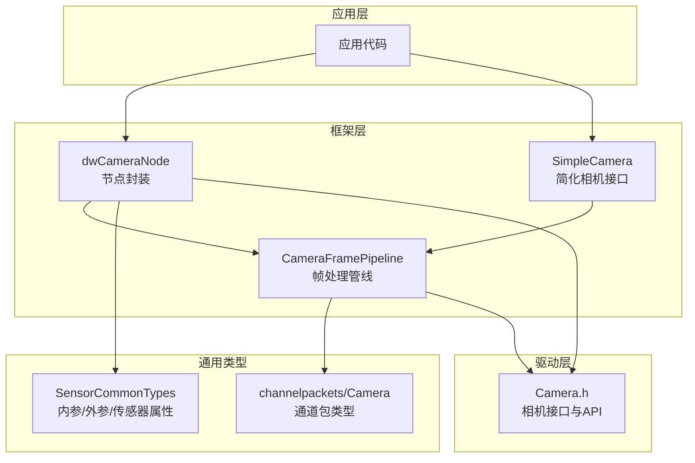
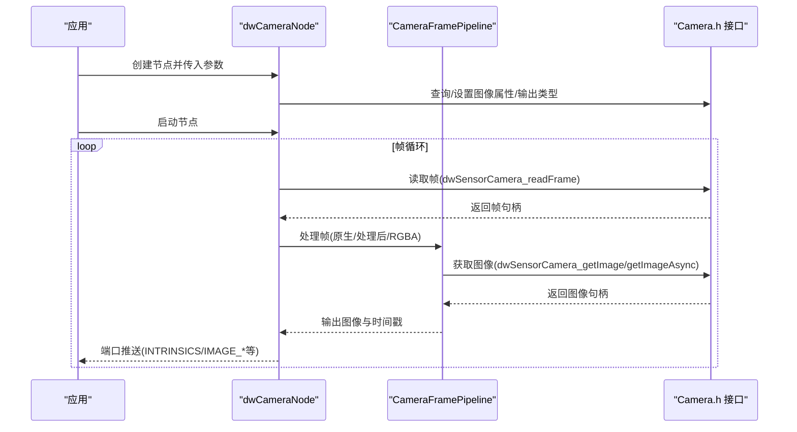
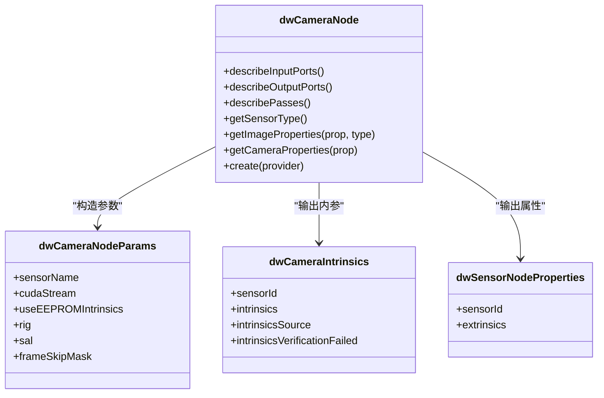
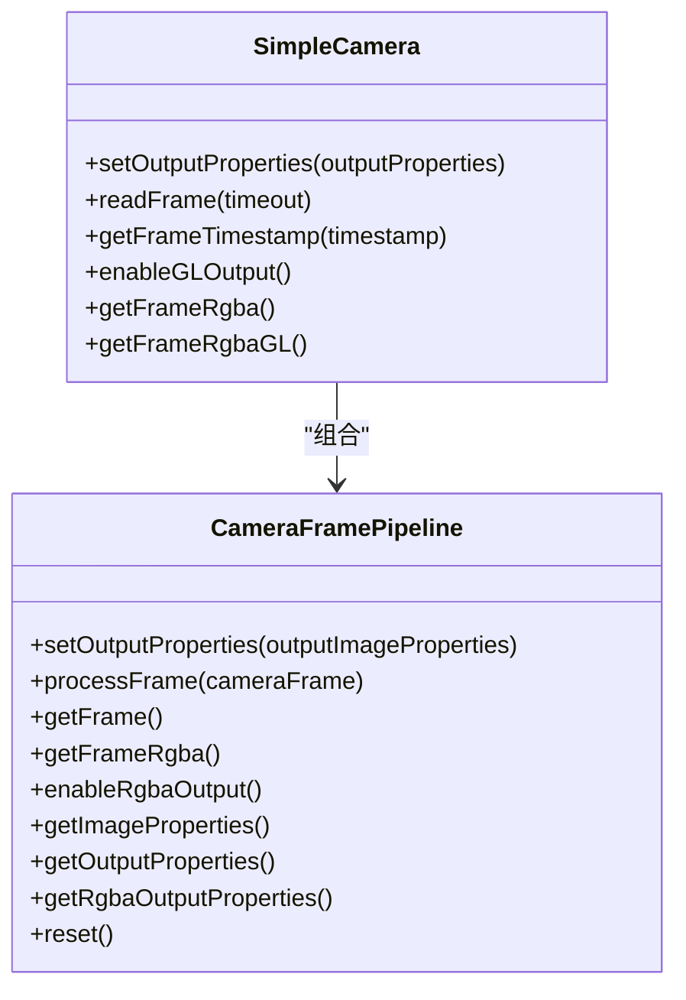
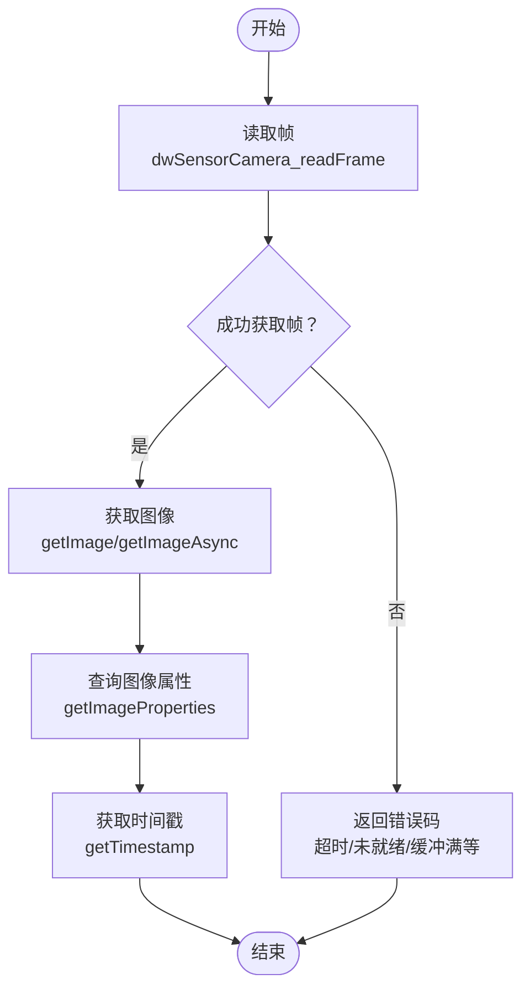
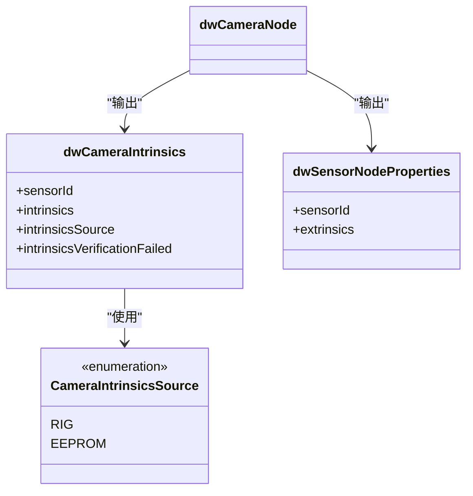
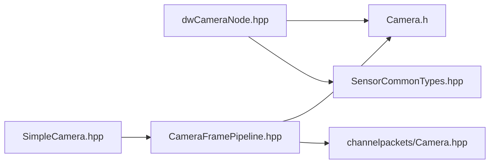

# 摄像头传感器

<cite>
**本文引用的文件**
- [Camera.h](file://driverorks-5.10/include/dw/sensors/camera/Camera.h)
- [Camera.hpp](file://driverorks-5.10/include/dwframework/dwnodes/common/channelpackets/Camera.hpp)
- [dwCameraNode.hpp](file://driverorks-5.10/include/dwframework/dwnodes/sensors/dwcameranode/dwCameraNode.hpp)
- [SensorCommonTypes.hpp](file://driverorks-5.10/include/dwframework/dwnodes/common/SensorCommonTypes.hpp)
- [SimpleCamera.hpp](file://driverorks-5.10/samples/src/framework/SimpleCamera.hpp)
- [CameraFramePipeline.hpp](file://driverorks-5.10/samples/src/framework/CameraFramePipeline.hpp)
- [rig.json](file://driveworks-5.14/samples/src/cgf_nodes/data/rig.json)
</cite>

## 目录
1. [简介](#简介)
2. [项目结构](#项目结构)
3. [核心组件](#核心组件)
4. [架构总览](#架构总览)
5. [详细组件分析](#详细组件分析)
6. [依赖关系分析](#依赖关系分析)
7. [性能考虑](#性能考虑)
8. [故障排查指南](#故障排查指南)
9. [结论](#结论)
10. [附录：配置与示例](#附录配置与示例)

## 简介
本技术文档围绕 NVIDIA DriveWorks 的摄像头传感器模块展开，系统性阐述接口设计、数据读取流程、时间戳与格式处理、多相机同步与坐标系变换，以及内参/外参/畸变参数的配置方式。文档以代码级事实为基础，结合图示帮助读者快速理解从底层驱动到上层节点的数据通路与控制流。

## 项目结构
与摄像头传感器相关的核心代码分布在以下层次：
- 底层传感器接口：位于 sensors/camera/Camera.h，定义了相机属性、输出类型、帧读取与图像获取等基础能力。
- 节点封装：位于 dwframework/dwnodes/sensors/dwcameranode/dwCameraNode.hpp，提供可配置的摄像头节点，支持多通道输出与参数描述。
- 通用类型与通道包：位于 dwframework/dwnodes/common/SensorCommonTypes.hpp 与 channelpackets/Camera.hpp，定义内参与外参、传感器属性、通道包类型等。
- 示例框架：位于 samples/src/framework/SimpleCamera.hpp 与 CameraFramePipeline.hpp，提供简化的相机使用范式与帧处理管线。
- 多相机配置：位于 samples 中的 rig.json，用于描述多相机系统的标定与外参关系。

**图表来源**
- [dwCameraNode.hpp:71-176](file://driverorks-5.10/include/dwframework/dwnodes/sensors/dwcameranode/dwCameraNode.hpp#L71-L176)
- [CameraFramePipeline.hpp:62-111](file://driverorks-5.10/samples/src/framework/CameraFramePipeline.hpp#L62-L111)
- [SimpleCamera.hpp:80-157](file://driverorks-5.10/samples/src/framework/SimpleCamera.hpp#L80-L157)
- [SensorCommonTypes.hpp:47-115](file://driverorks-5.10/include/dwframework/dwnodes/common/SensorCommonTypes.hpp#L47-L115)
- [Camera.h:514-781](file://driverorks-5.10/include/dw/sensors/camera/Camera.h#L514-L781)

**章节来源**
- [dwCameraNode.hpp:71-176](file://driverorks-5.10/include/dwframework/dwnodes/sensors/dwcameranode/dwCameraNode.hpp#L71-L176)
- [CameraFramePipeline.hpp:62-111](file://driverorks-5.10/samples/src/framework/CameraFramePipeline.hpp#L62-L111)
- [SimpleCamera.hpp:80-157](file://driverorks-5.10/samples/src/framework/SimpleCamera.hpp#L80-L157)
- [SensorCommonTypes.hpp:47-115](file://driverorks-5.10/include/dwframework/dwnodes/common/SensorCommonTypes.hpp#L47-L115)
- [Camera.h:514-781](file://driverorks-5.10/include/dw/sensors/camera/Camera.h#L514-L781)

## 核心组件
- dwCameraNode：摄像头节点，负责输入/输出端口描述、参数描述、生命周期管理与多通道输出（原生/处理后/RGBA、时间戳等）。
- dwCameraNodeParams：节点构造参数，包含传感器索引、CUDA 流、是否使用 EEPROM 内参、rig 句柄、SAL 句柄、帧跳过掩码等。
- dwCameraIntrinsics 与 CameraIntrinsicsSource：内参结构与来源（rig/eeprom），用于在节点输出中携带内参与来源标记。
- dwSensorNodeProperties：传感器属性，包含传感器 ID 与标定外参。
- CameraFramePipeline：帧处理管线，负责根据输出属性进行流式传输与格式转换（可选 RGBA 输出）。
- SimpleCamera：简化相机接口，封装传感器创建、帧读取、时间戳获取、seek 功能与可选 OpenGL 输出。
- Camera.h：底层相机 API，提供帧读取、图像获取、CUDA 流设置、图像属性查询、事件回调、同步 Fence 等能力。

**章节来源**
- [dwCameraNode.hpp:58-176](file://driverorks-5.10/include/dwframework/dwnodes/sensors/dwcameranode/dwCameraNode.hpp#L58-L176)
- [SensorCommonTypes.hpp:47-115](file://driverorks-5.10/include/dwframework/dwnodes/common/SensorCommonTypes.hpp#L47-L115)
- [CameraFramePipeline.hpp:62-111](file://driverorks-5.10/samples/src/framework/CameraFramePipeline.hpp#L62-L111)
- [SimpleCamera.hpp:80-157](file://driverorks-5.10/samples/src/framework/SimpleCamera.hpp#L80-L157)
- [Camera.h:514-781](file://driverorks-5.10/include/dw/sensors/camera/Camera.h#L514-L781)

## 架构总览
下图展示了从应用到节点再到驱动的典型调用链，以及节点输出端口与通道包类型的对应关系。

**图表来源**
- [dwCameraNode.hpp:77-103](file://driverorks-5.10/include/dwframework/dwnodes/sensors/dwcameranode/dwCameraNode.hpp#L77-L103)
- [Camera.h:548-619](file://driverorks-5.10/include/dw/sensors/camera/Camera.h#L548-L619)
- [CameraFramePipeline.hpp:75-86](file://driverorks-5.10/samples/src/framework/CameraFramePipeline.hpp#L75-L86)

**章节来源**
- [dwCameraNode.hpp:77-103](file://driverorks-5.10/include/dwframework/dwnodes/sensors/dwcameranode/dwCameraNode.hpp#L77-L103)
- [Camera.h:548-619](file://driverorks-5.10/include/dw/sensors/camera/Camera.h#L548-L619)
- [CameraFramePipeline.hpp:75-86](file://driverorks-5.10/samples/src/framework/CameraFramePipeline.hpp#L75-L86)

## 详细组件分析

### 组件一：dwCameraNode（节点封装）
- 输入端口
  - SENSOR_EXTRINSICS：标定外参
  - VIRTUAL_SYNC_TIME：虚拟同步时间
- 输出端口
  - SENSOR_PROPERTIES：传感器属性（含传感器 ID 与外参）
  - INTRINSICS：内参（含来源标记）
  - IMAGE_NATIVE_RAW / IMAGE_NATIVE_PROCESSED / IMAGE_PROCESSED_RGBA
  - IMAGE_TIMESTAMP / NEXT_IMAGE_TIMESTAMP / IMAGE_TIMESTAMP_AND_ID
- 参数描述
  - cameraIndex：相机索引（语义化参数）
  - streamIndex：CUDA 流索引
  - useEEPROMIntrinsics：是否使用 EEPROM 内参
  - rig/sal：rig 句柄与 SAL 句柄
  - frameSkipMask：帧跳过掩码（固定长度字符串）

**图表来源**
- [dwCameraNode.hpp:58-176](file://driverorks-5.10/include/dwframework/dwnodes/sensors/dwcameranode/dwCameraNode.hpp#L58-L176)
- [SensorCommonTypes.hpp:47-115](file://driverorks-5.10/include/dwframework/dwnodes/common/SensorCommonTypes.hpp#L47-L115)

**章节来源**
- [dwCameraNode.hpp:58-176](file://driverorks-5.10/include/dwframework/dwnodes/sensors/dwcameranode/dwCameraNode.hpp#L58-L176)
- [SensorCommonTypes.hpp:47-115](file://driverorks-5.10/include/dwframework/dwnodes/common/SensorCommonTypes.hpp#L47-L115)

### 组件二：CameraFramePipeline（帧处理管线）
- 能力
  - 设置输出属性并按需初始化流式器与转换器
  - 处理单帧（原生/处理后/RGBA）
  - 获取最新处理后的图像或 RGBA 图像
  - 支持启用 RGBA 输出
- 关键成员
  - 输入/输出图像属性、输出 RGBA 属性
  - 流式器、转换器、输出图像句柄

**图表来源**
- [CameraFramePipeline.hpp:62-111](file://driverorks-5.10/samples/src/framework/CameraFramePipeline.hpp#L62-L111)
- [SimpleCamera.hpp:80-157](file://driverorks-5.10/samples/src/framework/SimpleCamera.hpp#L80-L157)

**章节来源**
- [CameraFramePipeline.hpp:62-111](file://driverorks-5.10/samples/src/framework/CameraFramePipeline.hpp#L62-L111)
- [SimpleCamera.hpp:80-157](file://driverorks-5.10/samples/src/framework/SimpleCamera.hpp#L80-L157)

### 组件三：底层 Camera.h（相机接口）
- 帧读取与释放
  - 读取帧：dwSensorCamera_readFrame（阻塞，带超时）
  - 归还帧：dwSensorCamera_returnFrame
- 图像获取
  - 同步：dwSensorCamera_getImage
  - 异步：dwSensorCamera_getImageAsync（在指定 CUDA 流执行）
- 图像属性与传感器属性
  - dwSensorCamera_getImageProperties
  - dwSensorCamera_getSensorProperties
- CUDA 流与池化
  - dwSensorCamera_setCUDAStream / dwSensorCamera_getCUDAStream
  - dwSensorCamera_setImagePool
- 时间戳与同步
  - dwSensorCamera_getTimestamp
  - EOF Fence：dwSensorCamera_getEOFFence
  - 同步属性填充与对象设置：dwSensorCamera_fillSyncAttributes / dwSensorCamera_setSyncObject
- 事件回调与错误处理
  - 设备块与流水线回调：dwSensorCamera_setEventCallback
  - EEPROM 读取：dwSensorCamera_readEEPROM
- 其他
  - NvMedia IPP 管理器获取：dwSensorCamera_getNvMediaIPPManager
  - 分配属性附加：dwSensorCamera_appendAllocationAttributes

**图表来源**
- [Camera.h:548-794](file://driverorks-5.10/include/dw/sensors/camera/Camera.h#L548-L794)

**章节来源**
- [Camera.h:548-794](file://driverorks-5.10/include/dw/sensors/camera/Camera.h#L548-L794)

### 组件四：内参/外参/畸变与通道包
- 内参来源
  - CameraIntrinsicsSource：RIG 或 EEPROM
- 内参结构
  - dwCameraIntrinsics：包含 sensorId、intrinsics（具体内参结构）、来源与验证失败标志
- 传感器属性
  - dwSensorNodeProperties：包含 sensorId 与 calibrated extrinsics
- 通道包
  - channelpackets/Camera.hpp：声明 dwCameraFrameHandle_t 的 POD 类型包装，便于在通道中传递

**图表来源**
- [SensorCommonTypes.hpp:47-115](file://driverorks-5.10/include/dwframework/dwnodes/common/SensorCommonTypes.hpp#L47-L115)
- [Camera.hpp:34-37](file://driverorks-5.10/include/dwframework/dwnodes/common/channelpackets/Camera.hpp#L34-L37)

**章节来源**
- [SensorCommonTypes.hpp:47-115](file://driverorks-5.10/include/dwframework/dwnodes/common/SensorCommonTypes.hpp#L47-L115)
- [Camera.hpp:34-37](file://driverorks-5.10/include/dwframework/dwnodes/common/channelpackets/Camera.hpp#L34-L37)

## 依赖关系分析
- 节点对驱动的依赖
  - dwCameraNode 通过 Camera.h 的 API 完成帧读取、图像获取与属性查询。
- 节点对通用类型的依赖
  - 使用 SensorCommonTypes 中的内参与传感器属性结构，确保跨模块一致的数据契约。
- 管线对驱动的依赖
  - CameraFramePipeline 在内部调用底层 Camera.h 的图像获取与属性查询接口。
- 管线对通道包的依赖
  - 通过 channelpackets/Camera.hpp 声明的帧句柄类型在节点与管线之间传递。

**图表来源**
- [dwCameraNode.hpp:34-46](file://driverorks-5.10/include/dwframework/dwnodes/sensors/dwcameranode/dwCameraNode.hpp#L34-L46)
- [SensorCommonTypes.hpp:34-41](file://driverorks-5.10/include/dwframework/dwnodes/common/SensorCommonTypes.hpp#L34-L41)
- [CameraFramePipeline.hpp:35-50](file://driverorks-5.10/samples/src/framework/CameraFramePipeline.hpp#L35-L50)
- [Camera.hpp:34-37](file://driverorks-5.10/include/dwframework/dwnodes/common/channelpackets/Camera.hpp#L34-L37)
- [SimpleCamera.hpp:35-50](file://driverorks-5.10/samples/src/framework/SimpleCamera.hpp#L35-L50)

**章节来源**
- [dwCameraNode.hpp:34-46](file://driverorks-5.10/include/dwframework/dwnodes/sensors/dwcameranode/dwCameraNode.hpp#L34-L46)
- [SensorCommonTypes.hpp:34-41](file://driverorks-5.10/include/dwframework/dwnodes/common/SensorCommonTypes.hpp#L34-L41)
- [CameraFramePipeline.hpp:35-50](file://driverorks-5.10/samples/src/framework/CameraFramePipeline.hpp#L35-L50)
- [Camera.hpp:34-37](file://driverorks-5.10/include/dwframework/dwnodes/common/channelpackets/Camera.hpp#L34-L37)
- [SimpleCamera.hpp:35-50](file://driverorks-5.10/samples/src/framework/SimpleCamera.hpp#L35-L50)

## 性能考虑
- CUDA 流异步：通过 dwSensorCamera_getImageAsync 与 dwSensorCamera_setCUDAStream 将图像获取与转换放入指定 CUDA 流，减少主线程阻塞。
- 图像池复用：使用 dwSensorCamera_setImagePool 提前分配输出图像池，降低内存分配开销，提升吞吐。
- 输出类型选择：根据下游算法需求选择原生/处理后/RGBA 等输出类型，避免不必要的格式转换。
- 超时策略：合理设置读取超时（如 SimpleCamera 默认超时），避免长时间阻塞导致的系统卡顿。
- 同步 Fence：利用 EOF Fence 与 NvSciSync 对接外部同步机制，保证多源数据对齐与低延迟交付。

[本节为通用指导，不直接分析具体文件]

## 故障排查指南
- 常见错误与恢复
  - 超时（TIME_OUT）：检查帧率与超时设置，必要时增加超时；若累计多次超时超过数帧间隔，视为传感器无响应。
  - 未就绪（NOT_READY）：确认已启动传感器并在合理时间内完成首帧采集。
  - 缓冲满（BUFFER_FULL）：及时归还帧（dwSensorCamera_returnFrame）以释放缓冲空间。
  - 无效句柄/参数（INVALID_HANDLE/INVALID_ARGUMENT）：检查句柄有效性与参数合法性。
- 错误回调
  - 使用 dwSensorCamera_setEventCallback 注册设备块与流水线错误回调，快速定位问题来源。
- EEPROM 读取
  - 若使用 EEPROM 内参，可通过 dwSensorCamera_readEEPROM 读取参数，注意平台支持与数据有效性。

**章节来源**
- [Camera.h:548-546](file://driverorks-5.10/include/dw/sensors/camera/Camera.h#L548-L546)
- [Camera.h:881-882](file://driverorks-5.10/include/dw/sensors/camera/Camera.h#L881-L882)
- [Camera.h:831-832](file://driverorks-5.10/include/dw/sensors/camera/Camera.h#L831-L832)

## 结论
摄像头传感器模块通过清晰的节点封装与底层驱动接口，提供了从帧读取、图像获取、属性查询到同步与错误处理的完整能力。配合多相机 rig 配置与通道包类型，可在多传感器场景中实现稳定的内参/外参/畸变管理与数据对齐。建议在工程实践中优先采用异步图像获取、图像池复用与合理的超时策略，以获得更优的实时性与稳定性。

[本节为总结，不直接分析具体文件]

## 附录：配置与示例

### 多相机系统同步与坐标系变换
- 同步机制
  - 使用虚拟同步时间端口（VIRTUAL_SYNC_TIME）与节点输出的时间戳端口（IMAGE_TIMESTAMP/NEXT_IMAGE_TIMESTAMP/TIMESTAMP_AND_ID）进行对齐。
  - 利用 EOF Fence 与 NvSciSync 进行跨源同步，确保多相机帧在同一时刻被处理。
- 坐标系变换
  - 通过 SENSOR_EXTRINSICS 端口提供的标定外参，将各相机坐标系下的观测统一到统一世界坐标系。

**章节来源**
- [dwCameraNode.hpp:80-101](file://driverorks-5.10/include/dwframework/dwnodes/sensors/dwcameranode/dwCameraNode.hpp#L80-L101)
- [SensorCommonTypes.hpp:47-51](file://driverorks-5.10/include/dwframework/dwnodes/common/SensorCommonTypes.hpp#L47-L51)
- [Camera.h:842-863](file://driverorks-5.10/include/dw/sensors/camera/Camera.h#L842-L863)

### 摄像头配置示例（步骤说明）
- 初始化上下文与 SAL
  - 创建上下文与 SAL 句柄，作为后续传感器创建的基础。
- 选择相机类型与协议
  - 支持的类型包括 GMSL、USB、虚拟等；协议示例：camera.gmsl、camera.virtual、camera.usb。
- 创建传感器与节点
  - 使用传感器参数与输出类型创建传感器；在框架中创建 dwCameraNode 并传入参数（如 useEEPROMIntrinsics、frameSkipMask、rig/sal）。
- 配置输出属性与格式
  - 通过 dwSensorCamera_getImageProperties 查询目标输出类型的图像属性；必要时设置 CUDA 流与图像池。
- 读取图像与时间戳
  - 使用 dwSensorCamera_readFrame 获取帧句柄，再通过 dwSensorCamera_getImage/getImageAsync 获取图像；使用 dwSensorCamera_getTimestamp 获取时间戳。
- 处理错误与恢复
  - 根据返回状态进行超时、缓冲满、未就绪等处理；注册事件回调以便快速定位问题。

**章节来源**
- [SimpleCamera.hpp:86-122](file://driverorks-5.10/samples/src/framework/SimpleCamera.hpp#L86-L122)
- [Camera.h:548-619](file://driverorks-5.10/include/dw/sensors/camera/Camera.h#L548-L619)
- [Camera.h:751-781](file://driverorks-5.10/include/dw/sensors/camera/Camera.h#L751-L781)

### rig.json 配置要点（多相机系统）
- 描述多个传感器的外参关系与标定信息，供节点在运行时解析并输出对应的 INTRINSICS 与 SENSOR_PROPERTIES。
- 示例文件路径：samples 中的 rig.json（版本差异请参考对应版本目录）。

**章节来源**
- [rig.json](file://driveworks-5.14/samples/src/cgf_nodes/data/rig.json)