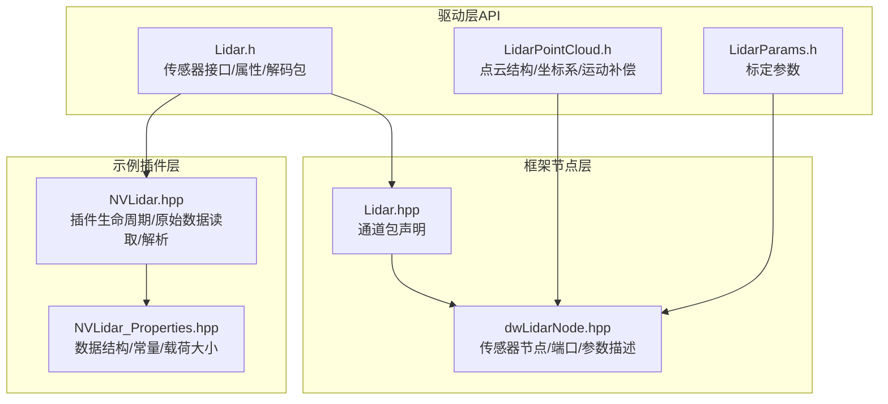
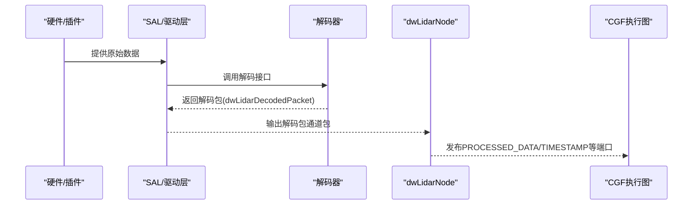
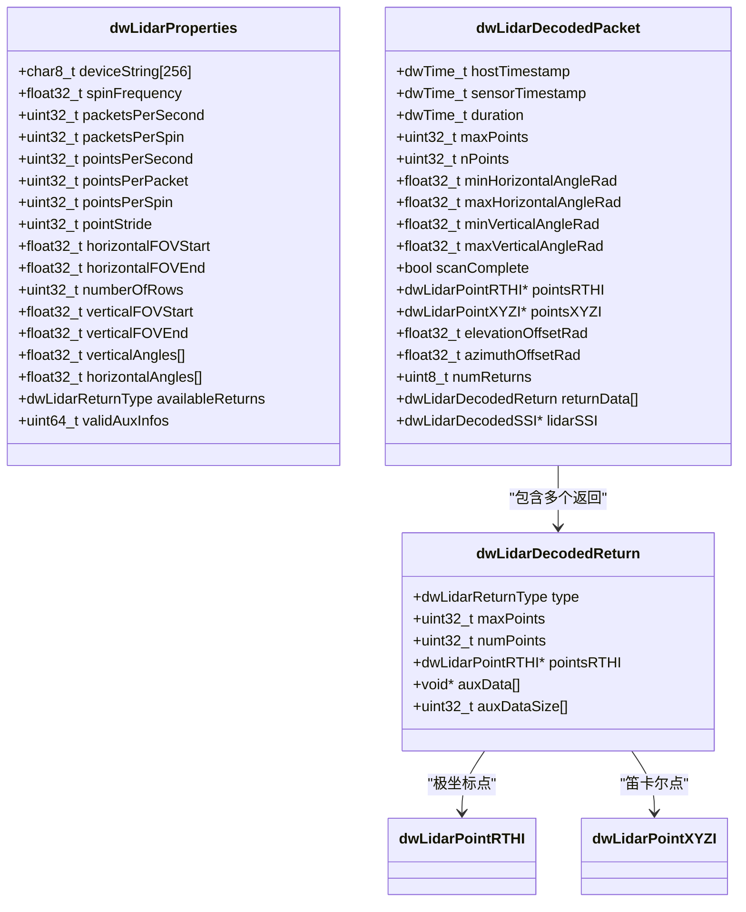
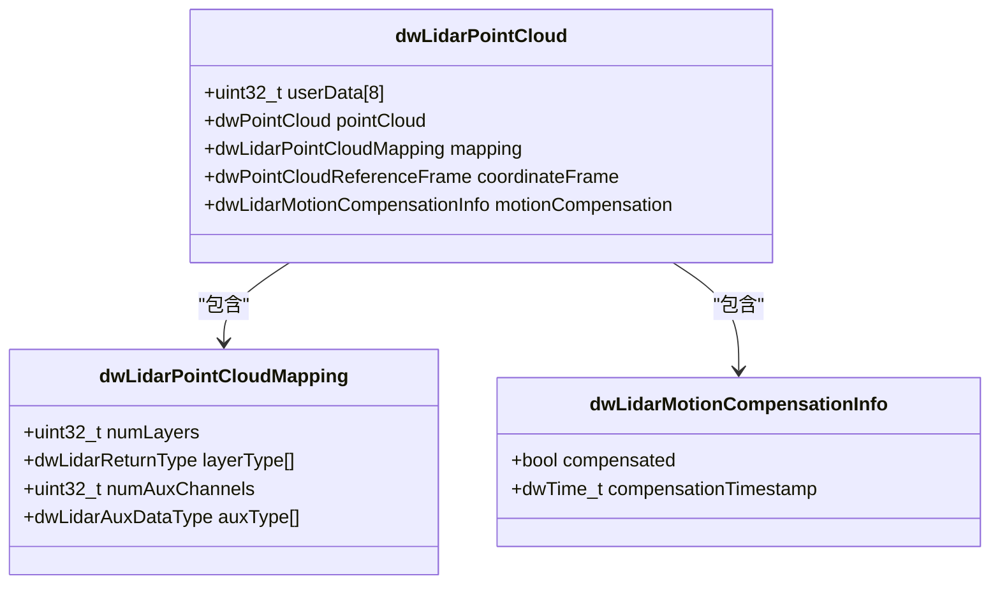
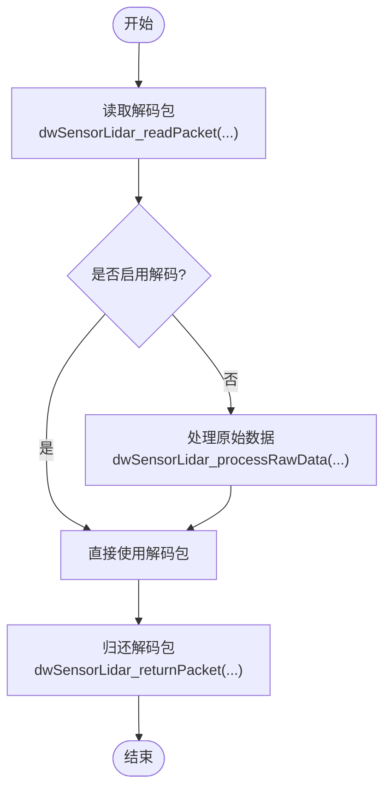
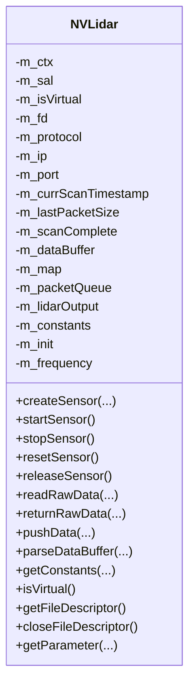
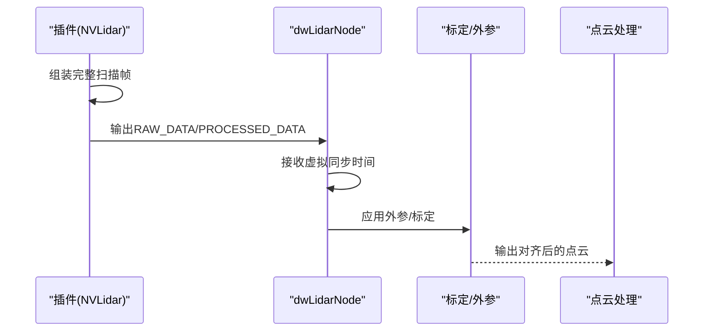
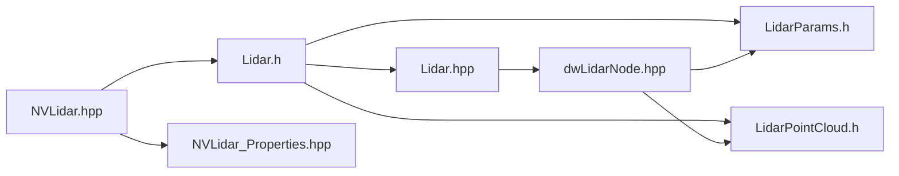

# 激光雷达传感器

<cite>
**本文引用的文件**   
- [Lidar.h（驱动版本5.10）](file://driverorks-5.10/include/dw/sensors/lidar/Lidar.h)
- [LidarPointCloud.h（驱动版本5.10）](file://driverorks-5.10/include/dw/pointcloudprocessing/pointcloud/LidarPointCloud.h)
- [LidarParams.h（驱动版本5.10）](file://driverorks-5.10/include/dw/calibration/engine/lidar/LidarParams.h)
- [Lidar.hpp（通道包，驱动版本5.10）](file://driverorks-5.10/include/dwframework/dwnodes/common/channelpackets/Lidar.hpp)
- [dwLidarNode.hpp（驱动框架节点，驱动版本5.10）](file://driverorks-5.10/include/dwframework/dwnodes/sensors/dwlidarnode/dwLidarNode.hpp)
- [Lidar.h（驱动版本5.14）](file://driveworks-5.14/include/dw/sensors/lidar/Lidar.h)
- [LidarPointCloud.h（驱动版本5.14）](file://driveworks-5.14/include/dw/pointcloudprocessing/pointcloud/LidarPointCloud.h)
- [LidarParams.h（驱动版本5.14）](file://driveworks-5.14/include/dw/calibration/engine/lidar/LidarParams.h)
- [NVLidar.hpp（示例插件，驱动版本5.14）](file://driveworks-5.14/samples/src/sensors/plugins/lidar/NVLidar.hpp)
- [NVLidar_Properties.hpp（示例插件属性，驱动版本5.14）](file://driveworks-5.14/samples/src/sensors/plugins/lidar/NVLidar_Properties.hpp)
</cite>

## 目录
1. [简介](#简介)
2. [项目结构](#项目结构)
3. [核心组件](#核心组件)
4. [架构总览](#架构总览)
5. [详细组件分析](#详细组件分析)
6. [依赖关系分析](#依赖关系分析)
7. [性能考虑](#性能考虑)
8. [故障排查指南](#故障排查指南)
9. [结论](#结论)
10. [附录：完整配置与使用示例路径](#附录完整配置与使用示例路径)

## 简介
本技术文档围绕激光雷达传感器模块进行系统化梳理，覆盖接口设计、参数配置、点云数据结构、数据读取流程、多传感器同步与坐标系对齐、以及配置示例与异常处理实践。内容以驱动版本5.10与5.14的公开API与示例插件为基础，帮助开发者快速理解并正确集成激光雷达数据采集与处理链路。

## 项目结构
激光雷达相关能力主要分布在以下层次：
- 驱动层API：定义传感器接口、属性、解码包与辅助数据类型等
- 标定与点云处理层：定义点云结构、参考坐标系、运动补偿与映射关系
- 框架节点层：将传感器输出封装为通道包，接入CGF执行图
- 示例插件层：演示如何从原始数据流解析、组包、解码并输出

**图表来源**
- [Lidar.h（驱动版本5.10）:1-391](file://driverorks-5.10/include/dw/sensors/lidar/Lidar.h#L1-L391)
- [LidarPointCloud.h（驱动版本5.10）:1-147](file://driverorks-5.10/include/dw/pointcloudprocessing/pointcloud/LidarPointCloud.h#L1-L147)
- [LidarParams.h（驱动版本5.10）:1-78](file://driverorks-5.10/include/dw/calibration/engine/lidar/LidarParams.h#L1-L78)
- [Lidar.hpp（通道包，驱动版本5.10）:1-41](file://driverorks-5.10/include/dwframework/dwnodes/common/channelpackets/Lidar.hpp#L1-L41)
- [dwLidarNode.hpp（驱动框架节点，驱动版本5.10）:1-122](file://driverorks-5.10/include/dwframework/dwnodes/sensors/dwlidarnode/dwLidarNode.hpp#L1-L122)
- [NVLidar.hpp（示例插件，驱动版本5.14）:1-181](file://driveworks-5.14/samples/src/sensors/plugins/lidar/NVLidar.hpp#L1-L181)
- [NVLidar_Properties.hpp（示例插件属性，驱动版本5.14）:1-101](file://driveworks-5.14/samples/src/sensors/plugins/lidar/NVLidar_Properties.hpp#L1-L101)

**章节来源**
- [Lidar.h（驱动版本5.10）:1-391](file://driverorks-5.10/include/dw/sensors/lidar/Lidar.h#L1-L391)
- [LidarPointCloud.h（驱动版本5.10）:1-147](file://driverorks-5.10/include/dw/pointcloudprocessing/pointcloud/LidarPointCloud.h#L1-L147)
- [LidarParams.h（驱动版本5.10）:1-78](file://driverorks-5.10/include/dw/calibration/engine/lidar/LidarParams.h#L1-L78)
- [Lidar.hpp（通道包，驱动版本5.10）:1-41](file://driverorks-5.10/include/dwframework/dwnodes/common/channelpackets/Lidar.hpp#L1-L41)
- [dwLidarNode.hpp（驱动框架节点，驱动版本5.10）:1-122](file://driverorks-5.10/include/dwframework/dwnodes/sensors/dwlidarnode/dwLidarNode.hpp#L1-L122)
- [NVLidar.hpp（示例插件，驱动版本5.14）:1-181](file://driveworks-5.14/samples/src/sensors/plugins/lidar/NVLidar.hpp#L1-L181)
- [NVLidar_Properties.hpp（示例插件属性，驱动版本5.14）:1-101](file://driveworks-5.14/samples/src/sensors/plugins/lidar/NVLidar_Properties.hpp#L1-L101)

## 核心组件
- 激光雷达抽象与接口
  - 返回类型与辅助数据类型枚举，用于指示可用返回与扩展信息
  - 属性结构体包含设备标识、转速、包/点速率、视角范围、行列角列表、可用返回与有效辅助信息位图
  - 解码包结构体包含时间戳、扫描完整性标志、极坐标与笛卡尔坐标的点数组、偏移角、返回数量与各返回的点集与辅助数据指针
- 点云数据结构
  - 坐标参考系：传感器坐标系、平台（车身/rig）坐标系、自定义坐标系
  - 运动补偿信息：是否已补偿及补偿参考时间戳
  - 映射关系：返回层映射与辅助通道映射
  - 用户自定义数据缓冲区
- 标定参数
  - 标定参数结构体包含快速接受策略、用户数据指针、状态变更回调、以及指向被标定激光雷达属性的指针

**章节来源**
- [Lidar.h（驱动版本5.14）:59-82](file://driveworks-5.14/include/dw/sensors/lidar/Lidar.h#L59-L82)
- [Lidar.h（驱动版本5.14）:84-110](file://driveworks-5.14/include/dw/sensors/lidar/Lidar.h#L84-L110)
- [Lidar.h（驱动版本5.14）:159-201](file://driveworks-5.14/include/dw/sensors/lidar/Lidar.h#L159-L201)
- [Lidar.h（驱动版本5.14）:203-265](file://driveworks-5.14/include/dw/sensors/lidar/Lidar.h#L203-L265)
- [LidarPointCloud.h（驱动版本5.14）:55-71](file://driveworks-5.14/include/dw/pointcloudprocessing/pointcloud/LidarPointCloud.h#L55-L71)
- [LidarPointCloud.h（驱动版本5.14）:77-87](file://driveworks-5.14/include/dw/pointcloudprocessing/pointcloud/LidarPointCloud.h#L77-L87)
- [LidarPointCloud.h（驱动版本5.14）:97-109](file://driveworks-5.14/include/dw/pointcloudprocessing/pointcloud/LidarPointCloud.h#L97-L109)
- [LidarParams.h（驱动版本5.14）:53-71](file://driveworks-5.14/include/dw/calibration/engine/lidar/LidarParams.h#L53-L71)

## 架构总览
激光雷达数据从硬件/插件读取原始数据，经由驱动层解码生成解码包，再通过框架节点封装为通道包，最终进入CGF执行图。点云处理模块负责将解码包转换为统一的点云结构，并支持坐标系变换与运动补偿。

**图表来源**
- [Lidar.hpp（通道包，驱动版本5.10）:38-38](file://driverorks-5.10/include/dwframework/dwnodes/common/channelpackets/Lidar.hpp#L38-L38)
- [dwLidarNode.hpp（驱动框架节点，驱动版本5.10）:65-73](file://driverorks-5.10/include/dwframework/dwnodes/sensors/dwlidarnode/dwLidarNode.hpp#L65-L73)
- [Lidar.h（驱动版本5.14）:332-334](file://driveworks-5.14/include/dw/sensors/lidar/Lidar.h#L332-L334)

## 详细组件分析

### 组件A：Lidar抽象与接口
- 返回类型与辅助数据类型
  - 返回类型：首回、尾回、最强回、绝对最强回，以及通用返回类型位域
  - 辅助数据类型：信噪比、脉冲宽度、时间、速度、存在概率、串扰概率、噪声水平、区域ID、检测器ID、行号、数据质量、扫描检查点、遮挡标志、传感器ID、方位角、高度角、距离、ROI、有效性、无效性标志等
- 属性结构体字段
  - 设备字符串、转速、每秒包数/每转包数、每秒点数、每包点数、每转点数、点步长
  - 水平/垂直视场起止角、行数、每行垂直角与水平角偏移数组、可用返回位图、有效辅助信息位图
- 解码包结构体
  - 主机/传感器时间戳、持续时间、最小/最大水平/垂直角、扫描完整性标志
  - 极坐标/笛卡尔坐标点指针、俯仰/方位偏移角、返回数量与各返回的点集与辅助数据指针
- 关键API
  - 启用/禁用解码、查询解码状态
  - 读取解码包、归还解码包
  - 处理原始数据为解码包
  - 获取传感器属性
  - 发送消息给传感器

**图表来源**
- [Lidar.h（驱动版本5.14）:159-201](file://driveworks-5.14/include/dw/sensors/lidar/Lidar.h#L159-L201)
- [Lidar.h（驱动版本5.14）:203-225](file://driveworks-5.14/include/dw/sensors/lidar/Lidar.h#L203-L225)
- [Lidar.h（驱动版本5.14）:230-265](file://driveworks-5.14/include/dw/sensors/lidar/Lidar.h#L230-L265)

**章节来源**
- [Lidar.h（驱动版本5.14）:59-82](file://driveworks-5.14/include/dw/sensors/lidar/Lidar.h#L59-L82)
- [Lidar.h（驱动版本5.14）:84-110](file://driveworks-5.14/include/dw/sensors/lidar/Lidar.h#L84-L110)
- [Lidar.h（驱动版本5.14）:159-201](file://driveworks-5.14/include/dw/sensors/lidar/Lidar.h#L159-L201)
- [Lidar.h（驱动版本5.14）:203-265](file://driveworks-5.14/include/dw/sensors/lidar/Lidar.h#L203-L265)

### 组件B：点云数据结构与坐标系
- 坐标参考系
  - 传感器坐标系（原点在传感器）
  - 平台（RIG）坐标系（原点在车辆）
  - 自定义坐标系
- 运动补偿信息
  - 是否已补偿
  - 补偿参考时间戳
- 映射关系
  - 返回层映射：将不同返回类型映射到点云层
  - 辅助通道映射：将辅助数据类型映射到点云的辅助通道
- 用户数据缓冲区
  - 保留8个32位整型供用户使用

**图表来源**
- [LidarPointCloud.h（驱动版本5.14）:77-87](file://driveworks-5.14/include/dw/pointcloudprocessing/pointcloud/LidarPointCloud.h#L77-L87)
- [LidarPointCloud.h（驱动版本5.14）:97-109](file://driveworks-5.14/include/dw/pointcloudprocessing/pointcloud/LidarPointCloud.h#L97-L109)

**章节来源**
- [LidarPointCloud.h（驱动版本5.14）:55-71](file://driveworks-5.14/include/dw/pointcloudprocessing/pointcloud/LidarPointCloud.h#L55-L71)
- [LidarPointCloud.h（驱动版本5.14）:77-87](file://driveworks-5.14/include/dw/pointcloudprocessing/pointcloud/LidarPointCloud.h#L77-L87)
- [LidarPointCloud.h（驱动版本5.14）:97-109](file://driveworks-5.14/include/dw/pointcloudprocessing/pointcloud/LidarPointCloud.h#L97-L109)

### 组件C：数据读取与解码流程
- 读取解码包
  - 支持超时参数，可无限等待或轮询
  - 返回的数据在应用归还前保持稳定
- 处理原始数据
  - 在调用线程上进行CPU解码，增加CPU负载
  - 解码结果在应用归还原始数据前有效
- 获取传感器属性
  - 查询传感器当前配置与能力

**图表来源**
- [Lidar.h（驱动版本5.14）:332-334](file://driveworks-5.14/include/dw/sensors/lidar/Lidar.h#L332-L334)
- [Lidar.h（驱动版本5.14）:364-366](file://driveworks-5.14/include/dw/sensors/lidar/Lidar.h#L364-L366)
- [Lidar.h（驱动版本5.14）:347-348](file://driveworks-5.14/include/dw/sensors/lidar/Lidar.h#L347-L348)

**章节来源**
- [Lidar.h（驱动版本5.14）:332-334](file://driveworks-5.14/include/dw/sensors/lidar/Lidar.h#L332-L334)
- [Lidar.h（驱动版本5.14）:364-366](file://driveworks-5.14/include/dw/sensors/lidar/Lidar.h#L364-L366)
- [Lidar.h（驱动版本5.14）:347-348](file://driveworks-5.14/include/dw/sensors/lidar/Lidar.h#L347-L348)

### 组件D：示例插件（NVIDIA激光雷达）
- 生命周期
  - 创建/启动/停止/重置/释放传感器
  - 读取原始数据、归还原始数据、推送数据
- 数据解析
  - 将原始缓冲解析为解码包
  - 获取解码器常量
- 参数与连接
  - 从命令行参数解析所需配置
  - 建立网络连接（UDP），管理文件描述符
- 数据结构与常量
  - 定义原始包、极坐标/笛卡尔点结构
  - 定义最大点数、点步长、UDP载荷大小、每切片包数、每秒最大转数等

**图表来源**
- [NVLidar.hpp（示例插件，驱动版本5.14）:63-179](file://driveworks-5.14/samples/src/sensors/plugins/lidar/NVLidar.hpp#L63-L179)
- [NVLidar_Properties.hpp（示例插件属性，驱动版本5.14）:62-93](file://driveworks-5.14/samples/src/sensors/plugins/lidar/NVLidar_Properties.hpp#L62-L93)

**章节来源**
- [NVLidar.hpp（示例插件，驱动版本5.14）:74-127](file://driveworks-5.14/samples/src/sensors/plugins/lidar/NVLidar.hpp#L74-L127)
- [NVLidar_Properties.hpp（示例插件属性，驱动版本5.14）:46-58](file://driveworks-5.14/samples/src/sensors/plugins/lidar/NVLidar_Properties.hpp#L46-L58)
- [NVLidar_Properties.hpp（示例插件属性，驱动版本5.14）:62-93](file://driveworks-5.14/samples/src/sensors/plugins/lidar/NVLidar_Properties.hpp#L62-L93)

### 组件E：多激光雷达同步与坐标系对齐
- 同步机制
  - 传感器节点提供虚拟同步时间端口，用于跨传感器时间对齐
  - 插件侧可维护扫描完成标志与时间戳，确保一帧完整扫描后再输出
- 坐标系对齐
  - 点云结构支持三种参考系：传感器、RIG、自定义
  - 结合外参（如标定）与运动补偿信息，实现多传感器点云融合

**图表来源**
- [dwLidarNode.hpp（驱动框架节点，驱动版本5.10）:59-73](file://driverorks-5.10/include/dwframework/dwnodes/sensors/dwlidarnode/dwLidarNode.hpp#L59-L73)
- [LidarPointCloud.h（驱动版本5.14）:55-62](file://driveworks-5.14/include/dw/pointcloudprocessing/pointcloud/LidarPointCloud.h#L55-L62)

**章节来源**
- [dwLidarNode.hpp（驱动框架节点，驱动版本5.10）:59-73](file://driverorks-5.10/include/dwframework/dwnodes/sensors/dwlidarnode/dwLidarNode.hpp#L59-L73)
- [LidarPointCloud.h（驱动版本5.14）:55-62](file://driveworks-5.14/include/dw/pointcloudprocessing/pointcloud/LidarPointCloud.h#L55-L62)

## 依赖关系分析
- 接口依赖
  - dwLidarDecodedPacket依赖于点类型（极坐标/笛卡尔）、返回类型与辅助数据类型
  - 点云结构依赖于映射关系与坐标参考系枚举
- 框架依赖
  - 通道包声明将解码包与框架类型关联
  - 传感器节点描述输入/输出端口与参数，对接CGF执行图
- 示例插件依赖
  - 插件内部维护原始数据缓冲、队列与解码常量，解析后填充解码包

**图表来源**
- [Lidar.h（驱动版本5.14）:1-401](file://driveworks-5.14/include/dw/sensors/lidar/Lidar.h#L1-L401)
- [Lidar.hpp（通道包，驱动版本5.10）:38-38](file://driverorks-5.10/include/dwframework/dwnodes/common/channelpackets/Lidar.hpp#L38-L38)
- [dwLidarNode.hpp（驱动框架节点，驱动版本5.10）:107-118](file://driverorks-5.10/include/dwframework/dwnodes/sensors/dwlidarnode/dwLidarNode.hpp#L107-L118)
- [LidarPointCloud.h（驱动版本5.14）:1-147](file://driveworks-5.14/include/dw/pointcloudprocessing/pointcloud/LidarPointCloud.h#L1-L147)
- [LidarParams.h（驱动版本5.14）:1-78](file://driveworks-5.14/include/dw/calibration/engine/lidar/LidarParams.h#L1-L78)
- [NVLidar.hpp（示例插件，驱动版本5.14）:1-181](file://driveworks-5.14/samples/src/sensors/plugins/lidar/NVLidar.hpp#L1-L181)
- [NVLidar_Properties.hpp（示例插件属性，驱动版本5.14）:1-101](file://driveworks-5.14/samples/src/sensors/plugins/lidar/NVLidar_Properties.hpp#L1-L101)

**章节来源**
- [Lidar.hpp（通道包，驱动版本5.10）:38-38](file://driverorks-5.10/include/dwframework/dwnodes/common/channelpackets/Lidar.hpp#L38-L38)
- [dwLidarNode.hpp（驱动框架节点，驱动版本5.10）:107-118](file://driverorks-5.10/include/dwframework/dwnodes/sensors/dwlidarnode/dwLidarNode.hpp#L107-L118)
- [NVLidar.hpp（示例插件，驱动版本5.14）:1-181](file://driveworks-5.14/samples/src/sensors/plugins/lidar/NVLidar.hpp#L1-L181)

## 性能考虑
- 解码开关
  - 启用解码会增加CPU负载；若仅需原始数据，可关闭解码以降低开销
- 内存与带宽
  - 根据最大点数、每包点数与包速率合理分配内存池
  - UDP载荷大小与每切片包数影响吞吐与延迟
- 时间戳与同步
  - 使用虚拟同步时间端口保证多传感器时间对齐，减少后续融合代价
- 运动补偿
  - 对需要高精度融合的应用，启用运动补偿并选择合适的参考时间戳

[本节为通用指导，不直接分析具体文件]

## 故障排查指南
- 常见错误与处理
  - 句柄无效：确认传感器句柄来自正确的创建流程
  - 调用不允许：当传感器处于运行状态时，禁止修改解码状态；先停止再操作
  - 资源不可用：检查设备连接与供电状态
  - 超时：调整读取超时参数或检查数据流是否正常
- 异常处理建议
  - 在读取/解码前后记录时间戳与状态
  - 对返回的指针在使用完毕后及时归还，避免资源泄漏
  - 对插件侧的原始数据缓冲与队列进行边界检查与完整性校验

**章节来源**
- [Lidar.h（驱动版本5.14）:315-334](file://driveworks-5.14/include/dw/sensors/lidar/Lidar.h#L315-L334)
- [Lidar.h（驱动版本5.14）:368-379](file://driveworks-5.14/include/dw/sensors/lidar/Lidar.h#L368-L379)
- [Lidar.h（驱动版本5.14）:381-393](file://driveworks-5.14/include/dw/sensors/lidar/Lidar.h#L381-L393)

## 结论
激光雷达传感器模块通过清晰的接口与结构化数据模型，提供了从原始数据采集、解码到点云处理与多传感器融合的完整能力。结合示例插件与框架节点，开发者可以快速搭建稳定的激光雷达数据管线，并通过标定与运动补偿实现高精度场景应用。

[本节为总结性内容，不直接分析具体文件]

## 附录：完整配置与使用示例路径
- 初始化与配置
  - 创建传感器与上下文：参考示例插件的生命周期函数
  - 设置解码状态：根据需求启用/禁用解码
  - 获取传感器属性：读取设备信息与能力参数
- 读取与处理
  - 读取解码包：使用读取接口并设置合适超时
  - 处理原始数据：在CPU线程上进行解码
  - 归还数据：确保及时归还解码包与原始数据
- 点云与坐标系
  - 创建点云结构：指定格式（XYZI/RTHI）、内存类型与映射关系
  - 设置坐标参考系：选择传感器/RIG/自定义坐标系
  - 运动补偿：标记补偿状态与参考时间戳
- 多传感器同步
  - 使用虚拟同步时间端口对齐多传感器帧
  - 结合外参与标定参数进行坐标系对齐

**章节来源**
- [NVLidar.hpp（示例插件，驱动版本5.14）:74-87](file://driveworks-5.14/samples/src/sensors/plugins/lidar/NVLidar.hpp#L74-L87)
- [NVLidar.hpp（示例插件，驱动版本5.14）:90-91](file://driveworks-5.14/samples/src/sensors/plugins/lidar/NVLidar.hpp#L90-L91)
- [Lidar.h（驱动版本5.14）:274-289](file://driveworks-5.14/include/dw/sensors/lidar/Lidar.h#L274-L289)
- [Lidar.h（驱动版本5.14）:332-334](file://driveworks-5.14/include/dw/sensors/lidar/Lidar.h#L332-L334)
- [Lidar.h（驱动版本5.14）:364-366](file://driveworks-5.14/include/dw/sensors/lidar/Lidar.h#L364-L366)
- [LidarPointCloud.h（驱动版本5.14）:123-128](file://driveworks-5.14/include/dw/pointcloudprocessing/pointcloud/LidarPointCloud.h#L123-L128)
- [LidarPointCloud.h（驱动版本5.14）:55-62](file://driveworks-5.14/include/dw/pointcloudprocessing/pointcloud/LidarPointCloud.h#L55-L62)
- [dwLidarNode.hpp（驱动框架节点，驱动版本5.10）:65-73](file://driverorks-5.10/include/dwframework/dwnodes/sensors/dwlidarnode/dwLidarNode.hpp#L65-L73)