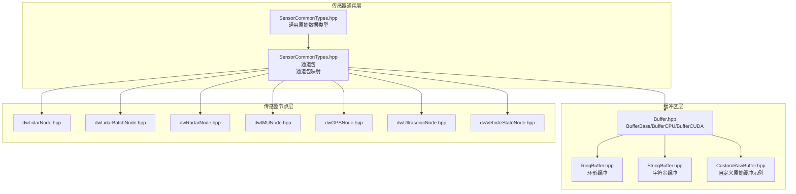
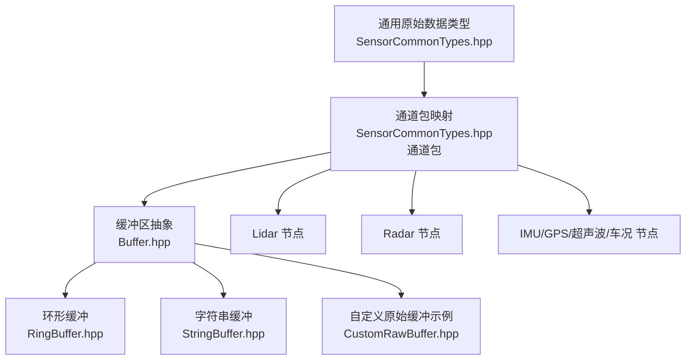
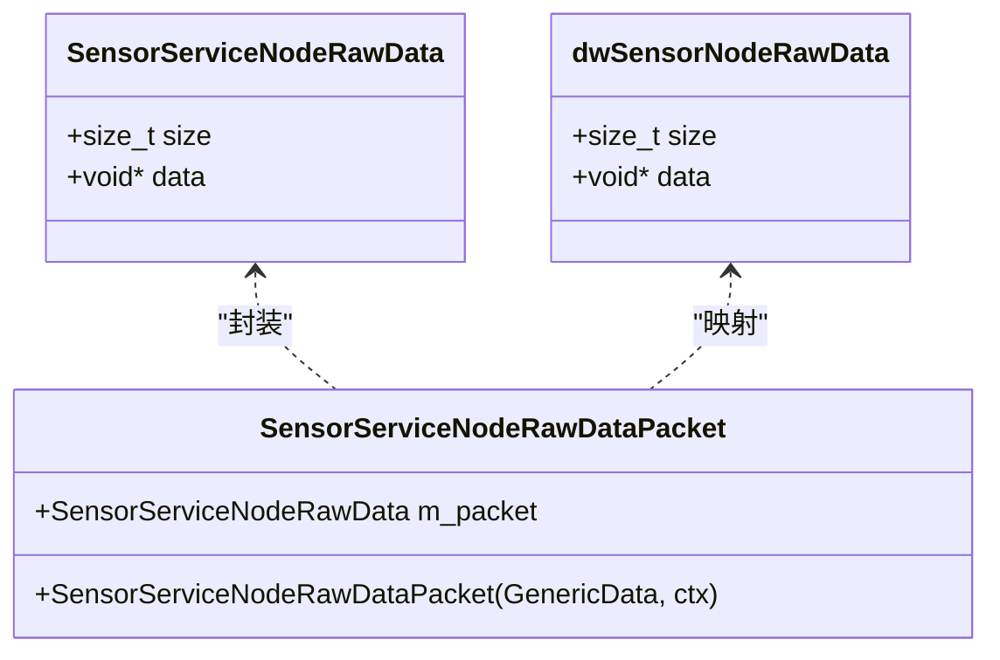
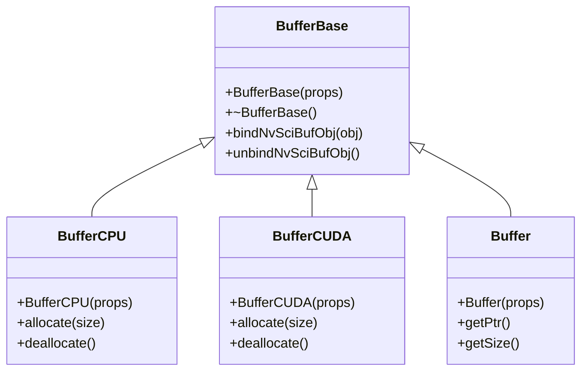
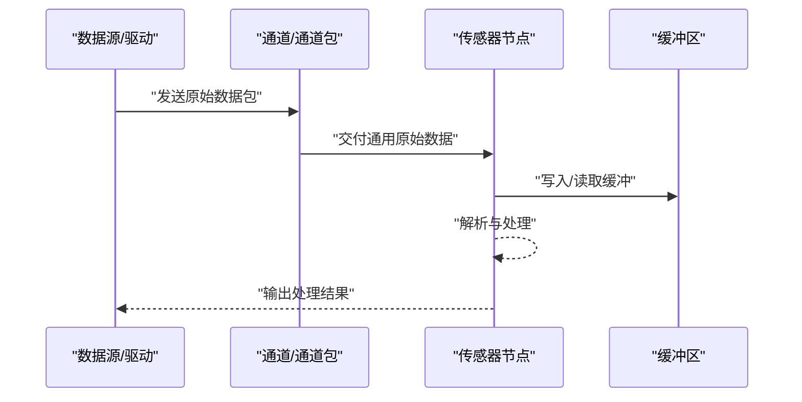
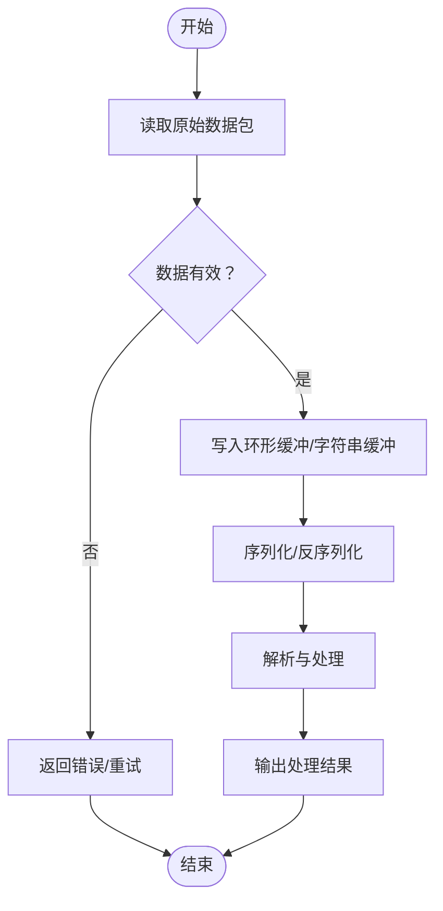
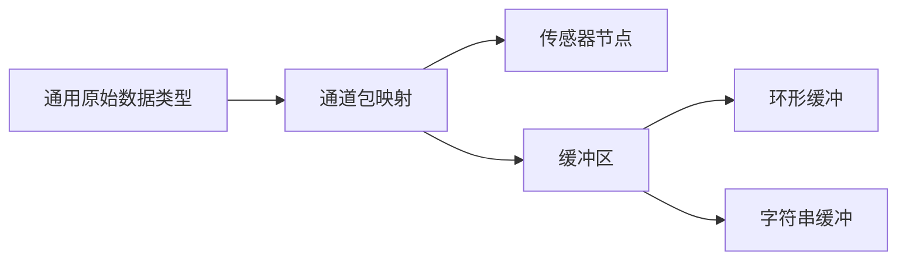

# 通用数据传感器

<cite>
**本文引用的文件**
- [SensorCommonTypes.hpp](file://driverorks-5.10/include/dwframework/dwnodes/common/SensorCommonTypes.hpp)
- [SensorCommonTypes.hpp（通道包）](file://driverorks-5.10/include/dwframework/dwnodes/common/channelpackets/SensorCommonTypes.hpp)
- [Buffer.hpp](file://driverorks-5.10/include/dwcgf/channel/Buffer.hpp)
- [Buffer.hpp（5.14）](file://driveworks-5.14/include/dwcgf/channel/Buffer.hpp)
- [Buffer.hpp（5.8）](file://driveworks-5.8/include/dwcgf/channel/Buffer.hpp)
- [Buffer.hpp（520）](file://driveworks-520/include/dwcgf/channel/Buffer.hpp)
- [RingBuffer.hpp](file://driverorks-5.10/include/dwshared/dwfoundation/dw/core/container/RingBuffer.hpp)
- [RingBuffer.hpp（5.14）](file://driveworks-5.14/include/dwshared/dwfoundation/dw/core/container/RingBuffer.hpp)
- [RingBuffer.hpp（5.8）](file://driveworks-5.8/include/dwshared/dwfoundation/dw/core/container/RingBuffer.hpp)
- [RingBuffer.hpp（520）](file://driveworks-520/include/dwshared/dwfoundation/dw/core/container/RingBuffer.hpp)
- [StringBuffer.hpp](file://driverorks-5.10/include/dwshared/dwfoundation/dw/core/base/StringBuffer.hpp)
- [StringBuffer.hpp（5.14）](file://driveworks-5.14/include/dwshared/dwfoundation/dw/core/base/StringBuffer.hpp)
- [CustomRawBuffer.hpp](file://driverorks-5.10/samples/src/dwchannel/CustomRawBuffer.hpp)
- [CustomRawBuffer.hpp（5.14）](file://driveworks-5.14/samples/src/dwchannel/CustomRawBuffer.hpp)
- [NVLidar.hpp](file://driverorks-5.10/samples/src/sensors/plugins/lidar/NVLidar.hpp)
- [NVRadar.hpp](file://driverorks-5.10/samples/src/sensors/plugins/radar/NVRadar.hpp)
- [dwLidarNode.hpp](file://driverorks-5.10/include/dwframework/dwnodes/sensors/dwlidarnode/dwLidarNode.hpp)
- [dwLidarBatchNode.hpp](file://driverorks-5.10/include/dwframework/dwnodes/sensors/dwlidarnode/dwLidarBatchNode.hpp)
- [dwRadarNode.hpp](file://driverorks-5.10/include/dwframework/dwnodes/sensors/dwradarnode/dwRadarNode.hpp)
- [dwIMUNode.hpp](file://driverorks-5.10/include/dwframework/dwnodes/sensors/dwimunode/dwIMUNode.hpp)
- [dwGPSNode.hpp](file://driverorks-5.10/include/dwframework/dwnodes/sensors/dwgpsnode/dwGPSNode.hpp)
- [dwUltrasonicNode.hpp](file://driverorks-5.10/include/dwframework/dwnodes/sensors/dwultrasonicnode/dwUltrasonicNode.hpp)
- [dwVehicleStateNode.hpp](file://driverorks-5.10/include/dwframework/dwnodes/sensors/dwvehiclestatenode/dwVehicleStateNode.hpp)
- [md_samples_sensors_data_README.html](file://driverorks-5.10/doc/nvsdk_dw_html/md_samples_sensors_data_README.html)
</cite>

## 目录
1. [引言](#引言)
2. [项目结构](#项目结构)
3. [核心组件](#核心组件)
4. [架构总览](#架构总览)
5. [详细组件分析](#详细组件分析)
6. [依赖关系分析](#依赖关系分析)
7. [性能考量](#性能考量)
8. [故障排查指南](#故障排查指南)
9. [结论](#结论)
10. [附录：配置与使用示例](#附录配置与使用示例)

## 引言
本技术文档聚焦于通用数据传感器模块，围绕“Data”传感器的接口设计与实现展开，系统阐述以下主题：
- Data抽象类的接口规范与职责边界
- 通用数据格式支持与灵活的数据处理机制
- 通用数据读取方法：任意二进制数据获取、缓冲区管理、序列化/反序列化
- 应用场景：虚拟传感器、数据回放、自定义数据流处理
- 完整配置示例：数据格式定义、缓冲区大小、数据流控制与错误处理
- 实际代码示例路径：初始化、配置、读取与状态处理

## 项目结构
通用数据传感器位于驱动框架与通道包层中，核心由以下部分组成：
- 传感器通用类型与通道包：定义通用原始数据类型及其通道包映射
- 缓冲区与环形缓冲：提供内存管理与数据流缓冲能力
- 自定义原始缓冲示例：展示如何扩展原始数据读取与写入
- 典型传感器节点：Lidar、Radar、IMU、GPS、超声波、车况等节点对原始数据端口进行声明与使用

**图示来源**
- [SensorCommonTypes.hpp:72-90](file://driverorks-5.10/include/dwframework/dwnodes/common/SensorCommonTypes.hpp#L72-L90)
- [SensorCommonTypes.hpp（通道包）:38-46](file://driverorks-5.10/include/dwframework/dwnodes/common/channelpackets/SensorCommonTypes.hpp#L38-L46)
- [Buffer.hpp:68-129](file://driverorks-5.10/include/dwcgf/channel/Buffer.hpp#L68-L129)
- [RingBuffer.hpp](file://driverorks-5.10/include/dwshared/dwfoundation/dw/core/container/RingBuffer.hpp)
- [StringBuffer.hpp](file://driverorks-5.10/include/dwshared/dwfoundation/dw/core/base/StringBuffer.hpp)
- [CustomRawBuffer.hpp](file://driverorks-5.10/samples/src/dwchannel/CustomRawBuffer.hpp)
- [dwLidarNode.hpp](file://driverorks-5.10/include/dwframework/dwnodes/sensors/dwlidarnode/dwLidarNode.hpp#L69)
- [dwLidarBatchNode.hpp](file://driverorks-5.10/include/dwframework/dwnodes/sensors/dwlidarnode/dwLidarBatchNode.hpp#L68)
- [dwRadarNode.hpp](file://driverorks-5.10/include/dwframework/dwnodes/sensors/dwradarnode/dwRadarNode.hpp#L84)
- [dwIMUNode.hpp](file://driverorks-5.10/include/dwframework/dwnodes/sensors/dwimunode/dwIMUNode.hpp#L81)
- [dwGPSNode.hpp](file://driverorks-5.10/include/dwframework/dwnodes/sensors/dwgpsnode/dwGPSNode.hpp#L79)
- [dwUltrasonicNode.hpp](file://driverorks-5.10/include/dwframework/dwnodes/sensors/dwultrasonicnode/dwUltrasonicNode.hpp#L73)
- [dwVehicleStateNode.hpp](file://driverorks-5.10/include/dwframework/dwnodes/sensors/dwvehiclestatenode/dwVehicleStateNode.hpp#L92)

**章节来源**
- [SensorCommonTypes.hpp:72-90](file://driverorks-5.10/include/dwframework/dwnodes/common/SensorCommonTypes.hpp#L72-L90)
- [SensorCommonTypes.hpp（通道包）:38-46](file://driverorks-5.10/include/dwframework/dwnodes/common/channelpackets/SensorCommonTypes.hpp#L38-L46)
- [Buffer.hpp:68-129](file://driverorks-5.10/include/dwcgf/channel/Buffer.hpp#L68-L129)
- [RingBuffer.hpp](file://driverorks-5.10/include/dwshared/dwfoundation/dw/core/container/RingBuffer.hpp)
- [StringBuffer.hpp](file://driverorks-5.10/include/dwshared/dwfoundation/dw/core/base/StringBuffer.hpp)
- [CustomRawBuffer.hpp](file://driverorks-5.10/samples/src/dwchannel/CustomRawBuffer.hpp)

## 核心组件
- 通用原始数据类型
  - 在通用类型头文件中定义了通用原始数据结构，并在通道包头文件中为其建立通道包映射关系，确保跨节点传递时的类型一致性与序列化/反序列化支持。
- 缓冲区体系
  - BufferBase/BufferCPU/BufferCUDA 提供统一的缓冲区抽象与平台相关实现；RingBuffer/StringBuffer 提供环形与字符串缓冲能力；CustomRawBuffer 展示如何扩展自定义原始数据缓冲。
- 传感器节点
  - 多个具体传感器节点通过端口声明使用通用原始数据类型，形成统一的数据输入入口。

**章节来源**
- [SensorCommonTypes.hpp:72-90](file://driverorks-5.10/include/dwframework/dwnodes/common/SensorCommonTypes.hpp#L72-L90)
- [SensorCommonTypes.hpp（通道包）:38-46](file://driverorks-5.10/include/dwframework/dwnodes/common/channelpackets/SensorCommonTypes.hpp#L38-L46)
- [Buffer.hpp:68-129](file://driverorks-5.10/include/dwcgf/channel/Buffer.hpp#L68-L129)
- [RingBuffer.hpp](file://driverorks-5.10/include/dwshared/dwfoundation/dw/core/container/RingBuffer.hpp)
- [StringBuffer.hpp](file://driverorks-5.10/include/dwshared/dwfoundation/dw/core/base/StringBuffer.hpp)
- [CustomRawBuffer.hpp](file://driverorks-5.10/samples/src/dwchannel/CustomRawBuffer.hpp)

## 架构总览
通用数据传感器采用“类型定义—通道包映射—缓冲区承载—节点消费”的分层架构。类型层定义通用原始数据；通道包层负责序列化/反序列化与跨进程/跨线程传输；缓冲区层提供内存管理与数据流控制；节点层以统一端口接入原始数据并进行业务处理。

**图示来源**
- [SensorCommonTypes.hpp:72-90](file://driverorks-5.10/include/dwframework/dwnodes/common/SensorCommonTypes.hpp#L72-L90)
- [SensorCommonTypes.hpp（通道包）:38-46](file://driverorks-5.10/include/dwframework/dwnodes/common/channelpackets/SensorCommonTypes.hpp#L38-L46)
- [Buffer.hpp:68-129](file://driverorks-5.10/include/dwcgf/channel/Buffer.hpp#L68-L129)
- [RingBuffer.hpp](file://driverorks-5.10/include/dwshared/dwfoundation/dw/core/container/RingBuffer.hpp)
- [StringBuffer.hpp](file://driverorks-5.10/include/dwshared/dwfoundation/dw/core/base/StringBuffer.hpp)
- [CustomRawBuffer.hpp](file://driverorks-5.10/samples/src/dwchannel/CustomRawBuffer.hpp)
- [dwLidarNode.hpp](file://driverorks-5.10/include/dwframework/dwnodes/sensors/dwlidarnode/dwLidarNode.hpp#L69)
- [dwRadarNode.hpp](file://driverorks-5.10/include/dwframework/dwnodes/sensors/dwradarnode/dwRadarNode.hpp#L84)
- [dwIMUNode.hpp](file://driverorks-5.10/include/dwframework/dwnodes/sensors/dwimunode/dwIMUNode.hpp#L81)
- [dwGPSNode.hpp](file://driverorks-5.10/include/dwframework/dwnodes/sensors/dwgpsnode/dwGPSNode.hpp#L79)
- [dwUltrasonicNode.hpp](file://driverorks-5.10/include/dwframework/dwnodes/sensors/dwultrasonicnode/dwUltrasonicNode.hpp#L73)
- [dwVehicleStateNode.hpp](file://driverorks-5.10/include/dwframework/dwnodes/sensors/dwvehiclestatenode/dwVehicleStateNode.hpp#L92)

## 详细组件分析

### 组件一：通用原始数据类型与通道包映射
- 接口与职责
  - 通用原始数据类型用于承载任意二进制数据，作为传感器节点的统一输入。
  - 通道包映射负责将该类型与通道包绑定，确保序列化/反序列化与跨通道传输。
- 关键要点
  - 类型与通道包的声明与关系在通道包头文件中集中定义，便于维护与扩展。
  - 传感器节点通过端口声明使用该类型，形成标准化的数据接入方式。

**图示来源**
- [SensorCommonTypes.hpp:72-90](file://driverorks-5.10/include/dwframework/dwnodes/common/SensorCommonTypes.hpp#L72-L90)
- [SensorCommonTypes.hpp（通道包）:38-46](file://driverorks-5.10/include/dwframework/dwnodes/common/channelpackets/SensorCommonTypes.hpp#L38-L46)

**章节来源**
- [SensorCommonTypes.hpp:72-90](file://driverorks-5.10/include/dwframework/dwnodes/common/SensorCommonTypes.hpp#L72-L90)
- [SensorCommonTypes.hpp（通道包）:38-46](file://driverorks-5.10/include/dwframework/dwnodes/common/channelpackets/SensorCommonTypes.hpp#L38-L46)

### 组件二：缓冲区与数据流管理
- BufferBase/BufferCPU/BufferCUDA
  - 提供统一的缓冲区抽象，支持CPU与CUDA内存，满足不同硬件加速需求。
  - 支持绑定与释放底层内存对象，保证生命周期与资源安全。
- 环形缓冲 RingBuffer
  - 提供固定容量的环形队列，适合高吞吐量数据流的暂存与轮转。
- 字符串缓冲 StringBuffer
  - 面向字符串场景的动态缓冲，便于文本/日志等数据的拼接与输出。
- 自定义原始缓冲 CustomRawBuffer
  - 示例展示了如何扩展原始数据的读取与写入，适配特定协议或格式。

**图示来源**
- [Buffer.hpp（5.10）:68-129](file://driverorks-5.10/include/dwcgf/channel/Buffer.hpp#L68-L129)
- [Buffer.hpp（5.14）:73-140](file://driveworks-5.14/include/dwcgf/channel/Buffer.hpp#L73-L140)
- [Buffer.hpp（5.8）:69-255](file://driveworks-5.8/include/dwcgf/channel/Buffer.hpp#L69-L255)
- [Buffer.hpp（520）](file://driveworks-520/include/dwcgf/channel/Buffer.hpp)

**章节来源**
- [Buffer.hpp（5.10）:68-129](file://driverorks-5.10/include/dwcgf/channel/Buffer.hpp#L68-L129)
- [Buffer.hpp（5.14）:73-140](file://driveworks-5.14/include/dwcgf/channel/Buffer.hpp#L73-L140)
- [Buffer.hpp（5.8）:69-255](file://driveworks-5.8/include/dwcgf/channel/Buffer.hpp#L69-L255)
- [Buffer.hpp（520）](file://driveworks-520/include/dwcgf/channel/Buffer.hpp)
- [RingBuffer.hpp（5.10）](file://driverorks-5.10/include/dwshared/dwfoundation/dw/core/container/RingBuffer.hpp)
- [RingBuffer.hpp（5.14）](file://driveworks-5.14/include/dwshared/dwfoundation/dw/core/container/RingBuffer.hpp)
- [RingBuffer.hpp（5.8）](file://driveworks-5.8/include/dwshared/dwfoundation/dw/core/container/RingBuffer.hpp)
- [RingBuffer.hpp（520）](file://driveworks-520/include/dwshared/dwfoundation/dw/core/container/RingBuffer.hpp)
- [StringBuffer.hpp（5.10）](file://driverorks-5.10/include/dwshared/dwfoundation/dw/core/base/StringBuffer.hpp)
- [StringBuffer.hpp（5.14）](file://driveworks-5.14/include/dwshared/dwfoundation/dw/core/base/StringBuffer.hpp)
- [CustomRawBuffer.hpp（5.10）](file://driverorks-5.10/samples/src/dwchannel/CustomRawBuffer.hpp)
- [CustomRawBuffer.hpp（5.14）](file://driveworks-5.14/samples/src/dwchannel/CustomRawBuffer.hpp)

### 组件三：典型传感器节点与原始数据端口
- 节点端口声明
  - Lidar、Radar、IMU、GPS、超声波、车况等节点均通过端口声明使用通用原始数据类型，形成统一的数据入口。
- 数据读取流程
  - 节点从通道接收原始数据包，解析并转换为内部数据结构，再进入后续处理管线。

**图示来源**
- [SensorCommonTypes.hpp（通道包）:38-46](file://driverorks-5.10/include/dwframework/dwnodes/common/channelpackets/SensorCommonTypes.hpp#L38-L46)
- [dwLidarNode.hpp](file://driverorks-5.10/include/dwframework/dwnodes/sensors/dwlidarnode/dwLidarNode.hpp#L69)
- [dwLidarBatchNode.hpp](file://driverorks-5.10/include/dwframework/dwnodes/sensors/dwlidarnode/dwLidarBatchNode.hpp#L68)
- [dwRadarNode.hpp](file://driverorks-5.10/include/dwframework/dwnodes/sensors/dwradarnode/dwRadarNode.hpp#L84)
- [dwIMUNode.hpp](file://driverorks-5.10/include/dwframework/dwnodes/sensors/dwimunode/dwIMUNode.hpp#L81)
- [dwGPSNode.hpp](file://driverorks-5.10/include/dwframework/dwnodes/sensors/dwgpsnode/dwGPSNode.hpp#L79)
- [dwUltrasonicNode.hpp](file://driverorks-5.10/include/dwframework/dwnodes/sensors/dwultrasonicnode/dwUltrasonicNode.hpp#L73)
- [dwVehicleStateNode.hpp](file://driverorks-5.10/include/dwframework/dwnodes/sensors/dwvehiclestatenode/dwVehicleStateNode.hpp#L92)

**章节来源**
- [dwLidarNode.hpp](file://driverorks-5.10/include/dwframework/dwnodes/sensors/dwlidarnode/dwLidarNode.hpp#L69)
- [dwLidarBatchNode.hpp](file://driverorks-5.10/include/dwframework/dwnodes/sensors/dwlidarnode/dwLidarBatchNode.hpp#L68)
- [dwRadarNode.hpp](file://driverorks-5.10/include/dwframework/dwnodes/sensors/dwradarnode/dwRadarNode.hpp#L84)
- [dwIMUNode.hpp](file://driverorks-5.10/include/dwframework/dwnodes/sensors/dwimunode/dwIMUNode.hpp#L81)
- [dwGPSNode.hpp](file://driverorks-5.10/include/dwframework/dwnodes/sensors/dwgpsnode/dwGPSNode.hpp#L79)
- [dwUltrasonicNode.hpp](file://driverorks-5.10/include/dwframework/dwnodes/sensors/dwultrasonicnode/dwUltrasonicNode.hpp#L73)
- [dwVehicleStateNode.hpp](file://driverorks-5.10/include/dwframework/dwnodes/sensors/dwvehiclestatenode/dwVehicleStateNode.hpp#L92)

### 组件四：通用数据读取与序列化/反序列化
- 任意二进制数据获取
  - 通过节点端口读取通用原始数据，结合缓冲区管理实现高效读取。
- 数据序列化/反序列化
  - 通道包映射确保数据在传输过程中的序列化/反序列化一致性。
- 数据缓冲区管理
  - 使用环形缓冲与字符串缓冲实现高吞吐与低延迟的数据暂存与拼接。

**图示来源**
- [SensorCommonTypes.hpp（通道包）:38-46](file://driverorks-5.10/include/dwframework/dwnodes/common/channelpackets/SensorCommonTypes.hpp#L38-L46)
- [RingBuffer.hpp（5.10）](file://driverorks-5.10/include/dwshared/dwfoundation/dw/core/container/RingBuffer.hpp)
- [StringBuffer.hpp（5.10）](file://driverorks-5.10/include/dwshared/dwfoundation/dw/core/base/StringBuffer.hpp)

**章节来源**
- [SensorCommonTypes.hpp（通道包）:38-46](file://driverorks-5.10/include/dwframework/dwnodes/common/channelpackets/SensorCommonTypes.hpp#L38-L46)
- [RingBuffer.hpp（5.10）](file://driverorks-5.10/include/dwshared/dwfoundation/dw/core/container/RingBuffer.hpp)
- [StringBuffer.hpp（5.10）](file://driverorks-5.10/include/dwshared/dwfoundation/dw/core/base/StringBuffer.hpp)

### 组件五：应用示例与场景
- 虚拟传感器
  - 通过自定义原始缓冲与通道包映射，模拟传感器数据流，验证处理链路。
- 数据回放
  - 利用环形缓冲与通道包的序列化特性，实现历史数据的稳定回放。
- 自定义数据流处理
  - 基于通用原始数据类型与缓冲区管理，快速扩展新的数据格式与处理逻辑。

**章节来源**
- [md_samples_sensors_data_README.html:1-136](file://driverorks-5.10/doc/nvsdk_dw_html/md_samples_sensors_data_README.html#L1-L136)
- [CustomRawBuffer.hpp（5.10）](file://driverorks-5.10/samples/src/dwchannel/CustomRawBuffer.hpp)
- [RingBuffer.hpp（5.10）](file://driverorks-5.10/include/dwshared/dwfoundation/dw/core/container/RingBuffer.hpp)

## 依赖关系分析
- 类型到通道包的依赖
  - 通用原始数据类型与通道包映射紧密耦合，确保类型与序列化/反序列化的契约一致。
- 缓冲区对节点的依赖
  - 节点通过通道包获取原始数据后，依赖缓冲区完成数据暂存与流转。
- 版本兼容性
  - 不同版本（5.8/5.10/5.14/520）在缓冲区与容器接口上保持一致的抽象层次，便于迁移与复用。

**图示来源**
- [SensorCommonTypes.hpp:72-90](file://driverorks-5.10/include/dwframework/dwnodes/common/SensorCommonTypes.hpp#L72-L90)
- [SensorCommonTypes.hpp（通道包）:38-46](file://driverorks-5.10/include/dwframework/dwnodes/common/channelpackets/SensorCommonTypes.hpp#L38-L46)
- [Buffer.hpp（5.10）:68-129](file://driverorks-5.10/include/dwcgf/channel/Buffer.hpp#L68-L129)
- [RingBuffer.hpp（5.10）](file://driverorks-5.10/include/dwshared/dwfoundation/dw/core/container/RingBuffer.hpp)
- [StringBuffer.hpp（5.10）](file://driverorks-5.10/include/dwshared/dwfoundation/dw/core/base/StringBuffer.hpp)

**章节来源**
- [SensorCommonTypes.hpp:72-90](file://driverorks-5.10/include/dwframework/dwnodes/common/SensorCommonTypes.hpp#L72-L90)
- [SensorCommonTypes.hpp（通道包）:38-46](file://driverorks-5.10/include/dwframework/dwnodes/common/channelpackets/SensorCommonTypes.hpp#L38-L46)
- [Buffer.hpp（5.10）:68-129](file://driverorks-5.10/include/dwcgf/channel/Buffer.hpp#L68-L129)
- [RingBuffer.hpp（5.10）](file://driverorks-5.10/include/dwshared/dwfoundation/dw/core/container/RingBuffer.hpp)
- [StringBuffer.hpp（5.10）](file://driverorks-5.10/include/dwshared/dwfoundation/dw/core/base/StringBuffer.hpp)

## 性能考量
- 缓冲区选择
  - CPU侧优先使用环形缓冲以降低分配开销；GPU侧使用CUDA缓冲以提升带宽。
- 数据流控制
  - 通过通道包的序列化/反序列化减少拷贝次数，提高吞吐。
- 内存管理
  - 统一的缓冲区抽象与生命周期管理有助于避免内存泄漏与越界访问。

## 故障排查指南
- 常见问题
  - 数据为空或无效：检查通道包是否正确序列化/反序列化，确认节点端口绑定。
  - 缓冲区溢出：调整环形缓冲大小或优化数据处理速率。
  - 内存异常：核对缓冲区分配与释放匹配，避免重复释放或泄漏。
- 定位手段
  - 使用通道包与缓冲区的日志接口定位数据流转问题。
  - 对比不同版本的缓冲区实现差异，确保兼容性。

**章节来源**
- [Buffer.hpp（5.10）:68-129](file://driverorks-5.10/include/dwcgf/channel/Buffer.hpp#L68-L129)
- [RingBuffer.hpp（5.10）](file://driverorks-5.10/include/dwshared/dwfoundation/dw/core/container/RingBuffer.hpp)
- [StringBuffer.hpp（5.10）](file://driverorks-5.10/include/dwshared/dwfoundation/dw/core/base/StringBuffer.hpp)

## 结论
通用数据传感器模块通过“类型—通道包—缓冲区—节点”的清晰分层，实现了对任意二进制数据的统一接入与高效处理。其接口规范明确、扩展性强，适用于虚拟传感器、数据回放与自定义数据流处理等多种场景。配合缓冲区与环形缓冲的内存管理策略，能够在高吞吐场景下保持稳定的性能表现。

## 附录：配置与使用示例
以下示例仅给出代码片段路径，不直接展示代码内容。请根据路径在相应文件中查看完整实现。

- 初始化与配置
  - 通用原始数据类型与通道包映射的声明与使用：[SensorCommonTypes.hpp:72-90](file://driverorks-5.10/include/dwframework/dwnodes/common/SensorCommonTypes.hpp#L72-L90)，[SensorCommonTypes.hpp（通道包）:38-46](file://driverorks-5.10/include/dwframework/dwnodes/common/channelpackets/SensorCommonTypes.hpp#L38-L46)
  - 缓冲区初始化与绑定：[Buffer.hpp（5.10）:68-129](file://driverorks-5.10/include/dwcgf/channel/Buffer.hpp#L68-L129)
  - 环形缓冲与字符串缓冲的使用：[RingBuffer.hpp（5.10）](file://driverorks-5.10/include/dwshared/dwfoundation/dw/core/container/RingBuffer.hpp)，[StringBuffer.hpp（5.10）](file://driverorks-5.10/include/dwshared/dwfoundation/dw/core/base/StringBuffer.hpp)
  - 自定义原始缓冲示例：[CustomRawBuffer.hpp（5.10）](file://driverorks-5.10/samples/src/dwchannel/CustomRawBuffer.hpp)

- 读取通用数据与处理数据流状态
  - 传感器节点端口声明与使用：[dwLidarNode.hpp](file://driverorks-5.10/include/dwframework/dwnodes/sensors/dwlidarnode/dwLidarNode.hpp#L69)，[dwRadarNode.hpp](file://driverorks-5.10/include/dwframework/dwnodes/sensors/dwradarnode/dwRadarNode.hpp#L84)，[dwIMUNode.hpp](file://driverorks-5.10/include/dwframework/dwnodes/sensors/dwimunode/dwIMUNode.hpp#L81)，[dwGPSNode.hpp](file://driverorks-5.10/include/dwframework/dwnodes/sensors/dwgpsnode/dwGPSNode.hpp#L79)，[dwUltrasonicNode.hpp](file://driverorks-5.10/include/dwframework/dwnodes/sensors/dwultrasonicnode/dwUltrasonicNode.hpp#L73)，[dwVehicleStateNode.hpp](file://driverorks-5.10/include/dwframework/dwnodes/sensors/dwvehiclestatenode/dwVehicleStateNode.hpp#L92)
  - 原始数据读取接口示例（Lidar/Radar插件）：[NVLidar.hpp](file://driverorks-5.10/samples/src/sensors/plugins/lidar/NVLidar.hpp)，[NVRadar.hpp](file://driverorks-5.10/samples/src/sensors/plugins/radar/NVRadar.hpp)

- 数据格式定义、缓冲区大小设置、数据流控制与错误处理
  - 通用数据格式定义与通道包映射：[SensorCommonTypes.hpp（通道包）:38-46](file://driverorks-5.10/include/dwframework/dwnodes/common/channelpackets/SensorCommonTypes.hpp#L38-L46)
  - 缓冲区大小与策略：[Buffer.hpp（5.10）:68-129](file://driverorks-5.10/include/dwcgf/channel/Buffer.hpp#L68-L129)，[RingBuffer.hpp（5.10）](file://driverorks-5.10/include/dwshared/dwfoundation/dw/core/container/RingBuffer.hpp)
  - 错误处理建议：在通道包序列化/反序列化失败时，返回错误码并记录上下文信息；在缓冲区溢出时，触发降级策略或告警。