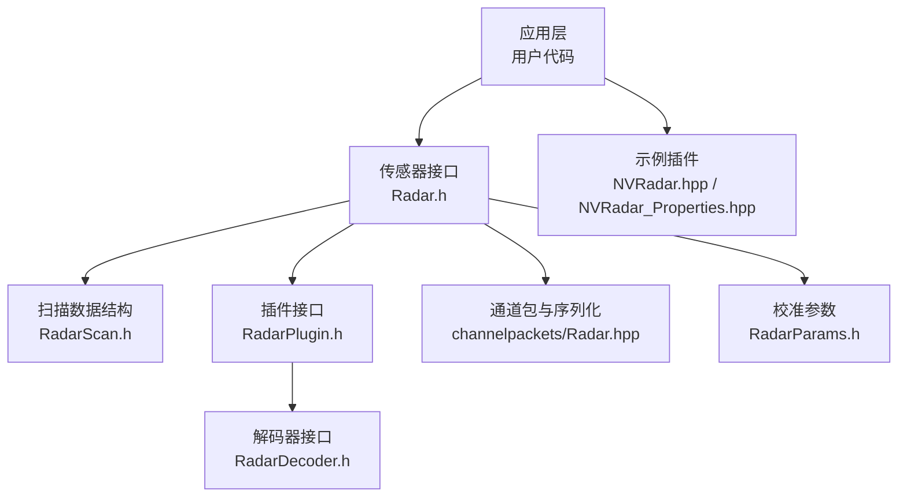
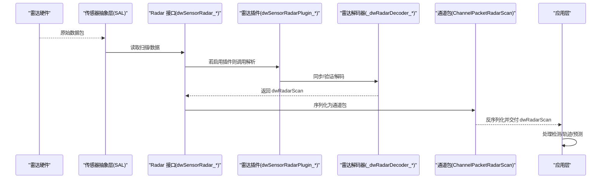
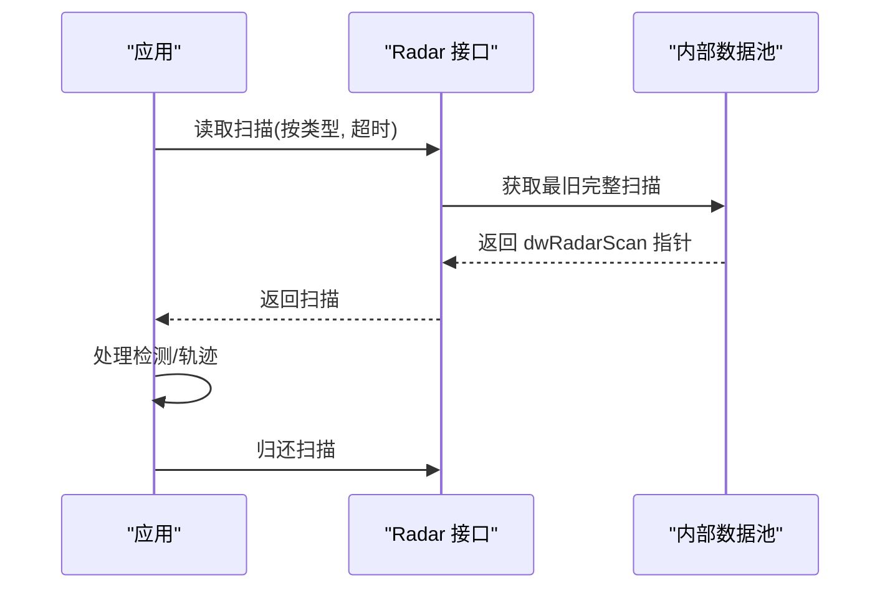
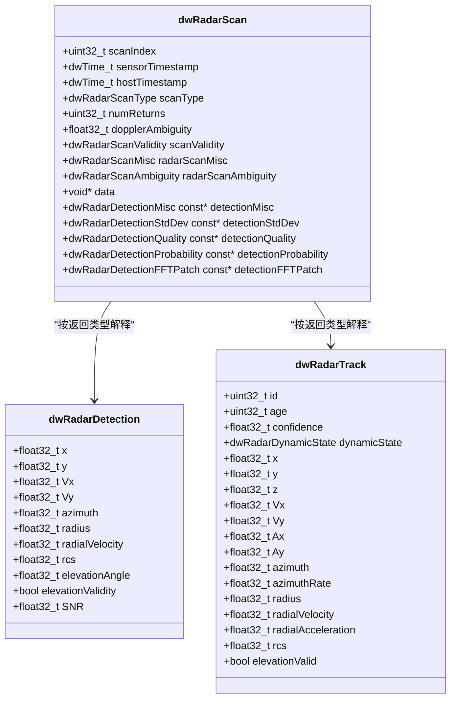
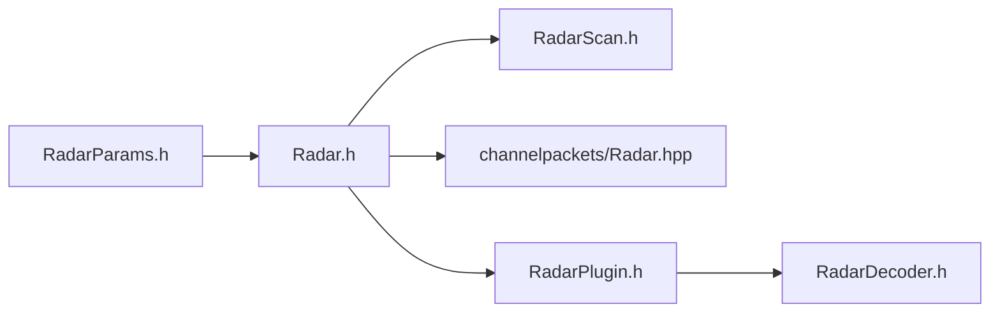

# 雷达传感器

<cite>
**本文引用的文件**
- [Radar.h（5.10）](file://driverorks-5.10/include/dw/sensors/radar/Radar.h)
- [RadarScan.h（5.10）](file://driverorks-5.10/include/dw/sensors/radar/RadarScan.h)
- [RadarParams.h（5.10）](file://driverorks-5.10/include/dw/calibration/engine/radar/RadarParams.h)
- [Radar.hpp（通道包，5.10）](file://driverorks-5.10/include/dwframework/dwnodes/common/channelpackets/Radar.hpp)
- [RadarPlugin.h（5.10）](file://driverorks-5.10/include/dw/sensors/plugins/radar/RadarPlugin.h)
- [RadarDecoder.h（5.10）](file://driverorks-5.10/include/dw/sensors/plugins/radar/RadarDecoder.h)
- [Radar.h（5.14）](file://driveworks-5.14/include/dw/sensors/radar/Radar.h)
- [RadarScan.h（5.14）](file://driveworks-5.14/include/dw/sensors/radar/RadarScan.h)
- [NVRadar.hpp（5.14 示例）](file://driveworks-5.14/samples/src/sensors/plugins/radar/NVRadar.hpp)
- [NVRadar_Properties.hpp（5.14 示例）](file://driveworks-5.14/samples/src/sensors/plugins/radar/NVRadar_Properties.hpp)
</cite>

## 目录
1. [引言](#引言)
2. [项目结构](#项目结构)
3. [核心组件](#核心组件)
4. [架构总览](#架构总览)
5. [详细组件分析](#详细组件分析)
6. [依赖关系分析](#依赖关系分析)
7. [性能考虑](#性能考虑)
8. [故障排查指南](#故障排查指南)
9. [结论](#结论)
10. [附录：配置与使用示例路径](#附录配置与使用示例路径)

## 引言
本技术文档围绕 NVIDIA DriveWorks 的雷达传感器模块展开，系统性阐述雷达传感器的接口设计、数据结构与读取流程，覆盖以下主题：
- Radar 抽象接口与 API 规范
- 雷达参数配置结构体 dwCalibrationRadarParams 的字段说明
- 雷达扫描数据结构 dwRadarScan 及其子结构（目标检测、轨迹、不确定性、概率、FFT 补丁等）
- 数据读取方法：目标检测帧获取、距离与速度信息处理、多普勒频移计算、信噪比分析
- 探测原理与数据格式：极坐标表示、目标轨迹预测、多目标跟踪
- 完整配置示例：探测范围、角度分辨率、目标检测阈值、滤波参数
- 实际代码示例路径：初始化雷达传感器、配置参数、读取雷达扫描数据、处理检测结果

## 项目结构
雷达传感器相关头文件主要分布在以下位置：
- 传感器接口与数据结构：include/dw/sensors/radar/*.h
- 校准参数：include/dw/calibration/engine/radar/*.h
- 通道包与序列化：include/dwframework/dwnodes/common/channelpackets/Radar.hpp
- 插件接口与解码器：include/dw/sensors/plugins/radar/*.h
- 示例插件：samples/src/sensors/plugins/radar/*.hpp

图表来源
- [Radar.h（5.14）:124-300](file://driveworks-5.14/include/dw/sensors/radar/Radar.h#L124-L300)
- [RadarScan.h（5.14）:67-500](file://driveworks-5.14/include/dw/sensors/radar/RadarScan.h#L67-L500)
- [RadarPlugin.h（5.10）:78-161](file://driverorks-5.10/include/dw/sensors/plugins/radar/RadarPlugin.h#L78-L161)
- [RadarDecoder.h（5.10）:75-196](file://driverorks-5.10/include/dw/sensors/plugins/radar/RadarDecoder.h#L75-L196)
- [Radar.hpp（通道包，5.10）:54-113](file://driverorks-5.10/include/dwframework/dwnodes/common/channelpackets/Radar.hpp#L54-L113)
- [RadarParams.h（5.10）:53-81](file://driverorks-5.10/include/dw/calibration/engine/radar/RadarParams.h#L53-L81)
- [NVRadar.hpp（5.14 示例）:62-120](file://driveworks-5.14/samples/src/sensors/plugins/radar/NVRadar.hpp#L62-L120)
- [NVRadar_Properties.hpp（5.14 示例）:1-200](file://driveworks-5.14/samples/src/sensors/plugins/radar/NVRadar_Properties.hpp#L1-L200)

章节来源
- [Radar.h（5.14）:124-300](file://driveworks-5.14/include/dw/sensors/radar/Radar.h#L124-L300)
- [RadarScan.h（5.14）:67-500](file://driveworks-5.14/include/dw/sensors/radar/RadarScan.h#L67-L500)
- [RadarPlugin.h（5.10）:78-161](file://driverorks-5.10/include/dw/sensors/plugins/radar/RadarPlugin.h#L78-L161)
- [RadarDecoder.h（5.10）:75-196](file://driverorks-5.10/include/dw/sensors/plugins/radar/RadarDecoder.h#L75-L196)
- [Radar.hpp（通道包，5.10）:54-113](file://driverorks-5.10/include/dwframework/dwnodes/common/channelpackets/Radar.hpp#L54-L113)
- [RadarParams.h（5.10）:53-81](file://driverorks-5.10/include/dw/calibration/engine/radar/RadarParams.h#L53-L81)
- [NVRadar.hpp（5.14 示例）:62-120](file://driveworks-5.14/samples/src/sensors/plugins/radar/NVRadar.hpp#L62-L120)
- [NVRadar_Properties.hpp（5.14 示例）:1-200](file://driveworks-5.14/samples/src/sensors/plugins/radar/NVRadar_Properties.hpp#L1-L200)

## 核心组件
- Radar 抽象接口与 API
  - 扫描类型切换、数据解码开关、单包读取、整帧读取、返回扫描、CPU 解码、属性查询、发送车辆状态与安装位姿等。
- 雷达扫描数据结构 dwRadarScan
  - 包含扫描索引、传感器/主机时间戳、扫描类型、返回数量、多普勒模糊范围、有效性标志、杂项、模糊域、以及指向各类扩展数组的指针（检测杂项、标准差、质量、概率、FFT 补丁）。
- 检测与轨迹结构
  - dwRadarDetection：极坐标（方位角、距离、径向速度）、速度分量（Vx/Vy）、反射幅度（rcs）、俯仰角与有效性、信噪比（SNR）。
  - dwRadarTrack：带轨迹 ID、年龄、置信度、动态状态、三维位置与速度、加速度、角率、补偿后的 rcs、z 有效性等。
- 辅助结构与枚举
  - 扫描类型（返回类型+范围）、雷达模型、数据质量、检测状态、扫描/检测/概率/标准差/FFT 补丁的有效性结构等。

章节来源
- [Radar.h（5.14）:124-300](file://driveworks-5.14/include/dw/sensors/radar/Radar.h#L124-L300)
- [RadarScan.h（5.14）:67-500](file://driveworks-5.14/include/dw/sensors/radar/RadarScan.h#L67-L500)
- [Radar.h（5.10）:126-271](file://driverorks-5.10/include/dw/sensors/radar/Radar.h#L126-L271)

## 架构总览
下图展示了从传感器到应用层的数据通路：传感器接口负责读取原始或解码后的扫描；插件与解码器负责解析与同步；通道包负责跨进程/跨节点传输；应用层消费 dwRadarScan 并进行轨迹预测与多目标跟踪。

图表来源
- [Radar.h（5.14）:124-300](file://driveworks-5.14/include/dw/sensors/radar/Radar.h#L124-L300)
- [RadarPlugin.h（5.10）:78-161](file://driverorks-5.10/include/dw/sensors/plugins/radar/RadarPlugin.h#L78-L161)
- [RadarDecoder.h（5.10）:75-196](file://driverorks-5.10/include/dw/sensors/plugins/radar/RadarDecoder.h#L75-L196)
- [Radar.hpp（通道包，5.10）:54-113](file://driverorks-5.10/include/dwframework/dwnodes/common/channelpackets/Radar.hpp#L54-L113)

## 详细组件分析

### 组件一：Radar 接口与数据读取
- 关键 API
  - 切换扫描类型、开启/关闭解码、按类型读取单包、按类型读取整帧、返回扫描、CPU 解码原始数据、获取传感器属性、设置车辆状态与安装位姿。
- 数据读取流程
  - 单包读取：适用于传感器可能以分片方式输出的场景，需显式归还数据。
  - 整帧读取：返回内部池中最老的完整扫描，适合稳定帧对齐的应用。
  - CPU 解码：在调用线程执行，适合自定义解码或离线分析。
- 时间戳与索引
  - scanIndex、sensorTimestamp、hostTimestamp 用于时序对齐与回放。

图表来源
- [Radar.h（5.14）:176-236](file://driveworks-5.14/include/dw/sensors/radar/Radar.h#L176-L236)

章节来源
- [Radar.h（5.14）:124-300](file://driveworks-5.14/include/dw/sensors/radar/Radar.h#L124-L300)

### 组件二：dwRadarScan 与子结构
- dwRadarScan
  - 扫描索引、时间戳、扫描类型、返回数量、多普勒模糊范围、有效性、杂项、模糊域、data/detection* 系列数组指针。
- dwRadarDetection
  - 极坐标：方位角、距离、径向速度；速度分量：Vx/Vy；反射幅度 rcs；俯仰角与有效性；信噪比 SNR。
- dwRadarTrack
  - 轨迹 ID、年龄、置信度、动态状态；三维位置(x/y/z)、速度(Vx/Vy)、加速度(Ax/Ay)；角率、径向加速度；补偿 rcs、z 有效性。
- dwRadarDetectionMisc/StdDev/Quality/Probability/FFTPatch
  - 提供测量模型、掩蔽角扇区、接收信号强度、峰值检测阈值、多普勒模糊域索引、各维度标准差、质量评分、存在/多重目标概率、多假设概率、FFT 补丁邻域值等。
- 有效性结构
  - 对上述结构中的每个字段提供有效性标记，便于应用侧进行鲁棒性判断。

图表来源
- [Radar.h（5.14）:64-116](file://driveworks-5.14/include/dw/sensors/radar/Radar.h#L64-L116)
- [RadarScan.h（5.14）:106-500](file://driveworks-5.14/include/dw/sensors/radar/RadarScan.h#L106-L500)

章节来源
- [Radar.h（5.14）:64-116](file://driveworks-5.14/include/dw/sensors/radar/Radar.h#L64-L116)
- [RadarScan.h（5.14）:106-500](file://driveworks-5.14/include/dw/sensors/radar/RadarScan.h#L106-L500)

### 组件三：多普勒频移与信噪比分析
- 多普勒频移
  - 通过扫描结构中的 dopplerAmbiguity 与 detectionMisc/detectionProbability 中的模糊域索引，结合雷达模型与调制模式，可恢复真实多普勒速度。
- 信噪比（SNR）
  - 检测结构中提供 SNR 字段；同时 detectionMisc 提供接收信号强度与峰值检测阈值，可用于动态阈值与鲁棒性评估。
- 距离与速度
  - 距离由 radius 表示；径向速度由 radialVelocity 表示；速度分量 Vx/Vy 可用于二维运动估计。

章节来源
- [Radar.h（5.14）:82-83](file://driveworks-5.14/include/dw/sensors/radar/Radar.h#L82-L83)
- [RadarScan.h（5.14）:106-133](file://driveworks-5.14/include/dw/sensors/radar/RadarScan.h#L106-L133)
- [RadarScan.h（5.14）:236-260](file://driveworks-5.14/include/dw/sensors/radar/RadarScan.h#L236-L260)

### 组件四：极坐标表示、轨迹预测与多目标跟踪
- 极坐标
  - 检测与轨迹均支持方位角、距离、径向速度等极坐标表示，便于与雷达观测一致。
- 轨迹预测
  - 结合速度、加速度、角率与时间戳，可进行简单外推；配合置信度与质量指标，可实现轨迹融合与选择。
- 多目标跟踪
  - 使用轨迹 ID 进行关联；动态状态枚举有助于区分移动/静止/对向/横穿/停止等场景。

章节来源
- [Radar.h（5.14）:91-111](file://driveworks-5.14/include/dw/sensors/radar/Radar.h#L91-L111)
- [RadarScan.h（5.14）:160-220](file://driveworks-5.14/include/dw/sensors/radar/RadarScan.h#L160-L220)

### 组件五：通道包与跨节点传输
- ChannelPacketRadarScan
  - 将 dwRadarScan 序列化后通过通道传输，内部管理 data 与 detection* 数组的缓冲区分配与指针重定向。
- RadarScanNvSciPacket
  - 基于 NvSciBuf 的高性能跨进程传输封装，负责打包/解包与内存布局映射。

章节来源
- [Radar.hpp（通道包，5.10）:54-113](file://driverorks-5.10/include/dwframework/dwnodes/common/channelpackets/Radar.hpp#L54-L113)

### 组件六：插件与解码器
- 插件接口
  - 提供解析缓冲区、获取解码常数、验证数据包、设置车辆状态等函数表，便于适配非标雷达。
- 解码器接口
  - 提供初始化/释放、获取常数、解码包、同步、验证、扫描完整性判断、编码车辆状态与安装位姿等。

章节来源
- [RadarPlugin.h（5.10）:78-161](file://driverorks-5.10/include/dw/sensors/plugins/radar/RadarPlugin.h#L78-L161)
- [RadarDecoder.h（5.10）:75-196](file://driverorks-5.10/include/dw/sensors/plugins/radar/RadarDecoder.h#L75-L196)

### 组件七：雷达参数配置（校准）
- dwCalibrationRadarParams
  - 支持启用雷达里程计速度因子与轮半径估计、快速接受策略、回调与用户数据、雷达属性指针等。
- 用途
  - 在校准流程中注入雷达属性，驱动估计过程与结果更新。

章节来源
- [RadarParams.h（5.10）:53-81](file://driverorks-5.10/include/dw/calibration/engine/radar/RadarParams.h#L53-L81)

### 组件八：示例插件（NVRadar）
- NVRadar
  - 示例雷达插件类，展示如何实现插件接口、解析数据、与解码器协作。
- NVRadar_Properties
  - 示例属性定义，演示如何声明雷达属性与常数。

章节来源
- [NVRadar.hpp（5.14 示例）:62-120](file://driveworks-5.14/samples/src/sensors/plugins/radar/NVRadar.hpp#L62-L120)
- [NVRadar_Properties.hpp（5.14 示例）:1-200](file://driveworks-5.14/samples/src/sensors/plugins/radar/NVRadar_Properties.hpp#L1-L200)

## 依赖关系分析
- Radar 接口依赖 RadarScan.h 中的数据结构与枚举。
- 插件与解码器接口为第三方雷达提供扩展能力，与 Radar 接口解耦。
- 通道包依赖 Radar 接口的扫描结构，负责序列化与跨进程传输。
- 校准参数依赖 Radar 接口提供的属性结构，驱动估计流程。

图表来源
- [Radar.h（5.14）:124-300](file://driveworks-5.14/include/dw/sensors/radar/Radar.h#L124-L300)
- [RadarScan.h（5.14）:67-500](file://driveworks-5.14/include/dw/sensors/radar/RadarScan.h#L67-L500)
- [Radar.hpp（通道包，5.10）:54-113](file://driverorks-5.10/include/dwframework/dwnodes/common/channelpackets/Radar.hpp#L54-L113)
- [RadarPlugin.h（5.10）:78-161](file://driverorks-5.10/include/dw/sensors/plugins/radar/RadarPlugin.h#L78-L161)
- [RadarDecoder.h（5.10）:75-196](file://driverorks-5.10/include/dw/sensors/plugins/radar/RadarDecoder.h#L75-L196)
- [RadarParams.h（5.10）:53-81](file://driverorks-5.10/include/dw/calibration/engine/radar/RadarParams.h#L53-L81)

章节来源
- [Radar.h（5.14）:124-300](file://driveworks-5.14/include/dw/sensors/radar/Radar.h#L124-L300)
- [RadarScan.h（5.14）:67-500](file://driveworks-5.14/include/dw/sensors/radar/RadarScan.h#L67-L500)
- [Radar.hpp（通道包，5.10）:54-113](file://driverorks-5.10/include/dwframework/dwnodes/common/channelpackets/Radar.hpp#L54-L113)
- [RadarPlugin.h（5.10）:78-161](file://driverorks-5.10/include/dw/sensors/plugins/radar/RadarPlugin.h#L78-L161)
- [RadarDecoder.h（5.10）:75-196](file://driverorks-5.10/include/dw/sensors/plugins/radar/RadarDecoder.h#L75-L196)
- [RadarParams.h（5.10）:53-81](file://driverorks-5.10/include/dw/calibration/engine/radar/RadarParams.h#L53-L81)

## 性能考虑
- 解码开关
  - 启用解码会增加 CPU 开销，建议仅在需要时开启，并在不需要时关闭以降低负载。
- 读取策略
  - 单包读取适合高吞吐场景，但需及时归还；整帧读取适合时序严格的应用。
- 通道包序列化
  - 通道包在传输前进行序列化，注意 data 与 detection* 数组的大小与对齐，避免额外拷贝。
- 解码器同步与验证
  - 在插件/解码器层面对数据包进行同步与验证，减少无效扫描进入应用层。

## 故障排查指南
- 常见错误与处理
  - 无效句柄/参数：检查传感器句柄与输入参数合法性。
  - 调用不允许：确保在正确生命周期内调用（如先停止再修改解码状态）。
  - 超时/不可用：根据超时设置与队列状态调整等待策略。
- 数据有效性
  - 使用 scanValidity 与 detection*Validity 标记，过滤无效字段后再进行轨迹预测与跟踪。
- 多普勒模糊
  - 结合 dopplerAmbiguity 与 detectionProbability 中的模糊域索引，进行多假设处理与一致性检查。
- 信噪比与阈值
  - 结合 SNR、rxSigStrength、peakDetectionThreshold 动态调整检测阈值，提升鲁棒性。

章节来源
- [Radar.h（5.14）:124-300](file://driveworks-5.14/include/dw/sensors/radar/Radar.h#L124-L300)
- [RadarScan.h（5.14）:477-500](file://driveworks-5.14/include/dw/sensors/radar/RadarScan.h#L477-L500)

## 结论
雷达传感器模块通过清晰的接口与丰富的数据结构，提供了从原始数据到解码扫描、从检测到轨迹的全链路能力。结合插件与解码器机制，可灵活适配多种雷达设备；通过通道包实现高效跨进程传输；借助校准参数与有效性标记，保障系统鲁棒性与可维护性。建议在工程实践中遵循“按需解码、及时归还、有效性过滤、多假设处理”的原则，以获得最佳性能与稳定性。

## 附录：配置与使用示例路径
- 初始化与配置
  - 设置雷达属性与安装位姿：参考 dwSensorRadar_setMountPosition 与 dwSensorRadar_setVehicleState 的调用路径。
  - 启用/禁用扫描类型与解码：参考 dwSensorRadar_toggleScanType 与 dwSensorRadar_setDataDecoding。
- 读取与处理
  - 读取扫描/数据与归还：参考 dwSensorRadar_readScan、dwSensorRadar_readData、dwSensorRadar_returnScan、dwSensorRadar_returnData。
  - CPU 解码原始数据：参考 dwSensorRadar_processRawData。
- 示例插件
  - 示例类与属性定义：参考 NVRadar.hpp 与 NVRadar_Properties.hpp。

章节来源
- [Radar.h（5.14）:124-300](file://driveworks-5.14/include/dw/sensors/radar/Radar.h#L124-L300)
- [NVRadar.hpp（5.14 示例）:62-120](file://driveworks-5.14/samples/src/sensors/plugins/radar/NVRadar.hpp#L62-L120)
- [NVRadar_Properties.hpp（5.14 示例）:1-200](file://driveworks-5.14/samples/src/sensors/plugins/radar/NVRadar_Properties.hpp#L1-L200)