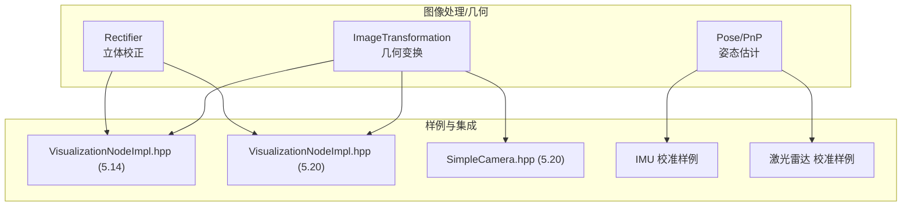
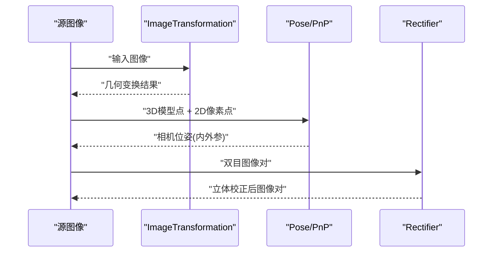
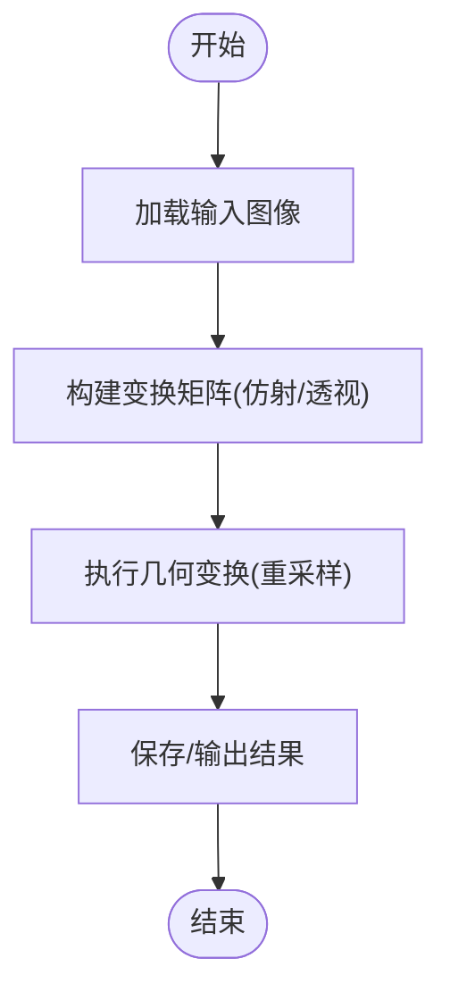
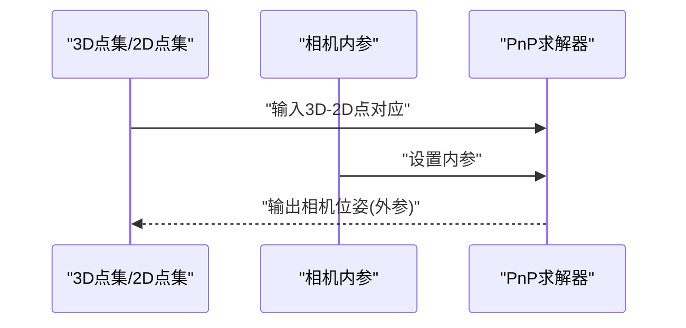
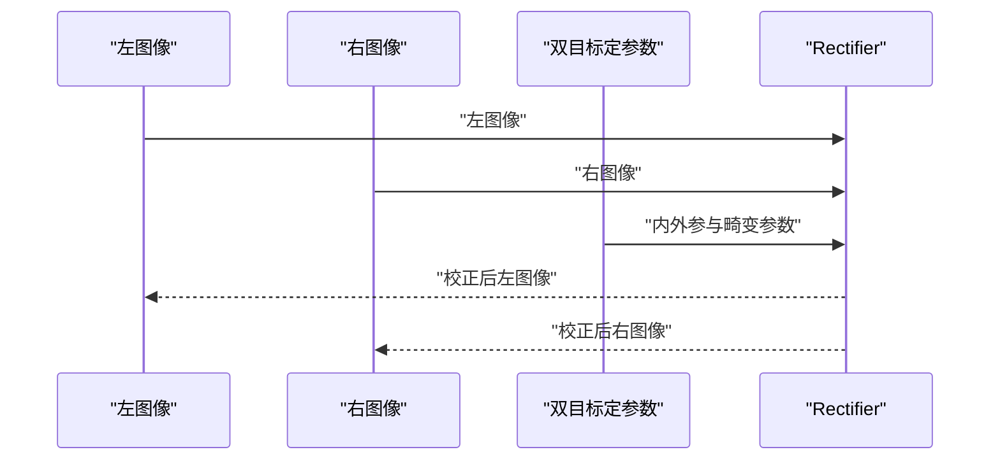
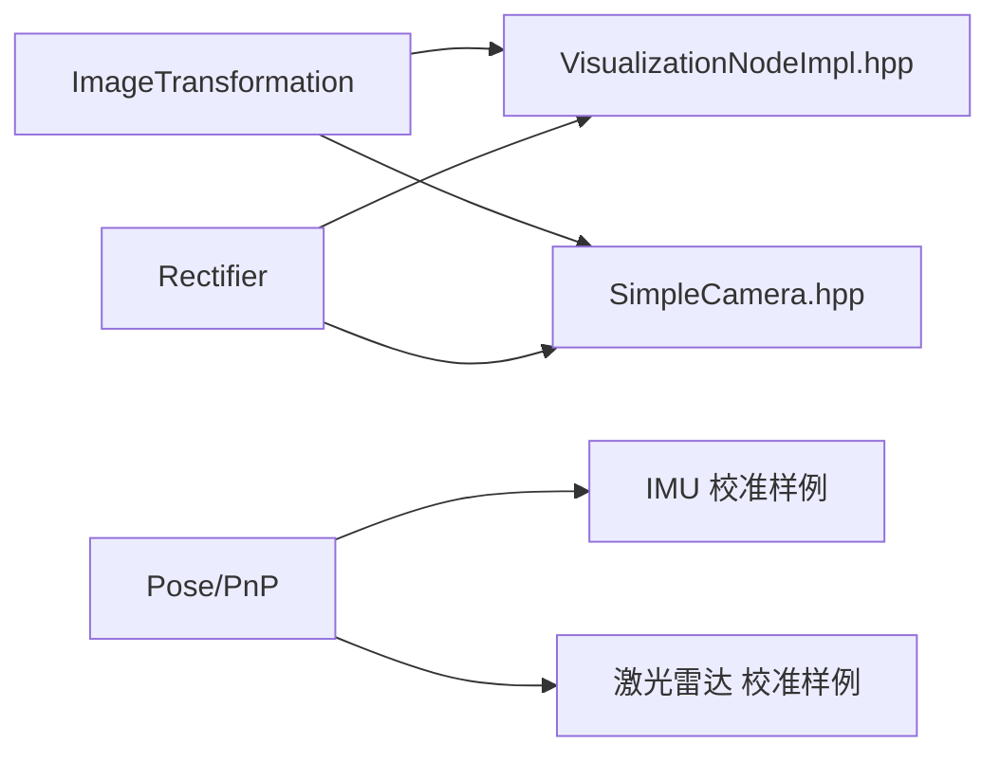

# 几何处理

<cite>
**本文引用的文件**
- [driverorks-5.10/doc/nvsdk_dw_html/md_src_dw_imageprocessing_geometry_imagetransformation_docs_mainsection.html](file://driverorks-5.10/doc/nvsdk_dw_html/md_src_dw_imageprocessing_geometry_imagetransformation_docs_mainsection.html)
- [driverorks-5.10/doc/nvsdk_dw_html/md_src_dw_imageprocessing_geometry_pose_docs_mainsection.html](file://driverorks-5.10/doc/nvsdk_dw_html/md_src_dw_imageprocessing_geometry_pose_docs_mainsection.html)
- [driverorks-5.10/doc/nvsdk_dw_html/md_src_dw_imageprocessing_geometry_rectifier_docs_mainsection.html](file://driverorks-5.10/doc/nvsdk_dw_html/md_src_dw_imageprocessing_geometry_rectifier_docs_mainsection.html)
- [driveworks-5.14/samples/src/minipipeline/VisualizationNodeImpl.hpp](file://driveworks-5.14/samples/src/minipipeline/VisualizationNodeImpl.hpp)
- [driveworks-520/samples/src/framework/SimpleCamera.hpp](file://driveworks-520/samples/src/framework/SimpleCamera.hpp)
- [driveworks-520/samples/src/minipipeline/VisualizationNodeImpl.hpp](file://driveworks-520/samples/src/minipipeline/VisualizationNodeImpl.hpp)
- [driverorks-5.10/samples/src/calibration/imu/main.cpp](file://driverorks-5.10/samples/src/calibration/imu/main.cpp)
- [driverorks-5.10/samples/src/calibration/lidar/main.cpp](file://driverorks-5.10/samples/src/calibration/lidar/main.cpp)
</cite>

## 目录
1. [引言](#引言)
2. [项目结构](#项目结构)
3. [核心组件](#核心组件)
4. [架构总览](#架构总览)
5. [详细组件分析](#详细组件分析)
6. [依赖分析](#依赖分析)
7. [性能考虑](#性能考虑)
8. [故障排查指南](#故障排查指南)
9. [结论](#结论)
10. [附录](#附录)

## 引言
本技术文档聚焦于几何处理模块，系统性阐述以下能力：
- 图像几何变换：仿射变换、透视变换、缩放与旋转等
- 相机姿态估计（PnP）：从3D-2D点对应求解相机位姿，结合内参与外参估计
- 立体校正（Rectifier）：双目相机标定与图像对齐

文档以DriveWorks SDK中“imageprocessing/geometry”子系统为主线，结合样例工程与API文档，给出架构视图、数据流、调用序列、复杂度与性能优化建议，并提供可操作的使用路径。

## 项目结构
几何处理位于SDK的图像处理子系统下，主要由三部分组成：
- 几何变换（imagetransformation）
- 姿态估计（pose，其中包含PnP）
- 立体校正（rectifier）

图表来源
- [driveworks-5.14/samples/src/minipipeline/VisualizationNodeImpl.hpp:1-80](file://driveworks-5.14/samples/src/minipipeline/VisualizationNodeImpl.hpp#L1-L80)
- [driveworks-520/samples/src/minipipeline/VisualizationNodeImpl.hpp:1-80](file://driveworks-520/samples/src/minipipeline/VisualizationNodeImpl.hpp#L1-L80)
- [driveworks-520/samples/src/framework/SimpleCamera.hpp:1-80](file://driveworks-520/samples/src/framework/SimpleCamera.hpp#L1-L80)
- [driverorks-5.10/samples/src/calibration/imu/main.cpp:830-930](file://driverorks-5.10/samples/src/calibration/imu/main.cpp#L830-L930)
- [driverorks-5.10/samples/src/calibration/lidar/main.cpp:880-930](file://driverorks-5.10/samples/src/calibration/lidar/main.cpp#L880-L930)

章节来源
- [driverorks-5.10/doc/nvsdk_dw_html/md_src_dw_imageprocessing_geometry_imagetransformation_docs_mainsection.html:1-136](file://driverorks-5.10/doc/nvsdk_dw_html/md_src_dw_imageprocessing_geometry_imagetransformation_docs_mainsection.html#L1-L136)
- [driverorks-5.10/doc/nvsdk_dw_html/md_src_dw_imageprocessing_geometry_pose_docs_mainsection.html:1-136](file://driverorks-5.10/doc/nvsdk_dw_html/md_src_dw_imageprocessing_geometry_pose_docs_mainsection.html#L1-L136)
- [driverorks-5.10/doc/nvsdk_dw_html/md_src_dw_imageprocessing_geometry_rectifier_docs_mainsection.html:1-136](file://driverorks-5.10/doc/nvsdk_dw_html/md_src_dw_imageprocessing_geometry_rectifier_docs_mainsection.html#L1-L136)

## 核心组件
- ImageTransformation（几何变换）
  - 提供仿射、透视、缩放、旋转等基础几何变换能力，支持图像重采样与坐标映射
  - 典型应用场景：相机标定前的图像预处理、传感器融合前的对齐
- Pose/PnP（姿态估计）
  - 基于3D-2D点对应关系求解相机位姿（外参），结合已知内参完成PnP求解
  - 典型应用场景：SLAM前端、目标跟踪、增强现实定位
- Rectifier（立体校正）
  - 双目相机标定后的图像对齐与重投影，保证视差沿扫描线方向变化，便于后续立体匹配
  - 典型应用场景：深度估计、三维重建

章节来源
- [driverorks-5.10/doc/nvsdk_dw_html/md_src_dw_imageprocessing_geometry_imagetransformation_docs_mainsection.html:1-136](file://driverorks-5.10/doc/nvsdk_dw_html/md_src_dw_imageprocessing_geometry_imagetransformation_docs_mainsection.html#L1-L136)
- [driverorks-5.10/doc/nvsdk_dw_html/md_src_dw_imageprocessing_geometry_pose_docs_mainsection.html:1-136](file://driverorks-5.10/doc/nvsdk_dw_html/md_src_dw_imageprocessing_geometry_pose_docs_mainsection.html#L1-L136)
- [driverorks-5.10/doc/nvsdk_dw_html/md_src_dw_imageprocessing_geometry_rectifier_docs_mainsection.html:1-136](file://driverorks-5.10/doc/nvsdk_dw_html/md_src_dw_imageprocessing_geometry_rectifier_docs_mainsection.html#L1-L136)

## 架构总览
几何处理模块在SDK中通过统一的图像处理管线进行编排，典型流程如下：
- 输入图像经由ImageTransformation进行几何校正或预处理
- 使用Pose模块进行PnP求解，得到相机位姿
- 对双目图像使用Rectifier进行立体校正，输出可用于深度计算的对齐图像

图表来源
- [driverorks-5.10/doc/nvsdk_dw_html/md_src_dw_imageprocessing_geometry_imagetransformation_docs_mainsection.html:1-136](file://driverorks-5.10/doc/nvsdk_dw_html/md_src_dw_imageprocessing_geometry_imagetransformation_docs_mainsection.html#L1-L136)
- [driverorks-5.10/doc/nvsdk_dw_html/md_src_dw_imageprocessing_geometry_pose_docs_mainsection.html:1-136](file://driverorks-5.10/doc/nvsdk_dw_html/md_src_dw_imageprocessing_geometry_pose_docs_mainsection.html#L1-L136)
- [driverorks-5.10/doc/nvsdk_dw_html/md_src_dw_imageprocessing_geometry_rectifier_docs_mainsection.html:1-136](file://driverorks-5.10/doc/nvsdk_dw_html/md_src_dw_imageprocessing_geometry_rectifier_docs_mainsection.html#L1-L136)

## 详细组件分析

### ImageTransformation（图像几何变换）
- 能力概述
  - 支持仿射变换、透视变换、缩放、旋转等常见几何变换
  - 提供重采样策略与边界处理选项
  - 面向标定、拼接、配准等任务的前置处理
- 典型调用序列
  - 读取输入图像
  - 构造变换矩阵（仿射/透视）
  - 应用变换并输出结果图像
- 复杂度与性能
  - 单像素映射与重采样通常为O(W×H)，内存访问局部性良好
  - 可利用GPU加速与批处理提升吞吐
- 使用建议
  - 在高分辨率图像上优先采用分块处理或降采样预处理
  - 合理选择插值方式以平衡精度与速度

图表来源
- [driverorks-5.10/doc/nvsdk_dw_html/md_src_dw_imageprocessing_geometry_imagetransformation_docs_mainsection.html:1-136](file://driverorks-5.10/doc/nvsdk_dw_html/md_src_dw_imageprocessing_geometry_imagetransformation_docs_mainsection.html#L1-L136)

章节来源
- [driverorks-5.10/doc/nvsdk_dw_html/md_src_dw_imageprocessing_geometry_imagetransformation_docs_mainsection.html:1-136](file://driverorks-5.10/doc/nvsdk_dw_html/md_src_dw_imageprocessing_geometry_imagetransformation_docs_mainsection.html#L1-L136)

### PnP（相机姿态估计）
- 能力概述
  - 通过3D世界点与对应的2D像素点，结合相机内参矩阵，求解相机外参（旋转向量和平移向量）
  - 常见求解器：P3P、EPnP、迭代非线性最小二乘等
- 数据接口要点
  - 3D点集：通常来自地图或检测器
  - 2D点集：像素坐标，需去畸变
  - 内参：焦距、主点、畸变参数（如需要先做去畸变）
- 典型调用序列
  - 准备3D-2D点对应
  - 设置相机内参
  - 执行PnP求解
  - 输出位姿（旋转矩阵/四元数/欧拉角）
- 实战参考
  - IMU与激光雷达校准样例展示了相对位姿与标定流程，可作为PnP前后处理的参考

图表来源
- [driverorks-5.10/doc/nvsdk_dw_html/md_src_dw_imageprocessing_geometry_pose_docs_mainsection.html:1-136](file://driverorks-5.10/doc/nvsdk_dw_html/md_src_dw_imageprocessing_geometry_pose_docs_mainsection.html#L1-L136)
- [driverorks-5.10/samples/src/calibration/imu/main.cpp:838-860](file://driverorks-5.10/samples/src/calibration/imu/main.cpp#L838-L860)
- [driverorks-5.10/samples/src/calibration/lidar/main.cpp:542-550](file://driverorks-5.10/samples/src/calibration/lidar/main.cpp#L542-L550)

章节来源
- [driverorks-5.10/doc/nvsdk_dw_html/md_src_dw_imageprocessing_geometry_pose_docs_mainsection.html:1-136](file://driverorks-5.10/doc/nvsdk_dw_html/md_src_dw_imageprocessing_geometry_pose_docs_mainsection.html#L1-L136)
- [driverorks-5.10/samples/src/calibration/imu/main.cpp:838-860](file://driverorks-5.10/samples/src/calibration/imu/main.cpp#L838-L860)
- [driverorks-5.10/samples/src/calibration/lidar/main.cpp:542-550](file://driverorks-5.10/samples/src/calibration/lidar/main.cpp#L542-L550)

### Rectifier（立体校正）
- 能力概述
  - 基于双目相机标定结果，对左右图像进行重投影与裁剪，使视差沿水平扫描线变化
  - 支持LDC（线性深度一致性）等模式下的校正
- 关键步骤
  - 双目标定：获取基线、内外参、畸变参数
  - 计算校正映射（左右到矫正坐标的像素映射）
  - 应用映射生成校正图像
- 典型调用序列
  - 加载标定参数
  - 构建校正映射
  - 对左右图像执行校正
  - 输出对齐图像对

图表来源
- [driverorks-5.10/doc/nvsdk_dw_html/md_src_dw_imageprocessing_geometry_rectifier_docs_mainsection.html:1-136](file://driverorks-5.10/doc/nvsdk_dw_html/md_src_dw_imageprocessing_geometry_rectifier_docs_mainsection.html#L1-L136)

章节来源
- [driverorks-5.10/doc/nvsdk_dw_html/md_src_dw_imageprocessing_geometry_rectifier_docs_mainsection.html:1-136](file://driverorks-5.10/doc/nvsdk_dw_html/md_src_dw_imageprocessing_geometry_rectifier_docs_mainsection.html#L1-L136)

## 依赖分析
- 组件耦合
  - ImageTransformation与Rectifier在数据流上互补：前者负责几何预处理，后者负责立体对齐
  - Pose模块与两者在数据链路上松耦合，通过3D-2D点与内参进行衔接
- 集成点
  - 样例工程中，可视化节点与简单相机框架均直接包含并使用ImageTransformation头文件，体现其作为通用工具的低耦合封装
- 外部依赖
  - 依赖SDK的图像类型、矩阵类型与状态管理

图表来源
- [driveworks-5.14/samples/src/minipipeline/VisualizationNodeImpl.hpp:1-80](file://driveworks-5.14/samples/src/minipipeline/VisualizationNodeImpl.hpp#L1-L80)
- [driveworks-520/samples/src/framework/SimpleCamera.hpp:1-80](file://driveworks-520/samples/src/framework/SimpleCamera.hpp#L1-L80)
- [driveworks-520/samples/src/minipipeline/VisualizationNodeImpl.hpp:1-80](file://driveworks-520/samples/src/minipipeline/VisualizationNodeImpl.hpp#L1-L80)
- [driverorks-5.10/samples/src/calibration/imu/main.cpp:838-860](file://driverorks-5.10/samples/src/calibration/imu/main.cpp#L838-L860)
- [driverorks-5.10/samples/src/calibration/lidar/main.cpp:542-550](file://driverorks-5.10/samples/src/calibration/lidar/main.cpp#L542-L550)

章节来源
- [driveworks-5.14/samples/src/minipipeline/VisualizationNodeImpl.hpp:1-80](file://driveworks-5.14/samples/src/minipipeline/VisualizationNodeImpl.hpp#L1-L80)
- [driveworks-520/samples/src/framework/SimpleCamera.hpp:1-80](file://driveworks-520/samples/src/framework/SimpleCamera.hpp#L1-L80)
- [driveworks-520/samples/src/minipipeline/VisualizationNodeImpl.hpp:1-80](file://driveworks-520/samples/src/minipipeline/VisualizationNodeImpl.hpp#L1-L80)
- [driverorks-5.10/samples/src/calibration/imu/main.cpp:838-860](file://driverorks-5.10/samples/src/calibration/imu/main.cpp#L838-L860)
- [driverorks-5.10/samples/src/calibration/lidar/main.cpp:542-550](file://driverorks-5.10/samples/src/calibration/lidar/main.cpp#L542-L550)

## 性能考虑
- 计算热点
  - 重采样与插值是ImageTransformation的主要开销；Rectifier的映射查找与插值同样昂贵
- 优化建议
  - 利用GPU并行化与批处理减少单帧延迟
  - 对高分辨率图像采用金字塔或多尺度策略
  - 合理设置插值核与边界策略，避免过度模糊
  - 将PnP求解与图像变换解耦，仅在必要时重新计算

## 故障排查指南
- 几何变换结果异常
  - 检查输入图像格式与尺寸是否匹配
  - 核对变换矩阵构造逻辑与坐标系约定
- PnP失败或发散
  - 确认3D-2D点对应质量与数量
  - 校验内参是否正确且与去畸变流程一致
  - 尝试不同初值或鲁棒估计器
- 立体校正后视差不连续
  - 检查双目标定质量与畸变参数
  - 确认校正映射范围与裁剪策略
- 实战参考
  - IMU与激光雷达校准样例展示了相对位姿计算与标定流程，可对照排查

章节来源
- [driverorks-5.10/samples/src/calibration/imu/main.cpp:838-860](file://driverorks-5.10/samples/src/calibration/imu/main.cpp#L838-L860)
- [driverorks-5.10/samples/src/calibration/lidar/main.cpp:542-550](file://driverorks-5.10/samples/src/calibration/lidar/main.cpp#L542-L550)

## 结论
几何处理模块在DriveWorks中提供了从图像几何变换、相机姿态估计到立体校正的完整链路。通过合理的数据流组织与性能优化策略，可在真实场景中实现稳定高效的视觉感知能力。建议在工程实践中：
- 明确各模块职责边界，保持低耦合
- 在高并发场景下充分利用GPU与批处理
- 严格校验标定与对应关系的质量，确保下游任务稳定性

## 附录
- API与文档入口
  - 几何变换：[md_src_dw_imageprocessing_geometry_imagetransformation_docs_mainsection.html:1-136](file://driverorks-5.10/doc/nvsdk_dw_html/md_src_dw_imageprocessing_geometry_imagetransformation_docs_mainsection.html#L1-L136)
  - 姿态估计（PnP）：[md_src_dw_imageprocessing_geometry_pose_docs_mainsection.html:1-136](file://driverorks-5.10/doc/nvsdk_dw_html/md_src_dw_imageprocessing_geometry_pose_docs_mainsection.html#L1-L136)
  - 立体校正：[md_src_dw_imageprocessing_geometry_rectifier_docs_mainsection.html:1-136](file://driverorks-5.10/doc/nvsdk_dw_html/md_src_dw_imageprocessing_geometry_rectifier_docs_mainsection.html#L1-L136)
- 样例集成位置
  - 可视化节点（5.14/5.20）与简单相机框架（5.20）均包含ImageTransformation头文件，便于快速集成
  - IMU与激光雷达校准样例展示了PnP前后处理流程