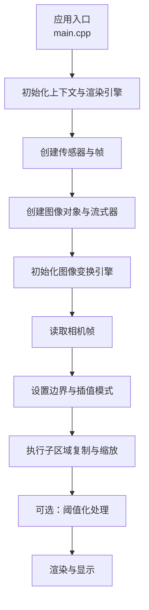
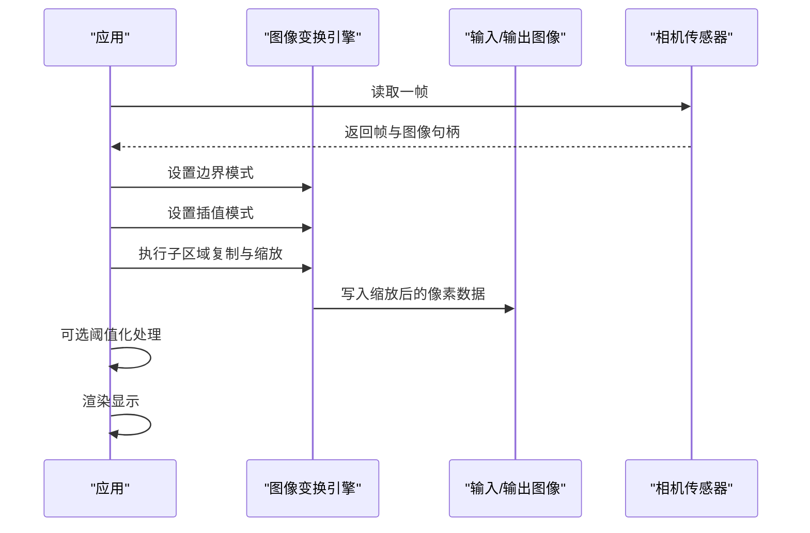
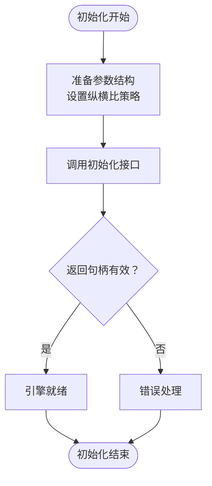
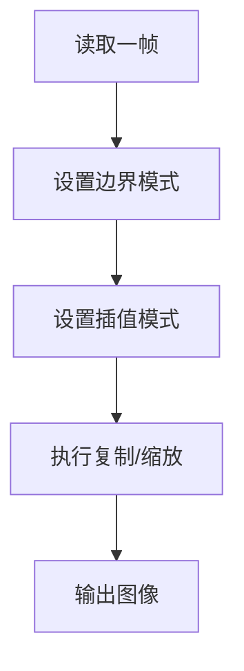
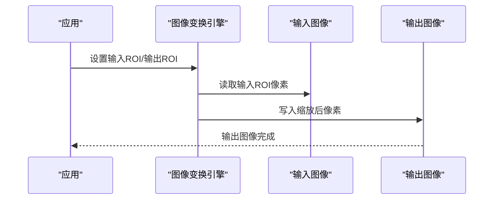
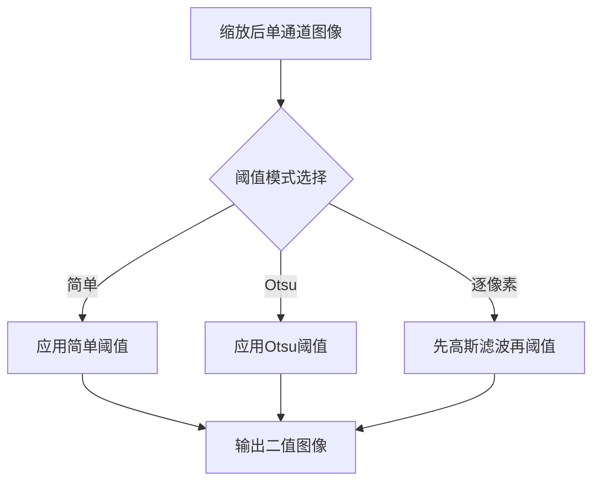
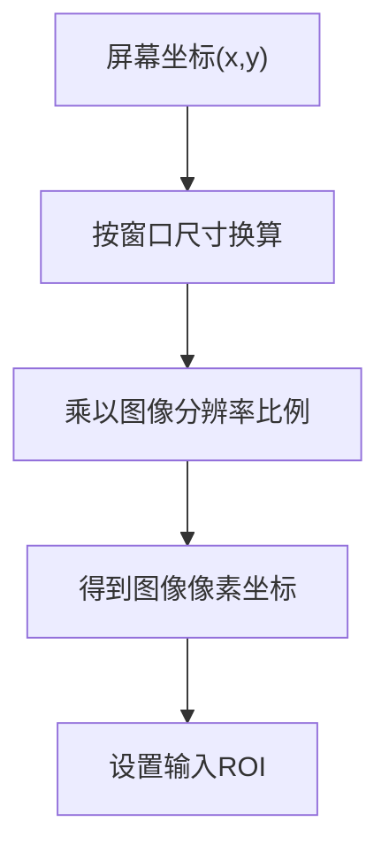
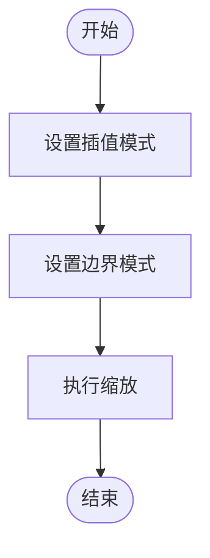
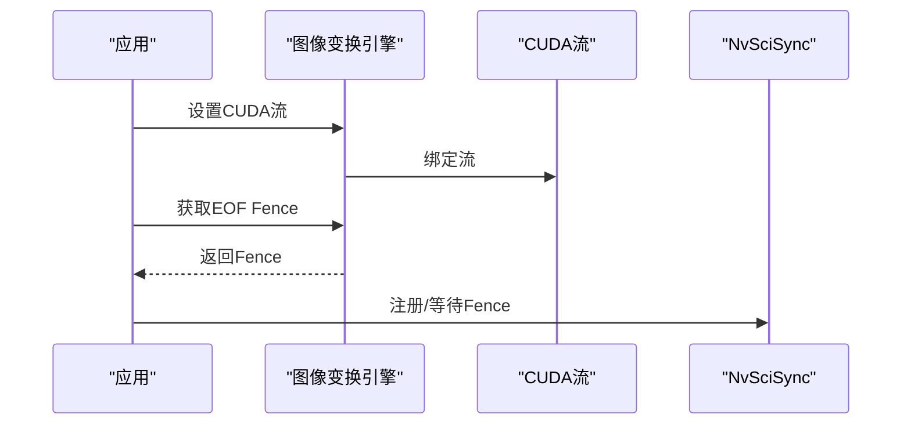
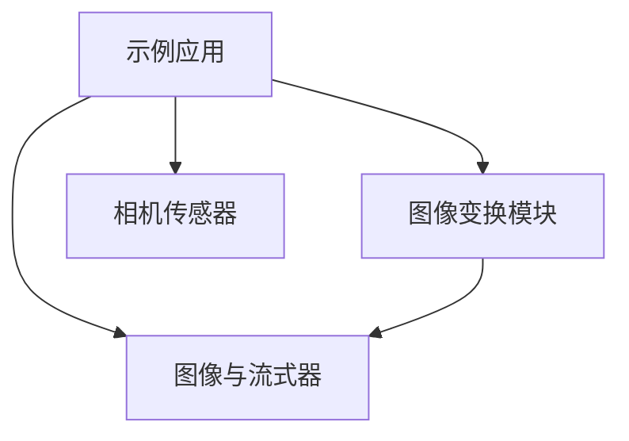

# 图像变换

<cite>
**本文引用的文件**   
- [main.cpp（5.8）](file://driveworks-5.8/samples/src/imageprocessing/geometry/imagetransformation/main.cpp)
- [main.cpp（5.10）](file://driverorks-5.10/samples/src/imageprocessing/geometry/imagetransformation/main.cpp)
- [main.cpp（5.14）](file://driveworks-5.14/samples/src/imageprocessing/geometry/imagetransformation/main.cpp)
- [main.cpp（5.20）](file://driveworks-520/samples/src/imageprocessing/geometry/imagetransformation/main.cpp)
- [ImageTransformation.h（5.8）](file://driveworks-5.8/include/dw/imageprocessing/geometry/imagetransformation/ImageTransformation.h)
- [ImageTransformation.h（5.10）](file://driverorks-5.10/include/dw/imageprocessing/geometry/imagetransformation/ImageTransformation.h)
- [ImageTransformation.h（5.14）](file://driveworks-5.14/include/dw/imageprocessing/geometry/imagetransformation/ImageTransformation.h)
- [ImageTransformation.h（5.20）](file://driveworks-520/include/dw/imageprocessing/geometry/imagetransformation/ImageTransformation.h)
</cite>

## 目录
1. [简介](#简介)
2. [项目结构](#项目结构)
3. [核心组件](#核心组件)
4. [架构总览](#架构总览)
5. [详细组件分析](#详细组件分析)
6. [依赖分析](#依赖分析)
7. [性能考虑](#性能考虑)
8. [故障排查指南](#故障排查指南)
9. [结论](#结论)
10. [附录](#附录)

## 简介
本技术文档围绕 DriveWorks 图像变换模块展开，聚焦于几何变换能力与相关 API 的使用方式。根据仓库中的示例与接口定义，图像变换模块提供以下关键能力：
- 图像子区域复制与缩放：在指定输入 ROI 上裁剪并缩放到输出图像或输出 ROI，支持格式转换与多通道处理。
- 边界模式与插值模式配置：通过设置边界填充策略与插值算法影响缩放质量。
- CUDA 流与同步机制：可绑定 CUDA 流以实现异步执行，并通过 NvSciSync 进行跨组件同步。

本文件将结合示例程序与接口定义，系统阐述：
- 几何变换 API 的调用流程与参数语义
- 坐标系与像素映射关系
- 插值与边界处理策略
- 性能优化建议与常见问题

## 项目结构
图像变换示例位于各版本 samples 中，核心流程包括：
- 初始化 DriveWorks 上下文与可视化渲染引擎
- 创建传感器帧与图像对象
- 初始化图像变换引擎与参数
- 在每帧中读取相机帧，设置边界与插值模式，执行子区域复制与缩放
- 可选地对结果进行阈值化处理
- 将结果通过流式器投递到渲染管线显示

**图表来源**
- [main.cpp（5.8）: 110-211 行:110-211](file://driveworks-5.8/samples/src/imageprocessing/geometry/imagetransformation/main.cpp#L110-L211)
- [main.cpp（5.10）: 110-211 行:110-211](file://driverorks-5.10/samples/src/imageprocessing/geometry/imagetransformation/main.cpp#L110-L211)
- [main.cpp（5.14）: 110-211 行:110-211](file://driveworks-5.14/samples/src/imageprocessing/geometry/imagetransformation/main.cpp#L110-L211)
- [main.cpp（5.20）: 127-228 行:127-228](file://driveworks-520/samples/src/imageprocessing/geometry/imagetransformation/main.cpp#L127-L228)

**章节来源**
- [main.cpp（5.8）: 110-211 行:110-211](file://driveworks-5.8/samples/src/imageprocessing/geometry/imagetransformation/main.cpp#L110-L211)
- [main.cpp（5.10）: 110-211 行:110-211](file://driverorks-5.10/samples/src/imageprocessing/geometry/imagetransformation/main.cpp#L110-L211)
- [main.cpp（5.14）: 110-211 行:110-211](file://driveworks-5.14/samples/src/imageprocessing/geometry/imagetransformation/main.cpp#L110-L211)
- [main.cpp（5.20）: 127-228 行:127-228](file://driveworks-520/samples/src/imageprocessing/geometry/imagetransformation/main.cpp#L127-L228)

## 核心组件
- 图像变换引擎句柄与参数
  - 引擎句柄：用于持有变换状态与资源
  - 参数结构：包含是否忽略纵横比等控制项
- 关键 API
  - 初始化/重置/释放
  - 设置边界模式与插值模式
  - 设置/获取 CUDA 流
  - 复制/子区域复制/全图复制
  - 同步相关（5.14/5.20 版本新增）

上述接口在各版本头文件中均有定义，功能语义一致，部分版本扩展了 NvSciSync 能力与参数字段。

**章节来源**
- [ImageTransformation.h（5.8）: 58-100 行:58-100](file://driveworks-5.8/include/dw/imageprocessing/geometry/imagetransformation/ImageTransformation.h#L58-L100)
- [ImageTransformation.h（5.10）: 58-100 行:58-100](file://driverorks-5.10/include/dw/imageprocessing/geometry/imagetransformation/ImageTransformation.h#L58-L100)
- [ImageTransformation.h（5.14）: 59-103 行:59-103](file://driveworks-5.14/include/dw/imageprocessing/geometry/imagetransformation/ImageTransformation.h#L59-L103)
- [ImageTransformation.h（5.20）: 58-116 行:58-116](file://driveworks-520/include/dw/imageprocessing/geometry/imagetransformation/ImageTransformation.h#L58-L116)

## 架构总览
图像变换模块在示例中的典型调用序列如下：

**图表来源**
- [main.cpp（5.8）: 421-441 行:421-441](file://driveworks-5.8/samples/src/imageprocessing/geometry/imagetransformation/main.cpp#L421-L441)
- [main.cpp（5.10）: 421-441 行:421-441](file://driverorks-5.10/samples/src/imageprocessing/geometry/imagetransformation/main.cpp#L421-L441)
- [main.cpp（5.14）: 421-441 行:421-441](file://driveworks-5.14/samples/src/imageprocessing/geometry/imagetransformation/main.cpp#L421-L441)
- [main.cpp（5.20）: 436-453 行:436-453](file://driveworks-520/samples/src/imageprocessing/geometry/imagetransformation/main.cpp#L436-L453)

## 详细组件分析

### 组件A：图像变换引擎初始化与参数
- 初始化：传入上下文与参数结构，创建引擎句柄
- 参数结构
  - 5.8/5.10：包含布尔型 ignoreAspectRatio
  - 5.14/5.20：参数结构扩展为字节型字段，新增 useNvMedia 控制项
- 释放：销毁引擎并回收资源

**图表来源**
- [ImageTransformation.h（5.8）: 77-79 行:77-79](file://driveworks-5.8/include/dw/imageprocessing/geometry/imagetransformation/ImageTransformation.h#L77-L79)
- [ImageTransformation.h（5.10）: 77-79 行:77-79](file://driverorks-5.10/include/dw/imageprocessing/geometry/imagetransformation/ImageTransformation.h#L77-L79)
- [ImageTransformation.h（5.14）: 79-81 行:79-81](file://driveworks-5.14/include/dw/imageprocessing/geometry/imagetransformation/ImageTransformation.h#L79-L81)
- [ImageTransformation.h（5.20）: 84-86 行:84-86](file://driveworks-520/include/dw/imageprocessing/geometry/imagetransformation/ImageTransformation.h#L84-L86)

**章节来源**
- [ImageTransformation.h（5.8）: 60-65 行:60-65](file://driveworks-5.8/include/dw/imageprocessing/geometry/imagetransformation/ImageTransformation.h#L60-L65)
- [ImageTransformation.h（5.10）: 60-65 行:60-65](file://driverorks-5.10/include/dw/imageprocessing/geometry/imagetransformation/ImageTransformation.h#L60-L65)
- [ImageTransformation.h（5.14）: 62-67 行:62-67](file://driveworks-5.14/include/dw/imageprocessing/geometry/imagetransformation/ImageTransformation.h#L62-L67)
- [ImageTransformation.h（5.20）: 58-65 行:58-65](file://driveworks-520/include/dw/imageprocessing/geometry/imagetransformation/ImageTransformation.h#L58-L65)

### 组件B：边界模式与插值模式
- 边界模式设置：控制超出输入图像边界的像素如何处理
- 插值模式设置：控制缩放时的像素采样策略
- 示例中演示了动态切换插值模式的行为

**图表来源**
- [main.cpp（5.8）: 423-424 行:423-424](file://driveworks-5.8/samples/src/imageprocessing/geometry/imagetransformation/main.cpp#L423-L424)
- [main.cpp（5.10）: 423-424 行:423-424](file://driverorks-5.10/samples/src/imageprocessing/geometry/imagetransformation/main.cpp#L423-L424)
- [main.cpp（5.14）: 423-424 行:423-424](file://driveworks-5.14/samples/src/imageprocessing/geometry/imagetransformation/main.cpp#L423-L424)
- [main.cpp（5.20）: 436-436 行:436-436](file://driveworks-520/samples/src/imageprocessing/geometry/imagetransformation/main.cpp#L436-L436)

**章节来源**
- [ImageTransformation.h（5.8）: 137-151 行:137-151](file://driveworks-5.8/include/dw/imageprocessing/geometry/imagetransformation/ImageTransformation.h#L137-L151)
- [ImageTransformation.h（5.10）: 137-151 行:137-151](file://driverorks-5.10/include/dw/imageprocessing/geometry/imagetransformation/ImageTransformation.h#L137-L151)
- [ImageTransformation.h（5.14）: 158-173 行:158-173](file://driveworks-5.14/include/dw/imageprocessing/geometry/imagetransformation/ImageTransformation.h#L158-L173)
- [ImageTransformation.h（5.20）: 169-184 行:169-184](file://driveworks-520/include/dw/imageprocessing/geometry/imagetransformation/ImageTransformation.h#L169-L184)

### 组件C：子区域复制与缩放
- 接口支持指定输入 ROI 与输出 ROI，实现“裁剪+缩放+格式转换”一体化处理
- 示例中通过 ROI 框选输入区域，同时将结果缩放到目标尺寸

**图表来源**
- [main.cpp（5.8）: 428 行:428-428](file://driveworks-5.8/samples/src/imageprocessing/geometry/imagetransformation/main.cpp#L428-L428)
- [main.cpp（5.10）: 428 行:428-428](file://driverorks-5.10/samples/src/imageprocessing/geometry/imagetransformation/main.cpp#L428-L428)
- [main.cpp（5.14）: 428 行:428-428](file://driveworks-5.14/samples/src/imageprocessing/geometry/imagetransformation/main.cpp#L428-L428)
- [main.cpp（5.20）: 440 行:440-440](file://driveworks-520/samples/src/imageprocessing/geometry/imagetransformation/main.cpp#L440-L440)

**章节来源**
- [ImageTransformation.h（5.8）: 196-209 行:196-209](file://driveworks-5.8/include/dw/imageprocessing/geometry/imagetransformation/ImageTransformation.h#L196-L209)
- [ImageTransformation.h（5.10）: 178-209 行:178-209](file://driverorks-5.10/include/dw/imageprocessing/geometry/imagetransformation/ImageTransformation.h#L178-L209)
- [ImageTransformation.h（5.14）: 202-235 行:202-235](file://driveworks-5.14/include/dw/imageprocessing/geometry/imagetransformation/ImageTransformation.h#L202-L235)
- [ImageTransformation.h（5.20）: 207-228 行:207-228](file://driveworks-520/include/dw/imageprocessing/geometry/imagetransformation/ImageTransformation.h#L207-L228)

### 组件D：阈值化与后处理（示例）
- 示例展示了在缩放后对单通道图像进行阈值化处理
- 支持多种阈值模式（简单/大津/Otsu/逐像素），并可动态切换

**图表来源**
- [main.cpp（5.8）: 430-438 行:430-438](file://driveworks-5.8/samples/src/imageprocessing/geometry/imagetransformation/main.cpp#L430-L438)
- [main.cpp（5.10）: 430-438 行:430-438](file://driverorks-5.10/samples/src/imageprocessing/geometry/imagetransformation/main.cpp#L430-L438)
- [main.cpp（5.14）: 430-438 行:430-438](file://driveworks-5.14/samples/src/imageprocessing/geometry/imagetransformation/main.cpp#L430-L438)
- [main.cpp（5.20）: 442-450 行:442-450](file://driveworks-520/samples/src/imageprocessing/geometry/imagetransformation/main.cpp#L442-L450)

**章节来源**
- [main.cpp（5.8）: 85 行:85-85](file://driveworks-5.8/samples/src/imageprocessing/geometry/imagetransformation/main.cpp#L85-L85)
- [main.cpp（5.10）: 85 行:85-85](file://driverorks-5.10/samples/src/imageprocessing/geometry/imagetransformation/main.cpp#L85-L85)
- [main.cpp（5.14）: 85 行:85-85](file://driveworks-5.14/samples/src/imageprocessing/geometry/imagetransformation/main.cpp#L85-L85)
- [main.cpp（5.20）: 103 行:103-103](file://driveworks-520/samples/src/imageprocessing/geometry/imagetransformation/main.cpp#L103-L103)

### 组件E：坐标系与像素映射
- 输入/输出 ROI 使用像素坐标表示
- 示例中通过鼠标交互计算 ROI，注意窗口宽度/高度与图像分辨率的比例换算
- 坐标映射关系：屏幕像素坐标 → 图像像素坐标

**图表来源**
- [main.cpp（5.8）: 449-472 行:449-472](file://driveworks-5.8/samples/src/imageprocessing/geometry/imagetransformation/main.cpp#L449-L472)
- [main.cpp（5.10）: 449-472 行:449-472](file://driverorks-5.10/samples/src/imageprocessing/geometry/imagetransformation/main.cpp#L449-L472)
- [main.cpp（5.14）: 449-472 行:449-472](file://driveworks-5.14/samples/src/imageprocessing/geometry/imagetransformation/main.cpp#L449-L472)
- [main.cpp（5.20）: 461-492 行:461-492](file://driveworks-520/samples/src/imageprocessing/geometry/imagetransformation/main.cpp#L461-L492)

**章节来源**
- [main.cpp（5.8）: 449-472 行:449-472](file://driveworks-5.8/samples/src/imageprocessing/geometry/imagetransformation/main.cpp#L449-L472)
- [main.cpp（5.10）: 449-472 行:449-472](file://driverorks-5.10/samples/src/imageprocessing/geometry/imagetransformation/main.cpp#L449-L472)
- [main.cpp（5.14）: 449-472 行:449-472](file://driveworks-5.14/samples/src/imageprocessing/geometry/imagetransformation/main.cpp#L449-L472)
- [main.cpp（5.20）: 461-492 行:461-492](file://driveworks-520/samples/src/imageprocessing/geometry/imagetransformation/main.cpp#L461-L492)

### 组件F：插值方法与边界处理策略
- 插值模式
  - 默认/线性插值：在缩放时对像素进行平滑采样
  - 示例中支持动态切换
- 边界模式
  - 零填充/边缘扩展等策略，决定越界像素的处理方式
  - 示例中设置为零填充

**图表来源**
- [main.cpp（5.8）: 423-424 行:423-424](file://driveworks-5.8/samples/src/imageprocessing/geometry/imagetransformation/main.cpp#L423-L424)
- [main.cpp（5.10）: 423-424 行:423-424](file://driverorks-5.10/samples/src/imageprocessing/geometry/imagetransformation/main.cpp#L423-L424)
- [main.cpp（5.14）: 423-424 行:423-424](file://driveworks-5.14/samples/src/imageprocessing/geometry/imagetransformation/main.cpp#L423-L424)
- [main.cpp（5.20）: 436-436 行:436-436](file://driveworks-520/samples/src/imageprocessing/geometry/imagetransformation/main.cpp#L436-L436)

**章节来源**
- [ImageTransformation.h（5.8）: 137-151 行:137-151](file://driveworks-5.8/include/dw/imageprocessing/geometry/imagetransformation/ImageTransformation.h#L137-L151)
- [ImageTransformation.h（5.10）: 137-151 行:137-151](file://driverorks-5.10/include/dw/imageprocessing/geometry/imagetransformation/ImageTransformation.h#L137-L151)
- [ImageTransformation.h（5.14）: 158-173 行:158-173](file://driveworks-5.14/include/dw/imageprocessing/geometry/imagetransformation/ImageTransformation.h#L158-L173)
- [ImageTransformation.h（5.20）: 169-184 行:169-184](file://driveworks-520/include/dw/imageprocessing/geometry/imagetransformation/ImageTransformation.h#L169-L184)

### 组件G：CUDA 流与同步（5.14/5.20）
- 设置/获取 CUDA 流：将变换操作绑定到指定流，便于与其它 GPU 操作并行
- 同步机制：通过 NvSciSync 属性与 Fence 实现跨组件同步

**图表来源**
- [ImageTransformation.h（5.14）: 175-200 行:175-200](file://driveworks-5.14/include/dw/imageprocessing/geometry/imagetransformation/ImageTransformation.h#L175-L200)
- [ImageTransformation.h（5.20）: 169-205 行:169-205](file://driveworks-520/include/dw/imageprocessing/geometry/imagetransformation/ImageTransformation.h#L169-L205)

**章节来源**
- [ImageTransformation.h（5.14）: 175-200 行:175-200](file://driveworks-5.14/include/dw/imageprocessing/geometry/imagetransformation/ImageTransformation.h#L175-L200)
- [ImageTransformation.h（5.20）: 169-205 行:169-205](file://driveworks-520/include/dw/imageprocessing/geometry/imagetransformation/ImageTransformation.h#L169-L205)

## 依赖分析
- 示例程序依赖关系
  - 应用层：主程序负责初始化、读取帧、调用变换、渲染
  - 图像变换模块：提供几何变换 API
  - 图像与流式器：负责图像数据与渲染管线对接
  - 传感器：提供原始帧与属性信息

**图表来源**
- [main.cpp（5.8）: 42-46 行:42-46](file://driveworks-5.8/samples/src/imageprocessing/geometry/imagetransformation/main.cpp#L42-L46)
- [main.cpp（5.10）: 42-46 行:42-46](file://driverorks-5.10/samples/src/imageprocessing/geometry/imagetransformation/main.cpp#L42-L46)
- [main.cpp（5.14）: 42-46 行:42-46](file://driveworks-5.14/samples/src/imageprocessing/geometry/imagetransformation/main.cpp#L42-L46)
- [main.cpp（5.20）: 42-48 行:42-48](file://driveworks-520/samples/src/imageprocessing/geometry/imagetransformation/main.cpp#L42-L48)

**章节来源**
- [main.cpp（5.8）: 42-46 行:42-46](file://driveworks-5.8/samples/src/imageprocessing/geometry/imagetransformation/main.cpp#L42-L46)
- [main.cpp（5.10）: 42-46 行:42-46](file://driverorks-5.10/samples/src/imageprocessing/geometry/imagetransformation/main.cpp#L42-L46)
- [main.cpp（5.14）: 42-46 行:42-46](file://driveworks-5.14/samples/src/imageprocessing/geometry/imagetransformation/main.cpp#L42-L46)
- [main.cpp（5.20）: 42-48 行:42-48](file://driveworks-520/samples/src/imageprocessing/geometry/imagetransformation/main.cpp#L42-L48)

## 性能考虑
- 使用 CUDA 流：将图像变换与其它 GPU 操作并行，减少 CPU 等待时间
- 动态切换插值模式：在质量与速度之间权衡
- ROI 裁剪：仅对感兴趣区域进行变换，降低计算量
- 合理设置纵横比策略：避免不必要的拉伸或重复缩放
- 同步策略：通过 Fence 与流配合，避免过度阻塞

[本节为通用指导，不直接分析具体文件]

## 故障排查指南
- 初始化失败
  - 检查上下文与句柄有效性
  - 确认参数结构字段正确
- 缩放结果异常
  - 核对输入/输出 ROI 坐标范围
  - 检查边界与插值模式设置
- 渲染黑屏或花屏
  - 确认图像格式与流式器匹配
  - 检查图像属性（宽高、通道数、内存布局）
- 同步问题（5.14/5.20）
  - 确认已正确设置/获取 Fence 并注册等待

**章节来源**
- [ImageTransformation.h（5.8）: 77-100 行:77-100](file://driveworks-5.8/include/dw/imageprocessing/geometry/imagetransformation/ImageTransformation.h#L77-L100)
- [ImageTransformation.h（5.10）: 77-100 行:77-100](file://driverorks-5.10/include/dw/imageprocessing/geometry/imagetransformation/ImageTransformation.h#L77-L100)
- [ImageTransformation.h（5.14）: 79-103 行:79-103](file://driveworks-5.14/include/dw/imageprocessing/geometry/imagetransformation/ImageTransformation.h#L79-L103)
- [ImageTransformation.h（5.20）: 84-116 行:84-116](file://driveworks-520/include/dw/imageprocessing/geometry/imagetransformation/ImageTransformation.h#L84-L116)

## 结论
图像变换模块提供了高效的几何变换能力，结合示例可实现从输入 ROI 裁剪、缩放到格式转换的一体化处理。通过合理设置边界与插值模式、利用 CUDA 流与同步机制，可在保证质量的同时提升整体性能。建议在实际工程中：
- 明确 ROI 与纵横比策略
- 根据场景选择合适的插值与边界模式
- 使用 CUDA 流与同步机制优化流水线
- 对异常情况进行完善的日志与回退处理

[本节为总结性内容，不直接分析具体文件]

## 附录
- 示例运行参数
  - 视频源路径可通过命令行参数传入
- 关键 API 路径参考
  - 初始化/重置/释放：[ImageTransformation.h（5.8）: 77-100 行:77-100](file://driveworks-5.8/include/dw/imageprocessing/geometry/imagetransformation/ImageTransformation.h#L77-L100)
  - 设置边界/插值：[ImageTransformation.h（5.8）: 137-151 行:137-151](file://driveworks-5.8/include/dw/imageprocessing/geometry/imagetransformation/ImageTransformation.h#L137-L151)
  - 子区域复制/全图复制：[ImageTransformation.h（5.8）: 196-223 行:196-223](file://driveworks-5.8/include/dw/imageprocessing/geometry/imagetransformation/ImageTransformation.h#L196-L223)
  - CUDA 流与同步（5.14/5.20）：[ImageTransformation.h（5.14）: 175-200 行:175-200](file://driveworks-5.14/include/dw/imageprocessing/geometry/imagetransformation/ImageTransformation.h#L175-L200)

**章节来源**
- [main.cpp（5.8）: 582-586 行:582-586](file://driveworks-5.8/samples/src/imageprocessing/geometry/imagetransformation/main.cpp#L582-L586)
- [main.cpp（5.10）: 582-586 行:582-586](file://driverorks-5.10/samples/src/imageprocessing/geometry/imagetransformation/main.cpp#L582-L586)
- [main.cpp（5.14）: 582-586 行:582-586](file://driveworks-5.14/samples/src/imageprocessing/geometry/imagetransformation/main.cpp#L582-L586)
- [main.cpp（5.20）: 594-598 行:594-598](file://driveworks-520/samples/src/imageprocessing/geometry/imagetransformation/main.cpp#L594-L598)