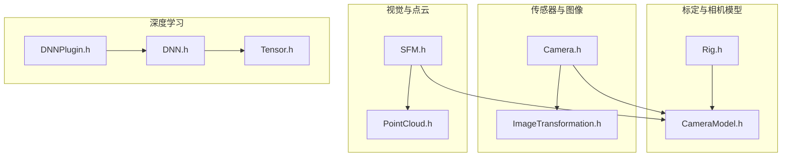
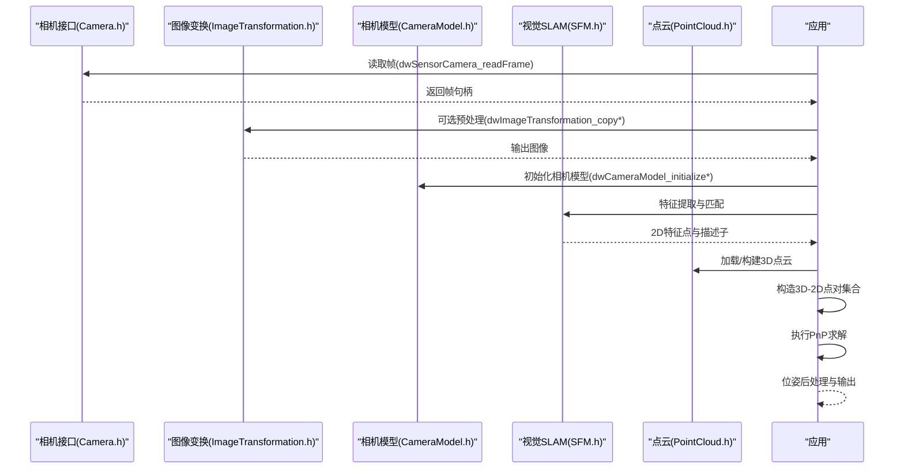
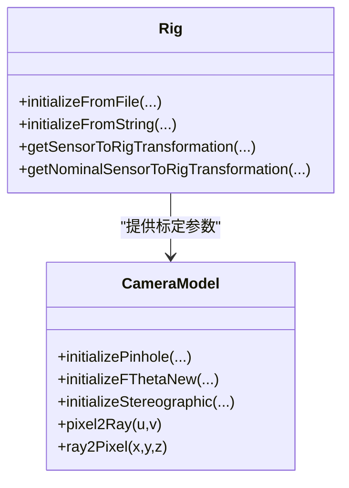
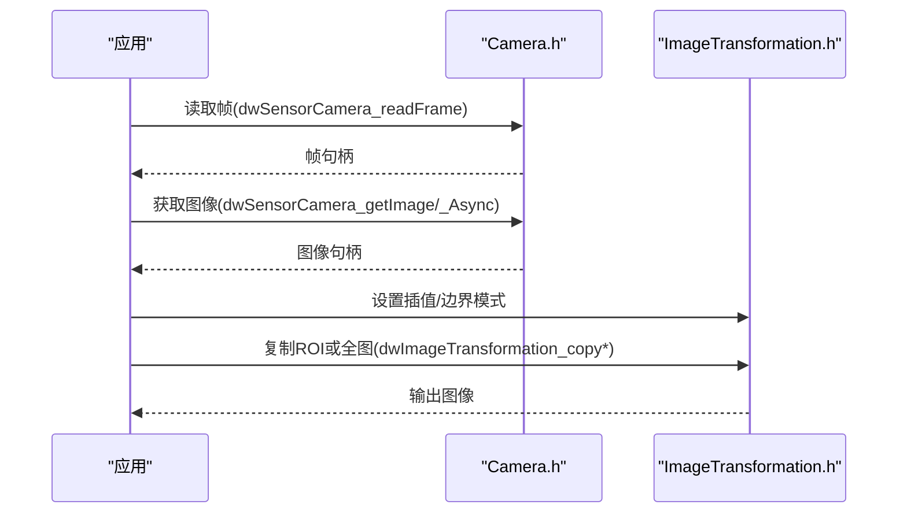
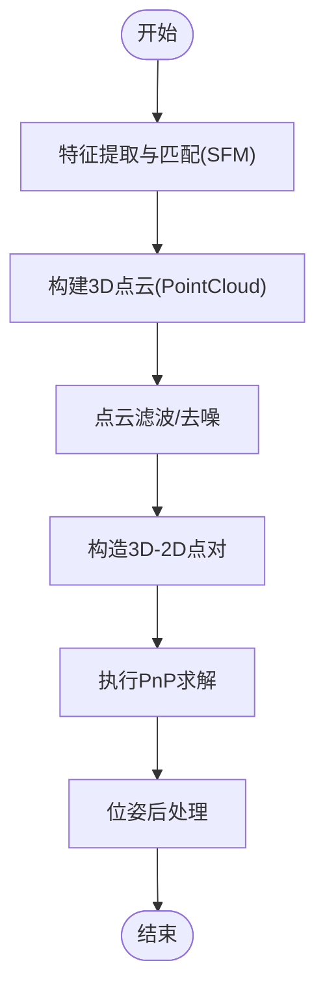
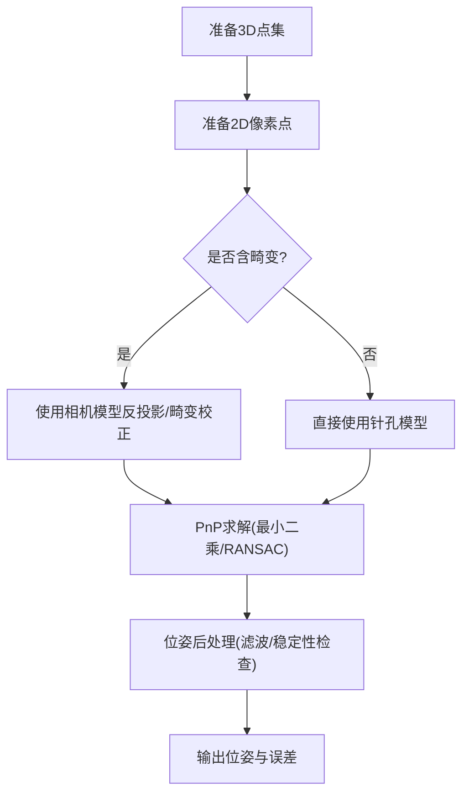
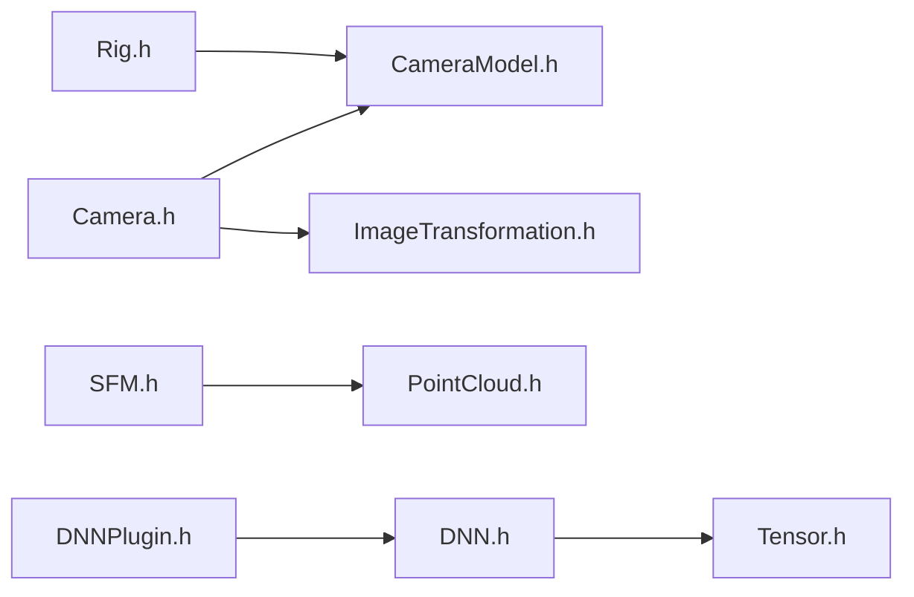

# 姿态估计

<cite>
**本文引用的文件**
- [Rig.h](file://driverorks-5.10/include/dw/rig/Rig.h)
- [CameraModel.h](file://driverorks-5.10/include/dw/calibration/cameramodel/CameraModel.h)
- [Camera.h](file://driverorks-5.10/include/dw/sensors/camera/Camera.h)
- [ImageTransformation.h](file://driverorks-5.10/include/dw/imageprocessing/geometry/imagetransformation/ImageTransformation.h)
- [SFM.h](file://driverorks-5.10/include/dw/imageprocessing/sfm/SFM.h)
- [PointCloud.h](file://driverorks-5.10/include/dw/pointcloudprocessing/pointcloud/PointCloud.h)
- [RigTypes.h](file://driveworks-5.14/include/dw/rig/RigTypes.h)
- [DNN.h](file://driveworks-5.14/include/dw/dnn/DNN.h)
- [DNNPlugin.h](file://driveworks-5.14/include/dw/dnn/plugin/DNNPlugin.h)
- [Tensor.h](file://driveworks-5.14/include/dw/dnn/tensor/Tensor.h)
</cite>

## 目录
1. [引言](#引言)
2. [项目结构](#项目结构)
3. [核心组件](#核心组件)
4. [架构总览](#架构总览)
5. [详细组件分析](#详细组件分析)
6. [依赖分析](#依赖分析)
7. [性能考虑](#性能考虑)
8. [故障排查指南](#故障排查指南)
9. [结论](#结论)
10. [附录](#附录)

## 引言
本技术文档围绕姿态估计模块展开，重点阐述在DriveWorks框架下如何利用相机模型与标定信息完成3D-2D点对应关系的建立，并结合点云与图像数据进行相机位姿估计。文档涵盖以下要点：
- PnP（Perspective-n-Point）算法在相机姿态估计中的应用与流程
- 3D-2D点对的准备与筛选策略
- 相机内参与畸变参数的使用方法
- 点云数据准备与结果后处理
- 鲁棒性与精度影响因素
- 实际应用场景与性能优化建议

## 项目结构
本仓库包含多版本的DriveWorks头文件与工具链，其中与姿态估计直接相关的核心模块位于以下路径：
- 标定与相机模型：driverorks-5.10/include/dw/calibration/cameramodel/CameraModel.h
- 车辆/传感器标定配置：driverorks-5.10/include/dw/rig/Rig.h
- 摄像头接口：driverorks-5.10/include/dw/sensors/camera/Camera.h
- 图像变换：driverorks-5.10/include/dw/imageprocessing/geometry/imagetransformation/ImageTransformation.h
- 视觉SLAM基础能力：driverorks-5.10/include/dw/imageprocessing/sfm/SFM.h
- 点云处理：driverorks-5.10/include/dw/pointcloudprocessing/pointcloud/PointCloud.h
- 版本差异补充（5.14）：driveworks-5.14/include/dw/rig/RigTypes.h、DNN与张量等

**图表来源**
- [CameraModel.h:67-151](file://driverorks-5.10/include/dw/calibration/cameramodel/CameraModel.h#L67-L151)
- [Rig.h:451-501](file://driverorks-5.10/include/dw/rig/Rig.h#L451-L501)
- [Camera.h:548-593](file://driverorks-5.10/include/dw/sensors/camera/Camera.h#L548-L593)
- [ImageTransformation.h:77-100](file://driverorks-5.10/include/dw/imageprocessing/geometry/imagetransformation/ImageTransformation.h#L77-L100)
- [SFM.h:1-200](file://driverorks-5.10/include/dw/imageprocessing/sfm/SFM.h#L1-L200)
- [PointCloud.h:1-200](file://driverorks-5.10/include/dw/pointcloudprocessing/pointcloud/PointCloud.h#L1-L200)

**章节来源**
- [CameraModel.h:67-151](file://driverorks-5.10/include/dw/calibration/cameramodel/CameraModel.h#L67-L151)
- [Rig.h:451-501](file://driverorks-5.10/include/dw/rig/Rig.h#L451-L501)
- [Camera.h:548-593](file://driverorks-5.10/include/dw/sensors/camera/Camera.h#L548-L593)
- [ImageTransformation.h:77-100](file://driverorks-5.10/include/dw/imageprocessing/geometry/imagetransformation/ImageTransformation.h#L77-L100)
- [SFM.h:1-200](file://driverorks-5.10/include/dw/imageprocessing/sfm/SFM.h#L1-L200)
- [PointCloud.h:1-200](file://driverorks-5.10/include/dw/pointcloudprocessing/pointcloud/PointCloud.h#L1-L200)

## 核心组件
- 相机模型与标定
  - 提供针孔/鱼眼/立体等相机模型初始化与像素-射线投影函数
  - 支持从Rig配置加载标定参数并生成可复用的相机模型句柄
- Rig标定配置
  - 定义传感器到车体坐标系的外参、传感器间外参以及畸变系数
  - 提供从文件或字符串初始化标定配置的能力
- 相机接口
  - 提供帧读取、图像输出格式选择、CUDA流设置等能力
- 图像变换
  - 提供缩放、裁剪、边界与插值模式设置等图像处理能力
- 视觉SLAM基础
  - 提供特征提取、匹配、三角化等基础能力，支撑PnP输入准备
- 点云处理
  - 提供点云容器、滤波、拼接等能力，用于3D空间几何表示

**章节来源**
- [CameraModel.h:85-137](file://driverorks-5.10/include/dw/calibration/cameramodel/CameraModel.h#L85-L137)
- [Rig.h:451-501](file://driverorks-5.10/include/dw/rig/Rig.h#L451-L501)
- [Camera.h:548-593](file://driverorks-5.10/include/dw/sensors/camera/Camera.h#L548-L593)
- [ImageTransformation.h:77-100](file://driverorks-5.10/include/dw/imageprocessing/geometry/imagetransformation/ImageTransformation.h#L77-L100)
- [SFM.h:1-200](file://driverorks-5.10/include/dw/imageprocessing/sfm/SFM.h#L1-L200)
- [PointCloud.h:1-200](file://driverorks-5.10/include/dw/pointcloudprocessing/pointcloud/PointCloud.h#L1-L200)

## 架构总览
姿态估计在DriveWorks中的典型流程如下：
- 输入准备：通过Camera读取图像帧；必要时使用ImageTransformation进行预处理
- 几何模型：根据Rig配置初始化CameraModel，获取像素-射线映射与反投影能力
- 特征与匹配：使用SFM模块提取特征并进行2D-2D匹配，得到候选3D-2D点对
- 3D点云：通过点云容器与滤波器准备3D场景点
- PnP求解：以3D点云点与对应的2D像素点作为输入，求解相机位姿
- 后处理：对位姿进行稳定性检查与滤波，输出结果

**图表来源**
- [Camera.h:548-593](file://driverorks-5.10/include/dw/sensors/camera/Camera.h#L548-L593)
- [ImageTransformation.h:191-223](file://driverorks-5.10/include/dw/imageprocessing/geometry/imagetransformation/ImageTransformation.h#L191-L223)
- [CameraModel.h:85-137](file://driverorks-5.10/include/dw/calibration/cameramodel/CameraModel.h#L85-L137)
- [SFM.h:1-200](file://driverorks-5.10/include/dw/imageprocessing/sfm/SFM.h#L1-L200)
- [PointCloud.h:1-200](file://driverorks-5.10/include/dw/pointcloudprocessing/pointcloud/PointCloud.h#L1-L200)

## 详细组件分析

### 组件A：相机模型与标定（CameraModel + Rig）
- 相机模型初始化
  - 针孔模型：提供宽高、主点、焦距与畸变系数，支持像素-射线与反投影
  - F-Theta与立体模型：提供广角/鱼眼光学模型与映射多项式
- Rig配置
  - 从文件或字符串加载标定JSON，解析传感器外参与畸变参数
  - 提供传感器到车体/传感器间的变换查询接口

**图表来源**
- [Rig.h:451-501](file://driverorks-5.10/include/dw/rig/Rig.h#L451-L501)
- [CameraModel.h:85-137](file://driverorks-5.10/include/dw/calibration/cameramodel/CameraModel.h#L85-L137)

**章节来源**
- [Rig.h:101-156](file://driverorks-5.10/include/dw/rig/Rig.h#L101-L156)
- [CameraModel.h:85-137](file://driverorks-5.10/include/dw/calibration/cameramodel/CameraModel.h#L85-L137)

### 组件B：图像采集与预处理（Camera + ImageTransformation）
- 图像采集
  - 读取帧、查询图像属性、设置CUDA流、异步获取图像
- 图像变换
  - ROI拷贝、全图拷贝、插值与边界模式设置

**图表来源**
- [Camera.h:548-593](file://driverorks-5.10/include/dw/sensors/camera/Camera.h#L548-L593)
- [ImageTransformation.h:191-223](file://driverorks-5.10/include/dw/imageprocessing/geometry/imagetransformation/ImageTransformation.h#L191-L223)

**章节来源**
- [Camera.h:548-593](file://driverorks-5.10/include/dw/sensors/camera/Camera.h#L548-L593)
- [ImageTransformation.h:77-100](file://driverorks-5.10/include/dw/imageprocessing/geometry/imagetransformation/ImageTransformation.h#L77-L100)

### 组件C：视觉SLAM与点云（SFM + PointCloud）
- SFM基础能力
  - 特征检测/描述子/匹配等，为PnP提供高质量2D-2D对应
- 点云处理
  - 点云容器、滤波、拼接与平面提取，用于3D场景建模

**图表来源**
- [SFM.h:1-200](file://driverorks-5.10/include/dw/imageprocessing/sfm/SFM.h#L1-L200)
- [PointCloud.h:1-200](file://driverorks-5.10/include/dw/pointcloudprocessing/pointcloud/PointCloud.h#L1-L200)

**章节来源**
- [SFM.h:1-200](file://driverorks-5.10/include/dw/imageprocessing/sfm/SFM.h#L1-L200)
- [PointCloud.h:1-200](file://driverorks-5.10/include/dw/pointcloudprocessing/pointcloud/PointCloud.h#L1-L200)

### 组件D：PnP求解流程（概念性）
- 输入
  - 3D世界点集合（来自点云/SLAM三角化）
  - 对应的2D像素点（来自相机模型反投影或特征匹配）
- 过程
  - 使用最小二乘或鲁棒估计（如RANSAC）求解位姿
  - 可选使用相机内参与畸变参数进行精确重投影
- 输出
  - 相机位姿（旋转+平移），误差指标与置信度

[本图为概念性流程，不直接映射具体源码文件]

## 依赖分析
- 模块耦合
  - Rig与CameraModel强耦合：Rig提供标定参数，CameraModel负责几何映射
  - Camera与ImageTransformation弱耦合：前者提供图像，后者提供预处理
  - SFM与PointCloud弱耦合：前者提供2D特征，后者提供3D几何
- 外部依赖
  - CUDA流与NVIDIA驱动栈（由Camera与ImageTransformation暴露）
  - 可选DNN模块（5.14版本）用于特征增强或目标检测

**图表来源**
- [Rig.h:451-501](file://driverorks-5.10/include/dw/rig/Rig.h#L451-L501)
- [CameraModel.h:85-137](file://driverorks-5.10/include/dw/calibration/cameramodel/CameraModel.h#L85-L137)
- [Camera.h:548-593](file://driverorks-5.10/include/dw/sensors/camera/Camera.h#L548-L593)
- [ImageTransformation.h:77-100](file://driverorks-5.10/include/dw/imageprocessing/geometry/imagetransformation/ImageTransformation.h#L77-L100)
- [SFM.h:1-200](file://driverorks-5.10/include/dw/imageprocessing/sfm/SFM.h#L1-L200)
- [PointCloud.h:1-200](file://driverorks-5.10/include/dw/pointcloudprocessing/pointcloud/PointCloud.h#L1-L200)
- [DNN.h:1-200](file://driveworks-5.14/include/dw/dnn/DNN.h#L1-L200)
- [DNNPlugin.h:1-200](file://driveworks-5.14/include/dw/dnn/plugin/DNNPlugin.h#L1-L200)
- [Tensor.h:1-200](file://driveworks-5.14/include/dw/dnn/tensor/Tensor.h#L1-L200)

**章节来源**
- [Rig.h:451-501](file://driverorks-5.10/include/dw/rig/Rig.h#L451-L501)
- [CameraModel.h:85-137](file://driverorks-5.10/include/dw/calibration/cameramodel/CameraModel.h#L85-L137)
- [Camera.h:548-593](file://driverorks-5.10/include/dw/sensors/camera/Camera.h#L548-L593)
- [ImageTransformation.h:77-100](file://driverorks-5.10/include/dw/imageprocessing/geometry/imagetransformation/ImageTransformation.h#L77-L100)
- [SFM.h:1-200](file://driverorks-5.10/include/dw/imageprocessing/sfm/SFM.h#L1-L200)
- [PointCloud.h:1-200](file://driverorks-5.10/include/dw/pointcloudprocessing/pointcloud/PointCloud.h#L1-L200)
- [DNN.h:1-200](file://driveworks-5.14/include/dw/dnn/DNN.h#L1-L200)
- [DNNPlugin.h:1-200](file://driveworks-5.14/include/dw/dnn/plugin/DNNPlugin.h#L1-L200)
- [Tensor.h:1-200](file://driveworks-5.14/include/dw/dnn/tensor/Tensor.h#L1-L200)

## 性能考虑
- CUDA流与异步处理
  - 使用Camera的异步接口与CUDA流减少阻塞
  - ImageTransformation设置合适的插值与边界模式降低计算开销
- 特征质量与数量
  - 通过SFM模块提升特征匹配质量，减少误匹配导致的PnP失败
- 点云质量
  - 使用滤波与平面提取减少离群点，提高PnP鲁棒性
- 内存与带宽
  - 合理设置图像输出格式与尺寸，避免不必要的拷贝

[本节提供通用指导，不直接分析具体文件]

## 故障排查指南
- 相机读取失败
  - 检查帧读取超时与错误码，确认传感器已启动且未进入不可恢复状态
- 图像格式不匹配
  - 确认输出类型与图像池属性一致，必要时调用分配属性附加接口
- 相机模型初始化失败
  - 校验Rig配置文件完整性与标定参数范围
- PnP求解异常
  - 检查3D-2D点对数量与分布，确保满足最小约束并避免共面
  - 关注畸变校正与内参一致性

**章节来源**
- [Camera.h:548-593](file://driverorks-5.10/include/dw/sensors/camera/Camera.h#L548-L593)
- [ImageTransformation.h:125-127](file://driverorks-5.10/include/dw/imageprocessing/geometry/imagetransformation/ImageTransformation.h#L125-L127)
- [CameraModel.h:85-137](file://driverorks-5.10/include/dw/calibration/cameramodel/CameraModel.h#L85-L137)

## 结论
本技术文档梳理了DriveWorks中姿态估计的关键路径：从Rig标定与相机模型初始化，到图像采集与预处理，再到特征与点云准备，最终完成PnP求解与后处理。通过合理组织模块依赖、优化图像与特征质量、以及正确使用内参与畸变参数，可在复杂场景中获得稳定且高精度的相机位姿估计。

## 附录
- 实际应用场景
  - 自动驾驶感知：基于多传感器融合的定位
  - SLAM与建图：结合视觉与激光雷达的定位与地图构建
  - 目标跟踪：基于位姿的三维目标跟踪与预测
- 性能优化建议
  - 并行化：充分利用CUDA流与多核处理
  - 数据缓存：复用已计算的特征与点云，减少重复计算
  - 参数调优：根据场景调整特征提取阈值与PnP鲁棒估计参数