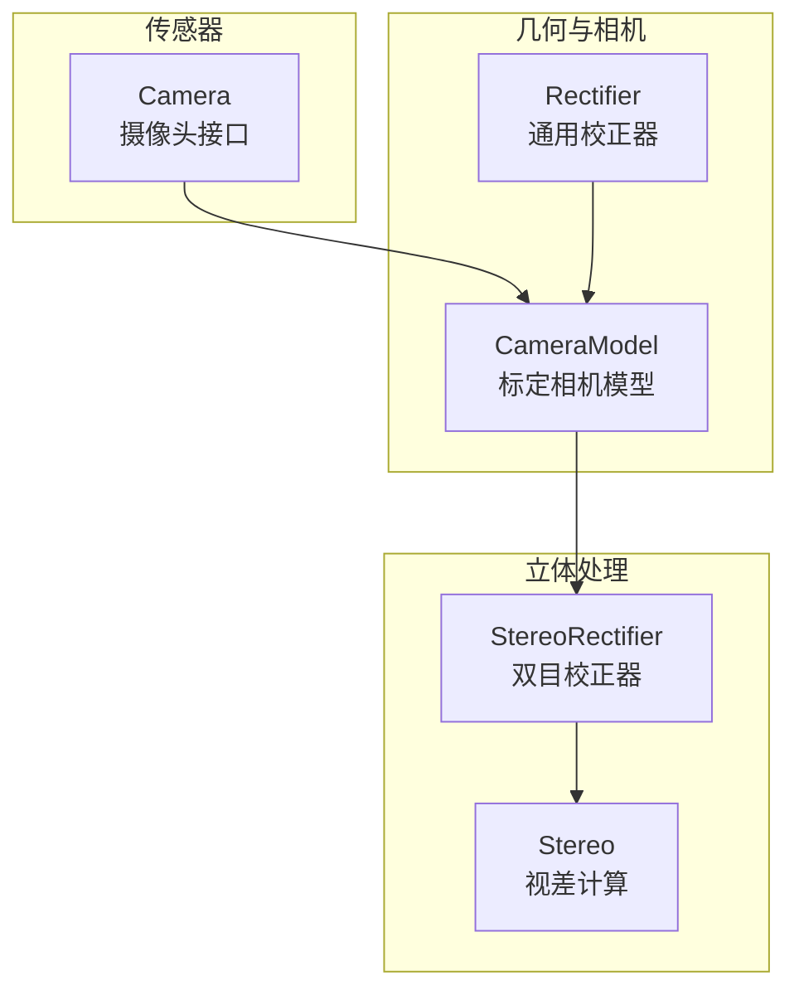
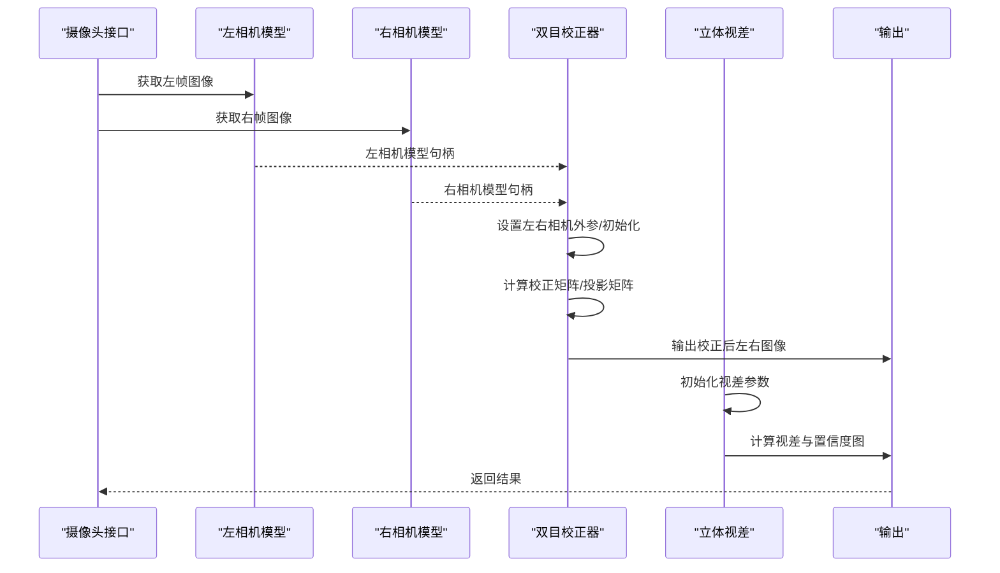
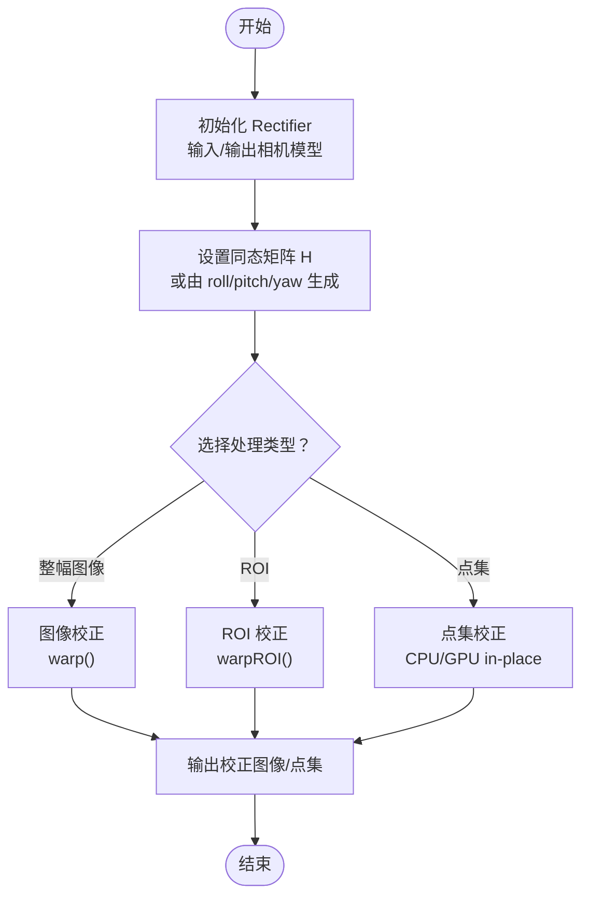
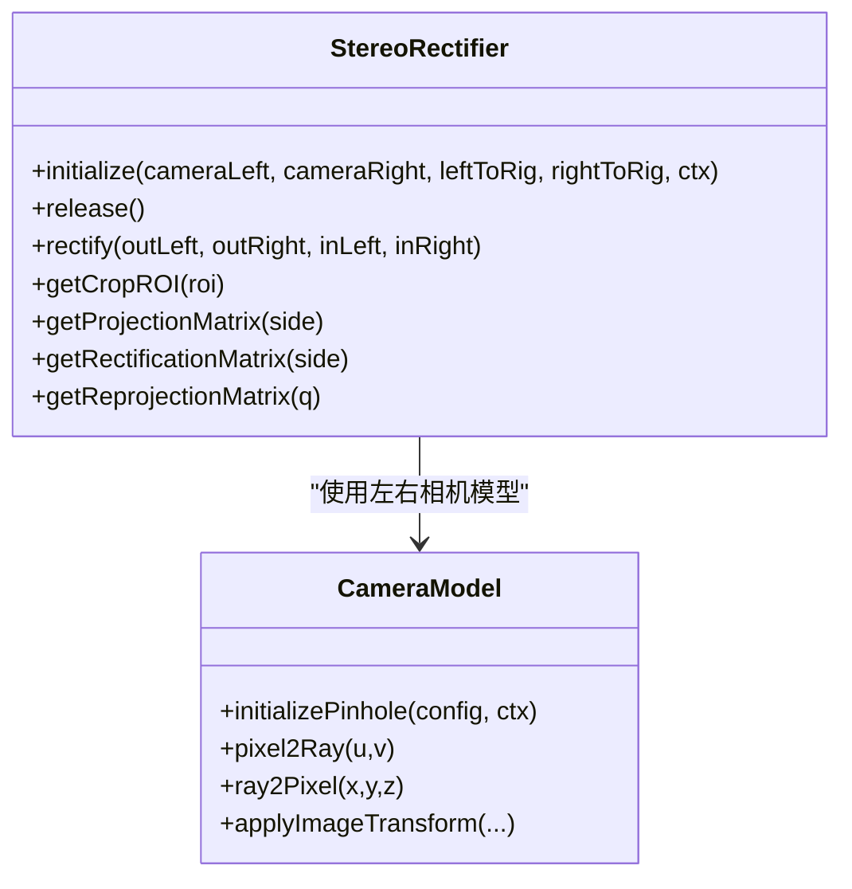
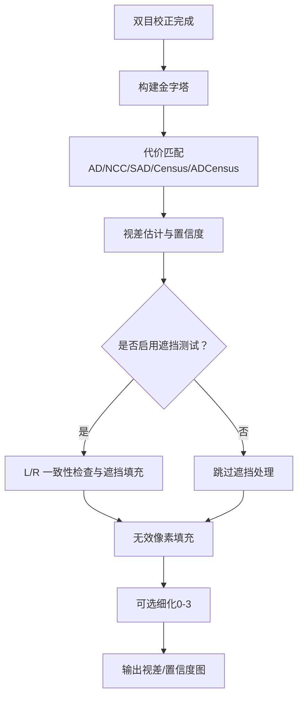
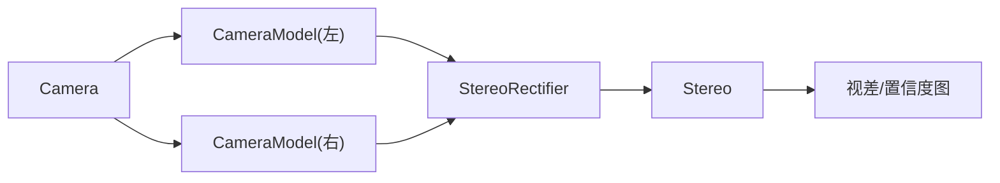

# 立体校正

<cite>
**本文引用的文件**
- [Rectifier.h](file://driverorks-5.10/include/dw/imageprocessing/geometry/rectifier/Rectifier.h)
- [Stereo.h](file://driverorks-5.10/include/dw/imageprocessing/stereo/Stereo.h)
- [CameraModel.h](file://driverorks-5.10/include/dw/calibration/cameramodel/CameraModel.h)
- [Camera.h](file://driverorks-5.10/include/dw/sensors/camera/Camera.h)
</cite>

## 目录
1. [引言](#引言)
2. [项目结构](#项目结构)
3. [核心组件](#核心组件)
4. [架构总览](#架构总览)
5. [详细组件分析](#详细组件分析)
6. [依赖关系分析](#依赖关系分析)
7. [性能考量](#性能考量)
8. [故障排查指南](#故障排查指南)
9. [结论](#结论)
10. [附录](#附录)

## 引言
本技术文档围绕 DriveWorks 中的立体校正模块展开，重点覆盖以下内容：
- 双目相机标定与相机模型（CameraModel）的使用
- 立体图像校正（Rectifier 与 StereoRectifier）的数学原理与实现要点
- 校正变换矩阵（含旋转、投影、重投影）的计算与应用
- 典型工作流：从采集到校正再到视差计算
- 质量评估与参数调优建议
- 实际工程中的注意事项与性能优化技巧

## 项目结构
与立体校正直接相关的头文件位于以下路径：
- 几何校正与点/图变换：imageprocessing/geometry/rectifier/Rectifier.h
- 立体处理与双目校正：imageprocessing/stereo/Stereo.h
- 相机模型与标定：calibration/cameramodel/CameraModel.h
- 摄像头接口与帧读取：sensors/camera/Camera.h

下图给出与立体校正相关的关键模块与文件映射：

图表来源
- [Stereo.h:341-474](file://driverorks-5.10/include/dw/imageprocessing/stereo/Stereo.h#L341-L474)
- [Rectifier.h:46-348](file://driverorks-5.10/include/dw/imageprocessing/geometry/rectifier/Rectifier.h#L46-L348)
- [CameraModel.h:31-370](file://driverorks-5.10/include/dw/calibration/cameramodel/CameraModel.h#L31-L370)
- [Camera.h:51-800](file://driverorks-5.10/include/dw/sensors/camera/Camera.h#L51-L800)

章节来源
- [Stereo.h:341-474](file://driverorks-5.10/include/dw/imageprocessing/stereo/Stereo.h#L341-L474)
- [Rectifier.h:46-348](file://driverorks-5.10/include/dw/imageprocessing/geometry/rectifier/Rectifier.h#L46-L348)
- [CameraModel.h:31-370](file://driverorks-5.10/include/dw/calibration/cameramodel/CameraModel.h#L31-L370)
- [Camera.h:51-800](file://driverorks-5.10/include/dw/sensors/camera/Camera.h#L51-L800)

## 核心组件
- Rectifier（通用校正器）
  - 支持输入/输出相机模型之间的像素坐标映射，可设置并获取同态矩阵（homography），支持 CPU/GPU 点映射与 ROI 映射，以及 NvMedia/VIC 加速路径。
- StereoRectifier（双目校正器）
  - 基于左右相机模型与外参（rig 中的左右相机位姿），将双目图像校正为极线平行的图像对，并提供裁剪 ROI、投影矩阵、重投影矩阵等工具。
- Stereo（视差计算）
  - 在双目校正后的图像上进行代价匹配、视差估计与置信度图生成，支持金字塔多尺度、细化与填充策略。
- CameraModel（标定相机模型）
  - 提供针孔/广角等模型的反投影（像素→光线）与前向投影（光线→像素），用于几何变换与校正。

章节来源
- [Rectifier.h:63-348](file://driverorks-5.10/include/dw/imageprocessing/geometry/rectifier/Rectifier.h#L63-L348)
- [Stereo.h:347-474](file://driverorks-5.10/include/dw/imageprocessing/stereo/Stereo.h#L347-L474)
- [CameraModel.h:67-370](file://driverorks-5.10/include/dw/calibration/cameramodel/CameraModel.h#L67-L370)

## 架构总览
下图展示了从原始双目图像到视差图的典型流程，以及各模块在其中的角色与交互。

图表来源
- [Stereo.h:374-466](file://driverorks-5.10/include/dw/imageprocessing/stereo/Stereo.h#L374-L466)
- [CameraModel.h:86-151](file://driverorks-5.10/include/dw/calibration/cameramodel/CameraModel.h#L86-L151)
- [Camera.h:548-620](file://driverorks-5.10/include/dw/sensors/camera/Camera.h#L548-L620)

## 详细组件分析

### 组件一：Rectifier（通用校正器）
- 主要职责
  - 将输入图像按输入/输出相机模型进行像素坐标映射；支持设置/获取同态矩阵（用于回投影时的旋转）；支持 ROI 映射；支持 CUDA/GPU 与 NvMedia/VIC 加速。
- 关键能力
  - 初始化与释放
  - 设置/获取同态矩阵（可由 roll/pitch/yaw 生成）
  - 图像级校正（warp/warpROI）、点级校正（CPU/GPU in-place 或非 in-place）
  - 获取畸变映射（distortion map）
  - CUDA 流设置/查询
- 数学要点
  - 同态矩阵 H 用于在“回投影-投影”链路中引入旋转，以满足极线约束与图像对齐条件。
  - 坐标系适配：当输入/输出图像尺寸与相机模型不一致时，内部会隐式缩放坐标，可能导致拉伸或比例变化。

图表来源
- [Rectifier.h:81-348](file://driverorks-5.10/include/dw/imageprocessing/geometry/rectifier/Rectifier.h#L81-L348)

章节来源
- [Rectifier.h:63-348](file://driverorks-5.10/include/dw/imageprocessing/geometry/rectifier/Rectifier.h#L63-L348)

### 组件二：StereoRectifier（双目校正器）
- 主要职责
  - 基于左右相机模型与 rig 外参，将双目图像校正为极线平行的图像对；提供裁剪 ROI、投影矩阵与重投影矩阵。
- 关键能力
  - 初始化（左右相机模型 + 左/右到 rig 的外参）
  - rectify（输出左右校正图像）
  - getCropROI（返回有效区域）
  - getProjectionMatrix（返回 P=[M_rect*[I|0/Tx]]）
  - getRectificationMatrix（发送极点至无穷的旋转矩阵）
  - getReprojectionMatrix（Q 矩阵，用于三维重建）

图表来源
- [Stereo.h:374-466](file://driverorks-5.10/include/dw/imageprocessing/stereo/Stereo.h#L374-L466)
- [CameraModel.h:86-279](file://driverorks-5.10/include/dw/calibration/cameramodel/CameraModel.h#L86-L279)

章节来源
- [Stereo.h:347-474](file://driverorks-5.10/include/dw/imageprocessing/stereo/Stereo.h#L347-L474)

### 组件三：Stereo（视差计算）
- 主要职责
  - 在双目校正后的图像上进行代价匹配、视差估计与置信度图生成；支持金字塔多尺度、细化与填充策略。
- 关键能力
  - 初始化参数与算法实例
  - computeDisparity（左右金字塔输入）
  - getDisparity/getConfidence（输出视差与置信度）
  - occlusion test/infill、invalidity threshold、refinement level 等配置

图表来源
- [Stereo.h:101-273](file://driverorks-5.10/include/dw/imageprocessing/stereo/Stereo.h#L101-L273)

章节来源
- [Stereo.h:101-273](file://driverorks-5.10/include/dw/imageprocessing/stereo/Stereo.h#L101-L273)

### 组件四：CameraModel（相机模型）
- 主要职责
  - 提供针孔/广角等模型的反投影（像素→光线）与前向投影（光线→像素）；支持图像坐标变换（裁剪/子采样等）。
- 关键能力
  - initializePinhole/initializeFThetaNew/initializeStereographic
  - pixel2Ray/ray2Pixel/isRayInsideFOV
  - getHorizontalFOV/getImageSize/applyImageTransform

章节来源
- [CameraModel.h:86-341](file://driverorks-5.10/include/dw/calibration/cameramodel/CameraModel.h#L86-L341)

## 依赖关系分析
- StereoRectifier 依赖 CameraModel（左右相机模型）与 rig 外参（leftToRig/rightToRig）
- StereoRectifier 输出的校正图像作为 Stereo 的输入
- Rectifier 可独立使用，也可作为通用几何变换工具服务于其他模块
- Camera 接口负责从传感器读取帧并转换为图像格式，为后续校正与视差计算提供数据源

图表来源
- [Camera.h:548-620](file://driverorks-5.10/include/dw/sensors/camera/Camera.h#L548-L620)
- [Stereo.h:374-405](file://driverorks-5.10/include/dw/imageprocessing/stereo/Stereo.h#L374-L405)

章节来源
- [Camera.h:548-620](file://driverorks-5.10/include/dw/sensors/camera/Camera.h#L548-L620)
- [Stereo.h:374-405](file://driverorks-5.10/include/dw/imageprocessing/stereo/Stereo.h#L374-L405)

## 性能考量
- CUDA 流与异步处理
  - Rectifier/Stereo 均支持设置 CUDA 流，便于与图像采集/解码流水线并行。
- ROI 校正
  - 使用 warpROI 可仅对感兴趣区域进行校正，减少计算量。
- 畸变映射缓存
  - 可通过获取畸变映射（distortion map）避免重复计算，提升批量处理效率。
- 金字塔与细化
  - 视差计算采用金字塔多尺度策略，先粗后精；细化级别越高，精度与性能权衡越大。
- NvMedia/VIC 加速
  - 在支持平台上使用 NvMedia 路径可降低 CPU 开销，但需满足图像属性与分辨率要求。

章节来源
- [Rectifier.h:135-177](file://driverorks-5.10/include/dw/imageprocessing/geometry/rectifier/Rectifier.h#L135-L177)
- [Stereo.h:285-311](file://driverorks-5.10/include/dw/imageprocessing/stereo/Stereo.h#L285-L311)

## 故障排查指南
- 句柄与参数校验
  - 初始化/调用失败时优先检查句柄有效性（NULL/类型错误）、参数合法性（ROI/图像尺寸/流指针）。
- CUDA/NvMedia 错误
  - CUDA 错误通常与显存不足、流状态异常或内核执行失败有关；NvMedia 错误与驱动导入/分配属性相关。
- 图像尺寸与坐标适配
  - 输入/输出图像尺寸与相机模型不一致时，内部会隐式缩放，可能导致拉伸；应确保图像尺寸与相机一致或正确设置相机模型。
- ROI 与裁剪
  - 使用 getCropROI 获取有效区域，避免边缘无效像素影响后续视差估计。
- 参数调优
  - 视差范围、金字塔层数、细化级别、遮挡测试阈值、无效像素填充策略等均会影响最终质量与性能，建议结合场景逐步调整。

章节来源
- [Rectifier.h:140-196](file://driverorks-5.10/include/dw/imageprocessing/geometry/rectifier/Rectifier.h#L140-L196)
- [Stereo.h:172-248](file://driverorks-5.10/include/dw/imageprocessing/stereo/Stereo.h#L172-L248)

## 结论
- 立体校正模块以 CameraModel 为基础，通过 StereoRectifier 实现双目图像的极线对齐与几何一致性，再由 Stereo 完成代价匹配与视差估计。
- Rectifier 提供通用的几何映射能力，既可用于单目/多目的校正，也可作为立体管线的预处理工具。
- 工程实践中应重视相机标定精度、图像同步与外参稳定性，同时结合 ROI、金字塔与 CUDA 流策略优化性能与质量。

## 附录

### A. 数学原理与变换矩阵
- 同态矩阵 H
  - 用于在回投影阶段引入旋转，满足极线约束与图像对齐条件。
- 投影矩阵 P
  - 左/右相机的投影矩阵形式为 P = M_rect * [I | 0] 或 P = M_rect * [I | Tx]，其中 M_rect 为校正后的内参矩阵，Tx 为基线平移。
- 重投影矩阵 Q
  - 用于将视差图映射回三维点云，包含焦距与基线信息。

章节来源
- [Stereo.h:421-466](file://driverorks-5.10/include/dw/imageprocessing/stereo/Stereo.h#L421-L466)

### B. 典型工作流与调用序列
- 采集与准备
  - 使用 Camera 接口读取左右帧，获取图像属性与 CUDA 流。
- 相机模型与外参
  - 初始化左右 CameraModel，准备 rig 外参（leftToRig/rightToRig）。
- 双目校正
  - 初始化 StereoRectifier，rectify 得到校正图像；必要时使用 getCropROI 进行裁剪。
- 视差计算
  - 初始化 Stereo 参数，computeDisparity，随后获取视差与置信度图。
- 三维重建
  - 使用 getReprojectionMatrix(Q) 将视差图映射为点云。

章节来源
- [Camera.h:548-620](file://driverorks-5.10/include/dw/sensors/camera/Camera.h#L548-L620)
- [Stereo.h:374-466](file://driverorks-5.10/include/dw/imageprocessing/stereo/Stereo.h#L374-L466)