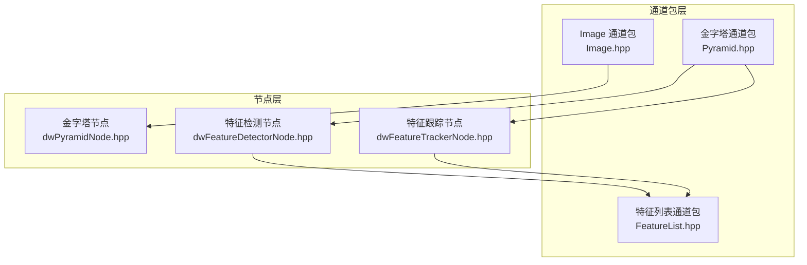
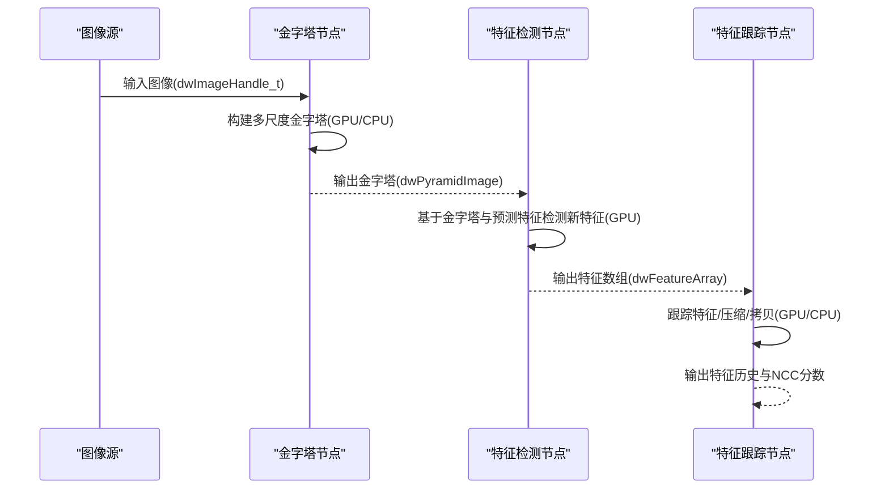
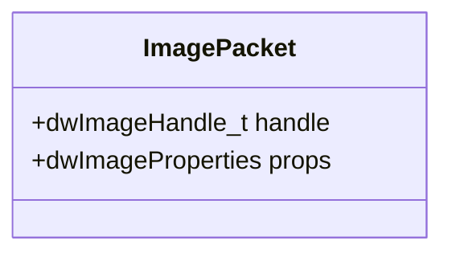
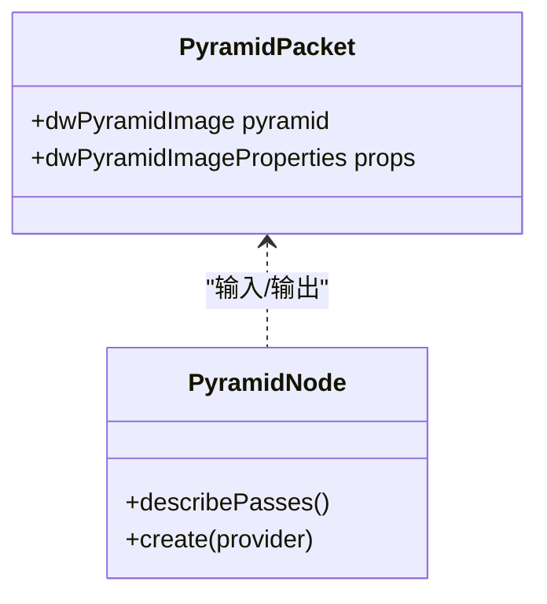
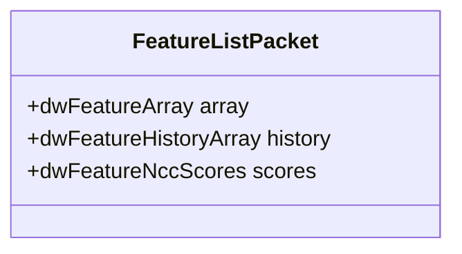
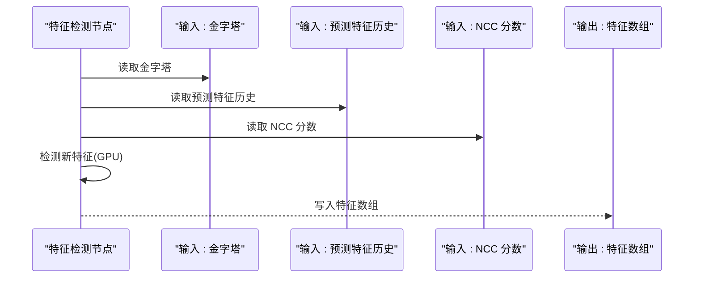
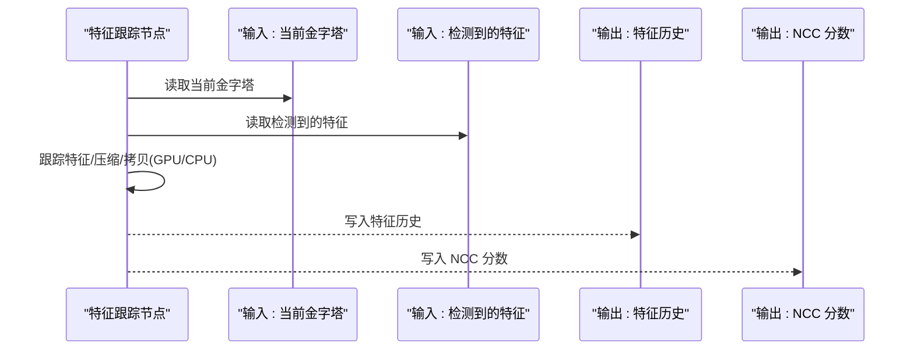
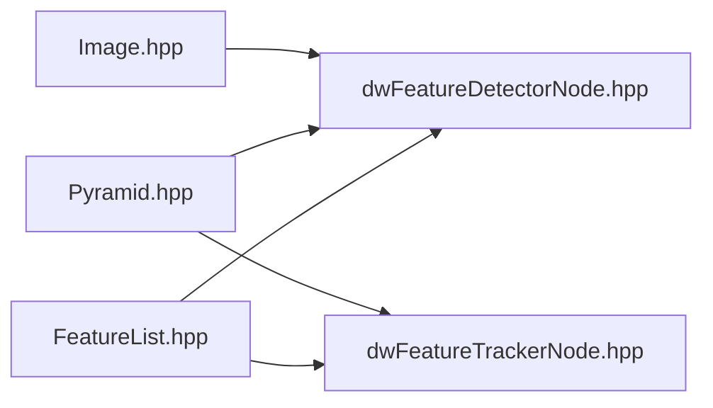

# 图像处理

<cite>
**本文引用的文件**
- [Image.hpp](file://driverorks-5.10/include/dwframework/dwnodes/common/channelpackets/Image.hpp)
- [Pyramid.hpp](file://driverorks-5.10/include/dwframework/dwnodes/common/channelpackets/Pyramid.hpp)
- [FeatureList.hpp](file://driverorks-5.10/include/dwframework/dwnodes/common/channelpackets/FeatureList.hpp)
- [dwFeatureDetectorNode.hpp](file://driverorks-5.10/include/dwframework/dwnodes/imageprocessing/dwfeaturedetectornode/dwFeatureDetectorNode.hpp)
- [dwFeatureTrackerNode.hpp](file://driverorks-5.10/include/dwframework/dwnodes/imageprocessing/dwfeaturetrackernode/dwFeatureTrackerNode.hpp)
- [dwPyramidNode.hpp](file://driverorks-5.10/include/dwframework/dwnodes/imageprocessing/dwpyramidnode/dwPyramidNode.hpp)
- [dwPyramidPVANode.hpp](file://driverorks-5.10/include/dwframework/dwnodes/imageprocessing/dwpyramidnode/dwPyramidPVANode.hpp)
- [dwFeatureDetectorPVANode.hpp](file://driverorks-5.10/include/dwframework/dwnodes/imageprocessing/dwfeaturedetectornode/dwFeatureDetectorPVANode.hpp)
- [dwFeatureTrackerPVANode.hpp](file://driverorks-5.10/include/dwframework/dwnodes/imageprocessing/dwfeaturetrackernode/dwFeatureTrackerPVANode.hpp)
</cite>

## 目录
1. [简介](#简介)
2. [项目结构](#项目结构)
3. [核心组件](#核心组件)
4. [架构总览](#架构总览)
5. [详细组件分析](#详细组件分析)
6. [依赖关系分析](#依赖关系分析)
7. [性能考虑](#性能考虑)
8. [故障排查指南](#故障排查指南)
9. [结论](#结论)
10. [附录](#附录)

## 简介
本技术文档围绕 DriveWorks 框架中的图像处理模块展开，系统性介绍图像处理的核心能力与实现方式，覆盖以下主题：
- 图像数据封装与通道包：Image 类型通过通道包进行跨节点传递
- 几何与变换：相机内参、外参与坐标系转换
- 图像金字塔与滤波：多尺度图像表示与降采样
- 特征检测与特征列表管理：特征生成、历史记录与 NCC 分数
- 特征跟踪算法：GPU/CPU 流水线化处理、特征历史管理与 NCC 计算
- 连通区域标记、颜色校正、立体视觉与结构从运动（SfM）等高级视觉任务在该框架中以节点化方式集成，便于在 CGF 数据流中编排

文档同时提供 API 参考与使用示例路径，帮助开发者从基础图像操作到高级计算机视觉算法高效落地。

## 项目结构
图像处理模块主要由以下层次构成：
- 通道包层：定义图像、金字塔、特征列表等跨节点传输的数据包类型
- 节点层：封装具体算法（如金字塔构建、特征检测、特征跟踪）
- 参数与端口描述：通过参数描述符与端口描述符声明节点的输入输出与运行时参数
- 处理管线：节点内部按 Pass 划分 CPU/GPU 阶段，实现流水化执行

**图表来源**
- [Image.hpp:31-42](file://driverorks-5.10/include/dwframework/dwnodes/common/channelpackets/Image.hpp#L31-L42)
- [Pyramid.hpp:31-40](file://driverorks-5.10/include/dwframework/dwnodes/common/channelpackets/Pyramid.hpp#L31-L40)
- [FeatureList.hpp:31-42](file://driverorks-5.10/include/dwframework/dwnodes/common/channelpackets/FeatureList.hpp#L31-L42)
- [dwPyramidNode.hpp](file://driverorks-5.10/include/dwframework/dwnodes/imageprocessing/dwpyramidnode/dwPyramidNode.hpp)
- [dwFeatureDetectorNode.hpp:31-159](file://driverorks-5.10/include/dwframework/dwnodes/imageprocessing/dwfeaturedetectornode/dwFeatureDetectorNode.hpp#L31-L159)
- [dwFeatureTrackerNode.hpp:31-164](file://driverorks-5.10/include/dwframework/dwnodes/imageprocessing/dwfeaturetrackernode/dwFeatureTrackerNode.hpp#L31-L164)

**章节来源**
- [Image.hpp:31-42](file://driverorks-5.10/include/dwframework/dwnodes/common/channelpackets/Image.hpp#L31-L42)
- [Pyramid.hpp:31-40](file://driverorks-5.10/include/dwframework/dwnodes/common/channelpackets/Pyramid.hpp#L31-L40)
- [FeatureList.hpp:31-42](file://driverorks-5.10/include/dwframework/dwnodes/common/channelpackets/FeatureList.hpp#L31-L42)
- [dwPyramidNode.hpp](file://driverorks-5.10/include/dwframework/dwnodes/imageprocessing/dwpyramidnode/dwPyramidNode.hpp)
- [dwFeatureDetectorNode.hpp:31-159](file://driverorks-5.10/include/dwframework/dwnodes/imageprocessing/dwfeaturedetectornode/dwFeatureDetectorNode.hpp#L31-L159)
- [dwFeatureTrackerNode.hpp:31-164](file://driverorks-5.10/include/dwframework/dwnodes/imageprocessing/dwfeaturetrackernode/dwFeatureTrackerNode.hpp#L31-L164)

## 核心组件
- 图像通道包：将 dwImageHandle_t 与图像属性打包为通道包，支持跨节点传输
- 金字塔通道包：将 dwPyramidImage 与属性打包，作为特征检测与跟踪的输入
- 特征列表通道包：封装特征数组、特征历史数组与 NCC 分数，用于特征管理与质量评估
- 金字塔节点：构建多尺度图像金字塔，支持 GPU/CPU 处理阶段划分
- 特征检测节点：基于金字塔与预测特征，生成新特征并输出特征数组
- 特征跟踪节点：对当前帧特征进行跟踪、压缩与拷贝，维护特征历史与 NCC 分数

**章节来源**
- [Image.hpp:31-42](file://driverorks-5.10/include/dwframework/dwnodes/common/channelpackets/Image.hpp#L31-L42)
- [Pyramid.hpp:31-40](file://driverorks-5.10/include/dwframework/dwnodes/common/channelpackets/Pyramid.hpp#L31-L40)
- [FeatureList.hpp:31-42](file://driverorks-5.10/include/dwframework/dwnodes/common/channelpackets/FeatureList.hpp#L31-L42)
- [dwPyramidNode.hpp](file://driverorks-5.10/include/dwframework/dwnodes/imageprocessing/dwpyramidnode/dwPyramidNode.hpp)
- [dwFeatureDetectorNode.hpp:31-159](file://driverorks-5.10/include/dwframework/dwnodes/imageprocessing/dwfeaturedetectornode/dwFeatureDetectorNode.hpp#L31-L159)
- [dwFeatureTrackerNode.hpp:31-164](file://driverorks-5.10/include/dwframework/dwnodes/imageprocessing/dwfeaturetrackernode/dwFeatureTrackerNode.hpp#L31-L164)

## 架构总览
下图展示从图像输入到特征检测与跟踪的整体数据流与处理阶段：

**图表来源**
- [Image.hpp:31-42](file://driverorks-5.10/include/dwframework/dwnodes/common/channelpackets/Image.hpp#L31-L42)
- [Pyramid.hpp:31-40](file://driverorks-5.10/include/dwframework/dwnodes/common/channelpackets/Pyramid.hpp#L31-L40)
- [FeatureList.hpp:31-42](file://driverorks-5.10/include/dwframework/dwnodes/common/channelpackets/FeatureList.hpp#L31-L42)
- [dwPyramidNode.hpp](file://driverorks-5.10/include/dwframework/dwnodes/imageprocessing/dwpyramidnode/dwPyramidNode.hpp)
- [dwFeatureDetectorNode.hpp:31-159](file://driverorks-5.10/include/dwframework/dwnodes/imageprocessing/dwfeaturedetectornode/dwFeatureDetectorNode.hpp#L31-L159)
- [dwFeatureTrackerNode.hpp:31-164](file://driverorks-5.10/include/dwframework/dwnodes/imageprocessing/dwfeaturetrackernode/dwFeatureTrackerNode.hpp#L31-L164)

## 详细组件分析

### 图像通道包与数据模型
- 作用：将 dwImageHandle_t 与图像属性打包为通道包类型，便于在 CGF 数据流中跨节点传递
- 关键点：
  - 通过宏声明通道包与 DW 类型的关系
  - 支持指针类型的 POD 包装，便于在通道间传递句柄

**图表来源**
- [Image.hpp:31-42](file://driverorks-5.10/include/dwframework/dwnodes/common/channelpackets/Image.hpp#L31-L42)

**章节来源**
- [Image.hpp:31-42](file://driverorks-5.10/include/dwframework/dwnodes/common/channelpackets/Image.hpp#L31-L42)

### 金字塔通道包与构建节点
- 作用：将 dwPyramidImage 与属性打包为通道包；提供多尺度图像表示，支撑特征检测与跟踪
- 关键点：
  - 通过宏声明通道包与 DW 类型的关系
  - 金字塔节点按 Pass 划分 CPU/GPU 阶段，实现流水化处理

**图表来源**
- [Pyramid.hpp:31-40](file://driverorks-5.10/include/dwframework/dwnodes/common/channelpackets/Pyramid.hpp#L31-L40)
- [dwPyramidNode.hpp](file://driverorks-5.10/include/dwframework/dwnodes/imageprocessing/dwpyramidnode/dwPyramidNode.hpp)

**章节来源**
- [Pyramid.hpp:31-40](file://driverorks-5.10/include/dwframework/dwnodes/common/channelpackets/Pyramid.hpp#L31-L40)
- [dwPyramidNode.hpp](file://driverorks-5.10/include/dwframework/dwnodes/imageprocessing/dwpyramidnode/dwPyramidNode.hpp)

### 特征列表通道包与管理
- 作用：封装特征数组、特征历史数组与 NCC 分数，支撑特征管理与质量评估
- 关键点：
  - 通过宏声明通道包与 DW 类型的关系
  - 支持历史数组与分数的跨节点传递

**图表来源**
- [FeatureList.hpp:31-42](file://driverorks-5.10/include/dwframework/dwnodes/common/channelpackets/FeatureList.hpp#L31-L42)

**章节来源**
- [FeatureList.hpp:31-42](file://driverorks-5.10/include/dwframework/dwnodes/common/channelpackets/FeatureList.hpp#L31-L42)

### 特征检测节点
- 作用：基于金字塔与预测特征，生成新特征并输出特征数组
- 关键点：
  - 输入端口：金字塔、预测特征历史、NCC 分数
  - 输出端口：特征数组
  - 参数：是否按相机初始化、相机内参索引、外参、检测器配置、CUDA 流等
  - Pass：SETUP（CPU）、DETECT_NEW_FEATURE（GPU）、TEARDOWN（CPU）

**图表来源**
- [dwFeatureDetectorNode.hpp:31-159](file://driverorks-5.10/include/dwframework/dwnodes/imageprocessing/dwfeaturedetectornode/dwFeatureDetectorNode.hpp#L31-L159)

**章节来源**
- [dwFeatureDetectorNode.hpp:31-159](file://driverorks-5.10/include/dwframework/dwnodes/imageprocessing/dwfeaturedetectornode/dwFeatureDetectorNode.hpp#L31-L159)

### 特征跟踪节点
- 作用：对当前帧特征进行跟踪、压缩与拷贝，维护特征历史与 NCC 分数
- 关键点：
  - 输入端口：当前金字塔、检测到的特征
  - 输出端口：特征历史（CPU/GPU）、NCC 分数、模块句柄
  - 参数：是否按相机初始化、相机内参索引、外参、跟踪器算法、金字塔层数、最大特征数、图像宽高、CUDA 流等
  - Pass：SETUP、TRACK_FEATURE、COMPACT_FEATURE、COPY、WAIT_EVENT、TEARDOWN

**图表来源**
- [dwFeatureTrackerNode.hpp:31-164](file://driverorks-5.10/include/dwframework/dwnodes/imageprocessing/dwfeaturetrackernode/dwFeatureTrackerNode.hpp#L31-L164)

**章节来源**
- [dwFeatureTrackerNode.hpp:31-164](file://driverorks-5.10/include/dwframework/dwnodes/imageprocessing/dwfeaturetrackernode/dwFeatureTrackerNode.hpp#L31-L164)

### API 参考与使用示例路径
- 图像通道包
  - 类型与宏声明：[Image.hpp:31-42](file://driverorks-5.10/include/dwframework/dwnodes/common/channelpackets/Image.hpp#L31-L42)
- 金字塔通道包
  - 类型与宏声明：[Pyramid.hpp:31-40](file://driverorks-5.10/include/dwframework/dwnodes/common/channelpackets/Pyramid.hpp#L31-L40)
- 特征列表通道包
  - 类型与宏声明：[FeatureList.hpp:31-42](file://driverorks-5.10/include/dwframework/dwnodes/common/channelpackets/FeatureList.hpp#L31-L42)
- 金字塔节点
  - 端口与 Pass 描述：[dwPyramidNode.hpp](file://driverorks-5.10/include/dwframework/dwnodes/imageprocessing/dwpyramidnode/dwPyramidNode.hpp)
- 特征检测节点
  - 端口、参数与 Pass：[dwFeatureDetectorNode.hpp:31-159](file://driverorks-5.10/include/dwframework/dwnodes/imageprocessing/dwfeaturedetectornode/dwFeatureDetectorNode.hpp#L31-L159)
- 特征跟踪节点
  - 端口、参数与 Pass：[dwFeatureTrackerNode.hpp:31-164](file://driverorks-5.10/include/dwframework/dwnodes/imageprocessing/dwfeaturetrackernode/dwFeatureTrackerNode.hpp#L31-L164)

**章节来源**
- [Image.hpp:31-42](file://driverorks-5.10/include/dwframework/dwnodes/common/channelpackets/Image.hpp#L31-L42)
- [Pyramid.hpp:31-40](file://driverorks-5.10/include/dwframework/dwnodes/common/channelpackets/Pyramid.hpp#L31-L40)
- [FeatureList.hpp:31-42](file://driverorks-5.10/include/dwframework/dwnodes/common/channelpackets/FeatureList.hpp#L31-L42)
- [dwPyramidNode.hpp](file://driverorks-5.10/include/dwframework/dwnodes/imageprocessing/dwpyramidnode/dwPyramidNode.hpp)
- [dwFeatureDetectorNode.hpp:31-159](file://driverorks-5.10/include/dwframework/dwnodes/imageprocessing/dwfeaturedetectornode/dwFeatureDetectorNode.hpp#L31-L159)
- [dwFeatureTrackerNode.hpp:31-164](file://driverorks-5.10/include/dwframework/dwnodes/imageprocessing/dwfeaturetrackernode/dwFeatureTrackerNode.hpp#L31-L164)

## 依赖关系分析
- 通道包层依赖底层图像与特征处理库类型（如 dwImageHandle_t、dwPyramidImage、dwFeatureArray 等）
- 节点层依赖参数提供器、端口描述符与 Pass 描述符，实现节点的可配置与可编排
- 特征检测与跟踪节点共享金字塔输入，形成数据依赖链

**图表来源**
- [Image.hpp:31-42](file://driverorks-5.10/include/dwframework/dwnodes/common/channelpackets/Image.hpp#L31-L42)
- [Pyramid.hpp:31-40](file://driverorks-5.10/include/dwframework/dwnodes/common/channelpackets/Pyramid.hpp#L31-L40)
- [FeatureList.hpp:31-42](file://driverorks-5.10/include/dwframework/dwnodes/common/channelpackets/FeatureList.hpp#L31-L42)
- [dwFeatureDetectorNode.hpp:31-159](file://driverorks-5.10/include/dwframework/dwnodes/imageprocessing/dwfeaturedetectornode/dwFeatureDetectorNode.hpp#L31-L159)
- [dwFeatureTrackerNode.hpp:31-164](file://driverorks-5.10/include/dwframework/dwnodes/imageprocessing/dwfeaturetrackernode/dwFeatureTrackerNode.hpp#L31-L164)

**章节来源**
- [Image.hpp:31-42](file://driverorks-5.10/include/dwframework/dwnodes/common/channelpackets/Image.hpp#L31-L42)
- [Pyramid.hpp:31-40](file://driverorks-5.10/include/dwframework/dwnodes/common/channelpackets/Pyramid.hpp#L31-L40)
- [FeatureList.hpp:31-42](file://driverorks-5.10/include/dwframework/dwnodes/common/channelpackets/FeatureList.hpp#L31-L42)
- [dwFeatureDetectorNode.hpp:31-159](file://driverorks-5.10/include/dwframework/dwnodes/imageprocessing/dwfeaturedetectornode/dwFeatureDetectorNode.hpp#L31-L159)
- [dwFeatureTrackerNode.hpp:31-164](file://driverorks-5.10/include/dwframework/dwnodes/imageprocessing/dwfeaturetrackernode/dwFeatureTrackerNode.hpp#L31-L164)

## 性能考虑
- 流水化处理：节点按 Pass 划分 CPU/GPU 阶段，减少同步开销，提升吞吐
- CUDA 流与 CUPVA 流：通过显式流参数与 CUPVA 流，避免资源争用，提高并发度
- 金字塔层级：合理设置金字塔层数与最大特征数，平衡精度与性能
- 内存带宽：特征数组与历史数组的频繁拷贝需关注内存带宽，必要时采用零拷贝或统一内存策略
- 参数绑定：通过语义参数类型自动绑定图像宽高与相机索引，降低配置错误概率

[本节为通用性能建议，不直接分析具体文件]

## 故障排查指南
- 端口未连接：检查节点输入端口是否正确绑定（如 PYRAMID、DETECTED_FEATURES、PREDICTED_FEATURE 等）
- 参数缺失：确认相机内参索引、外参、图像宽高、CUDA 流等参数已正确传入
- Pass 执行异常：核对节点 Pass 定义与处理器类型，确保 SETUP/TEARDOWN 正确配对
- 内存不足：检查特征最大数量与金字塔层级，适当降低配置以缓解显存压力
- 数据类型不匹配：确认通道包类型与底层类型一致（如 dwImageHandle_t、dwPyramidImage、dwFeatureArray 等）

[本节为通用排查建议，不直接分析具体文件]

## 结论
本模块通过通道包与节点化设计，将图像处理的关键环节（金字塔、特征检测、特征跟踪）解耦并流水化，既保证了灵活性，又兼顾了性能。结合语义参数与端口描述，开发者可在 CGF 中快速编排从基础图像操作到高级视觉算法的完整数据流。

[本节为总结性内容，不直接分析具体文件]

## 附录
- 相关节点头文件（版本 5.10）：
  - 金字塔节点：[dwPyramidNode.hpp](file://driverorks-5.10/include/dwframework/dwnodes/imageprocessing/dwpyramidnode/dwPyramidNode.hpp)
  - 特征检测节点：[dwFeatureDetectorNode.hpp](file://driverorks-5.10/include/dwframework/dwnodes/imageprocessing/dwfeaturedetectornode/dwFeatureDetectorNode.hpp)
  - 特征跟踪节点：[dwFeatureTrackerNode.hpp](file://driverorks-5.10/include/dwframework/dwnodes/imageprocessing/dwfeaturetrackernode/dwFeatureTrackerNode.hpp)
  - 特征检测 PVA 节点：[dwFeatureDetectorPVANode.hpp](file://driverorks-5.10/include/dwframework/dwnodes/imageprocessing/dwfeaturedetectornode/dwFeatureDetectorPVANode.hpp)
  - 特征跟踪 PVA 节点：[dwFeatureTrackerPVANode.hpp](file://driverorks-5.10/include/dwframework/dwnodes/imageprocessing/dwfeaturetrackernode/dwFeatureTrackerPVANode.hpp)

**章节来源**
- [dwPyramidNode.hpp](file://driverorks-5.10/include/dwframework/dwnodes/imageprocessing/dwpyramidnode/dwPyramidNode.hpp)
- [dwFeatureDetectorNode.hpp:31-159](file://driverorks-5.10/include/dwframework/dwnodes/imageprocessing/dwfeaturedetectornode/dwFeatureDetectorNode.hpp#L31-L159)
- [dwFeatureTrackerNode.hpp:31-164](file://driverorks-5.10/include/dwframework/dwnodes/imageprocessing/dwfeaturetrackernode/dwFeatureTrackerNode.hpp#L31-L164)
- [dwFeatureDetectorPVANode.hpp](file://driverorks-5.10/include/dwframework/dwnodes/imageprocessing/dwfeaturedetectornode/dwFeatureDetectorPVANode.hpp)
- [dwFeatureTrackerPVANode.hpp](file://driverorks-5.10/include/dwframework/dwnodes/imageprocessing/dwfeaturetrackernode/dwFeatureTrackerPVANode.hpp)