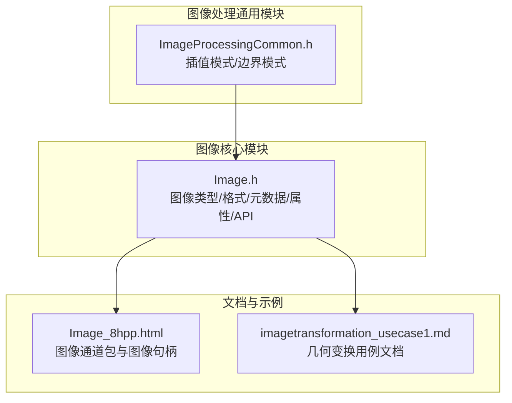
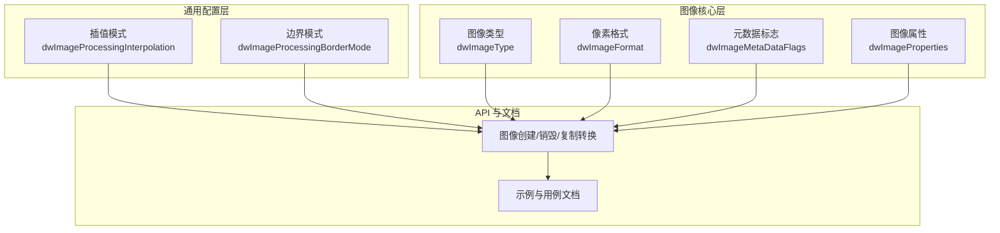
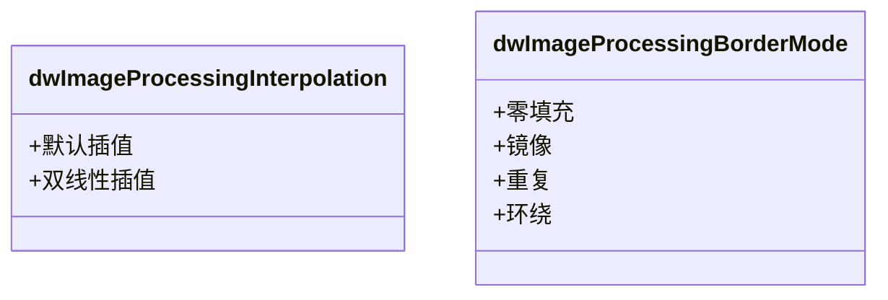
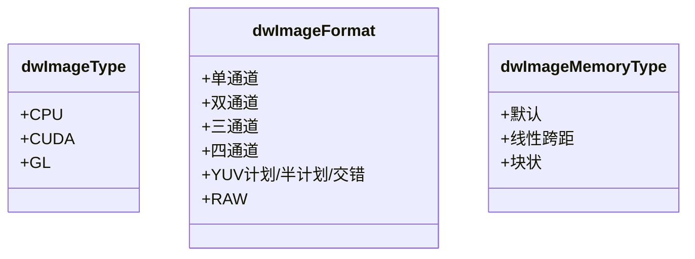
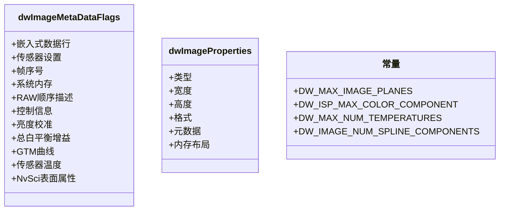
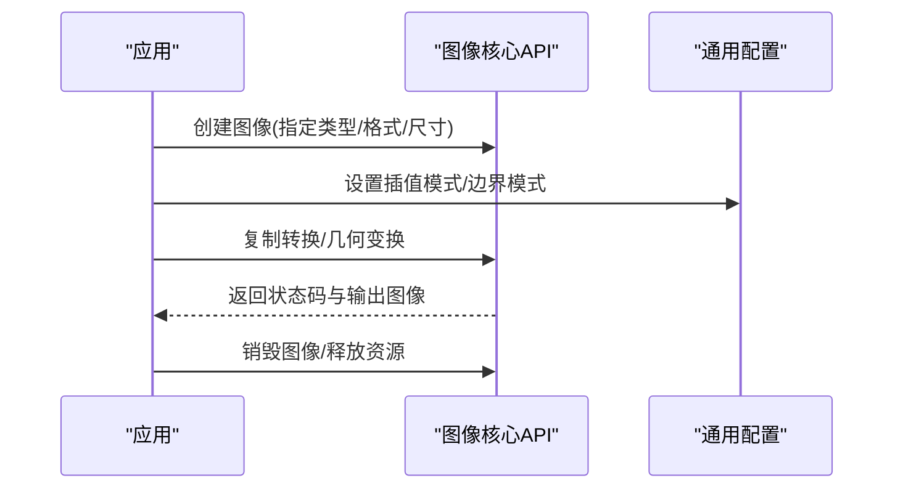
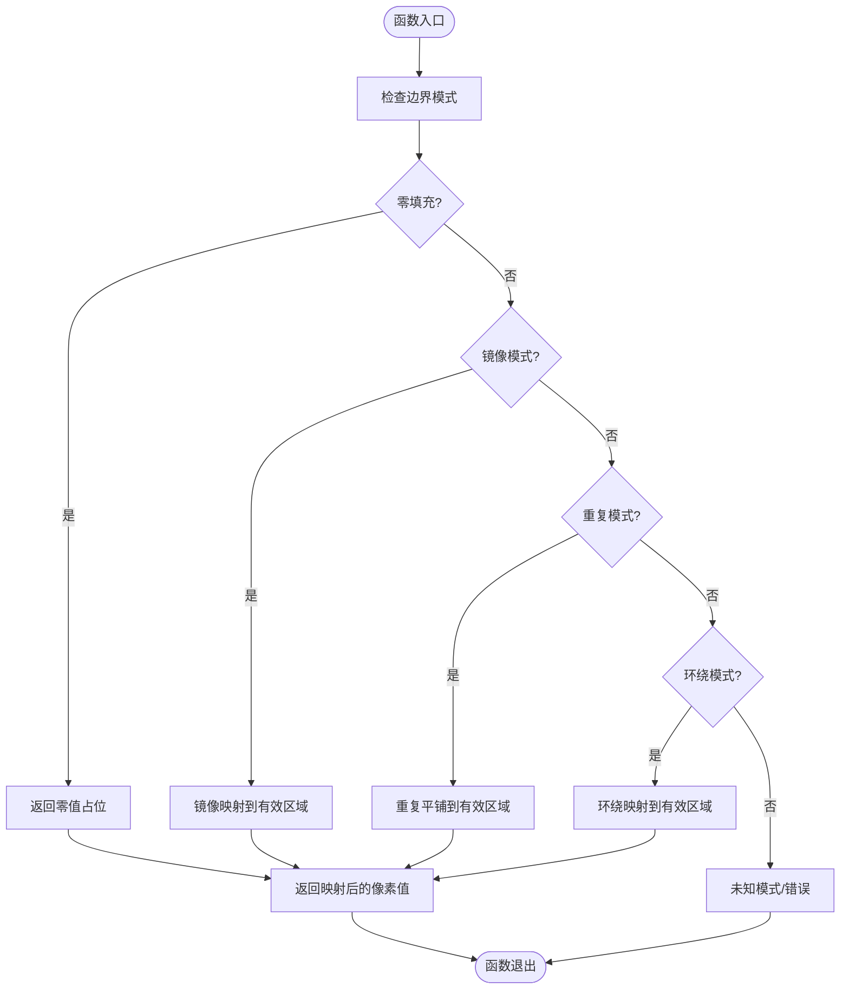

# 图像处理通用模块

<cite>
**本文引用的文件**
- [ImageProcessingCommon.h](file://driverorks-5.10/include/dw/imageprocessing/common/ImageProcessingCommon.h)
- [Image.h](file://driverorks-5.10/include/dw/image/Image.h)
- [Image_8hpp.html](file://driverorks-5.10/doc/nvcgf_html/Image_8hpp.html)
- [imagetransformation_usecase1.md](file://driverorks-5.10/doc/nvsdk_dw_html/imageprocessing_2geometry_2imagetransformation_2docs_2usecase1_8md.html)
</cite>

## 目录
1. [简介](#简介)
2. [项目结构](#项目结构)
3. [核心组件](#核心组件)
4. [架构总览](#架构总览)
5. [详细组件分析](#详细组件分析)
6. [依赖分析](#依赖分析)
7. [性能考虑](#性能考虑)
8. [故障排查指南](#故障排查指南)
9. [结论](#结论)
10. [附录](#附录)

## 简介
本技术文档聚焦于 NVIDIA DriveWorks 图像处理通用模块，系统阐述基础数据类型、枚举定义与通用常量，并结合图像处理中的标准数据结构（像素格式、颜色空间、图像尺寸表示等）进行深入解析。文档同时给出与图像处理模块之间的关系与依赖，提供可操作的使用路径与最佳实践建议，帮助开发者在多版本 SDK 中正确选择与使用通用类型与常量。

## 项目结构
- 通用类型与常量位于图像处理公共头文件中，定义插值模式与边界处理策略等。
- 图像核心抽象与 API 定义位于图像头文件中，涵盖图像类型、格式、元数据、内存布局、属性与常用操作接口。
- 文档与示例位于 SDK 文档与示例页面中，便于理解典型用法与流程。

**图表来源**
- [ImageProcessingCommon.h:46-71](file://driverorks-5.10/include/dw/imageprocessing/common/ImageProcessingCommon.h#L46-L71)
- [Image.h:50-752](file://driverorks-5.10/include/dw/image/Image.h#L50-L752)
- [Image_8hpp.html](file://driverorks-5.10/doc/nvcgf_html/Image_8hpp.html)
- [imagetransformation_usecase1.md:1-134](file://driverorks-5.10/doc/nvsdk_dw_html/imageprocessing_2geometry_2imagetransformation_2docs_2usecase1_8md.html#L1-L134)

**章节来源**
- [ImageProcessingCommon.h:46-71](file://driverorks-5.10/include/dw/imageprocessing/common/ImageProcessingCommon.h#L46-L71)
- [Image.h:50-752](file://driverorks-5.10/include/dw/image/Image.h#L50-L752)

## 核心组件
本节聚焦于图像处理通用模块中的基础数据类型、枚举与常量，以及与之紧密关联的图像核心数据结构。

- 插值模式（dwImageProcessingInterpolation）
  - 默认插值（DW_IMAGEPROCESSING_INTERPOLATION_DEFAULT）
  - 双线性插值（DW_IMAGEPROCESSING_INTERPOLATION_LINEAR）
  - 用途：在几何变换、重采样等场景中控制像素插值策略。

- 边界模式（dwImageProcessingBorderMode）
  - 零填充（DW_IMAGEPROCESSING_BORDER_MODE_ZERO）
  - 镜像（DW_IMAGEPROCESSING_BORDER_MODE_MIRROR）
  - 重复（DW_IMAGEPROCESSING_BORDER_MODE_REPEAT）
  - 环绕（DW_IMAGEPROCESSING_BORDER_MODE_WRAP）
  - 用途：在变换或卷积等处理时，控制超出边界的像素取值策略。

- 图像类型（dwImageType）
  - CPU 类型（DW_IMAGE_CPU）
  - CUDA 类型（DW_IMAGE_CUDA）
  - OpenGL 类型（DW_IMAGE_GL）
  - 用途：标识图像的存储与执行环境，决定后续 API 的可用性与行为。

- 像素格式（dwImageFormat）
  - 单通道整型/浮点型：R_UINT8/R_UINT16/R_FLOAT16/R_FLOAT32 等
  - 双通道：RG_UINT8/RG_FLOAT32 等
  - 三通道：RGB_UINT8/RGB_UINT16/RGB_FLOAT16/RGB_FLOAT32 等
  - 四通道：RGBA_UINT8/RGBA_UINT16/RGBA_FLOAT16/RGBA_FLOAT32 等
  - YUV 计划/半计划/交错：如 YUV420/YUV422/YUV444 等
  - RAW：RAW_UINT16/RAW_FLOAT16 等
  - 用途：描述像素的数据组织方式与位深，影响内存布局、带宽与计算效率。

- 内存布局（dwImageMemoryType）
  - 默认（DW_IMAGE_MEMORY_TYPE_DEFAULT）
  - 线性跨距（DW_IMAGE_MEMORY_TYPE_PITCH）
  - 块状（DW_IMAGE_MEMORY_TYPE_BLOCK）
  - 用途：指定平面数据的排列方式，影响 GPU 访问效率与兼容性。

- 元数据标志（dwImageMetaDataFlags）
  - 嵌入式数据行（DW_IMAGE_FLAGS_EMBEDDED_LINES）
  - 传感器设置（DW_IMAGE_FLAGS_SENSOR_SETTINGS）
  - 帧序号（DW_IMAGE_FLAGS_FRAME_SEQUENCE_NUMBER）
  - 系统内存（DW_IMAGE_FLAGS_SYSMEM）
  - RAW 顺序描述（DW_IMAGE_FLAGS_HAS_RAW_ORDER_DESCRIPTOR）
  - 控制信息（DW_IMAGE_FLAGS_CONTROLINFO）
  - 亮度校准（DW_IMAGE_FLAGS_LUMINANCE_CALIBRATED）
  - 总白平衡增益（DW_IMAGE_FLAGS_TOTAL_WHITE_BALANCE_GAIN）
  - GTM 曲线（DW_IMAGE_FLAGS_GTM_SPLINE_INFO）
  - 传感器温度（DW_IMAGE_FLAGS_SENSOR_TEMPERATURE）
  - NvSci 表面属性（DW_IMAGE_FLAGS_NVSCI_SURF_ATTR）
  - 用途：指示图像元数据的有效字段集合，便于按需读写与处理。

- 图像属性（dwImageProperties）
  - 包含类型、宽高、格式、元数据与内存布局等关键信息，是创建与操作图像的基础契约。

- 常量
  - DW_MAX_IMAGE_PLANES：最大平面数
  - DW_ISP_MAX_COLOR_COMPONENT：ISP 最大颜色分量数
  - DW_MAX_NUM_TEMPERATURES：最大温度传感器数量
  - DW_IMAGE_NUM_SPLINE_COMPONENTS：GTM 曲线控制点数量
  - 用途：限定数组大小、控制数据结构容量与兼容性。

**章节来源**
- [ImageProcessingCommon.h:52-66](file://driverorks-5.10/include/dw/imageprocessing/common/ImageProcessingCommon.h#L52-L66)
- [Image.h:83-87](file://driverorks-5.10/include/dw/image/Image.h#L83-L87)
- [Image.h:89-100](file://driverorks-5.10/include/dw/image/Image.h#L89-L100)
- [Image.h:113-191](file://driverorks-5.10/include/dw/image/Image.h#L113-L191)
- [Image.h:193-202](file://driverorks-5.10/include/dw/image/Image.h#L193-L202)
- [Image.h:217-256](file://driverorks-5.10/include/dw/image/Image.h#L217-L256)
- [Image.h:388-403](file://driverorks-5.10/include/dw/image/Image.h#L388-L403)

## 架构总览
图像处理通用模块与图像核心模块协同工作：
- 通用模块提供插值与边界策略等通用配置，供几何变换、滤波等处理使用。
- 图像核心模块提供图像对象、格式、元数据与 API，支撑从创建到访问的完整生命周期。
- 文档与示例页面提供典型流程与用例参考，便于集成与验证。

**图表来源**
- [ImageProcessingCommon.h:52-66](file://driverorks-5.10/include/dw/imageprocessing/common/ImageProcessingCommon.h#L52-L66)
- [Image.h:89-100](file://driverorks-5.10/include/dw/image/Image.h#L89-L100)
- [Image.h:113-191](file://driverorks-5.10/include/dw/image/Image.h#L113-L191)
- [Image.h:217-256](file://driverorks-5.10/include/dw/image/Image.h#L217-L256)
- [Image.h:388-403](file://driverorks-5.10/include/dw/image/Image.h#L388-L403)
- [Image_8hpp.html](file://driverorks-5.10/doc/nvcgf_html/Image_8hpp.html)
- [imagetransformation_usecase1.md:1-134](file://driverorks-5.10/doc/nvsdk_dw_html/imageprocessing_2geometry_2imagetransformation_2docs_2usecase1_8md.html#L1-L134)

## 详细组件分析

### 组件一：通用插值与边界策略
- 作用：为几何变换与重采样提供统一的插值与边界处理策略。
- 使用要点：
  - 在调用几何变换 API 时，根据需求选择默认或双线性插值。
  - 对于超出边界的像素，依据场景选择零填充、镜像、重复或环绕策略。
- 适用范围：适用于 CUDA 图像与部分 NvMedia 图像的处理流程。

**图表来源**
- [ImageProcessingCommon.h:52-66](file://driverorks-5.10/include/dw/imageprocessing/common/ImageProcessingCommon.h#L52-L66)

**章节来源**
- [ImageProcessingCommon.h:52-66](file://driverorks-5.10/include/dw/imageprocessing/common/ImageProcessingCommon.h#L52-L66)

### 组件二：图像类型与像素格式
- 图像类型（dwImageType）：区分 CPU/CUDA/GL 等后端，决定内存与计算位置。
- 像素格式（dwImageFormat）：覆盖单/双/三/四通道、YUV 计划/半计划/交错、RAW 等多种形态，直接影响内存布局与处理效率。
- 内存布局（dwImageMemoryType）：默认、线性跨距、块状，影响 GPU 访问性能与兼容性。

**图表来源**
- [Image.h:89-100](file://driverorks-5.10/include/dw/image/Image.h#L89-L100)
- [Image.h:113-191](file://driverorks-5.10/include/dw/image/Image.h#L113-L191)
- [Image.h:193-202](file://driverorks-5.10/include/dw/image/Image.h#L193-L202)

**章节来源**
- [Image.h:89-100](file://driverorks-5.10/include/dw/image/Image.h#L89-L100)
- [Image.h:113-191](file://driverorks-5.10/include/dw/image/Image.h#L113-L191)
- [Image.h:193-202](file://driverorks-5.10/include/dw/image/Image.h#L193-L202)

### 组件三：元数据与属性
- 元数据标志（dwImageMetaDataFlags）：用于声明图像携带的附加信息，如嵌入式数据行、传感器设置、帧序号、RAW 顺序描述、温度等。
- 图像属性（dwImageProperties）：统一描述图像的类型、尺寸、格式、元数据与内存布局，是创建与访问图像的基础契约。
- 常量：限制平面数、颜色分量、温度数量与 GTM 曲线控制点数量，确保数据结构一致性与资源上限。

**图表来源**
- [Image.h:217-256](file://driverorks-5.10/include/dw/image/Image.h#L217-L256)
- [Image.h:388-403](file://driverorks-5.10/include/dw/image/Image.h#L388-L403)
- [Image.h:83-87](file://driverorks-5.10/include/dw/image/Image.h#L83-L87)

**章节来源**
- [Image.h:217-256](file://driverorks-5.10/include/dw/image/Image.h#L217-L256)
- [Image.h:388-403](file://driverorks-5.10/include/dw/image/Image.h#L388-L403)
- [Image.h:83-87](file://driverorks-5.10/include/dw/image/Image.h#L83-L87)

### 组件四：API 流程（以几何变换为例）
- 典型流程：准备输入图像 → 选择插值与边界策略 → 执行变换 → 检查输出结果。
- 关键 API：图像创建/销毁、复制转换、获取 CPU/CUDA/NvMedia 视图、查询像素类型与平面数等。

**图表来源**
- [Image.h:451-520](file://driverorks-5.10/include/dw/image/Image.h#L451-L520)
- [Image.h:651-693](file://driverorks-5.10/include/dw/image/Image.h#L651-L693)
- [ImageProcessingCommon.h:52-66](file://driverorks-5.10/include/dw/imageprocessing/common/ImageProcessingCommon.h#L52-L66)

**章节来源**
- [Image.h:451-520](file://driverorks-5.10/include/dw/image/Image.h#L451-L520)
- [Image.h:651-693](file://driverorks-5.10/include/dw/image/Image.h#L651-L693)
- [ImageProcessingCommon.h:52-66](file://driverorks-5.10/include/dw/imageprocessing/common/ImageProcessingCommon.h#L52-L66)

### 组件五：算法流程（以边界处理为例）
- 输入：图像尺寸、边界模式、像素坐标。
- 输出：映射后的有效像素索引或零填充值。
- 关键逻辑：根据边界模式对越界坐标进行映射或填充。

**图表来源**
- [ImageProcessingCommon.h:60-66](file://driverorks-5.10/include/dw/imageprocessing/common/ImageProcessingCommon.h#L60-L66)

**章节来源**
- [ImageProcessingCommon.h:60-66](file://driverorks-5.10/include/dw/imageprocessing/common/ImageProcessingCommon.h#L60-L66)

## 依赖分析
- 通用模块依赖图像核心模块提供的图像类型与格式定义，以便在几何变换等处理中统一使用。
- 图像核心模块依赖通用模块的插值与边界策略，以实现一致的处理行为。
- 文档与示例页面为集成与验证提供参考路径，降低使用门槛。

**图表来源**
- [ImageProcessingCommon.h:46-71](file://driverorks-5.10/include/dw/imageprocessing/common/ImageProcessingCommon.h#L46-L71)
- [Image.h:50-752](file://driverorks-5.10/include/dw/image/Image.h#L50-L752)
- [Image_8hpp.html](file://driverorks-5.10/doc/nvcgf_html/Image_8hpp.html)
- [imagetransformation_usecase1.md:1-134](file://driverorks-5.10/doc/nvsdk_dw_html/imageprocessing_2geometry_2imagetransformation_2docs_2usecase1_8md.html#L1-L134)

**章节来源**
- [ImageProcessingCommon.h:46-71](file://driverorks-5.10/include/dw/imageprocessing/common/ImageProcessingCommon.h#L46-L71)
- [Image.h:50-752](file://driverorks-5.10/include/dw/image/Image.h#L50-L752)

## 性能考虑
- 优先选择与硬件匹配的像素格式与内存布局，减少数据搬运与转换开销。
- 在 CUDA 场景下，合理利用块状布局与线程并行，避免跨步访问导致的吞吐下降。
- 几何变换时，优先采用双线性插值以平衡质量与性能；对实时性要求高的场景可考虑默认插值。
- 边界处理应尽量避免频繁越界，必要时预分配缓冲区或裁剪 ROI，减少额外映射成本。
- 利用异步复制转换接口（如 CUDA 流）提升并发度，但需注意同步与错误处理。

## 故障排查指南
- 常见错误与处理：
  - 无效句柄/参数：检查图像句柄与属性是否正确初始化。
  - 不支持的类型：确认图像类型与目标 API 的兼容性（例如 GL 类型需要额外库支持）。
  - CUDA 错误：检查显存分配、流状态与内核执行情况。
  - 转换失败：核对输入输出图像的类型、尺寸与内存布局是否一致。
- 建议排查步骤：
  - 校验图像属性（类型/尺寸/格式/内存布局）。
  - 确认插值与边界模式与处理需求匹配。
  - 使用文档与示例页面对照典型流程，逐步定位问题环节。

**章节来源**
- [Image.h:651-693](file://driverorks-5.10/include/dw/image/Image.h#L651-L693)

## 结论
图像处理通用模块通过统一的插值与边界策略，为几何变换等处理提供了稳定且可移植的配置层；图像核心模块则以丰富的类型、格式与 API 支撑完整的图像生命周期管理。二者配合，既保证了灵活性，又兼顾了性能与可维护性。建议在实际工程中遵循本文的最佳实践，结合文档与示例进行集成与优化。

## 附录
- 代码示例路径（不直接展示代码内容）：
  - 几何变换用例文档：[imagetransformation_usecase1.md:1-134](file://driverorks-5.10/doc/nvsdk_dw_html/imageprocessing_2geometry_2imagetransformation_2docs_2usecase1_8md.html#L1-L134)
  - 图像通道包与图像句柄说明：[Image_8hpp.html](file://driverorks-5.10/doc/nvcgf_html/Image_8hpp.html)
- 版本差异提示：
  - 通用模块在不同版本中保持稳定，主要枚举值与注释略有调整。
  - 图像核心模块在各版本中持续演进，新增/弃用字段与 API，请以对应版本头文件为准。