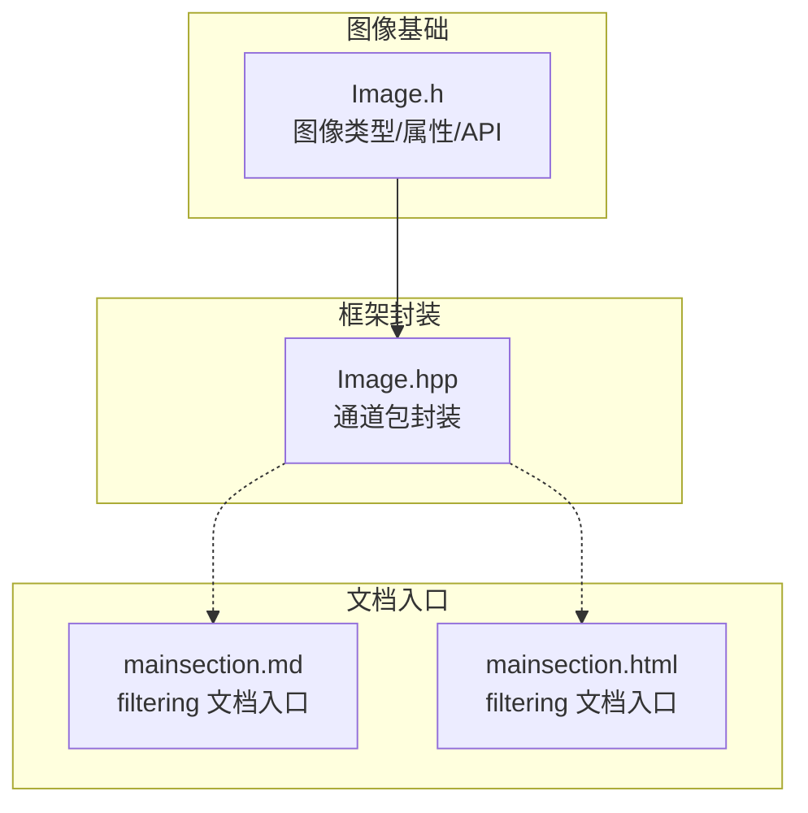
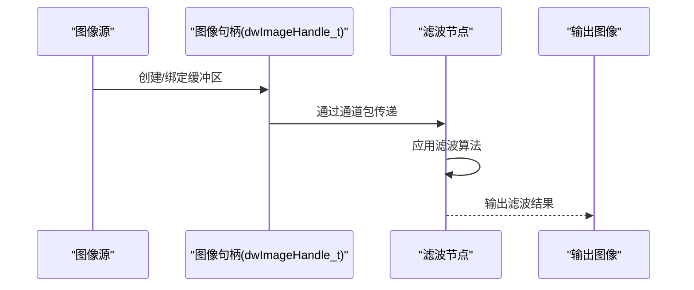
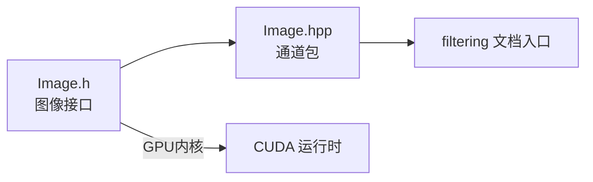

# 图像滤波

<cite>
**本文引用的文件**
- [Image.h](file://driverorks-5.10/include/dw/image/Image.h)
- [Image.hpp](file://driverorks-5.10/include/dwframework/dwnodes/common/channelpackets/Image.hpp)
- [mainsection.md](file://driverorks-5.10/doc/nvsdk_dw_html/imageprocessing_2filtering_2docs_2mainsection_8md.html)
- [mainsection.html](file://driverorks-5.10/doc/nvsdk_dw_html/md_src_dw_imageprocessing_filtering_docs_mainsection.html)
</cite>

## 目录
1. [引言](#引言)
2. [项目结构](#项目结构)
3. [核心组件](#核心组件)
4. [架构总览](#架构总览)
5. [详细组件分析](#详细组件分析)
6. [依赖关系分析](#依赖关系分析)
7. [性能考量](#性能考量)
8. [故障排查指南](#故障排查指南)
9. [结论](#结论)
10. [附录](#附录)

## 引言
本技术文档聚焦于图像滤波模块，围绕图像数据抽象、滤波接口能力以及在DriveWorks框架下的应用路径展开。根据仓库现有资料，SDK提供了统一的图像类型与属性抽象（CPU/GPU/NvMedia等），并支持多种图像格式与元数据管理；同时，图像处理子系统包含“filtering”主题文档入口。本文将结合现有头文件与文档入口，系统化梳理滤波相关的能力边界、数据流与使用建议，并给出可操作的应用指引。

## 项目结构
与图像滤波直接相关的核心位置如下：
- 图像基础类型与接口：位于驱动库头文件中，定义了图像句柄、属性、内存布局、元数据等关键结构与API。
- 框架侧通道包：在框架层对图像句柄与属性进行了封装，便于在节点间传递。
- 文档入口：图像处理子系统的“filtering”文档入口，作为进一步探索滤波能力的起点。

图表来源
- [Image.h:90-100](file://driverorks-5.10/include/dw/image/Image.h#L90-L100)
- [Image.hpp:34-41](file://driverorks-5.10/include/dwframework/dwnodes/common/channelpackets/Image.hpp#L34-L41)
- [mainsection.md:1-134](file://driverorks-5.10/doc/nvsdk_dw_html/imageprocessing_2filtering_2docs_2mainsection_8md.html#L1-L134)
- [mainsection.html:1-136](file://driverorks-5.10/doc/nvsdk_dw_html/md_src_dw_imageprocessing_filtering_docs_mainsection.html#L1-L136)

章节来源
- [Image.h:90-100](file://driverorks-5.10/include/dw/image/Image.h#L90-L100)
- [Image.hpp:34-41](file://driverorks-5.10/include/dwframework/dwnodes/common/channelpackets/Image.hpp#L34-L41)
- [mainsection.md:1-134](file://driverorks-5.10/doc/nvsdk_dw_html/imageprocessing_2filtering_2docs_2mainsection_8md.html#L1-L134)
- [mainsection.html:1-136](file://driverorks-5.10/doc/nvsdk_dw_html/md_src_dw_imageprocessing_filtering_docs_mainsection.html#L1-L136)

## 核心组件
- 图像类型与属性
  - 支持的图像类型：CPU、CUDA、GL等；图像格式覆盖单通道、RGB/RGBA、YUV等多种平面/交错格式；内存布局支持默认、行间距（pitch）、块状（block）等。
  - 元数据：曝光、增益、白平衡、帧序号、嵌入行、RAW属性、ISP统计、全局色调映射曲线等。
  - 关键API：创建/销毁、获取属性与时间戳、复制转换、提取平面、映射ROI等。
- 框架侧通道包
  - 将图像句柄与属性声明为通道包类型，便于在节点图中跨节点传递。

章节来源
- [Image.h:90-100](file://driverorks-5.10/include/dw/image/Image.h#L90-L100)
- [Image.h:115-191](file://driverorks-5.10/include/dw/image/Image.h#L115-L191)
- [Image.h:194-202](file://driverorks-5.10/include/dw/image/Image.h#L194-L202)
- [Image.h:218-256](file://driverorks-5.10/include/dw/image/Image.h#L218-L256)
- [Image.h:388-403](file://driverorks-5.10/include/dw/image/Image.h#L388-L403)
- [Image.h:406-431](file://driverorks-5.10/include/dw/image/Image.h#L406-L431)
- [Image.h:462-520](file://driverorks-5.10/include/dw/image/Image.h#L462-L520)
- [Image.h:524-583](file://driverorks-5.10/include/dw/image/Image.h#L524-L583)
- [Image.h:585-626](file://driverorks-5.10/include/dw/image/Image.h#L585-L626)
- [Image.h:628-693](file://driverorks-5.10/include/dw/image/Image.h#L628-L693)
- [Image.h:695-723](file://driverorks-5.10/include/dw/image/Image.h#L695-L723)
- [Image.h:725-745](file://driverorks-5.10/include/dw/image/Image.h#L725-L745)
- [Image.hpp:34-41](file://driverorks-5.10/include/dwframework/dwnodes/common/channelpackets/Image.hpp#L34-L41)

## 架构总览
从数据流角度，滤波通常发生在图像采集后、特征检测或深度估计之前。整体流程可概括为：输入图像（CPU/CUDA/NvMedia）经由SDK创建为统一的图像句柄，随后在节点图中通过通道包传递到滤波节点，再输出到后续处理阶段。文档入口“filtering”为该子系统提供进一步的使用说明与用例参考。

图表来源
- [Image.h:462-520](file://driverorks-5.10/include/dw/image/Image.h#L462-L520)
- [Image.hpp:34-41](file://driverorks-5.10/include/dwframework/dwnodes/common/channelpackets/Image.hpp#L34-L41)
- [mainsection.md:1-134](file://driverorks-5.10/doc/nvsdk_dw_html/imageprocessing_2filtering_2docs_2mainsection_8md.html#L1-L134)

## 详细组件分析
本节聚焦滤波能力的“能做什么、如何做、何时做”的问题。当前仓库未提供具体滤波算法实现的源码，但可通过以下方式理解与规划：

- 线性滤波器
  - 高斯滤波：用于平滑噪声与模糊，常用于预处理以提升后续边缘/角点检测稳定性。参数选择需考虑尺度与核大小，兼顾平滑程度与边缘保持。
  - 拉普拉斯滤波：用于边缘增强与二阶微分增强，适合突出纹理细节，但对噪声敏感，建议先进行低通平滑。
- 非线性滤波器
  - 中值滤波：对椒盐噪声与脉冲噪声有良好抑制作用，适合纹理区域的去噪与边缘保护。
  - 双边滤波：在空间域与灰度域共同进行加权，可在去噪的同时保留边缘，适合高质量纹理平滑。

上述算法的数学本质与实现要点（如卷积核设计、边界处理策略）属于通用图像处理知识范畴。在DriveWorks框架下，滤波的落地步骤建议遵循：
- 输入准备：确保图像格式与内存布局满足目标滤波器需求（例如双边滤波可能需要浮点像素类型）。
- 参数规划：依据场景噪声特性与任务目标（去噪/边缘/纹理平滑）选择核大小、标准差、邻域半径等。
- 边界策略：常见策略包括零填充、镜像扩展、周期延拓等，需与算法相匹配。
- 性能优化：优先使用GPU加速（CUDA），合理设置块尺寸与网格尺寸，避免频繁的主机-设备同步。

由于仓库未包含具体滤波实现源码，无法在此给出精确的调用序列图与类图。建议以“filtering”文档入口为线索，结合SDK示例工程进一步定位具体实现与用法。

## 依赖关系分析
- 组件耦合
  - 图像基础层（Image.h）与框架通道包（Image.hpp）形成“数据抽象—封装传递”的层次关系。
  - “filtering”文档入口作为上层使用指南，依赖底层图像接口与节点框架。
- 外部依赖
  - CUDA运行时与内核执行环境（由图像转换与处理API隐式依赖）。
  - 在某些平台（如VIBRANTE）可能涉及NvMedia/NvSciBuf等资源管理。

图表来源
- [Image.h:462-520](file://driverorks-5.10/include/dw/image/Image.h#L462-L520)
- [Image.hpp:34-41](file://driverorks-5.10/include/dwframework/dwnodes/common/channelpackets/Image.hpp#L34-L41)
- [mainsection.md:1-134](file://driverorks-5.10/doc/nvsdk_dw_html/imageprocessing_2filtering_2docs_2mainsection_8md.html#L1-L134)

章节来源
- [Image.h:462-520](file://driverorks-5.10/include/dw/image/Image.h#L462-L520)
- [Image.hpp:34-41](file://driverorks-5.10/include/dwframework/dwnodes/common/channelpackets/Image.hpp#L34-L41)
- [mainsection.md:1-134](file://driverorks-5.10/doc/nvsdk_dw_html/imageprocessing_2filtering_2docs_2mainsection_8md.html#L1-L134)

## 性能考量
- 数据类型与内存布局
  - 浮点型像素在双边等非线性滤波中更常见，但会增加带宽与显存占用；整型像素在高斯/中值等算法中更高效。
  - 块状（block）布局在CUDA数组上可获得更好的吞吐，但需满足特定格式约束。
- 并行策略
  - 利用GPU并行化，合理划分线程块与网格维度，减少跨步访问与分支发散。
  - 对大核卷积可采用分离核或频域方法降低计算复杂度。
- I/O与同步
  - 避免不必要的主机-设备同步；批量处理时复用CUDA流。
  - ROI裁剪与平面提取可减少无效区域的处理量。

## 故障排查指南
- 常见错误与定位
  - 句柄/上下文非法：检查图像创建与销毁配对、上下文有效性。
  - 格式不匹配：确认输入输出图像格式一致，必要时使用复制转换API。
  - 内存布局不兼容：当使用CUDA数组时需满足块状布局要求。
- 调试建议
  - 使用最小可复现样例验证滤波参数与边界策略。
  - 分阶段测试：先在CPU端验证算法正确性，再迁移至GPU。
  - 关注元数据一致性（曝光、增益、帧序号等）对后续处理的影响。

章节来源
- [Image.h:462-520](file://driverorks-5.10/include/dw/image/Image.h#L462-L520)
- [Image.h:524-583](file://driverorks-5.10/include/dw/image/Image.h#L524-L583)
- [Image.h:628-693](file://driverorks-5.10/include/dw/image/Image.h#L628-L693)

## 结论
本仓库提供了统一的图像抽象与通道包封装，为滤波等图像处理能力奠定了基础。虽然当前未包含具体滤波算法实现源码，但通过图像接口、文档入口与通用图像处理知识，可以系统地规划与实施线性与非线性滤波方案。建议结合SDK示例与“filtering”文档入口，逐步完善参数选择、边界策略与性能优化，以满足去噪、边缘增强与纹理平滑等多样化场景需求。

## 附录
- 实际应用场景与效果对比
  - 去噪：中值滤波对脉冲噪声有效；高斯滤波对高斯噪声有效；双边滤波在保边去噪方面表现优异。
  - 边缘增强：拉普拉斯滤波对细节增强显著，但易放大噪声；高斯-拉普拉斯（LoG）可先平滑再增强。
  - 纹理平滑：双边滤波在保持边缘的同时平滑纹理，适合高质量渲染前处理。
- 参数选择原则
  - 核大小与标准差：与噪声强度与目标尺度相关；过大导致细节损失，过小去噪不足。
  - 边界策略：镜像/零填充/周期延拓应与算法相匹配，避免引入伪影。
  - 性能权衡：在保证质量的前提下优先选择高效实现（如分离核、近似方法）。