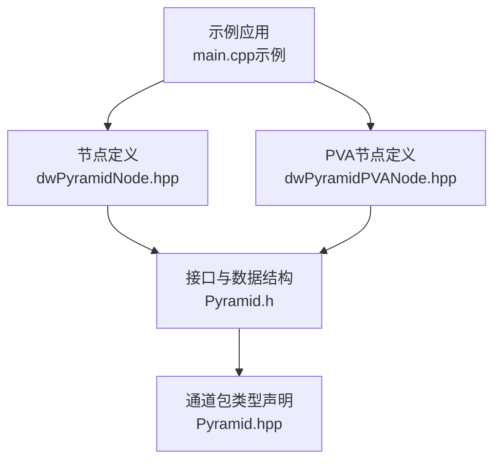
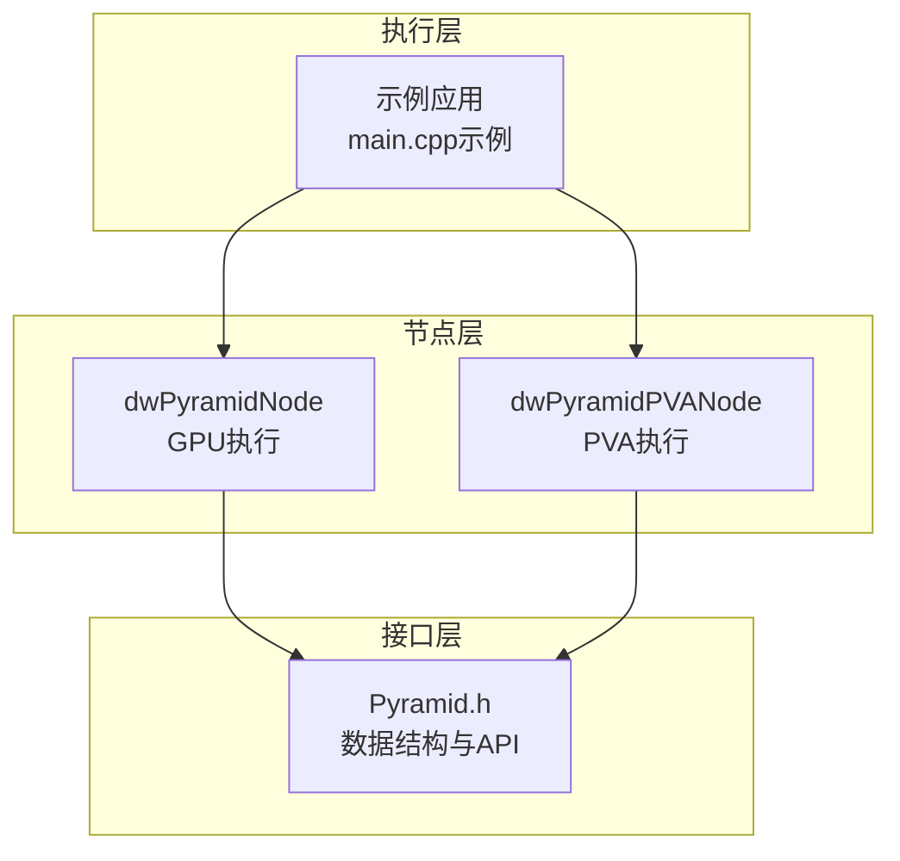
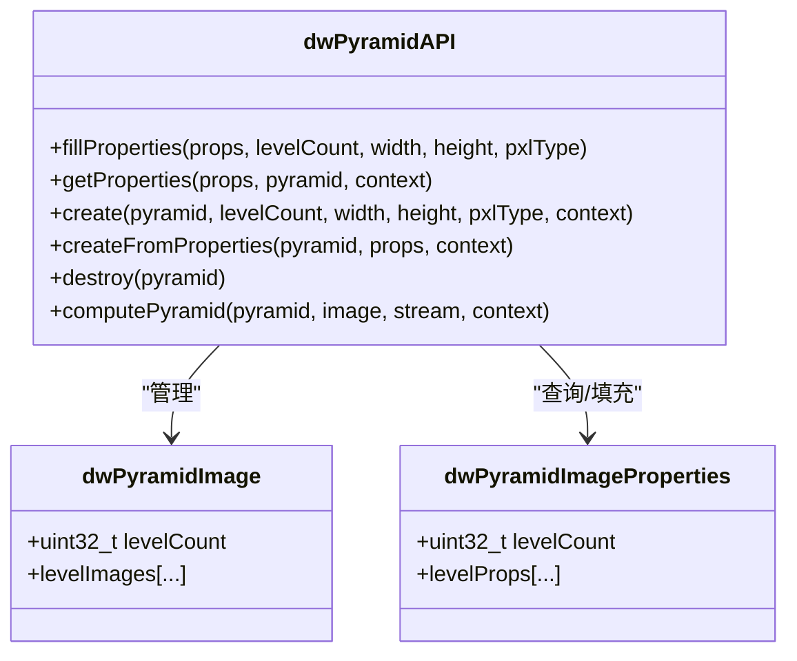
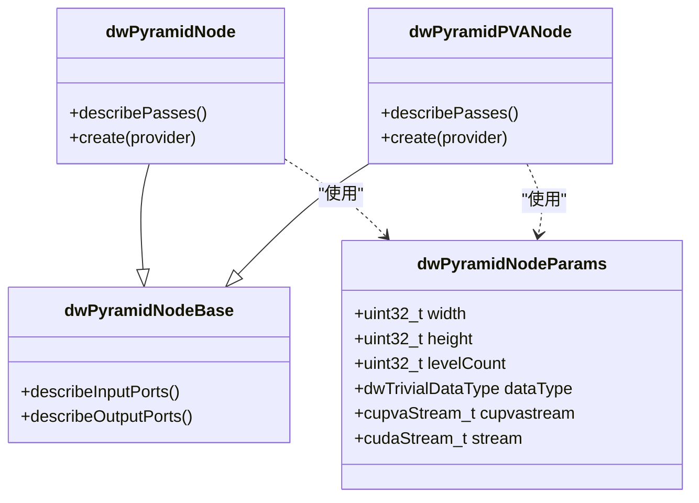
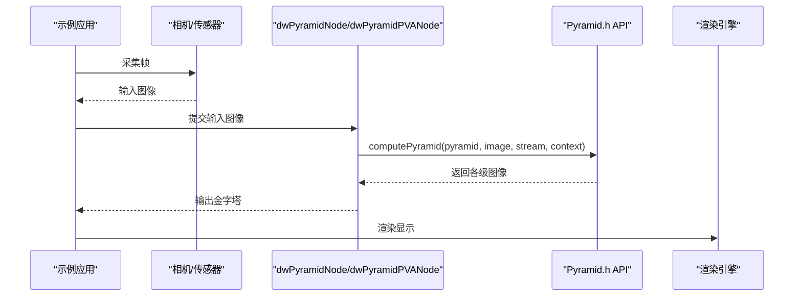
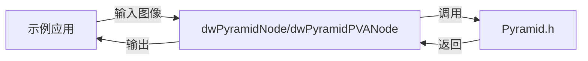

# 图像金字塔

<cite>
**本文引用的文件**
- [Pyramid.h](file://driverorks-5.10/include/dw/imageprocessing/pyramid/Pyramid.h)
- [Pyramid.hpp](file://driverorks-5.10/include/dwframework/dwnodes/common/channelpackets/Pyramid.hpp)
- [dwPyramidNode.hpp](file://driverorks-5.10/include/dwframework/dwnodes/imageprocessing/dwpyramidnode/dwPyramidNode.hpp)
- [dwPyramidPVANode.hpp](file://driverorks-5.10/include/dwframework/dwnodes/imageprocessing/dwpyramidnode/dwPyramidPVANode.hpp)
- [main.cpp（示例）](file://driverorks-5.10/samples/src/imageprocessing/pyramid/main.cpp)
</cite>

## 目录
1. [简介](#简介)
2. [项目结构](#项目结构)
3. [核心组件](#核心组件)
4. [架构总览](#架构总览)
5. [详细组件分析](#详细组件分析)
6. [依赖分析](#依赖分析)
7. [性能考虑](#性能考虑)
8. [故障排查指南](#故障排查指南)
9. [结论](#结论)
10. [附录](#附录)

## 简介
本技术文档围绕图像金字塔模块展开，系统阐述多尺度图像处理能力，重点覆盖以下方面：
- 金字塔数据结构与属性：层级数量、各级分辨率、像素类型等
- 金字塔构建流程：从输入图像到各级子样本图像的生成
- 高斯金字塔与拉普拉斯金字塔的数学原理与递归关系
- 尺度空间理论与多分辨率表示
- 下采样与上采样实现思路
- 典型应用：图像融合、边缘检测、目标跟踪
- 在计算机视觉算法中的作用与性能优势
- 实际应用案例与优化建议

## 项目结构
本仓库中与图像金字塔直接相关的代码主要分布在以下位置：
- 接口定义与数据结构：驱动层接口头文件
- 框架通道包：将金字塔作为通道包类型进行封装
- 节点与管线：GPU/PVA执行路径的节点与参数描述
- 示例程序：演示如何初始化、运行并渲染金字塔输出

图表来源
- [main.cpp（示例）:311-326](file://driverorks-5.10/samples/src/imageprocessing/pyramid/main.cpp#L311-L326)
- [dwPyramidNode.hpp:80-124](file://driverorks-5.10/include/dwframework/dwnodes/imageprocessing/dwpyramidnode/dwPyramidNode.hpp#L80-L124)
- [dwPyramidPVANode.hpp:41-92](file://driverorks-5.10/include/dwframework/dwnodes/imageprocessing/dwpyramidnode/dwPyramidPVANode.hpp#L41-L92)
- [Pyramid.h:63-186](file://driverorks-5.10/include/dw/imageprocessing/pyramid/Pyramid.h#L63-L186)
- [Pyramid.hpp:34-40](file://driverorks-5.10/include/dwframework/dwnodes/common/channelpackets/Pyramid.hpp#L34-L40)

章节来源
- [Pyramid.h:63-186](file://driverorks-5.10/include/dw/imageprocessing/pyramid/Pyramid.h#L63-L186)
- [Pyramid.hpp:34-40](file://driverorks-5.10/include/dwframework/dwnodes/common/channelpackets/Pyramid.hpp#L34-L40)
- [dwPyramidNode.hpp:53-124](file://driverorks-5.10/include/dwframework/dwnodes/imageprocessing/dwpyramidnode/dwPyramidNode.hpp#L53-L124)
- [dwPyramidPVANode.hpp:41-92](file://driverorks-5.10/include/dwframework/dwnodes/imageprocessing/dwpyramidnode/dwPyramidPVANode.hpp#L41-L92)
- [main.cpp（示例）:120-302](file://driverorks-5.10/samples/src/imageprocessing/pyramid/main.cpp#L120-L302)

## 核心组件
- 金字塔数据结构
  - 层级计数与各级图像句柄数组
  - 层级属性数组，记录各级分辨率与像素类型
- 金字塔属性填充与查询
  - 填充属性：根据层级数、首级宽高与像素类型生成属性
  - 查询属性：从已构建的金字塔获取属性
- 金字塔创建与销毁
  - 创建：按属性分配各级图像资源
  - 销毁：释放各级图像资源
- 金字塔构建
  - 从首级（最高分辨率）图像开始，逐级下采样生成各级图像
  - 支持指定CUDA流与上下文

章节来源
- [Pyramid.h:63-186](file://driverorks-5.10/include/dw/imageprocessing/pyramid/Pyramid.h#L63-L186)

## 架构总览
图像金字塔在SDK中的整体架构由“接口层 + 节点层 + 执行层”组成：
- 接口层：提供金字塔数据结构与构建API
- 节点层：定义CPU/GPU/PVA执行阶段的节点与参数
- 执行层：示例应用或CGF图通过节点将输入图像送入金字塔构建流程

图表来源
- [Pyramid.h:63-186](file://driverorks-5.10/include/dw/imageprocessing/pyramid/Pyramid.h#L63-L186)
- [dwPyramidNode.hpp:80-124](file://driverorks-5.10/include/dwframework/dwnodes/imageprocessing/dwpyramidnode/dwPyramidNode.hpp#L80-L124)
- [dwPyramidPVANode.hpp:41-92](file://driverorks-5.10/include/dwframework/dwnodes/imageprocessing/dwpyramidnode/dwPyramidPVANode.hpp#L41-L92)
- [main.cpp（示例）:311-326](file://driverorks-5.10/samples/src/imageprocessing/pyramid/main.cpp#L311-L326)

## 详细组件分析

### 数据结构与API（Pyramid.h）
- 关键结构体
  - 金字塔图像结构：包含层级计数与各级图像句柄数组
  - 金字塔属性结构：包含层级计数与各级图像属性数组
- 关键API
  - 填充属性、查询属性、创建、销毁、构建金字塔
- 使用约束
  - 首级图像分辨率需与创建时一致
  - 内存布局需满足要求
  - 支持的像素类型有限制

图表来源
- [Pyramid.h:63-186](file://driverorks-5.10/include/dw/imageprocessing/pyramid/Pyramid.h#L63-L186)

章节来源
- [Pyramid.h:63-186](file://driverorks-5.10/include/dw/imageprocessing/pyramid/Pyramid.h#L63-L186)

### 通道包与类型声明（Pyramid.hpp）
- 将金字塔图像类型注册为通道包类型，便于在框架中传输与处理
- 与通道包实现与枚举类型关联

章节来源
- [Pyramid.hpp:34-40](file://driverorks-5.10/include/dwframework/dwnodes/common/channelpackets/Pyramid.hpp#L34-L40)

### 节点与参数（dwPyramidNode.hpp / dwPyramidPVANode.hpp）
- 参数结构体包含：首级宽度、高度、层级数、像素类型、CUDA流、PVA流
- GPU节点：CPU准备、GPU构建、CPU收尾
- PVA节点：CPU准备、PVA构建、GPU后处理、CPU收尾
- 描述参数与端口：输入图像、输出金字塔

图表来源
- [dwPyramidNode.hpp:53-124](file://driverorks-5.10/include/dwframework/dwnodes/imageprocessing/dwpyramidnode/dwPyramidNode.hpp#L53-L124)
- [dwPyramidPVANode.hpp:41-92](file://driverorks-5.10/include/dwframework/dwnodes/imageprocessing/dwpyramidnode/dwPyramidPVANode.hpp#L41-L92)

章节来源
- [dwPyramidNode.hpp:53-124](file://driverorks-5.10/include/dwframework/dwnodes/imageprocessing/dwpyramidnode/dwPyramidNode.hpp#L53-L124)
- [dwPyramidPVANode.hpp:41-92](file://driverorks-5.10/include/dwframework/dwnodes/imageprocessing/dwpyramidnode/dwPyramidPVANode.hpp#L41-L92)

### 示例应用流程（main.cpp）
- 初始化：SDK、SAL、可视化、传感器、渲染引擎
- 传感器采集帧并转换为所需格式
- 选择PVA或GPU路径进行金字塔构建
- 输出结果用于渲染或后续处理

图表来源
- [main.cpp（示例）:311-326](file://driverorks-5.10/samples/src/imageprocessing/pyramid/main.cpp#L311-L326)
- [Pyramid.h:168-186](file://driverorks-5.10/include/dw/imageprocessing/pyramid/Pyramid.h#L168-L186)
- [dwPyramidNode.hpp:80-124](file://driverorks-5.10/include/dwframework/dwnodes/imageprocessing/dwpyramidnode/dwPyramidNode.hpp#L80-L124)

章节来源
- [main.cpp（示例）:120-302](file://driverorks-5.10/samples/src/imageprocessing/pyramid/main.cpp#L120-L302)

### 数学原理与递归关系（概念性说明）
- 尺度空间理论
  - 通过平滑核对图像进行连续尺度变换，形成尺度空间
  - 高斯核作为平滑算子，控制尺度参数
- 多分辨率表示
  - 金字塔将图像在不同尺度下表示，便于多尺度分析
- 高斯金字塔
  - 对相邻层级进行高斯平滑与降采样
  - 递归关系：L_{k+1} = G_σ * L_k（下采样）
- 拉普拉斯金字塔
  - 由高斯金字塔的差分构成：L_k = D_k(G_k)
  - 可用于图像重建与融合
- 下采样与上采样
  - 下采样：隔点采样或卷积后降采样
  - 上采样：零插入与插值核重建

（本节为概念性说明，不直接分析具体文件）

### 典型应用与使用示例（概念性说明）
- 图像融合
  - 利用拉普拉斯金字塔对多张图像进行分层融合，再重建
- 边缘检测
  - 通过高斯金字塔计算差分高斯（DoG），定位边缘
- 目标跟踪
  - 在多尺度下匹配模板，提升鲁棒性与速度

（本节为概念性说明，不直接分析具体文件）

## 依赖分析
- 组件耦合
  - 示例应用依赖节点与接口；节点依赖接口；通道包依赖节点与接口
- 外部依赖
  - CUDA流、PVA引擎（可选）、渲染引擎
- 执行路径
  - GPU路径：CPU准备 → GPU构建 → CPU收尾
  - PVA路径：CPU准备 → PVA构建 → GPU后处理 → CPU收尾

图表来源
- [main.cpp（示例）:311-326](file://driverorks-5.10/samples/src/imageprocessing/pyramid/main.cpp#L311-L326)
- [dwPyramidNode.hpp:80-124](file://driverorks-5.10/include/dwframework/dwnodes/imageprocessing/dwpyramidnode/dwPyramidNode.hpp#L80-L124)
- [Pyramid.h:168-186](file://driverorks-5.10/include/dw/imageprocessing/pyramid/Pyramid.h#L168-L186)

章节来源
- [dwPyramidNode.hpp:63-124](file://driverorks-5.10/include/dwframework/dwnodes/imageprocessing/dwpyramidnode/dwPyramidNode.hpp#L63-L124)
- [Pyramid.h:168-186](file://driverorks-5.10/include/dw/imageprocessing/pyramid/Pyramid.h#L168-L186)

## 性能考虑
- 多尺度并行化
  - 金字塔各级可并行处理，充分利用GPU/PVA并行能力
- 内存带宽
  - 控制金字塔层级数与像素类型，平衡精度与内存占用
- 流水线
  - 将准备、构建、后处理拆分为不同阶段，减少等待时间
- 采样策略
  - 合理选择下采样与上采样策略，降低计算开销

（本节提供通用指导，不直接分析具体文件）

## 故障排查指南
- 常见错误与原因
  - 输入图像尺寸与创建时不一致
  - 不支持的像素类型
  - 内存布局不符合要求
  - CUDA流或PVA配置错误
- 排查步骤
  - 核对创建参数与输入图像属性
  - 检查平台是否支持PVA路径
  - 确认流与上下文正确传递
- 相关API与返回码
  - 属性填充、查询、创建、销毁、构建金字塔均有明确返回码

章节来源
- [Pyramid.h:87-186](file://driverorks-5.10/include/dw/imageprocessing/pyramid/Pyramid.h#L87-L186)

## 结论
图像金字塔是多尺度视觉分析的核心工具。该模块提供了清晰的数据结构与API，并通过节点与管线实现了灵活的执行路径（GPU/PVA）。结合尺度空间理论与多分辨率表示，金字塔在图像融合、边缘检测与目标跟踪等任务中具有显著优势。通过合理的参数配置与流水线设计，可在保证精度的同时获得良好的性能表现。

## 附录
- 关键API速览
  - 填充属性、查询属性、创建、销毁、构建金字塔
- 关键节点速览
  - dwPyramidNode：GPU执行路径
  - dwPyramidPVANode：PVA执行路径
- 示例参考
  - 示例应用展示了从采集到渲染的完整流程

章节来源
- [Pyramid.h:87-186](file://driverorks-5.10/include/dw/imageprocessing/pyramid/Pyramid.h#L87-L186)
- [dwPyramidNode.hpp:80-124](file://driverorks-5.10/include/dwframework/dwnodes/imageprocessing/dwpyramidnode/dwPyramidNode.hpp#L80-L124)
- [dwPyramidPVANode.hpp:41-92](file://driverorks-5.10/include/dwframework/dwnodes/imageprocessing/dwpyramidnode/dwPyramidPVANode.hpp#L41-L92)
- [main.cpp（示例）:311-326](file://driverorks-5.10/samples/src/imageprocessing/pyramid/main.cpp#L311-L326)