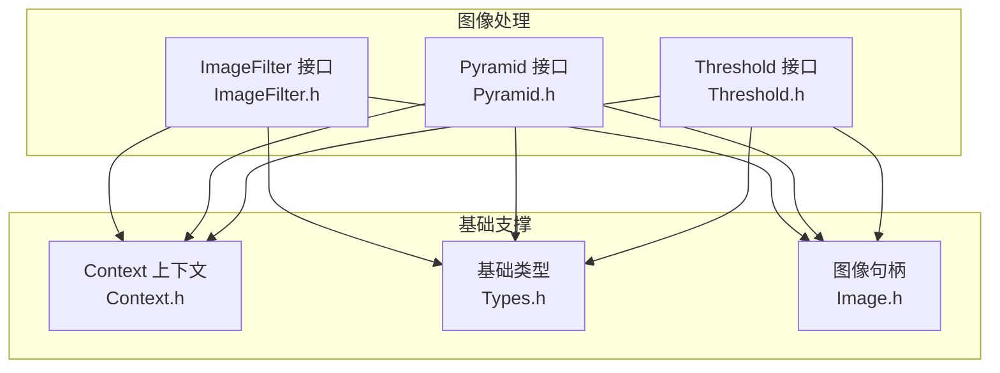
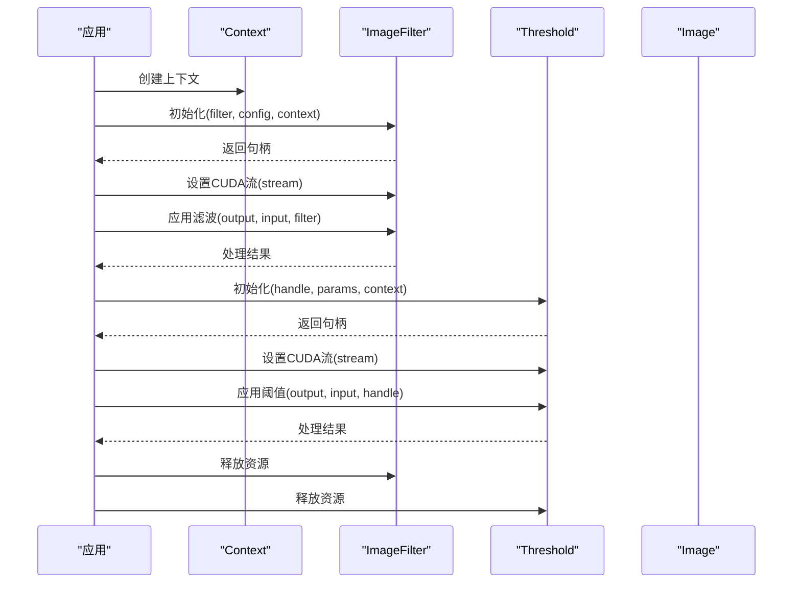
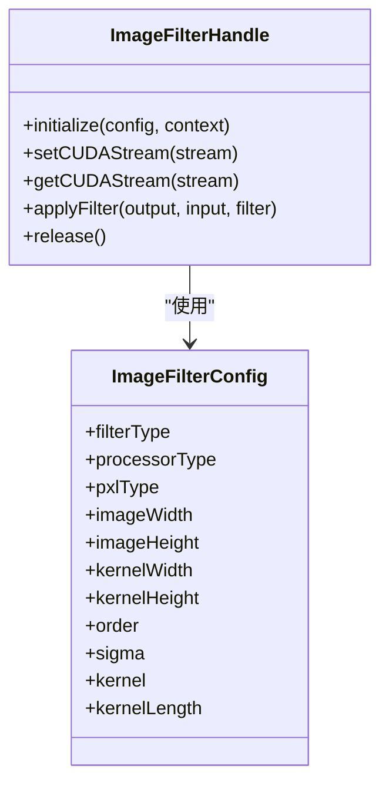
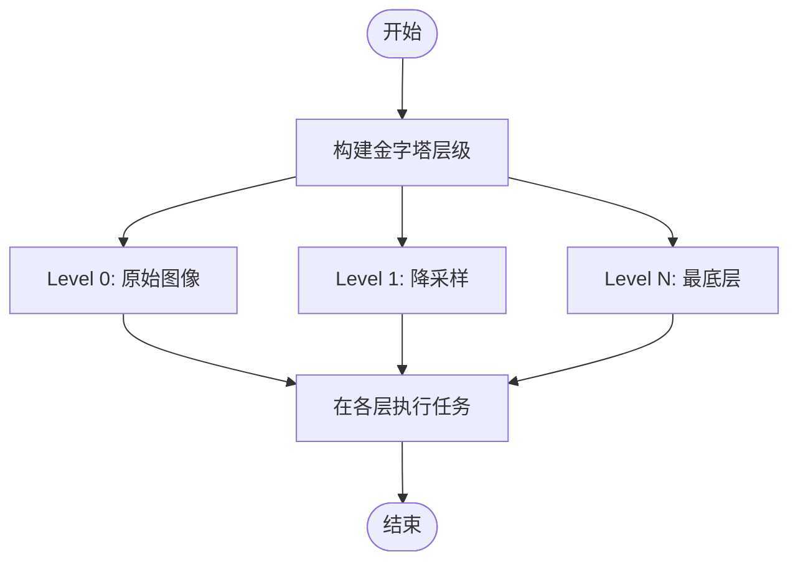
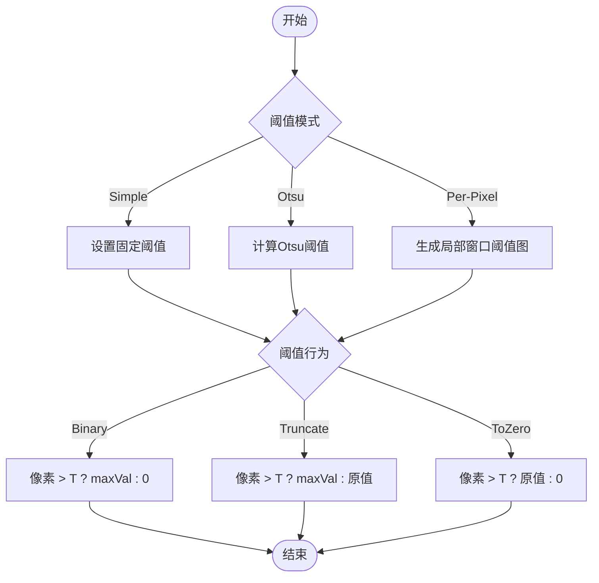
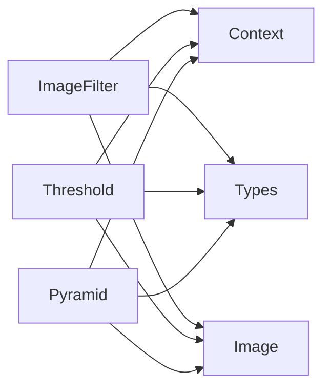

# 滤波处理

<cite>
**本文引用的文件**
- [ImageFilter.h](file://driverorks-5.10/include/dw/imageprocessing/filtering/ImageFilter.h)
- [Pyramid.h（已弃用）](file://driverorks-5.10/include/dw/imageprocessing/filtering/Pyramid.h)
- [Pyramid.h（新位置）](file://driverorks-5.10/include/dw/imageprocessing/pyramid/Pyramid.h)
- [Threshold.h](file://driverorks-5.10/include/dw/imageprocessing/filtering/Threshold.h)
- [Image.h](file://driverorks-5.10/include/dw/image/Image.h)
- [Context.h](file://driverorks-5.10/include/dw/core/context/Context.h)
- [Types.h](file://driverorks-5.10/include/dw/core/base/Types.h)
</cite>

## 目录
1. [简介](#简介)
2. [项目结构](#项目结构)
3. [核心组件](#核心组件)
4. [架构总览](#架构总览)
5. [详细组件分析](#详细组件分析)
6. [依赖关系分析](#依赖关系分析)
7. [性能考虑](#性能考虑)
8. [故障排查指南](#故障排查指南)
9. [结论](#结论)
10. [附录：API 参考](#附录api-参考)

## 简介
本技术文档聚焦于 NVIDIA DriveWorks 图像处理中的“滤波处理”模块，系统性地介绍以下能力与接口：
- 图像滤波：高斯滤波、盒式滤波、卷积滤波等常见滤波器的配置与应用。
- 金字塔构建与多尺度图像处理：多分辨率图像序列的生成与管理。
- 阈值处理：全局阈值、Otsu 自动阈值以及逐像素自适应阈值的实现与使用。

文档将从系统架构、数据流、处理逻辑、错误处理与性能优化等方面进行深入解析，并提供 API 参考与实践建议，帮助开发者在真实场景中高效、正确地使用滤波处理能力。

## 项目结构
滤波处理模块位于 DriveWorks 的图像处理子系统中，核心文件分布如下：
- 过滤器接口：dw/imageprocessing/filtering/ImageFilter.h
- 金字塔接口：dw/imageprocessing/pyramid/Pyramid.h（原路径为 filtering/Pyramid.h 已弃用）
- 阈值接口：dw/imageprocessing/filtering/Threshold.h
- 基础类型与上下文：dw/core/base/Types.h、dw/core/context/Context.h
- 图像句柄：dw/image/Image.h

图表来源
- [ImageFilter.h:1-190](file://driverorks-5.10/include/dw/imageprocessing/filtering/ImageFilter.h#L1-L190)
- [Pyramid.h（新位置）:1-43](file://driverorks-5.10/include/dw/imageprocessing/pyramid/Pyramid.h#L1-L43)
- [Threshold.h:1-187](file://driverorks-5.10/include/dw/imageprocessing/filtering/Threshold.h#L1-L187)
- [Image.h](file://driverorks-5.10/include/dw/image/Image.h)
- [Context.h](file://driverorks-5.10/include/dw/core/context/Context.h)
- [Types.h](file://driverorks-5.10/include/dw/core/base/Types.h)

章节来源
- [ImageFilter.h:1-190](file://driverorks-5.10/include/dw/imageprocessing/filtering/ImageFilter.h#L1-L190)
- [Pyramid.h（已弃用）:1-43](file://driverorks-5.10/include/dw/imageprocessing/filtering/Pyramid.h#L1-L43)
- [Pyramid.h（新位置）:1-43](file://driverorks-5.10/include/dw/imageprocessing/pyramid/Pyramid.h#L1-L43)
- [Threshold.h:1-187](file://driverorks-5.10/include/dw/imageprocessing/filtering/Threshold.h#L1-L187)

## 核心组件
本模块围绕三个核心组件展开：
- ImageFilter：封装多种滤波算法（高斯、盒式、卷积），支持 PVA/GPU 执行后端，提供初始化、设置 CUDA 流、应用滤波与释放资源等接口。
- Pyramid：多尺度图像金字塔的构建与访问，用于多分辨率分析与层级特征提取。
- Threshold：图像阈值化处理，支持简单阈值、Otsu 自动阈值与逐像素自适应阈值。

章节来源
- [ImageFilter.h:63-125](file://driverorks-5.10/include/dw/imageprocessing/filtering/ImageFilter.h#L63-L125)
- [Pyramid.h（新位置）:1-43](file://driverorks-5.10/include/dw/imageprocessing/pyramid/Pyramid.h#L1-L43)
- [Threshold.h:69-94](file://driverorks-5.10/include/dw/imageprocessing/filtering/Threshold.h#L69-L94)

## 架构总览
滤波处理模块遵循“配置驱动 + 句柄式资源管理”的设计模式：
- 通过配置结构体定义算法类型、处理器类型、核尺寸、核参数等；
- 初始化阶段分配并绑定上下文与资源；
- 应用阶段对输入图像进行处理，输出目标图像；
- 支持 CUDA 流设置，便于与流水线集成；
- 资源在使用结束后统一释放。

图表来源
- [ImageFilter.h:136-183](file://driverorks-5.10/include/dw/imageprocessing/filtering/ImageFilter.h#L136-L183)
- [Threshold.h:106-181](file://driverorks-5.10/include/dw/imageprocessing/filtering/Threshold.h#L106-L181)
- [Context.h](file://driverorks-5.10/include/dw/core/context/Context.h)
- [Image.h](file://driverorks-5.10/include/dw/image/Image.h)

## 详细组件分析

### ImageFilter 组件分析
ImageFilter 提供三类滤波器：
- 递归高斯滤波（零阶）：适用于特定通道与像素类型，常用于平滑与降噪。
- 盒式滤波：快速近似平滑，适合实时场景。
- 卷积滤波：支持用户自定义核，可执行二维或一维可分离卷积。

关键配置项与行为：
- 处理器类型：支持 PVA 与 GPU；
- 像素类型：需与输入/输出图像一致；
- 核尺寸与核长度：二维核长度=宽×高，一维可分离核长度=宽+高；
- 高斯核参数：核大小与 sigma 控制平滑程度；
- CUDA 流：可选设置，便于异步与并发调度。

图表来源
- [ImageFilter.h:80-125](file://driverorks-5.10/include/dw/imageprocessing/filtering/ImageFilter.h#L80-L125)
- [ImageFilter.h:136-183](file://driverorks-5.10/include/dw/imageprocessing/filtering/ImageFilter.h#L136-L183)

章节来源
- [ImageFilter.h:63-125](file://driverorks-5.10/include/dw/imageprocessing/filtering/ImageFilter.h#L63-L125)
- [ImageFilter.h:136-183](file://driverorks-5.10/include/dw/imageprocessing/filtering/ImageFilter.h#L136-L183)

### Pyramid 组件分析
金字塔用于构建多分辨率图像序列，典型流程：
- 由输入图像开始，按比例降采样生成下一层；
- 可在不同尺度上执行特征提取、匹配或检测；
- 输出层可作为后续处理的输入，提升鲁棒性与效率。

图表来源
- [Pyramid.h（新位置）:1-43](file://driverorks-5.10/include/dw/imageprocessing/pyramid/Pyramid.h#L1-L43)

章节来源
- [Pyramid.h（已弃用）:34-40](file://driverorks-5.10/include/dw/imageprocessing/filtering/Pyramid.h#L34-L40)
- [Pyramid.h（新位置）:1-43](file://driverorks-5.10/include/dw/imageprocessing/pyramid/Pyramid.h#L1-L43)

### Threshold 组件分析
Threshold 提供三种阈值模式与多种比较行为：
- 简单阈值（MODE_SIMPLE）：使用固定阈值；
- Otsu 自动阈值（MODE_OTSU）：自动计算最佳阈值；
- 逐像素自适应阈值（MODE_PER_PIXEL）：基于局部窗口的动态阈值图；
- 行为包括二值化、截断、至零等。

图表来源
- [Threshold.h:69-94](file://driverorks-5.10/include/dw/imageprocessing/filtering/Threshold.h#L69-L94)
- [Threshold.h:106-157](file://driverorks-5.10/include/dw/imageprocessing/filtering/Threshold.h#L106-L157)

章节来源
- [Threshold.h:69-94](file://driverorks-5.10/include/dw/imageprocessing/filtering/Threshold.h#L69-L94)
- [Threshold.h:106-157](file://driverorks-5.10/include/dw/imageprocessing/filtering/Threshold.h#L106-L157)

## 依赖关系分析
- ImageFilter 依赖 Context、Types 与 Image；
- Threshold 同样依赖 Context、Types 与 Image；
- Pyramid 依赖 Context、Types 与 Image；
- 所有组件均通过句柄式接口管理生命周期，避免直接暴露内部状态。

图表来源
- [ImageFilter.h:49-55](file://driverorks-5.10/include/dw/imageprocessing/filtering/ImageFilter.h#L49-L55)
- [Threshold.h:49-51](file://driverorks-5.10/include/dw/imageprocessing/filtering/Threshold.h#L49-L51)
- [Pyramid.h（新位置）:1-43](file://driverorks-5.10/include/dw/imageprocessing/pyramid/Pyramid.h#L1-L43)

章节来源
- [ImageFilter.h:49-55](file://driverorks-5.10/include/dw/imageprocessing/filtering/ImageFilter.h#L49-L55)
- [Threshold.h:49-51](file://driverorks-5.10/include/dw/imageprocessing/filtering/Threshold.h#L49-L51)
- [Pyramid.h（新位置）:1-43](file://driverorks-5.10/include/dw/imageprocessing/pyramid/Pyramid.h#L1-L43)

## 性能考虑
- 选择处理器类型：GPU 通常更适合大规模卷积与高斯滤波；PVA 在某些平台上具备低延迟优势。
- 合理设置核尺寸与 sigma：核越大、sigma 越大，平滑效果越强但计算开销越高。
- 使用可分离卷积：当核可分离时，将二维卷积分解为两次一维卷积，显著降低复杂度。
- 利用 CUDA 流：在多任务流水线中并行处理，减少等待时间。
- 输入输出像素类型一致性：确保 pxlType 与图像格式匹配，避免额外转换。
- 金字塔层数控制：层数越多，内存占用与计算量越大，应根据任务需求折中选择。

## 故障排查指南
- 初始化失败（返回无效参数）：检查配置字段是否完整，如处理器类型、核尺寸、像素类型与图像尺寸是否匹配。
- CUDA 错误：确认 CUDA 流设置正确，设备可用且无其他冲突任务。
- VPI 操作失败：检查底层图像格式与通道数是否满足算法要求（例如高斯滤波仅支持特定通道与像素类型）。
- 阈值结果异常：确认阈值模式与行为设置是否符合预期；逐像素阈值图需与输入图像尺寸一致。

章节来源
- [ImageFilter.h:136-183](file://driverorks-5.10/include/dw/imageprocessing/filtering/ImageFilter.h#L136-L183)
- [Threshold.h:106-181](file://driverorks-5.10/include/dw/imageprocessing/filtering/Threshold.h#L106-L181)

## 结论
滤波处理模块提供了从基础平滑到高级多尺度与阈值分割的完整工具链。通过合理的配置与资源管理，开发者可在 DriveWorks 平台上高效实现图像预处理与分析任务。建议优先评估 GPU 与 PVA 的性能差异，结合具体应用场景选择最优算法与参数组合。

## 附录：API 参考

- ImageFilter
  - 初始化：[dwImageFilter_initialize:136-137](file://driverorks-5.10/include/dw/imageprocessing/filtering/ImageFilter.h#L136-L137)
  - 设置 CUDA 流：[dwImageFilter_setCUDAStream:147-148](file://driverorks-5.10/include/dw/imageprocessing/filtering/ImageFilter.h#L147-L148)
  - 获取 CUDA 流：[dwImageFilter_getCUDAStream:158-159](file://driverorks-5.10/include/dw/imageprocessing/filtering/ImageFilter.h#L158-L159)
  - 应用滤波：[dwImageFilter_applyFilter:172-173](file://driverorks-5.10/include/dw/imageprocessing/filtering/ImageFilter.h#L172-L173)
  - 释放资源：[dwImageFilter_release:182-183](file://driverorks-5.10/include/dw/imageprocessing/filtering/ImageFilter.h#L182-L183)

- Threshold
  - 初始化：[dwThreshold_initialize:106-108](file://driverorks-5.10/include/dw/imageprocessing/filtering/Threshold.h#L106-L108)
  - 重置：[dwThreshold_reset:117-118](file://driverorks-5.10/include/dw/imageprocessing/filtering/Threshold.h#L117-L118)
  - 释放：[dwThreshold_release:128-129](file://driverorks-5.10/include/dw/imageprocessing/filtering/Threshold.h#L128-L129)
  - 应用阈值：[dwThreshold_applyThreshold:142-143](file://driverorks-5.10/include/dw/imageprocessing/filtering/Threshold.h#L142-L143)
  - 设置参数：[dwThreshold_setThresholdParameters:155-157](file://driverorks-5.10/include/dw/imageprocessing/filtering/Threshold.h#L155-L157)
  - 设置/获取 CUDA 流：[dwThreshold_setCUDAStream:167-168](file://driverorks-5.10/include/dw/imageprocessing/filtering/Threshold.h#L167-L168)、[dwThreshold_getCUDAStream:180-181](file://driverorks-5.10/include/dw/imageprocessing/filtering/Threshold.h#L180-L181)

- Pyramid
  - 说明：原路径 filtering/Pyramid.h 已弃用，迁移至 pyramids/Pyramid.h，请更新包含路径。[弃用提示:34-40](file://driverorks-5.10/include/dw/imageprocessing/filtering/Pyramid.h#L34-L40)、[新路径:1-43](file://driverorks-5.10/include/dw/imageprocessing/pyramid/Pyramid.h#L1-L43)

- 关键类型与句柄
  - 图像句柄：[dwImageHandle_t](file://driverorks-5.10/include/dw/image/Image.h)
  - 上下文句柄：[dwContextHandle_t](file://driverorks-5.10/include/dw/core/context/Context.h)
  - 基础类型：[dwProcessorType、dwTrivialDataType 等](file://driverorks-5.10/include/dw/core/base/Types.h)