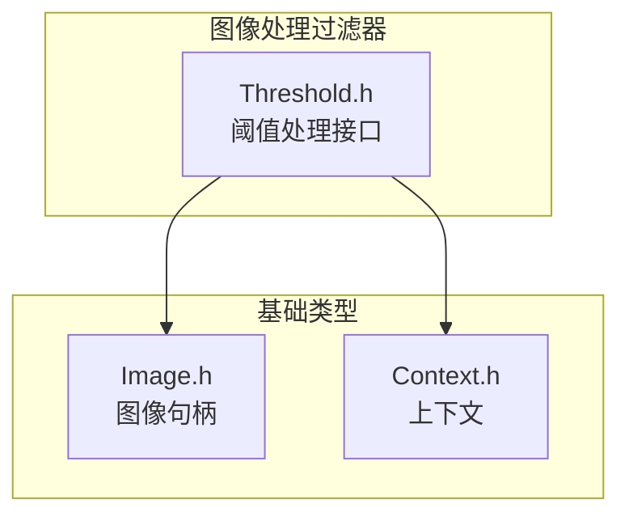
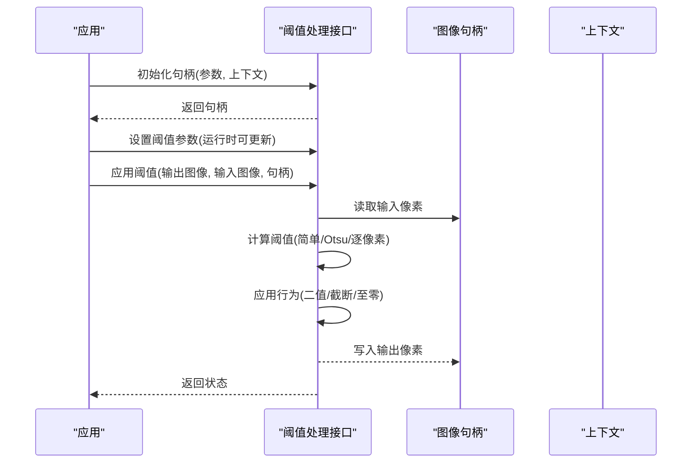
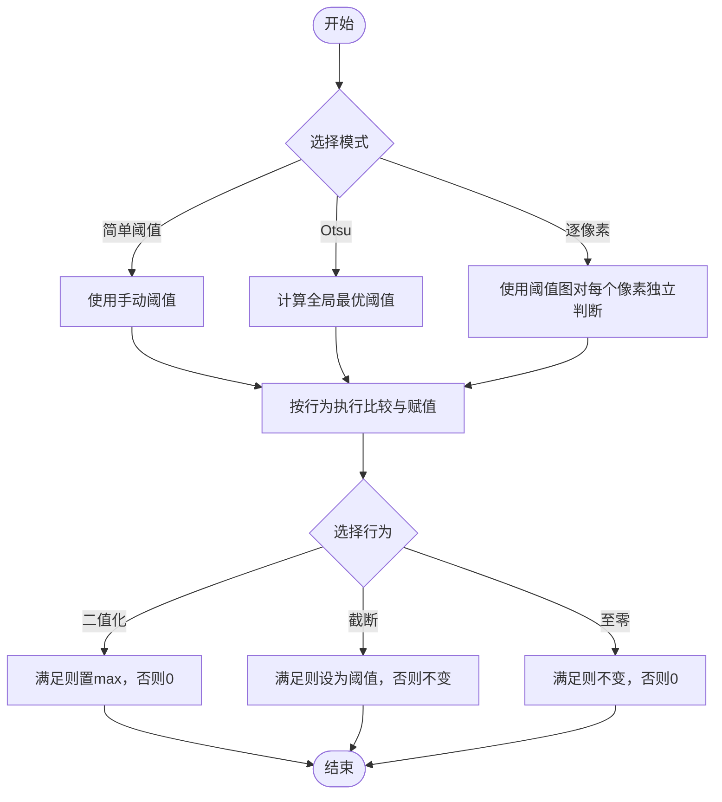
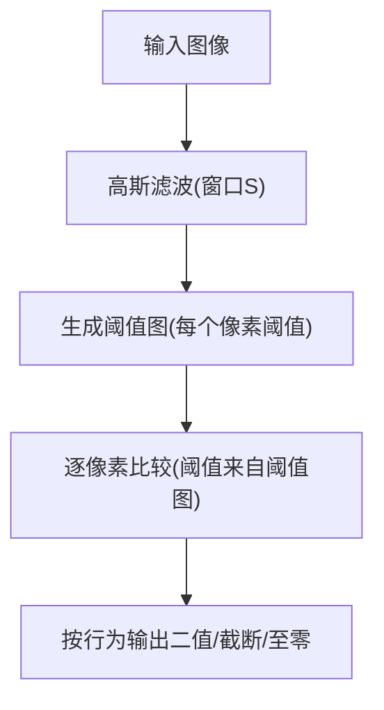
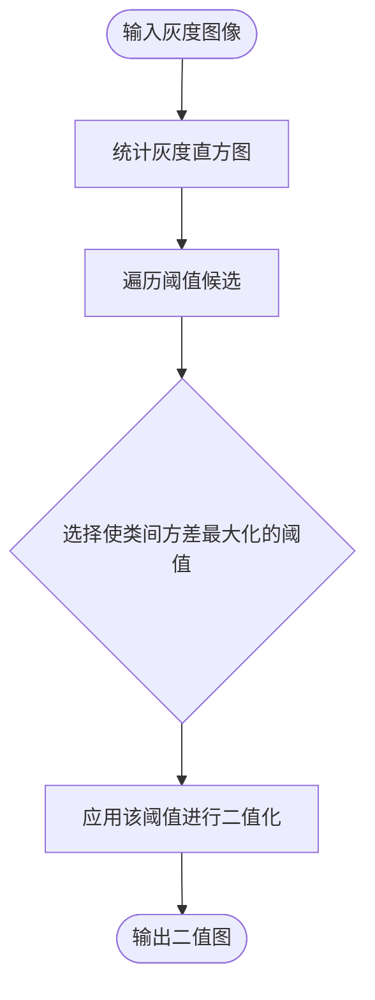
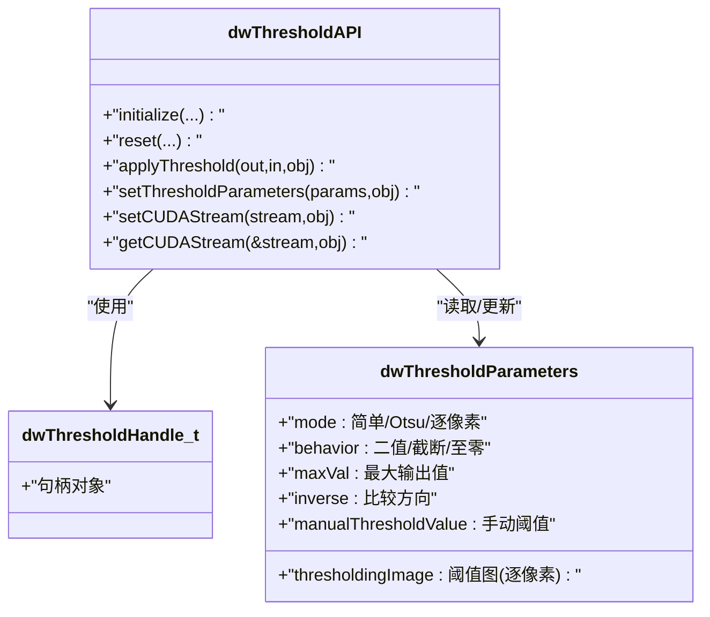
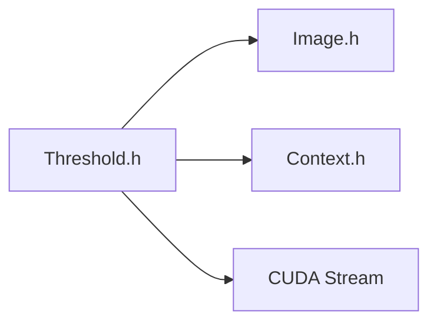

# 阈值处理

<cite>
**本文引用的文件**
- [Threshold.h（5.8）](file://driveworks-5.8/include/dw/imageprocessing/filtering/Threshold.h)
- [Threshold.h（5.10）](file://driverorks-5.10/include/dw/imageprocessing/filtering/Threshold.h)
- [Threshold.h（5.14）](file://driveworks-5.14/include/dw/imageprocessing/filtering/Threshold.h)
- [Image.h](file://driveworks-5.14/include/dw/image/Image.h)
- [Context.h](file://driveworks-5.14/include/dw/core/context/Context.h)
</cite>

## 目录
1. [简介](#简介)
2. [项目结构](#项目结构)
3. [核心组件](#核心组件)
4. [架构总览](#架构总览)
5. [详细组件分析](#详细组件分析)
6. [依赖关系分析](#依赖关系分析)
7. [性能考虑](#性能考虑)
8. [故障排查指南](#故障排查指南)
9. [结论](#结论)
10. [附录](#附录)

## 简介
本文件面向使用 NVIDIA DriveWorks 的开发者，系统性阐述图像阈值处理模块的设计与使用方法。该模块提供三种主要阈值策略：固定阈值（全局简单阈值）、Otsu 自动阈值以及逐像素自适应阈值，并支持多种阈值行为（二值化、截断、至零）。文档将从接口定义、数据流、算法原理、参数选择与优化、到与后续图像分析流程的衔接进行全面说明，并给出可直接定位到源码的路径指引，便于快速查阅与实现。

## 项目结构
阈值处理位于 DriveWorks 图像处理子系统中，核心接口定义于图像处理过滤器子目录下，与图像句柄、上下文等基础类型协同工作。

图示来源
- [Threshold.h（5.14）: 49-51:49-51](file://driveworks-5.14/include/dw/imageprocessing/filtering/Threshold.h#L49-L51)
- [Image.h](file://driveworks-5.14/include/dw/image/Image.h)
- [Context.h](file://driveworks-5.14/include/dw/core/context/Context.h)

章节来源
- [Threshold.h（5.14）: 49-51:49-51](file://driveworks-5.14/include/dw/imageprocessing/filtering/Threshold.h#L49-L51)

## 核心组件
- 句柄与参数
  - 句柄类型：用于封装阈值处理状态与资源
  - 参数结构体：包含模式、行为、最大输出值、是否反向比较、手动阈值、以及逐像素阈值图等字段
- 模式与行为
  - 模式：简单阈值、Otsu 自动阈值、逐像素自适应阈值
  - 行为：二值化、截断、至零；支持正向/反向比较
- 运行时控制
  - 初始化/重置/释放
  - 应用阈值
  - 设置/获取 CUDA 流

章节来源
- [Threshold.h（5.8）: 57-94:57-94](file://driveworks-5.8/include/dw/imageprocessing/filtering/Threshold.h#L57-L94)
- [Threshold.h（5.10）: 57-94:57-94](file://driverorks-5.10/include/dw/imageprocessing/filtering/Threshold.h#L57-L94)
- [Threshold.h（5.14）: 57-94:57-94](file://driveworks-5.14/include/dw/imageprocessing/filtering/Threshold.h#L57-L94)
- [Threshold.h（5.8）: 106-181:106-181](file://driveworks-5.8/include/dw/imageprocessing/filtering/Threshold.h#L106-L181)
- [Threshold.h（5.10）: 106-181:106-181](file://driverorks-5.10/include/dw/imageprocessing/filtering/Threshold.h#L106-L181)
- [Threshold.h（5.14）: 106-181:106-181](file://driveworks-5.14/include/dw/imageprocessing/filtering/Threshold.h#L106-L181)

## 架构总览
阈值处理以“句柄 + 参数 + 图像输入/输出”的方式组织，遵循 C 接口风格，便于在多语言环境中集成。其核心流程是：初始化句柄并设置参数 → 将输入图像与句柄传入 → 执行阈值操作 → 获取输出图像。

图示来源
- [Threshold.h（5.14）: 106-143:106-143](file://driveworks-5.14/include/dw/imageprocessing/filtering/Threshold.h#L106-L143)
- [Image.h](file://driveworks-5.14/include/dw/image/Image.h)
- [Context.h](file://driveworks-5.14/include/dw/core/context/Context.h)

## 详细组件分析

### 组件一：阈值模式与行为
- 模式
  - 简单阈值（全局固定阈值）
  - Otsu 自动阈值（自动选择最佳阈值）
  - 逐像素自适应阈值（每个像素使用独立阈值图）
- 行为
  - 二值化：满足比较条件则置为最大值，否则为零
  - 截断：满足条件则保持阈值，否则保持原值
  - 至零：满足条件则保持原值，否则置零
- 比较方向
  - 支持正向（大于/小于）与反向（小于/大于等于）两种比较方向

图示来源
- [Threshold.h（5.14）: 69-94:69-94](file://driveworks-5.14/include/dw/imageprocessing/filtering/Threshold.h#L69-L94)

章节来源
- [Threshold.h（5.8）: 59-94:59-94](file://driveworks-5.8/include/dw/imageprocessing/filtering/Threshold.h#L59-L94)
- [Threshold.h（5.10）: 59-94:59-94](file://driverorks-5.10/include/dw/imageprocessing/filtering/Threshold.h#L59-L94)
- [Threshold.h（5.14）: 59-94:59-94](file://driveworks-5.14/include/dw/imageprocessing/filtering/Threshold.h#L59-L94)

### 组件二：逐像素自适应阈值
- 原理概述
  - 对于每个像素位置，使用一个“阈值图”中的对应像素值作为该点的阈值，从而实现局部自适应
  - 当阈值图由高斯滤波生成时，称为“高斯自适应阈值”，窗口大小影响局部对比度敏感度
- 典型流程
  - 使用高斯滤波生成阈值图（窗口大小 S）
  - 将阈值图作为阈值输入，对原图逐像素比较与赋值
- 适用场景
  - 光照不均匀、局部对比度变化显著的图像
  - 背景复杂但前景局部特征明显的场景

图示来源
- [Threshold.h（5.14）: 90-93:90-93](file://driveworks-5.14/include/dw/imageprocessing/filtering/Threshold.h#L90-L93)

章节来源
- [Threshold.h（5.8）: 90-93:90-93](file://driveworks-5.8/include/dw/imageprocessing/filtering/Threshold.h#L90-L93)
- [Threshold.h（5.10）: 90-93:90-93](file://driverorks-5.10/include/dw/imageprocessing/filtering/Threshold.h#L90-L93)
- [Threshold.h（5.14）: 90-93:90-93](file://driveworks-5.14/include/dw/imageprocessing/filtering/Threshold.h#L90-L93)

### 组件三：Otsu 自动阈值
- 原理概述
  - 基于灰度直方图的双峰假设，通过最大化类间方差自动选择最佳阈值
  - 适合灰度分布呈现双峰或多峰的图像
- 适用场景
  - 全局光照稳定、前景与背景明显分离的图像
  - 不需要局部自适应的场景，追求高效与稳定

图示来源
- [Threshold.h（5.14）: 72](file://driveworks-5.14/include/dw/imageprocessing/filtering/Threshold.h#L72)

章节来源
- [Threshold.h（5.8）: 72](file://driveworks-5.8/include/dw/imageprocessing/filtering/Threshold.h#L72)
- [Threshold.h（5.10）: 72](file://driverorks-5.10/include/dw/imageprocessing/filtering/Threshold.h#L72)
- [Threshold.h（5.14）: 72](file://driveworks-5.14/include/dw/imageprocessing/filtering/Threshold.h#L72)

### 组件四：接口与生命周期
- 初始化：传入参数与上下文，返回句柄
- 重置：清理内部状态（如需重新配置）
- 应用：对输入图像执行阈值处理，写入输出图像
- 参数更新：运行时可动态修改阈值参数
- CUDA 流：可设置/查询底层 CUDA 流，便于流水线并行

图示来源
- [Threshold.h（5.14）: 57-94:57-94](file://driveworks-5.14/include/dw/imageprocessing/filtering/Threshold.h#L57-L94)
- [Threshold.h（5.14）: 106-181:106-181](file://driveworks-5.14/include/dw/imageprocessing/filtering/Threshold.h#L106-L181)

章节来源
- [Threshold.h（5.8）: 106-181:106-181](file://driveworks-5.8/include/dw/imageprocessing/filtering/Threshold.h#L106-L181)
- [Threshold.h（5.10）: 106-181:106-181](file://driverorks-5.10/include/dw/imageprocessing/filtering/Threshold.h#L106-L181)
- [Threshold.h（5.14）: 106-181:106-181](file://driveworks-5.14/include/dw/imageprocessing/filtering/Threshold.h#L106-L181)

## 依赖关系分析
- 外部依赖
  - 图像句柄：输入/输出图像的抽象
  - 上下文：Driveworks 运行环境
  - CUDA 流：异步执行与流水线并行
- 内部耦合
  - 参数结构体集中定义了阈值策略与行为，驱动内部算法分支
  - 句柄封装状态，避免重复初始化带来的开销

图示来源
- [Threshold.h（5.14）: 49-51:49-51](file://driveworks-5.14/include/dw/imageprocessing/filtering/Threshold.h#L49-L51)
- [Threshold.h（5.14）: 167-181:167-181](file://driveworks-5.14/include/dw/imageprocessing/filtering/Threshold.h#L167-L181)

章节来源
- [Threshold.h（5.8）: 49-51:49-51](file://driveworks-5.8/include/dw/imageprocessing/filtering/Threshold.h#L49-L51)
- [Threshold.h（5.10）: 49-51:49-51](file://driverorks-5.10/include/dw/imageprocessing/filtering/Threshold.h#L49-L51)
- [Threshold.h（5.14）: 49-51:49-51](file://driveworks-5.14/include/dw/imageprocessing/filtering/Threshold.h#L49-L51)

## 性能考虑
- 并行化
  - 阈值处理通常以像素级并行为主，建议通过设置 CUDA 流与多流并行提升吞吐
- 内存访问
  - 输入/输出图像尽量与 GPU 内存对齐，减少跨设备拷贝
- 算法选择
  - Otsu 适合全局稳定场景，逐像素自适应适合光照不均场景，简单阈值适合实时性要求高的场景
- 参数影响
  - 逐像素模式的窗口大小会影响局部对比度与噪声敏感性，需结合具体场景权衡

## 故障排查指南
- 常见错误与处理
  - 句柄无效：检查初始化是否成功、句柄是否被提前释放
  - 输入/输出图像格式不匹配：确保输入为灰度或单通道，输出格式与预期一致
  - CUDA 错误：检查 CUDA 流设置、显存占用与驱动版本
- 参数校验
  - 最大输出值与阈值范围应合理设置，避免溢出或无效结果
  - 逐像素模式下的阈值图尺寸需与输入图像一致
- 调试建议
  - 先用简单阈值验证流程，再逐步切换到 Otsu 或逐像素模式
  - 输出中间结果（阈值图、二值图）辅助定位问题

章节来源
- [Threshold.h（5.8）: 102-104:102-104](file://driveworks-5.8/include/dw/imageprocessing/filtering/Threshold.h#L102-L104)
- [Threshold.h（5.10）: 102-104:102-104](file://driverorks-5.10/include/dw/imageprocessing/filtering/Threshold.h#L102-L104)
- [Threshold.h（5.14）: 102-104:102-104](file://driveworks-5.14/include/dw/imageprocessing/filtering/Threshold.h#L102-L104)

## 结论
DriveWorks 阈值处理模块提供了从全局到局部、从简单到自动的完整阈值能力。通过统一的句柄与参数接口，开发者可在不同场景下灵活选择策略，并与后续图像分析（如连通域、特征提取等）无缝衔接。实践中建议先以简单阈值验证流程，再根据光照与对比度特性选择 Otsu 或逐像素自适应策略，并结合 CUDA 流实现高性能流水线。

## 附录
- 快速上手步骤
  - 初始化上下文与图像句柄
  - 创建阈值句柄并设置参数（模式、行为、阈值、最大值、比较方向）
  - 调用应用函数对输入图像执行阈值处理
  - 获取输出图像并进行后续分析
- 关键接口定位
  - 初始化/重置/释放/应用/参数设置/CUDA 流设置/查询
    - [Threshold.h（5.8）: 106-181:106-181](file://driveworks-5.8/include/dw/imageprocessing/filtering/Threshold.h#L106-L181)
    - [Threshold.h（5.10）: 106-181:106-181](file://driverorks-5.10/include/dw/imageprocessing/filtering/Threshold.h#L106-L181)
    - [Threshold.h（5.14）: 106-181:106-181](file://driveworks-5.14/include/dw/imageprocessing/filtering/Threshold.h#L106-L181)