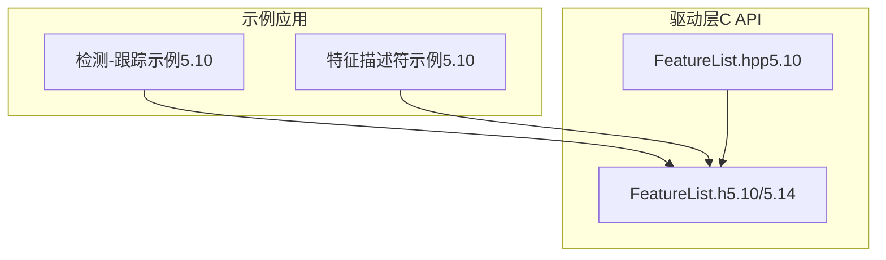
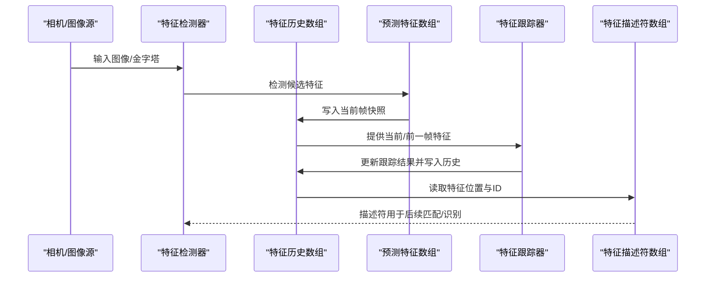
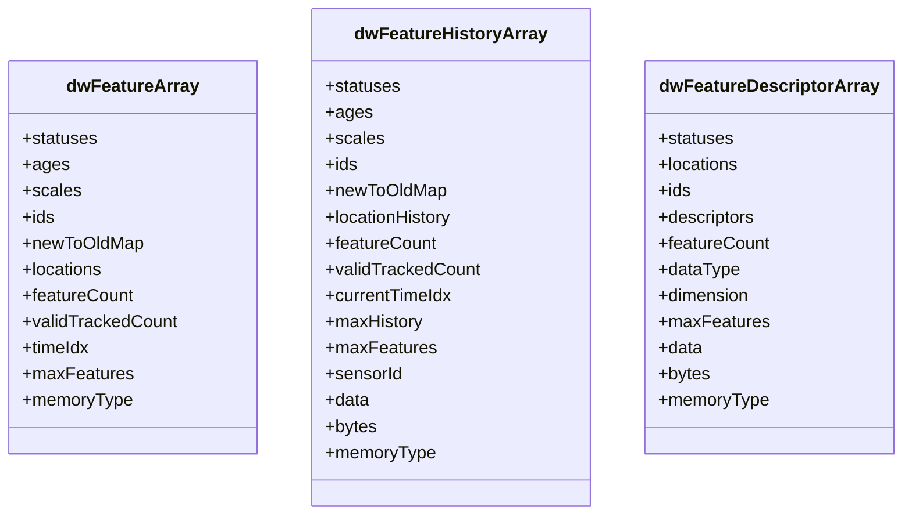
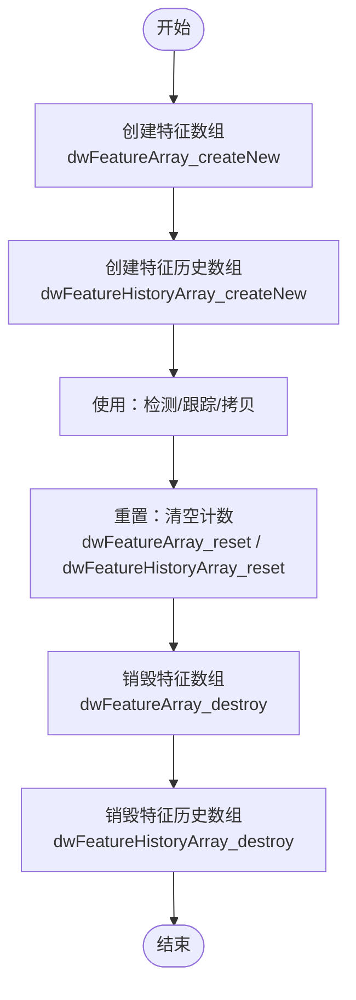
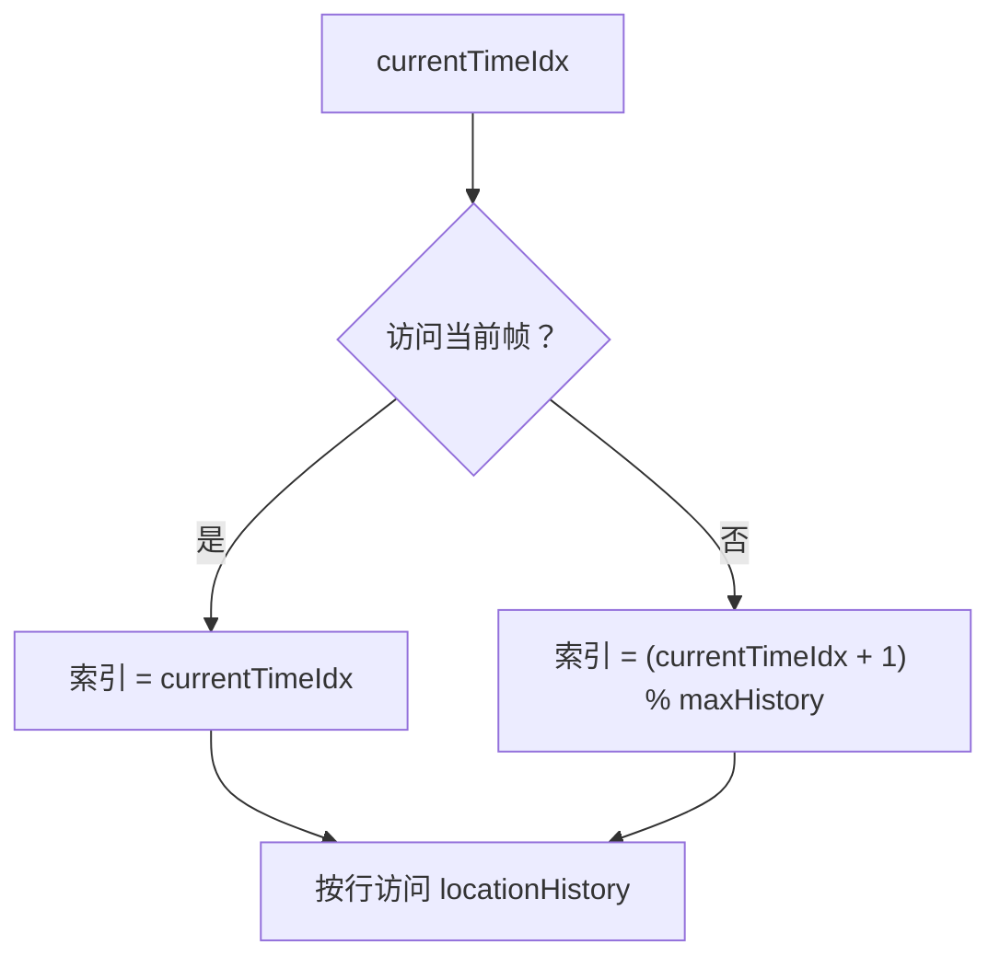
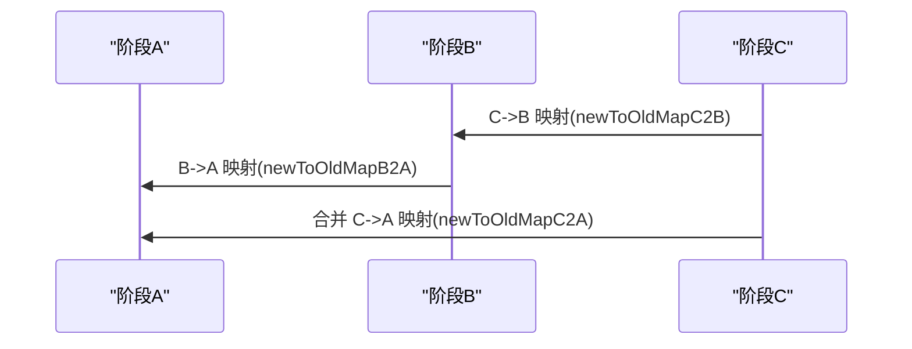
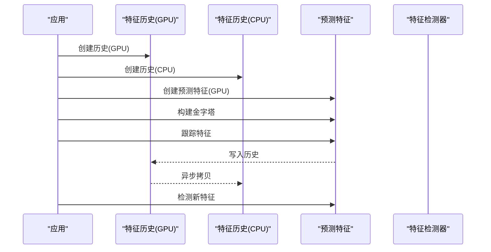

# 特征列表管理

<cite>
**本文档引用的文件**
- [FeatureList.h（5.10）](file://driverorks-5.10/include/dw/imageprocessing/features/FeatureList.h)
- [FeatureList.hpp（5.10）](file://driverorks-5.10/include/dwframework/dwnodes/common/channelpackets/FeatureList.hpp)
- [FeatureList.h（5.14）](file://driveworks-5.14/include/dw/imageprocessing/features/FeatureList.h)
- [FeatureList.cpp 示例（5.10）](file://driverorks-5.10/samples/src/dnn/sample_object_detector_tracker/main.cpp)
- [特征描述符示例（5.10）](file://driverorks-5.10/samples/src/imageprocessing/feature_descriptor/main.cpp)
</cite>

## 目录
1. [简介](#简介)
2. [项目结构](#项目结构)
3. [核心组件](#核心组件)
4. [架构总览](#架构总览)
5. [详细组件分析](#详细组件分析)
6. [依赖关系分析](#依赖关系分析)
7. [性能考虑](#性能考虑)
8. [故障排查指南](#故障排查指南)
9. [结论](#结论)
10. [附录](#附录)

## 简介
本技术文档围绕 DriveWorks 的特征列表管理模块展开，系统性阐述 FeatureList 类族提供的特征数据结构与管理能力，重点覆盖以下方面：
- 特征数据结构设计：关键点坐标、响应值、尺度、方向、状态、年龄、ID、新旧索引映射等
- 特征列表操作接口：创建、销毁、重置、深拷贝、历史快照获取、映射合并等
- 在特征匹配与跟踪中的角色：作为检测器与跟踪器之间的桥梁，支持多帧历史回溯与跨阶段映射合并
- 大规模特征集合管理策略：内存类型选择、异步拷贝、环形缓冲区时间索引、GPU/CPU 双态部署
- 内存优化与性能提升建议：避免不必要的内存复制、合理设置最大特征数与历史容量、流式异步处理

## 项目结构
与特征列表管理相关的核心文件位于以下路径：
- 驱动层头文件：包含特征数组、历史数组、描述符数组的数据结构定义与 API 声明
- 框架层通道包声明：将特征数组类型与框架通道包关联
- 示例代码：展示特征历史数组与特征数组在检测-跟踪流水线中的实际使用

**图表来源**
- [FeatureList.h（5.10）:46-447](file://driverorks-5.10/include/dw/imageprocessing/features/FeatureList.h#L46-L447)
- [FeatureList.hpp（5.10）:31-42](file://driverorks-5.10/include/dwframework/dwnodes/common/channelpackets/FeatureList.hpp#L31-L42)
- [FeatureList.h（5.14）:46-498](file://driveworks-5.14/include/dw/imageprocessing/features/FeatureList.h#L46-L498)

**章节来源**
- [FeatureList.h（5.10）:46-447](file://driverorks-5.10/include/dw/imageprocessing/features/FeatureList.h#L46-L447)
- [FeatureList.hpp（5.10）:31-42](file://driverorks-5.10/include/dwframework/dwnodes/common/channelpackets/FeatureList.hpp#L31-L42)
- [FeatureList.h（5.14）:46-498](file://driveworks-5.14/include/dw/imageprocessing/features/FeatureList.h#L46-L498)

## 核心组件
- 特征数组（dwFeatureArray）
  - 存储当前时刻的特征位置、状态、年龄、尺度、ID、新到旧索引映射、有效特征计数、上一帧有效跟踪数等
  - 支持时间索引 timeIdx（0 表示最新）
- 特征历史数组（dwFeatureHistoryArray）
  - 以列为主的时间矩阵，按 ringbuffer 方式维护多帧历史
  - 提供获取当前帧、前一帧、指定历史帧快照的能力
  - 包含当前时间索引 currentTimeIdx、最大历史容量 maxHistory、传感器 ID 等
- 特征描述符数组（dwFeatureDescriptorArray）
  - 存储每个特征的描述符向量，支持指定数据类型与维度
- 关键枚举与类型
  - 特征状态（无效、刚检测、已跟踪）
  - 内存类型（CPU/GPU/Pinned）

这些组件共同构成特征数据的统一抽象，并通过一系列创建、销毁、重置、拷贝与映射合并的 API 实现生命周期管理与跨阶段协作。

**章节来源**
- [FeatureList.h（5.10）:115-153](file://driverorks-5.10/include/dw/imageprocessing/features/FeatureList.h#L115-L153)
- [FeatureList.h（5.14）:115-175](file://driveworks-5.14/include/dw/imageprocessing/features/FeatureList.h#L115-L175)

## 架构总览
特征列表管理在检测-跟踪流水线中的典型交互如下：

**图表来源**
- [FeatureList.h（5.10）:286-336](file://driverorks-5.10/include/dw/imageprocessing/features/FeatureList.h#L286-L336)
- [FeatureList.h（5.14）:334-385](file://driveworks-5.14/include/dw/imageprocessing/features/FeatureList.h#L334-L385)
- [FeatureList.cpp 示例（5.10）:707-732](file://driverorks-5.10/samples/src/dnn/sample_object_detector_tracker/main.cpp#L707-L732)

## 详细组件分析

### 数据结构与属性详解
- dwFeatureArray
  - 关键字段：statuses、ages、scales、ids、newToOldMap、locations、featureCount、validTrackedCount、timeIdx、maxFeatures、memoryType
  - 用途：承载单帧特征集合，供检测器输出与跟踪器输入使用
- dwFeatureHistoryArray
  - 关键字段：statuses、ages、scales、ids、newToOldMap、locationHistory、featureCount、validTrackedCount、currentTimeIdx、maxHistory、maxFeatures、sensorId、data、bytes、memoryType
  - 用途：多帧历史记录，支持 ringbuffer 时间索引与环形访问
- dwFeatureDescriptorArray
  - 关键字段：statuses、locations、ids、descriptors、featureCount、dataType、dimension、maxFeatures、data、bytes、memoryType
  - 用途：保存特征描述符，便于后续匹配或识别任务

**图表来源**
- [FeatureList.h（5.10）:115-173](file://driverorks-5.10/include/dw/imageprocessing/features/FeatureList.h#L115-L173)
- [FeatureList.h（5.14）:115-175](file://driveworks-5.14/include/dw/imageprocessing/features/FeatureList.h#L115-L175)

**章节来源**
- [FeatureList.h（5.10）:115-173](file://driverorks-5.10/include/dw/imageprocessing/features/FeatureList.h#L115-L173)
- [FeatureList.h（5.14）:115-175](file://driveworks-5.14/include/dw/imageprocessing/features/FeatureList.h#L115-L175)

### 创建与销毁流程
- dwFeatureArray_create / dwFeatureArray_createNew
  - 5.14 引入 createNew 版本，显式传入 CUDA 流，便于异步初始化
- dwFeatureHistoryArray_create / dwFeatureHistoryArray_createNew
  - 同样引入 createNew 版本，支持流式初始化
- 销毁与重置
  - destroy 释放资源；reset 将特征计数清零，保留结构体与内存布局

**图表来源**
- [FeatureList.h（5.14）:192-233](file://driveworks-5.14/include/dw/imageprocessing/features/FeatureList.h#L192-L233)
- [FeatureList.h（5.14）:278-318](file://driveworks-5.14/include/dw/imageprocessing/features/FeatureList.h#L278-L318)

**章节来源**
- [FeatureList.h（5.14）:192-233](file://driveworks-5.14/include/dw/imageprocessing/features/FeatureList.h#L192-L233)
- [FeatureList.h（5.14）:278-318](file://driveworks-5.14/include/dw/imageprocessing/features/FeatureList.h#L278-L318)

### 历史快照与时间索引
- ringbuffer 时间索引
  - currentTimeIdx 指向最新帧，历史容量为 maxHistory
  - 访问当前帧与前一帧时，通过环形索引计算 locationHistory 的行偏移
- 快照获取
  - getCurrent / getPrevious / get(historyIdx) 返回对应时间片的特征快照
  - 返回的快照不需再次销毁，由历史数组统一管理

**图表来源**
- [FeatureList.h（5.10）:88-112](file://driverorks-5.10/include/dw/imageprocessing/features/FeatureList.h#L88-L112)
- [FeatureList.h（5.14）:88-112](file://driveworks-5.14/include/dw/imageprocessing/features/FeatureList.h#L88-L112)

**章节来源**
- [FeatureList.h（5.10）:88-112](file://driverorks-5.10/include/dw/imageprocessing/features/FeatureList.h#L88-L112)
- [FeatureList.h（5.14）:88-112](file://driveworks-5.14/include/dw/imageprocessing/features/FeatureList.h#L88-L112)

### 映射合并与跨阶段追踪
- newToOldMap 合并
  - 支持在多阶段（A->B->C）中合并映射，从 C->B 与 B->A 推导 C->A
  - 适用于流水线化处理，确保特征 ID 的一致性与可追溯性

**图表来源**
- [FeatureList.h（5.10）:354-375](file://driverorks-5.10/include/dw/imageprocessing/features/FeatureList.h#L354-L375)
- [FeatureList.h（5.14）:403-424](file://driveworks-5.14/include/dw/imageprocessing/features/FeatureList.h#L403-L424)

**章节来源**
- [FeatureList.h（5.10）:354-375](file://driverorks-5.10/include/dw/imageprocessing/features/FeatureList.h#L354-L375)
- [FeatureList.h（5.14）:403-424](file://driveworks-5.14/include/dw/imageprocessing/features/FeatureList.h#L403-L424)

### 在检测-跟踪流水线中的使用
- 初始化
  - 创建 CPU/GPU 特征历史数组与 GPU 特征数组
  - 准备金字塔与掩码（可选）
- 运行流程
  - 构建金字塔 -> 跟踪特征 -> 异步拷贝到 CPU -> 更新特征位置与状态 -> 检测新特征
- 渲染与可视化
  - 将跟踪到的特征点绘制到渲染引擎

**图表来源**
- [FeatureList.cpp 示例（5.10）:359-364](file://driverorks-5.10/samples/src/dnn/sample_object_detector_tracker/main.cpp#L359-L364)
- [FeatureList.cpp 示例（5.10）:707-732](file://driverorks-5.10/samples/src/dnn/sample_object_detector_tracker/main.cpp#L707-L732)

**章节来源**
- [FeatureList.cpp 示例（5.10）:359-364](file://driverorks-5.10/samples/src/dnn/sample_object_detector_tracker/main.cpp#L359-L364)
- [FeatureList.cpp 示例（5.10）:707-732](file://driverorks-5.10/samples/src/dnn/sample_object_detector_tracker/main.cpp#L707-L732)

### 特征描述符数组的使用
- 创建与销毁
  - 指定数据类型、维度与最大特征数，支持 CPU/GPU 双态
- 拷贝策略
  - GPU->GPU 使用异步拷贝，CPU->CPU 使用同步拷贝
- 应用场景
  - 与特征数组配合，用于后续匹配、检索或识别任务

**章节来源**
- [FeatureList.h（5.10）:377-440](file://driverorks-5.10/include/dw/imageprocessing/features/FeatureList.h#L377-L440)
- [FeatureList.h（5.14）:427-491](file://driveworks-5.14/include/dw/imageprocessing/features/FeatureList.h#L427-L491)
- [特征描述符示例（5.10）:197-198](file://driverorks-5.10/samples/src/imageprocessing/feature_descriptor/main.cpp#L197-L198)

## 依赖关系分析
- 结构体依赖
  - dwFeatureHistoryArray 依赖 dwFeatureArray 的快照语义
  - 新旧索引映射在多阶段处理中被复用与合并
- API 依赖
  - 历史数组提供快照获取 API，供跟踪器与渲染管线使用
  - 描述符数组与特征数组配合，形成“位置+描述”的完整特征表示

**图表来源**
- [FeatureList.h（5.10）:286-336](file://driverorks-5.10/include/dw/imageprocessing/features/FeatureList.h#L286-L336)
- [FeatureList.h（5.10）:354-375](file://driverorks-5.10/include/dw/imageprocessing/features/FeatureList.h#L354-L375)

**章节来源**
- [FeatureList.h（5.10）:286-336](file://driverorks-5.10/include/dw/imageprocessing/features/FeatureList.h#L286-L336)
- [FeatureList.h（5.10）:354-375](file://driverorks-5.10/include/dw/imageprocessing/features/FeatureList.h#L354-L375)

## 性能考虑
- 内存类型选择
  - 大规模特征集合优先使用 GPU 或 Pinned 内存，减少主机与设备间拷贝开销
- 异步处理
  - 使用流式初始化与异步拷贝，避免阻塞主线程
- ringbuffer 设计
  - 利用环形索引避免频繁内存移动，降低拷贝成本
- 批量操作
  - 统一进行特征计数重置与批量拷贝，减少 API 调用次数
- 合理配置
  - 最大特征数与历史容量应结合场景峰值进行预估，避免动态扩容带来的额外开销

## 故障排查指南
- 常见错误与定位
  - 空指针或无效句柄：检查创建 API 的返回值与上下文参数
  - 容量不匹配：拷贝前后 maxFeatures 必须一致
  - 内存类型不兼容：CPU->CPU 与 GPU->GPU 的拷贝需使用对应 API
- 建议排查步骤
  - 确认创建/销毁配对调用
  - 在异步拷贝后执行流同步或事件同步
  - 核对 ringbuffer 索引计算与访问边界

**章节来源**
- [FeatureList.h（5.10）:224-237](file://driverorks-5.10/include/dw/imageprocessing/features/FeatureList.h#L224-L237)
- [FeatureList.h（5.10）:411-427](file://driverorks-5.10/include/dw/imageprocessing/features/FeatureList.h#L411-L427)
- [FeatureList.h（5.14）:250-262](file://driveworks-5.14/include/dw/imageprocessing/features/FeatureList.h#L250-L262)
- [FeatureList.h（5.14）:462-478](file://driveworks-5.14/include/dw/imageprocessing/features/FeatureList.h#L462-L478)

## 结论
特征列表管理模块通过统一的数据结构与完善的 API，为特征检测与跟踪提供了高效、可扩展的基础设施。借助 ringbuffer 历史管理、新旧索引映射合并以及流式异步处理，能够在保证实时性的前提下支撑大规模特征集合的管理与应用。结合合理的内存类型选择与容量规划，可进一步提升整体性能与稳定性。

## 附录
- API 速查
  - 创建：dwFeatureArray_createNew / dwFeatureHistoryArray_createNew
  - 销毁：dwFeatureArray_destroy / dwFeatureHistoryArray_destroy
  - 重置：dwFeatureArray_reset / dwFeatureHistoryArray_reset
  - 拷贝：dwFeatureArray_copyAsync / dwFeatureHistoryArray_copyAsync
  - 快照：getCurrent / getPrevious / get(historyIdx)
  - 描述符：dwFeatureDescriptorArray_create / copyAsync / copy / destroy
  - 映射合并：dwFeature_mergeNewToOldMap

**章节来源**
- [FeatureList.h（5.14）:192-233](file://driveworks-5.14/include/dw/imageprocessing/features/FeatureList.h#L192-L233)
- [FeatureList.h（5.14）:278-318](file://driveworks-5.14/include/dw/imageprocessing/features/FeatureList.h#L278-L318)
- [FeatureList.h（5.14）:334-385](file://driveworks-5.14/include/dw/imageprocessing/features/FeatureList.h#L334-L385)
- [FeatureList.h（5.14）:418-424](file://driveworks-5.14/include/dw/imageprocessing/features/FeatureList.h#L418-L424)
- [FeatureList.h（5.14）:427-491](file://driveworks-5.14/include/dw/imageprocessing/features/FeatureList.h#L427-L491)