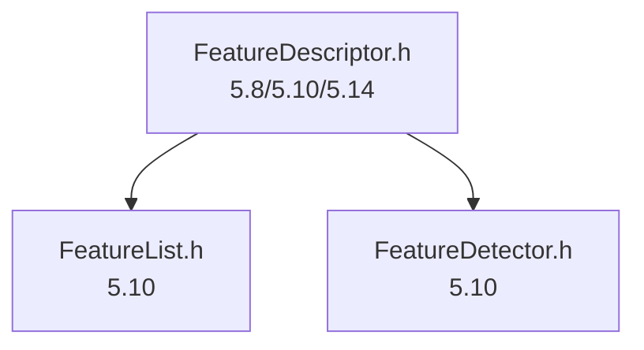
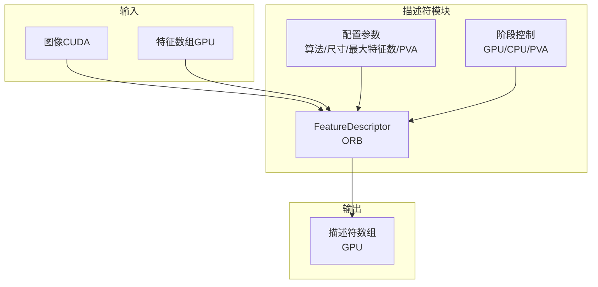
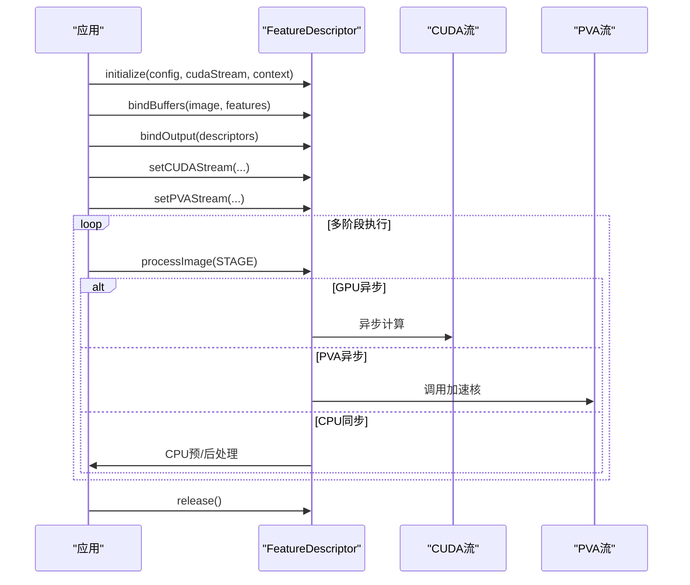
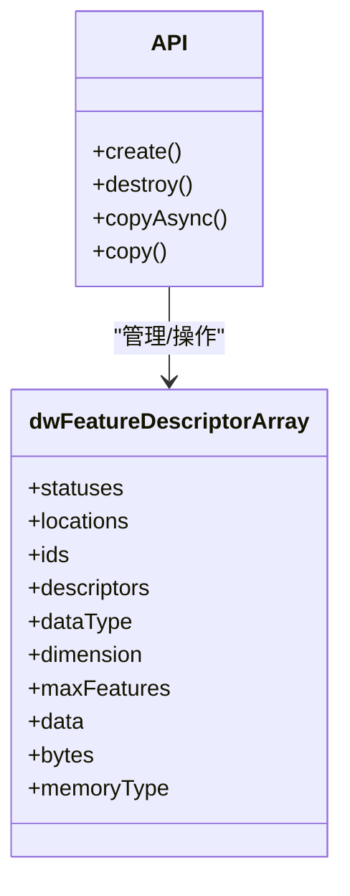
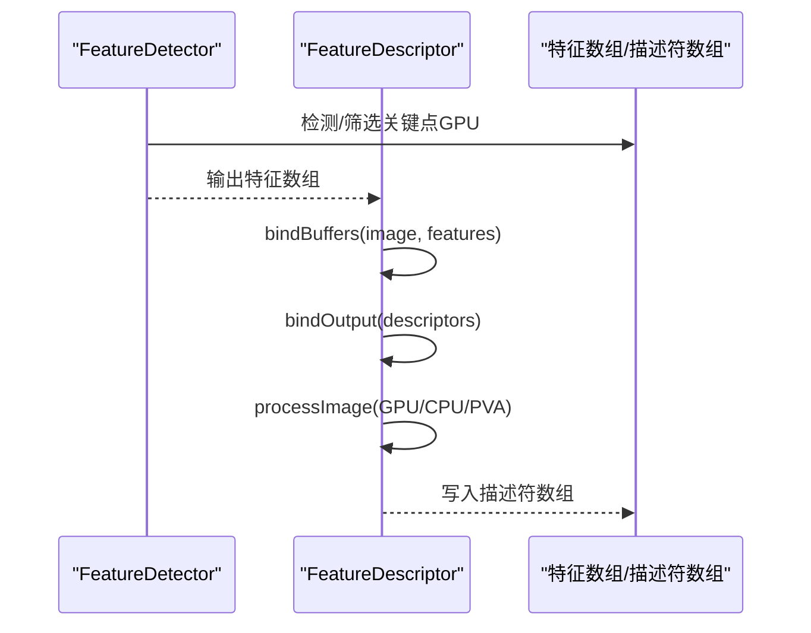
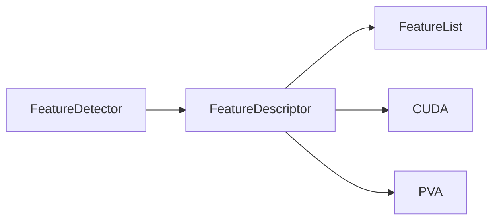

# 特征描述符

<cite>
**本文引用的文件**
- [FeatureDescriptor.h（5.10）](file://driverorks-5.10/include/dw/imageprocessing/featuredetector/descriptor/FeatureDescriptor.h)
- [FeatureDescriptor.h（5.14）](file://driveworks-5.14/include/dw/imageprocessing/featuredetector/descriptor/FeatureDescriptor.h)
- [FeatureDescriptor.h（5.8）](file://driveworks-5.8/include/dw/imageprocessing/features/descriptor/FeatureDescriptor.h)
- [FeatureList.h（5.10）](file://driverorks-5.10/include/dw/imageprocessing/features/FeatureList.h)
- [FeatureDetector.h（5.10）](file://driverorks-5.10/include/dw/imageprocessing/featuredetector/FeatureDetector.h)
</cite>

## 目录
1. [引言](#引言)
2. [项目结构](#项目结构)
3. [核心组件](#核心组件)
4. [架构总览](#架构总览)
5. [详细组件分析](#详细组件分析)
6. [依赖关系分析](#依赖关系分析)
7. [性能考量](#性能考量)
8. [故障排查指南](#故障排查指南)
9. [结论](#结论)
10. [附录：使用与示例路径](#附录使用与示例路径)

## 引言
本技术文档聚焦于 DriveWorks 图像处理子系统中的“特征描述符”模块，系统性阐述 FeatureDescriptor 类提供的二维特征描述符计算能力，重点覆盖 ORB 描述符在该框架中的接口定义、配置参数、数据结构、流水线阶段以及与特征检测器和特征数组的协同关系。文档同时给出关键流程的时序图与数据流图，帮助读者从整体到细节理解描述符的计算过程与集成方式，并提供面向实际应用的使用建议与性能对比视角。

## 项目结构
特征描述符相关的核心接口位于以下版本的头文件中：
- 5.10 版本：位于 imageprocessing/featuredetector/descriptor/FeatureDescriptor.h
- 5.14 版本：位于 imageprocessing/featuredetector/descriptor/FeatureDescriptor.h
- 5.8 版本：位于 imageprocessing/features/descriptor/FeatureDescriptor.h

此外，特征描述符输出的数据结构由 FeatureList.h 提供，特征检测器接口由 FeatureDetector.h 提供，二者共同构成“先检测、后描述”的典型管线。

图表来源
- [FeatureDescriptor.h（5.10）:1-307](file://driverorks-5.10/include/dw/imageprocessing/featuredetector/descriptor/FeatureDescriptor.h#L1-L307)
- [FeatureDescriptor.h（5.14）:1-307](file://driveworks-5.14/include/dw/imageprocessing/featuredetector/descriptor/FeatureDescriptor.h#L1-L307)
- [FeatureDescriptor.h（5.8）:1-245](file://driveworks-5.8/include/dw/imageprocessing/features/descriptor/FeatureDescriptor.h#L1-L245)
- [FeatureList.h（5.10）:1-447](file://driverorks-5.10/include/dw/imageprocessing/features/FeatureList.h#L1-L447)
- [FeatureDetector.h（5.10）:1-483](file://driverorks-5.10/include/dw/imageprocessing/featuredetector/FeatureDetector.h#L1-L483)

章节来源
- [FeatureDescriptor.h（5.10）:1-307](file://driverorks-5.10/include/dw/imageprocessing/featuredetector/descriptor/FeatureDescriptor.h#L1-L307)
- [FeatureDescriptor.h（5.14）:1-307](file://driveworks-5.14/include/dw/imageprocessing/featuredetector/descriptor/FeatureDescriptor.h#L1-L307)
- [FeatureDescriptor.h（5.8）:1-245](file://driveworks-5.8/include/dw/imageprocessing/features/descriptor/FeatureDescriptor.h#L1-L245)
- [FeatureList.h（5.10）:1-447](file://driverorks-5.10/include/dw/imageprocessing/features/FeatureList.h#L1-L447)
- [FeatureDetector.h（5.10）:1-483](file://driverorks-5.10/include/dw/imageprocessing/featuredetector/FeatureDetector.h#L1-L483)

## 核心组件
- 特征描述符句柄与算法类型
  - 句柄类型：dwFeature2DDescriptorHandle_t、dwConstFeature2DDescriptorHandle_t
  - 算法枚举：当前版本仅支持 ORB 描述符（DW_FEATURE2D_DESCRIPTOR_ALGORITHM_ORB）
- 配置参数结构体 dwFeature2DDescriptorConfig
  - algorithm：选择 ORB
  - imageWidth、imageHeight：输入图像尺寸
  - maxFeatureCount：最大特征数
  - processorType：当使用 PVA 加速时指定处理器类型（如 DW_PROCESSOR_TYPE_PVA_0）
- 流水线阶段枚举 dwFeature2DDescriptorStage
  - GPU 异步预处理
  - CPU 同步预处理
  - PVA 异步处理
  - CPU 同步后处理
  - GPU 异步后处理
- 关键 API
  - 初始化与释放：dwFeature2DDescriptor_initialize、dwFeature2DDescriptor_release、dwFeature2DDescriptor_reset
  - 绑定输入输出：bindBuffers（绑定图像与特征）、bindOutput（绑定描述符输出数组）
  - 执行：processImage（按阶段执行）
  - CUDA/PVA 流设置与查询：setCUDAStream、getCUDAStream、setPVAStream、getPVAStream
- 输出数据结构 dwFeatureDescriptorArray
  - 包含每个特征的位置、ID、状态、描述符向量、维度、内存类型等字段

章节来源
- [FeatureDescriptor.h（5.10）:62-307](file://driverorks-5.10/include/dw/imageprocessing/featuredetector/descriptor/FeatureDescriptor.h#L62-L307)
- [FeatureDescriptor.h（5.14）:62-307](file://driveworks-5.14/include/dw/imageprocessing/featuredetector/descriptor/FeatureDescriptor.h#L62-L307)
- [FeatureDescriptor.h（5.8）:61-245](file://driveworks-5.8/include/dw/imageprocessing/features/descriptor/FeatureDescriptor.h#L61-L245)
- [FeatureList.h（5.10）:157-173](file://driverorks-5.10/include/dw/imageprocessing/features/FeatureList.h#L157-L173)

## 架构总览
特征描述符模块在 DriveWorks 中作为“特征检测—特征描述—匹配跟踪”的中间环节，通常与特征检测器（FeatureDetector）和特征数组（FeatureList）配合使用。其核心职责是：对已检测到的关键点（位置、尺度、方向等）进行描述符向量计算，并将结果写入描述符数组。

图表来源
- [FeatureDescriptor.h（5.10）:85-138](file://driverorks-5.10/include/dw/imageprocessing/featuredetector/descriptor/FeatureDescriptor.h#L85-L138)
- [FeatureList.h（5.10）:136-173](file://driverorks-5.10/include/dw/imageprocessing/features/FeatureList.h#L136-L173)

## 详细组件分析

### 组件一：FeatureDescriptor 接口与生命周期
- 初始化与释放
  - initialize：根据配置、CUDA 流、上下文创建并初始化描述符对象
  - reset：重置内部状态
  - release：释放资源，使句柄失效
- 流设置
  - setCUDAStream/getCUDAStream：设置/获取 CUDA 流
  - setPVAStream/getPVAStream：设置/获取 PVA 流（用于 PVA 加速）
- 输入输出绑定
  - bindBuffers：绑定输入图像（CUDA）与特征数组（GPU）
  - bindOutput：绑定输出描述符数组（需与初始化时 maxFeatureCount 一致且为 GPU）

图表来源
- [FeatureDescriptor.h（5.10）:146-307](file://driverorks-5.10/include/dw/imageprocessing/featuredetector/descriptor/FeatureDescriptor.h#L146-L307)
- [FeatureDescriptor.h（5.14）:146-307](file://driveworks-5.14/include/dw/imageprocessing/featuredetector/descriptor/FeatureDescriptor.h#L146-L307)
- [FeatureDescriptor.h（5.8）:120-245](file://driveworks-5.8/include/dw/imageprocessing/features/descriptor/FeatureDescriptor.h#L120-L245)

章节来源
- [FeatureDescriptor.h（5.10）:146-307](file://driverorks-5.10/include/dw/imageprocessing/featuredetector/descriptor/FeatureDescriptor.h#L146-L307)
- [FeatureDescriptor.h（5.14）:146-307](file://driveworks-5.14/include/dw/imageprocessing/featuredetector/descriptor/FeatureDescriptor.h#L146-L307)
- [FeatureDescriptor.h（5.8）:120-245](file://driveworks-5.8/include/dw/imageprocessing/features/descriptor/FeatureDescriptor.h#L120-L245)

### 组件二：描述符输出数据结构 dwFeatureDescriptorArray
- 字段要点
  - statuses、locations、ids：特征状态、像素坐标、唯一标识
  - descriptors：描述符向量（字节序列），维度由 dimension 指定
  - dataType：描述符数据类型
  - memoryType：内存位置（GPU/CPU/固定页）
  - maxFeatures、bytes：容量与总字节数
- 创建与销毁
  - create：按维度、最大特征数、内存类型创建
  - destroy：销毁
  - copy/copyAsync：在 GPU/CPU 间拷贝

图表来源
- [FeatureList.h（5.10）:157-173](file://driverorks-5.10/include/dw/imageprocessing/features/FeatureList.h#L157-L173)
- [FeatureList.h（5.10）:392-441](file://driverorks-5.10/include/dw/imageprocessing/features/FeatureList.h#L392-L441)

章节来源
- [FeatureList.h（5.10）:157-173](file://driverorks-5.10/include/dw/imageprocessing/features/FeatureList.h#L157-L173)
- [FeatureList.h（5.10）:392-441](file://driverorks-5.10/include/dw/imageprocessing/features/FeatureList.h#L392-L441)

### 组件三：与特征检测器的协作
- 典型工作流
  - 使用 FeatureDetector 在当前帧检测或筛选关键点，得到特征数组（GPU）
  - 将图像与特征数组绑定至 FeatureDescriptor
  - 按阶段执行 processImage，最终输出描述符数组
- 参数一致性
  - 描述符数组的 maxFeatureCount 必须与初始化时一致
  - 输入特征数组必须位于 GPU 内存
  - 输入图像必须为 CUDA 图像

图表来源
- [FeatureDetector.h（5.10）:374-413](file://driverorks-5.10/include/dw/imageprocessing/featuredetector/FeatureDetector.h#L374-L413)
- [FeatureDescriptor.h（5.10）:256-273](file://driverorks-5.10/include/dw/imageprocessing/featuredetector/descriptor/FeatureDescriptor.h#L256-L273)
- [FeatureList.h（5.10）:136-173](file://driverorks-5.10/include/dw/imageprocessing/features/FeatureList.h#L136-L173)

章节来源
- [FeatureDetector.h（5.10）:374-413](file://driverorks-5.10/include/dw/imageprocessing/featuredetector/FeatureDetector.h#L374-L413)
- [FeatureDescriptor.h（5.10）:256-273](file://driverorks-5.10/include/dw/imageprocessing/featuredetector/descriptor/FeatureDescriptor.h#L256-L273)
- [FeatureList.h（5.10）:136-173](file://driverorks-5.10/include/dw/imageprocessing/features/FeatureList.h#L136-L173)

### 组件四：数学原理与实现要点（概念性说明）
- 局部梯度统计
  - 描述符向量通常基于局部像素灰度或梯度信息统计构建，例如二进制描述符（如 ORB）通过采样点的相对明暗关系编码局部纹理。
- 旋转不变性设计
  - 常见做法包括主方向估计（参考特征点局部质心或梯度分布确定主方向），随后将采样网格旋转到主方向，保证描述符对旋转鲁棒。
- 关键点定位与主方向估计
  - 关键点定位：在多尺度空间中寻找稳定极值点，结合亚像素插值与边缘响应抑制。
  - 主方向：统计关键点邻域内梯度直方图，选取主峰作为主方向，用于构建旋转不变描述符。
- 特征向量生成
  - 对关键点邻域按固定网格采样，计算采样点的强度/梯度比较结果，形成二进制或浮点向量；必要时进行归一化或量化。

（本节为概念性说明，不直接分析具体源码文件）

## 依赖关系分析
- 外部依赖
  - CUDA：用于 GPU 异步阶段与特征数组拷贝
  - PVA：用于 PVA 异步阶段（当 processorType 指定为 PVA）
  - 上下文与流：通过 dwContextHandle_t 与 CUDA/cupva 流进行资源管理
- 内部耦合
  - FeatureDescriptor 依赖 FeatureList 的数据结构（特征数组、描述符数组）
  - FeatureDescriptor 与 FeatureDetector 协同，前者消费后者的输出作为输入

图表来源
- [FeatureDescriptor.h（5.10）:49-56](file://driverorks-5.10/include/dw/imageprocessing/featuredetector/descriptor/FeatureDescriptor.h#L49-L56)
- [FeatureList.h（5.10）:136-173](file://driverorks-5.10/include/dw/imageprocessing/features/FeatureList.h#L136-L173)
- [FeatureDetector.h（5.10）:50-56](file://driverorks-5.10/include/dw/imageprocessing/featuredetector/FeatureDetector.h#L50-L56)

章节来源
- [FeatureDescriptor.h（5.10）:49-56](file://driverorks-5.10/include/dw/imageprocessing/featuredetector/descriptor/FeatureDescriptor.h#L49-L56)
- [FeatureList.h（5.10）:136-173](file://driverorks-5.10/include/dw/imageprocessing/features/FeatureList.h#L136-L173)
- [FeatureDetector.h（5.10）:50-56](file://driverorks-5.10/include/dw/imageprocessing/featuredetector/FeatureDetector.h#L50-L56)

## 性能考量
- 并行与流水线
  - GPU 异步阶段与 PVA 异步阶段可并行推进，减少 CPU 等待时间
  - CPU 同步阶段用于必要的预处理/后处理，应尽量保持轻量
- 内存与带宽
  - 特征数组与描述符数组均建议使用 GPU 内存，避免频繁 CPU-GPU 拷贝
  - 描述符维度越大，带宽压力越高；需权衡精度与性能
- PVA 加速
  - 当 processorType 指定为 PVA 时，可在专用硬件上加速 ORB 描述符计算，显著降低延迟
- 参数调优
  - maxFeatureCount 应与检测阶段输出规模匹配，避免过小导致截断或过大造成浪费
  - imageWidth/imageHeight 与检测器配置一致，确保描述符计算在正确分辨率上进行

（本节为通用性能指导，不直接分析具体源码文件）

## 故障排查指南
- 常见错误与定位
  - 句柄/指针为空：initialize/bind/process 等 API 返回 DW_INVALID_ARGUMENT
  - 内存类型不匹配：特征数组/描述符数组必须为 GPU 内存
  - 未绑定输出：processImage 前必须 bindOutput
  - CUDA/PVA 流未设置：若平台支持，需显式 setCUDAStream/setPVAStream
- 建议排查步骤
  - 确认初始化配置（algorithm、imageWidth、imageHeight、maxFeatureCount、processorType）
  - 确认 bindBuffers 与 bindOutput 成功返回
  - 分阶段调用 processImage，观察各阶段是否成功
  - 若使用 PVA，确认平台支持且 PVA 流有效

章节来源
- [FeatureDescriptor.h（5.10）:163-194](file://driverorks-5.10/include/dw/imageprocessing/featuredetector/descriptor/FeatureDescriptor.h#L163-L194)
- [FeatureDescriptor.h（5.10）:256-273](file://driverorks-5.10/include/dw/imageprocessing/featuredetector/descriptor/FeatureDescriptor.h#L256-L273)
- [FeatureDescriptor.h（5.14）:163-194](file://driveworks-5.14/include/dw/imageprocessing/featuredetector/descriptor/FeatureDescriptor.h#L163-L194)
- [FeatureDescriptor.h（5.14）:256-273](file://driveworks-5.14/include/dw/imageprocessing/featuredetector/descriptor/FeatureDescriptor.h#L256-L273)
- [FeatureDescriptor.h（5.8）:135-164](file://driveworks-5.8/include/dw/imageprocessing/features/descriptor/FeatureDescriptor.h#L135-L164)
- [FeatureDescriptor.h（5.8）:222-239](file://driveworks-5.8/include/dw/imageprocessing/features/descriptor/FeatureDescriptor.h#L222-L239)

## 结论
DriveWorks 的特征描述符模块以清晰的阶段化接口与灵活的硬件加速（CUDA/PVA）为核心，围绕 ORB 描述符提供了完整的特征向量生成能力。通过与特征检测器和特征数组的紧密协作，用户可以在端侧平台上高效地完成从关键点到描述符的完整链路。实践中应重点关注内存布局、阶段划分与硬件加速配置，以获得最佳性能与稳定性。

## 附录：使用与示例路径
- 初始化与配置
  - [dwFeature2DDescriptor_initDefaultParams:146-147](file://driverorks-5.10/include/dw/imageprocessing/featuredetector/descriptor/FeatureDescriptor.h#L146-L147)
  - [dwFeature2DDescriptor_initialize:163-166](file://driverorks-5.10/include/dw/imageprocessing/featuredetector/descriptor/FeatureDescriptor.h#L163-L166)
- 绑定与执行
  - [dwFeature2DDescriptor_bindBuffers:256-258](file://driverorks-5.10/include/dw/imageprocessing/featuredetector/descriptor/FeatureDescriptor.h#L256-L258)
  - [dwFeature2DDescriptor_bindOutput:239-240](file://driverorks-5.10/include/dw/imageprocessing/featuredetector/descriptor/FeatureDescriptor.h#L239-L240)
  - [dwFeature2DDescriptor_processImage:272-273](file://driverorks-5.10/include/dw/imageprocessing/featuredetector/descriptor/FeatureDescriptor.h#L272-L273)
- 流设置与查询
  - [dwFeature2DDescriptor_setCUDAStream/getCUDAStream:209-222](file://driverorks-5.10/include/dw/imageprocessing/featuredetector/descriptor/FeatureDescriptor.h#L209-L222)
  - [dwFeature2DDescriptor_setPVAStream/getPVAStream:288-301](file://driverorks-5.10/include/dw/imageprocessing/featuredetector/descriptor/FeatureDescriptor.h#L288-L301)
- 描述符数组管理
  - [dwFeatureDescriptorArray_create/destroy/copyAsync:393-427](file://driverorks-5.10/include/dw/imageprocessing/features/FeatureList.h#L393-L427)
- 与检测器的衔接
  - [FeatureDetector.detectFromImage/detectFromPyramid:374-413](file://driverorks-5.10/include/dw/imageprocessing/featuredetector/FeatureDetector.h#L374-L413)