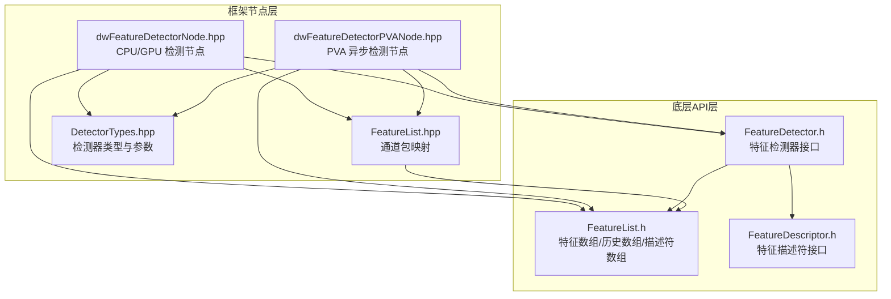
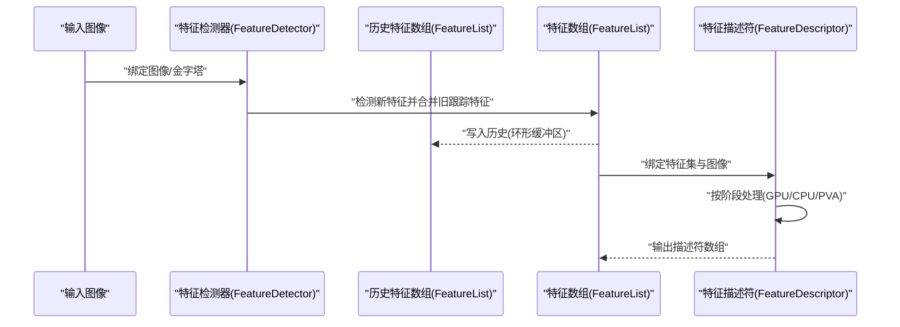
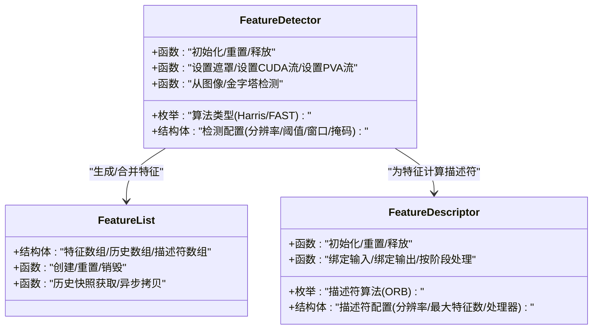
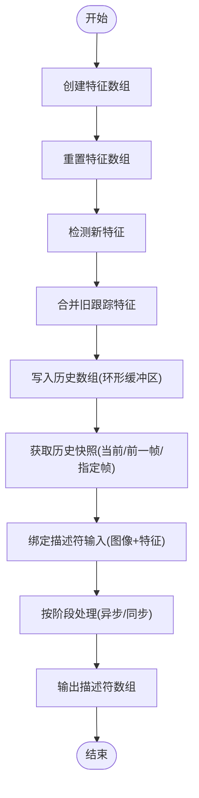
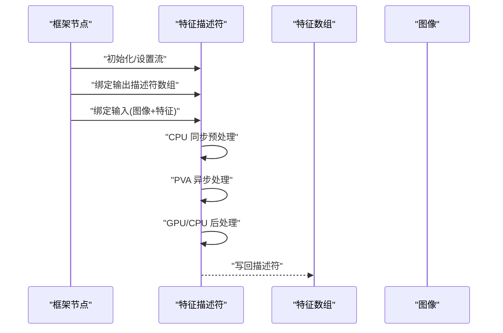
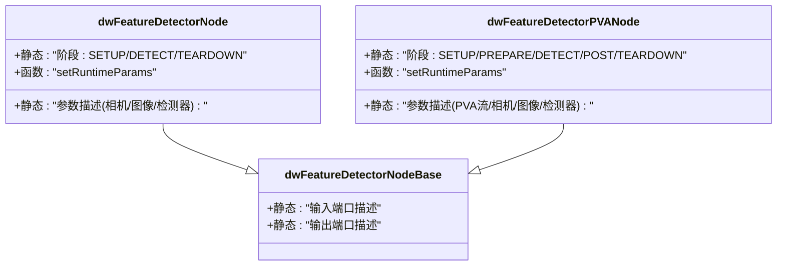
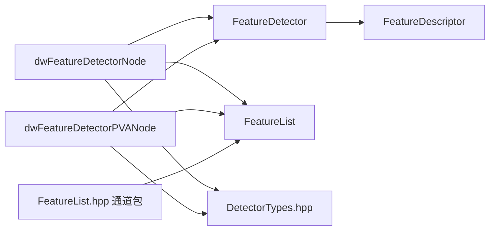

# 特征检测

<cite>
**本文引用的文件**
- [FeatureDetector.h](file://driverorks-5.10/include/dw/imageprocessing/featuredetector/FeatureDetector.h)
- [FeatureList.h](file://driverorks-5.10/include/dw/imageprocessing/features/FeatureList.h)
- [FeatureDescriptor.h](file://driverorks-5.10/include/dw/imageprocessing/featuredetector/descriptor/FeatureDescriptor.h)
- [dwFeatureDetectorNode.hpp](file://driverorks-5.10/include/dwframework/dwnodes/imageprocessing/dwfeaturedetectornode/dwFeatureDetectorNode.hpp)
- [dwFeatureDetectorPVANode.hpp](file://driverorks-5.10/include/dwframework/dwnodes/imageprocessing/dwfeaturedetectornode/dwFeatureDetectorPVANode.hpp)
- [FeatureList.hpp](file://driverorks-5.10/include/dwframework/dwnodes/common/channelpackets/FeatureList.hpp)
- [DetectorTypes.hpp](file://driverorks-5.10/include/dwframework/dwnodes/common/DetectorTypes.hpp)
</cite>

## 目录
1. [简介](#简介)
2. [项目结构](#项目结构)
3. [核心组件](#核心组件)
4. [架构总览](#架构总览)
5. [详细组件分析](#详细组件分析)
6. [依赖关系分析](#依赖关系分析)
7. [性能考虑](#性能考虑)
8. [故障排查指南](#故障排查指南)
9. [结论](#结论)
10. [附录：API 参考与示例路径](#附录api-参考与示例路径)

## 简介
本技术文档围绕 DriveWorks 的特征检测与特征列表管理能力展开，系统性介绍以下内容：
- 特征检测：涵盖角点（Harris、FAST）、边缘与兴趣点检测的算法族与参数配置
- 特征列表管理：特征数组、历史特征数组、描述符数组的数据结构与生命周期管理
- 特征描述符：当前支持的 ORB 描述符及其分阶段处理流程
- 节点封装：框架层节点对底层检测器与描述符的封装与管线集成
- 性能优化与算法选择：针对不同硬件（GPU/PVA）与场景的参数与流程建议

## 项目结构
本模块位于驱动orks-5.10版本的 include/dw 与 include/dwframework 子目录中，按“底层API + 框架节点封装”的层次组织：
- 底层API层：特征检测器、特征列表、特征描述符的 C 接口定义
- 框架节点层：面向 CGF 的节点封装，负责参数描述、端口绑定与执行阶段划分

**图示来源**
- [FeatureDetector.h:38-483](file://driverorks-5.10/include/dw/imageprocessing/featuredetector/FeatureDetector.h#L38-L483)
- [FeatureList.h:38-447](file://driverorks-5.10/include/dw/imageprocessing/features/FeatureList.h#L38-L447)
- [FeatureDescriptor.h:38-307](file://driverorks-5.10/include/dw/imageprocessing/featuredetector/descriptor/FeatureDescriptor.h#L38-L307)
- [dwFeatureDetectorNode.hpp:31-160](file://driverorks-5.10/include/dwframework/dwnodes/imageprocessing/dwfeaturedetectornode/dwFeatureDetectorNode.hpp#L31-L160)
- [dwFeatureDetectorPVANode.hpp:31-119](file://driverorks-5.10/include/dwframework/dwnodes/imageprocessing/dwfeaturedetectornode/dwFeatureDetectorPVANode.hpp#L31-L119)
- [FeatureList.hpp:31-43](file://driverorks-5.10/include/dwframework/dwnodes/common/channelpackets/FeatureList.hpp#L31-L43)
- [DetectorTypes.hpp:31-71](file://driverorks-5.10/include/dwframework/dwnodes/common/DetectorTypes.hpp#L31-L71)

**章节来源**
- [FeatureDetector.h:38-483](file://driverorks-5.10/include/dw/imageprocessing/featuredetector/FeatureDetector.h#L38-L483)
- [FeatureList.h:38-447](file://driverorks-5.10/include/dw/imageprocessing/features/FeatureList.h#L38-L447)
- [FeatureDescriptor.h:38-307](file://driverorks-5.10/include/dw/imageprocessing/featuredetector/descriptor/FeatureDescriptor.h#L38-L307)
- [dwFeatureDetectorNode.hpp:31-160](file://driverorks-5.10/include/dwframework/dwnodes/imageprocessing/dwfeaturedetectornode/dwFeatureDetectorNode.hpp#L31-L160)
- [dwFeatureDetectorPVANode.hpp:31-119](file://driverorks-5.10/include/dwframework/dwnodes/imageprocessing/dwfeaturedetectornode/dwFeatureDetectorPVANode.hpp#L31-L119)
- [FeatureList.hpp:31-43](file://driverorks-5.10/include/dwframework/dwnodes/common/channelpackets/FeatureList.hpp#L31-L43)
- [DetectorTypes.hpp:31-71](file://driverorks-5.10/include/dwframework/dwnodes/common/DetectorTypes.hpp#L31-L71)

## 核心组件
- 特征检测器（FeatureDetector）
  - 支持算法族：标准 Harris、扩展 Harris、FAST9
  - 关键参数：图像尺寸、最大特征数、Harris K、cellSize、梯度/块窗口大小、分数阈值、NMS半径、分布掩码类型与高斯中心/方差、半精度开关、遮罩调整开关、处理器类型（CPU/GPU/PVA）
  - 生命周期：初始化、重置、释放；可设置 CUDA/PVA 流
  - 输入输出：从图像或金字塔检测新特征，合并旧跟踪特征，支持 NCC 分数输入
- 特征列表（FeatureList）
  - 数据结构：特征数组（locations、statuses、ages、scales、ids、newToOldMap、featureCount、validTrackedCount）、历史特征数组（ringbuffer式位置历史、时间索引、容量）
  - 生命周期：创建、重置、销毁；支持异步深拷贝；历史快照获取（当前/前一帧/指定历史帧）
  - 描述符数组：描述符维度、数据类型、内存类型、异步/同步拷贝
- 特征描述符（FeatureDescriptor）
  - 当前支持：ORB 描述符
  - 处理阶段：GPU 异步、CPU 同步预处理、PVA 异步、CPU 后处理、GPU 后处理
  - 绑定与处理：绑定输入图像与特征集，绑定输出描述符数组，按阶段执行

**章节来源**
- [FeatureDetector.h:68-247](file://driverorks-5.10/include/dw/imageprocessing/featuredetector/FeatureDetector.h#L68-L247)
- [FeatureList.h:115-173](file://driverorks-5.10/include/dw/imageprocessing/features/FeatureList.h#L115-L173)
- [FeatureDescriptor.h:75-138](file://driverorks-5.10/include/dw/imageprocessing/featuredetector/descriptor/FeatureDescriptor.h#L75-L138)

## 架构总览
下图展示从图像到特征检测、特征管理与描述符计算的整体流程，以及框架节点如何组织这些模块。

**图示来源**
- [FeatureDetector.h:374-413](file://driverorks-5.10/include/dw/imageprocessing/featuredetector/FeatureDetector.h#L374-L413)
- [FeatureList.h:286-336](file://driverorks-5.10/include/dw/imageprocessing/features/FeatureList.h#L286-L336)
- [FeatureDescriptor.h:256-273](file://driverorks-5.10/include/dw/imageprocessing/featuredetector/descriptor/FeatureDescriptor.h#L256-L273)

## 详细组件分析

### 组件A：特征检测器（FeatureDetector）
- 功能要点
  - 算法族与适用场景：STD/Harris（快速）、EX/Harris（灵活高质量）、FAST9（更快）
  - 参数体系：分辨率、最大特征数、Harris K、cellSize、梯度/块窗口、分数阈值、NMS半径、分布掩码（均匀/高斯）、高斯中心与方差、半精度、遮罩调整、处理器类型
  - 生命周期与流：初始化/重置/释放；CUDA/PVA 流设置与查询
  - 输入输出：从图像或金字塔检测，合并旧跟踪特征；支持 NCC 分数作为输入
- 关键API路径
  - 初始化与默认参数：[dwFeature2DDetector_initDefaultParams:258-275](file://driverorks-5.10/include/dw/imageprocessing/featuredetector/FeatureDetector.h#L258-L275)
  - 创建与释放：[dwFeature2DDetector_initialize:288-292](file://driverorks-5.10/include/dw/imageprocessing/featuredetector/FeatureDetector.h#L288-L292)，[dwFeature2DDetector_release:317-318](file://driverorks-5.10/include/dw/imageprocessing/featuredetector/FeatureDetector.h#L317-L318)
  - 设置遮罩与流：[dwFeature2DDetector_setMask:337-342](file://driverorks-5.10/include/dw/imageprocessing/featuredetector/FeatureDetector.h#L337-L342)，[dwFeature2DDetector_setCUDAStream:437-438](file://driverorks-5.10/include/dw/imageprocessing/featuredetector/FeatureDetector.h#L437-L438)
  - 检测接口：[dwFeature2DDetector_detectFromImage:374-378](file://driverorks-5.10/include/dw/imageprocessing/featuredetector/FeatureDetector.h#L374-L378)，[dwFeature2DDetector_detectFromPyramid:409-413](file://driverorks-5.10/include/dw/imageprocessing/featuredetector/FeatureDetector.h#L409-L413)

**图示来源**
- [FeatureDetector.h:68-247](file://driverorks-5.10/include/dw/imageprocessing/featuredetector/FeatureDetector.h#L68-L247)
- [FeatureList.h:115-173](file://driverorks-5.10/include/dw/imageprocessing/features/FeatureList.h#L115-L173)
- [FeatureDescriptor.h:75-138](file://driverorks-5.10/include/dw/imageprocessing/featuredetector/descriptor/FeatureDescriptor.h#L75-L138)

**章节来源**
- [FeatureDetector.h:68-247](file://driverorks-5.10/include/dw/imageprocessing/featuredetector/FeatureDetector.h#L68-L247)
- [FeatureDetector.h:258-476](file://driverorks-5.10/include/dw/imageprocessing/featuredetector/FeatureDetector.h#L258-L476)

### 组件B：特征列表管理（FeatureList）
- 数据模型
  - 特征数组：locations、statuses、ages、scales、ids、newToOldMap、featureCount、validTrackedCount、timeIdx、maxFeatures、memoryType
  - 历史特征数组：statuses、ages、scales、ids、newToOldMap、locationHistory（列主序环形缓冲区）、currentTimeIdx、maxHistory、maxFeatures、data、bytes、memoryType
  - 描述符数组：statuses、locations、ids、descriptors、dataType、dimension、maxFeatures、data、bytes、memoryType
- 生命周期与操作
  - 创建/销毁/重置：[dwFeatureArray_create:191-194](file://driverorks-5.10/include/dw/imageprocessing/features/FeatureList.h#L191-L194)，[dwFeatureArray_destroy:207-208](file://driverorks-5.10/include/dw/imageprocessing/features/FeatureList.h#L207-L208)，[dwFeatureArray_reset:220-222](file://driverorks-5.10/include/dw/imageprocessing/features/FeatureList.h#L220-L222)
  - 历史快照与拷贝：[dwFeatureHistoryArray_getCurrent:297-298](file://driverorks-5.10/include/dw/imageprocessing/features/FeatureList.h#L297-L298)，[dwFeatureHistoryArray_getPrevious:315-316](file://driverorks-5.10/include/dw/imageprocessing/features/FeatureList.h#L315-L316)，[dwFeatureHistoryArray_get:334-336](file://driverorks-5.10/include/dw/imageprocessing/features/FeatureList.h#L334-L336)，[dwFeatureHistoryArray_copyAsync:350-352](file://driverorks-5.10/include/dw/imageprocessing/features/FeatureList.h#L350-L352)
  - 描述符数组：[dwFeatureDescriptorArray_create:393-398](file://driverorks-5.10/include/dw/imageprocessing/features/FeatureList.h#L393-L398)，[dwFeatureDescriptorArray_copyAsync:425-427](file://driverorks-5.10/include/dw/imageprocessing/features/FeatureList.h#L425-L427)，[dwFeatureDescriptorArray_copy:439-440](file://driverorks-5.10/include/dw/imageprocessing/features/FeatureList.h#L439-L440)

**图示来源**
- [FeatureList.h:191-336](file://driverorks-5.10/include/dw/imageprocessing/features/FeatureList.h#L191-L336)
- [FeatureDescriptor.h:256-273](file://driverorks-5.10/include/dw/imageprocessing/featuredetector/descriptor/FeatureDescriptor.h#L256-L273)

**章节来源**
- [FeatureList.h:115-173](file://driverorks-5.10/include/dw/imageprocessing/features/FeatureList.h#L115-L173)
- [FeatureList.h:191-352](file://driverorks-5.10/include/dw/imageprocessing/features/FeatureList.h#L191-L352)
- [FeatureList.h:377-440](file://driverorks-5.10/include/dw/imageprocessing/features/FeatureList.h#L377-L440)

### 组件C：特征描述符（FeatureDescriptor）
- 算法与阶段
  - 算法：ORB（当前支持）
  - 阶段：GPU 异步、CPU 同步预处理、PVA 异步、CPU 后处理、GPU 后处理
- 关键API路径
  - 默认参数与初始化：[dwFeature2DDescriptor_initDefaultParams:146-147](file://driverorks-5.10/include/dw/imageprocessing/featuredetector/descriptor/FeatureDescriptor.h#L146-L147)，[dwFeature2DDescriptor_initialize:163-166](file://driverorks-5.10/include/dw/imageprocessing/featuredetector/descriptor/FeatureDescriptor.h#L163-L166)
  - 绑定与处理：[dwFeature2DDescriptor_bindBuffers:256-258](file://driverorks-5.10/include/dw/imageprocessing/featuredetector/descriptor/FeatureDescriptor.h#L256-L258)，[dwFeature2DDescriptor_bindOutput:239-240](file://driverorks-5.10/include/dw/imageprocessing/featuredetector/descriptor/FeatureDescriptor.h#L239-L240)，[dwFeature2DDescriptor_processImage:272-273](file://driverorks-5.10/include/dw/imageprocessing/featuredetector/descriptor/FeatureDescriptor.h#L272-L273)
  - 流管理：[dwFeature2DDescriptor_setCUDAStream:208-209](file://driverorks-5.10/include/dw/imageprocessing/featuredetector/descriptor/FeatureDescriptor.h#L208-L209)，[dwFeature2DDescriptor_setPVAStream:287-288](file://driverorks-5.10/include/dw/imageprocessing/featuredetector/descriptor/FeatureDescriptor.h#L287-L288)

**图示来源**
- [FeatureDescriptor.h:146-301](file://driverorks-5.10/include/dw/imageprocessing/featuredetector/descriptor/FeatureDescriptor.h#L146-L301)
- [dwFeatureDetectorNode.hpp:95-155](file://driverorks-5.10/include/dwframework/dwnodes/imageprocessing/dwfeaturedetectornode/dwFeatureDetectorNode.hpp#L95-L155)

**章节来源**
- [FeatureDescriptor.h:75-138](file://driverorks-5.10/include/dw/imageprocessing/featuredetector/descriptor/FeatureDescriptor.h#L75-L138)
- [FeatureDescriptor.h:146-301](file://driverorks-5.10/include/dw/imageprocessing/featuredetector/descriptor/FeatureDescriptor.h#L146-L301)

### 组件D：框架节点封装（dwFeatureDetectorNode / dwFeatureDetectorPVANode）
- 节点职责
  - 参数描述：相机内外参、图像宽高、最大特征数、检测器类型、PVA/CUDA 流索引等
  - 端口描述：输入（金字塔、预测特征历史、NCC 分数），输出（GPU 特征数组）
  - 执行阶段：SETUP → DETECT_NEW_FEATURE → TEARDOWN（CPU/GPU），或增加 PREPARE_DATA/POST_PROCESS（PVA）
- 关键API路径
  - 参数描述：[describeParameters:105-148](file://driverorks-5.10/include/dwframework/dwnodes/imageprocessing/dwfeaturedetectornode/dwFeatureDetectorNode.hpp#L105-L148)
  - PVA 节点参数描述：[describeParameters:59-107](file://driverorks-5.10/include/dwframework/dwnodes/imageprocessing/dwfeaturedetectornode/dwFeatureDetectorPVANode.hpp#L59-L107)
  - 运行时参数设置：[setRuntimeParams:154-155](file://driverorks-5.10/include/dwframework/dwnodes/imageprocessing/dwfeaturedetectornode/dwFeatureDetectorNode.hpp#L154-L155)，[setRuntimeParams:113-114](file://driverorks-5.10/include/dwframework/dwnodes/imageprocessing/dwfeaturedetectornode/dwFeatureDetectorPVANode.hpp#L113-L114)

**图示来源**
- [dwFeatureDetectorNode.hpp:70-155](file://driverorks-5.10/include/dwframework/dwnodes/imageprocessing/dwfeaturedetectornode/dwFeatureDetectorNode.hpp#L70-L155)
- [dwFeatureDetectorPVANode.hpp:41-114](file://driverorks-5.10/include/dwframework/dwnodes/imageprocessing/dwfeaturedetectornode/dwFeatureDetectorPVANode.hpp#L41-L114)

**章节来源**
- [dwFeatureDetectorNode.hpp:70-155](file://driverorks-5.10/include/dwframework/dwnodes/imageprocessing/dwfeaturedetectornode/dwFeatureDetectorNode.hpp#L70-L155)
- [dwFeatureDetectorPVANode.hpp:41-114](file://driverorks-5.10/include/dwframework/dwnodes/imageprocessing/dwfeaturedetectornode/dwFeatureDetectorPVANode.hpp#L41-L114)

## 依赖关系分析
- 模块耦合
  - 框架节点依赖底层检测器与特征列表；检测器依赖图像与金字塔；描述符依赖检测器输出与图像
  - 通道包映射将底层类型与框架包关联，便于在 CGF 中传递
- 外部依赖
  - CUDA/PVA 流用于异步处理；上下文句柄贯穿创建与生命周期管理
- 潜在循环依赖
  - 无直接循环；通过句柄与指针进行单向依赖

**图示来源**
- [dwFeatureDetectorNode.hpp:34-44](file://driverorks-5.10/include/dwframework/dwnodes/imageprocessing/dwfeaturedetectornode/dwFeatureDetectorNode.hpp#L34-L44)
- [dwFeatureDetectorPVANode.hpp:34-34](file://driverorks-5.10/include/dwframework/dwnodes/imageprocessing/dwfeaturedetectornode/dwFeatureDetectorPVANode.hpp#L34-L34)
- [FeatureList.hpp:39-40](file://driverorks-5.10/include/dwframework/dwnodes/common/channelpackets/FeatureList.hpp#L39-L40)
- [DetectorTypes.hpp:42-66](file://driverorks-5.10/include/dwframework/dwnodes/common/DetectorTypes.hpp#L42-L66)

**章节来源**
- [FeatureList.hpp:39-40](file://driverorks-5.10/include/dwframework/dwnodes/common/channelpackets/FeatureList.hpp#L39-L40)
- [DetectorTypes.hpp:42-66](file://driverorks-5.10/include/dwframework/dwnodes/common/DetectorTypes.hpp#L42-L66)

## 性能考虑
- 算法选择
  - 快速场景优先：STD/Harris（固定参数）或 FAST9（更快）
  - 高质量场景：EX/Harris（可配置cellSize、NMS半径、分布掩码）
- 参数调优
  - maxFeatureCount ≥ ceil(图像宽/cellSize) × ceil(图像高/cellSize)（EX模式）
  - scoreThreshold 控制特征密度；NMSRadius 影响非极大值抑制强度
  - 遮罩区域（mask）仅在有效区域（mask=0xFF）内产生新特征，减少无效区域计算
- 并行与流水线
  - GPU 异步检测与描述符处理；PVA 异步加速（FAST/Harris/ORB）
  - CUDA/PVA 流分离，避免阻塞
- 内存与拷贝
  - 使用 GPU 内存的特征数组与描述符数组以降低拷贝开销
  - 异步拷贝需配合流同步确保可见性

[本节为通用性能建议，不直接分析具体文件]

## 故障排查指南
- 常见错误与定位
  - 参数非法：检查图像宽高、最大特征数、cellSize 等是否满足约束
  - CUDA/PVA 流未正确设置：确认 setCUDAStream/setPVAStream 已调用且句柄有效
  - 绑定问题：描述符需先 bindOutput，再 bindBuffers；检测器需绑定图像/金字塔与预跟踪特征
  - 内存类型不匹配：特征数组/描述符数组需与处理器类型一致（GPU/CPU/粘滞内存）
- 定位路径
  - 检测器初始化/释放与流设置：[dwFeature2DDetector_initialize:288-292](file://driverorks-5.10/include/dw/imageprocessing/featuredetector/FeatureDetector.h#L288-L292)，[dwFeature2DDetector_setCUDAStream:437-438](file://driverorks-5.10/include/dw/imageprocessing/featuredetector/FeatureDetector.h#L437-L438)，[dwFeature2DDetector_release:317-318](file://driverorks-5.10/include/dw/imageprocessing/featuredetector/FeatureDetector.h#L317-L318)
  - 描述符绑定与处理：[dwFeature2DDescriptor_bindOutput:239-240](file://driverorks-5.10/include/dw/imageprocessing/featuredetector/descriptor/FeatureDescriptor.h#L239-L240)，[dwFeature2DDescriptor_bindBuffers:256-258](file://driverorks-5.10/include/dw/imageprocessing/featuredetector/descriptor/FeatureDescriptor.h#L256-L258)，[dwFeature2DDescriptor_processImage:272-273](file://driverorks-5.10/include/dw/imageprocessing/featuredetector/descriptor/FeatureDescriptor.h#L272-L273)
  - 特征数组/历史数组生命周期：[dwFeatureArray_create:191-194](file://driverorks-5.10/include/dw/imageprocessing/features/FeatureList.h#L191-L194)，[dwFeatureArray_destroy:207-208](file://driverorks-5.10/include/dw/imageprocessing/features/FeatureList.h#L207-L208)，[dwFeatureHistoryArray_create:254-258](file://driverorks-5.10/include/dw/imageprocessing/features/FeatureList.h#L254-L258)，[dwFeatureHistoryArray_destroy:268-269](file://driverorks-5.10/include/dw/imageprocessing/features/FeatureList.h#L268-L269)

**章节来源**
- [FeatureDetector.h:288-318](file://driverorks-5.10/include/dw/imageprocessing/featuredetector/FeatureDetector.h#L288-L318)
- [FeatureDescriptor.h:163-194](file://driverorks-5.10/include/dw/imageprocessing/featuredetector/descriptor/FeatureDescriptor.h#L163-L194)
- [FeatureList.h:191-208](file://driverorks-5.10/include/dw/imageprocessing/features/FeatureList.h#L191-L208)
- [FeatureList.h:254-269](file://driverorks-5.10/include/dw/imageprocessing/features/FeatureList.h#L254-L269)

## 结论
本模块提供了从底层特征检测、特征管理到特征描述符计算的完整链路，并通过框架节点实现与 CGF 的无缝集成。通过合理选择算法与参数、利用异步流水线与硬件加速（GPU/PVA），可在保证质量的同时获得良好性能。建议在实际部署中结合具体传感器与平台特性进行参数微调与流配置。

[本节为总结性内容，不直接分析具体文件]

## 附录：API 参考与示例路径
- 特征检测器
  - 初始化与默认参数：[dwFeature2DDetector_initDefaultParams:258-275](file://driverorks-5.10/include/dw/imageprocessing/featuredetector/FeatureDetector.h#L258-L275)
  - 创建/重置/释放：[dwFeature2DDetector_initialize:288-292](file://driverorks-5.10/include/dw/imageprocessing/featuredetector/FeatureDetector.h#L288-L292)，[dwFeature2DDetector_reset:302-303](file://driverorks-5.10/include/dw/imageprocessing/featuredetector/FeatureDetector.h#L302-L303)，[dwFeature2DDetector_release:317-318](file://driverorks-5.10/include/dw/imageprocessing/featuredetector/FeatureDetector.h#L317-L318)
  - 设置遮罩与流：[dwFeature2DDetector_setMask:337-342](file://driverorks-5.10/include/dw/imageprocessing/featuredetector/FeatureDetector.h#L337-L342)，[dwFeature2DDetector_setCUDAStream:437-438](file://driverorks-5.10/include/dw/imageprocessing/featuredetector/FeatureDetector.h#L437-L438)，[dwFeature2DDetector_setPVAStream:463-464](file://driverorks-5.10/include/dw/imageprocessing/featuredetector/FeatureDetector.h#L463-L464)
  - 检测接口：[dwFeature2DDetector_detectFromImage:374-378](file://driverorks-5.10/include/dw/imageprocessing/featuredetector/FeatureDetector.h#L374-L378)，[dwFeature2DDetector_detectFromPyramid:409-413](file://driverorks-5.10/include/dw/imageprocessing/featuredetector/FeatureDetector.h#L409-L413)
- 特征列表
  - 特征数组：创建/销毁/重置/拷贝：[dwFeatureArray_create:191-194](file://driverorks-5.10/include/dw/imageprocessing/features/FeatureList.h#L191-L194)，[dwFeatureArray_destroy:207-208](file://driverorks-5.10/include/dw/imageprocessing/features/FeatureList.h#L207-L208)，[dwFeatureArray_reset:220-222](file://driverorks-5.10/include/dw/imageprocessing/features/FeatureList.h#L220-L222)，[dwFeatureArray_copyAsync:235-237](file://driverorks-5.10/include/dw/imageprocessing/features/FeatureList.h#L235-L237)
  - 历史数组：创建/销毁/重置/拷贝/快照：[dwFeatureHistoryArray_create:254-258](file://driverorks-5.10/include/dw/imageprocessing/features/FeatureList.h#L254-L258)，[dwFeatureHistoryArray_destroy:268-269](file://driverorks-5.10/include/dw/imageprocessing/features/FeatureList.h#L268-L269)，[dwFeatureHistoryArray_reset:282-283](file://driverorks-5.10/include/dw/imageprocessing/features/FeatureList.h#L282-L283)，[dwFeatureHistoryArray_copyAsync:350-352](file://driverorks-5.10/include/dw/imageprocessing/features/FeatureList.h#L350-L352)，[dwFeatureHistoryArray_getCurrent:297-298](file://driverorks-5.10/include/dw/imageprocessing/features/FeatureList.h#L297-L298)，[dwFeatureHistoryArray_getPrevious:315-316](file://driverorks-5.10/include/dw/imageprocessing/features/FeatureList.h#L315-L316)，[dwFeatureHistoryArray_get:334-336](file://driverorks-5.10/include/dw/imageprocessing/features/FeatureList.h#L334-L336)
  - 描述符数组：创建/销毁/拷贝：[dwFeatureDescriptorArray_create:393-398](file://driverorks-5.10/include/dw/imageprocessing/features/FeatureList.h#L393-L398)，[dwFeatureDescriptorArray_destroy:408-409](file://driverorks-5.10/include/dw/imageprocessing/features/FeatureList.h#L408-L409)，[dwFeatureDescriptorArray_copyAsync:425-427](file://driverorks-5.10/include/dw/imageprocessing/features/FeatureList.h#L425-L427)，[dwFeatureDescriptorArray_copy:439-440](file://driverorks-5.10/include/dw/imageprocessing/features/FeatureList.h#L439-L440)
- 特征描述符
  - 默认参数与初始化：[dwFeature2DDescriptor_initDefaultParams:146-147](file://driverorks-5.10/include/dw/imageprocessing/featuredetector/descriptor/FeatureDescriptor.h#L146-L147)，[dwFeature2DDescriptor_initialize:163-166](file://driverorks-5.10/include/dw/imageprocessing/featuredetector/descriptor/FeatureDescriptor.h#L163-L166)
  - 绑定与处理：[dwFeature2DDescriptor_bindOutput:239-240](file://driverorks-5.10/include/dw/imageprocessing/featuredetector/descriptor/FeatureDescriptor.h#L239-L240)，[dwFeature2DDescriptor_bindBuffers:256-258](file://driverorks-5.10/include/dw/imageprocessing/featuredetector/descriptor/FeatureDescriptor.h#L256-L258)，[dwFeature2DDescriptor_processImage:272-273](file://driverorks-5.10/include/dw/imageprocessing/featuredetector/descriptor/FeatureDescriptor.h#L272-L273)
  - 流管理：[dwFeature2DDescriptor_setCUDAStream:208-209](file://driverorks-5.10/include/dw/imageprocessing/featuredetector/descriptor/FeatureDescriptor.h#L208-L209)，[dwFeature2DDescriptor_setPVAStream:287-288](file://driverorks-5.10/include/dw/imageprocessing/featuredetector/descriptor/FeatureDescriptor.h#L287-L288)
- 框架节点
  - 参数描述与运行时设置：[dwFeatureDetectorNode::describeParameters:105-148](file://driverorks-5.10/include/dwframework/dwnodes/imageprocessing/dwfeaturedetectornode/dwFeatureDetectorNode.hpp#L105-L148)，[dwFeatureDetectorNode::setRuntimeParams:154-155](file://driverorks-5.10/include/dwframework/dwnodes/imageprocessing/dwfeaturedetectornode/dwFeatureDetectorNode.hpp#L154-L155)
  - PVA 节点参数描述与运行时设置：[dwFeatureDetectorPVANode::describeParameters:59-107](file://driverorks-5.10/include/dwframework/dwnodes/imageprocessing/dwfeaturedetectornode/dwFeatureDetectorPVANode.hpp#L59-L107)，[dwFeatureDetectorPVANode::setRuntimeParams:113-114](file://driverorks-5.10/include/dwframework/dwnodes/imageprocessing/dwfeaturedetectornode/dwFeatureDetectorPVANode.hpp#L113-L114)

**章节来源**
- [FeatureDetector.h:258-476](file://driverorks-5.10/include/dw/imageprocessing/featuredetector/FeatureDetector.h#L258-L476)
- [FeatureList.h:191-440](file://driverorks-5.10/include/dw/imageprocessing/features/FeatureList.h#L191-L440)
- [FeatureDescriptor.h:146-301](file://driverorks-5.10/include/dw/imageprocessing/featuredetector/descriptor/FeatureDescriptor.h#L146-L301)
- [dwFeatureDetectorNode.hpp:105-155](file://driverorks-5.10/include/dwframework/dwnodes/imageprocessing/dwfeaturedetectornode/dwFeatureDetectorNode.hpp#L105-L155)
- [dwFeatureDetectorPVANode.hpp:59-114](file://driverorks-5.10/include/dwframework/dwnodes/imageprocessing/dwfeaturedetectornode/dwFeatureDetectorPVANode.hpp#L59-L114)