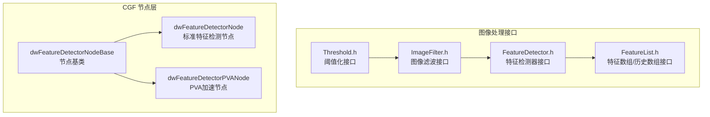
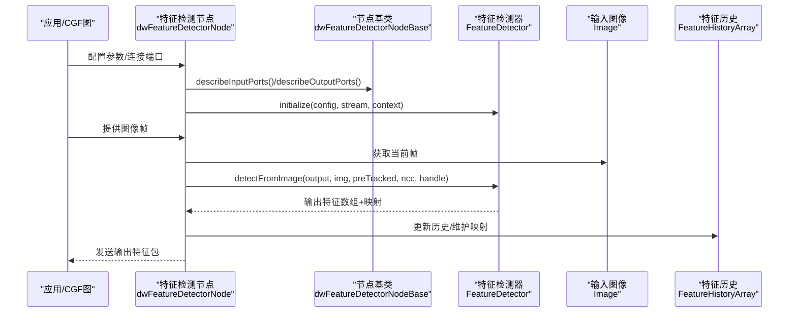
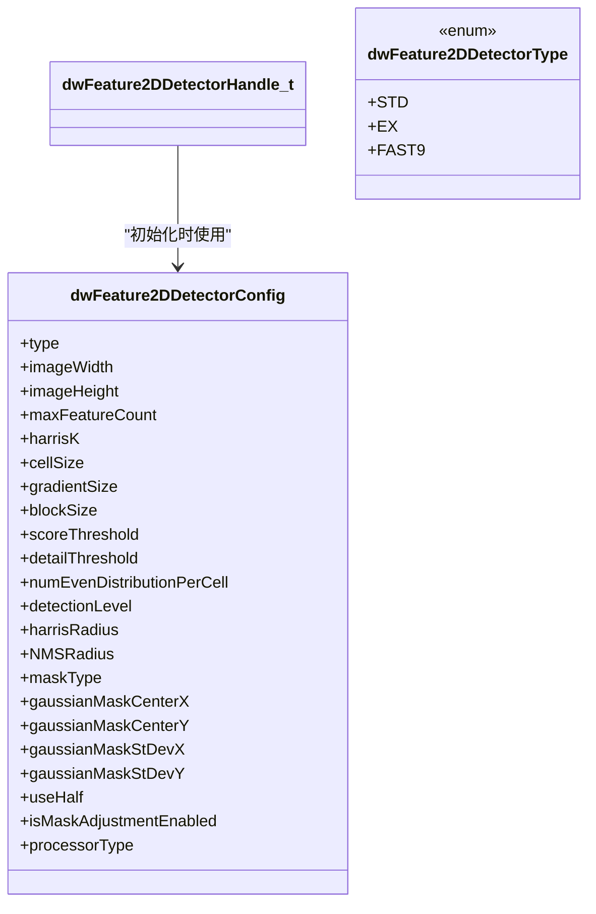
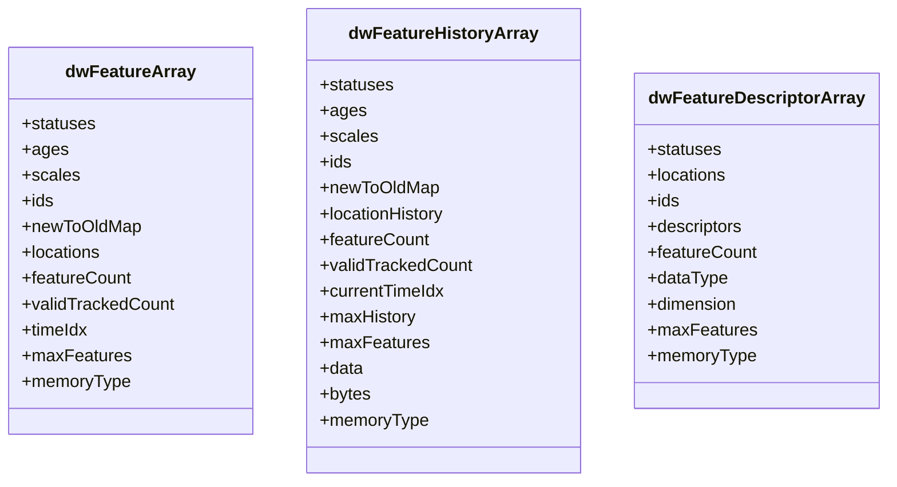
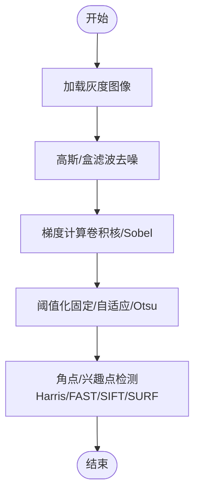
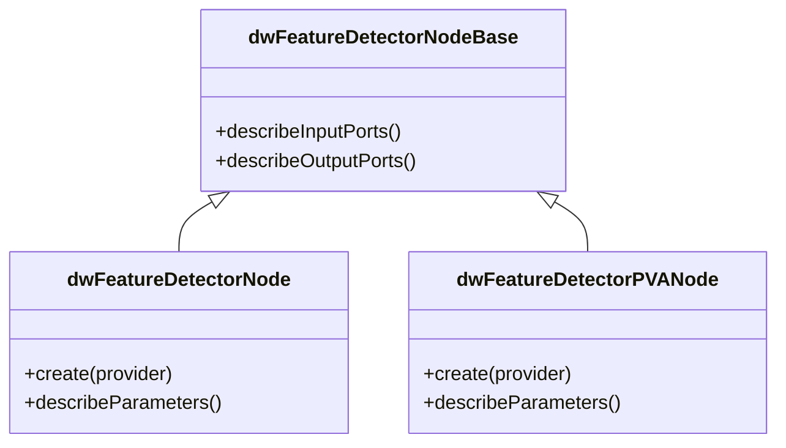
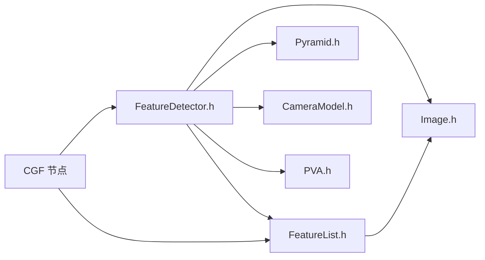

# 特征检测器核心

<cite>
**本文引用的文件**
- [FeatureDetector.h](file://driverorks-5.10/include/dw/imageprocessing/featuredetector/FeatureDetector.h)
- [FeatureList.h](file://driverorks-5.10/include/dw/imageprocessing/features/FeatureList.h)
- [ImageFilter.h](file://driverorks-5.10/include/dw/imageprocessing/filtering/ImageFilter.h)
- [Threshold.h](file://driverorks-5.10/include/dw/imageprocessing/filtering/Threshold.h)
- [FeatureDetector.h（5.14）](file://driveworks-5.14/include/dw/imageprocessing/features/FeatureDetector.h)
- [FeatureDetectorNode 类](file://driverorks-5.10/doc/nvcgf_html/classdw_1_1framework_1_1dwFeatureDetectorNode.html)
- [FeatureDetectorNodeBase 类](file://driverorks-5.10/doc/nvcgf_html/classdw_1_1framework_1_1dwFeatureDetectorNodeBase.html)
- [FeatureDetectorPVANode 类](file://driverorks-5.10/doc/nvcgf_html/classdw_1_1framework_1_1dwFeatureDetectorPVANode.html)
</cite>

## 目录
1. [引言](#引言)
2. [项目结构](#项目结构)
3. [核心组件](#核心组件)
4. [架构总览](#架构总览)
5. [详细组件分析](#详细组件分析)
6. [依赖关系分析](#依赖关系分析)
7. [性能考量](#性能考量)
8. [故障排查指南](#故障排查指南)
9. [结论](#结论)
10. [附录](#附录)

## 引言
本技术文档聚焦于 NVIDIA DriveWorks 图像处理子系统中的“特征检测器核心”模块，系统性阐述特征检测接口与数据结构，覆盖角点检测（Harris 角点、Shi-Tomasi 角点）、边缘检测（Canny/Sobel 的间接支持路径）、兴趣点检测（FAST、SIFT/SURF 的可用性说明），并给出参数配置、质量评估与优化策略、典型使用流程与性能对比建议。文档同时结合 CGF 节点层的特征检测节点类，帮助读者从系统集成角度理解端到端工作流。

## 项目结构
围绕特征检测器核心，相关代码主要分布在以下位置：
- 接口定义：图像处理特征检测与特征数组接口
- 辅助模块：图像滤波与阈值化（用于边缘/梯度预处理）
- CGF 节点：特征检测器节点族（标准、基类、PVA 加速）

图表来源
- [FeatureDetector.h:1-483](file://driverorks-5.10/include/dw/imageprocessing/featuredetector/FeatureDetector.h#L1-L483)
- [FeatureList.h:1-447](file://driverorks-5.10/include/dw/imageprocessing/features/FeatureList.h#L1-L447)
- [ImageFilter.h:1-190](file://driverorks-5.10/include/dw/imageprocessing/filtering/ImageFilter.h#L1-L190)
- [Threshold.h:1-187](file://driverorks-5.10/include/dw/imageprocessing/filtering/Threshold.h#L1-L187)
- [FeatureDetectorNode 类](file://driverorks-5.10/doc/nvcgf_html/classdw_1_1framework_1_1dwFeatureDetectorNode.html)
- [FeatureDetectorNodeBase 类](file://driverorks-5.10/doc/nvcgf_html/classdw_1_1framework_1_1dwFeatureDetectorNodeBase.html)
- [FeatureDetectorPVANode 类](file://driverorks-5.10/doc/nvcgf_html/classdw_1_1framework_1_1dwFeatureDetectorPVANode.html)

章节来源
- [FeatureDetector.h:1-483](file://driverorks-5.10/include/dw/imageprocessing/featuredetector/FeatureDetector.h#L1-L483)
- [FeatureList.h:1-447](file://driverorks-5.10/include/dw/imageprocessing/features/FeatureList.h#L1-L447)
- [ImageFilter.h:1-190](file://driverorks-5.10/include/dw/imageprocessing/filtering/ImageFilter.h#L1-L190)
- [Threshold.h:1-187](file://driverorks-5.10/include/dw/imageprocessing/filtering/Threshold.h#L1-L187)
- [FeatureDetectorNode 类](file://driverorks-5.10/doc/nvcgf_html/classdw_1_1framework_1_1dwFeatureDetectorNode.html)
- [FeatureDetectorNodeBase 类](file://driverorks-5.10/doc/nvcgf_html/classdw_1_1framework_1_1dwFeatureDetectorNodeBase.html)
- [FeatureDetectorPVANode 类](file://driverorks-5.10/doc/nvcgf_html/classdw_1_1framework_1_1dwFeatureDetectorPVANode.html)

## 核心组件
- 特征检测器句柄与配置
  - 句柄类型：dwFeature2DDetectorHandle_t
  - 配置结构：dwFeature2DDetectorConfig，包含算法类型、图像尺寸、最大特征数、Harris K、cellSize、PVA 参数、分数阈值、细节阈值、均匀分布/高斯掩膜参数、半精度开关、掩膜调整开关、处理器类型等
- 特征数组与历史数组
  - dwFeatureArray：单帧特征容器（状态、年龄、尺度、ID、位置、映射、计数等）
  - dwFeatureHistoryArray：多帧历史容器（ringbuffer 时间索引、历史容量、状态/年龄/尺度/ID/映射/位置历史等）
  - dwFeatureDescriptorArray：特征描述子数组（描述子维度、数据类型、GPU/CPU/pinned 内存）
- 图像滤波与阈值化
  - ImageFilter：递归高斯、盒滤波、卷积（含可分离核）
  - Threshold：二值/截断/至零阈值、Otsu 自适应、逐像素阈值（配合滤波实现自适应阈值）

章节来源
- [FeatureDetector.h:62-247](file://driverorks-5.10/include/dw/imageprocessing/featuredetector/FeatureDetector.h#L62-L247)
- [FeatureList.h:115-173](file://driverorks-5.10/include/dw/imageprocessing/features/FeatureList.h#L115-L173)
- [ImageFilter.h:80-125](file://driverorks-5.10/include/dw/imageprocessing/filtering/ImageFilter.h#L80-L125)
- [Threshold.h:78-94](file://driverorks-5.10/include/dw/imageprocessing/filtering/Threshold.h#L78-L94)

## 架构总览
特征检测器核心在系统中的位置与交互如下：

图表来源
- [FeatureDetectorNode 类](file://driverorks-5.10/doc/nvcgf_html/classdw_1_1framework_1_1dwFeatureDetectorNode.html)
- [FeatureDetectorNodeBase 类](file://driverorks-5.10/doc/nvcgf_html/classdw_1_1framework_1_1dwFeatureDetectorNodeBase.html)
- [FeatureDetector.h:288-413](file://driverorks-5.10/include/dw/imageprocessing/featuredetector/FeatureDetector.h#L288-L413)
- [FeatureList.h:240-336](file://driverorks-5.10/include/dw/imageprocessing/features/FeatureList.h#L240-L336)

## 详细组件分析

### 组件一：特征检测器接口（FeatureDetector）
- 算法类型
  - 标准 Harris（STD）
  - 扩展 Harris（EX）
  - FAST9（快速角点）
- 关键参数与行为
  - 图像尺寸约束（PVA FAST9）
  - 最大特征数与 cellSize（EX 均匀/高斯分布）
  - Harris K、blockSize、gradientSize（PVA）
  - 分数阈值、细节阈值、均匀分布每 cell 数量（STD）
  - 检测层级（EX）
  - 非极大值抑制半径（NMSRadius）
  - 掩膜类型（均匀/高斯）及中心与标准差
  - 半精度开关、掩膜调整开关
  - 处理器类型（GPU/PVA）
- 核心 API
  - 初始化/重置/释放
  - 设置掩膜（mask）
  - 从图像/金字塔检测新特征，并与旧跟踪特征合并
  - 设置/获取 CUDA/PVA 流

图表来源
- [FeatureDetector.h:101-247](file://driverorks-5.10/include/dw/imageprocessing/featuredetector/FeatureDetector.h#L101-L247)
- [FeatureDetector.h:71-84](file://driverorks-5.10/include/dw/imageprocessing/featuredetector/FeatureDetector.h#L71-L84)

章节来源
- [FeatureDetector.h:62-483](file://driverorks-5.10/include/dw/imageprocessing/featuredetector/FeatureDetector.h#L62-L483)

### 组件二：特征数组与历史数组（FeatureList）
- 数据结构要点
  - dwFeatureArray：locations、statuses、ages、scales、ids、newToOldMap、featureCount、validTrackedCount、timeIdx、maxFeatures、memoryType
  - dwFeatureHistoryArray：locationHistory（列优先存储时间序列）、statuses/ages/scales/ids/newToOldMap、featureCount、validTrackedCount、currentTimeIdx、maxHistory、maxFeatures、data、bytes、memoryType
  - dwFeatureDescriptorArray：描述子数据指针、维度、数据类型、maxFeatures、memoryType
- 生命周期与操作
  - 创建/销毁/重置
  - 历史快照获取（当前/前一帧/指定历史帧）
  - 异步复制（特征数组/历史数组/描述子数组）
  - 合并 newToOldMap（跨阶段映射）

图表来源
- [FeatureList.h:136-173](file://driverorks-5.10/include/dw/imageprocessing/features/FeatureList.h#L136-L173)

章节来源
- [FeatureList.h:115-447](file://driverorks-5.10/include/dw/imageprocessing/features/FeatureList.h#L115-L447)

### 组件三：边缘与梯度预处理（ImageFilter/Threshold）
- 边缘检测的间接支持
  - 通过 ImageFilter 提供卷积/高斯/盒滤波，为后续 Harris/FAST 等提供平滑或梯度增强
  - 通过 Threshold 提供二值化/截断/自适应阈值，可用于边缘二值化或自适应窗口阈值
- 典型流程
  - 输入灰度图 -> 高斯平滑（降低噪声）-> Sobel/Gaussian 梯度 -> 阈值化 -> 角点/兴趣点检测

图表来源
- [ImageFilter.h:80-125](file://driverorks-5.10/include/dw/imageprocessing/filtering/ImageFilter.h#L80-L125)
- [Threshold.h:78-94](file://driverorks-5.10/include/dw/imageprocessing/filtering/Threshold.h#L78-L94)
- [FeatureDetector.h:71-84](file://driverorks-5.10/include/dw/imageprocessing/featuredetector/FeatureDetector.h#L71-L84)

章节来源
- [ImageFilter.h:1-190](file://driverorks-5.10/include/dw/imageprocessing/filtering/ImageFilter.h#L1-L190)
- [Threshold.h:1-187](file://driverorks-5.10/include/dw/imageprocessing/filtering/Threshold.h#L1-L187)

### 组件四：CGF 节点层（特征检测器节点）
- 节点族
  - dwFeatureDetectorNodeBase：节点基类，提供输入/输出端口描述
  - dwFeatureDetectorNode：标准特征检测节点
  - dwFeatureDetectorPVANode：PVA 加速版本节点
- 工作方式
  - 通过 describeInputPorts/describeOutputPorts 描述端口
  - 通过 create/describeParameters 进行节点创建与参数描述
  - 在运行期调用底层 FeatureDetector API 完成检测

图表来源
- [FeatureDetectorNodeBase 类](file://driverorks-5.10/doc/nvcgf_html/classdw_1_1framework_1_1dwFeatureDetectorNodeBase.html)
- [FeatureDetectorNode 类](file://driverorks-5.10/doc/nvcgf_html/classdw_1_1framework_1_1dwFeatureDetectorNode.html)
- [FeatureDetectorPVANode 类](file://driverorks-5.10/doc/nvcgf_html/classdw_1_1framework_1_1dwFeatureDetectorPVANode.html)

章节来源
- [FeatureDetectorNodeBase 类](file://driverorks-5.10/doc/nvcgf_html/classdw_1_1framework_1_1dwFeatureDetectorNodeBase.html)
- [FeatureDetectorNode 类](file://driverorks-5.10/doc/nvcgf_html/classdw_1_1framework_1_1dwFeatureDetectorNode.html)
- [FeatureDetectorPVANode 类](file://driverorks-5.10/doc/nvcgf_html/classdw_1_1framework_1_1dwFeatureDetectorPVANode.html)

## 依赖关系分析
- 接口耦合
  - FeatureDetector 依赖 Context、Image、Pyramid、CameraModel、PVA 等模块
  - FeatureList 作为数据载体被检测器与跟踪器共享
- 外部依赖
  - CUDA/PVA 流用于异步执行
  - 图像格式与内存类型（GPU/CPU/pinned）影响性能与带宽
- 节点层集成
  - CGF 节点封装底层检测器，提供统一的参数描述与端口模型

图表来源
- [FeatureDetector.h:49-56](file://driverorks-5.10/include/dw/imageprocessing/featuredetector/FeatureDetector.h#L49-L56)
- [FeatureList.h:49-53](file://driverorks-5.10/include/dw/imageprocessing/features/FeatureList.h#L49-L53)
- [FeatureDetectorNode 类](file://driverorks-5.10/doc/nvcgf_html/classdw_1_1framework_1_1dwFeatureDetectorNode.html)

章节来源
- [FeatureDetector.h:49-56](file://driverorks-5.10/include/dw/imageprocessing/featuredetector/FeatureDetector.h#L49-L56)
- [FeatureList.h:49-53](file://driverorks-5.10/include/dw/imageprocessing/features/FeatureList.h#L49-L53)
- [FeatureDetectorNode 类](file://driverorks-5.10/doc/nvcgf_html/classdw_1_1framework_1_1dwFeatureDetectorNode.html)

## 性能考量
- 算法选择
  - STD：参数固定、速度较快，适合实时场景
  - EX：参数灵活、质量更高但更慢；注意 maxFeatureCount ≥ ceil(图像尺寸/cellSize)²
  - FAST9：极快，PVA 加速下效果显著，需满足图像尺寸范围
- 并行与流
  - 使用独立 CUDA/PVA 流避免阻塞
  - 合理设置 maxFeatureCount 与 cellSize，减少无效特征与内存拷贝
- 预处理
  - 高斯平滑可降低噪声，提高角点稳定性
  - 自适应阈值（Otsu/逐像素）提升复杂光照下的鲁棒性
- 硬件与平台
  - PVA 加速对 Harris/FAST 更友好；GPU 更适合大规模并行
  - 注意图像尺寸与掩膜大小对内存带宽的影响

## 故障排查指南
- 常见错误与定位
  - DW_INVALID_ARGUMENT：检查句柄、配置、图像格式、内存类型是否有效
  - DW_INVALID_HANDLE：确认图像为 CUDA 图像、特征数组在 GPU 上分配
  - DW_SUCCESS：确保异步操作后进行流同步或事件同步
- 参数校验
  - STD：numEvenDistributionPerCell=0 时仅由 detailThreshold 生效
  - EX：NMSRadius=0 表示禁用非极大值抑制；useHalf 与 isMaskAdjustmentEnabled 需按需求开启
  - PVA：FAST9 对图像宽高有范围限制；gradientSize/blockSize 必须为 3/5/7
- 掩膜与历史
  - setMask 后 reset 会清除掩膜，需重新设置
  - 历史数组 ringbuffer 访问需正确使用 currentTimeIdx 与 wrap-around

章节来源
- [FeatureDetector.h:320-413](file://driverorks-5.10/include/dw/imageprocessing/featuredetector/FeatureDetector.h#L320-L413)
- [FeatureList.h:285-336](file://driverorks-5.10/include/dw/imageprocessing/features/FeatureList.h#L285-L336)

## 结论
特征检测器核心以清晰的接口与灵活的参数体系支撑多种角点与兴趣点检测算法。通过合理的参数配置、预处理与硬件加速，可在实时性与质量之间取得平衡。结合 CGF 节点层，用户可以快速构建从图像到特征的历史化管线，满足感知与定位任务的需求。

## 附录

### 算法与参数速查
- 角点检测（Harris/STD/EX/FAST9）
  - 关键参数：harrisK、blockSize、gradientSize、NMSRadius、maskType、cellSize、maxFeatureCount、scoreThreshold、detailThreshold、numEvenDistributionPerCell
  - 适用场景：STD 快速；EX 质量优先；FAST9 实时
- 边缘检测（Canny/Sobel 间接支持）
  - 通过 ImageFilter 卷积核与 Threshold 阈值化组合实现
  - 典型流程：平滑 → 梯度 → 阈值化 → 角点/兴趣点检测
- 兴趣点检测（FAST/SIFT/SURF）
  - FAST：快速角点，PVA 加速显著
  - SIFT/SURF：在该版本中未直接暴露对应接口，需通过其他模块或外部库实现

章节来源
- [FeatureDetector.h:71-247](file://driverorks-5.10/include/dw/imageprocessing/featuredetector/FeatureDetector.h#L71-L247)
- [ImageFilter.h:80-125](file://driverorks-5.10/include/dw/imageprocessing/filtering/ImageFilter.h#L80-L125)
- [Threshold.h:78-94](file://driverorks-5.10/include/dw/imageprocessing/filtering/Threshold.h#L78-L94)
- [FeatureDetector.h（5.14）:23-34](file://driveworks-5.14/include/dw/imageprocessing/features/FeatureDetector.h#L23-L34)