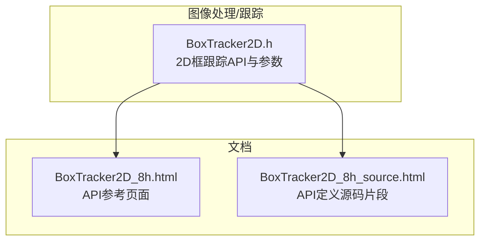
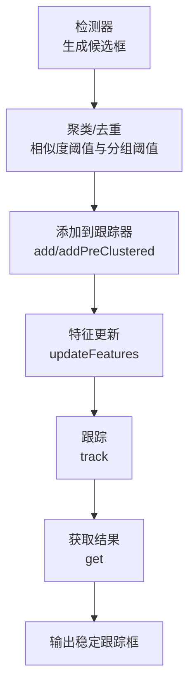
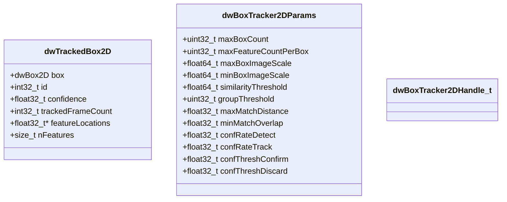
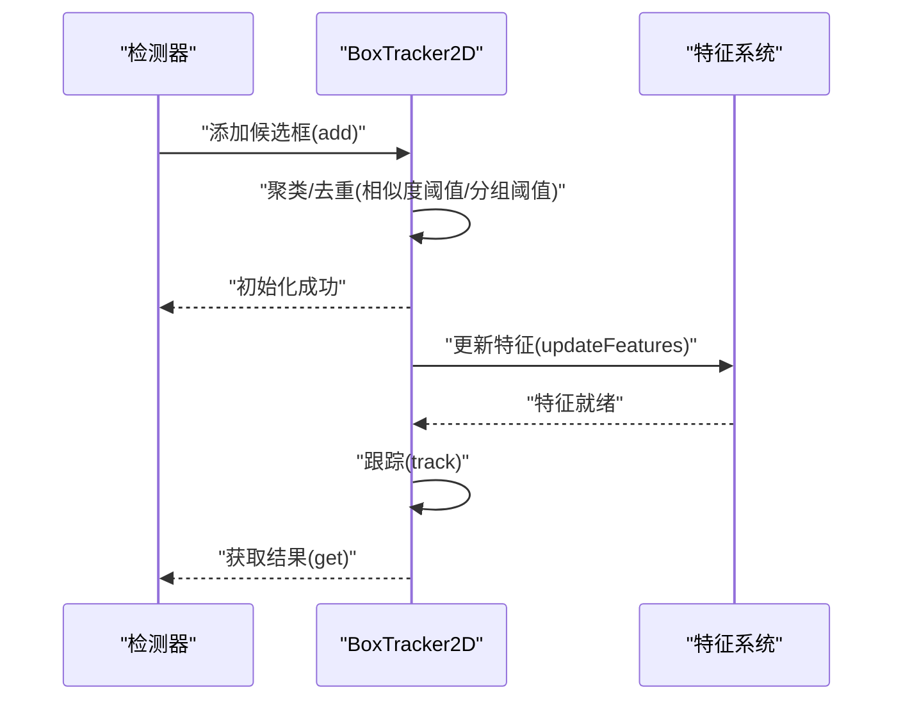
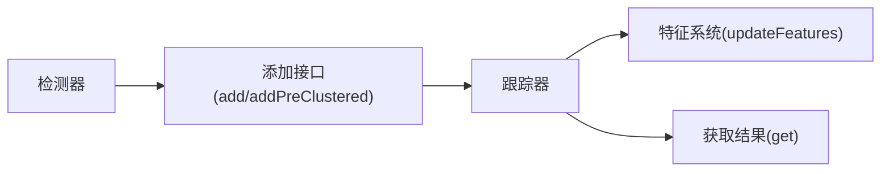

# 2D框跟踪核心算法

<cite>
**本文引用的文件**
- [BoxTracker2D.h](file://driverorks-5.10/include/dw/imageprocessing/tracking/boxtracker2d/BoxTracker2D.h)
- [BoxTracker2D_8h.html](file://driverorks-5.10/doc/nvsdk_dw_html/BoxTracker2D_8h.html)
- [BoxTracker2D_8h_source.html](file://driverorks-5.10/doc/nvsdk_dw_html/BoxTracker2D_8h_source.html)
</cite>

## 目录
1. [引言](#引言)
2. [项目结构](#项目结构)
3. [核心组件](#核心组件)
4. [架构总览](#架构总览)
5. [详细组件分析](#详细组件分析)
6. [依赖关系分析](#依赖关系分析)
7. [性能考量](#性能考量)
8. [故障排查指南](#故障排查指南)
9. [结论](#结论)
10. [附录](#附录)

## 引言
本技术文档聚焦于DriveWorks SDK中2D框跟踪核心算法模块，系统阐述BoxTracker2D类所提供的目标跟踪能力与接口使用方式。文档围绕以下主题展开：边界框的表示与变换、外观特征与运动模型的融合策略、状态预测与更新流程（含基于外观的关联与置信度传播）、目标初始化与维护策略（包含消失检测与重新初始化）、以及跟踪精度评估与鲁棒性提升方法。为便于不同背景读者理解，文档采用由浅入深的方式组织内容，并辅以可视化图示帮助把握整体流程与关键数据结构。

## 项目结构
在DriveWorks SDK中，2D框跟踪相关接口定义位于图像处理子系统的跟踪模块内，核心API集中在头文件中声明，配合参数结构体与返回状态类型共同构成完整的调用契约。下图展示了与2D框跟踪直接相关的文件与角色定位：

**图表来源**
- [BoxTracker2D.h:1-348](file://driverorks-5.10/include/dw/imageprocessing/tracking/boxtracker2d/BoxTracker2D.h#L1-L348)
- [BoxTracker2D_8h.html:130-185](file://driverorks-5.10/doc/nvsdk_dw_html/BoxTracker2D_8h.html#L130-L185)
- [BoxTracker2D_8h_source.html:240-275](file://driverorks-5.10/doc/nvsdk_dw_html/BoxTracker2D_8h_source.html#L240-L275)

**章节来源**
- [BoxTracker2D.h:40-55](file://driverorks-5.10/include/dw/imageprocessing/tracking/boxtracker2d/BoxTracker2D.h#L40-L55)
- [BoxTracker2D_8h.html:130-185](file://driverorks-5.10/doc/nvsdk_dw_html/BoxTracker2D_8h.html#L130-L185)

## 核心组件
本节从接口与数据结构两个维度梳理2D框跟踪的核心组成，帮助快速建立对算法模块的整体认知。

- 句柄与数据结构
  - 句柄类型：用于标识一个2D框跟踪器实例，作为所有API调用的上下文载体。
  - 跟踪结果结构：包含边界框、ID、置信度、跟踪帧计数、内部特征点坐标与数量等字段，用于对外输出稳定且可扩展的跟踪结果。
  - 参数结构：集中定义了最大框数量、每框最大特征数、图像尺度范围、相似度阈值、分组阈值、匹配距离、最小重叠、置信度衰减与确认阈值等关键超参，直接影响跟踪稳定性与鲁棒性。

- 关键API族
  - 初始化与释放：负责分配与销毁跟踪器实例，设置图像尺寸与上下文。
  - 添加与预聚类添加：支持原始候选框的聚类聚合与预聚类输入两种模式，前者通过相似度阈值与分组阈值合并冗余框，后者直接将已聚类框加入跟踪。
  - 特征更新：在当前帧更新内部特征点位置与状态，为后续跟踪与关联提供依据。
  - 跟踪：执行跨帧关联与状态更新，结合外观特征与空间相似度完成匹配。
  - 获取结果：返回当前帧的稳定跟踪列表与数量。
  - 优先级控制：启用优先级跟踪并设置/查询对象优先级，用于多框重叠时的特征归属决策。

**章节来源**
- [BoxTracker2D.h:60-85](file://driverorks-5.10/include/dw/imageprocessing/tracking/boxtracker2d/BoxTracker2D.h#L60-L85)
- [BoxTracker2D.h:87-150](file://driverorks-5.10/include/dw/imageprocessing/tracking/boxtracker2d/BoxTracker2D.h#L87-L150)
- [BoxTracker2D.h:152-341](file://driverorks-5.10/include/dw/imageprocessing/tracking/boxtracker2d/BoxTracker2D.h#L152-L341)

## 架构总览
下图给出2D框跟踪在典型流水线中的位置与交互关系，展示从检测到跟踪再到输出的关键步骤与数据流：

该流程体现了“先聚类再添加、后更新特征、再跟踪”的标准工作流；同时，优先级跟踪可在多框重叠场景下提升特征归属的准确性。

**图表来源**
- [BoxTracker2D.h:217-245](file://driverorks-5.10/include/dw/imageprocessing/tracking/boxtracker2d/BoxTracker2D.h#L217-L245)
- [BoxTracker2D.h:263-285](file://driverorks-5.10/include/dw/imageprocessing/tracking/boxtracker2d/BoxTracker2D.h#L263-L285)
- [BoxTracker2D.h:287-300](file://driverorks-5.10/include/dw/imageprocessing/tracking/boxtracker2d/BoxTracker2D.h#L287-L300)

## 详细组件分析

### 数据结构与边界框表示
- 边界框表示
  - 使用二维框结构承载位置与尺度信息，配合ID、置信度、跟踪帧计数与内部特征点集合，形成完整的跟踪实体描述。
  - 特征点以二维坐标数组形式存储，数量受每框最大特征数限制，便于后续外观匹配与更新。

- 参数结构要点
  - 图像尺度范围：通过最大/最小框比例限定可跟踪目标的物理尺寸范围，避免过大或过小目标影响稳定性。
  - 相似度阈值与分组阈值：前者决定候选框是否视为同一对象，后者抑制离群输入，提升初始化鲁棒性。
  - 匹配距离与最小重叠：控制候选匹配的容忍度与一致性要求，平衡召回与误检。
  - 置信度衰减与确认阈值：动态调整跟踪置信度，确保仅在高置信度时输出结果，降低误报。

**图表来源**
- [BoxTracker2D.h:66-85](file://driverorks-5.10/include/dw/imageprocessing/tracking/boxtracker2d/BoxTracker2D.h#L66-L85)
- [BoxTracker2D.h:87-150](file://driverorks-5.10/include/dw/imageprocessing/tracking/boxtracker2d/BoxTracker2D.h#L87-L150)
- [BoxTracker2D.h:60-64](file://driverorks-5.10/include/dw/imageprocessing/tracking/boxtracker2d/BoxTracker2D.h#L60-L64)

**章节来源**
- [BoxTracker2D.h:66-85](file://driverorks-5.10/include/dw/imageprocessing/tracking/boxtracker2d/BoxTracker2D.h#L66-L85)
- [BoxTracker2D.h:87-150](file://driverorks-5.10/include/dw/imageprocessing/tracking/boxtracker2d/BoxTracker2D.h#L87-L150)

### 算法流程与关键步骤
- 目标初始化
  - 原始候选框经聚类/去重后，按相似度阈值与分组阈值规则合并，得到稳定初始集。
  - 将聚类后的框加入跟踪器，为后续特征更新与跟踪做好准备。

- 外观与运动模型融合
  - 特征更新：在当前帧更新内部特征点位置与状态，为外观匹配提供基础。
  - 跟踪：结合外观特征与空间相似度（如IOU）进行跨帧关联，维持轨迹连续性。

- 状态预测与更新
  - 预测：基于历史轨迹与运动假设（例如恒速模型）预测当前帧位置。
  - 更新：当外观与空间一致性满足阈值条件时，融合新观测修正状态，更新置信度与轨迹。

- 目标维护策略
  - 消失检测：当置信度低于丢弃阈值时停止跟踪；当低于确认阈值时不再输出结果。
  - 重新初始化：通过再次调用添加接口并提供新的聚类结果，实现对丢失目标的恢复。

**图表来源**
- [BoxTracker2D.h:217-245](file://driverorks-5.10/include/dw/imageprocessing/tracking/boxtracker2d/BoxTracker2D.h#L217-L245)
- [BoxTracker2D.h:263-285](file://driverorks-5.10/include/dw/imageprocessing/tracking/boxtracker2d/BoxTracker2D.h#L263-L285)
- [BoxTracker2D.h:287-300](file://driverorks-5.10/include/dw/imageprocessing/tracking/boxtracker2d/BoxTracker2D.h#L287-L300)

**章节来源**
- [BoxTracker2D.h:217-245](file://driverorks-5.10/include/dw/imageprocessing/tracking/boxtracker2d/BoxTracker2D.h#L217-L245)
- [BoxTracker2D.h:263-285](file://driverorks-5.10/include/dw/imageprocessing/tracking/boxtracker2d/BoxTracker2D.h#L263-L285)
- [BoxTracker2D.h:287-300](file://driverorks-5.10/include/dw/imageprocessing/tracking/boxtracker2d/BoxTracker2D.h#L287-L300)

### 边界框表示与变换
- 表示方法
  - 位置坐标：由二维框结构承载，通常包含中心点与宽高或左上角与右下角坐标。
  - 尺度参数：通过最大/最小框比例与图像尺寸计算得到，限制可跟踪目标的物理大小。
  - 纵横比：在当前API中未显式提供独立参数，可通过宽高比间接参与相似度计算与匹配。

- 变换过程
  - 输入候选框经聚类后得到平均框，作为稳定的初始化输入。
  - 跟踪过程中，外观特征与空间相似度共同驱动框的平滑与修正，维持尺度与位置的一致性。

**章节来源**
- [BoxTracker2D.h:87-150](file://driverorks-5.10/include/dw/imageprocessing/tracking/boxtracker2d/BoxTracker2D.h#L87-L150)
- [BoxTracker2D.h:217-245](file://driverorks-5.10/include/dw/imageprocessing/tracking/boxtracker2d/BoxTracker2D.h#L217-L245)

### 粒子滤波与贝叶斯估计（概念性说明）
- 粒子滤波
  - 在概念层面，粒子滤波通过一组带权粒子表示后验分布，利用重要性采样与重采样策略逼近真实状态。对于2D框跟踪，粒子可编码位置、尺度与速度等状态变量，外观特征用于评估观测似然，从而实现鲁棒的非线性/非高斯跟踪。
- 贝叶斯估计
  - 通过先验（运动模型）与观测（外观特征+几何约束）的联合建模，递归求解后验分布，实现状态估计与不确定性量化。置信度可视为后验强度的代理，用于决策与维护策略。

[本节为概念性说明，不直接分析具体源文件，故无“章节来源”标注]

### 卡尔曼滤波（概念性说明）
- 状态预测与更新
  - 预测阶段：基于运动模型（如恒速）推进状态均值与协方差。
  - 更新阶段：当观测（外观与几何）满足阈值时，利用观测残差修正状态，更新协方差，实现稳健跟踪。
- 与2D框跟踪的关系
  - 在当前API中未直接暴露卡尔曼滤波接口，但其思想可体现在“状态预测-外观更新”的流程中，用于平滑轨迹与抑制噪声。

[本节为概念性说明，不直接分析具体源文件，故无“章节来源”标注]

### 典型使用流程与示例路径
- 目标初始化
  - 步骤：初始化跟踪器 → 添加候选框（聚类/去重）→ 更新特征 → 执行跟踪 → 获取结果。
  - 示例路径：[BoxTracker2D.h:178-180](file://driverorks-5.10/include/dw/imageprocessing/tracking/boxtracker2d/BoxTracker2D.h#L178-L180)、[BoxTracker2D.h:217-245](file://driverorks-5.10/include/dw/imageprocessing/tracking/boxtracker2d/BoxTracker2D.h#L217-L245)、[BoxTracker2D.h:263-285](file://driverorks-5.10/include/dw/imageprocessing/tracking/boxtracker2d/BoxTracker2D.h#L263-L285)、[BoxTracker2D.h:287-300](file://driverorks-5.10/include/dw/imageprocessing/tracking/boxtracker2d/BoxTracker2D.h#L287-L300)

- 状态预测与观测更新
  - 流程：先更新特征，再执行跟踪，最后获取结果，确保外观信息与状态一致。
  - 示例路径：[BoxTracker2D.h:263-285](file://driverorks-5.10/include/dw/imageprocessing/tracking/boxtracker2d/BoxTracker2D.h#L263-L285)、[BoxTracker2D.h:287-300](file://driverorks-5.10/include/dw/imageprocessing/tracking/boxtracker2d/BoxTracker2D.h#L287-L300)

- 维护策略（消失检测与重新初始化）
  - 策略：根据置信度阈值决定是否继续跟踪与输出；通过再次添加新聚类结果实现重新初始化。
  - 示例路径：[BoxTracker2D.h:134-149](file://driverorks-5.10/include/dw/imageprocessing/tracking/boxtracker2d/BoxTracker2D.h#L134-L149)、[BoxTracker2D.h:217-245](file://driverorks-5.10/include/dw/imageprocessing/tracking/boxtracker2d/BoxTracker2D.h#L217-L245)

**章节来源**
- [BoxTracker2D.h:134-149](file://driverorks-5.10/include/dw/imageprocessing/tracking/boxtracker2d/BoxTracker2D.h#L134-L149)
- [BoxTracker2D.h:178-180](file://driverorks-5.10/include/dw/imageprocessing/tracking/boxtracker2d/BoxTracker2D.h#L178-L180)
- [BoxTracker2D.h:217-245](file://driverorks-5.10/include/dw/imageprocessing/tracking/boxtracker2d/BoxTracker2D.h#L217-L245)
- [BoxTracker2D.h:263-285](file://driverorks-5.10/include/dw/imageprocessing/tracking/boxtracker2d/BoxTracker2D.h#L263-L285)
- [BoxTracker2D.h:287-300](file://driverorks-5.10/include/dw/imageprocessing/tracking/boxtracker2d/BoxTracker2D.h#L287-L300)

## 依赖关系分析
- 组件耦合
  - 跟踪器与特征系统：特征更新必须在跟踪之前完成，二者存在严格的前后顺序依赖。
  - 跟踪器与检测器：检测器提供候选框，跟踪器负责聚类与关联，二者通过添加接口耦合。
- 外部依赖
  - 上下文与配置：初始化时需传入上下文与图像尺寸，确保资源与环境正确配置。
  - 返回状态：所有API统一返回状态码，便于错误传播与统一处理。

**图表来源**
- [BoxTracker2D.h:217-245](file://driverorks-5.10/include/dw/imageprocessing/tracking/boxtracker2d/BoxTracker2D.h#L217-L245)
- [BoxTracker2D.h:263-285](file://driverorks-5.10/include/dw/imageprocessing/tracking/boxtracker2d/BoxTracker2D.h#L263-L285)
- [BoxTracker2D.h:287-300](file://driverorks-5.10/include/dw/imageprocessing/tracking/boxtracker2d/BoxTracker2D.h#L287-L300)

**章节来源**
- [BoxTracker2D.h:178-180](file://driverorks-5.10/include/dw/imageprocessing/tracking/boxtracker2d/BoxTracker2D.h#L178-L180)
- [BoxTracker2D.h:217-245](file://driverorks-5.10/include/dw/imageprocessing/tracking/boxtracker2d/BoxTracker2D.h#L217-L245)
- [BoxTracker2D.h:263-285](file://driverorks-5.10/include/dw/imageprocessing/tracking/boxtracker2d/BoxTracker2D.h#L263-L285)
- [BoxTracker2D.h:287-300](file://driverorks-5.10/include/dw/imageprocessing/tracking/boxtracker2d/BoxTracker2D.h#L287-L300)

## 性能考量
- 计算复杂度
  - 聚类与匹配：相似度阈值与分组阈值影响候选框合并与匹配成本，建议根据场景合理设置以平衡精度与速度。
  - 特征数量：每框最大特征数与总框数直接影响内存占用与计算开销，应结合硬件能力与实时性需求调优。
- 内存与吞吐
  - 特征缓冲区大小与生命周期管理：确保在跟踪前及时更新特征，避免无效匹配导致的额外计算。
  - 输出批处理：批量获取结果可减少频繁调用带来的系统开销。

[本节提供通用指导，不直接分析具体源文件，故无“章节来源”标注]

## 故障排查指南
- 常见问题与处理
  - 参数非法：初始化或调用API时若句柄、指针为空或尺寸非法，会返回相应状态码。请检查参数合法性与内存分配。
  - 特征数量越界：特征数量超过上限将导致失败，请核对nFeatures与最大特征数限制。
  - 结果为空：若置信度低于确认阈值，跟踪器不会输出结果；请适当调整阈值或检查特征质量。
  - 优先级设置：启用优先级跟踪后，需为对象设置优先级并确保索引有效。

- 定位方法
  - 逐项检查初始化参数与图像尺寸。
  - 在特征更新与跟踪之间插入日志，确认特征状态正常。
  - 通过获取结果接口验证输出数量与置信度变化趋势。

**章节来源**
- [BoxTracker2D.h:152-162](file://driverorks-5.10/include/dw/imageprocessing/tracking/boxtracker2d/BoxTracker2D.h#L152-L162)
- [BoxTracker2D.h:287-300](file://driverorks-5.10/include/dw/imageprocessing/tracking/boxtracker2d/BoxTracker2D.h#L287-L300)
- [BoxTracker2D.h:314-341](file://driverorks-5.10/include/dw/imageprocessing/tracking/boxtracker2d/BoxTracker2D.h#L314-L341)

## 结论
BoxTracker2D提供了面向2D框跟踪的完整API族，涵盖初始化、聚类/去重、特征更新、跟踪与结果获取等关键环节。通过参数化控制相似度阈值、分组阈值、匹配距离、最小重叠与置信度衰减等关键因子，可在精度与鲁棒性之间取得良好平衡。结合优先级跟踪与合理的维护策略，可进一步提升在复杂场景下的稳定性与可恢复性。建议在实际部署中结合硬件能力与任务需求，对关键参数进行系统性调优，并建立完善的监控与故障排查机制。

## 附录
- API参考页面与源码片段
  - 参考页面：[BoxTracker2D_8h.html](file://driverorks-5.10/doc/nvsdk_dw_html/BoxTracker2D_8h.html)
  - 源码片段：[BoxTracker2D_8h_source.html](file://driverorks-5.10/doc/nvsdk_dw_html/BoxTracker2D_8h_source.html)

**章节来源**
- [BoxTracker2D_8h.html:130-185](file://driverorks-5.10/doc/nvsdk_dw_html/BoxTracker2D_8h.html#L130-L185)
- [BoxTracker2D_8h_source.html:240-275](file://driverorks-5.10/doc/nvsdk_dw_html/BoxTracker2D_8h_source.html#L240-L275)