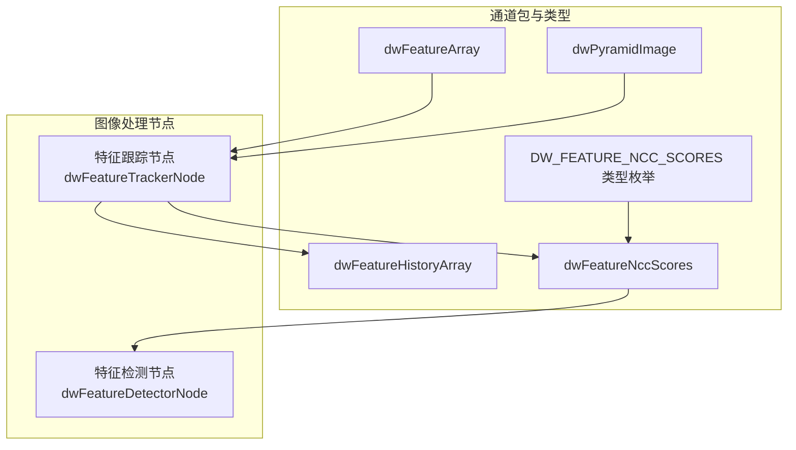
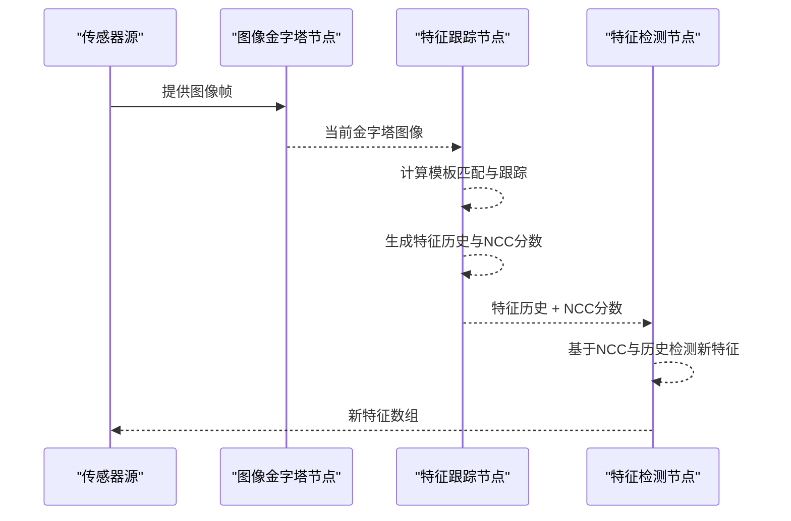
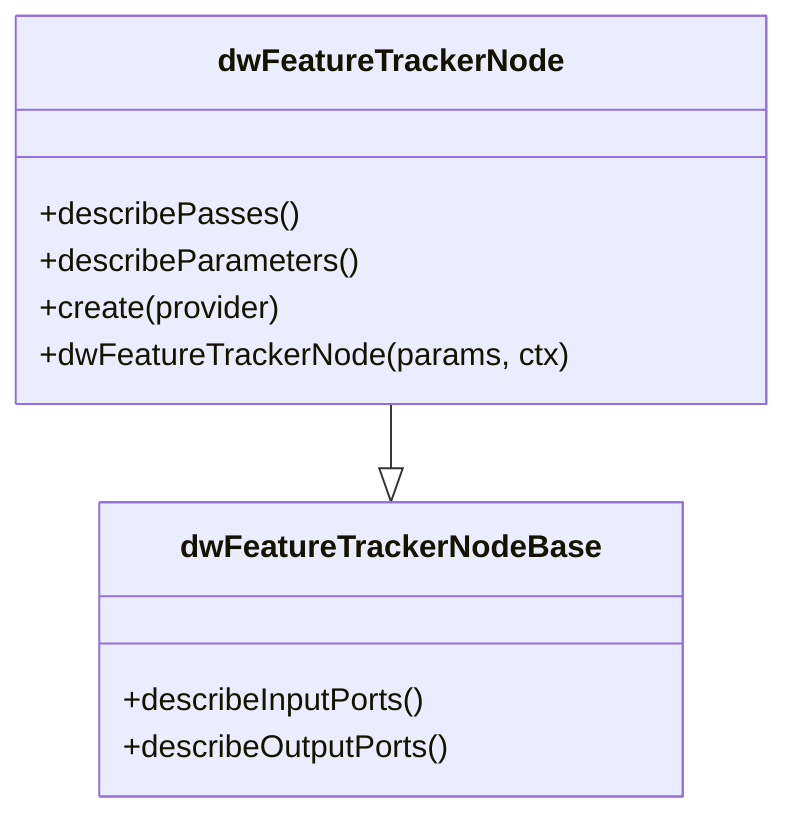
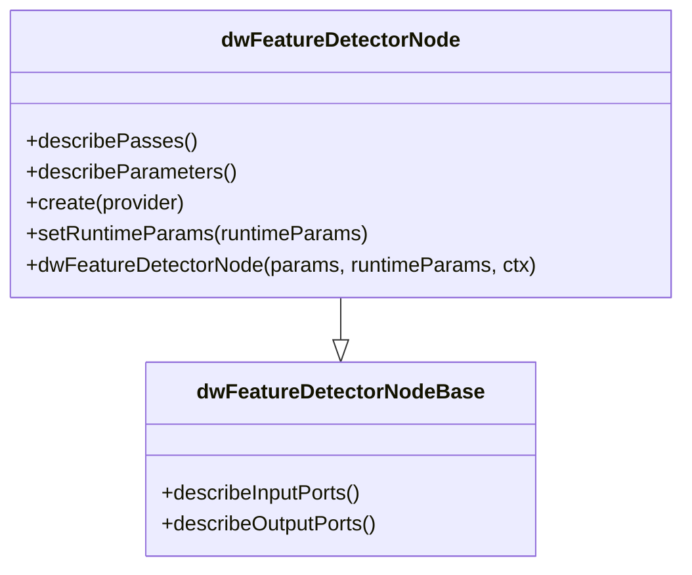
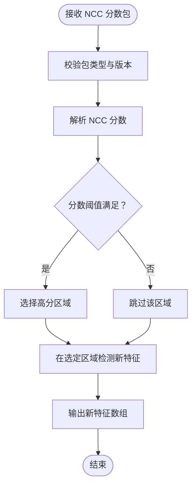
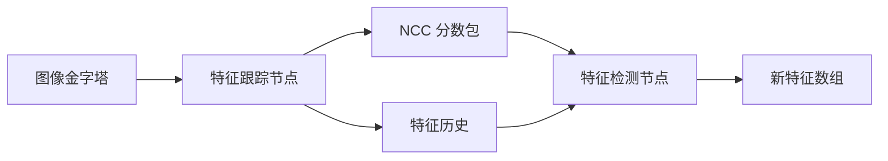

# 模板跟踪核心算法

<cite>
**本文引用的文件**
- [dwFeatureTrackerNode.hpp](file://driverorks-5.10/include/dwframework/dwnodes/imageprocessing/dwfeaturetrackernode/dwFeatureTrackerNode.hpp)
- [dwFeatureDetectorNode.hpp](file://driverorks-5.10/include/dwframework/dwnodes/imageprocessing/dwfeaturedetectornode/dwFeatureDetectorNode.hpp)
- [dwFeatureTrackerNode.node.json](file://driverorks-5.10/src/dwframework/dwnodes/imageprocessing/dwfeaturetrackernode/dwFeatureTrackerNode.node.json)
- [dwFeatureDetectorNode.node.json](file://driverorks-5.10/src/dwframework/dwnodes/imageprocessing/dwfeaturedetectornode/dwFeatureDetectorNode.node.json)
- [SensorCommonTypes.hpp](file://driveworks-5.14/include/dwframework/dwnodes/common/channelpackets/SensorCommonTypes.hpp)
- [Types.hpp](file://driveworks-5.14/include/dwcgf/Types.hpp)
- [ChannelPacketTypes.hpp](file://driveworks-5.14/include/dwcgf/channel/ChannelPacketTypes.hpp)
</cite>

## 目录
1. [引言](#引言)
2. [项目结构](#项目结构)
3. [核心组件](#核心组件)
4. [架构总览](#架构总览)
5. [详细组件分析](#详细组件分析)
6. [依赖关系分析](#依赖关系分析)
7. [性能考虑](#性能考虑)
8. [故障排查指南](#故障排查指南)
9. [结论](#结论)
10. [附录](#附录)

## 引言
本技术文档围绕 DriveWorks 图像处理流水线中的模板跟踪与特征检测模块展开，重点阐述特征跟踪节点与特征检测节点在模板跟踪流程中的职责、参数配置、数据通道以及与 NCC（归一化互相关）分数包的集成方式。文档旨在帮助开发者理解模板初始化、模板更新与目标定位的端到端流程，并给出可操作的参数调优建议与常见问题排查路径。

## 项目结构
模板跟踪与特征检测相关代码主要分布在以下位置：
- 节点接口与参数描述：位于 dwframework 的 dwnodes 子目录中，分别定义了特征跟踪节点与特征检测节点的输入输出端口、参数集合与执行阶段。
- 节点配置文件：以 JSON 形式描述节点的输入输出类型、参数类型与执行阶段，便于运行时绑定与调度。
- 通用通道包与类型系统：通过通用的数据包类型（如 NCC 分数包）与类型枚举，将底层算法结果与上层节点解耦。

图表来源
- [dwFeatureTrackerNode.node.json:1-96](file://driverorks-5.10/src/dwframework/dwnodes/imageprocessing/dwfeaturetrackernode/dwFeatureTrackerNode.node.json#L1-L96)
- [dwFeatureDetectorNode.node.json:1-64](file://driverorks-5.10/src/dwframework/dwnodes/imageprocessing/dwfeaturedetectornode/dwFeatureDetectorNode.node.json#L1-L64)
- [SensorCommonTypes.hpp:132-141](file://driveworks-5.14/include/dwframework/dwnodes/common/channelpackets/SensorCommonTypes.hpp#L132-L141)
- [Types.hpp:73-73](file://driveworks-5.14/include/dwcgf/Types.hpp#L73-L73)
- [ChannelPacketTypes.hpp:196-196](file://driveworks-5.14/include/dwcgf/channel/ChannelPacketTypes.hpp#L196-L196)

章节来源
- [dwFeatureTrackerNode.hpp:67-87](file://driverorks-5.10/include/dwframework/dwnodes/imageprocessing/dwfeaturetrackernode/dwFeatureTrackerNode.hpp#L67-L87)
- [dwFeatureDetectorNode.hpp:70-87](file://driverorks-5.10/include/dwframework/dwnodes/imageprocessing/dwfeaturedetectornode/dwFeatureDetectorNode.hpp#L70-L87)

## 核心组件
- 特征跟踪节点（dwFeatureTrackerNode）
  - 输入：当前金字塔图像、检测到的特征集合
  - 输出：特征历史（CPU/GPU）、NCC 分数、模块句柄
  - 参数：是否按相机初始化、相机内参索引、相机外参、跟踪算法类型、特征检测器类型、最大特征数、金字塔层数、CUDA 流索引等
  - 执行阶段：SETUP、TRACK_FEATURE、COMPACT_FEATURE、COPY、WAIT_EVENT、TEARDOWN
- 特征检测节点（dwFeatureDetectorNode）
  - 输入：图像金字塔、预测特征（历史）、NCC 分数
  - 输出：新的特征数组（GPU）
  - 参数：是否按相机初始化、相机内参索引、相机外参、特征检测器类型、最大特征数、CUDA 流索引等
  - 执行阶段：SETUP、DETECT_NEW_FEATURE、TEARDOWN
- 通用通道包与类型
  - NCC 分数包类型：通过类型枚举与通道包声明，将 NCC 分数作为特征跟踪与检测之间的桥梁

章节来源
- [dwFeatureTrackerNode.hpp:89-160](file://driverorks-5.10/include/dwframework/dwnodes/imageprocessing/dwfeaturetrackernode/dwFeatureTrackerNode.hpp#L89-L160)
- [dwFeatureDetectorNode.hpp:89-155](file://driverorks-5.10/include/dwframework/dwnodes/imageprocessing/dwfeaturedetectornode/dwFeatureDetectorNode.hpp#L89-L155)
- [SensorCommonTypes.hpp:132-141](file://driveworks-5.14/include/dwframework/dwnodes/common/channelpackets/SensorCommonTypes.hpp#L132-L141)
- [Types.hpp:73-73](file://driveworks-5.14/include/dwcgf/Types.hpp#L73-L73)
- [ChannelPacketTypes.hpp:196-196](file://driveworks-5.14/include/dwcgf/channel/ChannelPacketTypes.hpp#L196-L196)

## 架构总览
模板跟踪与特征检测在 DriveWorks 中采用“跟踪-检测”两级流水线：
- 第一级：特征跟踪节点对当前帧进行模板匹配与跟踪，生成特征历史与 NCC 分数。
- 第二级：特征检测节点根据历史与 NCC 分数，在新区域检测新的特征点，维持目标的持续跟踪。

图表来源
- [dwFeatureTrackerNode.node.json:6-33](file://driverorks-5.10/src/dwframework/dwnodes/imageprocessing/dwfeaturetrackernode/dwFeatureTrackerNode.node.json#L6-L33)
- [dwFeatureDetectorNode.node.json:6-25](file://driverorks-5.10/src/dwframework/dwnodes/imageprocessing/dwfeaturedetectornode/dwFeatureDetectorNode.node.json#L6-L25)

## 详细组件分析

### 组件A：特征跟踪节点（模板跟踪主控）
- 职责
  - 接收当前金字塔与已检测特征，执行模板匹配与跟踪
  - 生成特征历史（CPU/GPU）与 NCC 分数
  - 提供模块句柄用于后续流程
- 关键参数
  - 算法类型：选择跟踪算法（如基于模板的跟踪）
  - 检测器类型：选择特征检测器类型
  - 最大特征数：限制每帧跟踪的特征数量
  - 金字塔层数：控制多尺度匹配精度与性能
  - CUDA 流索引：指定 GPU 并行流
- 执行阶段
  - SETUP：初始化跟踪器与资源
  - TRACK_FEATURE：执行模板匹配与跟踪
  - COMPACT_FEATURE：压缩无效或低质量特征
  - COPY：拷贝结果至 CPU/GPU
  - WAIT_EVENT：等待异步事件完成
  - TEARDOWN：释放资源

图表来源
- [dwFeatureTrackerNode.hpp:67-160](file://driverorks-5.10/include/dwframework/dwnodes/imageprocessing/dwfeaturetrackernode/dwFeatureTrackerNode.hpp#L67-L160)

章节来源
- [dwFeatureTrackerNode.hpp:89-160](file://driverorks-5.10/include/dwframework/dwnodes/imageprocessing/dwfeaturetrackernode/dwFeatureTrackerNode.hpp#L89-L160)
- [dwFeatureTrackerNode.node.json:34-56](file://driverorks-5.10/src/dwframework/dwnodes/imageprocessing/dwfeaturetrackernode/dwFeatureTrackerNode.node.json#L34-L56)

### 组件B：特征检测节点（模板更新与新特征补充）
- 职责
  - 接收特征历史与 NCC 分数，结合金字塔信息检测新特征
  - 输出新的特征数组，用于模板更新与跟踪延续
- 关键参数
  - 检测器类型：选择特征检测器
  - 最大特征数：限制新增特征数量
  - CUDA 流索引：指定 GPU 并行流
- 执行阶段
  - SETUP：初始化检测器
  - DETECT_NEW_FEATURE：在合适区域检测新特征
  - TEARDOWN：释放资源

图表来源
- [dwFeatureDetectorNode.hpp:70-155](file://driverorks-5.10/include/dwframework/dwnodes/imageprocessing/dwfeaturedetectornode/dwFeatureDetectorNode.hpp#L70-L155)

章节来源
- [dwFeatureDetectorNode.hpp:89-155](file://driverorks-5.10/include/dwframework/dwnodes/imageprocessing/dwfeaturedetectornode/dwFeatureDetectorNode.hpp#L89-L155)
- [dwFeatureDetectorNode.node.json:26-42](file://driverorks-5.10/src/dwframework/dwnodes/imageprocessing/dwfeaturedetectornode/dwFeatureDetectorNode.node.json#L26-L42)

### 组件C：NCC 分数通道包与类型系统
- 作用
  - 将特征跟踪得到的 NCC 分数以统一的数据包形式传递给特征检测节点
  - 通过类型枚举与通道包声明，确保跨模块的数据一致性
- 数据契约
  - 输入：特征历史数组、NCC 分数包
  - 输出：新的特征数组

图表来源
- [SensorCommonTypes.hpp:132-141](file://driveworks-5.14/include/dwframework/dwnodes/common/channelpackets/SensorCommonTypes.hpp#L132-L141)
- [Types.hpp:73-73](file://driveworks-5.14/include/dwcgf/Types.hpp#L73-L73)
- [ChannelPacketTypes.hpp:196-196](file://driveworks-5.14/include/dwcgf/channel/ChannelPacketTypes.hpp#L196-L196)

章节来源
- [SensorCommonTypes.hpp:132-141](file://driveworks-5.14/include/dwframework/dwnodes/common/channelpackets/SensorCommonTypes.hpp#L132-L141)
- [Types.hpp:73-73](file://driveworks-5.14/include/dwcgf/Types.hpp#L73-L73)
- [ChannelPacketTypes.hpp:196-196](file://driveworks-5.14/include/dwcgf/channel/ChannelPacketTypes.hpp#L196-L196)

## 依赖关系分析
- 节点间依赖
  - 特征跟踪节点输出的 NCC 分数与特征历史，作为特征检测节点的输入
  - 两者共享图像金字塔作为共同输入
- 类型系统依赖
  - 通过类型枚举与通道包声明，确保 NCC 分数包在不同节点间的正确传递
- 配置文件依赖
  - JSON 描述文件定义了输入输出类型、参数类型与执行阶段，驱动运行时绑定与调度

图表来源
- [dwFeatureTrackerNode.node.json:6-33](file://driverorks-5.10/src/dwframework/dwnodes/imageprocessing/dwfeaturetrackernode/dwFeatureTrackerNode.node.json#L6-L33)
- [dwFeatureDetectorNode.node.json:6-25](file://driverorks-5.10/src/dwframework/dwnodes/imageprocessing/dwfeaturedetectornode/dwFeatureDetectorNode.node.json#L6-L25)

章节来源
- [dwFeatureTrackerNode.node.json:1-96](file://driverorks-5.10/src/dwframework/dwnodes/imageprocessing/dwfeaturetrackernode/dwFeatureTrackerNode.node.json#L1-L96)
- [dwFeatureDetectorNode.node.json:1-64](file://driverorks-5.10/src/dwframework/dwnodes/imageprocessing/dwfeaturedetectornode/dwFeatureDetectorNode.node.json#L1-L64)

## 性能考虑
- 金字塔层数
  - 增加金字塔层数可提升多尺度匹配精度，但会增加计算开销；需根据场景分辨率与运动幅度权衡
- 最大特征数
  - 控制每帧跟踪与检测的特征数量，避免 GPU/CPU 资源过载；建议根据硬件能力与实时性要求动态调整
- CUDA 流索引
  - 合理设置并行流可提升吞吐；需避免流间竞争与同步阻塞
- NCC 分数阈值
  - 通过 NCC 分数包的阈值筛选，减少无效区域的检测开销；阈值过高易漏检，过低易引入误检
- 执行阶段划分
  - 将 SETUP/TEARDOWN 放置在 CPU，TRACK_FEATURE/DETECT_NEW_FEATURE 放置在 GPU，可充分利用异构计算资源

## 故障排查指南
- 无法获取 NCC 分数
  - 检查特征跟踪节点输出端口是否正确绑定 NCC 分数包
  - 确认类型枚举与通道包声明一致
- 特征检测不到新特征
  - 检查 NCC 分数阈值是否过高
  - 确认金字塔层数与图像分辨率匹配
  - 核对特征检测器类型与最大特征数配置
- 性能不达标
  - 降低金字塔层数或最大特征数
  - 调整 CUDA 流索引与并行策略
  - 检查是否存在不必要的同步阻塞

章节来源
- [SensorCommonTypes.hpp:132-141](file://driveworks-5.14/include/dwframework/dwnodes/common/channelpackets/SensorCommonTypes.hpp#L132-L141)
- [dwFeatureTrackerNode.node.json:57-94](file://driverorks-5.10/src/dwframework/dwnodes/imageprocessing/dwfeaturetrackernode/dwFeatureTrackerNode.node.json#L57-L94)
- [dwFeatureDetectorNode.node.json:43-62](file://driverorks-5.10/src/dwframework/dwnodes/imageprocessing/dwfeaturedetectornode/dwFeatureDetectorNode.node.json#L43-L62)

## 结论
模板跟踪与特征检测在 DriveWorks 中通过清晰的节点边界与统一的通道包类型实现了解耦与高效协作。特征跟踪节点负责模板匹配与历史维护，特征检测节点负责新特征补充与模板更新。通过合理配置参数与执行阶段，可在保证精度的同时获得良好的实时性能。建议在实际应用中结合场景特性（如光照变化、尺度变化、遮挡等）进行针对性调优。

## 附录
- 实际应用场景
  - 自动驾驶中的车道线/交通标志跟踪：利用金字塔与 NCC 分数提升鲁棒性
  - 运动目标跟踪：结合历史轨迹与新检测特征，维持长时跟踪稳定性
- 性能调优建议
  - 动态调整金字塔层数与最大特征数，平衡精度与延迟
  - 利用 NCC 分数阈值过滤低质量匹配，减少无效计算
  - 在多流环境下合理分配 GPU/CPU 资源，避免瓶颈