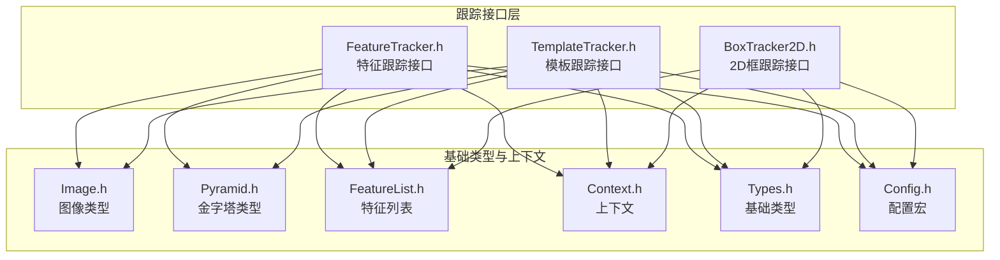
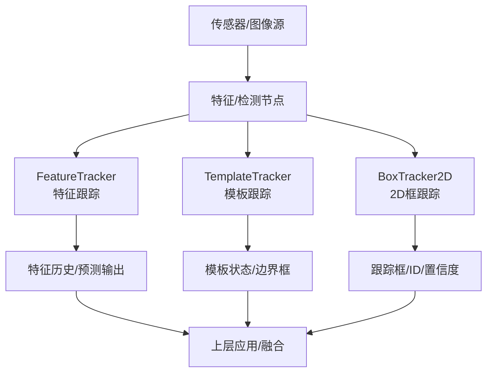
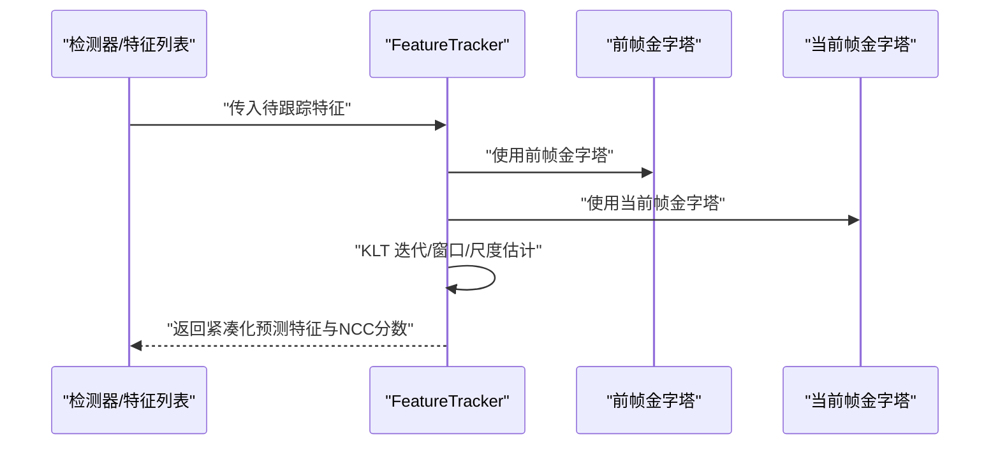
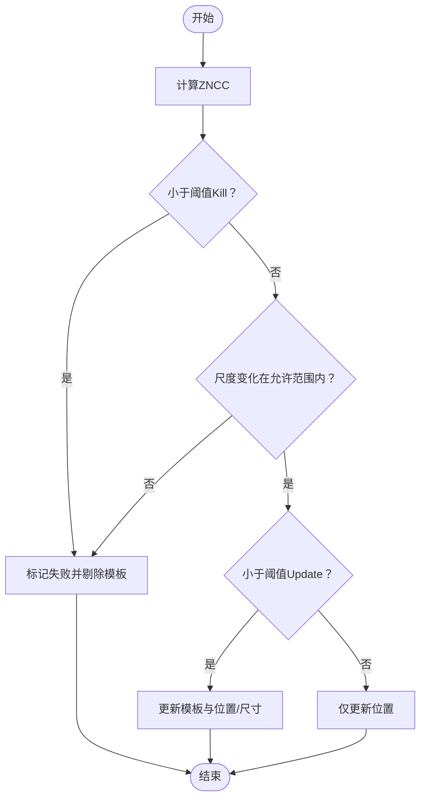
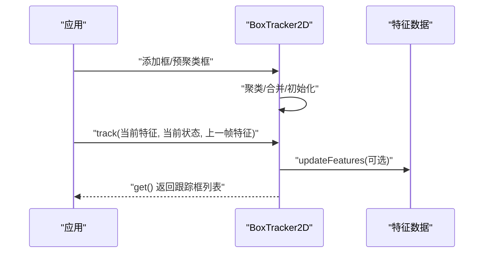
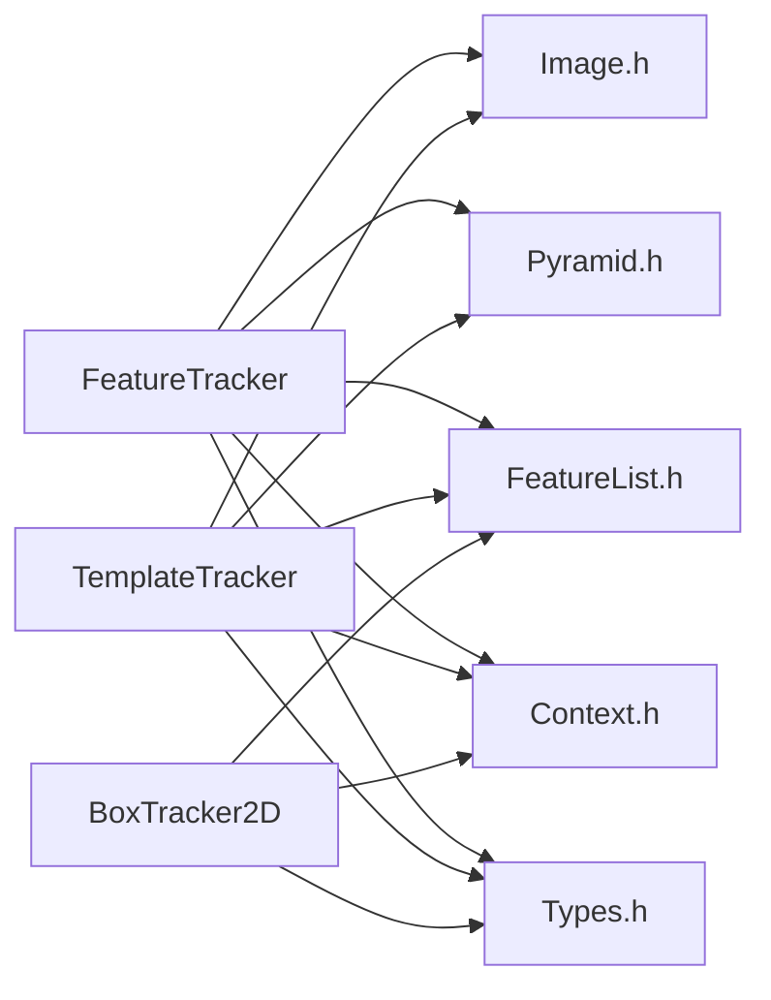

# 特征跟踪

<cite>
**本文引用的文件**
- [BoxTracker2D.h](file://driverorks-5.10/include/dw/imageprocessing/tracking/boxtracker2d/BoxTracker2D.h)
- [FeatureTracker.h（弃用入口）](file://driverorks-5.10/include/dw/imageprocessing/tracking/FeatureTracker.h)
- [FeatureTracker.h（实际实现入口）](file://driverorks-5.10/include/dw/imageprocessing/tracking/featuretracker/FeatureTracker.h)
- [TemplateTracker.h（弃用入口）](file://driverorks-5.10/include/dw/imageprocessing/tracking/TemplateTracker.h)
- [TemplateTracker.h（实际实现入口）](file://driverorks-5.10/include/dw/imageprocessing/tracking/templatetracker/TemplateTracker.h)
- [FeatureList.h](file://driverorks-5.10/include/dw/imageprocessing/features/FeatureList.h)
- [Pyramid.h](file://driverorks-5.10/include/dw/imageprocessing/pyramid/Pyramid.h)
- [Image.h](file://driverorks-5.10/include/dw/image/Image.h)
- [Context.h](file://driverorks-5.10/include/dw/core/context/Context.h)
- [Types.h](file://driverorks-5.10/include/dw/core/base/Types.h)
- [Config.h](file://driverorks-5.10/include/dw/core/base/Config.h)
- [FeatureTrackerNode 类文档片段](file://driverorks-5.10/doc/nvcgf_html/classdw_1_1framework_1_1dwFeatureTrackerNode.html)
- [BoxTracker2D API 文档片段](file://driverorks-5.10/doc/nvsdk_dw_html/BoxTracker2D_8h.html)
</cite>

## 目录
1. [简介](#简介)
2. [项目结构](#项目结构)
3. [核心组件](#核心组件)
4. [架构总览](#架构总览)
5. [详细组件分析](#详细组件分析)
6. [依赖关系分析](#依赖关系分析)
7. [性能考量](#性能考量)
8. [故障排查指南](#故障排查指南)
9. [结论](#结论)
10. [附录：API 参考与示例](#附录api-参考与示例)

## 简介
本技术文档聚焦于 DriveWorks 图像处理跟踪子系统中的三大核心能力：
- 特征跟踪：基于金字塔的 KLT 扩展跟踪、自适应窗口与尺度估计，支持 GPU/PVA 处理器执行。
- 模板跟踪：基于零均值归一化互相关（ZNCC）的模板匹配与更新策略，支持图像与金字塔两种输入。
- 2D 框跟踪：面向检测框的多目标跟踪，提供参数化聚类、置信度衰减与优先级分配机制。

文档将从架构、数据流、处理逻辑、API 使用与优化建议等方面进行系统化阐述，并给出从单目标到多目标的典型应用流程。

## 项目结构
围绕特征/模板/2D 框跟踪，相关头文件与依赖关系如下：

图表来源
- [FeatureTracker.h（实际实现入口）:49-56](file://driverorks-5.10/include/dw/imageprocessing/tracking/featuretracker/FeatureTracker.h#L49-L56)
- [TemplateTracker.h（实际实现入口）:48-55](file://driverorks-5.10/include/dw/imageprocessing/tracking/templatetracker/TemplateTracker.h#L48-L55)
- [BoxTracker2D.h:35-39](file://driverorks-5.10/include/dw/imageprocessing/tracking/boxtracker2d/BoxTracker2D.h#L35-L39)

章节来源
- [FeatureTracker.h（弃用入口）:37-41](file://driverorks-5.10/include/dw/imageprocessing/tracking/FeatureTracker.h#L37-L41)
- [TemplateTracker.h（弃用入口）:66-70](file://driverorks-5.10/include/dw/imageprocessing/tracking/TemplateTracker.h#L66-L70)

## 核心组件
- FeatureTracker（特征跟踪）
  - 支持标准/扩展/快速扩展 KLT 算法族，可配置金字塔层数、窗口大小、迭代次数、半精度中间结果等。
  - 提供 GPU/PVA 执行路径选择，支持稀疏输出与紧凑化。
- TemplateTracker（模板跟踪）
  - 基于 IA/IC 的 Lucas–Kanade 模板跟踪，采用 ZNCC 阈值控制模板更新与剔除。
  - 支持图像与金字塔输入，提供模板数组的生命周期管理。
- BoxTracker2D（2D 框跟踪）
  - 输入检测框序列，内部进行聚类/合并，按相似度阈值与 IOU 进行匹配。
  - 提供置信度衰减、优先级分配与特征更新接口，支持浅重置与深重置。

章节来源
- [FeatureTracker.h（实际实现入口）:75-86](file://driverorks-5.10/include/dw/imageprocessing/tracking/featuretracker/FeatureTracker.h#L75-L86)
- [TemplateTracker.h（实际实现入口）:122-125](file://driverorks-5.10/include/dw/imageprocessing/tracking/templatetracker/TemplateTracker.h#L122-L125)
- [BoxTracker2D.h:88-150](file://driverorks-5.10/include/dw/imageprocessing/tracking/boxtracker2d/BoxTracker2D.h#L88-L150)

## 架构总览
下图展示三类跟踪器在典型流水线中的位置与交互关系（概念示意）：

（该图为概念性架构示意，不直接映射具体源码文件）

## 详细组件分析

### 组件A：FeatureTracker（特征跟踪）
- 功能要点
  - KLT 算法族：标准、扩展、快速扩展；后者支持尺度估计与自适应窗口。
  - 参数化配置：金字塔层数、窗口尺寸、迭代次数、半精度中间结果、最大尺度变化、NCC 剪枝与更新阈值、大位移剔除比例、收敛阈值、处理器类型等。
  - 生命周期：初始化、重置、释放；支持设置/获取 CUDA/PVA 流。
  - 输出：紧凑化后的特征历史数组，包含新旧索引映射。
- 关键流程（跟踪调用序列）

图表来源
- [FeatureTracker.h（实际实现入口）:292-332](file://driverorks-5.10/include/dw/imageprocessing/tracking/featuretracker/FeatureTracker.h#L292-L332)

- 数据结构与复杂度
  - 特征历史数组：支持历史容量上限与紧凑化，时间复杂度与特征数线性相关。
  - 窗口大小与金字塔层数影响计算量与鲁棒性，需权衡。
- 错误处理与边界条件
  - CUDA/PVA 流设置失败、参数为空、金字塔层数不一致、内存类型非法等将返回错误码。
- 性能优化建议
  - 合理设置窗口大小与金字塔层数；启用半精度中间结果以降低寄存器占用。
  - 在 GPU 上批量处理，避免频繁主机设备同步。
  - 对于 PVA，仅支持 IC 算法族时应选择合适算法。

章节来源
- [FeatureTracker.h（实际实现入口）:91-217](file://driverorks-5.10/include/dw/imageprocessing/tracking/featuretracker/FeatureTracker.h#L91-L217)
- [FeatureTracker.h（实际实现入口）:226-264](file://driverorks-5.10/include/dw/imageprocessing/tracking/featuretracker/FeatureTracker.h#L226-L264)
- [FeatureTracker.h（实际实现入口）:324-332](file://driverorks-5.10/include/dw/imageprocessing/tracking/featuretracker/FeatureTracker.h#L324-L332)
- [FeatureTracker.h（实际实现入口）:347-349](file://driverorks-5.10/include/dw/imageprocessing/tracking/featuretracker/FeatureTracker.h#L347-L349)
- [FeatureTracker.h（实际实现入口）:362-375](file://driverorks-5.10/include/dw/imageprocessing/tracking/featuretracker/FeatureTracker.h#L362-L375)
- [FeatureTracker.h（实际实现入口）:389-403](file://driverorks-5.10/include/dw/imageprocessing/tracking/featuretracker/FeatureTracker.h#L389-L403)

### 组件B：TemplateTracker（模板跟踪）
- 功能要点
  - 算法：IA（逆加法）与 IC（逆组合）两种 KLT 变体。
  - 模板数组：包含状态、边界框、ID、年龄、尺度因子、新旧索引映射、原始数据指针与字节数、内存类型。
  - 更新策略：基于 ZNCC 与阈值比较决定是否更新模板或仅移动位置；对尺度变化进行约束。
- 关键流程（模板跟踪伪代码）

图表来源
- [TemplateTracker.h（实际实现入口）:65-108](file://driverorks-5.10/include/dw/imageprocessing/tracking/templatetracker/TemplateTracker.h#L65-L108)

- 生命周期与内存管理
  - 创建/销毁/重置/异步拷贝，支持 CPU/GPU/Pinned 内存类型。
- 性能与稳定性
  - 合理设置粗/细粒度迭代次数与停止阈值；控制模板尺寸与有效宽高限制。

章节来源
- [TemplateTracker.h（实际实现入口）:127-197](file://driverorks-5.10/include/dw/imageprocessing/tracking/templatetracker/TemplateTracker.h#L127-L197)
- [TemplateTracker.h（实际实现入口）:234-264](file://driverorks-5.10/include/dw/imageprocessing/tracking/templatetracker/TemplateTracker.h#L234-L264)
- [TemplateTracker.h（实际实现入口）:303-305](file://driverorks-5.10/include/dw/imageprocessing/tracking/templatetracker/TemplateTracker.h#L303-L305)
- [TemplateTracker.h（实际实现入口）:370-399](file://driverorks-5.10/include/dw/imageprocessing/tracking/templatetracker/TemplateTracker.h#L370-L399)

### 组件C：BoxTracker2D（2D 框跟踪）
- 功能要点
  - 输入：检测框数组或预聚类框；可选特征位置与状态用于辅助关联。
  - 参数：最大框数、每框最大特征数、图像尺度范围、相似度阈值、组阈值、匹配距离、最小匹配重叠、置信度衰减与确认/丢弃阈值等。
  - 能力：聚类/合并、匹配、置信度更新、优先级跟踪、浅/深重置、释放。
- 关键流程（添加与跟踪序列）

图表来源
- [BoxTracker2D.h:218-245](file://driverorks-5.10/include/dw/imageprocessing/tracking/boxtracker2d/BoxTracker2D.h#L218-L245)
- [BoxTracker2D.h:247-266](file://driverorks-5.10/include/dw/imageprocessing/tracking/boxtracker2d/BoxTracker2D.h#L247-L266)
- [BoxTracker2D.h:268-285](file://driverorks-5.10/include/dw/imageprocessing/tracking/boxtracker2d/BoxTracker2D.h#L268-L285)
- [BoxTracker2D.h:287-300](file://driverorks-5.10/include/dw/imageprocessing/tracking/boxtracker2d/BoxTracker2D.h#L287-L300)

- 与特征系统的集成
  - 通过特征位置与状态辅助框内特征分配与一致性检查。

章节来源
- [BoxTracker2D.h:88-150](file://driverorks-5.10/include/dw/imageprocessing/tracking/boxtracker2d/BoxTracker2D.h#L88-L150)
- [BoxTracker2D.h:161-180](file://driverorks-5.10/include/dw/imageprocessing/tracking/boxtracker2d/BoxTracker2D.h#L161-L180)
- [BoxTracker2D.h:190-204](file://driverorks-5.10/include/dw/imageprocessing/tracking/boxtracker2d/BoxTracker2D.h#L190-L204)
- [BoxTracker2D.h:217-245](file://driverorks-5.10/include/dw/imageprocessing/tracking/boxtracker2d/BoxTracker2D.h#L217-L245)
- [BoxTracker2D.h:247-266](file://driverorks-5.10/include/dw/imageprocessing/tracking/boxtracker2d/BoxTracker2D.h#L247-L266)
- [BoxTracker2D.h:268-285](file://driverorks-5.10/include/dw/imageprocessing/tracking/boxtracker2d/BoxTracker2D.h#L268-L285)
- [BoxTracker2D.h:287-300](file://driverorks-5.10/include/dw/imageprocessing/tracking/boxtracker2d/BoxTracker2D.h#L287-L300)
- [BoxTracker2D.h:302-341](file://driverorks-5.10/include/dw/imageprocessing/tracking/boxtracker2d/BoxTracker2D.h#L302-L341)

## 依赖关系分析
- 接口依赖
  - FeatureTracker/TemplateTracker 依赖图像、金字塔、特征列表、上下文与基础类型。
  - BoxTracker2D 依赖特征列表与上下文。
- 处理器与内存
  - 支持 GPU 与 PVA（部分算法），内存类型区分 CPU/GPU/Pinned。
- 错误传播
  - 初始化/重置/释放/跟踪等 API 均返回统一状态码，便于上层统一处理。

图表来源
- [FeatureTracker.h（实际实现入口）:49-56](file://driverorks-5.10/include/dw/imageprocessing/tracking/featuretracker/FeatureTracker.h#L49-L56)
- [TemplateTracker.h（实际实现入口）:48-55](file://driverorks-5.10/include/dw/imageprocessing/tracking/templatetracker/TemplateTracker.h#L48-L55)
- [BoxTracker2D.h:35-39](file://driverorks-5.10/include/dw/imageprocessing/tracking/boxtracker2d/BoxTracker2D.h#L35-L39)

章节来源
- [FeatureList.h](file://driverorks-5.10/include/dw/imageprocessing/features/FeatureList.h)
- [Pyramid.h](file://driverorks-5.10/include/dw/imageprocessing/pyramid/Pyramid.h)
- [Image.h](file://driverorks-5.10/include/dw/image/Image.h)
- [Context.h](file://driverorks-5.10/include/dw/core/context/Context.h)
- [Types.h](file://driverorks-5.10/include/dw/core/base/Types.h)
- [Config.h](file://driverorks-5.10/include/dw/core/base/Config.h)

## 性能考量
- 算法选择
  - 扩展/快速扩展 KLT 更稳健但更耗时；标准 KLT 适合实时场景。
  - IC 算法在 PVA 上可用，适合特定平台。
- 计算资源
  - 合理设置金字塔层数与窗口大小；开启半精度中间结果可显著节省寄存器。
  - 尽量批量处理特征/模板，减少主机设备往返。
- 内存与带宽
  - 控制最大特征数/模板数与每框最大特征数；及时紧凑化与释放无效条目。
- 平台适配
  - GPU 与 PVA 的算法可用性不同，需根据平台选择合适算法与流。

（本节为通用指导，不直接分析具体文件）

## 故障排查指南
- 常见错误与定位
  - 参数为空/无效：检查初始化参数、上下文句柄、内存类型。
  - 金字塔层数不一致：确保前后帧金字塔层数相同。
  - CUDA/PVA 流设置失败：确认流有效性与平台支持。
  - 特征/模板数组越界：核对计数与容量上限。
- 建议排查步骤
  - 先以默认参数运行，逐步调整关键阈值与迭代次数。
  - 观察置信度衰减曲线与匹配 IOU 分布，判断阈值设置是否合理。
  - 对于模板跟踪，关注 ZNCC 分布与更新频率，避免过度更新导致漂移。

章节来源
- [FeatureTracker.h（实际实现入口）:255-259](file://driverorks-5.10/include/dw/imageprocessing/tracking/featuretracker/FeatureTracker.h#L255-L259)
- [TemplateTracker.h（实际实现入口）:298-300](file://driverorks-5.10/include/dw/imageprocessing/tracking/templatetracker/TemplateTracker.h#L298-L300)
- [BoxTracker2D.h:174-176](file://driverorks-5.10/include/dw/imageprocessing/tracking/boxtracker2d/BoxTracker2D.h#L174-L176)

## 结论
本模块提供了从特征到模板再到 2D 框的全链路跟踪能力，具备参数化强、可移植（GPU/PVA）、可扩展（稀疏输出/模板数组）的特点。结合合理的参数设置与平台适配，可在保证精度的同时满足实时性需求。建议在工程中以默认参数起步，逐步微调关键阈值与迭代策略，并配合置信度与优先级机制提升多目标场景下的鲁棒性。

## 附录：API 参考与示例

### FeatureTracker API（节选）
- 初始化与参数
  - dwFeature2DTracker_initDefaultParams
  - dwFeature2DTracker_initDefaultParamsForCamera
  - dwFeature2DTracker_initialize
  - dwFeature2DTracker_reset
  - dwFeature2DTracker_release
- 跟踪与输出
  - dwFeature2DTracker_trackFeatures
  - dwFeature2DTracker_compact
- 流设置
  - dwFeature2DTracker_setCUDAStream / getCUDAStream
  - dwFeature2DTracker_setPVAStream / getPVAStream

章节来源
- [FeatureTracker.h（实际实现入口）:226-264](file://driverorks-5.10/include/dw/imageprocessing/tracking/featuretracker/FeatureTracker.h#L226-L264)
- [FeatureTracker.h（实际实现入口）:292-332](file://driverorks-5.10/include/dw/imageprocessing/tracking/featuretracker/FeatureTracker.h#L292-L332)
- [FeatureTracker.h（实际实现入口）:347-349](file://driverorks-5.10/include/dw/imageprocessing/tracking/featuretracker/FeatureTracker.h#L347-L349)
- [FeatureTracker.h（实际实现入口）:362-375](file://driverorks-5.10/include/dw/imageprocessing/tracking/featuretracker/FeatureTracker.h#L362-L375)
- [FeatureTracker.h（实际实现入口）:389-403](file://driverorks-5.10/include/dw/imageprocessing/tracking/featuretracker/FeatureTracker.h#L389-L403)

### TemplateTracker API（节选）
- 模板数组
  - dwTemplateArray_create / destroy / reset / copyAsync
- 跟踪
  - dwTemplateTracker_initDefaultParams
  - dwTemplateTracker_initialize / reset / release
  - dwTemplateTracker_set/getCUDAStream
  - dwTemplateTracker_trackImage / trackPyramid

章节来源
- [TemplateTracker.h（实际实现入口）:234-264](file://driverorks-5.10/include/dw/imageprocessing/tracking/templatetracker/TemplateTracker.h#L234-L264)
- [TemplateTracker.h（实际实现入口）:289-305](file://driverorks-5.10/include/dw/imageprocessing/tracking/templatetracker/TemplateTracker.h#L289-L305)
- [TemplateTracker.h（实际实现入口）:370-399](file://driverorks-5.10/include/dw/imageprocessing/tracking/templatetracker/TemplateTracker.h#L370-L399)

### BoxTracker2D API（节选）
- 初始化与重置
  - dwBoxTracker2D_initParams / initialize / reset / shallowReset / release
- 添加与跟踪
  - dwBoxTracker2D_add / addPreClustered
  - dwBoxTracker2D_track
  - dwBoxTracker2D_updateFeatures
  - dwBoxTracker2D_get
- 优先级与置信度
  - dwBoxTracker2D_enablePriorityTracking
  - dwBoxTracker2D_set/getTrackingPriority

章节来源
- [BoxTracker2D.h:161-180](file://driverorks-5.10/include/dw/imageprocessing/tracking/boxtracker2d/BoxTracker2D.h#L161-L180)
- [BoxTracker2D.h:217-245](file://driverorks-5.10/include/dw/imageprocessing/tracking/boxtracker2d/BoxTracker2D.h#L217-L245)
- [BoxTracker2D.h:247-266](file://driverorks-5.10/include/dw/imageprocessing/tracking/boxtracker2d/BoxTracker2D.h#L247-L266)
- [BoxTracker2D.h:268-285](file://driverorks-5.10/include/dw/imageprocessing/tracking/boxtracker2d/BoxTracker2D.h#L268-L285)
- [BoxTracker2D.h:287-300](file://driverorks-5.10/include/dw/imageprocessing/tracking/boxtracker2d/BoxTracker2D.h#L287-L300)
- [BoxTracker2D.h:302-341](file://driverorks-5.10/include/dw/imageprocessing/tracking/boxtracker2d/BoxTracker2D.h#L302-L341)

### 实际使用示例（流程示意）
- 单目标跟踪（特征跟踪）
  - 步骤：初始化特征检测器 → 初始化 FeatureTracker → 构建前/当前帧金字塔 → 调用跟踪 → 获取预测特征与 NCC。
  - 参考：[FeatureTracker.h（实际实现入口）:292-332](file://driverorks-5.10/include/dw/imageprocessing/tracking/featuretracker/FeatureTracker.h#L292-L332)
- 单目标跟踪（模板跟踪）
  - 步骤：创建模板数组 → 初始化 TemplateTracker → 设置 CUDA 流 → 跟踪图像/金字塔 → 获取模板状态。
  - 参考：[TemplateTracker.h（实际实现入口）:303-305](file://driverorks-5.10/include/dw/imageprocessing/tracking/templatetracker/TemplateTracker.h#L303-L305), [TemplateTracker.h（实际实现入口）:370-399](file://driverorks-5.10/include/dw/imageprocessing/tracking/templatetracker/TemplateTracker.h#L370-L399)
- 多目标跟踪（2D 框跟踪）
  - 步骤：初始化 BoxTracker2D → 添加检测框 → 跟踪（可选更新特征）→ 获取跟踪框列表 → 设置优先级/置信度。
  - 参考：[BoxTracker2D.h:217-245](file://driverorks-5.10/include/dw/imageprocessing/tracking/boxtracker2d/BoxTracker2D.h#L217-L245), [BoxTracker2D.h:247-266](file://driverorks-5.10/include/dw/imageprocessing/tracking/boxtracker2d/BoxTracker2D.h#L247-L266), [BoxTracker2D.h:287-300](file://driverorks-5.10/include/dw/imageprocessing/tracking/boxtracker2d/BoxTracker2D.h#L287-L300), [BoxTracker2D.h:302-341](file://driverorks-5.10/include/dw/imageprocessing/tracking/boxtracker2d/BoxTracker2D.h#L302-L341)

### CGF 节点集成参考
- dwFeatureTrackerNode/dwFeatureTrackerNodeBase/dwFeatureTrackerPVANode 在 CGF 图中作为处理节点使用，负责特征跟踪数据流。
- 参考：[FeatureTrackerNode 类文档片段](file://driverorks-5.10/doc/nvcgf_html/classdw_1_1framework_1_1dwFeatureTrackerNode.html)

章节来源
- [FeatureTrackerNode 类文档片段](file://driverorks-5.10/doc/nvcgf_html/classdw_1_1framework_1_1dwFeatureTrackerNode.html)