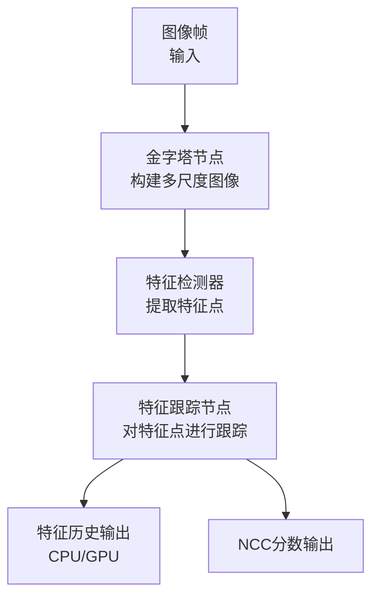
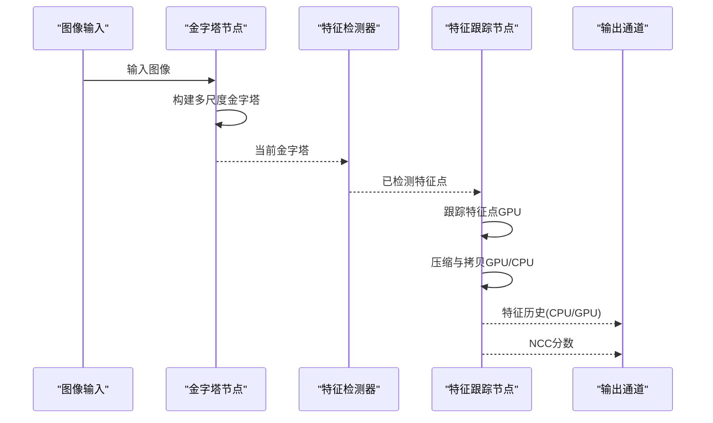
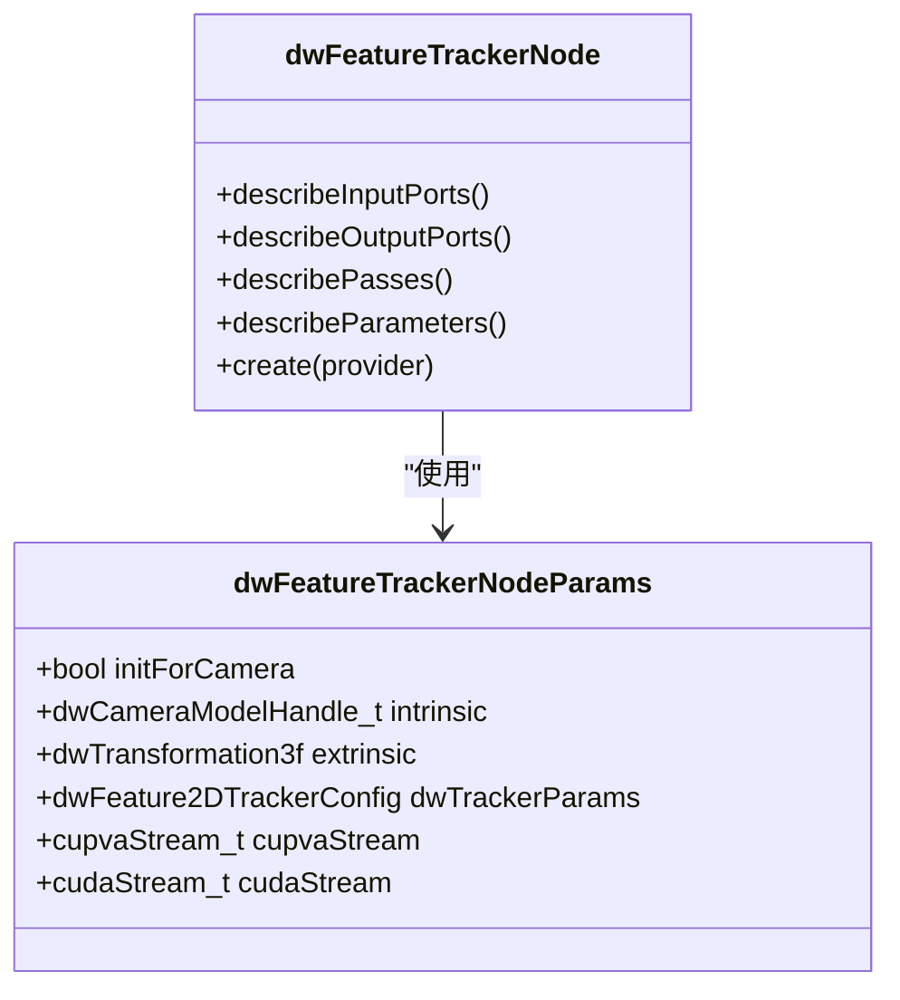
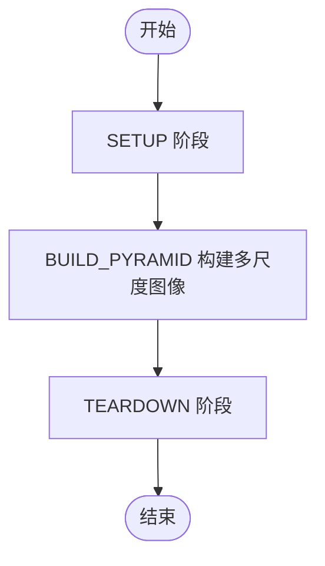
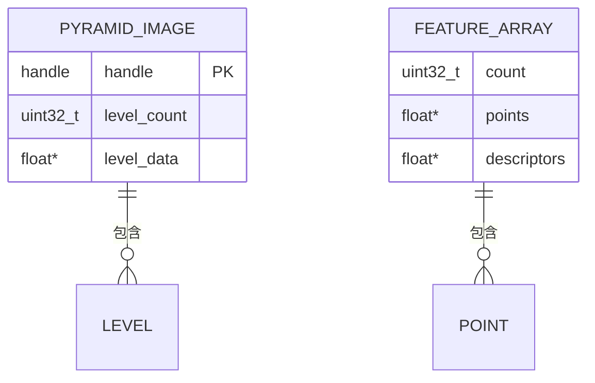
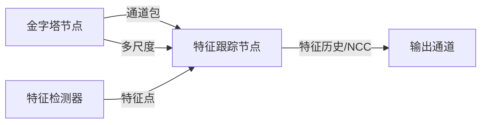

# 特征跟踪核心算法

<cite>
**本文引用的文件**   
- [dwFeatureTrackerNode.hpp](file://driverorks-5.10/include/dwframework/dwnodes/imageprocessing/dwfeaturetrackernode/dwFeatureTrackerNode.hpp)
- [dwPyramidNode.hpp](file://driverorks-5.10/include/dwframework/dwnodes/imageprocessing/dwpyramidnode/dwPyramidNode.hpp)
- [Pyramid.hpp](file://driverorks-5.10/include/dwframework/dwnodes/common/channelpackets/Pyramid.hpp)
- [FeatureDetector.h](file://driverorks-5.10/include/dw/imageprocessing/featuredetector/FeatureDetector.h)
- [FeatureList.h](file://driverorks-5.10/include/dw/imageprocessing/features/FeatureList.h)
- [Pyramid.h](file://driverorks-5.10/include/dw/imageprocessing/pyramid/Pyramid.h)
</cite>

## 目录
1. [引言](#引言)
2. [项目结构](#项目结构)
3. [核心组件](#核心组件)
4. [架构总览](#架构总览)
5. [详细组件分析](#详细组件分析)
6. [依赖关系分析](#依赖关系分析)
7. [性能考虑](#性能考虑)
8. [故障排查指南](#故障排查指南)
9. [结论](#结论)
10. [附录](#附录)

## 引言
本技术文档聚焦于DriveWorks框架中“特征跟踪核心算法”模块，围绕特征跟踪节点与金字塔构建节点的接口定义、参数配置与数据通路展开，帮助读者理解从图像金字塔到特征点跟踪的整体流程，并给出参数调优、失败检测与恢复策略、精度评估与性能优化建议。由于仓库中未直接提供特征跟踪算法的实现源码，本文以接口与通道包定义为依据，结合常见计算机视觉跟踪范式进行原理性阐述与实践指导。

## 项目结构
本模块涉及以下关键文件：
- 特征跟踪节点：定义输入输出端口、参数描述与处理阶段
- 金字塔节点：负责多尺度图像金字塔的构建
- 通道包：定义金字塔与特征列表的数据结构与类型映射
- 图像处理接口：特征检测器与特征列表的公共接口
- 多尺度金字塔接口：提供金字塔构建与访问能力

**图表来源**
- [dwPyramidNode.hpp:66-75](file://driverorks-5.10/include/dwframework/dwnodes/imageprocessing/dwpyramidnode/dwPyramidNode.hpp#L66-L75)
- [dwFeatureTrackerNode.hpp:70-83](file://driverorks-5.10/include/dwframework/dwnodes/imageprocessing/dwfeaturetrackernode/dwFeatureTrackerNode.hpp#L70-L83)
- [Pyramid.hpp:33-37](file://driverorks-5.10/include/dwframework/dwnodes/common/channelpackets/Pyramid.hpp#L33-L37)

**章节来源**
- [dwPyramidNode.hpp:1-129](file://driverorks-5.10/include/dwframework/dwnodes/imageprocessing/dwpyramidnode/dwPyramidNode.hpp#L1-L129)
- [dwFeatureTrackerNode.hpp:1-165](file://driverorks-5.10/include/dwframework/dwnodes/imageprocessing/dwfeaturetrackernode/dwFeatureTrackerNode.hpp#L1-L165)
- [Pyramid.hpp:1-40](file://driverorks-5.10/include/dwframework/dwnodes/common/channelpackets/Pyramid.hpp#L1-L40)

## 核心组件
- 金字塔节点（dwPyramidNode）
  - 输入：单帧图像
  - 输出：多层级金字塔图像
  - 关键参数：金字塔层数、图像宽高、CUDA流索引
  - 处理阶段：SETUP → BUILD_PYRAMID → TEARDOWN
- 特征跟踪节点（dwFeatureTrackerNode）
  - 输入：当前金字塔、已检测特征点
  - 输出：特征历史（CPU/GPU）、NCC分数、模块句柄
  - 关键参数：跟踪算法类型、特征检测器类型、最大特征数、金字塔层数、图像宽高、CUDA流索引
  - 处理阶段：SETUP → TRACK_FEATURE → COMPACT_FEATURE → COPY → WAIT_EVENT → TEARDOWN
- 通道包与类型映射
  - 金字塔通道包：将内部金字塔对象映射为通道数据类型
  - 特征列表通道包：封装特征数组与历史信息
- 图像处理接口
  - 特征检测器接口：提供特征点提取能力
  - 特征列表接口：提供特征点集合的统一表示
  - 金字塔接口：提供多尺度图像的访问与管理

**章节来源**
- [dwPyramidNode.hpp:53-61](file://driverorks-5.10/include/dwframework/dwnodes/imageprocessing/dwpyramidnode/dwPyramidNode.hpp#L53-L61)
- [dwPyramidNode.hpp:85-91](file://driverorks-5.10/include/dwframework/dwnodes/imageprocessing/dwpyramidnode/dwPyramidNode.hpp#L85-L91)
- [dwFeatureTrackerNode.hpp:53-62](file://driverorks-5.10/include/dwframework/dwnodes/imageprocessing/dwfeaturetrackernode/dwFeatureTrackerNode.hpp#L53-L62)
- [dwFeatureTrackerNode.hpp:93-101](file://driverorks-5.10/include/dwframework/dwnodes/imageprocessing/dwfeaturetrackernode/dwFeatureTrackerNode.hpp#L93-L101)
- [Pyramid.hpp:33-37](file://driverorks-5.10/include/dwframework/dwnodes/common/channelpackets/Pyramid.hpp#L33-L37)
- [FeatureDetector.h](file://driverorks-5.10/include/dw/imageprocessing/featuredetector/FeatureDetector.h)
- [FeatureList.h](file://driverorks-5.10/include/dw/imageprocessing/features/FeatureList.h)
- [Pyramid.h](file://driverorks-5.10/include/dw/imageprocessing/pyramid/Pyramid.h)

## 架构总览
下图展示了从图像输入到特征跟踪输出的端到端数据流，以及各节点之间的依赖关系与数据类型映射。

**图表来源**
- [dwPyramidNode.hpp:66-75](file://driverorks-5.10/include/dwframework/dwnodes/imageprocessing/dwpyramidnode/dwPyramidNode.hpp#L66-L75)
- [dwFeatureTrackerNode.hpp:70-83](file://driverorks-5.10/include/dwframework/dwnodes/imageprocessing/dwfeaturetrackernode/dwFeatureTrackerNode.hpp#L70-L83)
- [Pyramid.hpp:33-37](file://driverorks-5.10/include/dwframework/dwnodes/common/channelpackets/Pyramid.hpp#L33-L37)

## 详细组件分析

### 组件A：特征跟踪节点（dwFeatureTrackerNode）
- 端口与数据通路
  - 输入：当前金字塔、已检测特征点
  - 输出：特征历史（CPU/GPU）、NCC分数、模块句柄
- 参数与配置
  - 跟踪算法类型、特征检测器类型、最大特征数、金字塔层数、图像宽高、CUDA流索引
- 处理阶段
  - SETUP：初始化资源
  - TRACK_FEATURE：在GPU上执行特征跟踪
  - COMPACT_FEATURE：压缩有效特征
  - COPY：拷贝结果至目标域
  - WAIT_EVENT：等待事件完成
  - TEARDOWN：释放资源
- 数学与算法要点（概念性说明）
  - 光流约束方程：在局部窗口内建立亮度恒定与空间时间平滑的最小二乘问题，求解每像素的速度分量
  - 金字塔多尺度：通过多层低通滤波与降采样构建尺度空间，先粗后精进行迭代优化
  - 迭代优化：在每层使用高斯-牛顿或莱文伯格-马夸特法求解，逐层细化直至收敛
  - 特征匹配与KLT：KLT在光流基础上引入形变模型与鲁棒权重，提升遮挡与大位移下的稳定性
- 参数设置与调节
  - 窗口大小：影响局部平滑与细节保留的平衡
  - 金字塔层数：控制多尺度分辨率与计算开销
  - 最大迭代次数与收敛阈值：决定跟踪精度与实时性权衡
  - 最大特征数：限制并行计算负载与内存占用
- 代码示例路径（不展示具体代码内容）
  - 特征检测与跟踪流程参考：[dwFeatureTrackerNode.hpp:106-156](file://driverorks-5.10/include/dwframework/dwnodes/imageprocessing/dwfeaturetrackernode/dwFeatureTrackerNode.hpp#L106-L156)
  - 金字塔通道包类型映射参考：[Pyramid.hpp:33-37](file://driverorks-5.10/include/dwframework/dwnodes/common/channelpackets/Pyramid.hpp#L33-L37)
- 跟踪失败检测与恢复策略（概念性说明）
  - 失败检测：NCC分数过低、跟踪误差过大、特征点丢失比例过高
  - 恢复策略：回退到上一时刻历史、降低金字塔层数、增大窗口尺寸、重新初始化特征点
- 精度评估与性能优化（概念性说明）
  - 精度：重投影误差、跟踪漂移、丢失率、NCC分数分布
  - 优化：减少最大特征数、降低金字塔层数、选择更高效的跟踪算法、合理分配CUDA流

**图表来源**
- [dwFeatureTrackerNode.hpp:67-160](file://driverorks-5.10/include/dwframework/dwnodes/imageprocessing/dwfeaturetrackernode/dwFeatureTrackerNode.hpp#L67-L160)

**章节来源**
- [dwFeatureTrackerNode.hpp:53-160](file://driverorks-5.10/include/dwframework/dwnodes/imageprocessing/dwfeaturetrackernode/dwFeatureTrackerNode.hpp#L53-L160)
- [Pyramid.hpp:33-37](file://driverorks-5.10/include/dwframework/dwnodes/common/channelpackets/Pyramid.hpp#L33-L37)
- [FeatureDetector.h](file://driverorks-5.10/include/dw/imageprocessing/featuredetector/FeatureDetector.h)
- [FeatureList.h](file://driverorks-5.10/include/dw/imageprocessing/features/FeatureList.h)

### 组件B：金字塔节点（dwPyramidNode）
- 端口与数据通路
  - 输入：单帧图像
  - 输出：多层级金字塔图像
- 参数与配置
  - 图像宽高、金字塔层数、CUDA流索引
- 处理阶段
  - SETUP → BUILD_PYRAMID → TEARDOWN
- 多尺度处理（概念性说明）
  - 通过高斯金字塔对图像进行多尺度分解，逐层降采样，形成尺度空间
  - 在粗层进行快速估计，在细层进行精细优化，提高鲁棒性与效率

**图表来源**
- [dwPyramidNode.hpp:85-91](file://driverorks-5.10/include/dwframework/dwnodes/imageprocessing/dwpyramidnode/dwPyramidNode.hpp#L85-L91)

**章节来源**
- [dwPyramidNode.hpp:53-124](file://driverorks-5.10/include/dwframework/dwnodes/imageprocessing/dwpyramidnode/dwPyramidNode.hpp#L53-L124)
- [Pyramid.h](file://driverorks-5.10/include/dw/imageprocessing/pyramid/Pyramid.h)

### 组件C：通道包与数据模型
- 金字塔通道包
  - 将内部金字塔对象映射为通道数据类型，便于跨节点传递
- 特征列表通道包
  - 提供特征数组与历史信息的统一封装，支持CPU/GPU双通道输出

**图表来源**
- [Pyramid.hpp:33-37](file://driverorks-5.10/include/dwframework/dwnodes/common/channelpackets/Pyramid.hpp#L33-L37)

**章节来源**
- [Pyramid.hpp:33-37](file://driverorks-5.10/include/dwframework/dwnodes/common/channelpackets/Pyramid.hpp#L33-L37)
- [FeatureList.h](file://driverorks-5.10/include/dw/imageprocessing/features/FeatureList.h)

## 依赖关系分析
- 节点间耦合
  - 金字塔节点与特征跟踪节点通过通道包耦合，前者提供多尺度输入，后者消费特征点与金字塔
- 接口契约
  - 特征检测器与特征列表接口为跟踪节点提供统一的特征抽象
  - 金字塔接口为跟踪与检测提供多尺度基础
- 外部依赖
  - CUDA流与PVA流用于异步处理与加速
  - 通道包类型映射确保跨模块数据一致性

**图表来源**
- [dwPyramidNode.hpp:66-75](file://driverorks-5.10/include/dwframework/dwnodes/imageprocessing/dwpyramidnode/dwPyramidNode.hpp#L66-L75)
- [dwFeatureTrackerNode.hpp:70-83](file://driverorks-5.10/include/dwframework/dwnodes/imageprocessing/dwfeaturetrackernode/dwFeatureTrackerNode.hpp#L70-L83)

**章节来源**
- [dwPyramidNode.hpp:1-129](file://driverorks-5.10/include/dwframework/dwnodes/imageprocessing/dwpyramidnode/dwPyramidNode.hpp#L1-L129)
- [dwFeatureTrackerNode.hpp:1-165](file://driverorks-5.10/include/dwframework/dwnodes/imageprocessing/dwfeaturetrackernode/dwFeatureTrackerNode.hpp#L1-L165)
- [FeatureDetector.h](file://driverorks-5.10/include/dw/imageprocessing/featuredetector/FeatureDetector.h)
- [FeatureList.h](file://driverorks-5.10/include/dw/imageprocessing/features/FeatureList.h)
- [Pyramid.h](file://driverorks-5.10/include/dw/imageprocessing/pyramid/Pyramid.h)

## 性能考虑
- 计算与内存
  - 控制最大特征数与金字塔层数，避免过度并行与内存峰值
  - 合理选择CUDA流，减少同步阻塞
- 算法与参数
  - 根据场景动态调整窗口大小与收敛阈值
  - 在光照变化或遮挡严重时适当降低金字塔层数以提升鲁棒性
- 数据通路
  - 利用通道包的CPU/GPU双通道输出，减少不必要的拷贝
  - 在跟踪前后进行特征压缩，降低后续处理成本

## 故障排查指南
- 常见问题
  - 跟踪漂移：检查金字塔层数与窗口大小是否合适；必要时回退历史帧
  - 特征丢失：降低最大特征数或增大窗口；检查光照与纹理条件
  - 性能瓶颈：减少金字塔层数或最大特征数；合并CUDA流
- 检测与恢复
  - 使用NCC分数作为质量指标；低于阈值则触发恢复策略
  - 在失败时回退到上一时刻的历史特征，重新初始化跟踪

## 结论
本模块通过“金字塔构建 + 特征检测 + 特征跟踪”的流水线化设计，提供了可配置、可扩展的特征跟踪能力。尽管实现细节未在仓库中直接呈现，但接口与通道包清晰定义了数据流与参数契约，使得用户能够根据场景需求灵活调整参数、评估精度并优化性能。

## 附录
- 参数速查
  - 金字塔层数：控制多尺度分辨率与计算复杂度
  - 最大特征数：限制并行与内存占用
  - 窗口大小：影响局部平滑与细节保留
  - 收敛阈值与迭代次数：平衡精度与实时性
- 参考路径
  - 特征跟踪节点参数描述：[dwFeatureTrackerNode.hpp:106-156](file://driverorks-5.10/include/dwframework/dwnodes/imageprocessing/dwfeaturetrackernode/dwFeatureTrackerNode.hpp#L106-L156)
  - 金字塔节点参数描述：[dwPyramidNode.hpp:95-120](file://driverorks-5.10/include/dwframework/dwnodes/imageprocessing/dwpyramidnode/dwPyramidNode.hpp#L95-L120)
  - 通道包类型映射：[Pyramid.hpp:33-37](file://driverorks-5.10/include/dwframework/dwnodes/common/channelpackets/Pyramid.hpp#L33-L37)