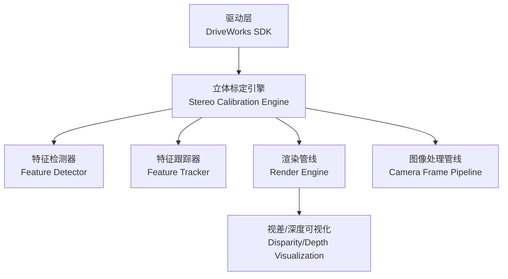
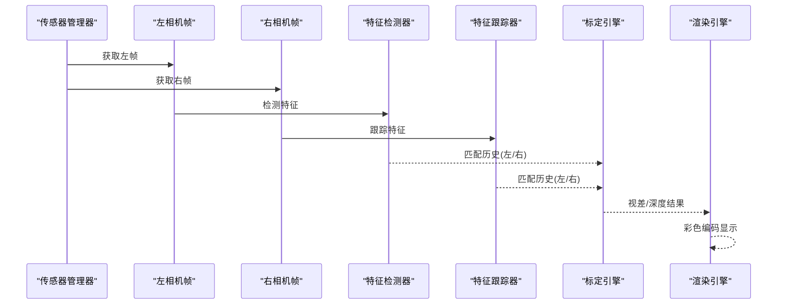
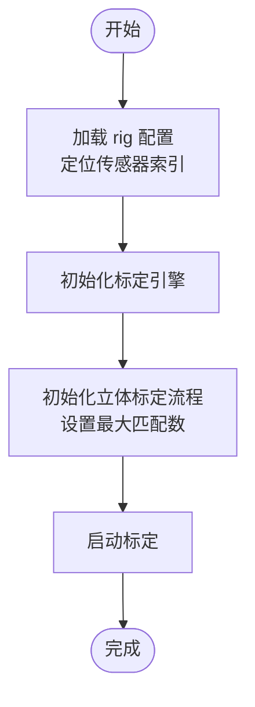
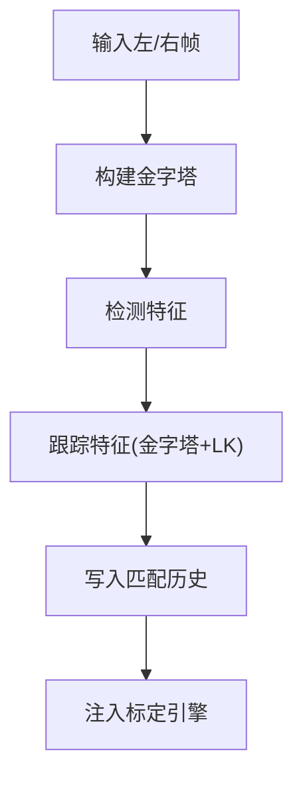
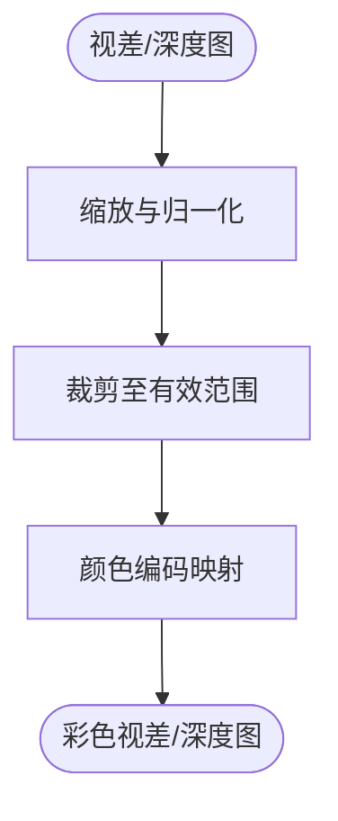
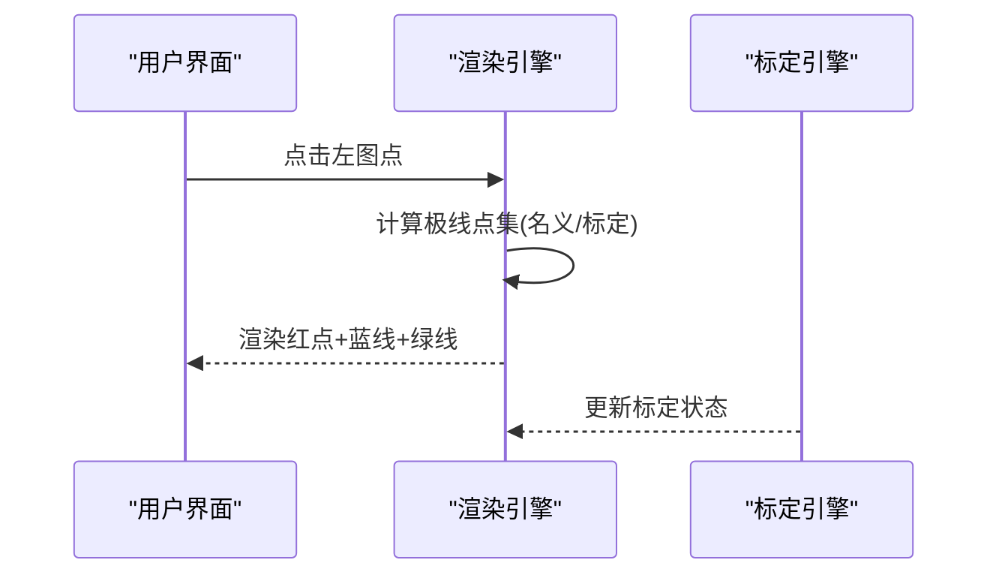
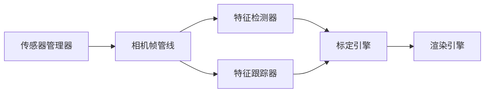

# 立体视觉

<cite>
**本文引用的文件**
- [StereoParams.h](file://driverorks-5.10/include/dw/calibration/engine/stereo/StereoParams.h)
- [main.cpp](file://driverorks-5.10/samples/src/calibration/stereo/main.cpp)
- [utils.hpp](file://driverorks-5.10/samples/src/imageprocessing/stereo/stereo/utils.hpp)
- [README.md](file://driverorks-5.10/samples/src/calibration/stereo/README.md)
</cite>

## 目录
1. [引言](#引言)
2. [项目结构](#项目结构)
3. [核心组件](#核心组件)
4. [架构总览](#架构总览)
5. [详细组件分析](#详细组件分析)
6. [依赖关系分析](#依赖关系分析)
7. [性能考量](#性能考量)
8. [故障排查指南](#故障排查指南)
9. [结论](#结论)
10. [附录](#附录)

## 引言
本文件面向立体视觉模块的技术文档，聚焦于双目图像的视差计算与深度重建能力，以及立体匹配（区域匹配、全局匹配、多视图立体）在该框架中的实现方式与使用路径。文档以 DriveWorks 驱动的立体标定与渲染样例为依据，系统阐述：
- 立体视觉处理流程：从传感器帧获取、特征检测与跟踪、到视差/深度结果输出
- 视差图生成与后处理：颜色编码、亚像素插值与噪声抑制策略
- 参数配置与系统设计权衡：匹配窗口、金字塔层级、最大匹配数等
- 实际应用中的精度评估与性能优化建议

## 项目结构
立体视觉相关代码主要分布在以下位置：
- 标定与立体参数定义：include/dw/calibration/engine/stereo/StereoParams.h
- 立体标定与渲染样例：samples/src/calibration/stereo/main.cpp
- 视差/深度可视化工具：samples/src/imageprocessing/stereo/stereo/utils.hpp
- 样例说明文档：samples/src/calibration/stereo/README.md

**图表来源**
- [StereoParams.h:54-77](file://driverorks-5.10/include/dw/calibration/engine/stereo/StereoParams.h#L54-L77)
- [main.cpp:132-154](file://driverorks-5.10/samples/src/calibration/stereo/main.cpp#L132-L154)
- [utils.hpp:38](file://driverorks-5.10/samples/src/imageprocessing/stereo/stereo/utils.hpp#L38)

**章节来源**
- [StereoParams.h:54-77](file://driverorks-5.10/include/dw/calibration/engine/stereo/StereoParams.h#L54-L77)
- [main.cpp:132-154](file://driverorks-5.10/samples/src/calibration/stereo/main.cpp#L132-L154)
- [utils.hpp:38](file://driverorks-5.10/samples/src/imageprocessing/stereo/stereo/utils.hpp#L38)

## 核心组件
- 立体标定参数结构体：用于初始化立体标定流程，包含极线约束的最大匹配数、左右相机模型句柄、回调与用户数据等字段。
- 特征检测与跟踪：通过金字塔图像与 Lucas-Kanade 跟踪器实现稳定的跨帧匹配。
- 渲染与可视化：将视差/深度结果映射为彩色编码图，并叠加在双目图像上进行验证。

关键职责与接口要点：
- 初始化上下文、传感器管理、相机模型与渲染引擎
- 启动立体标定流程并注入匹配历史
- 将匹配点对投射到右图像的极线上，验证标定质量
- 输出视差/深度结果并进行颜色编码

**章节来源**
- [StereoParams.h:54-77](file://driverorks-5.10/include/dw/calibration/engine/stereo/StereoParams.h#L54-L77)
- [main.cpp:132-154](file://driverorks-5.10/samples/src/calibration/stereo/main.cpp#L132-L154)
- [main.cpp:636-667](file://driverorks-5.10/samples/src/calibration/stereo/main.cpp#L636-L667)
- [main.cpp:741-758](file://driverorks-5.10/samples/src/calibration/stereo/main.cpp#L741-L758)
- [utils.hpp:38](file://driverorks-5.10/samples/src/imageprocessing/stereo/stereo/utils.hpp#L38)

## 架构总览
下图展示了从传感器事件到视差/深度结果的端到端流程：

**图表来源**
- [main.cpp:274-376](file://driverorks-5.10/samples/src/calibration/stereo/main.cpp#L274-L376)
- [main.cpp:636-667](file://driverorks-5.10/samples/src/calibration/stereo/main.cpp#L636-L667)
- [main.cpp:741-758](file://driverorks-5.10/samples/src/calibration/stereo/main.cpp#L741-L758)

## 详细组件分析

### 组件A：立体标定参数与初始化
- 结构体字段解析
  - 极线约束最大匹配数：限制每次标定迭代中可用的匹配点数量，影响鲁棒性与速度
  - 左右已标定相机模型句柄：可直接传入或由标定引擎从 rig 配置克隆
  - 用户数据与状态回调：便于外部集成与进度反馈
- 初始化流程
  - 读取 rig 配置，定位车辆与左右相机传感器索引
  - 初始化标定引擎与立体标定流程
  - 启动标定并绘制初始极线段

**图表来源**
- [StereoParams.h:54-77](file://driverorks-5.10/include/dw/calibration/engine/stereo/StereoParams.h#L54-L77)
- [main.cpp:526-575](file://driverorks-5.10/samples/src/calibration/stereo/main.cpp#L526-L575)
- [main.cpp:741-758](file://driverorks-5.10/samples/src/calibration/stereo/main.cpp#L741-L758)

**章节来源**
- [StereoParams.h:54-77](file://driverorks-5.10/include/dw/calibration/engine/stereo/StereoParams.h#L54-L77)
- [main.cpp:526-575](file://driverorks-5.10/samples/src/calibration/stereo/main.cpp#L526-L575)
- [main.cpp:741-758](file://driverorks-5.10/samples/src/calibration/stereo/main.cpp#L741-L758)

### 组件B：特征检测与跟踪（区域匹配）
- 金字塔构建：为两帧分别构建多层级金字塔，提升匹配鲁棒性
- 特征检测：在当前帧检测兴趣点，限制最大数量
- 特征跟踪：使用金字塔与 Lucas-Kanade 迭代跟踪前一帧特征，支持仅平移模式
- 历史管理：维护固定容量的历史数组，避免跨帧误匹配

**图表来源**
- [main.cpp:636-667](file://driverorks-5.10/samples/src/calibration/stereo/main.cpp#L636-L667)
- [main.cpp:791-798](file://driverorks-5.10/samples/src/calibration/stereo/main.cpp#L791-L798)

**章节来源**
- [main.cpp:636-667](file://driverorks-5.10/samples/src/calibration/stereo/main.cpp#L636-L667)
- [main.cpp:791-798](file://driverorks-5.10/samples/src/calibration/stereo/main.cpp#L791-L798)

### 组件C：视差图生成与后处理（颜色编码）
- 颜色编码函数：将视差/深度映射为伪彩图，便于直观观察
- 参数说明
  - 缩放因子：控制颜色映射范围
  - 最大距离/深度因子：用于裁剪与归一化
- 典型后处理
  - 亚像素插值：通过金字塔与子像素优化提升精度
  - 噪声抑制：通过匹配一致性检验、中值滤波等手段减少误匹配

**图表来源**
- [utils.hpp:38](file://driverorks-5.10/samples/src/imageprocessing/stereo/stereo/utils.hpp#L38)

**章节来源**
- [utils.hpp:38](file://driverorks-5.10/samples/src/imageprocessing/stereo/stereo/utils.hpp#L38)

### 组件D：渲染与标定验证
- 双屏渲染：左侧原图叠加点击点，右侧显示极线（名义与标定后）
- 文本信息：显示标定状态、位姿修正量、时间戳等
- 交互：鼠标点击选择左图点，自动计算对应极线段

**图表来源**
- [main.cpp:161-270](file://driverorks-5.10/samples/src/calibration/stereo/main.cpp#L161-L270)
- [main.cpp:380-407](file://driverorks-5.10/samples/src/calibration/stereo/main.cpp#L380-L407)

**章节来源**
- [main.cpp:161-270](file://driverorks-5.10/samples/src/calibration/stereo/main.cpp#L161-L270)
- [main.cpp:380-407](file://driverorks-5.10/samples/src/calibration/stereo/main.cpp#L380-L407)

### 组件E：多视图立体（概念性说明）
- 多视图立体通常指利用多个视角（>2）进行稠密匹配与深度估计，常见方法包括：
  - 区域匹配：SGBM、半全局匹配（SGM）
  - 全局匹配：能量最小化、图割/BP/树幅优化
  - 多视图一致性：多基线、多尺度、多假设融合
- 在本框架中，立体匹配以双目特征跟踪为主；若需扩展到多视图，可在现有特征/匹配模块之上增加多相机帧队列与一致性检查逻辑。

[本节为概念性内容，不直接分析具体文件]

## 依赖关系分析
- 模块耦合
  - 传感器管理器负责同步左右相机帧并保证时间戳一致
  - 特征检测/跟踪模块依赖图像金字塔与 CUDA 流
  - 渲染引擎依赖可视化上下文与双屏布局
- 关键依赖链
  - 传感器事件 → 相机帧管线 → 特征检测/跟踪 → 标定引擎 → 渲染/输出

**图表来源**
- [main.cpp:274-376](file://driverorks-5.10/samples/src/calibration/stereo/main.cpp#L274-L376)
- [main.cpp:636-667](file://driverorks-5.10/samples/src/calibration/stereo/main.cpp#L636-L667)
- [main.cpp:741-758](file://driverorks-5.10/samples/src/calibration/stereo/main.cpp#L741-L758)

**章节来源**
- [main.cpp:274-376](file://driverorks-5.10/samples/src/calibration/stereo/main.cpp#L274-L376)
- [main.cpp:636-667](file://driverorks-5.10/samples/src/calibration/stereo/main.cpp#L636-L667)
- [main.cpp:741-758](file://driverorks-5.10/samples/src/calibration/stereo/main.cpp#L741-L758)

## 性能考量
- 匹配窗口与金字塔层级
  - 更大的窗口与更多金字塔层级可提升精度但增加计算开销
  - 建议根据分辨率与场景复杂度折中设置
- 最大匹配数
  - 控制标定迭代的样本规模，过小导致信息不足，过大可能引入噪声
- CUDA 流与内存类型
  - 使用 CUDA 内存与流可显著降低 CPU-GPU 同步开销
- 渲染与可视化
  - 双屏渲染与大量极线点绘制会占用带宽，建议在调试阶段启用，发布版本关闭或降采样

[本节提供通用指导，不直接分析具体文件]

## 故障排查指南
- 时间戳不一致
  - 现象：抛出“左右时间戳必须相同”的异常
  - 排查：确认左右相机同步配置与触发信号
- 分辨率不匹配
  - 现象：左右相机内参与传感器分辨率不一致或左右分辨率不一致
  - 排查：核对 rig 配置与相机输出属性
- 匹配失败或漂移
  - 现象：极线不通过对应点、标定状态不稳定
  - 排查：增大最大匹配数、调整金字塔层级、检查光照与纹理
- 渲染异常
  - 现象：窗口尺寸变化导致坐标系错乱
  - 排查：响应窗口大小变化重置渲染引擎

**章节来源**
- [main.cpp:783-786](file://driverorks-5.10/samples/src/calibration/stereo/main.cpp#L783-L786)
- [main.cpp:598-628](file://driverorks-5.10/samples/src/calibration/stereo/main.cpp#L598-L628)
- [main.cpp:410-420](file://driverorks-5.10/samples/src/calibration/stereo/main.cpp#L410-L420)

## 结论
本立体视觉模块以双目特征跟踪为核心，结合标定引擎与渲染管线，实现了从原始图像到视差/深度结果的完整链路。通过合理配置匹配窗口、金字塔层级与最大匹配数，可在精度与性能之间取得平衡。颜色编码与极线验证为标定质量提供了直观保障；进一步扩展可引入多视图一致性与全局优化方法以提升稠密重建质量。

[本节为总结性内容，不直接分析具体文件]

## 附录

### A. 使用示例（步骤级指引）
- 准备工作
  - 准备 rig 配置与左右相机传感器索引
  - 设置最大匹配数与渲染窗口
- 执行流程
  - 初始化上下文、传感器管理器与相机帧管线
  - 初始化特征检测器与跟踪器，构建金字塔
  - 获取左右帧，检测并跟踪特征，写入匹配历史
  - 注入标定引擎并启动标定，渲染极线与颜色编码图
- 验证与导出
  - 通过极线通过性与颜色编码分布评估精度
  - 导出标定结果与深度图用于下游任务

**章节来源**
- [README.md](file://driverorks-5.10/samples/src/calibration/stereo/README.md)
- [main.cpp:132-154](file://driverorks-5.10/samples/src/calibration/stereo/main.cpp#L132-L154)
- [main.cpp:334-353](file://driverorks-5.10/samples/src/calibration/stereo/main.cpp#L334-L353)
- [utils.hpp:38](file://driverorks-5.10/samples/src/imageprocessing/stereo/stereo/utils.hpp#L38)