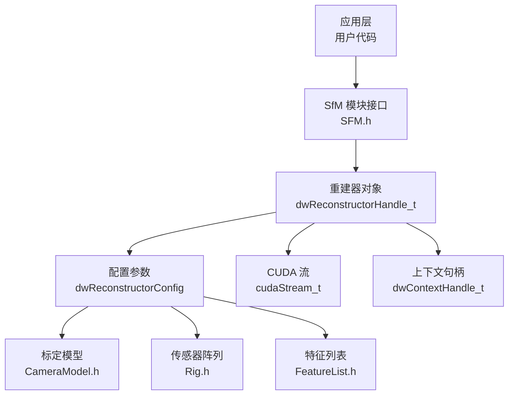
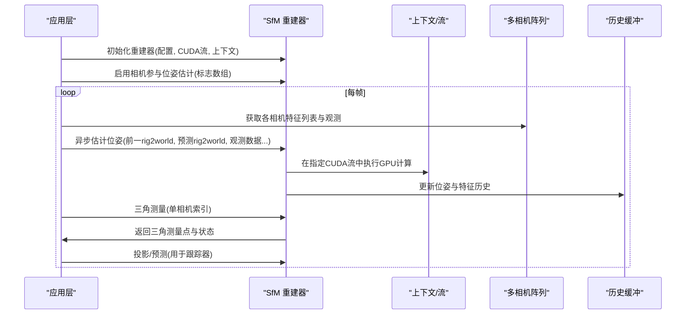
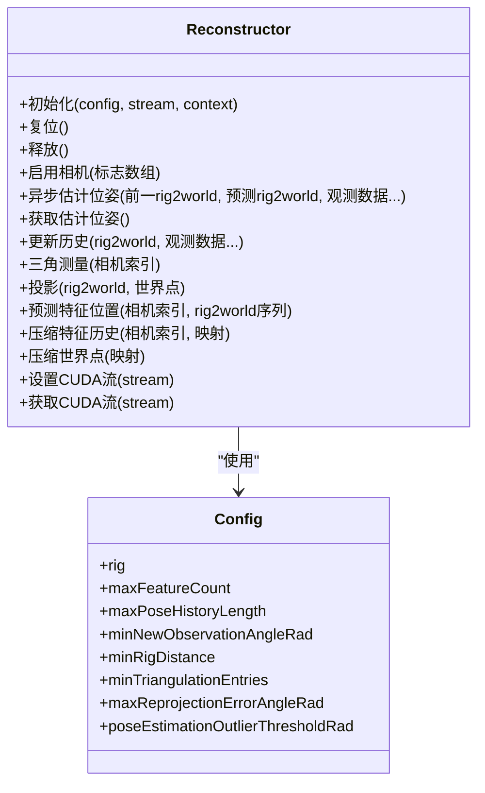
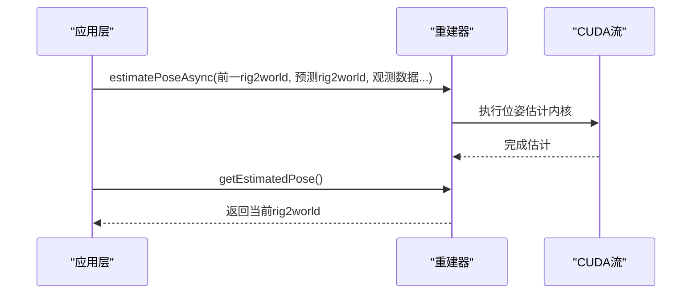
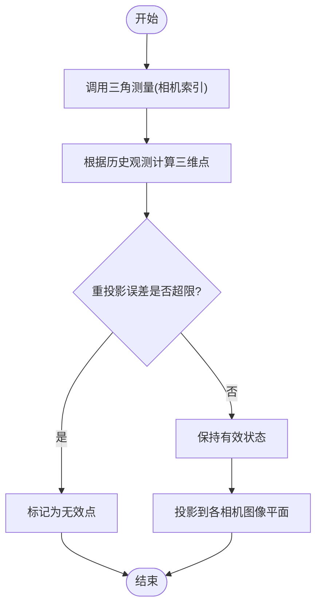
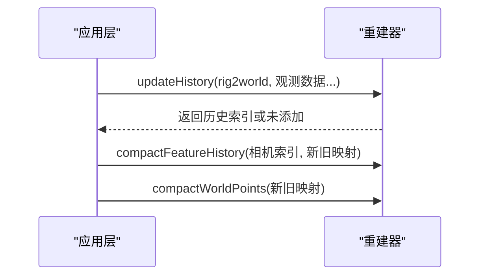
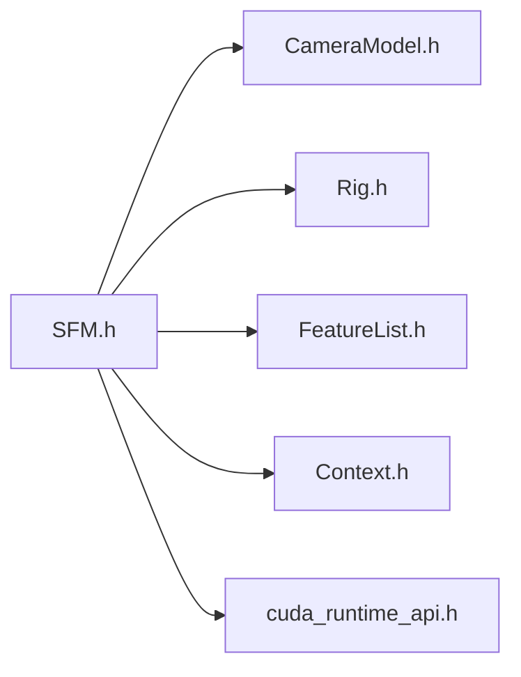

# 结构从运动(SfM)

<cite>
**本文引用的文件**
- [driverorks-5.10/include/dw/imageprocessing/sfm/SFM.h](file://driverorks-5.10/include/dw/imageprocessing/sfm/SFM.h)
- [driveworks-5.14/include/dw/imageprocessing/sfm/SFM.h](file://driveworks-5.14/include/dw/imageprocessing/sfm/SFM.h)
- [driveworks-5.8/include/dw/imageprocessing/sfm/SFM.h](file://driveworks-5.8/include/dw/imageprocessing/sfm/SFM.h)
- [driveworks-520/include/dw/imageprocessing/sfm/SFM.h](file://driveworks-520/include/dw/imageprocessing/sfm/SFM.h)
</cite>

## 目录
1. [引言](#引言)
2. [项目结构](#项目结构)
3. [核心组件](#核心组件)
4. [架构总览](#架构总览)
5. [详细组件分析](#详细组件分析)
6. [依赖关系分析](#依赖关系分析)
7. [性能考量](#性能考量)
8. [故障排查指南](#故障排查指南)
9. [结论](#结论)
10. [附录](#附录)

## 引言
本文件面向使用 NVIDIA DriveWorks 的开发者，系统化阐述结构从运动（Structure-from-Motion, SfM）模块在多传感器平台上的实现与应用。SfM 模块通过“视觉特征匹配—相机位姿估计—三角测量—历史更新”的流程，实现从多视角图像中恢复相机轨迹与稀疏三维场景结构，并为后续点云拼接、语义分割与高精地图构建提供基础。

本技术文档将：
- 解析 SfM 类提供的接口与配置参数，说明其在多视图重建与相机轨迹估计中的作用；
- 阐述 SfM 算法的数学原理与关键步骤（特征匹配、基础矩阵估计、三角测量等）；
- 对比稀疏重建与密集重建策略（点云生成与网格重建思路），并给出工程实践建议；
- 提供可直接定位到源码的路径示例，帮助快速上手；
- 总结算法鲁棒性与精度的影响因素，并给出性能优化与故障排查建议。

## 项目结构
SfM 接口位于驱动库的图像处理子模块下，随版本演进保持稳定的 API 设计。以下为与 SfM 相关的关键头文件位置与版本对应关系：

- driverorks-5.10：SFM 接口定义于该版本头文件中，提供基础的重建器对象、配置参数与核心 API。
- driveworks-5.14：与 5.10 版本接口一致，保持向后兼容。
- driveworks-5.8：与 5.10 版本接口一致，保持向后兼容。
- driveworks-520：在 5.10 基础上新增“GPU 图形预热”能力，以支持安全平台的 CUDA Graph 录制与运行。

图表来源
- [driverorks-5.10/include/dw/imageprocessing/sfm/SFM.h:87-118](file://driverorks-5.10/include/dw/imageprocessing/sfm/SFM.h#L87-L118)
- [driveworks-5.14/include/dw/imageprocessing/sfm/SFM.h:87-118](file://driveworks-5.14/include/dw/imageprocessing/sfm/SFM.h#L87-L118)
- [driveworks-5.8/include/dw/imageprocessing/sfm/SFM.h:87-118](file://driveworks-5.8/include/dw/imageprocessing/sfm/SFM.h#L87-L118)
- [driveworks-520/include/dw/imageprocessing/sfm/SFM.h:87-118](file://driveworks-520/include/dw/imageprocessing/sfm/SFM.h#L87-L118)

章节来源
- [driverorks-5.10/include/dw/imageprocessing/sfm/SFM.h:38-44](file://driverorks-5.10/include/dw/imageprocessing/sfm/SFM.h#L38-L44)
- [driveworks-5.14/include/dw/imageprocessing/sfm/SFM.h:38-44](file://driveworks-5.14/include/dw/imageprocessing/sfm/SFM.h#L38-L44)
- [driveworks-5.8/include/dw/imageprocessing/sfm/SFM.h:38-44](file://driveworks-5.8/include/dw/imageprocessing/sfm/SFM.h#L38-L44)
- [driveworks-520/include/dw/imageprocessing/sfm/SFM.h:38-44](file://driveworks-520/include/dw/imageprocessing/sfm/SFM.h#L38-L44)

## 核心组件
SfM 模块围绕“重建器（Reconstructor）”对象展开，其核心职责包括：
- 初始化与释放重建器；
- 配置重建参数（如最大特征数、历史长度、最小观测角度、重投影阈值等）；
- 多相机并行估计当前车体位姿；
- 更新特征与位姿历史；
- 单相机三角测量特征；
- 将三角测量结果投影回图像或预测特征位置；
- 支持特征历史与世界点压缩，维持内存与同步一致性；
- 设置/获取 CUDA 流，便于与流水线集成。

关键数据结构与接口概览（以 5.10 版本为例）：
- 句柄类型：重建器句柄、常量重建器句柄
- 配置结构：包含标定阵列、最大特征数、历史长度、最小观测角、最小三角化条目、重投影误差阈值、位姿估计异常值阈值等
- 核心 API：初始化、复位、释放、启用相机参与位姿估计、异步估计位姿、获取估计位姿、更新历史、三角测量、投影、特征位置预测、压缩历史与世界点、设置/获取 CUDA 流

章节来源
- [driverorks-5.10/include/dw/imageprocessing/sfm/SFM.h:76-118](file://driverorks-5.10/include/dw/imageprocessing/sfm/SFM.h#L76-L118)
- [driverorks-5.10/include/dw/imageprocessing/sfm/SFM.h:144-175](file://driverorks-5.10/include/dw/imageprocessing/sfm/SFM.h#L144-L175)
- [driverorks-5.10/include/dw/imageprocessing/sfm/SFM.h:224-231](file://driverorks-5.10/include/dw/imageprocessing/sfm/SFM.h#L224-L231)
- [driverorks-5.10/include/dw/imageprocessing/sfm/SFM.h:275-280](file://driverorks-5.10/include/dw/imageprocessing/sfm/SFM.h#L275-L280)
- [driverorks-5.10/include/dw/imageprocessing/sfm/SFM.h:302-306](file://driverorks-5.10/include/dw/imageprocessing/sfm/SFM.h#L302-L306)
- [driverorks-5.10/include/dw/imageprocessing/sfm/SFM.h:320-324](file://driverorks-5.10/include/dw/imageprocessing/sfm/SFM.h#L320-L324)
- [driverorks-5.10/include/dw/imageprocessing/sfm/SFM.h:346-354](file://driverorks-5.10/include/dw/imageprocessing/sfm/SFM.h#L346-L354)
- [driverorks-5.10/include/dw/imageprocessing/sfm/SFM.h:371-374](file://driverorks-5.10/include/dw/imageprocessing/sfm/SFM.h#L371-L374)
- [driverorks-5.10/include/dw/imageprocessing/sfm/SFM.h:390-393](file://driverorks-5.10/include/dw/imageprocessing/sfm/SFM.h#L390-L393)
- [driverorks-5.10/include/dw/imageprocessing/sfm/SFM.h:407-408](file://driverorks-5.10/include/dw/imageprocessing/sfm/SFM.h#L407-L408)

## 架构总览
SfM 在系统中的典型工作流如下：
- 输入：来自传感器阵列（Rig）的多相机图像帧；每帧包含特征列表（FeatureList）、特征状态、二维观测坐标与可能的三维先验；
- 处理：重建器根据配置与历史，对所有相机并行估计当前位姿；随后更新位姿与特征历史；对单相机执行三角测量；将三角测量结果投影回图像或预测下一时刻特征位置；
- 输出：当前位姿（rig2world）、三角测量后的三维点云（稀疏）、以及可用于跟踪器的预测位置。

图表来源
- [driverorks-5.10/include/dw/imageprocessing/sfm/SFM.h:144-175](file://driverorks-5.10/include/dw/imageprocessing/sfm/SFM.h#L144-L175)
- [driverorks-5.10/include/dw/imageprocessing/sfm/SFM.h:194-231](file://driverorks-5.10/include/dw/imageprocessing/sfm/SFM.h#L194-L231)
- [driverorks-5.10/include/dw/imageprocessing/sfm/SFM.h:275-280](file://driverorks-5.10/include/dw/imageprocessing/sfm/SFM.h#L275-L280)
- [driverorks-5.10/include/dw/imageprocessing/sfm/SFM.h:302-306](file://driverorks-5.10/include/dw/imageprocessing/sfm/SFM.h#L302-L306)
- [driverorks-5.10/include/dw/imageprocessing/sfm/SFM.h:320-324](file://driverorks-5.10/include/dw/imageprocessing/sfm/SFM.h#L320-L324)
- [driverorks-5.10/include/dw/imageprocessing/sfm/SFM.h:346-354](file://driverorks-5.10/include/dw/imageprocessing/sfm/SFM.h#L346-L354)

## 详细组件分析

### 组件A：重建器对象与配置
- 对象：重建器句柄封装了内部状态与资源，支持初始化、复位与释放；
- 配置：包含标定阵列（Rig）、最大特征数、历史长度、最小新观测夹角、最小三角化条目、重投影误差阈值、位姿估计异常值阈值等；
- CUDA 流：所有 GPU 计算绑定到指定流，便于与系统流水线协同；
- 上下文：重建器在给定上下文中创建，确保生命周期与资源管理一致。

图表来源
- [driverorks-5.10/include/dw/imageprocessing/sfm/SFM.h:76-118](file://driverorks-5.10/include/dw/imageprocessing/sfm/SFM.h#L76-L118)
- [driverorks-5.10/include/dw/imageprocessing/sfm/SFM.h:144-175](file://driverorks-5.10/include/dw/imageprocessing/sfm/SFM.h#L144-L175)
- [driverorks-5.10/include/dw/imageprocessing/sfm/SFM.h:224-231](file://driverorks-5.10/include/dw/imageprocessing/sfm/SFM.h#L224-L231)
- [driverorks-5.10/include/dw/imageprocessing/sfm/SFM.h:275-280](file://driverorks-5.10/include/dw/imageprocessing/sfm/SFM.h#L275-L280)
- [driverorks-5.10/include/dw/imageprocessing/sfm/SFM.h:302-306](file://driverorks-5.10/include/dw/imageprocessing/sfm/SFM.h#L302-L306)
- [driverorks-5.10/include/dw/imageprocessing/sfm/SFM.h:320-324](file://driverorks-5.10/include/dw/imageprocessing/sfm/SFM.h#L320-L324)
- [driverorks-5.10/include/dw/imageprocessing/sfm/SFM.h:346-354](file://driverorks-5.10/include/dw/imageprocessing/sfm/SFM.h#L346-L354)
- [driverorks-5.10/include/dw/imageprocessing/sfm/SFM.h:371-374](file://driverorks-5.10/include/dw/imageprocessing/sfm/SFM.h#L371-L374)
- [driverorks-5.10/include/dw/imageprocessing/sfm/SFM.h:390-393](file://driverorks-5.10/include/dw/imageprocessing/sfm/SFM.h#L390-L393)
- [driverorks-5.10/include/dw/imageprocessing/sfm/SFM.h:407-408](file://driverorks-5.10/include/dw/imageprocessing/sfm/SFM.h#L407-L408)

章节来源
- [driverorks-5.10/include/dw/imageprocessing/sfm/SFM.h:76-118](file://driverorks-5.10/include/dw/imageprocessing/sfm/SFM.h#L76-L118)
- [driverorks-5.10/include/dw/imageprocessing/sfm/SFM.h:144-175](file://driverorks-5.10/include/dw/imageprocessing/sfm/SFM.h#L144-L175)

### 组件B：位姿估计流程
- 输入：前一帧 rig2world、预测 rig2world、各相机的特征计数、状态、二维观测与三维先验；
- 处理：重建器在 CUDA 流中并行处理所有相机，结合状态与观测，估计当前位姿；
- 输出：估计的 rig2world 与内部状态。

图表来源
- [driverorks-5.10/include/dw/imageprocessing/sfm/SFM.h:224-231](file://driverorks-5.10/include/dw/imageprocessing/sfm/SFM.h#L224-L231)
- [driverorks-5.10/include/dw/imageprocessing/sfm/SFM.h:247-248](file://driverorks-5.10/include/dw/imageprocessing/sfm/SFM.h#L247-L248)

章节来源
- [driverorks-5.10/include/dw/imageprocessing/sfm/SFM.h:224-231](file://driverorks-5.10/include/dw/imageprocessing/sfm/SFM.h#L224-L231)
- [driverorks-5.10/include/dw/imageprocessing/sfm/SFM.h:247-248](file://driverorks-5.10/include/dw/imageprocessing/sfm/SFM.h#L247-L248)

### 组件C：三角测量与投影
- 三角测量：针对单相机，利用内部历史中的多个观测，计算三维点与状态；
- 投影：将三角测量得到的世界点投影回各相机图像平面，用于跟踪器预测或可视化。

图表来源
- [driverorks-5.10/include/dw/imageprocessing/sfm/SFM.h:302-306](file://driverorks-5.10/include/dw/imageprocessing/sfm/SFM.h#L302-L306)
- [driverorks-5.10/include/dw/imageprocessing/sfm/SFM.h:320-324](file://driverorks-5.10/include/dw/imageprocessing/sfm/SFM.h#L320-L324)

章节来源
- [driverorks-5.10/include/dw/imageprocessing/sfm/SFM.h:302-306](file://driverorks-5.10/include/dw/imageprocessing/sfm/SFM.h#L302-L306)
- [driverorks-5.10/include/dw/imageprocessing/sfm/SFM.h:320-324](file://driverorks-5.10/include/dw/imageprocessing/sfm/SFM.h#L320-L324)

### 组件D：历史更新与压缩
- 历史更新：当位姿变化足够大或观测提供新的三角化信息时，更新位姿与特征历史；
- 压缩：当特征列表被压缩后，需同步压缩内部历史与世界点数组，保持索引一致性。

图表来源
- [driverorks-5.10/include/dw/imageprocessing/sfm/SFM.h:275-280](file://driverorks-5.10/include/dw/imageprocessing/sfm/SFM.h#L275-L280)
- [driverorks-5.10/include/dw/imageprocessing/sfm/SFM.h:371-374](file://driverorks-5.10/include/dw/imageprocessing/sfm/SFM.h#L371-L374)
- [driverorks-5.10/include/dw/imageprocessing/sfm/SFM.h:390-393](file://driverorks-5.10/include/dw/imageprocessing/sfm/SFM.h#L390-L393)

章节来源
- [driverorks-5.10/include/dw/imageprocessing/sfm/SFM.h:275-280](file://driverorks-5.10/include/dw/imageprocessing/sfm/SFM.h#L275-L280)
- [driverorks-5.10/include/dw/imageprocessing/sfm/SFM.h:371-374](file://driverorks-5.10/include/dw/imageprocessing/sfm/SFM.h#L371-L374)
- [driverorks-5.10/include/dw/imageprocessing/sfm/SFM.h:390-393](file://driverorks-5.10/include/dw/imageprocessing/sfm/SFM.h#L390-L393)

### 组件E：版本差异与新特性（5.20）
- 新增“GPU 图形预热”接口，用于安全平台的 CUDA Graph 录制，避免运行时分配；
- 其他接口与 5.10 版本保持一致，便于迁移。

章节来源
- [driveworks-520/include/dw/imageprocessing/sfm/SFM.h:236-237](file://driveworks-520/include/dw/imageprocessing/sfm/SFM.h#L236-L237)
- [driveworks-520/include/dw/imageprocessing/sfm/SFM.h:269-277](file://driveworks-520/include/dw/imageprocessing/sfm/SFM.h#L269-L277)

## 依赖关系分析
SfM 模块依赖以下基础组件：
- 标定模型：CameraModel.h 提供相机内参与畸变模型；
- 传感器阵列：Rig.h 描述多相机布局与相对位姿；
- 特征列表：FeatureList.h 提供二维特征观测与状态；
- 上下文与 CUDA：上下文与 CUDA 流贯穿重建器生命周期与计算执行。

图表来源
- [driverorks-5.10/include/dw/imageprocessing/sfm/SFM.h:49-58](file://driverorks-5.10/include/dw/imageprocessing/sfm/SFM.h#L49-L58)
- [driveworks-5.14/include/dw/imageprocessing/sfm/SFM.h:49-58](file://driveworks-5.14/include/dw/imageprocessing/sfm/SFM.h#L49-L58)
- [driveworks-5.8/include/dw/imageprocessing/sfm/SFM.h:49-58](file://driveworks-5.8/include/dw/imageprocessing/sfm/SFM.h#L49-L58)
- [driveworks-520/include/dw/imageprocessing/sfm/SFM.h:49-58](file://driveworks-520/include/dw/imageprocessing/sfm/SFM.h#L49-L58)

章节来源
- [driverorks-5.10/include/dw/imageprocessing/sfm/SFM.h:49-58](file://driverorks-5.10/include/dw/imageprocessing/sfm/SFM.h#L49-L58)
- [driveworks-5.14/include/dw/imageprocessing/sfm/SFM.h:49-58](file://driveworks-5.14/include/dw/imageprocessing/sfm/SFM.h#L49-L58)
- [driveworks-5.8/include/dw/imageprocessing/sfm/SFM.h:49-58](file://driveworks-5.8/include/dw/imageprocessing/sfm/SFM.h#L49-L58)
- [driveworks-520/include/dw/imageprocessing/sfm/SFM.h:49-58](file://driveworks-520/include/dw/imageprocessing/sfm/SFM.h#L49-L58)

## 性能考量
- CUDA 流与并行：重建器在指定 CUDA 流中执行，多相机并行处理可显著提升吞吐；合理设置流与队列深度有助于减少 CPU-GPU 同步开销。
- 内存对齐与批量：三角测量要求输出指针按 16 字节对齐，且批量处理特征可降低内核启动次数。
- 历史长度与阈值：适当增大历史长度与最小观测角可提升稳定性，但会增加内存占用；重投影阈值过小可能导致剔除过多有效点，过大则引入噪声。
- 压缩与同步：特征列表压缩后必须同步压缩历史与世界点，避免索引错配导致崩溃。
- 安全平台优化（5.20）：在安全平台上先执行“GPU 图形预热”，可避免运行时分配带来的抖动与错误。

章节来源
- [driverorks-5.10/include/dw/imageprocessing/sfm/SFM.h:302-306](file://driverorks-5.10/include/dw/imageprocessing/sfm/SFM.h#L302-L306)
- [driverorks-5.10/include/dw/imageprocessing/sfm/SFM.h:371-374](file://driverorks-5.10/include/dw/imageprocessing/sfm/SFM.h#L371-L374)
- [driveworks-520/include/dw/imageprocessing/sfm/SFM.h:236-237](file://driveworks-520/include/dw/imageprocessing/sfm/SFM.h#L236-L237)

## 故障排查指南
- 句柄与上下文：若返回“无效句柄/类型错误”，检查上下文与句柄有效性；确保重建器在正确的上下文中创建与销毁。
- 参数合法性：若返回“参数非法”，检查配置参数范围（如最大特征数、历史长度、阈值等）与输入数据尺寸一致性。
- CUDA 流问题：若出现异步调用失败或结果不可用，确认已正确设置 CUDA 流并在同一流中提交任务。
- 压缩后不同步：若三角测量或投影结果异常，检查是否在特征压缩后同步压缩历史与世界点。
- 安全平台：在安全平台首次运行前务必执行“GPU 图形预热”，否则会报告 CUDA 错误。

章节来源
- [driverorks-5.10/include/dw/imageprocessing/sfm/SFM.h:144-175](file://driverorks-5.10/include/dw/imageprocessing/sfm/SFM.h#L144-L175)
- [driverorks-5.10/include/dw/imageprocessing/sfm/SFM.h:224-231](file://driverorks-5.10/include/dw/imageprocessing/sfm/SFM.h#L224-L231)
- [driverorks-5.10/include/dw/imageprocessing/sfm/SFM.h:275-280](file://driverorks-5.10/include/dw/imageprocessing/sfm/SFM.h#L275-L280)
- [driverorks-5.10/include/dw/imageprocessing/sfm/SFM.h:371-374](file://driverorks-5.10/include/dw/imageprocessing/sfm/SFM.h#L371-L374)
- [driveworks-520/include/dw/imageprocessing/sfm/SFM.h:236-237](file://driveworks-520/include/dw/imageprocessing/sfm/SFM.h#L236-L237)

## 结论
SfM 模块通过稳健的重建器对象与清晰的 API 设计，实现了从多视角图像中高效恢复相机轨迹与稀疏三维结构。配合特征历史与位姿历史的维护、三角测量与投影能力，以及在 5.20 版本引入的 GPU 图形预热机制，可在多种平台上获得稳定与高性能的表现。工程实践中应重视参数配置、内存对齐、历史同步与 CUDA 流管理，以获得最佳鲁棒性与精度。

## 附录
- 实际使用建议
  - 在初始化阶段设置合理的最大特征数与历史长度，平衡内存与稳定性；
  - 使用“启用相机参与位姿估计”接口仅选择质量可靠的相机；
  - 在安全平台部署前完成“GPU 图形预热”；
  - 特征压缩后务必同步压缩历史与世界点；
  - 利用投影与预测接口为跟踪器提供高质量初始猜测，提升整体鲁棒性。