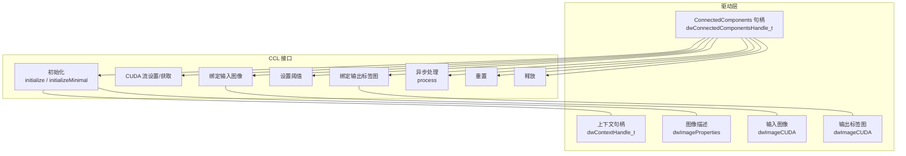
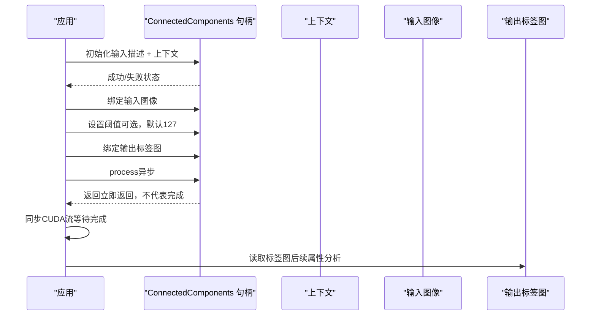
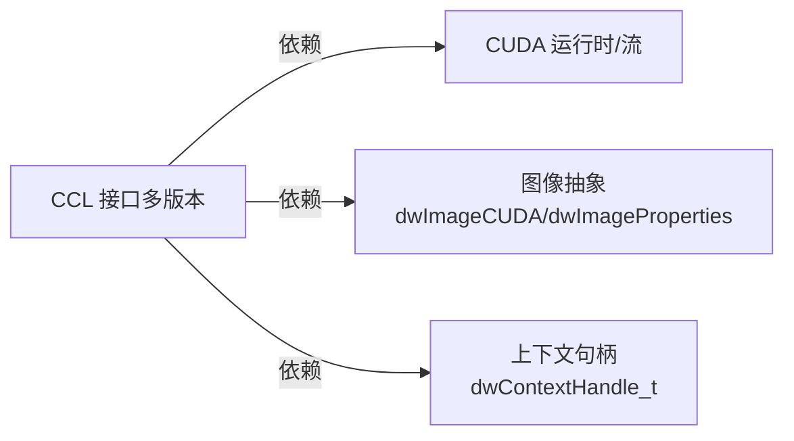

# 连通区域标记

<cite>
**本文引用的文件**
- [ConnectedComponents.h（5.10）](file://driverorks-5.10/include/dw/imageprocessing/ccl/ConnectedComponents.h)
- [ConnectedComponents.h（5.14）](file://driveworks-5.14/include/dw/imageprocessing/ccl/ConnectedComponents.h)
- [ConnectedComponents.h（5.8）](file://driveworks-5.8/include/dw/imageprocessing/ccl/ConnectedComponents.h)
- [ConnectedComponents.h（5.20）](file://driveworks-520/include/dw/imageprocessing/ccl/ConnectedComponents.h)
- [ConnectedComponents_8h.html（5.10 文档）](file://driverorks-5.10/doc/nvsdk_dw_html/ConnectedComponents_8h.html)
- [ConnectedComponents_8h_source.html（5.10 文档源码）](file://driverorks-5.10/doc/nvsdk_dw_html/ConnectedComponents_8h_source.html)
</cite>

## 目录
1. [简介](#简介)
2. [项目结构](#项目结构)
3. [核心组件](#核心组件)
4. [架构总览](#架构总览)
5. [详细组件分析](#详细组件分析)
6. [依赖关系分析](#依赖关系分析)
7. [性能考虑](#性能考虑)
8. [故障排查指南](#故障排查指南)
9. [结论](#结论)
10. [附录](#附录)

## 简介
本技术文档围绕 NVIDIA DriveWorks 的连通区域标记（Connected Components Labeling，简称 CCL）模块展开，系统介绍其在二值图像上的区域分割与标注能力。文档重点覆盖以下方面：
- ConnectedComponents 类（句柄对象）提供的接口与生命周期管理
- 输入/输出数据绑定、阈值处理与异步执行模型
- 连通性定义与标记算法的实现要点（4-连通与8-连通的区分）
- 区域属性计算方法（面积、周长、矩形边界、质心等）
- 典型使用流程与代码示例路径
- 时间/空间复杂度分析
- 实际应用中的参数调节与效果优化建议

## 项目结构
CCL 模块位于 DriveWorks 图像处理子系统中，面向 C API，提供初始化、输入绑定、阈值设置、标签输出绑定、异步处理、流设置、重置与释放等能力。不同版本的头文件在接口细节上略有差异，但核心语义一致。

图表来源
- [ConnectedComponents.h（5.10）:75-185](file://driverorks-5.10/include/dw/imageprocessing/ccl/ConnectedComponents.h#L75-L185)
- [ConnectedComponents.h（5.14）:75-185](file://driveworks-5.14/include/dw/imageprocessing/ccl/ConnectedComponents.h#L75-L185)
- [ConnectedComponents.h（5.8）:74-169](file://driveworks-5.8/include/dw/imageprocessing/ccl/ConnectedComponents.h#L74-L169)
- [ConnectedComponents.h（5.20）:79-225](file://driveworks-520/include/dw/imageprocessing/ccl/ConnectedComponents.h#L79-L225)

章节来源
- [ConnectedComponents.h（5.10）:64-185](file://driverorks-5.10/include/dw/imageprocessing/ccl/ConnectedComponents.h#L64-L185)
- [ConnectedComponents.h（5.14）:64-185](file://driveworks-5.14/include/dw/imageprocessing/ccl/ConnectedComponents.h#L64-L185)
- [ConnectedComponents.h（5.8）:55-169](file://driveworks-5.8/include/dw/imageprocessing/ccl/ConnectedComponents.h#L55-L169)
- [ConnectedComponents.h（5.20）:55-225](file://driveworks-520/include/dw/imageprocessing/ccl/ConnectedComponents.h#L55-L225)

## 核心组件
- 句柄类型：dwConnectedComponentsHandle_t 为不透明句柄，封装 CCL 内部状态与资源。
- 初始化：支持完整功能初始化与“最小化”初始化（仅限局部瓦片内连通），后者用于受限场景。
- CUDA 流：可设置/查询执行流，确保与用户流同步。
- 输入/输出：分别绑定输入图像与输出标签图；输入需匹配初始化时的图像描述。
- 阈值：对输入图像进行二值化，阈值默认 127。
- 异步处理：process 为异步调用，需在合适时机同步以保证结果可用。
- 生命周期：reset 与 release 提供重置与资源回收。

章节来源
- [ConnectedComponents.h（5.10）:75-185](file://driverorks-5.10/include/dw/imageprocessing/ccl/ConnectedComponents.h#L75-L185)
- [ConnectedComponents.h（5.14）:75-185](file://driveworks-5.14/include/dw/imageprocessing/ccl/ConnectedComponents.h#L75-L185)
- [ConnectedComponents.h（5.8）:74-169](file://driveworks-5.8/include/dw/imageprocessing/ccl/ConnectedComponents.h#L74-L169)
- [ConnectedComponents.h（5.20）:79-225](file://driveworks-520/include/dw/imageprocessing/ccl/ConnectedComponents.h#L79-L225)

## 架构总览
下图展示了从初始化到异步处理再到结果读取的整体流程与关键接口交互。

图表来源
- [ConnectedComponents.h（5.10）:75-185](file://driverorks-5.10/include/dw/imageprocessing/ccl/ConnectedComponents.h#L75-L185)
- [ConnectedComponents.h（5.14）:75-185](file://driveworks-5.14/include/dw/imageprocessing/ccl/ConnectedComponents.h#L75-L185)
- [ConnectedComponents.h（5.8）:74-169](file://driveworks-5.8/include/dw/imageprocessing/ccl/ConnectedComponents.h#L74-L169)
- [ConnectedComponents.h（5.20）:79-225](file://driveworks-520/include/dw/imageprocessing/ccl/ConnectedComponents.h#L79-L225)

## 详细组件分析

### 连通性定义与标记算法
- 连通性类型
  - 4-连通：仅上下左右四个方向相邻像素构成连通分量。
  - 8-连通：包含对角邻接在内的八个方向。
- 实现要点
  - CCL 模块通过 CUDA 内核并行扫描与合并实现高效标记。输入通常先经阈值二值化，随后按行或分块扫描，使用并查集（Union-Find）策略或两遍扫描法（如 Hilditch 或双遍标号法）完成等价类合并与标签重映射。
  - 4-连通与8-连通的选择影响区域形状与数量：8-连通会将对角接触的像素视为同一区域，可能减少区域数；4-连通更严格，适合强调矩形结构的应用。
- 边界与拓扑
  - 输出标签图中每个连通区域被赋予唯一整数标签，背景通常为零。标签图可用于后续几何属性提取与形态学后处理。

（本节为概念性说明，不直接分析具体源码文件）

### 区域属性计算方法
- 面积（像素数）
  - 统计每个标签对应的像素计数，即该区域包含的像素总数。
- 周长
  - 可通过区域边界像素的轮廓长度估算；常用方法是计算区域外边界像素数或使用 Freeman 链码近似。
- 矩形边界（外接矩形）
  - 计算每个标签区域内像素坐标的最小/最大行列索引，形成包围矩形。
- 质心（重心）
  - 对每个标签，计算其所有像素坐标的均值，得到二维坐标作为质心。
- 扩展属性
  - 方向主轴、惯性矩、等效椭圆参数等可由矩量推导，用于形状描述与分类。

（本节为概念性说明，不直接分析具体源码文件）

### 使用流程与代码示例路径
以下示例路径展示典型调用序列（请在对应版本的 samples 或应用代码中参考）：
- 初始化与最小化初始化
  - [初始化接口定义（5.10）:75-78](file://driverorks-5.10/include/dw/imageprocessing/ccl/ConnectedComponents.h#L75-L78)
  - [初始化接口定义（5.14）:75-78](file://driveworks-5.14/include/dw/imageprocessing/ccl/ConnectedComponents.h#L75-L78)
  - [最小化初始化接口定义（5.10）:90-93](file://driverorks-5.10/include/dw/imageprocessing/ccl/ConnectedComponents.h#L90-L93)
  - [最小化初始化接口定义（5.14）:90-93](file://driveworks-5.14/include/dw/imageprocessing/ccl/ConnectedComponents.h#L90-L93)
- 绑定输入与输出
  - [绑定输入接口定义（5.10）:125-127](file://driverorks-5.10/include/dw/imageprocessing/ccl/ConnectedComponents.h#L125-L127)
  - [绑定输出接口定义（5.10）:152-153](file://driverorks-5.10/include/dw/imageprocessing/ccl/ConnectedComponents.h#L152-L153)
- 阈值设置
  - [阈值设置接口定义（5.10）:139-141](file://driverorks-5.10/include/dw/imageprocessing/ccl/ConnectedComponents.h#L139-L141)
- CUDA 流设置/获取
  - [设置流接口定义（5.10）:103-104](file://driverorks-5.10/include/dw/imageprocessing/ccl/ConnectedComponents.h#L103-L104)
  - [获取流接口定义（5.10）:113-114](file://driverorks-5.10/include/dw/imageprocessing/ccl/ConnectedComponents.h#L113-L114)
- 异步处理
  - [process 接口定义（5.10）:166-167](file://driverorks-5.10/include/dw/imageprocessing/ccl/ConnectedComponents.h#L166-L167)
- 重置与释放
  - [reset 接口定义（5.10）:175-176](file://driverorks-5.10/include/dw/imageprocessing/ccl/ConnectedComponents.h#L175-L176)
  - [release 接口定义（5.10）:184-185](file://driverorks-5.10/include/dw/imageprocessing/ccl/ConnectedComponents.h#L184-L185)

章节来源
- [ConnectedComponents.h（5.10）:75-185](file://driverorks-5.10/include/dw/imageprocessing/ccl/ConnectedComponents.h#L75-L185)
- [ConnectedComponents.h（5.14）:75-185](file://driveworks-5.14/include/dw/imageprocessing/ccl/ConnectedComponents.h#L75-L185)
- [ConnectedComponents.h（5.8）:74-169](file://driveworks-5.8/include/dw/imageprocessing/ccl/ConnectedComponents.h#L74-L169)
- [ConnectedComponents.h（5.20）:79-225](file://driveworks-520/include/dw/imageprocessing/ccl/ConnectedComponents.h#L79-L225)

### 复杂度分析
- 时间复杂度
  - 单次 CCL 处理通常与像素总数线性相关 O(W×H)，其中 W、H 为图像宽高。若采用两遍扫描法或并查集策略，常数因子取决于实现细节与内存访问模式。
- 空间复杂度
  - 输出标签图占用 W×H 的整型存储；内部工作缓冲区与临时表（如等价类映射）通常与像素数线性相关，额外开销与连通性类型及算法实现有关。
- 并行与流
  - CUDA 内核并行执行，process 为异步调用，需配合 CUDA 流同步确保结果一致性。

（本节为通用性能讨论，不直接分析具体源码文件）

### 参数调节与效果优化建议
- 阈值选择
  - 默认阈值为 127。对于低对比度或偏暗/偏亮场景，应根据目标统计分布调整阈值，避免过分割或欠分割。
- 连通性类型
  - 若关注矩形/栅格结构，优先 4-连通；若希望合并对角接触区域，使用 8-连通。
- 输入预处理
  - 在 CCL 前进行去噪（中值滤波）与边缘平滑可降低伪边界噪声，提升连通区域质量。
- 输出后处理
  - 移除小面积噪声区域（面积阈值过滤）与孔洞填充可改善最终结果。
- 流与同步
  - 将 CCL 放入专用 CUDA 流，并在需要读取标签图前显式同步，避免竞态条件。

（本节为通用实践建议，不直接分析具体源码文件）

## 依赖关系分析
- 外部依赖
  - CUDA 运行时与流：CCL 内核在指定流中执行，需有效 CUDA 上下文。
  - 图像抽象：输入/输出均为 dwImageCUDA，要求与初始化时的图像描述一致。
- 版本差异
  - 5.8 与 5.10/5.14/5.20 在函数签名与注释细节上有差异，但核心接口保持一致。5.20 版本新增了“最小化初始化”能力，适用于受限场景。

图表来源
- [ConnectedComponents.h（5.10）:75-185](file://driverorks-5.10/include/dw/imageprocessing/ccl/ConnectedComponents.h#L75-L185)
- [ConnectedComponents.h（5.14）:75-185](file://driveworks-5.14/include/dw/imageprocessing/ccl/ConnectedComponents.h#L75-L185)
- [ConnectedComponents.h（5.8）:74-169](file://driveworks-5.8/include/dw/imageprocessing/ccl/ConnectedComponents.h#L74-L169)
- [ConnectedComponents.h（5.20）:79-225](file://driveworks-520/include/dw/imageprocessing/ccl/ConnectedComponents.h#L79-L225)

章节来源
- [ConnectedComponents.h（5.10）:75-185](file://driverorks-5.10/include/dw/imageprocessing/ccl/ConnectedComponents.h#L75-L185)
- [ConnectedComponents.h（5.14）:75-185](file://driveworks-5.14/include/dw/imageprocessing/ccl/ConnectedComponents.h#L75-L185)
- [ConnectedComponents.h（5.8）:74-169](file://driveworks-5.8/include/dw/imageprocessing/ccl/ConnectedComponents.h#L74-L169)
- [ConnectedComponents.h（5.20）:79-225](file://driveworks-520/include/dw/imageprocessing/ccl/ConnectedComponents.h#L79-L225)

## 性能考虑
- 并行效率
  - 利用 GPU 并行优势，尽量减少跨块通信与分支发散；合理设置块大小与网格维度。
- 内存带宽
  - 顺序访问与缓存友好的内存布局有助于提升吞吐；避免频繁的主机-设备同步。
- 异步执行
  - 将 CCL 放入独立流，与其他算子流水线化，减少等待时间。
- 数据对齐与格式
  - 输入图像的像素格式与对齐方式应满足底层实现要求，避免额外转换开销。

（本节为通用性能讨论，不直接分析具体源码文件）

## 故障排查指南
- 常见错误与定位
  - 输入/输出未绑定：调用 process 前必须完成 bindInput 与 bindOutput，否则返回“不允许调用”类错误。
  - 句柄无效：传入 NULL 句柄或已释放句柄会导致无效句柄错误。
  - 图像描述不匹配：输入/输出图像尺寸、通道、像素格式需与初始化时一致。
  - CUDA 资源创建失败：检查 CUDA 上下文是否有效、显存是否充足。
- 建议排查步骤
  - 确认初始化成功且上下文有效；
  - 校验输入/输出图像描述与初始化一致；
  - 在 process 后进行流同步再读取结果；
  - 逐步缩小问题范围：先验证阈值设置与二值化效果，再检查标签图连通性。

章节来源
- [ConnectedComponents.h（5.10）:155-167](file://driverorks-5.10/include/dw/imageprocessing/ccl/ConnectedComponents.h#L155-L167)
- [ConnectedComponents.h（5.14）:155-167](file://driveworks-5.14/include/dw/imageprocessing/ccl/ConnectedComponents.h#L155-L167)
- [ConnectedComponents.h（5.8）:138-150](file://driveworks-5.8/include/dw/imageprocessing/ccl/ConnectedComponents.h#L138-L150)
- [ConnectedComponents.h（5.20）:183-199](file://driveworks-520/include/dw/imageprocessing/ccl/ConnectedComponents.h#L183-L199)

## 结论
ConnectedComponents 模块提供了高效的二值图像连通区域标记能力，具备清晰的生命周期与异步执行模型。通过阈值设置与合适的连通性类型，可在不同应用场景中取得良好的分割效果。结合合理的参数调节与后处理策略，可进一步提升鲁棒性与实用性。建议在实际工程中配合流同步与性能监控，持续优化端到端延迟与吞吐。

## 附录
- 关键接口速查（以 5.10 版本为例）
  - 初始化：[initialize:75-78](file://driverorks-5.10/include/dw/imageprocessing/ccl/ConnectedComponents.h#L75-L78)
  - 最小化初始化：[initializeMinimal:90-93](file://driverorks-5.10/include/dw/imageprocessing/ccl/ConnectedComponents.h#L90-L93)
  - 绑定输入：[bindInput:125-127](file://driverorks-5.10/include/dw/imageprocessing/ccl/ConnectedComponents.h#L125-L127)
  - 设置阈值：[setThreshold:139-141](file://driverorks-5.10/include/dw/imageprocessing/ccl/ConnectedComponents.h#L139-L141)
  - 绑定输出标签图：[bindOutputLabels:152-153](file://driverorks-5.10/include/dw/imageprocessing/ccl/ConnectedComponents.h#L152-L153)
  - 异步处理：[process:166-167](file://driverorks-5.10/include/dw/imageprocessing/ccl/ConnectedComponents.h#L166-L167)
  - 设置/获取 CUDA 流：[setCUDAStream/getCUDAStream:103-114](file://driverorks-5.10/include/dw/imageprocessing/ccl/ConnectedComponents.h#L103-L114)
  - 重置/释放：[reset/release:175-185](file://driverorks-5.10/include/dw/imageprocessing/ccl/ConnectedComponents.h#L175-L185)